# ArXiv Daily Digest - 2026-10-12 (AIGC 音频生成与编辑, 10 papers)

**Generated**: 2026-10-12 17:00 CST

**Source**: arXiv cs.CV, cs.SD, eess.AS, cs.CL, cs.AI, cs.RO, cs.LG submissions, window 2026-10-09 UTC (latest announced batch as of 2026-10-12 17:00 CST; 10-10/10-11 were weekend with no announcement)

**Track**: aigc_audio (top 10 of 488 papers scanned, 50 full reads)

**Scope**: expressive controllable TTS with data/control decoupling, emotion bidirectional preference optimization for diffusion TTS, what audio-language judges actually respond to, naturalness evaluation bias for foreign-accent speech, training-free audio-visual editing, streaming neural instrument synthesizer, TTS/voice-conversion augmentation for ASR, continuous loudness control, human motion from spatial audio, open-vocabulary sound event localization

---

本批音频线有一个清晰的主线：**把隐式维度变成显式可控量**，且几乎每篇都在指出某个被默认的接口不成立。**E3-System** 把零样本 TTS 的表达力瓶颈表述为「**语义意图与声学实现之间的落差**」——文本描述有自然接口但声学 grounding 弱，风格提示有具体韵律但难编辑；它把问题表述为数据与控制的解耦。这正是 10-09 日报 Beyond Speech Captions 那条诊断（实证语音-文本对齐弱预测下游声学结果）的正面回应。

**评测侧的两篇是本批最尖锐的**，与今天其他四条线共同构成审计主题。《What Do Audio-Language Judges of Generated Music Listen For?》指出裁判的有效性只通过「与专家评分的相关性」验证，而这没有说明裁判在响应音乐、文本提示还是提问方式。《How Should We Evaluate Naturalness with a Foreign Accent?》发现广泛使用的 **UTMOS 倾向给口音更重的合成语音打更低分**——这意味着用 UTMOS 筛选合成数据会在数据里进一步强化口音偏见，形成闭环。

其余是具体能力：竞争性情感模式的显式建模（Emo-BPO，指出只强化目标情感会让模型在目标与竞争之间平均，得到模糊的中间情感）、免训练免反演的音视频编辑、流式神经乐器合成器（「可弹奏」要求把延迟稳定性而非平均延迟变成指标）、连续声压级控制的嗓音强度转换（从离散类别转向连续物理量）、从空间音频流式生成人体动作，以及一个把「类别不存在时」写进任务定义的开放词汇声音定位基准。

---

## Top 10 - AIGC 音频生成与编辑

### 1. E3-System: Expressive EmoData, Explicitly Controllable, Easy-to-Use TTS

**arXiv**: [2610.12993](https://arxiv.org/abs/2610.12993) | **Score**: 9.0 (relevance 9 x 0.7 + quality 9 x 0.3) | **Tags**: AIGC-audio | **Categories**: cs.SD, eess.AS | **Pages**: 6

**Authors**: Yiqiao Huang, Xiaolong Lin, Zhenpeng Zhan, Zhizheng Wu

**Affiliation**: 1Harvard University, Cambridge, MA, USA | 2Baidu Inc., Shenzhen, China | 3The Chinese University of Hong Kong, Shenzhen, China

**Abstract**

> Recent zero-shot Text-to-Speech (TTS) systems can clone unseen speakers, yet controllable expressiveness remains limited by a gap between semantic intent and acoustic realization. Text descriptions offer a natural control interface but provide weak acoustic grounding, whereas speech style prompts provide concrete prosody but entangle style with the prompt speaker's timbre. To bridge this gap, we propose E3-System, a unified intent-to-speech framework for expressive zero-shot TTS that couples three requirements: Expressive style modeling, Explicit timbre-style control, and Easy-to-use natural-language interaction. Given a target speaker and either a natural-language style description or a speech style prompt, E3-System generates expressive speech while preserving the target timbre. The key idea is to close the full control loop: building a large expressive style space, grounding user intent into usable acoustic style references, and synthesizing speech with disentangled timbre and style. To realize this loop, EmoData provides a thousand-hour multilingual emotional speech dataset, Style-RAG grounds text descriptions into high-quality acoustic style prompts from these data, and Dual-TTS transfers the grounded style to arbitrary target speakers through VC-augmented timbre-style disentanglement. Experiments show that E3-System achieves strong speech quality, speaker preservation, and explicit expressive controllability.

**Key findings**

- **Finding**: 零样本 TTS 能克隆未见说话人，但可控表现力受限于**语义意图与声学实现之间的落差**。

- **Finding**: 文本描述提供自然控制接口但**声学 grounding 弱**；语音风格提示提供具体韵律但带来其他约束。

- **Finding**: E3-System 把该问题显式表述为数据（EmoData）与控制解耦，并强调易用性。

- **Inference**: 10-09 日报的 Beyond Speech Captions 实证了「语音-文本对齐弱预测下游声学结果」，E3-System 的「数据与控制解耦」是同一诊断的直接工程回应——把表达数据与控制信号分开构造，而不是指望从描述里自动恢复声学。

- **Recommendation**: 与 10-09 的 Beyond Speech Captions 连读，一篇是诊断、一篇是解法；两篇合起来是本项目日报中「代理信号不预测下游效果」这条线最完整的一组。

**Key figures**

*Framework / architecture - Figure 1 An illustration of the proposed Dual-TTS.*

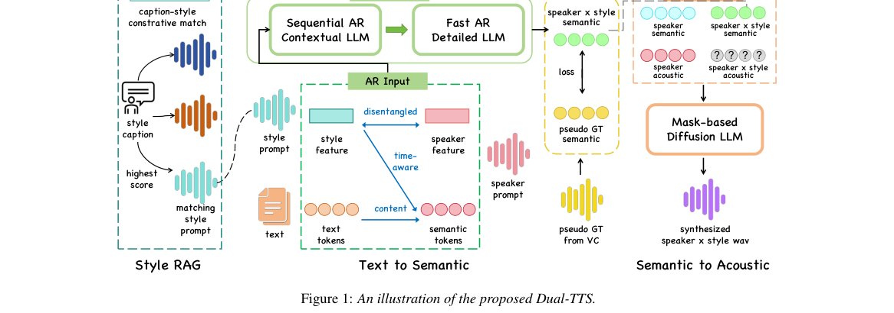

*Main result - Figure 2 An illustration of the training paradigm.*

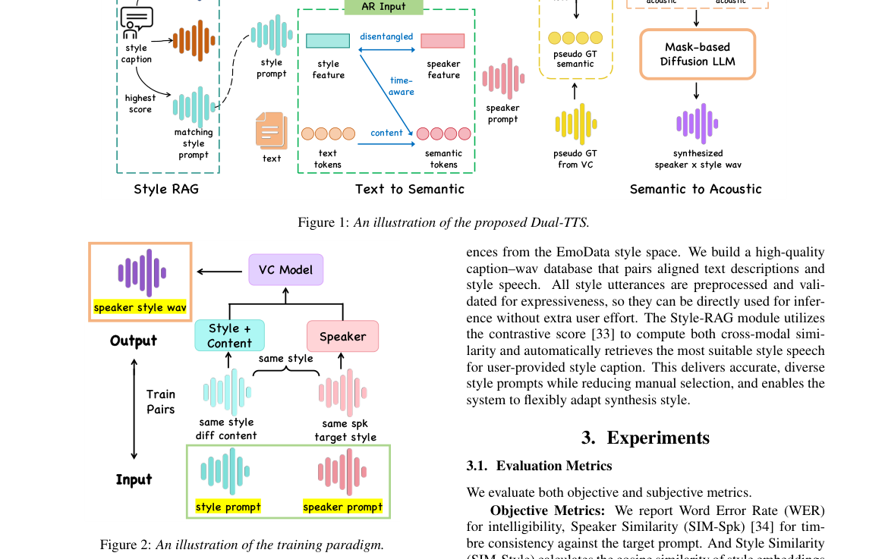

**Why this ranks #1**: 与 10-09 日报 Beyond Speech Captions 完全同题——「描述保真度不蕴含有效控制」——今天给出了正面解法。

---

### 2. Emo-BPO: Emotion Bidirectional Preference Optimization for Diffusion-based Emotional TTS

**arXiv**: [2610.12958](https://arxiv.org/abs/2610.12958) | **Score**: 8.0 (relevance 8 x 0.7 + quality 8 x 0.3) | **Tags**: AIGC-audio | **Categories**: cs.SD, eess.AS | **Pages**: 5

**Authors**: Jiacheng Shi, Hongfei Du, Xinyuan Song, Y. Alicia Hong, Yanfu Zhang, Ye Gao

**Affiliation**: 1 College of William & Mary, USA, 2 Emory University, USA | 3 George Mason University, USA

**Abstract**

> Diffusion-based TTS has demonstrated strong capability in emotional speech generation. However, existing emotion alignment methods primarily reinforce target emotional expressions while overlooking modeling of competing emotional modes, limiting fine-grained controllability. This issue becomes more pronounced under classifier-free guidance (CFG), which relies on contrasting conditional trajectories to shape generation. We propose Emotion Bidirectional Preference Optimization (Emo-BPO), a simple effective framework that jointly learns emotion-aligned and emotion-contrastive score functions from reordered same-text emotional pairs. Our method requires neither auxiliary reward models nor additional annotations, and can be seamlessly integrated into existing diffusion-based TTS systems to improve emotional controllability and expressiveness.

**Key findings**

- **Finding**: 既有情感对齐方法主要强化目标情感表达，**忽视对竞争性情感模式的建模**，限制细粒度可控性。

- **Finding**: 该问题在分类器自由引导（CFG）下更突出；Emo-BPO 用情感双向偏好优化应对。

- **Inference**: 「竞争性情感模式」意味着多个情感在声学上共存，而只强化目标会让模型在目标与竞争之间平均——得到的是模糊的中间情感而非明确的目标。双向偏好优化把竞争模式显式纳入目标。

- **Recommendation**: 与 10-07/10-08 日报的 TTS 情感控制（激活引导、性别校准）同属一条四天的情感可控性线索。

**Key figures**

*Framework / architecture - Figure 1 Overview of Emo-BPO. Training constructs inverted same-text emotional pairs to jointly learn emotion-aligned (EA) and emotion-contrastive (EC) diffusion branches while par- tially fine-tunin*

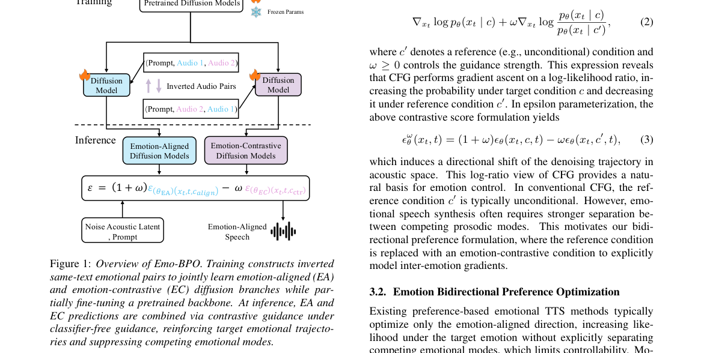

*Main result - Figure 2 Comparison of subjective evaluation results from AB preference tests: 1) left: Emospeech vs. Emo-BPO and 2) right: CosyVoice2 vs. Emo-BPO*

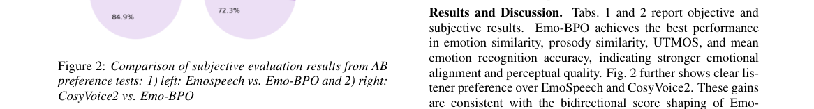

**Why this ranks #2**: 「只强化目标、忽视竞争模式」是一个精确的奖励设计缺陷，且被点明在 CFG 下更严重。

---

### 3. What Do Audio-Language Judges of Generated Music Listen For? Four Probes with Controls from Expert Ratings

**arXiv**: [2610.13247](https://arxiv.org/abs/2610.13247) | **Score**: 8.0 (relevance 8 x 0.7 + quality 8 x 0.3) | **Tags**: AIGC-audio | **Categories**: cs.CL, cs.SD, eess.AS | **Pages**: 10

**Authors**: Mateusz Modrzejewski, Tomasz Radzikowski

**Affiliation**: Institute of Computer Science, Warsaw University of Technology

**Abstract**

> Open audio-language models are used as judges of generated music: given a clip and its text prompt, the model rates the clip, and the judge is validated by how well its ratings correlate with expert ratings. The correlation does not show what the judge responds to: the music, the text prompt, or the way the question is asked. We propose four probes that test each of these, three of them read against a control computed from the human ratings: removing the audio, replacing the clip with another model's clip for the same prompt, swapping the order of two clips in pairwise judging, and rewording the instruction. We apply them to five open judges on all 2,748 clips of MusicEval, and the last two to the SongEval songs. Without audio, no judge exceeds what the prompt alone predicts from the human ratings, and for prompt alignment every judge falls below it. With audio, every judge follows the clip it hears when rating prompt alignment, two do when rating musical quality, and the strongest judge's quality score tracks the experts' alignment rating more than their quality rating. The pairwise verdicts of the four smaller judges follow the position of a clip in the pair (its slot) rather than its quality on both rating sets. For musical quality, rewording the instruction moves the correlation of most judges as much as changing the judge. MusicEval's prompt assignment bounds any prompt-only judge at the model level. We recommend reporting the four probes with every music judge.

**Key findings**

- **Finding**: 开放音频语言模型被用作生成音乐裁判，其有效性通过**与专家评分的相关性**验证。

- **Finding**: 但相关性**没有说明裁判在响应什么**——音乐、文本提示，还是提问方式本身。

- **Finding**: 作者用四个带对照的探针来区分这三种来源（Four Probes with Controls from Expert Ratings）。

- **Inference**: 这是评测工具的自我审计：若裁判主要在响应文本提示，则它测的是「提示听起来像好音乐吗」而非「这段音乐好吗」——而这恰恰是自动评测最容易通过而实际最无效的情形。

- **Recommendation**: 被精读的三篇之一。与 10-09 日报 Selective Listening、今天 2610.13112（审计 AAD）并列，是本项目日报审计线索最密集的一天。

**Key figures**

*Framework / architecture - Figure 1 Two of the four probes for the five judges, with 95% bootstrap intervals. Left: in the same-prompt swap, the standardized coefficient of the judge’s score on the expert rating of the clip pl*

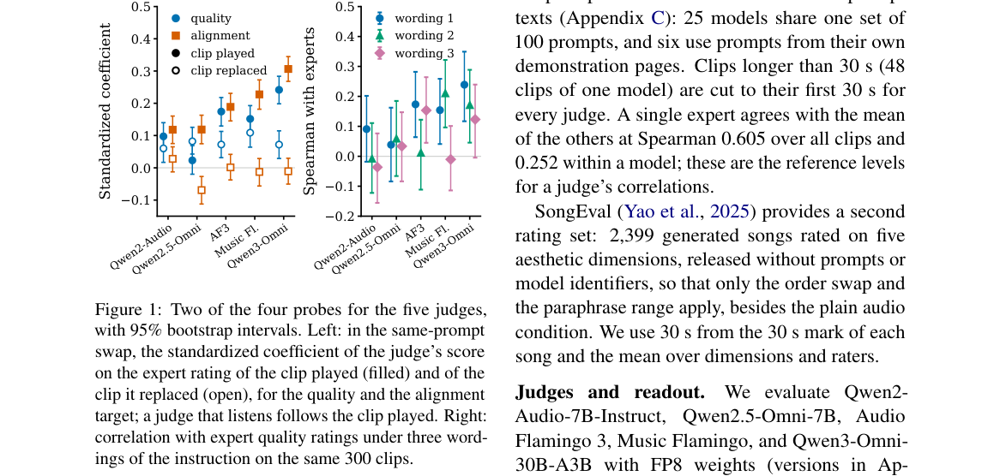

**Why this ranks #3**: 「裁判在与专家评分相关」这一验证方式本身无法说明裁判可信——本批审计主题的第五例，且对象是评测的核心工具。

---

### 4. How Should We Evaluate Naturalness for Synthetic Speech with a Foreign Accent?

**arXiv**: [2610.13175](https://arxiv.org/abs/2610.13175) | **Score**: 8.0 (relevance 8 x 0.7 + quality 8 x 0.3) | **Tags**: AIGC-audio | **Categories**: cs.SD, eess.AS | **Pages**: 8

**Authors**: Kentaro Onda, Satoru Fukayama, Daisuke Saito, Nobuaki Minematsu

**Affiliation**: ∗The University of Tokyo, Japan †National Institute of Advanced Industrial Science and Technology (AIST), Japan

**Abstract**

> Recent advances in speech synthesis technology have enabled the generation of speech with diverse characteristics. One such characteristic is a foreign accent. In our preliminary experiments, we found that UTMOS, a widely used automatic speech quality assessment system, tended to assign lower scores to speech with stronger foreign accents, even though it is produced by a human speaker. This observation raised a question: How do humans evaluate the naturalness of foreign-accented speech? We conducted a large-scale subjective evaluation involving both native and non-native listeners under different evaluation instructions. The results showed that humans also considered accentedness when evaluating naturalness, but that defining naturalness in terms of human-likeness and selecting raters who have greater exposure to the target accent may enable more appropriate evaluation. This study aims to provide a starting point for future discussions on fairer and more appropriate evaluation of synthetic speech with a foreign accent.

**Key findings**

- **Finding**: 作者发现广泛使用的自动语音质量评估系统 **UTMOS 倾向给口音更重的语音打更低分**。

- **Finding**: 本文追问：当合成语音带有外国口音时，自然度应当如何评估。

- **Inference**: UTMOS 的训练数据中母语语音占绝大多数，因此「像母语」被隐式编码为自然——这使得用 UTMOS 做数据筛选时，带口音的合成语音会被系统性淘汰，从而在合成数据里进一步强化口音偏见。这是一个闭环。

- **Recommendation**: 用自动质量指标筛选语音合成数据的团队应立刻自查；与本批 VoxAnon、DistilHuBERT 重测构成「评测工具有偏」的三例。

**Key figures**

*Framework / architecture - Figure 1 Relationship between the proficiency of Japanese speakers of English and the naturalness scores predicted by UTMOS [23] from their utterances: speakers with lower proficiency tend to have lowe*

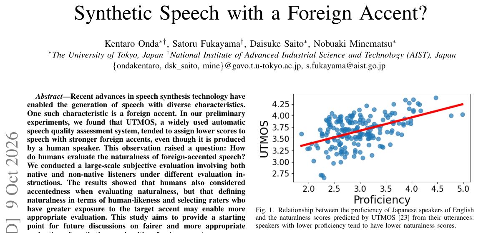

*Main result - Figure 2 Violin plots of MOS values for JE speech by rater group and evaluation instruction. Statistical significance was assessed using Wilcoxon signed-rank tests with Holm correction (\*: p < 0.05, \*\**

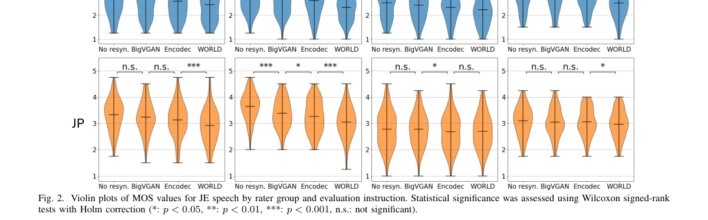

**Why this ranks #4**: 一个广泛使用的质量指标在系统性地惩罚口音——这是评测工具的偏见，且直接影响数据构建时的模型选择。

---

### 5. AV-FlowEdit: Training-Free Prompt-Driven Audio-Visual Editing with Event-Aware Spectral Trajectory Preservation

**arXiv**: [2610.13072](https://arxiv.org/abs/2610.13072) | **Score**: 8.0 (relevance 8 x 0.7 + quality 8 x 0.3) | **Tags**: AIGC-audio, AIGC-video | **Categories**: cs.CV, cs.SD, eess.AS | **Pages**: 9

**Authors**: Shaohua Pan, Xiao Liu

**Affiliation**: [not-found in PDF]

**Abstract**

> Joint audio-video diffusion models generate synchronized content, but editing existing clips requires target changes without disrupting non-target structure or cross-modal correspondence. We present AV-FlowEdit, a training-free and inversion-free framework for prompt-driven audio-video editing. Our key insight is that source--target flow differences provide both cross-modal editing directions and preservation cues. Under shared perturbations, they jointly update the video and audio branches, supporting visual-only, audio-only, and joint edits while retaining pretrained cross-modal interactions. To suppress drift accumulated during sampling, Cross-Modal Event-Aware Spectral Trajectory Preservation combines flow saliency, aligned audio activity, multiscale low-frequency displacement, and diffusion-stage scheduling. This adaptively preserves unsupported regions while allowing intended audio-visual events. AV-FlowEdit requires no model training, external masks, or optimization-based inversion. Experiments show strong prompt alignment and temporal consistency, together with competitive audio quality and cross-modal coherence.

**Key findings**

- **Finding**: 编辑已有片段要求做出目标改变，同时**不破坏非目标结构与跨模态对应**。

- **Finding**: AV-FlowEdit 是**免训练且免反演**的框架，关键洞察围绕源-目标之间的事件感知频谱轨迹保持。

- **Inference**: 免反演之所以可能，是因为该方法沿扩散流而非重建误差空间编辑——这与 10-07 日报的 Cache Reuse（沿流调度）属同一思路：把编辑/加速都表述为流上的操作。

- **Recommendation**: 音视频编辑的读者注意；与 10-09 日报的 SepGen（4D 视听场景）同属音视频联合路线。

**Key figures**

*Framework / architecture - Figure 1 Results of our training-free audio-video editing framework. Given a source video and a target prompt, our method performs consistent semantic editing while preserving scene structure, camera*

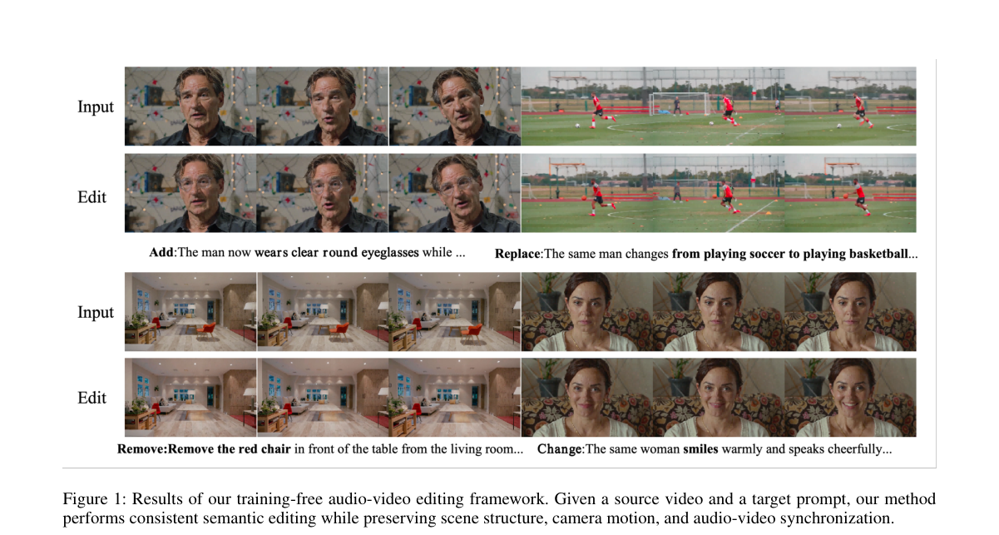

*Main result - Figure 2 Overall AV-FlowEdit framework. Modality-specific encoders produce separate video and audio latents, while frozen dual branches exchange cross-modal information to estimate coupled source–tar*

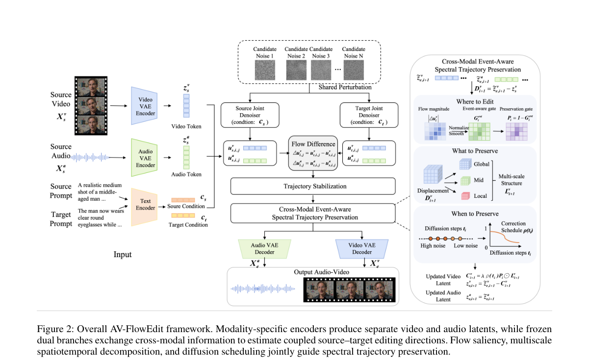

**Why this ranks #5**: 「不破坏跨模态对应」是音视频编辑独有的约束，而免训练免反演同时满足两者。

---

### 6. LiveSynth: A Streaming Neural Synthesizer for Instrument Cloning and Text-to-Instrument

**arXiv**: [2610.13054](https://arxiv.org/abs/2610.13054) | **Score**: 7.3 (relevance 7 x 0.7 + quality 8 x 0.3) | **Tags**: aigc-audio | **Categories**: cs.SD, eess.AS | **Pages**: 5

**Authors**: Kyungsu Kim, Yejin Kim, Kyogu Lee

**Affiliation**: † Department of Intelligence and Information, Seoul National University | ‡ Interdisciplinary Program in Artificial Intelligence, Seoul National University

**Abstract**

> Recently, generative neural synthesizers have enabled zero-shot instrument cloning from reference recordings and timbre generation from text prompts. However, existing systems generate complete audio segments offline, precluding their use as playable instruments. We present LiveSynth, a streaming neural synthesizer with flexible timbre control and interactive generation capabilities, including zero-shot instrument cloning and text-to-instrument synthesis. A feedback-free causal Transformer conditioned on MIDI events and a CLAP timbre embedding outputs continuous audio latents at 100 Hz, which a causal variational autoencoder decodes into audio. Frame-wise timbre conditioning enables continuous timbre morphing, while MIDI-conditioning dropout enables autonomous continuation from a performed prefix. On the NSynth and Slakh datasets, LiveSynth achieved timbre similarity and spectral reconstruction quality comparable to offline baselines. On an M3 MacBook Air, LiveSynth required 8.8 ms of computation per 10 ms audio frame (an RTF of 0.88) with 10 ms algorithmic latency, enabling real-time interaction with a performer.

**Key findings**

- **Finding**: 既有生成式神经合成器离线生成完整片段，因此**无法作为可弹奏乐器**使用。

- **Finding**: LiveSynth 提出流式神经合成器，支持乐器克隆与文本到乐器。

- **Inference**: 实时性要求带来了离线生成没有的约束：延迟必须稳定而非仅仅平均较低——因为演奏者的手速不等人。这与本批 AudioTETRIS（token 消除）同属推理效率，但这里的瓶颈是延迟方差而非平均延迟。

- **Recommendation**: 音乐交互系统的读者注意；延迟稳定性（jitter）而非平均延迟是该场景的真正指标。

**Key figures**

*Framework / architecture - Figure 1 Overview of LiveSynth. (a) Conditional adversarial training of the feedback-free continuous-latent generator. (b) Frame-wise stream- ing synthesis conditioned on MIDI and audio- or text-derive*

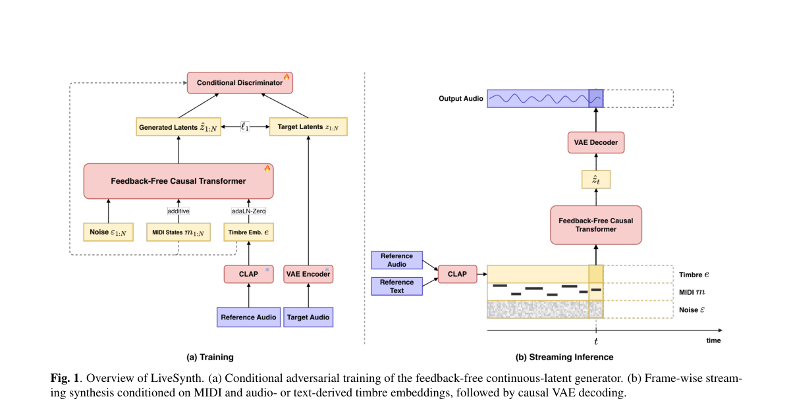

*Main result - Figure 2 PANNs similarity to endpoint timbres A and B during a streamed 10 s timbre morph. Similarities are computed over 2 s sliding windows with a 1 s hop; curves show the mean and 95% CI across 64 i*

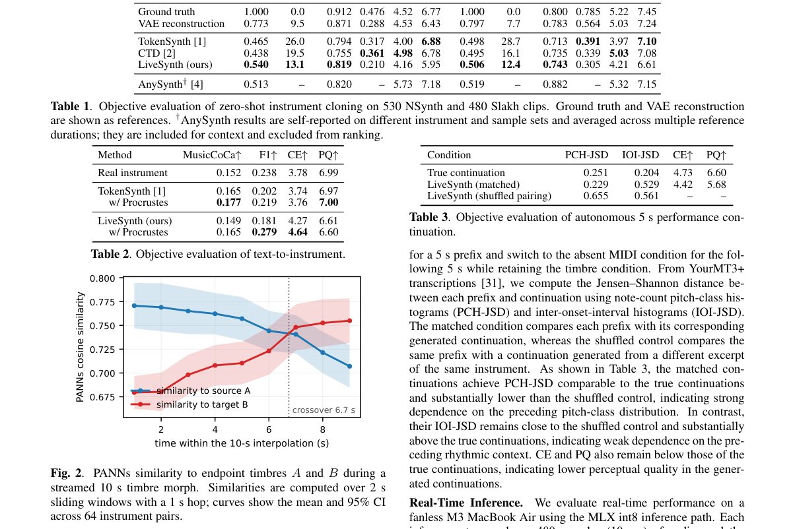

**Why this ranks #6**: 「可弹奏」这一要求把生成从一次性产物变成了实时过程，是能力类型的改变。

---

### 7. Enhancing Speech Recognition through Text-to-Speech and Voice Conversion Augmentation

**arXiv**: [2610.13662](https://arxiv.org/abs/2610.13662) | **Score**: 7.0 (relevance 7 x 0.7 + quality 7 x 0.3) | **Tags**: AIGC-audio | **Categories**: cs.SD, eess.AS | **Pages**: 15

**Authors**: Yunus Emre Ozkose, Ali Haznedaroglu

**Affiliation**: [not-found in PDF]

**Abstract**

> Given the challenges associated with obtaining large volumes of real-world audio, the advancement of Automatic Speech Recognition (ASR) systems increasingly depends on synthetic data. This study focuses on the call center-banking domain, providing a targeted analysis of ASR models in this context. We evaluate real and synthetic datasets, using Word Error Rate (WER) and Character Error Rate (CER) as metrics, and employ a speech quality model to assess the impact on ASR performance. Our research compares Text-to-Speech (TTS) and advanced voice conversion methods, including KNNVC, Seed-VC, and Vec2Wav2, revealing significant improvements in speech quality and ASR accuracy, particularly with Seed-VC. Additionally, our domain-specific experimentation provides insight into the unique challenges and opportunities that arise when applying ASR technologies to industry-relevant settings. This highlights the potential of voice conversion technologies to enhance ASR systems, guiding future research in diverse linguistic scenarios, and paving the way for the broader application of ASR innovations across various fields.

**Key findings**

- **Finding**: ASR 系统日益依赖合成数据；本文在呼叫中心-银行领域对真实与合成数据做针对性分析。

- **Finding**: 评估使用 TTS 与语音转换两条合成路径产生的数据。

- **Inference**: 金融语音的特殊性在于术语密度高、人名与账号类实体多——这两类正是 TTS/VC 合成最容易产生不可控错误的地方，因此该领域的合成数据收益预期应低于通用场景。

- **Recommendation**: 领域专用但结论可迁移到其他术语密集场景；与本批 E3-System 同为 TTS 作为数据/控制来源的两条用法。

**Key figures**

*Framework / architecture - Figure 1 Histogram of NISQA-predicted MOS (Mean Opinion Score) values for real and synthetic speech data. The "Real Data" (blue) shows a broad distribution of perceived quality, reflecting diverse acou*

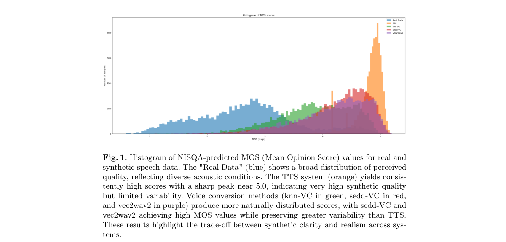

**Why this ranks #7**: 领域聚焦但结论通用：合成数据在金融语音上的可用性边界。

---

### 8. Vocal Intensity Conversion with Continuous SPL Control via Adversarial Training

**arXiv**: [2610.13608](https://arxiv.org/abs/2610.13608) | **Score**: 7.0 (relevance 7 x 0.7 + quality 7 x 0.3) | **Tags**: AIGC-audio | **Categories**: cs.LG, cs.SD, eess.AS | **Pages**: 5

**Authors**: Quentin Le Tellier, Albert Rilliard, Olivier Perrotin, Marc Evrard

**Affiliation**: [not-found in PDF]

**Abstract**

> Vocal intensity conversion renders a recorded utterance at a different vocal intensity, rather than simply scaling its amplitude, while preserving its content and speaker identity. Existing systems control intensity through a reference utterance or a few discrete categories. Instead, we control the conversion with any target sound pressure level (SPL) on a continuous dB scale. A lightweight converter, trained as a conditional cycle-consistent GAN without parallel data, transforms the features of a frozen speech encoder, from which a pretrained vocoder resynthesizes the speech. We compare three representations, log-mel spectrograms, WavLM, and SpeechTokenizer, and introduce an objective protocol that measures the achieved intensity change against the target one on a calibrated corpus. With WavLM, the converter achieves a measured 83% of the target change in intensity and also shifts the fundamental frequency. A perceptual evaluation confirms that perceived vocal intensity increases with the target level on amplitude-normalized stimuli.

**Key findings**

- **Finding**: 既有系统通过参考utterance 或**少数离散类别**控制嗓音强度；本文改为用任意目标声压级（SPL）控制。

- **Finding**: 方法采用对抗训练，转换过程保留内容与说话人身份。

- **Inference**: 离散类别（如「轻声/正常/大声」）把一个连续物理量离散化，导致相邻类别之间不可达且转换结果不连续；连续 SPL 控制消除了这个人为的断点。

- **Recommendation**: 与本批 E3-System（显式可控 TTS）同属「把隐式维度变成显式连续控制」的一族。

**Key figures**

*Framework / architecture - Figure 1 Modeling strategy: Enc and Dec are frozen; Cθ is trained. The dashed arc is the cycle: the converted frames pass back through the same converter at the source level and must return z. Dψ score*

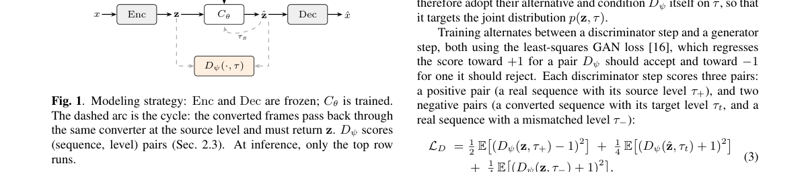

*Main result - Figure 2 Perceived level of the conversions against their target level, both in dB SPL, from 54 listeners. Points are the fitted perceived levels, with intervals resampled across listeners, and the das*

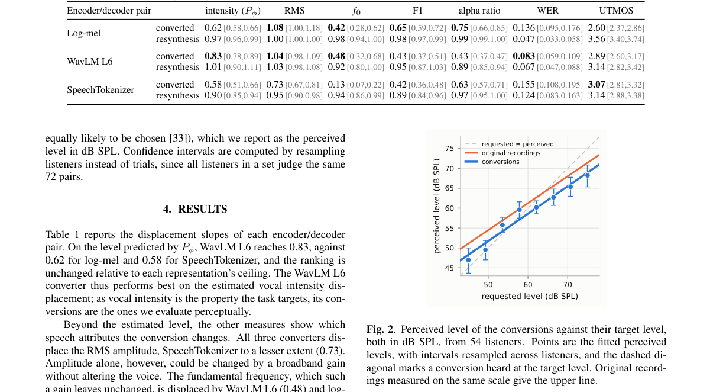

**Why this ranks #8**: 从离散类别转向连续 SPL，是控制接口粒度的一次实质变化。

---

### 9. Sonic-AMG: Streaming Human Motion Generation from Spatial Audio

**arXiv**: [2610.13300](https://arxiv.org/abs/2610.13300) | **Score**: 6.3 (relevance 6 x 0.7 + quality 7 x 0.3) | **Tags**: AIGC-audio | **Categories**: cs.CV, cs.GR, cs.LG, cs.RO | **Pages**: 23

**Authors**: Jingcheng Ni, Zekun Li, Zhiyang Dou, Xiaoyan Cong, Ziyao Zeng, Hongyang Du, Randall Balestriero, Taku Komura, Srinath Sridhar

**Affiliation**: 1 Brown University | 3 Yale University | 4 The University of Hong Kong

**Abstract**

> Modeling human reactions to spatial audio requires understanding both what is heard and where it comes from. Prior work generates motion offline from complete acoustic and spatial input sequences. Humans, however, react to sounds without knowing what they will hear next. We present Sonic-AMG, to our knowledge the first framework for streaming human motion generation from spatial audio. The model encodes acoustic content and body-relative source geometry as separate tokens. Conditioned on these tokens, a causal transformer with a flow head generates continuous motion latents, from which a causal decoder reconstructs motion segments. Standard teacher-forced training derives motion histories and body-relative source locations from ground-truth motion, whereas streaming inference relies on generated motion for both, resulting in a training-inference mismatch. To reduce this history discrepancy, we introduce rehearsal training, which combines full-sequence teacher-forced supervision with supervised prediction along short autoregressive self-rollouts. To keep spatial conditioning consistent with generated motion, we propose spatial feedback, which recomputes body-relative source locations from generated root poses during both rehearsal training and inference. On SAM, Sonic-AMG achieves state-of-the-art FID and R-precision. It further supports real-time online generation of coherent reactions across sound events and source locations. Project page: https://jingchengni.com/sonic-amg/.

**Key findings**

- **Finding**: 既有工作从完整的声学与空间输入序列**离线**生成动作。

- **Finding**: 但人类并不知道接下来会听到什么；Sonic-AMG 据称是首个从空间音频做**流式**人体运动生成的框架。

- **Inference**: 流式因果结构（只因应当前听到的而动）与离线完整序列的根本差异在于：人类反应的是**当前**声源而非全部，因此把完整序列当条件会引入未来信息导致的运动过度规划。

- **Recommendation**: 空间音频与人体建模交叉方向的读者可参考；与本批 AV-FlowEdit（音视频）属相邻但独立的路线。

**Key figures**

*Framework / architecture - Figure 1 Streaming motion generation from spatial audio. Sonic-AMG generates continuous re- actions to successive sounds, updating each source’s position relative to the generated body. Colors link s*

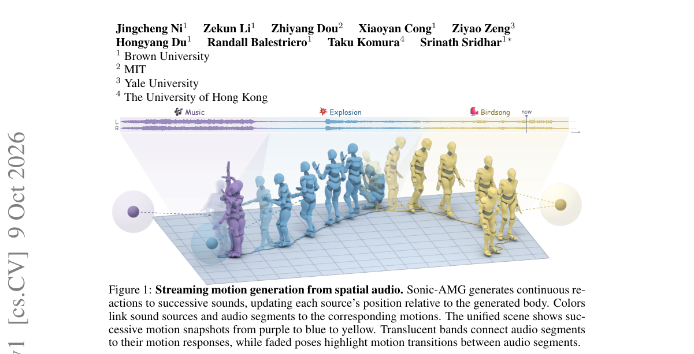

*Main result - Figure 2 Sonic-AMG architecture. A causal transformer and flow head generate motion latents from interleaved acoustic (what), spatial (where), and motion tokens. Spatial feedback updates body-relativ*

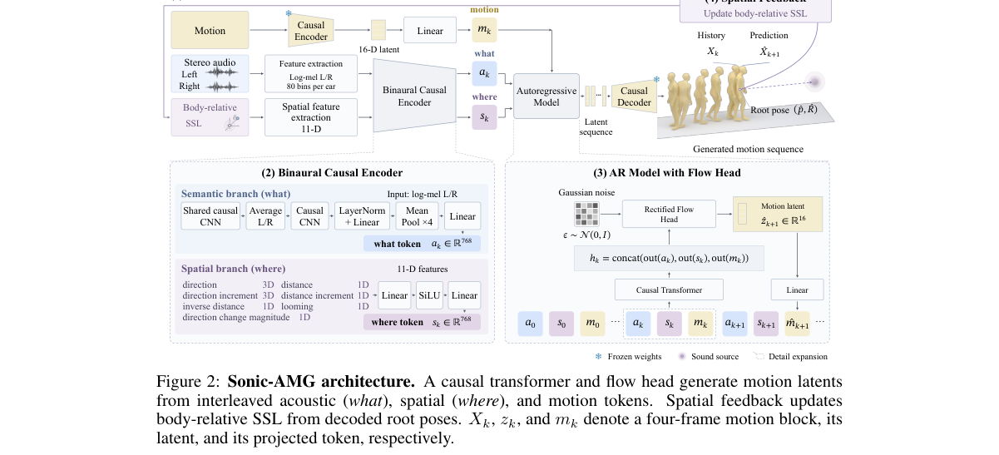

**Why this ranks #9**: 指出「人类反应于当下而非对未来音频的完整认知」，这改变了任务的因果结构。

---

### 10. QC-MI-OVSEL: Benchmarking Query-Conditioned Multi-Instance Open-Vocabulary Sound Event Localization

**arXiv**: [2610.13198](https://arxiv.org/abs/2610.13198) | **Score**: 6.0 (relevance 6 x 0.7 + quality 6 x 0.3) | **Tags**: AIGC-audio `[wild-card]` | **Categories**: cs.SD, eess.AS | **Pages**: 5

**Authors**: Yongqiang Chen, Peiwei Chang, Yuelan Cheng, Xiatian Zhu, Wenwu Wang

**Affiliation**: Centre for Vision, Speech and Signal Processing, University of Surrey, UK

**Abstract**

> We study query-conditioned multi-instance open-vocabulary sound event localization (QC-MI-OVSEL), where a system must recover all active physical sources matching a natural-language category query, including when the queried category is absent. We introduce the QC-MI-OVSEL benchmark, a 40,000-scene first-order Ambisonics benchmark with 80,000 balanced present/absent query views over 83 classes, including 17 novel classes excluded from training and development. Each frame is annotated with the activity and 3-D direction of every query-matching source, with up to three simultaneous targets. We further propose Q-RSet, which uses query-conditioned source slots and responsibility-based evidence aggregation for source-set prediction. Experiments show improved source recovery, localization recall, cardinality estimation, exact-set recovery, and absent-query suppression over complementary baselines. Analysis indicates that novel categories, paraphrased queries, and higher source multiplicity mainly impair source discovery and set completion, while directional accuracy remains comparatively stable for successfully recovered sources.

**Key findings**

- **Finding**: 任务要求恢复所有匹配查询类别的活跃源，**且在类别不存在时也须正确处理**。

- **Finding**: QC-MI-OVSEL 是 4 万场景的一阶 Ambisonics 基准。

- **Inference**: 把「不存在」写进任务定义而非事后指标，是防止开放词汇系统被「总是猜一个类别」策略刷分的标准做法——这类基准设计值得借用。

- **Recommendation**: wild-card 项；开放词汇任务必须显式包含否定情形，否则排行榜会被恒输出策略主导。

**Key figures**

*Framework / architecture - Figure 1 Query-conditioned multi-instance open-vocabulary sound event localization formulation.*

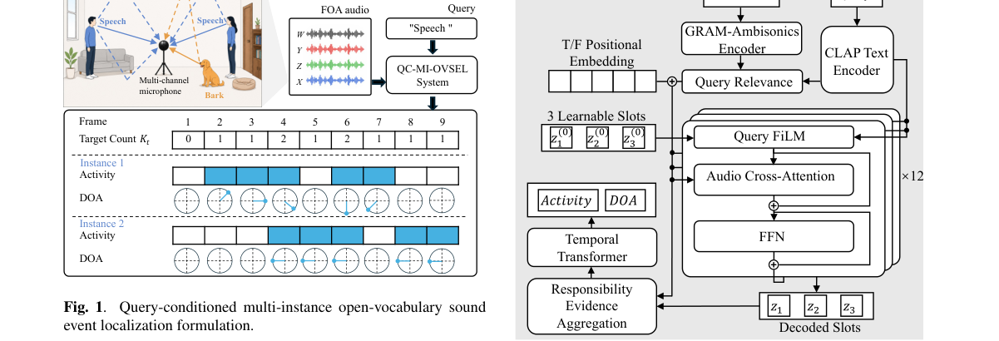

*Main result - Figure 2 Q-RSet architecture.*

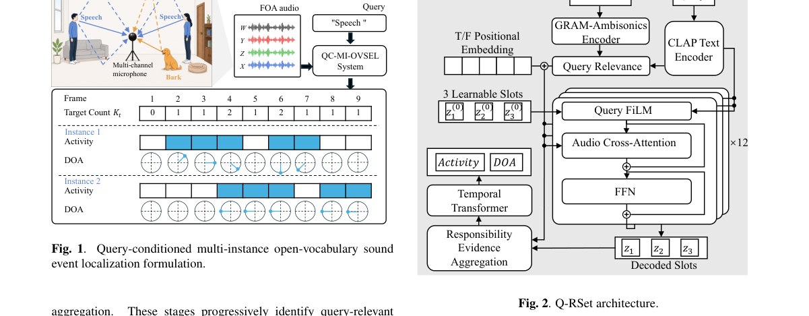

**Why this ranks #10**: 「包括类别不存在时」这个要求把误报问题写进了任务定义，而非事后指标。

---

## Footer

- Total papers reviewed across all 5 tracks: 50 (from 488 scanned)
- aigc_audio track final top-10: 10
- Wild-cards in this track: 2
- Figure assets: `res/` (shared across tracks)

Generated by `mine-arxiv-daily-digest` skill. Sister file: `2026-10-12_aigc_audio_entry.md`.
