# ArXiv Daily Digest - 2026-10-12 (AIGC 图像 / 视频 / 3D 生成与编辑, 10 papers)

**Generated**: 2026-10-12 17:00 CST

**Source**: arXiv cs.CV, cs.SD, eess.AS, cs.CL, cs.AI, cs.RO, cs.LG submissions, window 2026-10-09 UTC (latest announced batch as of 2026-10-12 17:00 CST; 10-10/10-11 were weekend with no announcement)

**Track**: aigc_visual (top 10 of 488 papers scanned, 50 full reads)

**Scope**: suppressing image-to-text feedback in MMDiTs, semantic drag editing with visual reasoning, unified generative video compression across AR and bidirectional diffusion, golden anchor for I2V controllability, few-step instruction-following correction, animating fluids in 3DGS, material-controllable 3D reconstruction, attention sinks in T2I transformers, emotion editing, confidence-aware 3DGS densification

---

本批最强的一篇是 **Images Talk Back**，它问了一个所有 MMDiT 使用者都默认成立的问题：演化中的图像通过联合注意力更新内部文本表示、这些表示再引导后续图像更新——**这个反馈是帮助纠正对提示的偏离，还是在保留这些偏离？** 答案是后者：image-to-text 反馈会保留已经出现的对象与属性，抑制它反而提升质量。这是一条被广泛依赖的自我纠正机制在方向上就是错的，与 10-08 日报「奖励模型奖励看似合理的失败」同构——载体从奖励换成注意力反馈。

**ThinkDrag** 同样在质疑一个默认：拖拽编辑方法常把指令解释为**几何位移**，而 ThinkDrag 引入视觉推理——当用户拖动对象是为了改变其属性而非位置时，位移解释必然失败。**Unified Generative Video Compression** 则把双向与自回归从架构对立变成同一框架下的参数，与 10-09 日报的 Conditional Residual Prediction（质疑「必须有双向教师」）构成本周最连贯的一组对：两者合起来指向**因果性与双向性不是二选一**。

其余覆盖 I2V 锚点的作用重审、3DGS 的静态假设被流体打破、材质可控 3D 重建、注意力汇在 T2I 中的行为、情感编辑的事件评价中介，以及 3DGS-MCMC 的前景偏置。

---

## Top 10 - AIGC 图像 / 视频 / 3D 生成与编辑

### 1. Images Talk Back: Guiding MMDiTs by Suppressing Image-to-Text Feedback

**arXiv**: [2610.13941](https://arxiv.org/abs/2610.13941) | **Score**: 9.0 (relevance 9 x 0.7 + quality 9 x 0.3) | **Tags**: AIGC-image, AIGC-video | **Categories**: cs.CV | **Pages**: 26

**Authors**: Yucheng Yang, Xiaoxiao Sun, Shusheng Yang, Jiakang Chen, Serena Yeung-Levy

**Affiliation**: 1 Stanford University | 2 Tsinghua University | 3 New York University | “an apple and an orange”

**Abstract**

> Multimodal diffusion transformers (MMDiTs) allow the evolving image to update internal text representations through joint attention. These representations then guide subsequent image updates, raising a question: does this feedback help correct deviations from the prompt, or preserve them? We find that image-to-text (I2T) feedback can preserve the objects and attributes already represented in the evolving image, including errors. Transplanting I2T messages can rescue failures or disrupt successes. At matched intervention strengths, suppressing the influence of I2T feedback improves generation, whereas opposite controls degrade it. These findings motivate Semantic Feedback Guidance (SFG), which suppresses the influence of I2T feedback by guiding away from an auxiliary branch that strengthens this feedback and weakens text-to-image conditioning. The in-place variant, iSFG, directly suppresses I2T feedback and strengthens text-to-image conditioning, requiring no extra model evaluations. Temporal interventions motivate running the SFG branch during the first 20% of image sampling steps, requiring about $1.2\times$ the base NFE without classifier-free guidance (CFG). Experiments across three image-generation backbones show gains in alignment and preference-model scores. On FLUX, adding SFG to CFG raises GenEval from $0.6661$ to $0.7479$; on SD3.5M, iSFG adds $+1.33$ HPSv2.1 over CFG at zero extra NFE. The control also transfers to text-to-video and image-to-video generation, improving VBench scores. Code is available at https://github.com/yyc1215lll-creator/SFG.

**Key findings**

- **Finding**: MMDiT 通过联合注意力让演化中的图像更新内部文本表示，这些表示再引导后续图像更新。

- **Finding**: 作者提出关键问题：image-to-text 反馈是**帮助纠正**对提示的偏离，还是**保留**已经出现的对象与属性？

- **Finding**: 答案是后者——I2T 反馈会保留已存在的对象与属性；作者据此通过抑制该反馈来引导 MMDiT。

- **Inference**: 这是一条被广泛依赖的自我纠正机制（让模型看自己的图来修正文本表示）在**方向上就是错的**：它强化已有内容而非修正它。这与 10-08 日报「奖励模型奖励看似合理的失败」是同一类病，只是载体从奖励换成了注意力反馈。

- **Recommendation**: 被精读的三篇之一。做 MMDiT 的团队应优先验证这一条——抑制一个被广泛使用的机制并能提升质量，是一个反直觉且高杠杆的结果。

**Key figures**

*Framework / architecture - Figure 1 Matched qualitative comparisons on FLUX. When dealing with more complex prompts, our method aligns better with the objects and attributes specified in the complex prompts.*

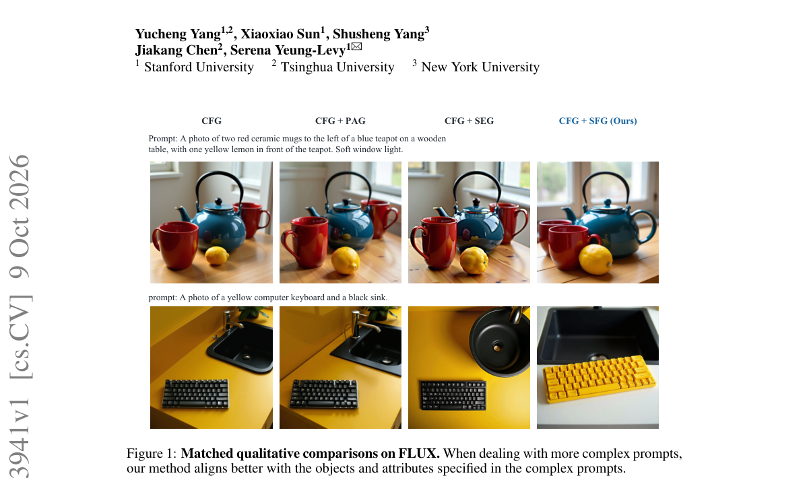

*Main result - Figure 2 Image-to-text feedback. The current image writes into internal text states through Bi→t, which later blocks read to update the image. If the image misses an object, does this feedback help r*

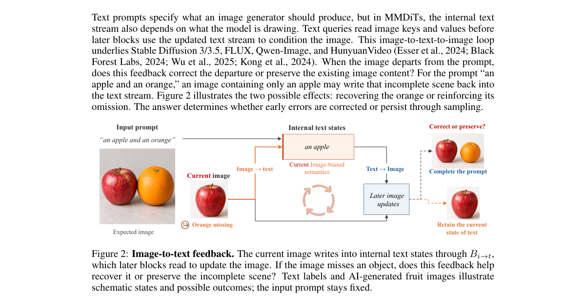

**Why this ranks #1**: 本批与 10-09 日报 Selective Listening 同构的最强实例：一条反馈通路看起来有用，实际在做相反的事。

---

### 2. ThinkDrag: Semantic Drag-Based Image Editing with Visual Reasoning

**arXiv**: [2610.13316](https://arxiv.org/abs/2610.13316) | **Score**: 9.0 (relevance 9 x 0.7 + quality 9 x 0.3) | **Tags**: AIGC-edit, AIGC-image | **Categories**: cs.CV | **Pages**: 19

**Authors**: Armando Fortes, Tianyi Wei, Chindanai Trakantannarong, Shangchen Zhou, Xingang Pan

**Affiliation**: S-Lab, Nanyang Technological University, Singapore

**Abstract**

> Drag-based image editing provides an intuitive interface for spatially controlled image manipulation by allowing users to specify handle and target points. Existing methods have made substantial progress through optimization-based, one-step, and feed-forward formulations, but they often interpret drag instructions as geometric displacements. This limits their effectiveness when the desired edit depends on interpreting image content and inferring a plausible semantic transformation from sparse point constraints. We introduce ThinkDrag, a unified multimodal framework for drag-based image editing with visual reasoning. ThinkDrag is trained to associate point constraints with meaningful object- and scene-level transformations, and can optionally produce an explicit reasoning trace that interprets the intended edit before image generation. This reasoning trace improves interpretability, particularly for ambiguous drags. Drag Endpoint Markers, motivated by an analysis of cross-image attention, provide an explicit correspondence signal that grounds each drag in image space. To support this framework, we construct a supervised dataset of semantic drag transformations paired with reasoning traces and introduce DragBench++, a benchmark targeting challenging drag-based editing scenarios with reference edit solutions. Experiments show that ThinkDrag achieves state-of-the-art performance, improving generation quality and plausibility while maintaining competitive point-following precision.

**Key findings**

- **Finding**: 拖拽编辑让用户指定控制点与目标点，提供直观的空间可控接口。

- **Finding**: 既有方法（基于优化、单步、前馈三种表述）常把拖拽指令解释为**几何位移**，这限制了它在需要语义理解时的效果。

- **Finding**: ThinkDrag 引入**视觉推理**来解释拖拽指令。

- **Inference**: 「拖拽 = 位移」在大多数编辑上够用，因为目标通常是纯几何的；但当用户拖动一个对象是为了改变其属性（如让杯子看起来更满）时，位移解释必然失败——这是语义与几何的接口问题。

- **Recommendation**: 与 10-08/10-09 日报的编辑方向连续：ThinkDrag → Reasoning-Informed Visual Editing → 今天这条，指向「编辑指令需要推理而非直接执行」的共同趋势。

**Key figures**

*Framework / architecture - Figure 1 THINKDRAG handles challenging and ambiguous drags, optionally making its interpretation explicit as a reasoning trace that the user can refine, while the drags keep the edit spatially ground*

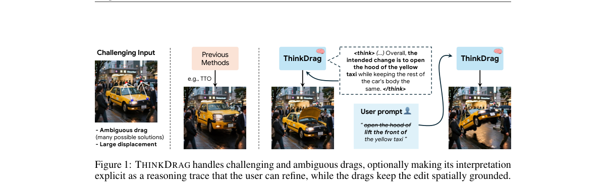

*Main result - Figure 2 Dataset construction pipeline of the THINKDRAG dataset.*

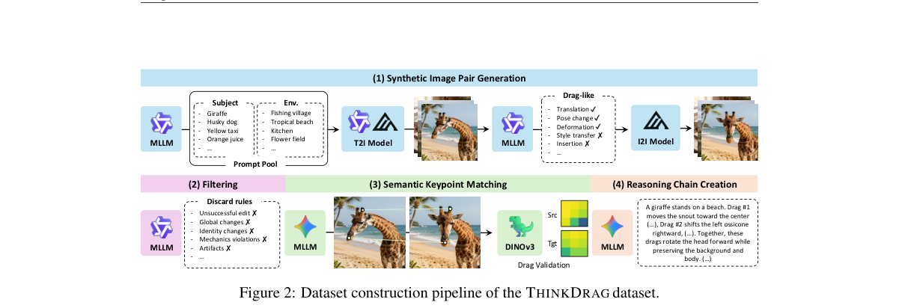

**Why this ranks #2**: 指出「把语义指令当几何位移执行」是一个被默认接受但明显不对的简化。

---

### 3. Unified Generative Video Compression with Autoregressive and Bidirectional Video Diffusion

**arXiv**: [2610.13023](https://arxiv.org/abs/2610.13023) | **Score**: 8.3 (relevance 8 x 0.7 + quality 9 x 0.3) | **Tags**: AIGC-video | **Categories**: cs.CV | **Pages**: 23

**Authors**: Tianyu Zhang, Shuai Huo, Dengchao Jin, Hewei Liu, Meng Lei, Tianwen Wu, Jiawen Gu, Chao Zhou, Li Li, Dong Liu

**Affiliation**: 2Kuaishou Technology

**Abstract**

> Video diffusion models can reconstruct visually compelling content from severely compressed representations at ultra-low bitrates, but they impose a rigid deployment trade-off. Bidirectional (BI) models achieve high quality through dense full-sequence attention, yet require the entire sequence before reconstruction and incur substantial latency. Autoregressive (AR) models enable low-delay streaming, but their restricted temporal context reduces compression efficiency. This tension is particularly relevant when a video stream must be decoded in real time yet is also stored for later, quality-oriented playback, making AR and BI models natural choices for the live and replay stages, respectively. To support both stages, we present UniGVC, a Unified Generative Video Codec that supports two decoding modes from a single bitstream. UniGVC-BI employs a BI-DiT with dense attention for quality-oriented random-access decoding, whereas UniGVC-AR uses windowed AR-DiT for low-delay streaming. Both paths share a hierarchical latent codec that recurrently produces the same conditions with ultra-low bitrates, allowing UniGVC-BI to serve as a conditional teacher for single-step distillation of UniGVC-AR. A tiny conditional video decoder further reduces streaming latency while preserving most of the reconstruction quality. On standard 1080p benchmarks, UniGVC-BI achieves the best overall rate-distortion-perception trade-off among the evaluated methods and produces temporally stable video at rates as low as 0.0005 bits per pixel. Meanwhile, UniGVC-AR remains competitive while decoding 1080p video at 36.85 FPS, over $250\times$ faster than UniGVC-BI. Code and models will be released later.

**Key findings**

- **Finding**: 双向模型靠稠密全程注意力取得高质量，但需整个序列就绪因而延迟高；自回归模型支持流式——这是一个僵硬的部署权衡。

- **Finding**: 该文把自回归与双向视频扩散统一在同一个**生成式压缩**框架中。

- **Inference**: 10-09 日报的 Conditional Residual Prediction 质疑「必须有双向教师」，本篇则把双向/自回归从架构对立变成同一框架下的参数——两者合起来指向同一个方向：因果性与双向性不是二选一。

- **Recommendation**: 与 10-09 的 Conditional Residual Prediction 连读，两篇是本周最连贯的一组对。

**Key figures**

*Framework / architecture - Figure 1 Training and inference pipeline of UniGVC. (a) Training stage 1 jointly adapts a shared latent codec and LoRA modules for a dense bidirectional DiT (BI-DiT) and a windowed causal DiT (AR-DiT*

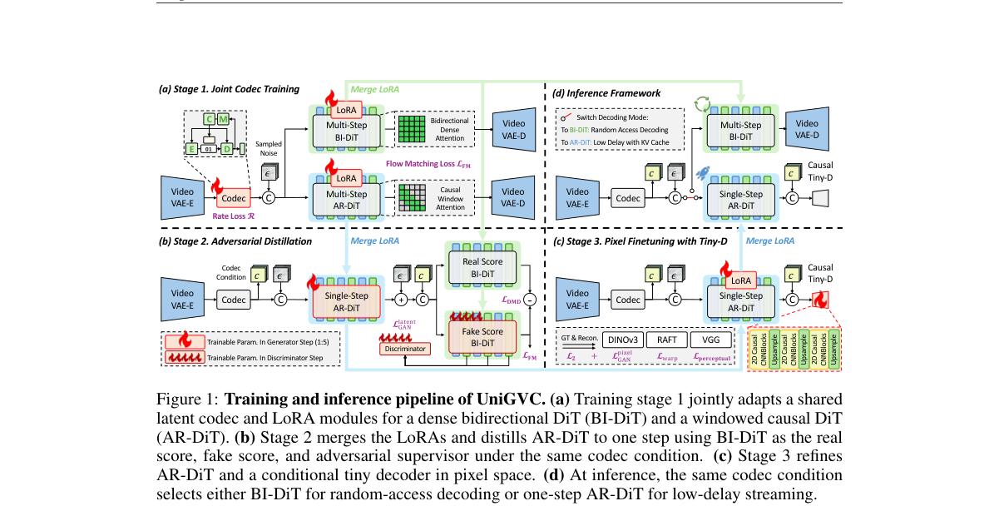

*Main result - Figure 2 Codec overview and analysis on bits allocation. Left: The unified latent video codec compresses video latent lt with hierarchical entropy modeling, updates recurrent feature memories, then s*

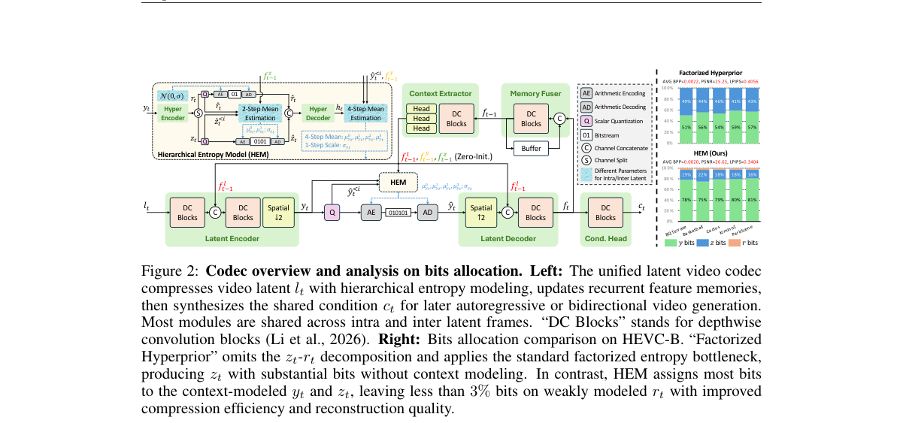

**Why this ranks #3**: 把 AR 与双向放在同一压缩框架里统一，是视频生成基础设施层面的一个实质命题。

---

### 4. Golden Anchor for Video Generation

**arXiv**: [2610.13217](https://arxiv.org/abs/2610.13217) | **Score**: 8.0 (relevance 8 x 0.7 + quality 8 x 0.3) | **Tags**: AIGC-video | **Categories**: cs.CV, cs.LG | **Pages**: 22

**Authors**: Jinyuan Xu, Shitong Shao, Lichen Bai, Zikai Zhou, Guoxi Huang, Nantheera Anantrasirichai, Zeke Xie

**Affiliation**: 1The Hong Kong University of Science and Technology (Guangzhou) | and interactive world models (Bruce et al., 2024; NVIDIA, 2025; Valevski et al., 2025; Bai et al., 2026a). One

**Abstract**

> Video generation supports digital content creation, with applications in virtual avatars, AI-driven filmmaking, interactive game engines, and world models. State-of-the-art systems achieve controllability primarily through image-to-video (I2V) generation, in which an injected anchor image determines the identity, composition, and style of the resulting video. In modern pipelines, this anchor is synthesized by a text-to-image (T2I) generator. This raises a largely overlooked question: Are images obtained directly from the T2I model truly suitable for current video models? Our analysis shows that anchor aesthetic and quality scores are weakly correlated with downstream video quality. The structure-and-texture score is negatively correlated with I2V video quality in both the visual and motion dimensions. Fine-tuning the T2I model on an image reward accordingly yields anchors with visibly denser structural and character detail: they score higher on image metrics, yet lower the video reward on every I2V model we test and change downstream motion unpredictably. We therefore introduce Golden Anchor Learning (GAL), to our knowledge the first framework for learning golden anchors by optimizing a T2I generator with downstream video feedback. GAL evaluates candidate anchors through the videos they induce under a frozen I2V model and converts video rewards into image-level preferences for DPO fine-tuning of the T2I generator. On all four I2V models, GAL raises the VBench average by $2.97\%$--$8.46\%$ over the untuned generator. The rendered clips also score higher under VideoReward-Overall, and their extracted frames under HPSv3 and UniPercept. GAL yields consistent motion gains across all four I2V models, as measured by a $5.62\%$--$38.24\%$ increase in VBench dynamic degree. Although GAL is trained only on HunyuanVideo-1.5 renders, these gains extend to the other three I2V models.

**Key findings**

- **Finding**: 当前最先进视频生成系统的可控性主要靠 I2V：一张注入的锚点图像决定身份、构图与风格。

- **Finding**: Golden Anchor 重新检视锚点在该流水线中的实际作用与优化方式。

- **Inference**: 「锚点决定一切」意味着后续的去噪过程几乎不改变语义内容——若如此，长视频生成中的语义漂移与身份保持问题就都是锚点选择与保持的问题，而非去噪质量的问题。

- **Recommendation**: I2V 与世界模型方向的读者注意；与 10-09 日报的 Lego（视角变换）同属「生成前先定住语义」的路线。

**Key figures**

*Framework / architecture - Figure 1 In the shown examples, the GAL anchor induces more in-scene motion in every one-second interval across all four I2V models. Top: within each I2V-model block, rows are clips rendered from Bas*

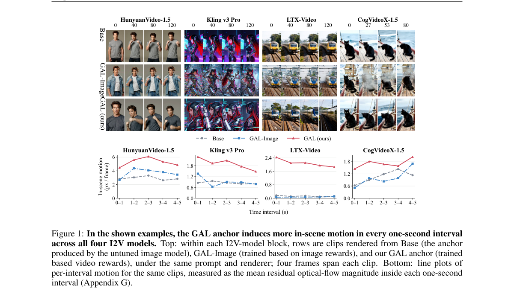

*Main result - Figure 2 Mismatch between image scores and video rewards. Pearson correlation between UniPercept scores of the anchor (IAA: aesthet- ics; IQA: quality; ISTA: structure and texture) and VideoReward sc*

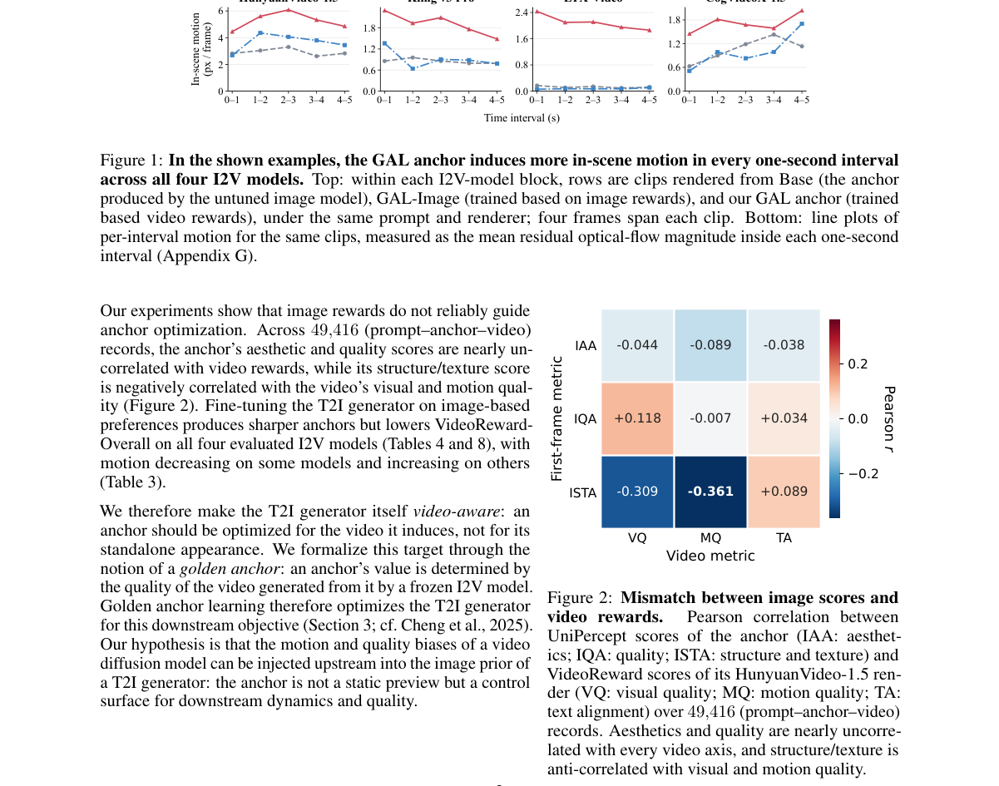

**Why this ranks #4**: 把 I2V 的锚点图像当作「决定性注入」来重新检视，是一个基础设定的审查。

---

### 5. A Lightweight Velocity Correction Framework for Improving Instruction Following in Few-Step Text-to-Image Generation

**arXiv**: [2610.12899](https://arxiv.org/abs/2610.12899) | **Score**: 8.0 (relevance 8 x 0.7 + quality 8 x 0.3) | **Tags**: AIGC-image | **Categories**: cs.CV | **Pages**: 16

**Authors**: Yating Gao, Zhenlong Zhu, Wen Zihao, Lenan Zhang, Jiexiong Wang, Yang Yang, Guanjun Jiang, Yixiong Zou, Takuya Maekawa

**Affiliation**: 1The University of Osaka | 2Alibaba Group | 3Peking University | 4Huazhong University of Science and Technology

**Abstract**

> Few-step text-to-image generators produce high-quality images with few network forward passes, yet struggle with complex prompts involving multiple subjects, interactions, spatial relations, counting, and attribute binding. Can these errors be reduced without changing the generator's parameters or increasing its forward-pass count? We propose a lightweight correction framework for a frozen 6B-parameter generator. The generator predicts velocities that determine how its intermediate image representation is updated; a corrector with fewer than 20M parameters learns residual adjustments at selected sampling steps. Because earlier corrections change the states encountered at later steps, our On-Trajectory Flow-Bridge Supervision derives residual targets at the states actually reached during corrected generation. A single corrector is shared across selected steps and runs in parallel with the generator. Only the corrector is trained, requiring neither reward optimization nor re-distillation. To our knowledge, this is the first framework for lightweight velocity-residual adaptation of fully frozen few-step text-to-image generators that preserves their original sampling schedule and forward-pass count. On our target complex-scene distribution, the framework achieves a +17.60-percentage-point NetWin over frozen Z-Image-Turbo in pairwise instruction-following evaluation, with only 26.9 ms (0.84%) additional end-to-end latency per image and no increase in backbone evaluations.

**Key findings**

- **Finding**: 少步生成器在复杂提示（多主体、交互、空间关系、计数、属性绑定）上挣扎；核心问题是能否在不改动参数、不增加前向次数的前提下减少错误。

- **Finding**: 作者提出轻量的**速度场修正**框架。

- **Inference**: 「速度场修正」意味着错误被定位在轨迹层面而非模型能力层面——这与 10-09 日报的 Parametric Trajectory Distillation（「容量分配」问题）属于同一诊断家族。

- **Recommendation**: 少步生成的读者注意；修正开销与复杂提示上的增益之比是实用性的关键。

**Key figures**

*Framework / architecture - Figure 1 Few-step and multi-step generation: intermediate updates and instruction following. (a) Intermediate update directions differ substantially, with angles corresponding to mean cosine similari*

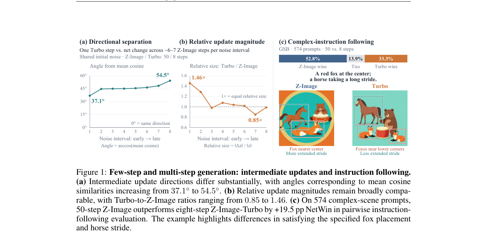

*Main result - Figure 2 Sparse velocity correction for few-step generation. From shared noise, Turbo (orange) and Ours (teal) generate images in eight steps, alongside a multi-step reference (gray). Ours freezes th*

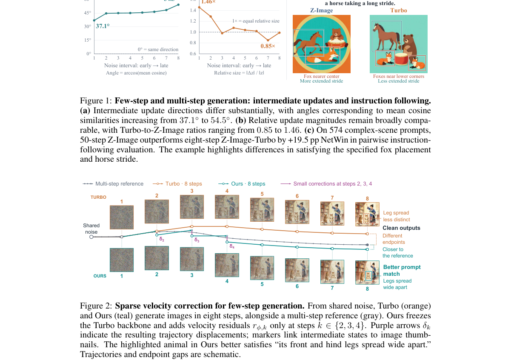

**Why this ranks #5**: 明确把「不改动参数、不增加计算」作为约束条件，是很强的实用导向。

---

### 6. Make It Flow: Animating Water in 3D Gaussian Splatting Scenes

**arXiv**: [2610.13860](https://arxiv.org/abs/2610.13860) | **Score**: 7.3 (relevance 7 x 0.7 + quality 8 x 0.3) | **Tags**: AIGC-3D | **Categories**: cs.CV, cs.GR | **Pages**: 14

**Authors**: Kjell Keune, Florian Hahlbohm, Jannis Möller, Susana Castillo, Martin Eisemann, Marcus Magnor

**Affiliation**: [not-found in PDF]

**Abstract**

> Explicit 3D scene representations such as 3D Gaussian Splatting (3DGS) have recently enabled high-quality, real-time novel view synthesis. However, these methods assume static scenes, limiting realism in the presence of dynamic phenomena ubiquitous in real-world environments. While coherent motion (e.g., humans or vehicles) can be captured and reconstructed, high-frequency effects such as flowing water remain intractable under casual capture conditions, where dense multi-view, high-speed acquisition is not feasible. We present a method to animate water in static 3DGS scenes, enabling visually plausible motion without requiring dynamic capture or physical simulation. Our approach estimates 2D optical flow from reference images or model renderings and lifts it into a consistent 3D Eulerian motion field. We propose a cinemagraph-inspired algorithm that applies this motion field to deform Gaussian primitives, producing temporally seamless looping animations. The resulting representation retains real-time rendering performance, significantly enhances perceptual realism, and preserves free-viewpoint navigation within the scene. We evaluate our method on a newly captured dataset of in-the-wild waterfall scenes and demonstrate clear improvements over prior work in dynamic Gaussian splatting and 3D cinemagraph generation in visual quality and computational efficiency.

**Key findings**

- **Finding**: 3DGS 类方法假设场景静态；连贯运动可被重建，但**高频**效应（尤其流体）难以捕获。

- **Finding**: Make It Flow 为 3DGS 场景中的水做动画化处理。

- **Inference**: 流体难的原因与其他动态对象不同：它的形变没有刚性对应物，因此无法像人或车那样用刚体运动建模——这决定了方法必须直接建模形变场而非运动轨迹。

- **Recommendation**: 与本批 PhysForge（材质可控 3D 重建）对照：一篇处理动力学，一篇处理物理属性，都在扩展 3DGS 的静态假设。

**Key figures**

*Framework / architecture - Figure 1 We generate seamlessly looping water animations in static 3D Gaussian Splatting scenes via a cinemagraph-inspired approach that lifts optical flow into a coherent 3D Eulerian motion field. T*

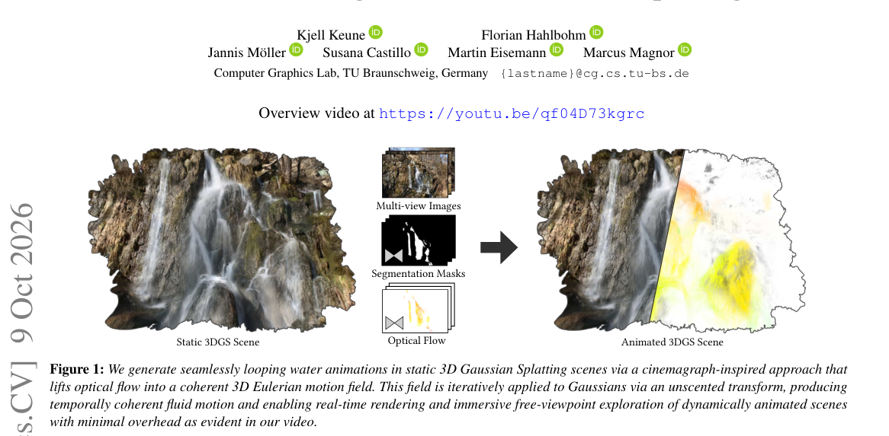

*Main result - Figure 2 We generate optical flow depicting fluid motion from multi-view observations of a static 3DGS reconstruction by refining user-defined motion hints with segmentation masks and GAN-based flow*

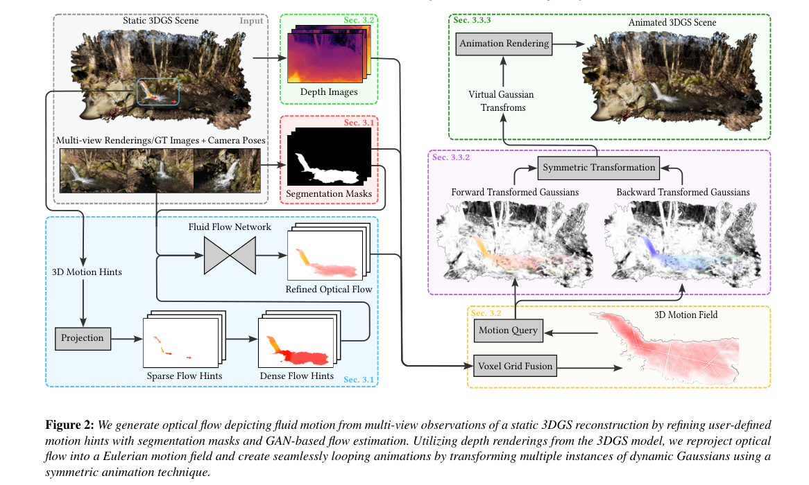

**Why this ranks #6**: 把 3DGS 的静态假设具体定位到「流体最难」，是一个清晰的能力边界刻画。

---

### 7. Exploring Attention Sinks in Text-to-Image Transformers from Diffusion and Autoregressive Models

**arXiv**: [2610.13337](https://arxiv.org/abs/2610.13337) | **Score**: 7.3 (relevance 7 x 0.7 + quality 8 x 0.3) | **Tags**: AIGC-image | **Categories**: cs.CL, cs.CV | **Pages**: 10

**Authors**: Binglei Li, Mengping Yang, Zhiyu Tan, Wenxu Qian, Junping Zhang, Hao Li

**Affiliation**: 1Fudan University | 2 Shanghai Innovation Institute | 3 Shanghai Academy of AI for Science

**Abstract**

> Attention sinks are tokens or positions that consistently receive disproportionate attention mass, often beyond what their semantic content would suggest. Despite extensive study in large language models, their behavior and functional relevance in text-to-image (T2I) Transformers remain largely unexplored. To fill this gap and better understand how text-to-image Transformers allocate and route attention, we explore this phenomenon of text-to-image transformers across bidirectional diffusion models and causal autoregressive models. Specifically, we explore whether attention sinks exist, where they emerge, and how they functionally influence generation. Through systematic attention analysis and targeted interventions, we identify that attention sinks emerge in both bidirectional diffusion and autoregressive models but exhibit distinct patterns. The autoregressive model concentrates attention on the first and global-scale tokens, whereas the bidirectional models develop sinks near modality boundaries, within text regions, and at spatial corners. Moreover, these patterns vary across generation stages and are localized to a sparse subset of layers and heads. To assess their functional relevance, we perturb sink-related heads and token positions. It turns out that perturbing sink-ranked heads produces larger average changes than non-sink comparisons, while some sink-position perturbations have limited effects on bidirectional model scores. We further introduce register tokens to redistribute attention sinks and find that several configurations preserve or modestly improve generation performance. Overall, attention sinks are architecture-, inference-stage-, and component-dependent phenomena, providing a basis for mechanistic analysis and principled attention design in text-to-image transformers.

**Key findings**

- **Finding**: 注意力汇在 LLM 中已被广泛研究，但在文生图 Transformer 中的行为与功能相关性基本未知。

- **Finding**: 作者从扩散模型与自回归模型两种 T2I 架构出发分析注意力汇（Exploring Attention Sinks...）。

- **Inference**: 若 T2I 中也存在注意力汇，那么它们很可能是噪声 token 的默认去处——删除它们的效果可能与「移除无效计算」这一直觉相符，但实际收益可能更大。

- **Recommendation**: 做 T2I 架构分析的读者可参考；两种架构的对照是本文最有价值的部分。

**Key figures**

*Framework / architecture - Figure 1 Overview of our analysis on attention sinks in text-to-image Transformers. (a) Transformer architecture of bidirectional diffusion and causal autoregressive models; (b) representative sink p*

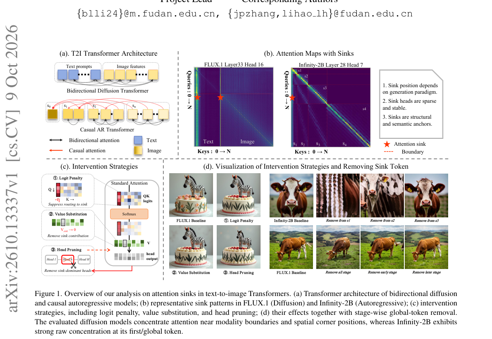

*Main result - Figure 2 Attention mass by token position across models. We highlight the most prominent sink positions for each model. Pan- els show FLUX.1, Z-Image, and Infinity-2B, while vertical mark- ers identi*

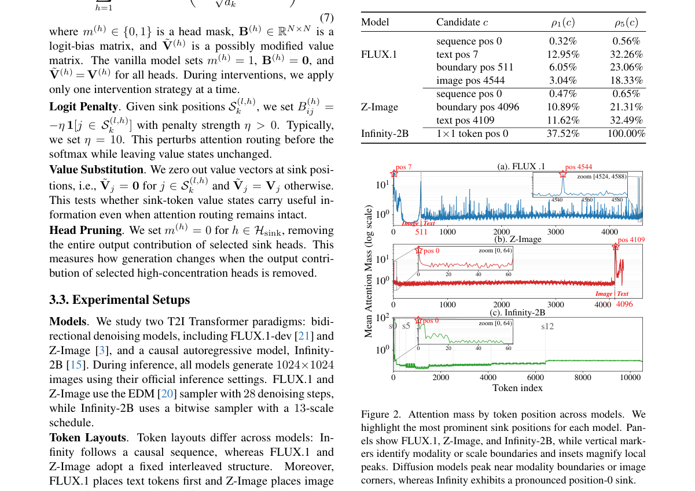

**Why this ranks #7**: 把 LLM 侧的成熟概念搬到视觉生成并做系统分析，是一条高性价比的研究路径。

---

### 8. PhysForge: Material-Controllable 3D Reconstruction with Separable Components

**arXiv**: [2610.13681](https://arxiv.org/abs/2610.13681) | **Score**: 7.0 (relevance 7 x 0.7 + quality 7 x 0.3) | **Tags**: AIGC-3D | **Categories**: cs.CV | **Pages**: 16

**Authors**: Yuchen Wang, Yanqi Bao, Zheng Gu, Zhengqing Chen, Jieqi Shi, Jing Huo

**Affiliation**: School of Computer Science | Nanjing University | College of Computer Science

**Abstract**

> Recent advances in physical 3D generation have enabled visually faithful assets with simulatable mechanical behavior. However, existing methods provide limited control over material behavior beyond appearance-based inference and struggle to estimate physical properties from complex interactions between objects and semantic parts. Therefore, we present PhysForge, a Video Diffusion Model (VDM)-based framework for addressing these challenges, comprising two complementary modules for material-controllable physical fitting and componentlevel interaction modeling. The first, PhysFit, leverages material-conditioned VDM dynamics as references for physical-property fitting, introducing windowed fitting to focus on material-revealing interactions and Hallucinated Forcing to disentangle nonphysical motion hallucinated by the VDM from material responses. The second, PhysComp decomposes complex interactions into individual objects and semantic components, enabling their physical parameters to be optimized independently and flexibly composed for joint simulation. Experiments on PhysAssets and Google Scanned Objects demonstrate that, compared with existing methods, PhysForge provides stronger control over material-dependent physical responses while supporting component-level physical modeling for complex interactions. It achieves the best CLIP and physical controllability scores on both common and uncommon materials, with qualitative comparisons, component-level ablations, and a user study further supporting these improvements. Our project page is available at https://masterwanna.github.io/PhysForge.html .

**Key findings**

- **Finding**: 既有方法对材质行为的控制超出外观推断之外就很有限，且难以从物体与语义部件的复杂交互中估计物理属性。

- **Finding**: PhysForge 提出可分离组件建模（separable components）的材质可控 3D 重建，基于视频扩散。

- **Inference**: 「可分离」是必要的设计：材质属性与几何/外观纠缠会导致物理参数无法被独立调节——而独立调节正是该任务的目的。

- **Recommendation**: 与本批 Make It Flow（3DGS 流体动画）同属「扩展 3DGS 静态假设」的一族，建议对照。

**Key figures**

*Framework / architecture - Figure 1 PHYSFORGE achieves material controllability and separable components.*

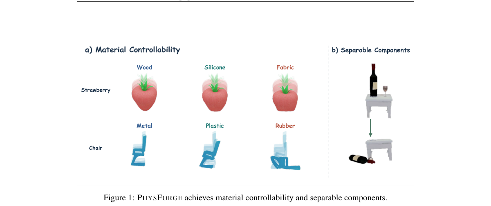

*Main result - Figure 2 Overview of PHYSFORGE. The framework comprises PHYSFIT and PHYSCOMP. PHYSFIT receives a material-conditioned video generated by a VLM-supervised VDM. The gen- erated video is analyzed to sel*

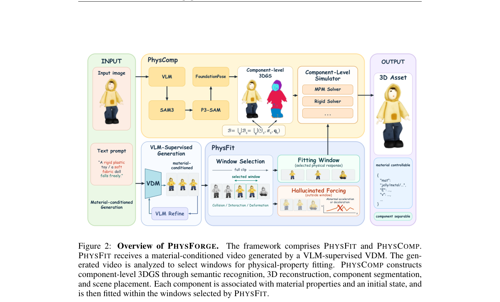

**Why this ranks #8**: 「物理属性需要从交互中估计，而交互是复杂的」这个诊断很实在。

---

### 9. What We Talk About When We Talk About Emotion Editing

**arXiv**: [2610.13558](https://arxiv.org/abs/2610.13558) | **Score**: 7.0 (relevance 7 x 0.7 + quality 7 x 0.3) | **Tags**: AIGC-edit, AIGC-image | **Categories**: cs.CV | **Pages**: 17

**Authors**: Xingzu Zhan, Lin Gu, Ruogu Fang

**Affiliation**: 1Department of Biomedical Engineering, Vanderbilt University, Nashville, Tennessee, USA | 2Research Institute of Electrical Communication, Tohoku University, Sendai, Japan

**Abstract**

> Emotional image editing aims to change the emotion a scene conveys while preserving its essential content. Because the same scene can support different emotional interpretations, achieving an emotional goal requires visual changes grounded in the source context. Motivated by the Component Process Model, which links emotional responses to event appraisal, we investigate neural representations as a reference for these editing decisions. Using TRIBE v2, an fMRI encoding model, we analyze 400 source-target pairs across eight emotion categories. Hidden states from EmoEdit, EmoEditor, and AffectDelta correspond more strongly to predicted target-image responses in visual regions than in affect-related regions. This imbalance motivates ROI-ReFT, which combines source visual responses as a content reference with a predicted affective response change as an editing direction. Two interacting branches use both conditions to guide a frozen editor throughout generation. Predicted responses of the generated image supervise affective change and constrain visual drift. On a post hoc selected subset of 400 editing requests, ROI-ReFT achieves 91.75% target-emotion accuracy and 83.25% joint success, with the same output both matching the target emotion and reaching source-output DINO-I of at least 0.80. Our code and dataset will be publicly released.

**Key findings**

- **Finding**: 同一场景可支持不同情感解读，因此情感编辑需要**以源上下文为基础**的视觉变化，而非通用情感模板。

- **Finding**: 作者受成分过程模型（Component Process Model，把情感反应与事件评价相联系）启发，研究神经表示。

- **Inference**: 以事件评价为中介，意味着编辑操作被定义在「什么被评价」而不是「看起来什么情绪」——后者是通用模板的典型做法，也是最容易产生「看起来悲伤但其实没改变内容」的原因。

- **Recommendation**: 与 10-07/10-08 日报的情感控制工作（TTS 激活引导、指令 TTS 性别校准）同属情感可控性，但作用于视觉侧。

**Key figures**

*Framework / architecture - Figure 1 Emotional image editing requires connecting visual content to emotional meaning. (a) Conceptual illustration of cognitive reappraisal: women crying outside a church may suggest grief or joy*

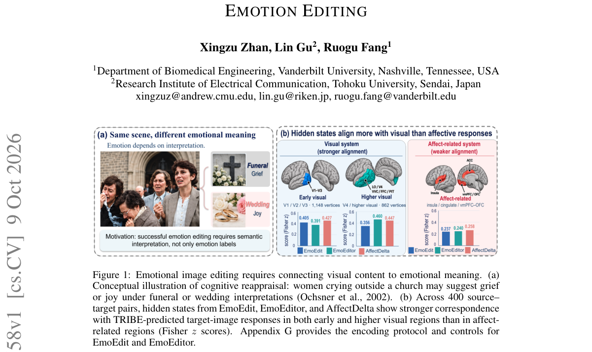

*Main result - Figure 2 Overview of joint visual and affective neural guidance. TRIBE-predicted source visual responses provide a content reference, while a source-conditioned predictor supplies an affective editin*

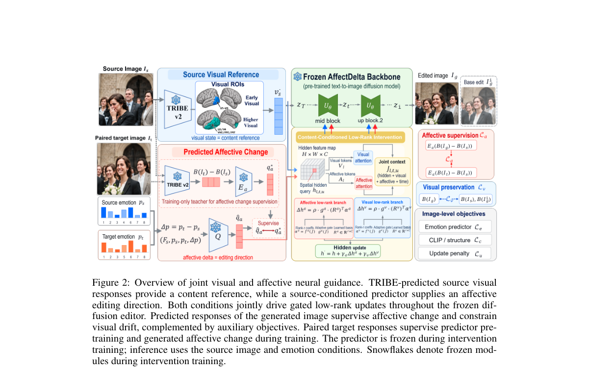

**Why this ranks #9**: 从心理学模型推导编辑目标，而不是从数据里学一个情感分类器。

---

### 10. Efficient Confidence-Aware Densification for 3DGS

**arXiv**: [2610.13541](https://arxiv.org/abs/2610.13541) | **Score**: 6.3 (relevance 6 x 0.7 + quality 7 x 0.3) | **Tags**: AIGC-3D `[wild-card]` | **Categories**: cs.CV, cs.GR | **Pages**: 20

**Authors**: Manuel Hofer, Thomas Köhler, Felix Windisch, Bernhard Kerbl, Markus Steinberger, Lukas Radl

**Affiliation**: 1Graz University of Technology, Austria 2University of Copenhagen, Denmark 3Huawei Technologies, Austria

**Abstract**

> 3DGS-MCMC has replaced the gradient-driven density control of 3D Gaussian Splatting with opacity-based sampling and relocation, and is now the de facto standard for prior-free densification under a fixed primitive budget. Because opacity stays high where the scene is already well reconstructed, this sampling sends most new primitives to the foreground and leaves the background under-reconstructed. At low budgets, prior-based methods such as ConeGS and EDGS outperform it, at the cost of a pre-trained radiance field or dense image matches and a separate initialization stage. We argue for a comeback of error-driven densification within the fixed-budget MCMC framework. Our confidence-aware densification keeps the fixed budget and gradual growth of 3DGS-MCMC, but places primitives by the image error instead of the opacity. New primitives are drawn mostly where screen-space gradients are large. We favor primitives with a low learned confidence, which marks regions the reconstruction still explains poorly, and relocate the primitives that contribute least to the rendered images to these places. Averaged over 24 scenes, our method outperforms 3DGS-MCMC in PSNR, SSIM and LPIPS at every budget from 100k to 2M primitives. At 100k, without a prior or an initialization stage, it recovers 0.84dB of the 1.05dB PSNR by which ConeGS leads 3DGS-MCMC, and from 500k on, it has the highest PSNR and SSIM of all fixed-budget methods we compare with, including ConeGS and EDGS. While inherently prior-free, our densification can also exploit priors: from the ConeGS or EDGS initialization, it matches ConeGS in PSNR and SSIM at 100k and is best in all three metrics at 500k.

**Key findings**

- **Finding**: 3DGS-MCMC 用不透明度采样与重定位取代梯度驱动的密度控制，成为固定预算下的事实标准。

- **Finding**: 但不透明度在已充分重建处仍然**高**，因此采样把大多数新图元送到前景，背景被系统性忽略。

- **Finding**: Efficient Confidence-Aware Densification 引入置信度以纠正该偏置。

- **Inference**: 前景偏置的直接后果是背景质量在固定预算下持续劣于前景——而这正是 novel view 合成中背景错误最容易被察觉的地方。

- **Recommendation**: wild-card 项；3DGS 训练的读者可直接受益，前景/背景图元分配的修正成本很低。

**Key figures**

*Framework / architecture - Figure 1 Confidence-Aware Densification: Left: average PSNR over the primitive budget for the Mip-NeRF 360 dataset, for our method, 3DGS-MCMC [KRS∗24], EDGS [KGO26] and ConeGS [BEG∗26]; our gain over*

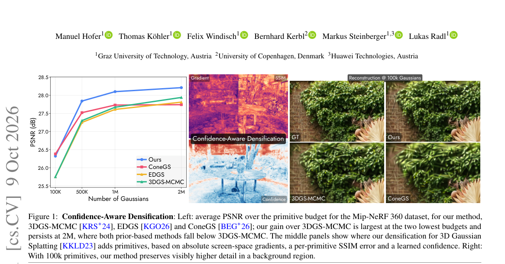

*Main result - Figure 2 Biased sampling in 3DGS-MCMC. We render the po- sitions of all source primitives drawn during densification on the Mip-NeRF 360 Garden scene as a point cloud, for our method (left) and 3DGS-*

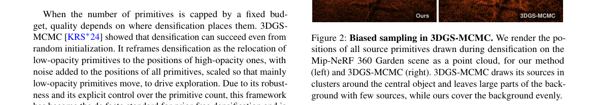

**Why this ranks #10**: 指出了 MCMC 稠密化策略的一个具体偏置（前景偏置），是一处可低成本修补的设计缺陷。

---

## Footer

- Total papers reviewed across all 5 tracks: 50 (from 488 scanned)
- aigc_visual track final top-10: 10
- Wild-cards in this track: 1
- Figure assets: `res/` (shared across tracks)

Generated by `mine-arxiv-daily-digest` skill. Sister file: `2026-10-12_aigc_visual_entry.md`.
