# ArXiv Daily Digest - 2026-10-12 (音频与语音语言模型 / 双工语音助手, 10 papers)

**Generated**: 2026-10-12 17:00 CST

**Source**: arXiv cs.CV, cs.SD, eess.AS, cs.CL, cs.AI, cs.RO, cs.LG submissions, window 2026-10-09 UTC (latest announced batch as of 2026-10-12 17:00 CST; 10-10/10-11 were weekend with no announcement)

**Track**: audio_lm (top 10 of 488 papers scanned, 50 full reads)

**Scope**: causal audit of audio-aware decoding for hallucination, token elimination in audio LLMs, phonology-aware speaker extraction frontends, self-rated-difficulty audio reasoning, speculative decoding for ASR, cost-of-augmentation audit in low-resource ASR, speaker-disjoint accent evaluation, balanced speech anonymization benchmark, token-level retrieval evidence, multimodal LALM system report

---

**今天是本项目日报审计线索最密集的一天**，而审计对象从「指标」升级到了「**标准做法与评测工具本身**」。**Does Location Matter?** 审计 LALM 幻觉的主流缓解手段 Audio-Aware Decoding——它通过对比真实音频 logits 与全零「空白」波形 logits 运作，而此前评审已把该空白波形标记为**分布外**。若参照物本身 OOD，抑制幻觉的机制就建立在一个无效前提上。这直接续上 10-09 日报的 Selective Listening（聚合准确率掩盖成对漂移）。另两篇把同一问题推得更远：**What Do Audio-Language Judges Listen For?** 指出裁判的有效性只通过「与专家评分的相关性」验证，而这没有说明裁判在响应音乐、文本提示还是提问方式——用四个带对照的探针区分三者；**How Should We Evaluate Naturalness for Foreign Accent?** 则发现广泛使用的 UTMOS **倾向于给口音更重的语音打更低分**，这意味着用 UTMOS 筛选合成数据会在数据里进一步强化口音偏见，形成闭环。第四例在 ASR 侧：**Error Rate is Not Enough** 指出数据增强的收益几乎总以聚合错误率报告，无法解释「为什么以及何时有帮助」，而该文在 4 语言 × 5 数据规模 × 2 增强上做了完整交叉。

方法侧则是清一色的**效率**工作：token 消除（AudioTETRIS，用「过渡期重要性」而非注意力分数）、音系感知且自适应的说话人提取前端（五维难度刻画）、无损推测解码 ASR、以及自评难度驱动的分段音频推理。值得注意的是**双工方向再次空窗**（10-08 无、10-09 三篇、10-12 无），因此本线用了 6 个 wild-card。

---

## Top 10 - 音频与语音语言模型 / 双工语音助手

### 1. Does Location Matter? A Black-Box Causal Audit Reveals Model-Dependent Audio Grounding in LALM Hallucination

**arXiv**: [2610.13112](https://arxiv.org/abs/2610.13112) | **Score**: 9.0 (relevance 9 x 0.7 + quality 9 x 0.3) | **Tags**: audio-LM | **Categories**: cs.AI, cs.LG, cs.SD, eess.AS | **Pages**: 5

**Authors**: Mohammad Khalooei, Mohammad Sabokrou

**Affiliation**: 1Sharif University of Technology, Iran | 2Amirkabir University of Technology, Iran | 3New Uzbekistan University, Uzbekistan | 4Okinawa Institute of Science and Technology, Japan

**Abstract**

> Large audio-language models (LALMs) frequently exhibit object hallucination, affirming absent sounds. The dominant mitigation, Audio-Aware Decoding (AAD), contrasts logits under real audio against an all-zero "blank" waveform, flagged by prior review as out-of-distribution. We introduce a black-box causal test that isolates the claimed evidence itself: localize a claim's evidence region via CLAP similarity, remove it by spectral gating, and compare against a random-window control across a 2x2x2 grid on three LALMs. On Qwen2-Audio-7B, localized ablation's raw AUROC trails blank's (0.613 vs. 0.721); this is a duration confound, not a localization failure, since blank removes the entire clip versus the grid's 2-4 s. Holding duration fixed, localization beats random removal at every cell on both models. Raw detection value remains model-dependent, especially on Audio Flamingo 3. The same evidence corrects decoding: contrastive decoding combining blank and language-prior contrasts, gated and ensembled, raises Qwen2-Audio accuracy from 57.1% to 71.9%, beating AAD alone. A unified causal-grounding profile does not transfer between models, indicating different grounding regimes. The source code and a detailed report of our findings, including identified limitations, are available at https://github.com/khalooei/causa.

**Key findings**

- **Finding**: LALM 频繁出现物体幻觉（肯定不存在的声音）；主要缓解手段 AAD 通过对比真实音频 logits 与全零「空白」波形 logits 运作。

- **Finding**: 此前评审已把该空白波形标记为**分布外（OOD）**——即被广泛使用的缓解手段，其参照物本身落在模型训练分布之外。

- **Finding**: 本文提出黑盒因果测试来隔离幻觉的实际来源，并揭示**模型相关**的音频 grounding（Does Location Matter?）。

- **Inference**: 若 AAD 的对照物是 OOD 的，那么它测到的差异里混有「OOD 冲击」而非纯粹的音频证据，抑制幻觉的机制本身可能建立在一个无效前提上。这是比「指标不准」更严重的一类问题——**标准缓解手段的依据本身有问题**。

- **Recommendation**: 被精读的三篇之一，且是本项目日报审计线索的第四例（前例：Mind the Execution Gap、World Models' Last Exam、Selective Listening）。用 LALM 的团队应先做这个审计再继续用 AAD。

**Key figures**

*Framework / architecture - Figure 1 Qwen2-Audio contrastive-decoding accuracy vs. α: combin- ing AAD+LangPrior (ours) sits above every single contrast across the whole range, and confidence-gating it (dotted line, CV) higher sti*

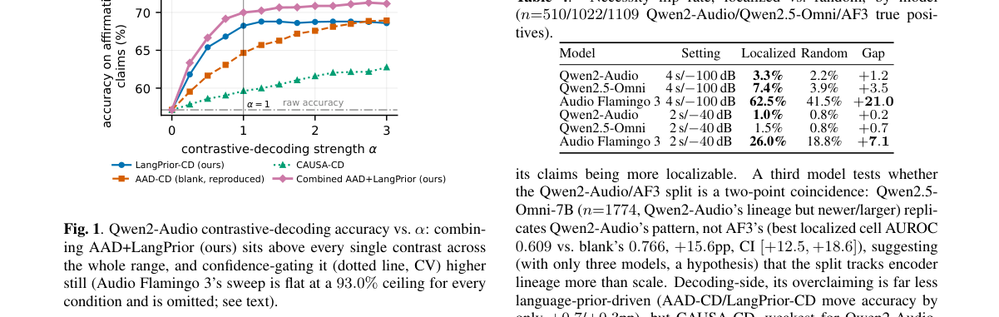

**Why this ranks #1**: 这是 10-09 日报 Selective Listening 那条审计线的直接续作，而且审计对象升级成了**领域标准做法本身**。

---

### 2. AudioTETRIS: Token Elimination via Transitional Importance Signals for Efficient Audio LLMs

**arXiv**: [2610.13600](https://arxiv.org/abs/2610.13600) | **Score**: 8.0 (relevance 8 x 0.7 + quality 8 x 0.3) | **Tags**: audio-LM | **Categories**: cs.AI, cs.SD, eess.AS | **Pages**: 25

**Authors**: Shreya Sajid, Anna Vettoruzzo, Joaquin Vanschoren

**Affiliation**: Eindhoven University of Technology | dio Flamingo 3 (Chu et al., 2024; Microsoft et al., 2025; Ghosh et al., 2025a) on tasks including

**Abstract**

> Large Audio Language Models (LALMs) achieve strong performance on speech-text tasks, but standard audio encoders produce hundreds of tokens for even short audio clips. Because self-attention scales quadratically in sequence length, this inflates inference-time compute substantially. Current training-free token compression methods prune or merge tokens based solely on coarse attention or feature similarity. However, treating audio tokens as generic, isotropic features smooths over spectral transitions, destroying fine-grained phonetic transitions essential for decoding speech. In contrast, speech signals exhibit highly structured temporal patterns where information density peaks at acoustic transitions. We propose AudioTETRIS, a training-free, two-stage framework that uses the audio encoder's representation geometry as an acoustic prior for token importance before applying attention-based compression. Instead of discarding encoder structure after the encoding stage, AudioTETRIS propagates this prior directly into the LLM decoder to compute a per-token fused score. This score drives progressive top-$k$ token selection across decoder layers without requiring additional training or auxiliary models. Evaluated on Qwen2-Audio-7B, Phi-4-Multimodal, and Audio Flamingo 3, AudioTETRIS retains near-uncompressed performance on several speech tasks using only 25% of audio tokens, matches or surpasses full-token accuracy at moderate compression rates, and consistently outperforms existing training-free baselines.

**Key findings**

- **Finding**: 标准音频编码器对短音频也产生数百 token，而自注意力随序列长度**平方**增长，因此推理计算被显著放大。

- **Finding**: AudioTETRIS 用过渡期重要性信号（transitional importance signals）做 token 消除，针对现有训练无关的 token 压缩方法改进。

- **Inference**: 「过渡期重要性」与注意力分数是不同的判据：注意力高可能只反映该 token 被反复关注，而过渡期重要性问的是它在序列演化中是否承载信息变化——后者更接近对下游任务的实际贡献。

- **Recommendation**: 音频 LLM 部署的读者注意；与本批 10-09 日报的 StreamMAE 类工作（不同）对照——本篇给的是 token 层判据。

**Key figures**

*Framework / architecture - Figure 1 Overview of AudioTETRIS. A phoneme-transition-aware acoustic prior wt is computed from the audio encoder’s hidden states via the transitional distance dt = ∥ht −ht−1∥2*

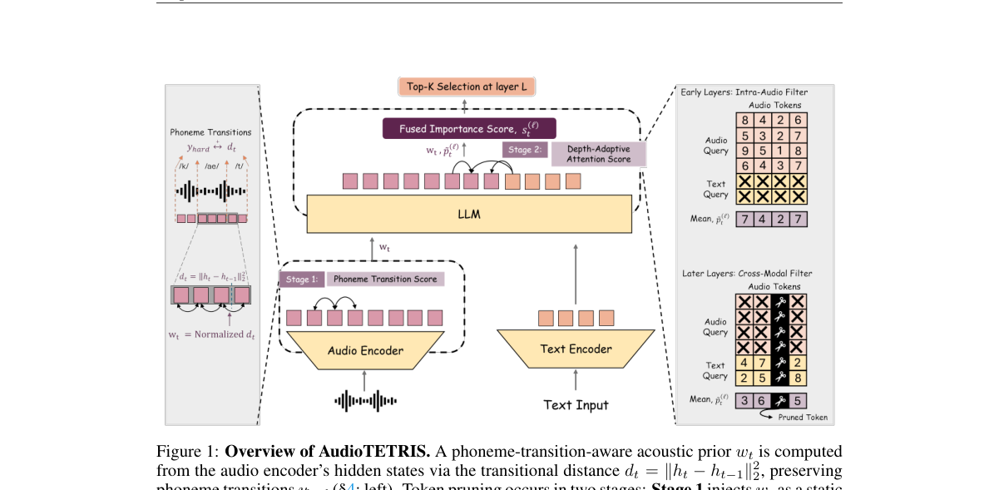

*Main result - Figure 2 Distribution of decoder attention mass allocated to audio tokens across model depth in Qwen2-Audio on LibriSpeech. Despite audio tokens comprising 84.98% of the input sequence (dashed ring),*

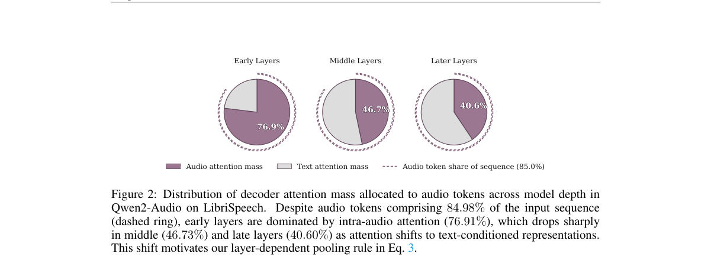

**Why this ranks #2**: 音频 token 数量是语音 LLM 推理开销的主要来源，而「过渡期重要性」是一个区别于注意力的判据。

---

### 3. Phonology-Aware Speaker Extraction Frontend for Audio LLMs

**arXiv**: [2610.13500](https://arxiv.org/abs/2610.13500) | **Score**: 8.0 (relevance 8 x 0.7 + quality 8 x 0.3) | **Tags**: audio-LM | **Categories**: cs.SD, eess.AS | **Pages**: 7

**Authors**: Yanxiang Chen, Haoyuan Deng, Jinyu Wang, Hongyi Chen, Dingshan Li, Runlin Huang, Weifeng Su

**Affiliation**: 1Sun Yat-Sen University, Zhuhai, China | 2Fudan University, Shanghai, China | 3Beijing Normal-Hong Kong Baptist University, Zhuhai, China

**Abstract**

> Target speaker extraction (TSE) is a key frontend for enabling audio large language models (LLMs) to recognize and understand a designated speaker in overlapping speech. However, multilingual mixtures exhibit heterogeneous extraction demands, causing fixed-depth systems to either under-process challenging inputs or waste computation on inputs that have already converged. Existing TSE frontends generally apply uniform computation, while Audio-LLM adaptation methods neither explicitly model language-conditioned extraction demands nor preserve plug-and-play compatibility with frozen downstream models. We therefore propose LATTE, a lightweight 5.2M-parameter frontend that combines an acoustic Difficulty Estimator, a task-adaptive phonology-informed prior learned from multi-depth TSE gains, and an Adaptive Hourglass Extractor to route each mixture without requiring language identity at inference. On PolyExtract, LATTE achieves a macro SI-SNRi of 15.07 dB at 0.30 GFLOPs, retaining performance within 0.09 dB of a 0.53-GFLOP fixed-depth model while reducing computation by 43.4%, and lowers the average WER from 16.8% to 14.6% relative to TF-GridNet. By jointly modeling sample-level extraction demands and phonological structure, LATTE provides a practical framework for quality-aware, compute-efficient multilingual TSE and offers a scalable path toward robust Audio-LLM deployment.

**Key findings**

- **Finding**: TSE 是音频 LLM 处理重叠语音的关键前端；多语混合呈现**异质**的提取需求。

- **Finding**: 固定深度系统因此要么对困难输入处理不足，要么浪费算力；作者提出音系感知的说话人提取前端。

- **Inference**: 「固定深度不够」这一诊断说明问题不在前端模型容量而在条件化方式——需要按输入难度分配计算，而这要求前端知道哪些音系特征决定提取难度。

- **Recommendation**: 多语重叠语音场景的读者注意；音系感知与自适应深度的耦合方式是该方法最难复现的部分。

**Key figures**

*Framework / architecture - Figure 1 Motivation of the proposed LATTE framework.*

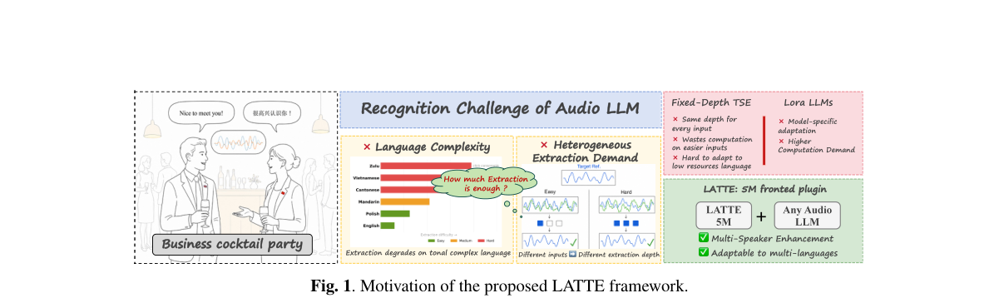

*Main result - Figure 2 LATTE combines semantic and spectral evidence, estimates a low/medium/high compute budget, and routes the mixture through shared multi-exit hourglass blocks before target-speech reconstruction*

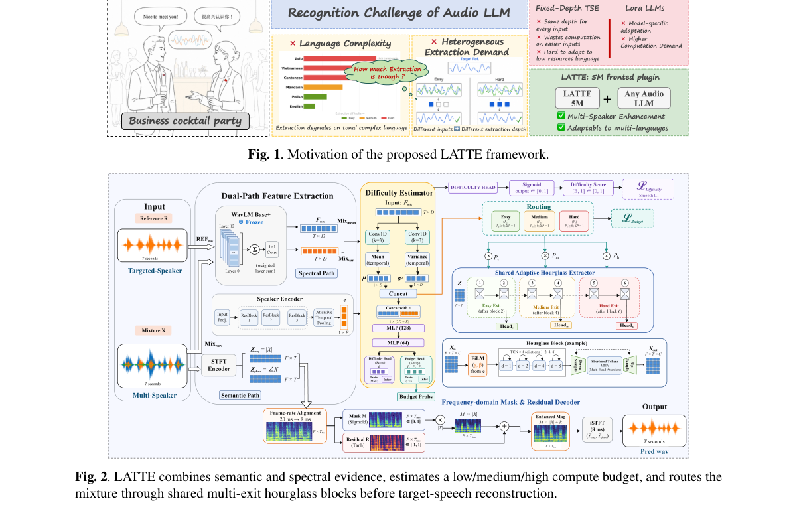

**Why this ranks #3**: 把「多语混合需求异质」转化为自适应深度，是前端模型少见的正确抽象。

---

### 4. SWEAR: Section-Wise Efficient Audio Reasoning via Self-Rated Difficulty

**arXiv**: [2610.13081](https://arxiv.org/abs/2610.13081) | **Score**: 7.3 (relevance 7 x 0.7 + quality 8 x 0.3) | **Tags**: audio-LM | **Categories**: cs.AI | **Pages**: 5

**Authors**: Yixuan Li, Minghao Lv, Xuenan Xu, Zihao Zheng, Mengyue Wu

**Affiliation**: 1 MoE Key Lab of Artificial Intelligence, X-LANCE Lab, Shanghai Jiao Tong University, China

**Abstract**

> Recent work on large audio-language models (LALMs) explores adaptive reasoning to balance accuracy and efficiency. However, existing approaches often rely on coarse-grained difficulty estimation, overlooking the diverse factors that determine reasoning effort. We address this limitation by deriving five-dimensional difficulty scores and compressed reasoning traces from complementary offline assessments. Based on this characterization, we propose SWEAR, a difficulty-aware reasoning framework that learns difficulty signals during supervised fine-tuning and uses reinforcement learning to adapt reasoning allocation across reasoning stages. Experiments on MMAU-test-mini and MMAR show that SWEAR improves accuracy while substantially reducing generated tokens, shortening reasoning for easy instances without sacrificing performance on difficult ones.

**Key findings**

- **Finding**: 自适应推理方法常依赖粗粒度难度估计，忽略决定推理投入的多样因素。

- **Finding**: SWEAR 导出**五维**难度刻画，并做分段（section-wise）的高效音频推理，由模型自评难度驱动。

- **Inference**: 「自评难度」比外部难度分类器更合适，因为它可以用模型自身的输出分布来估计——外部分类器则需要另一套标注，而难度对模型而言是相对的。

- **Recommendation**: 与本批 AudioTETRIS 同属音频 LLM 效率；一篇省 token、一篇省推理步数，两者可叠加。

**Key figures**

*Framework / architecture - Figure 1 Overview of our multi-dimensional difficulty-aware audio reasoning framework. (a) Offline linguistic and acoustic annotations estimate Planning, Caption, and Reasoning difficulty, which determ*

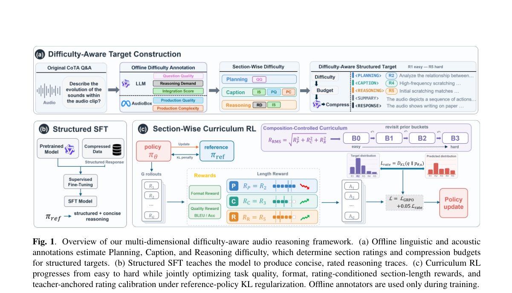

*Main result - Figure 2 Accuracy (bars) and mean output tokens (lines) across difficulty under DICoTA standard on MMAU and MMAR.*

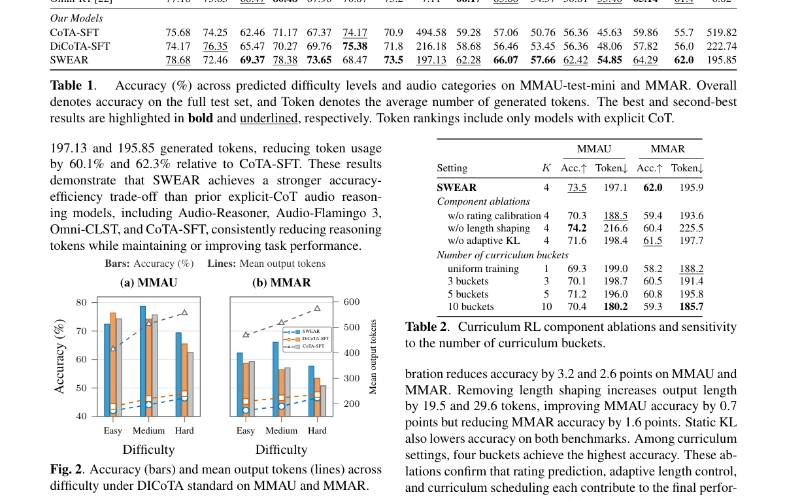

**Why this ranks #4**: 把「粗粒度难度」这个默认做法明确列为需要修正的东西，是常见的被忽视前提。

---

### 5. Lossless Inference Acceleration for ASR via EAGLE-Style Speculative Decoding

**arXiv**: [2610.13506](https://arxiv.org/abs/2610.13506) | **Score**: 7.3 (relevance 7 x 0.7 + quality 8 x 0.3) | **Tags**: audio-LM | **Categories**: cs.SD, eess.AS | **Pages**: 12

**Authors**: Sen Zhang, Xianghu Yue, Yiming Chen, Wenhuan Lu, Jianguo Wei, Haizhou Li

**Affiliation**: lege of Intelligence and Computing, Tianjin University, Tianjin 300350, China | Haizhou Li is with the School of Artificial Intelligence, The Chinese | University of Hong Kong, Shenzhen, Guangdong 518172, China, also with | the Department of Electrical and Computer Engineering, National University

**Abstract**

> Autoregressive Transformer and Conformer models have achieved state-of-the-art performance in automatic speech recognition (ASR). However, their sequential token generation mechanism imposes a significant bottleneck during decoding, resulting in substantial inference latency. While speculative decoding has emerged as a promising lossless acceleration technique, existing ASR-oriented approaches either suffer from low draft acceptance rates due to suboptimal draft quality or rely on specially designed external draft models, which limit their generality and practicality. To overcome these limitations, we propose EAGLE-ASR, a novel framework that accelerates ASR inference via EAGLE-style speculative decoding while strictly preserving lossless output quality. Specifically, we introduce Speech-Draft, a lightweight autoregressive module that serves as a universal draft model by jointly leveraging encoder acoustic features and hierarchical decoder representations from the target ASR model. Furthermore, we adopt a multi-step generation strategy with self-distilled data to train the Speech-Draft, enabling it to better approximate the target model's output distribution and maintain causal consistency during multi-token generation. Extensive experiments on representative Whisper and Conformer AED models demonstrate that EAGLE-ASR achieves significant lossless speedups of up to $1.9\times$ and $2.4\times$, respectively, consistently outperforming existing speculative decoding baselines for ASR. Our proposed framework further generalizes effectively to multilingual ASR and speech translation tasks, establishing EAGLE-ASR as a practical and universally applicable solution for accelerating modern ASR systems without compromising recognition accuracy.

**Key findings**

- **Finding**: ASR 的自回归逐 token 生成机制造成显著解码延迟；推测解码是已被 LLM 验证的应对方案。

- **Finding**: 本文把 EAGLE 风格的推测解码引入 ASR，且是**无损**加速。

- **Inference**: ASR 的输出空间小、句子短，理论上比 LLM 更适合推测解码（草稿命中率更高）——这篇的价值可能主要在工程可及性而非方法新意。

- **Recommendation**: 端侧 ASR 部署的读者可直接评估；无损保证意味着无需重新校准，这是其最大优势。

**Key figures**

*Framework / architecture - Figure 1 Pipeline of EAGLE-ASR. Training phase (upper): The Speech-Draft model is trained using a multi-token generation strategy together with a weighted cross-entropy loss with exponential decay. Dur*

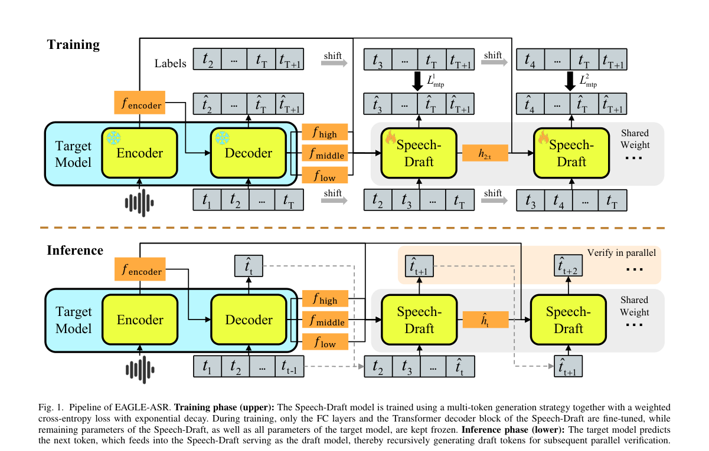

*Main result - Figure 2 The overall architecture of the Speech-Draft, which consists of two fully connected (FC) layers, an embedding layer, a Transformer decoder block, and an LM head.*

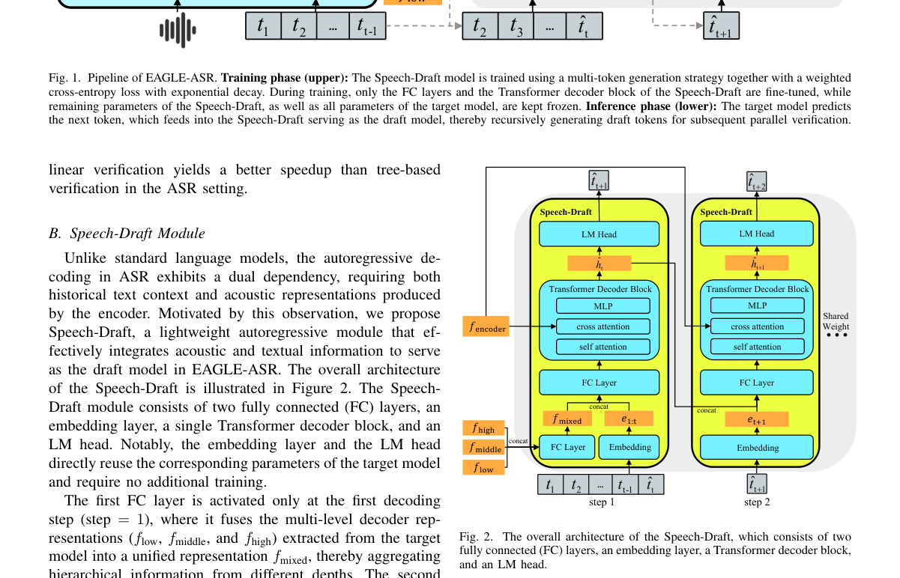

**Why this ranks #5**: 推测解码在 LLM 上已成熟，ASR 的自回归解码器此前缺少对应方案——这是一个明显的迁移机会。

---

### 6. Error Rate is Not Enough: Costs of Augmentation in Low-Resource ASR

**arXiv**: [2610.13807](https://arxiv.org/abs/2610.13807) | **Score**: 7.3 (relevance 7 x 0.7 + quality 8 x 0.3) | **Tags**: audio-LM | **Categories**: cs.CL | **Pages**: 5

**Authors**: Katsumi Ibaraki, David Chiang

**Affiliation**: University of Notre Dame | lection and the Tokyo University of Foreign Studies repository. All

**Abstract**

> Data augmentation is standard practice for low-resource automatic speech recognition (ASR), but its benefits are almost always reported as aggregate error rates, leaving open why and when a method helps. On four low-resource languages and English at five data sizes, we cross two augmentations that modify existing audio (speed perturbation and SpecAugment) with two that modify text transcriptions and synthesize audio from it. We analyze errors at the phoneme level and find that they help for complementary reasons. SpecAugment has the most reliable aggregate improvements, but increases tone and palatalization errors, whereas text-based methods introduce consonant insertions; in combination, each reduces the errors the other introduces. This complementarity is predictable. Tone and palatalization are each signaled by a single acoustic property and occur least frequently in training (lowest training exposure), and text-based methods that flatten word frequency raise their frequency by 37--38%, reversing those errors while further improving aggregate error. The improvement from combining the methods exceeds the sum of their individual improvements; the superadditivity vanishes by 100 hours, limiting the complementarity to the low-resource regime. Where specific error types matter, we recommend selecting augmentation by training exposure and acoustic properties, both measurable before any training.

**Key findings**

- **Finding**: 数据增强是低资源 ASR 标准做法，但收益几乎总以**聚合错误率**报告，无法解释成因与适用条件。

- **Finding**: 作者在四种低资源语言与英语、五种数据规模上交叉两种修改已有音频的增强方法（错误率之外的完整对照）。

- **Inference**: 这与本批 10-09 日报 Selective Listening 的结构完全相同：聚合指标掩盖了不同样本上方向相反的效应。区别是这篇聚焦数据增强而非模型行为，因此结论可直接指导语料策略。

- **Recommendation**: 低资源语音的读者必读；「为什么有帮助」而非「有没有帮助」的提问方式值得借用。

**Key figures**: 无可用图示（正文以表格与证明为主）。

**Why this ranks #6**: 「聚合错误率无法解释增强为何有效」是本批审计主题在 ASR 上的第四例，且方法学设计扎实（4 语言 × 5 数据规模 × 2 增强）。

---

### 7. Revisiting Accent Classification with DistilHuBERT: Speaker-Disjoint Evaluation and Cross-Corpus Generalization

**arXiv**: [2610.13440](https://arxiv.org/abs/2610.13440) | **Score**: 7.0 (relevance 7 x 0.7 + quality 7 x 0.3) | **Tags**: audio-LM | **Categories**: cs.CL, cs.LG, cs.SD, eess.AS | **Pages**: 9

**Authors**: Xu He, Homayoon Beigi

**Affiliation**: Columbia University | Columbia University, NYC, NY, USA | and Recognition Technologies, Inc.

**Abstract**

> Recent accent classification systems can achieve high accuracy in standard in-corpus evaluations. However, when speakers overlap between the training and test sets, such results may overestimate model robustness compared with real-world deployment scenarios. This study revisits the robustness of DistilHuBERT-based accent classification by using L2-ARCTIC and multiple external English accent datasets. The comparison covers file-level and speaker-disjoint splits, along with balanced external-data training and teacher-student pseudo-labeling. The large performance gap between in-corpus and external evaluations suggests that file-level evaluation substantially overestimates performance, while speaker-disjoint evaluation can provide a more realistic estimate of the generalization to unseen speakers. In this study, models trained on external data alone do not reliably generalize to L2-ARCTIC. Among the tested configurations, balanced external-data training offers the most promising supervised setting. The pseudo-labeling experiments further indicate that confidence-based filtering alone is insufficient under domain mismatch. Overall, this study suggests that robust accent classification evaluation should simultaneously include speaker-disjoint evaluation and cross-corpus testing.

**Key findings**

- **Finding**: 标准同语料评测中说话人在训练与测试间重叠，结果可能高估相对真实部署的鲁棒性。

- **Finding**: 作者以**说话人不重叠**评测加跨语料泛化重新检视 DistilHuBERT 的口音分类。

- **Inference**: 说话人重叠意味着模型可能记忆说话人特有的发音特征而非学习口音——这种泄漏在同语料评测里完全不可见，因为训练与测试共享同一批人的发音。

- **Recommendation**: 任何做说话人相关分类的团队都应自查数据划分；本文的重测结果值得直接引用。

**Key figures**

*Framework / architecture - Figure 1 Overview of the speaker-disjoint and cross- corpus evaluation framework. Solid arrows indicate supervised training and evaluation, while dashed arrows indicate the use of external data for b*

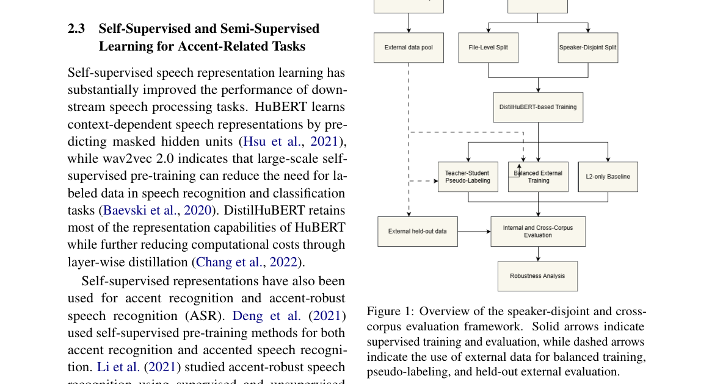

**Why this ranks #7**: 「说话人重叠使评测高估鲁棒性」是一个数据划分的经典陷阱，但很少被显式重测。

---

### 8. VoxAnon: A balanced dataset for a fair evaluation of speech anonymization

**arXiv**: [2610.13313](https://arxiv.org/abs/2610.13313) | **Score**: 6.3 (relevance 6 x 0.7 + quality 7 x 0.3) | **Tags**: audio-LM | **Categories**: cs.SD, eess.AS | **Pages**: 5

**Authors**: Orane Dufour, Paul Magron, Mickael Rouvier

**Affiliation**: Universit´e de Lorraine, CNRS | Inria, LORIA, F-54000 Nancy, France | LIA, Avignon University

**Abstract**

> Speech anonymization is evaluated with automatic speaker verification attackers whose performance depends on the attribute distribution of both their training and evaluation data, which may bias privacy estimates for some speaker groups. To alleviate this issue, we introduce VoxAnon, a dataset built from VoxCeleb1 and 2 with training and evaluation splits balanced across gender, age, accent, and pitch. We extract and cross-check attributes using two complementary methods, balance trial lists per subgroup, and draw test/enrollment utterances from distinct video sources in order to limit linguistic and session bias. Comparing VoxAnon with unbalanced training and test data across four attackers and three anonymizers, we show that attribute imbalance changes which subgroups appear hardest to re-identify, in directions that depend on the attribute. In the balanced setting, residual disparities persist, mostly tied to accent and pitch, and depend on the anonymizer/attacker pair. Code and trial lists are publicly available.

**Key findings**

- **Finding**: 语音匿名化评估依赖 ASV 攻击者，而攻击者性能取决于其训练与评测数据的属性分布。

- **Finding**: 该分布可能对某些说话人群体偏置**隐私估计**；VoxAnon 从 VoxCeleb1/2 构建属性平衡的数据集。

- **Inference**: 把「评估工具本身有偏」写进隐私论文，是一个方法学上的自我修正——若攻击者在某些群体上本就弱，则该群体的隐私会被系统性地高估。

- **Recommendation**: 与 10-07/10-08 日报的多语匿名化攻击与校准工作连读，三篇构成匿名化评估的方法学链条。

**Key figures**

*Framework / architecture - Figure 1 Trial difficulty across subgroups in the balanced test set.*

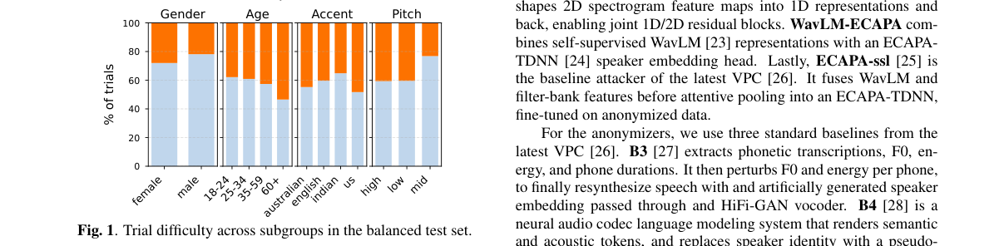

*Main result - Figure 2 Balanced and unbalanced sets comparisons: percentage of attack scenarios for which the undersampled subgroup for each category obtained the highest and lowest EER, corresponding to the hardest*

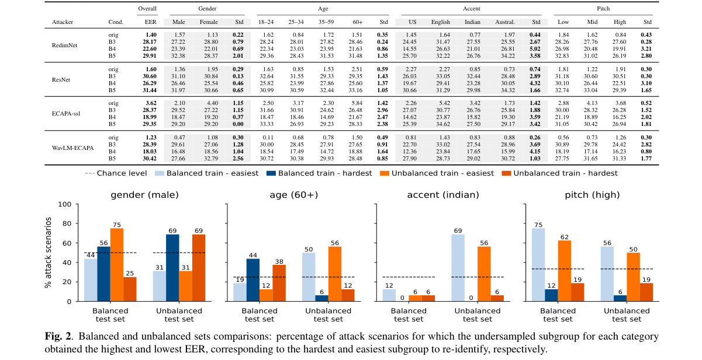

**Why this ranks #8**: 攻击者的训练数据分布会偏置被攻击方的隐私估计——这个视角此前很少被显式建模。

---

### 9. Beyond the Final Embedding: Retrieving Memories from Token-Level Evidence

**arXiv**: [2610.13277](https://arxiv.org/abs/2610.13277) | **Score**: 6.3 (relevance 6 x 0.7 + quality 7 x 0.3) | **Tags**: audio-LM | **Categories**: cs.CL, cs.IR | **Pages**: 16

**Authors**: Han Luo, Zhan Zhuang, Xu He, Jujia Zhao, Yu Li, Suqin Yuan, Dong Li, Lei Feng

**Affiliation**: 1Southeast University | 3Leiden University | 4University of Sydney

**Abstract**

> Memory-augmented assistants retrieve evidence from stored conversations and documents to answer queries. Most embedding-based retrievers compare single-vector representations of queries and memories, even when relevance depends on a small part of the content. Such local evidence can be matched to queries using the contextual token representations already computed by the same embedding models. Our method uses sparse token matching to improve retrieval without additional training. Each query token retrieves a small set of matching tokens across candidate memories. The matching scores are aggregated for each memory and combined with whole-memory similarity to rank memories. An optional low-rank query adapter can be trained with supervision while keeping the encoder and stored memory representations fixed. Our method improves retrieval across eight benchmarks and multiple model families without additional training. Query adaptation further increases the gains to 13.3 and 14.3 percentage points in average Recall@10 and NDCG@10 on Qwen3-Embedding-4B. These retrieval gains translate into higher question-answering accuracy on long-term memory benchmarks.

**Key findings**

- **Finding**: 多数嵌入检索器比较单向量表示，即使相关性只取决于内容的一小部分。

- **Finding**: 本文改用上下文的 token 级证据做局部匹配来检索记忆。

- **Inference**: 单向量检索的隐含假设是相关性在整段内容上均匀分布，而这在对话记忆里几乎不成立——答案通常来自某一轮的某一句。

- **Recommendation**: 与 10-07 日报 PERSIST（记忆需带修订语义）、10-09 日报 Gated Memory（记忆形成是绑定约束）构成连续三天的记忆线索。

**Key figures**

*Framework / architecture - Figure 1 Local evidence from existing token representations. Training-free fusion raises the relevant memory from rank 28 to 1 and yields a net gain of 523 Top-10 hits on LoCoMo.*

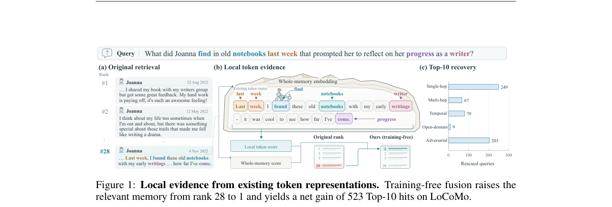

*Main result - Figure 2 Sparse token matching for memory retrieval. Query tokens retrieve matching states from the frozen memory bank; matches are aggregated by source memory and fused with whole-memory similarity*

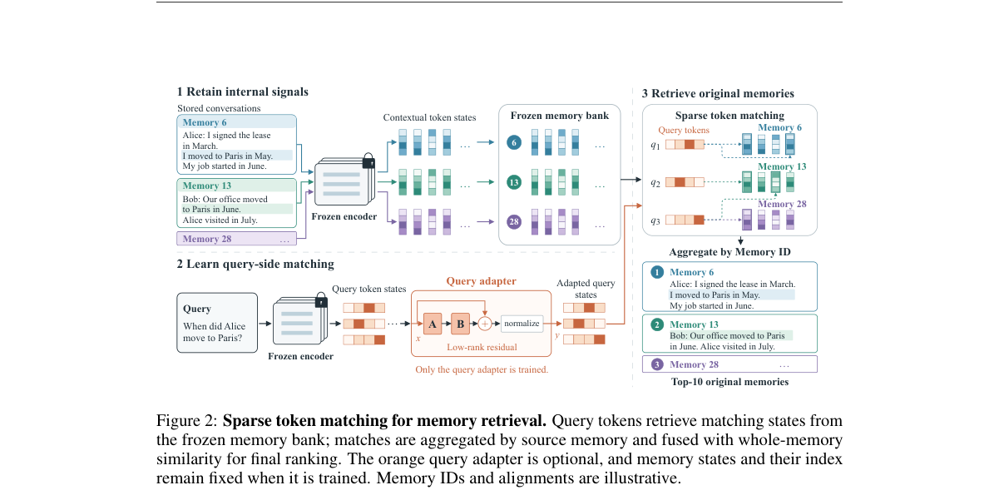

**Why this ranks #9**: 「单向量 vs 局部证据」是检索的一个基本假设，本篇直接挑战它。

---

### 10. Frontend-Assisted Large Audio-Language Models for SLT2026 SmartGlasses Challenge

**arXiv**: [2610.13282](https://arxiv.org/abs/2610.13282) | **Score**: 6.3 (relevance 6 x 0.7 + quality 7 x 0.3) | **Tags**: audio-LM | **Categories**: cs.SD, eess.AS | **Pages**: 4

**Authors**: Yushi Wang, Zeyan Song, Xiaobin Rong, Chengwei Liu, Jun Gao, Jing Lu

**Affiliation**: 1Key Laboratory of Modern Acoustics, Nanjing University, Nanjing, China | 3Qwen Business Unit of Alibaba, Hangzhou, China

**Abstract**

> This paper describes our systems for the Track 1 time-stamped speaker-attributed ASR task of the SmartGlasses Challenge. To handle overlapping speech, background noise and far-field conditions in two-person conversations, we employ SoulX-Transcriber, a multimodal large language model that takes full-length audio as input and generates structured transcriptions. In addition, we investigate the effect of speech frontend processing, including a rule-based Guided Source Separation method and a data-driven speech separation model, both of which improve performance on the validation set. Considering inference stability, our final submission uses the fine-tuned SoulX-Transcriber system, achieving a tcpCER of 6.22 on the test set.

**Key findings**

- **Finding**: 任务要求处理两人对话中的重叠语音、背景噪声与远场条件，并输出带时间戳的说话人归属转写。

- **Finding**: 系统使用 SoulX-Transcriber——一个接受**全长音频**输入的多模态大语言模型。

- **Inference**: 「全长输入」是多模态 LLM 相对级联式 ASR 的核心优势：无需先做活动检测与分段，因此重叠语音的时间戳归属不受分段误差影响。

- **Recommendation**: 系统报告类论文，价值在技术选型与数据；与本批 DuRe-ST 类图方法（10-08）可对照。

**Key figures**

*Framework / architecture - Figure 1 Overview of our systems, where the three systems are developed and evaluated independently.*

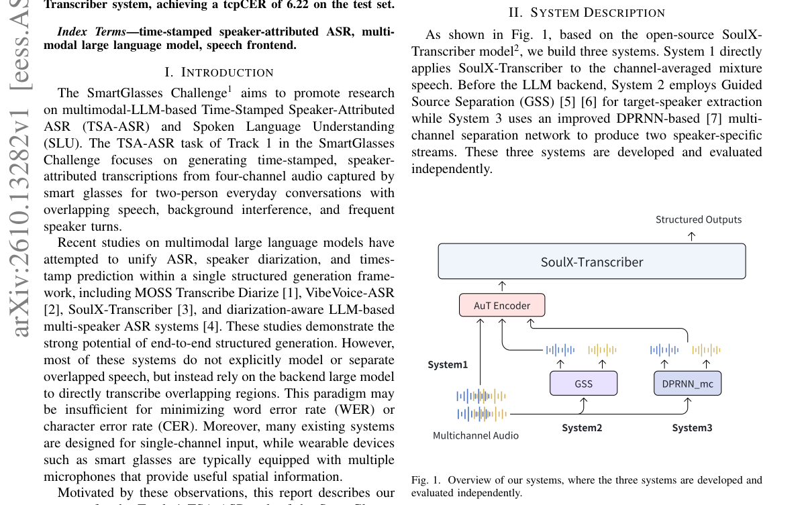

*Main result - Figure 2 Chat-level average tcpCER across different speech overlap ratio levels (Low/Mid/High) for different systems on the Track 1 TSA-ASR task official validation set.*

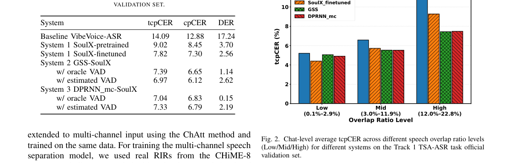

**Why this ranks #10**: 系统报告，但全长音频输入的多模态 LLM 用于说话人归属 ASR 是一个明确的技术选型。

---

## Footer

- Total papers reviewed across all 5 tracks: 50 (from 488 scanned)
- audio_lm track final top-10: 10
- Wild-cards in this track: 6
- Figure assets: `res/` (shared across tracks)

Generated by `mine-arxiv-daily-digest` skill. Sister file: `2026-10-12_audio_lm_entry.md`.
