# ArXiv Daily Digest - 2026-10-12 (具身智能与世界模型, 10 papers)

**Generated**: 2026-10-12 17:00 CST

**Source**: arXiv cs.CV, cs.SD, eess.AS, cs.CL, cs.AI, cs.RO, cs.LG submissions, window 2026-10-09 UTC (latest announced batch as of 2026-10-12 17:00 CST; 10-10/10-11 were weekend with no announcement)

**Track**: embodied (top 10 of 488 papers scanned, 50 full reads)

**Scope**: world-model synthetic data with physical grounding, learning future operation targets for VLA, continual steering of generalist policies with world models, personalized VLA from captured scenes, temporal MoE distillation for navigation, dexterous manipulation benchmark with dynamic phenomena, contact-aware retargeting for humanoid skills, offline goal-conditioned policy optimization, wrist-centric human demonstrations, dual-stream memory

---

本批具身线的主线是**用世界模型承担某个原本由数据承担的角色**——三篇高相关论文各做了一次。**Beyond Actions** 的出发点是一个观察：**动作说明机器人执行什么，但不描述这些命令将达成什么**，而 VLA 却主要通过预测动作块来学习；AFCE 因此让一个以未来为基准的物理**效果**成为主要预测目标。这是 10-08 日报「预测精度/动作相关性/目标达成度是三个不同的量」那条批判线的**第五次延续**，且给出了最直接的修法。**Grounded-Dreamer** 让世界模型承担数据合成的角色——既有人类遥操作贵、仿真缺视觉真实性、人类视频缺本体标注，而世界模型合成数据补的正是物理 grounding。**Dream to Remember** 让世界模型承担**记忆**的角色：任务顺序到来时两种 RL 路径都会覆盖旧能力，而用世界模型持续引导可避免灾难性遗忘。

另有一篇用数字说话：**Splat2Act** 报告即便是 π0.5 这样的强通才策略，在用户自己捕获的部署场景中**不经适配即 0% 抓取成功率**——0% 而非「较差」说明这不是精度问题，而是分布完全错配，把「个性化」从性能优化变成了可用性前提。其余是数据来源的三条路：腕部中心的人类演示（Human2Dex，把不可迁移的关节空间转到可迁移的接触空间）、接触感知的视频重定向（VICAR，补上视频不含力信息的关键缺口）、以及两个 VLA 后训练方法（OGPO 指出轨迹级模仿使策略偏向演示特定的解；双流记忆把状态跟踪与证据恢复分给两种表示）。

---

## Top 10 - 具身智能与世界模型

### 1. Beyond Actions: Learning Future Operation Targets for Vision-Language-Action Models

**arXiv**: [2610.13212](https://arxiv.org/abs/2610.13212) | **Score**: 9.0 (relevance 9 x 0.7 + quality 9 x 0.3) | **Tags**: embodied-ai, world-model | **Categories**: cs.AI, cs.RO | **Pages**: 18

**Authors**: Min Lin, Bokai Zhou, Jianqi Lin, Kaiyuan Yang, Yicheng Chang, Junjie Yu, Xiaofan Liu, Jianhua Han, Rui Li, Shen Zhao, Xiaodan Liang

**Affiliation**: 1Sun Yat-sen University | 2Yinwang Intelligent Technology Co., Ltd.

**Abstract**

> Actions specify what a robot should execute, but do not describe what those commands will achieve. Vision-language-action (VLA) policies nevertheless learn primarily by predicting action chunks from images, language, and state. We introduce Action--Future Coupled Effect Learning (AFCE), which makes a future-grounded physical Effect the policy's primary prediction target. An offline tokenizer constructs temporally ordered Effect tokens from demonstrated actions, realized robot responses, and sparse visual transitions. Reconstruction objectives encourage the representation to retain executable detail and observed physical change. A flow-matching VLA predicts Effects from current images, instruction, and robot state, while a state-conditioned decoder converts them into action chunks. Embodiment-specific interfaces allow single- and dual-arm tasks to share the Effect model. On DexJoCo, AFCE achieves $50.97\%$ overall success, improving over $π_{0.5}$ and UVT by 11.82 and 15.21 percentage points, respectively. It leads on all five bimanual tasks, highlighting the value of Effect supervision for coordinated dexterous manipulation. The project page is available at https://afceproject.github.io/AFCE-Web/.

**Key findings**

- **Finding**: **动作说明机器人执行什么，但不描述这些命令将达成什么**——这是本篇的出发点。

- **Finding**: VLA 策略却主要通过预测动作块来学习；AFCE 让一个以未来为基准的物理**效果**成为策略的主要预测目标（Action–Future Coupled Effect）。

- **Inference**: 把预测目标从「命令」换成「结果」，是因为命令在多解任务上不唯一——同一目标可由多组动作达成，而其中只有一部分在当前状态下可执行。直接预测效果让策略在训练时就接触到了可执行性问题。

- **Recommendation**: 被精读的三篇之一。接上 10-08 的 Predicted Futures Are Not Enough、RoboJEPA、ΔWAM，构成第五天的同一条批判线。

**Key figures**

*Framework / architecture - Figure 1 Comparison of policy supervision paradigms. A standard VLA predicts actions directly; world-action models use future dynamics to support control; AFCE predicts an action-decodable Effect gro*

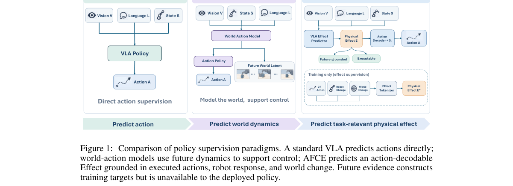

*Main result - Figure 2 Overview of Action–Future Coupled Effect Learning (AFCE). Stage I fuses demon- strated actions At, robot response ∆St, and visual transitions Vt into ordered Effect tokens E∗*

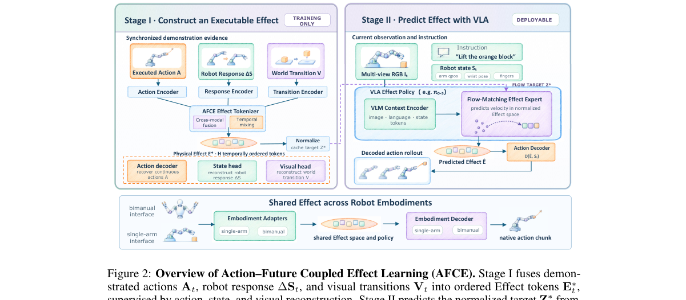

**Why this ranks #1**: 这是 10-08 日报「预测精度/动作相关性/目标达成度是三个不同的量」那条线的第五次延续，且给出了最直接的修法。

---

### 2. Grounded-Dreamer: Robot Learning from World Model Synthetic Data with Physical Grounding

**arXiv**: [2610.13164](https://arxiv.org/abs/2610.13164) | **Score**: 9.0 (relevance 9 x 0.7 + quality 9 x 0.3) | **Tags**: world-model, embodied-ai | **Categories**: cs.RO | **Pages**: 17

**Authors**: Feng Jiang, Shu Chen, Yuanfei Wang, Yuan Li, Zhenhao Shen, Jiaqi Liang, Yang Chen, Lei Wei, Chen Xie, Ruihai Wu

**Affiliation**: 1Peking University | 2Hong Kong University of Science and Technology (Guangzhou)

**Abstract**

> Scaling robot manipulation policies requires large amounts of diverse, action-labeled data, yet collecting such data in the real world remains expensive and difficult to scale. Existing methods either depend on human teleoperation, rely on simulation with limited visual realism, or use human videos that lack embodiment-specific annotations. In this paper, we introduce Grounded-Dreamer, a framework for synthesizing physically grounded robot manipulation data with video world models while avoiding human teleoperation demonstrations. Grounded-Dreamer combines the visual realism of generative video models with simulator physics engines. Starting from a small set of real images depicting robot task initial states, our method automatically reconstructs task-relevant objects and camera geometry, aligns them in simulation, and collects physically valid trajectories. These trajectories are used to post-train both a video world model and an inverse dynamics model, enabling the generation of visually realistic robot manipulation videos and corresponding robot actions from real images. To filter physically implausible rollouts, Grounded-Dreamer replays generated trajectories in the reconstructed simulation and retains only those that successfully complete the tasks. The real-world robot policies are trained solely on the grounded synthetic trajectories without any human demonstrations. Empirical results in real-world tasks demonstrate that Grounded-Dreamer can synthesize physically grounded data and substantially facilitate policy learning without requiring human teleoperation effort.

**Key findings**

- **Finding**: 三类既有来源各有缺口：人工遥操作（贵）、仿真（视觉真实性有限）、人类视频（缺本体特定标注）。

- **Finding**: Grounded-Dreamer 从世界模型的合成数据中学习机器人策略，并以**物理 grounding** 作为关键补充。

- **Inference**: 世界模型合成数据天然带动作标签与视觉多样性，缺的正是 grounding——即合成画面是否对应了物理上可达的状态。这个补充若做不实，策略会学到视觉上正确但物理上错误的行为。

- **Recommendation**: 与 10-09 日报的 RoboRender（机器人导向视频生成）同属「为机器人合成数据」路线，两篇对 grounding 的处理方式可对照。

**Key figures**

*Framework / architecture - Figure 1 Overview of Grounded-Dreamer. Our framework automates the generation of massive, high-fidelity robot data from a small number of real-world reference images. By combining generative world mo*

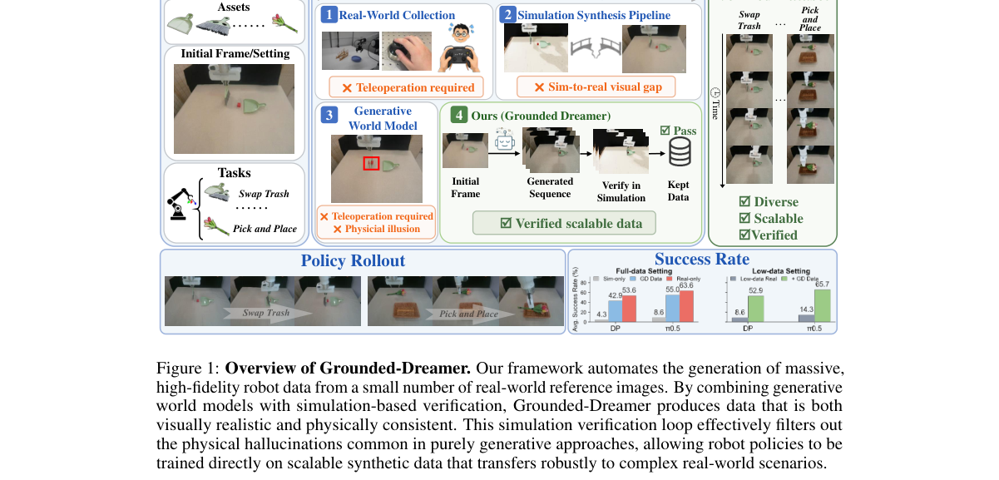

*Main result - Figure 2 The Grounded-Dreamer Pipeline. Given several real-world reference images, our pipeline first reconstructs physically aligned simulation scenes and objects. Within these environments, task da*

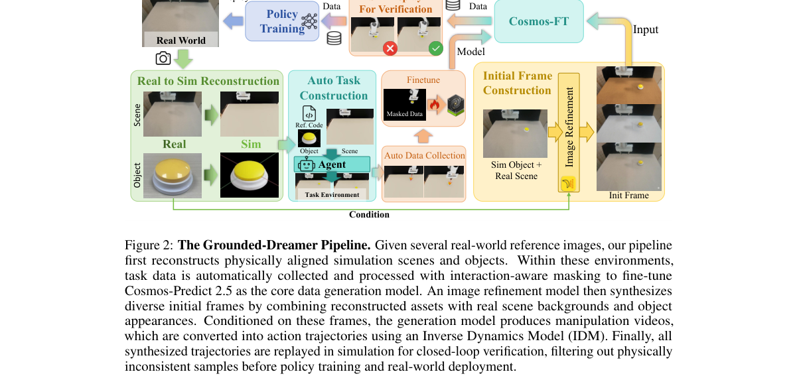

**Why this ranks #2**: 把三类既有数据来源各自的缺口列清，并逐一对应，是一篇结构清晰的数据方法论论文。

---

### 3. Dream to Remember: Continual Steering of Generalist Robot Policies with World Models

**arXiv**: [2610.13816](https://arxiv.org/abs/2610.13816) | **Score**: 9.0 (relevance 9 x 0.7 + quality 9 x 0.3) | **Tags**: world-model, embodied-ai | **Categories**: cs.CV, cs.LG, cs.RO | **Pages**: 31

**Authors**: Bahey Tharwat, Iman Nematollahi, Marvin Alles, Xingyuan Zhang, Akshay L Chandra, Abhinav Valada

**Affiliation**: 2Technical University of Munich | on large demonstration corpora (Chi et al., 2025; Lipman et al., 2023; Black et al., 2024; NVIDIA

**Abstract**

> Generalist robot policies are trained with imitation learning and are bounded by the quality and coverage of their demonstrations. Reinforcement learning can improve and extend them, either by fine-tuning the policy weights or by training a small module to steer the input noise of a frozen generative policy. When tasks arrive sequentially, both approaches suffer from catastrophic forgetting. Fine-tuning on a task degrades prior tasks, and steering only shifts forgetting to the shared steering module. We propose Dream to Remember (D2R), which continually steers a frozen generalist policy toward new tasks, while retaining its earlier skills. As the steering module learns a new task, a frozen pretrained world model rehearses prior tasks through imagined rollouts, anchoring the module to its earlier behavior without a replay buffer or new data. When the world model is faithful enough, D2R learns the new task entirely in imagination. Otherwise, it learns the task in the environment while using the world model only to rehearse prior tasks. On CALVIN, D2R improves eight tasks in sequence entirely in imagination, raising average success from 63.7% to 74.8%, while LoRA fine-tuning on the same sequence drops it to 11.7%. With a frozen off-the-shelf generalist policy and world model, $π_0$ and A2World, D2R learns unseen LIBERO-90 tasks in the environment while keeping $π_0$'s performance on the LIBERO suites it was fine-tuned on, even though the world model is not accurate enough for policy optimization. Finally, on a real Franka robot, D2R improves three tasks in sequence entirely in imagination while retaining the earlier improvements.

**Key findings**

- **Finding**: 通才策略受演示质量与覆盖限定；RL 可通过微调权重或训练小模块引导冻结生成策略的输入噪声来扩展能力。

- **Finding**: 当任务**顺序到来**时，两种做法都受损——即被新任务覆盖旧任务。

- **Finding**: Dream to Remember 用世界模型持续引导通才策略，标题即点明「用世界模型记住」。

- **Inference**: 把世界模型用作记忆而非监督，是第三条路：任务到来时不需要新演示，而由模型「想象」旧任务以避免遗忘——这把记忆问题转成了世界模型质量问题。

- **Recommendation**: 与本批 Beyond Actions、Grounded-Dreamer 构成今日具身三强，共同点都是「用世界模型承担某个原本由数据承担的角色」。

**Key figures**

*Framework / architecture - Figure 1 Dream to Remember (D2R): We adapt a frozen generative policy sequentially by steering its input noise with a small module trained inside a learned world model. While the module learns the cu*

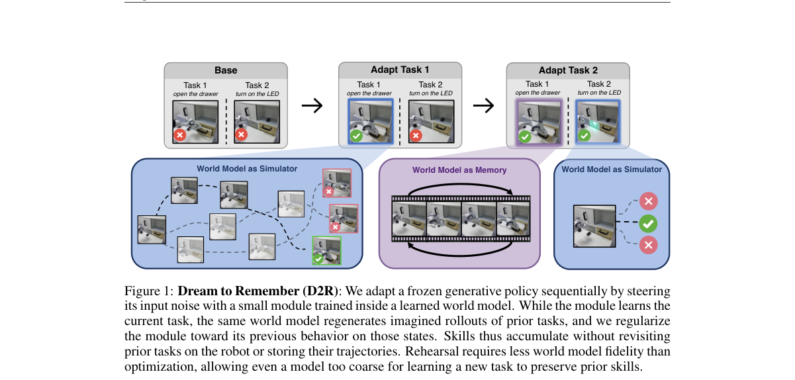

*Main result - Figure 2 Overview of D2R. (a) Steering in imagination: A small steering module learns to shape the noise fed to the frozen policy through RL in a frozen world model. (b) Rehearsal in the world model:*

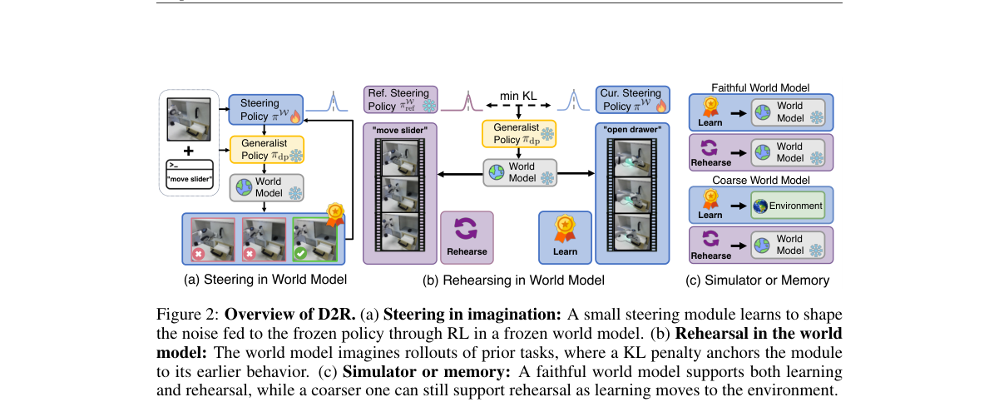

**Why this ranks #3**: 「任务顺序到来」这一设定把灾难性遗忘从理论问题变成了部署必然事件。

---

### 4. Splat2Act: From Captured Scenes to Personalized VLA Manipulation

**arXiv**: [2610.13945](https://arxiv.org/abs/2610.13945) | **Score**: 8.7 (relevance 9 x 0.7 + quality 8 x 0.3) | **Tags**: embodied-ai | **Categories**: cs.CV, cs.RO | **Pages**: 9

**Authors**: Xiaomeng Ye, Krishna Jaganathan, Gyubeum Lim, Gunjan Chhablani, Muhammad Zubair Irshad, Zsolt Kira

**Affiliation**: 1Institute for Robotics and Intelligent Machines, Georgia Institute of | USA. 3Toyota Research Institute, Cambridge, MA, USA. Emails: {xye87,

**Abstract**

> A user who brings a generalist manipulation policy into their home or office wants it to pick up their objects from their shelves, counters, and tables. Yet even a strong generalist like $π_{0.5}$ achieves 0% pickup success in our captured deployment scenes without adaptation, and collecting real demonstrations in every user's environment is prohibitively expensive. We present Splat2Act, an automated real-to-sim-to-real pipeline that personalizes a pretrained vision-language-action (VLA) policy to a specific scene and object set using only a handheld phone scan and images of the user's objects. Unlike prior real-to-sim work that reconstructs individual tabletops, Splat2Act operates on building-scale indoor environments: it builds a photorealistic digital twin with 3D Gaussian Splatting and collision geometry, automatically discovers tabletop and non-tabletop receptacles, constructs feasible pickup tasks, and generates successful demonstrations with a privileged simulation oracle, with only scene and object capture required from a human. Applied to 101 scanned campus environments with a median navigable area of 104.87 m$^2$ and 7 receptacles, the pipeline yields 852 receptacles and over 68,000 pickup demonstrations. We fine-tune $π_{0.5}$ in two stages: Stage 1 adapts to hundreds of public object assets, drawn either from the deployment scene alone or from all 101 scenes; Stage 2 personalizes to the user's own objects on the deployment scene's receptacles. Our strongest personalized policy reaches 62.5% aggregate pickup success in the target scene. Deployed on a real Stretch 3, the same policy achieves 63.9% success on a 12-task subset, closely tracking its 66.7% simulated success on those tasks. These results suggest that automated real-to-sim-to-real training can personalize VLA manipulation policies using only simulation-oracle data.

**Key findings**

- **Finding**: 即便是 π0.5 这样的强通才策略，在用户自己捕获的部署场景中**不经适配即 0% 抓取成功率**。

- **Finding**: 而在每个用户环境采集真机演示贵得不可行；Splat2Act 从捕获场景走向个性化 VLA 操作。

- **Inference**: 0% 而非「较差」，说明失败不是精度问题而是分布完全错配（用户自己的物件与布局从未被见过）。这把「个性化」从性能优化变成了可用性的前提条件。

- **Recommendation**: 与本批 Human2Dex、AutoBio+ 对照：三篇分别处理场景个性化、手形差异与实验室动态现象。

**Key figures**

*Framework / architecture - Figure 1 An overview of Splat2Act. From a handheld scan of a deployment scene and images of user-selected objects, Splat2Act builds a simulation-ready digital twin, generates pickup demonstrations with*

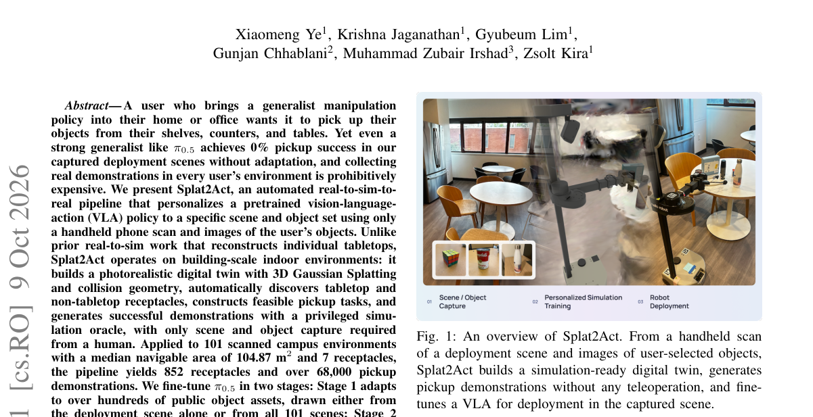

*Main result - Figure 2 The end-to-end pipeline of Splat2Act. Scene captures are reconstructed as a 3DGS with a mesh collision geometry, while simulation-ready 3D assets are generated from object captures. Receptacle*

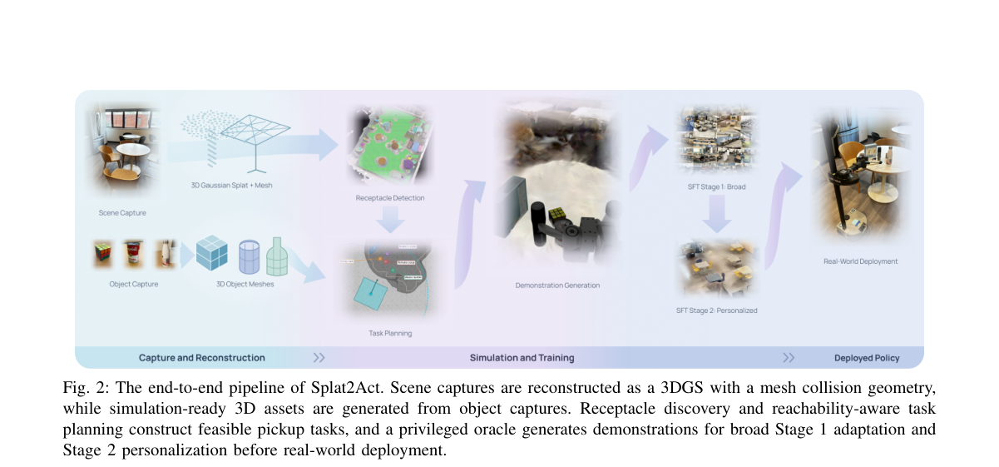

**Why this ranks #4**: 「0% 成功率」这个数字把个性化适配的必要量化到了极致。

---

### 5. TAME-Nav: Temporal Asymmetric Mixture-of-Experts Distillation for Agile and Versatile Robot Navigation

**arXiv**: [2610.12877](https://arxiv.org/abs/2610.12877) | **Score**: 8.0 (relevance 8 x 0.7 + quality 8 x 0.3) | **Tags**: embodied-ai | **Categories**: cs.RO | **Pages**: 8

**Authors**: Lingjie Zhang, Jun Xue, Shanze Wang, Haoyu Xi, Xinming Zhang, Xiaoyu Shen, Wei Zhang

**Affiliation**: 1 Shanghai Jiao Tong University, Shanghai, China. | 2 Eastern Institute of Technology, Ningbo, China. | Polytechnic University, Hung Hom, Kowloon, Hong Kong. | 4 University of Science and Technology of China, Hefei, China.

**Abstract**

> Agile and reliable navigation is a core capability for embodied robots navigating complex spatial constraints and dynamic interactions. However, a single policy often struggles to accommodate the distinct decision-making demands of diverse scenarios. We present TAME-Nav, an asymmetric Teacher-Student navigation framework built around a temporal soft mixture of experts (Soft-MoE). The Teacher combines clean observations with causally maintained dynamic-obstacle tracks to construct privileged representations, while the Student learns complementary navigation features from corrupted observation histories through temporal encoding, soft expert routing, and latent distillation. Procedural scenario generation and parallel task-level simulation broaden training coverage, while deployment-informed asymmetric domain randomization supports sim-to-real transfer. Across in-distribution and unseen compositional scenarios, TAME-Nav achieves higher success rates, lower collision rates, and higher navigation scores than representative baselines. On a real quadruped robot, it completes all twenty trials across local-trap escape and narrow-passage navigation with sudden dynamic obstacles, with only one minor contact.

**Key findings**

- **Finding**: 单一策略难以兼顾不同场景各异的决策需求；TAME-Nav 用**时间软混合专家**的非对称师生框架。

- **Inference**: 「时间软混合」意味着专家切换由时间而非空间位置驱动——对导航而言，速度与动态性确实是区分场景的主要维度，这比按区域切分专家更贴合任务结构。

- **Recommendation**: 导航方向的读者注意；与 10-09 日报的 Path-Creative Navigation 对照，两篇分别处理导航的策略容量与环境假设。

**Key figures**

*Framework / architecture - Figure 1 Overview of TAME-Nav. The Teacher combines clean observation histories with causal dynamic tracks, while the temporal Soft-MoE Student learns from corrupted histories through latent distillati*

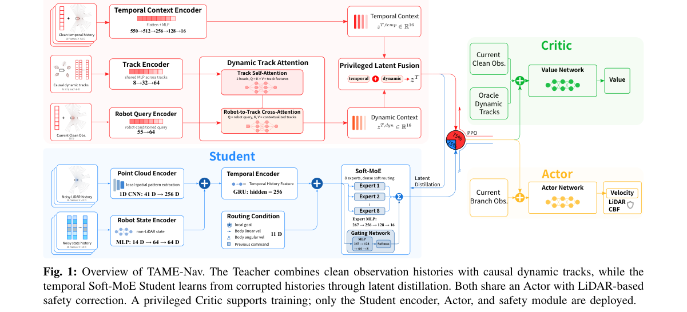

*Main result - Figure 2 Representative layouts from the six training scene families, each containing 100 distinct maps.*

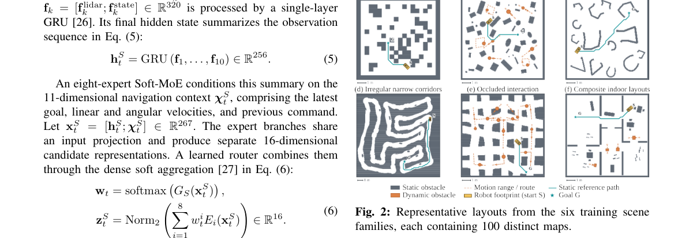

**Why this ranks #5**: 「单一策略难以满足各异场景」这一诊断直接指向专家混合，且是非对称（师生）的设计。

---

### 6. AutoBio+: Benchmarking Dexterous Manipulation with Dynamic Experimental Phenomena in Realistic Laboratories

**arXiv**: [2610.13643](https://arxiv.org/abs/2610.13643) | **Score**: 7.3 (relevance 7 x 0.7 + quality 8 x 0.3) | **Tags**: embodied-ai `[wild-card]` | **Categories**: cs.RO | **Pages**: 13

**Authors**: Xuanye Wu, Yue Shi, Yongcan Yang, Yiqun Wang, Zhaoqi Wan, Dayu Xia, Jiezhang Cao, Xiangfei Li, Yao Mu, Guangtao Zhai

**Affiliation**: Experimental Phenomena in Realistic Laboratories | 1Shanghai AI Laboratory | 2Huazhong University of Science and Technology | 3Shanghai Jiao Tong University

**Abstract**

> Automating biological laboratories requires robots to perform dexterous tool interactions under realistic visual conditions while handling dynamic experimental phenomena, presenting significant challenges for robotic manipulation. To enable systematic evaluation under these conditions, we introduce AutoBio+, a simulation benchmark and framework for dexterous manipulation in realistic biological laboratory environments. AutoBio+ comprises 14 tasks across 4 robot embodiments, spanning functional tool use, precision manipulation, language-conditioned visual grounding, and instrument operation. We introduce controllable dynamic experimental phenomena, including flames, vapor, and bubbles, to capture the evolving visual conditions of laboratory procedures. To further enhance environmental realism, we develop a hybrid rendering pipeline that integrates interactive simulated foreground objects with Gaussian-splatting backgrounds reconstructed from 6 real laboratory scenes. For efficient large-scale data generation and evaluation, we further build a parallel simulation framework on top of mjlab, proposing Parallel Finite-State Machine (PFSM) and integrating batched rendering with decoupled trajectory replay for demonstration generation and model-independent closed-loop policy evaluation. Our evaluation reveals substantial variation in policy performance across tasks, exposing distinct strengths and weaknesses of current manipulation policies. Real-world experiments further demonstrate a reduced sim-to-real gap, supporting the validity of AutoBio+ for realistic manipulation evaluation. Supplementary materials are available at https://autobio-plus.github.io/AutoBioPlus.

**Key findings**

- **Finding**: 生物实验室自动化要求机器人在真实视觉条件下做灵巧工具交互，**同时处理动态实验现象**。

- **Finding**: AutoBio+ 提供面向灵巧操作的仿真基准与框架，覆盖这些动态条件。

- **Inference**: 把「动态现象」纳入基准，意味着操作策略必须处理**过程中的变化**（试剂反应、液体状态），而现有基准多为静态目标——这与本批 Splat2Act 的 0% 失败共同说明部署环境比基准假设更动态。

- **Recommendation**: wild-card 项，领域专用但方法学价值高；动态现象的建模方式决定基准能否推广到其他实验室。

**Key figures**

*Framework / architecture - Figure 1 Overview of AutoBio+. AutoBio+ is a benchmark for dexterous manipulation in biological laboratories, comprising 14 tasks across four robot embodiments and incorporating three dynamic experimen*

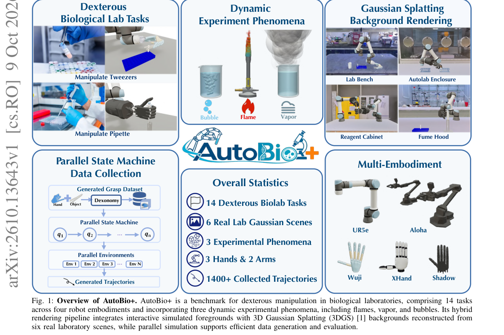

*Main result - Figure 2 Tasks Overview and Dynamic Experimental Phenomena. The top figure illustrates all 14 tasks in AutoBio+ along with the interactive assets, while the bottom figure presents the 3 types of dynami*

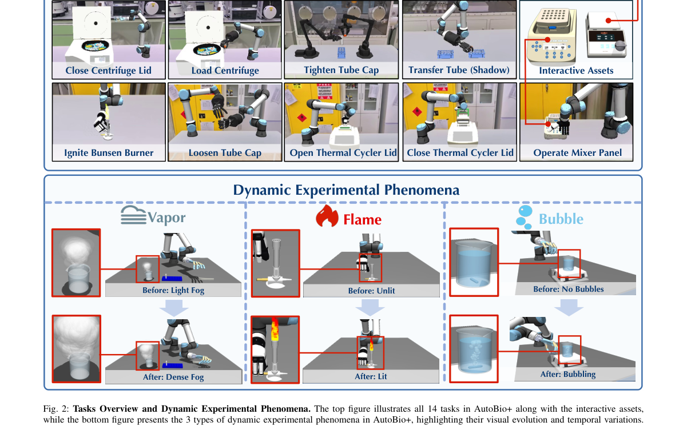

**Why this ranks #6**: 「动态实验现象」被明确列为评测维度，说明静态环境基准已不足以区分方法。

---

### 7. VICAR: Video Imitation with Contact-Aware Retargeting for Humanoid Interactive Skills

**arXiv**: [2610.13079](https://arxiv.org/abs/2610.13079) | **Score**: 7.7 (relevance 8 x 0.7 + quality 7 x 0.3) | **Tags**: embodied-ai | **Categories**: cs.RO | **Pages**: 9

**Authors**: Dvij Kalaria, Bike Zhang, S. Shankar Sastry

**Affiliation**: University of California, Berkeley | Project website: ember-center-berkeley.github.io/VICAR

**Abstract**

> Third-person human videos offer a scalable alternative to task-specific reward engineering, teleoperation, and manually scripted demonstrations for humanoid loco-manipulation. Recent video-to-humanoid systems have shown that noisy human motion, object trajectories, and contacts can be extracted from unstructured videos and refined into deployable skills. However, a key gap remains for contact-rich imitation: the task is often defined by world-frame contacts whose poses, timing, and speed must survive embodiment mismatch and runtime scene changes. Towards this, we present VICAR (Video Imitation with Contact-Aware Retargeting), a pipeline for learning humanoid interactive skills from third-person human videos. The system first recovers human motion, reconstructs task-relevant obstacles from monocular video, and then retargets the motion to a humanoid while preserving global contact poses, motion speed, and collision clearance. Unlike retargeting methods that only remove penetration or preserve local interaction geometry, our formulation represents user-specified contact poses and collision clearance as high-priority Lagrangian penalty terms and optimizes the full motion to remain smooth through contact-rich transitions. The resulting motions are used to train a contact-conditioned motion generator whose inputs include movable contact points enabling runtime adaptation to new contact positions. We demonstrate the framework on ten diverse third-person video skills, including six table-tennis serves, three object-pickup tasks, and ladder climbing, and deploy the learned skills on hardware. These results suggest that contact-preserving retargeting is a practical step toward humanoids that learn useful interactive behavior by watching humans.

**Key findings**

- **Finding**: 第三人称人类视频为 humanoid loco-manipulation 提供了可扩展的数据来源；近期视频到人形系统已能从非结构化视频提取可用技能。

- **Finding**: VICAR 引入**接触感知**的重定向（contact-aware retargeting）来填补关键缺口。

- **Inference**: 视频不含力信息，因此接触点与接触序必须靠重定向阶段补——这决定了重定向不是技术细节而是该路线能否成立的前提。

- **Recommendation**: 与本批 Human2Dex（腕部中心的人类演示）对照：一篇用视频、一篇用手腕佩戴设备，接触信息缺口各有解法。

**Key figures**

*Framework / architecture - Figure 1 Temporally aligned human input and robot execution frames for representative skills: (a) table-tennis serving, (b) bimanual pick-and-place, (c) under-table pickup with table-edge support, and*

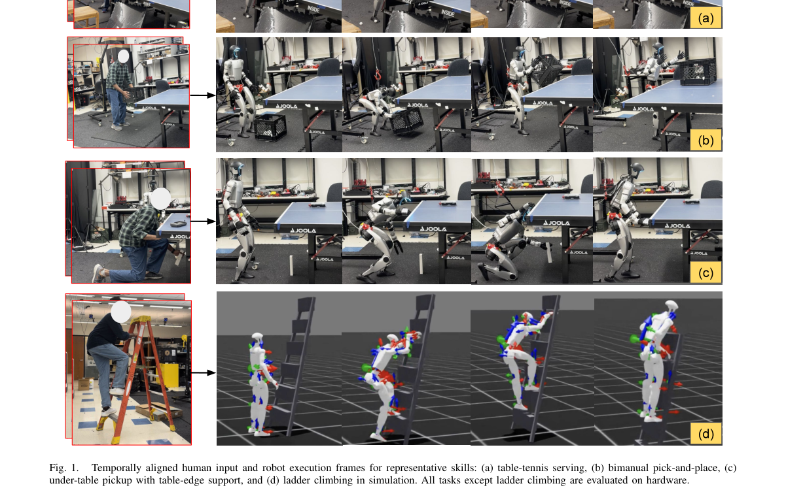

*Main result - Figure 2 Relative table-height mismatch across embodiments: the same table is near waist height for the human but near chest height for the shorter G1.*

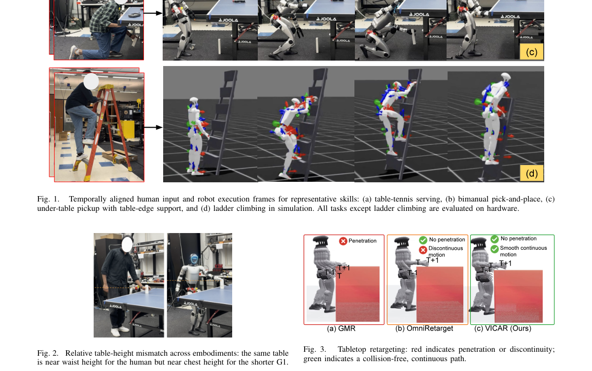

**Why this ranks #7**: 接触感知是关键——视频里看不出接触力，这是视频模仿的根本信息缺口。

---

### 8. OGPO: Offline Goal-conditioned Policy Optimization for Recoverable Vision-Language-Action Models

**arXiv**: [2610.12914](https://arxiv.org/abs/2610.12914) | **Score**: 7.7 (relevance 8 x 0.7 + quality 7 x 0.3) | **Tags**: embodied-ai, rl-algorithm | **Categories**: cs.AI | **Pages**: 19

**Authors**: Xule Gao, Xi Wang, Zehua Zang, Rui Wang, Changwen Zheng, Chuxiong Sun

**Affiliation**: 1 National Key Laboratory of Space Integrated Information System | 2 Institute of Software, Chinese Academy of Sciences | 3 University of Chinese Academy of Sciences | 4 Wangxuan Institute of Computer Technology, Peking University

**Abstract**

> Vision-language-action (VLA) models have shown strong promise in robotic manipulation, yet their post-training still predominantly relies on trajectory-level supervised imitation over robot demonstrations. While effective for learning feasible actions, this paradigm supervises policies to reproduce expert actions at each step, biasing them toward demonstration-specific action paths and providing limited guidance for recovering toward task-progress states once execution deviates from demonstrated trajectories. To address this limitation, we propose OGPO, an Offline Goal-conditioned Policy Optimization framework for recoverable VLA post-training. Instead of treating offline demonstrations merely as step-wise action labels, OGPO adaptively relabels trajectories with semantic key states and constructs goal-conditioned process rewards to optimize the policy for reaching these task-progress states. In this way, OGPO shifts VLA post-training from trajectory-level action imitation to key-state reachability learning, enabling policies to acquire a more robust ability to complete goal states from feasible off-demonstration states without requiring additional online interaction. Experiments on LIBERO and MetaWorld show that OGPO consistently improves VLA policy performance over standard supervised fine-tuning. Moreover, evaluations on LIBERO-Plus and our proposed LIBERO-ReAct, a mid-execution perturbation benchmark, further demonstrate that OGPO achieves stronger robustness and goal-directed recoverability under distribution shifts and recoverable off-demonstration states.

**Key findings**

- **Finding**: VLA 后训练主要依赖轨迹级监督模仿；该范式监督策略**在每一步复现专家动作**。

- **Finding**: 这使策略偏向演示特定的解，限制了它找到替代解；OGPO 用离线的目标条件策略优化做可恢复的 VLA。

- **Inference**: 轨迹级模仿的根本局限是它把「专家做了什么」当作目标而非「目标是什么」——这与本批 Beyond Actions 是同一问题的两种表述。

- **Recommendation**: 与 Beyond Actions 连读：一篇换预测目标，一篇换优化方法，是同一诊断的两种应对。

**Key figures**

*Framework / architecture - Figure 1 We design two representative perturbation cases to evaluate the robustness and goal-directed recoverability of offline-trained VLA policies under deviations from demonstration trajectories.*

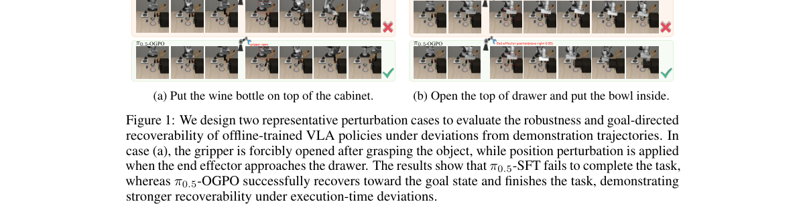

*Main result - Figure 2 Offline Goal-conditioned Policy Optimization(OGPO) framework.*

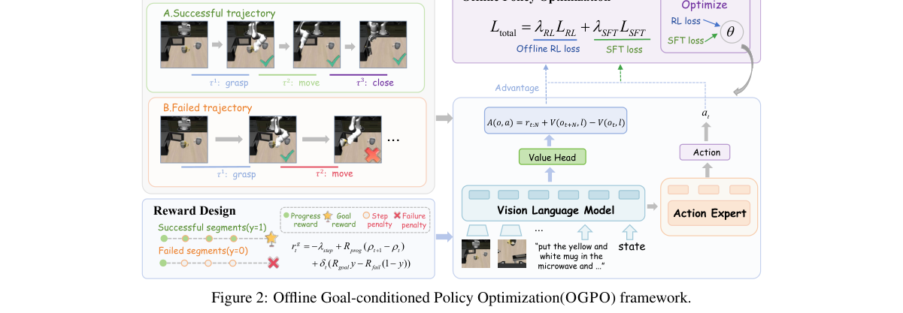

**Why this ranks #8**: 指出轨迹级模仿使策略「偏向演示特定的」解，而非找到最优解——这是模仿学习的一个基本局限。

---

### 9. Human2Dex: Dexterous Robot Learning from Wrist-Centric Human Demonstrations

**arXiv**: [2610.13119](https://arxiv.org/abs/2610.13119) | **Score**: 7.3 (relevance 7 x 0.7 + quality 8 x 0.3) | **Tags**: embodied-ai | **Categories**: cs.RO | **Pages**: 8

**Authors**: Jiachen Zhang, Yuanyuan Li, Shaqi Luo

**Affiliation**: Academy of Artificial Intelligence, Beijing, China.

**Abstract**

> Collecting dexterous manipulation demonstrations for each robot hand requires repeated task-specific data acquisition. We ask whether one shared corpus of natural human demonstrations can instead serve as a reusable data interface for different dexterous hands, without collecting task demonstrations on each target robot. We present Human2Dex, a wrist-centric human demonstration interface that separates shared human observation and motion semantics from embodiment-specific execution. It aligns observations through local hand-appearance adaptation and a shared 21-point hand representation with consistent structural semantics across human and robot observations. It constructs executable supervision by retargeting fused human hand motion to each target hand, and introduces the Grasp-Pocket Interaction Representation (GPIR) to express tracked objects relative to a hand-centered Functional Grasp Pocket. The corpus is converted into separate training sets for Linker O6 and Wuji, while action labels, normalization, training, and diffusion-policy checkpoints remain hand-specific. Across six real-world tasks, Human2Dex achieves 109/120 (90.8%) successes on Linker O6 and 97/120 (80.8%) on Wuji. Across both hands, Human-Raw achieves 63/240 (26.3%) successes, whereas the complete Human2Dex configuration achieves 206/240 (85.8%). These results support the use of wrist-centric human demonstrations as a reusable interface across calibrated dexterous hands while retaining embodiment-specific policy learning. The project website is publicly available at https://human2dex.pages.dev/.

**Key findings**

- **Finding**: 为每只灵巧手采集任务演示需重复的数据采集；作者提出一个共享的人类演示语料库作为可复用数据接口。

- **Finding**: Human2Dex 采用**腕部中心**（wrist-centric）的人类演示表示。

- **Inference**: 腕部中心表示之所以能跨手复用，是因为接触发生的手部区域在手腕坐标系下近似不变，而关节角度的变化模式跨手可映射——这是把不可迁移的关节空间转到可迁移的接触空间。

- **Recommendation**: 与 10-09 日报的 Generative Neural Retargeting 对读：两篇都在解决「人类数据如何跨本体迁移」，但一个重定向动作、一个换表示空间。

**Key figures**

*Framework / architecture - Figure 1 Human2Dex overview. A wrist-mounted camera records natural bare-hand demonstrations. The shared wrist-centric observation and 21-point hand interface are converted offline into separate execut*

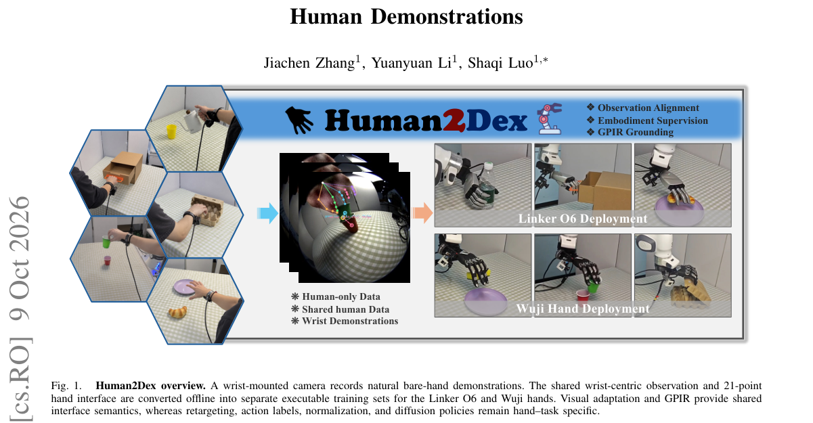

*Main result - Figure 2 Human2Dex conversion interface. Wrist RGB, PICO tracking, and a wrist-image hand model provide measurements for structural observations, target-specific action supervision, and grasp-centered*

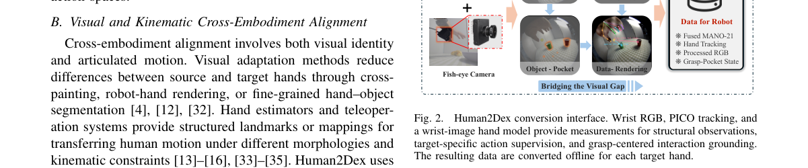

**Why this ranks #9**: 把「每只手都要采数据」这个问题重新表述为「能否有一个可复用的数据接口」。

---

### 10. Dual-Stream Memory for Vision-Language-Action Policies

**arXiv**: [2610.13262](https://arxiv.org/abs/2610.13262) | **Score**: 7.0 (relevance 7 x 0.7 + quality 7 x 0.3) | **Tags**: embodied-ai | **Categories**: cs.CV, cs.RO | **Pages**: 8

**Authors**: Yang Wang, Ping Liu, Ruiyu Wang, Xuhua Chen, Lingfeng Zhang, Tao Zhang

**Affiliation**: 1Magic-Lab Team, Magiclab Robotics Inc.

**Abstract**

> Memory-dependent manipulation requires a policy to track execution state and recover visual evidence that is no longer observable. We propose dual-stream memory for vision-language-action policies, assigning these requirements to complementary representations. A task-agnostic Gated DeltaNet compresses history into one temporal token, supervised by progress prediction and action-conditioned feature reconstruction. A task-conditioned retriever retains frames above a fixed relevance threshold; linear multi-scale fusion encodes each frame into sixteen spatial tokens. We then freeze the temporal compressor and jointly optimize retrieval and policy learning. Across sixteen RoboMME tasks, the complete model achieves 49.22% mean success versus 44.51% for the published FrameSamp+Modul reference, improving fourteen tasks and all four suite means. On four real-robot tasks, mean success reaches 62.5% versus 37.5%, with the largest gains on repeated actions requiring execution-stage discrimination. These results support combining execution context with selective visual access, while failures under cup swaps expose persistent identity tracking as an unresolved requirement.

**Key findings**

- **Finding**: 记忆依赖的操作要求策略做两件不同的事：跟踪执行状态、恢复不再可观测的视觉证据。

- **Finding**: 双流记忆把两项要求分配给互补表示：任务无关的 Gated DeltaNet 把历史压缩为**一个**时间 token（由进度预测监督）。

- **Inference**: 两需求的性质确实不同：进度是紧凑标量式的状态，视觉证据则是高维且需按需检索的。用一个时间 token 装进度、把证据留给另一条流，是有依据的分工而非简单堆叠。

- **Recommendation**: 接上 10-05 日报 EvoMem-VLA（记忆需带变化而非快照）与 10-07 日报的 ASLP 类工作，是记忆线索的第四篇。

**Key figures**

*Framework / architecture - Figure 1 Dual-stream memory combines recurrent execution context with retrieved spatial evidence. Bars show mean task success rate (TSR) across sixteen RoboMME tasks and four real-world tasks evaluated*

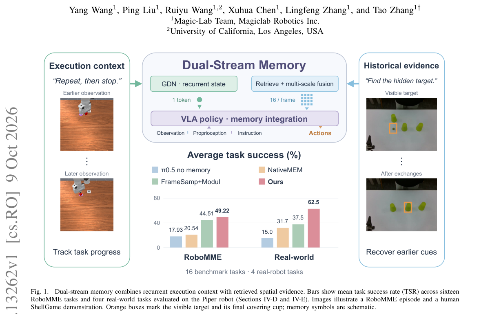

*Main result - Figure 2 Dual-stream memory. (a) GDN compresses visual history into one temporal token; threshold retrieval and multi-scale fusion produce 16mt spatial tokens from mt retained frames. Dashed arrows den*

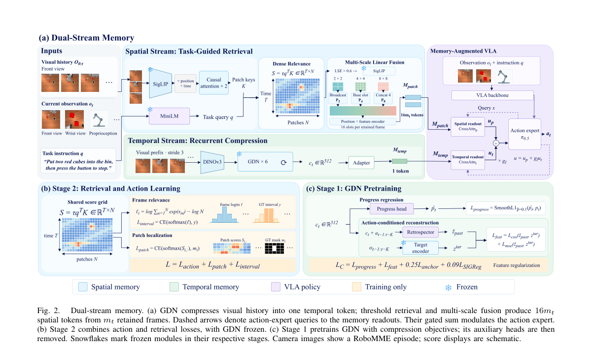

**Why this ranks #10**: 把「跟踪状态」与「恢复证据」分配给两种不同表示，是记忆设计上的正确分工。

---

## Footer

- Total papers reviewed across all 5 tracks: 50 (from 488 scanned)
- embodied track final top-10: 10
- Wild-cards in this track: 1
- Figure assets: `res/` (shared across tracks)

Generated by `mine-arxiv-daily-digest` skill. Sister file: `2026-10-12_embodied_entry.md`.
