# ArXiv Daily Digest - 2026-10-12 (强化学习, 10 papers)

**Generated**: 2026-10-12 17:00 CST

**Source**: arXiv cs.CV, cs.SD, eess.AS, cs.CL, cs.AI, cs.RO, cs.LG submissions, window 2026-10-09 UTC (latest announced batch as of 2026-10-12 17:00 CST; 10-10/10-11 were weekend with no announcement)

**Track**: rl (top 10 of 488 papers scanned, 50 full reads)

**Scope**: unifying LLM RL algorithms via divergence, hindsight-guided exploration and credit assignment for multi-turn agents, explanatory world models for credit assignment, simulation-grounded trajectory alignment for driving world action models, grounding-aware verifiable rewards, adaptive curriculum for visual Sudoku, decomposing joint safety constraints, trajectory-aware policy optimization, fixed-point flow matching RL, curriculum limits in GRPO

---

本批 RL 线有一篇值得单独标注：**Generalized PPO** 对本项目日报追踪的 GRPO 生态做了根源性判断——主流 PPO 依赖一个**几何退化的裁剪代理**，它无法自适应地对策略偏移的抵抗力，导致过早裁剪与探索退化；而后续所有 GRPO 变体都在打补丁而非修根本。作者从**散度**的视角统一 LLM RL 算法。这个诊断与本批另两篇同源：**Trajectory-Aware Policy Optimization** 指出既有方法在 token 或序列层面控制策略不匹配，但**局部的策略不匹配会沿轨迹累积成严重的状态分布偏移**——控制粒度不足是根本原因。

信用分配是第二个主题，三篇各从不同角度细化过粗的信号：**TreeHCA** 指出 GRPO 给每个 token 相同优势，而事后信用分配的估计**依赖于轨迹中存在信息性替代方案**，这个前提限制正是它引入树式扩展的原因；**Beyond Temporal Proximity** 指出标准 RL 按**时间邻近性**而非显式相关性传播奖励，在长延迟回报场景（推荐系统、机器人长程）必然出错；**EmoGavel** 则把「只监督最终偏好决策、不定位错误内容」的缺陷补上。共同结论是：过粗的信用分配信号必须先被细化，否则下游的一切优化都在放大噪声。

其余六篇覆盖：驾驶世界动作模型用仿真为 RL 探索的替代轨迹补视觉监督（SimVTA，解释了 WAM 类模型 RL 后训练为何难以见效）、视觉数独上的长时程多模态 RLVR、安全 MARL 的约束信用分解、课程难度推进在 GRPO 中的收益与**限制**（持续选中等难度会锁窄训练分布，与 10-08 日报的熵坍塌同源）、以及不动点流匹配用于 Boltzmann 策略采样。

---

## Top 10 - 强化学习

### 1. Generalized Proximal Policy Optimization: Unifying LLM RL Algorithms from the Perspective of Divergence

**arXiv**: [2610.13015](https://arxiv.org/abs/2610.13015) | **Score**: 9.0 (relevance 9 x 0.7 + quality 9 x 0.3) | **Tags**: rl-algorithm, rlhf | **Categories**: cs.AI, cs.LG | **Pages**: 17

**Authors**: Zhicheng Cai, Xinyuan Guo, Hanlin Wu, Weinan Dai, Yuyan Zhou, Wei-Ying Ma, Ya-Qin Zhang, Hao Zhou

**Affiliation**: Institute for AI Industry Research (AIR), Tsinghua University | SIA-Lab of Tsinghua AIR and ByteDance Seed | plex reasoning in LLMs (Guo et al., 2025; Comanici et al., 2025; OpenAI, 2024), powering break- | search (OpenAI, 2025; Jin et al., 2025).

**Abstract**

> Reinforcement learning has become the foundational paradigm for enhancing the reasoning capabilities of LLMs. Yet the dominant approach, Proximal Policy Optimization (PPO), relies on a geometrically degenerate clipping proxy that cannot adapt its resistance to policy shifts, leading to premature clipping and degraded exploration. Subsequent variants alleviate these issues through fragmented and heuristic modifications. We propose Generalized Proximal Policy Optimization (GPPO), a principled and unified framework for understanding and designing LLM RL algorithms through the lens of divergence. We establish a generalized $f$-divergence trust-region theory with a monotonic performance improvement guarantee, and show that different $f$-divergences induce distinct geometries and policy update dynamics. We further introduce novel estimator topologies that provide more faithful divergence estimates than the conventional single-sample Monte Carlo estimation. Under this framework, PPO and recent variants such as DAPO, DPPO, and RIPO emerge as special cases, establishing a principled two-dimensional design space of {Divergence $\times$ Estimator}. Extensive experiments on eight competition-level math and coding benchmarks show that both dimensions are critical. The best-performing GPPO instantiation surpasses standard GRPO by up to 50% and 14% on math and coding, delivering SOTA performance.

**Key findings**

- **Finding**: 主流 PPO 依赖一个**几何退化的裁剪代理**，无法自适应对策略偏移的抵抗力，导致**过早裁剪**与探索退化。

- **Finding**: 后续变体缓解了这些问题；作者从**散度（divergence）** 的视角统一 LLM RL 算法，提出广义 PPO。

- **Inference**: 「几何退化」是一个结构性批评：裁剪在信任域方向上是硬边界，但对不同方向的偏移施加同一信任域大小，在几何上并不对称——这解释了为什么后续所有 GRPO 变体都在打补丁而非修根本。

- **Recommendation**: 被精读的三篇之一。建议与本批 10-09 日报的 Residual Advantage、10-12 日报的 TreeHCA 连读，三篇分别处理信号分配、优势估计与信用分配。

**Key figures**

*Framework / architecture - Figure 1 Schematic of four f-divergence geometries and the corresponding proximal regions they induce, shown for three sampled policy ratios r = (r1, r2, r3) centred at r = 1.*

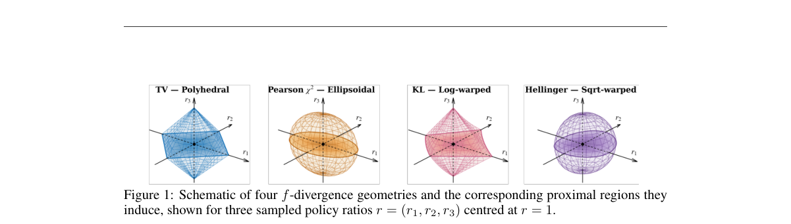

*Main result - Figure 2 Training dynamics of different GPPO instantiations on Math and Code. Solid lines repre- sent the training score, while dash-dotted lines represent the policy entropy.*

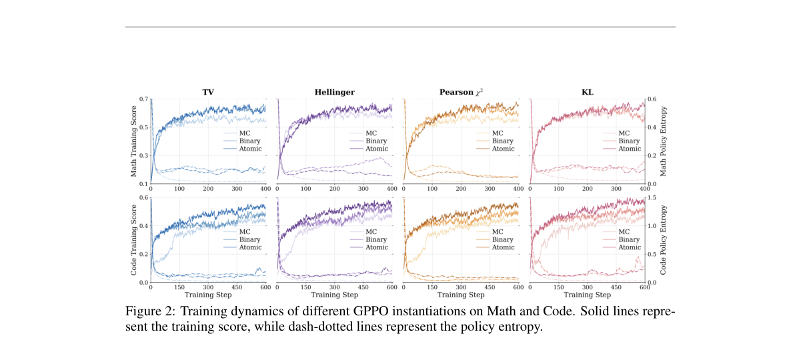

**Why this ranks #1**: 对本项目日报追踪的 GRPO 生态做了一个根源性判断：裁剪机制本身的几何性质是问题所在。

---

### 2. TreeHCA: Hindsight-Guided Exploration and Credit Assignment for Multi-Turn LLM Agents

**arXiv**: [2610.12828](https://arxiv.org/abs/2610.12828) | **Score**: 8.7 (relevance 9 x 0.7 + quality 8 x 0.3) | **Tags**: rlhf, rl-algorithm | **Categories**: cs.LG | **Pages**: 20

**Authors**: Debajoy Mukherjee, Jeremy Carleton, Sushil Vemuri, Srinivas Shakkottai, Dileep Kalathil

**Affiliation**: Department of Electrical and Computer Engineering, Texas A&M University, College Station, Texas, USA

**Abstract**

> Outcome-supervised group-relative policy optimization (GRPO) assigns the same advantage to every token in an LLM agent trajectory, leaving useful and unhelpful decisions undifferentiated. Hindsight credit assignment (HCA) can refine this feedback, but its estimates rely on trajectories containing informative alternatives at consequential histories. We introduce TreeHCA, which couples hindsight-guided exploration with hindsight credit assignment. TreeHCA uses changes in reference-answer likelihood to revisit intermediate histories and sample alternative continuations, forming a tree of reasoning and tool interactions. Because this exploration changes the distribution of sampled continuations, we derive the corresponding inverse-hindsight importance correction, including an exact finite-pool identity. We use this structure in a normalized tree backup that propagates terminal outcomes into turn-level advantages. This shared hindsight structure is TreeHCA's central design principle, linking informative exploration with hindsight-guided credit assignment. Across seven question-answering benchmarks and three Qwen backbones, TreeHCA outperforms all baselines in aggregate exact match, validating the effectiveness of paired exploration and credit assignment for multi-turn LLM agent training. Our code is available at github.com/TheBlackCat22/TreeHCA.

**Key findings**

- **Finding**: GRPO 给轨迹中每个 token 相同的优势，使有用与无用的决策无从区分。

- **Finding**: 事后信用分配（HCA）可细化反馈，但其估计**依赖于在关键历史上包含信息性替代方案的轨迹**——这是该路线的前提限制。

- **Finding**: TreeHCA 引入树式扩展来保证替代方案的存在。

- **Inference**: 把「缺少反事实对照」识别为 HCA 的前提条件，并用树结构在采样时主动构造对照——这是一个把诊断直接变成机制设计的干净做法。

- **Recommendation**: 与 10-09 日报的 BoT-GRPO（token 无差别优势）连读，两篇针对同一问题但一个改奖励分配、一个改采样结构。

**Key figures**

*Framework / architecture - Figure 1 TREEHCA pairs exploration with credit assignment. (a) A drop in hindsight score identifies a parent history to revisit. The sampled alternative continues alongside the retained original path*

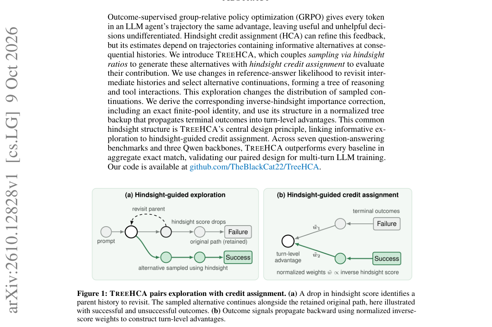

*Main result - Figure 2 Hindsight-guided exploration. (1) A low score on an observed completed turn identifies its parent for resampling. (2) From that starting point, N = 2 policy decisions are executed and scored*

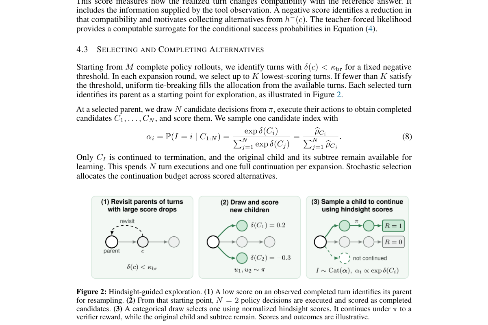

**Why this ranks #2**: 指出了 HCA 这条改进路线自身的一个前提限制，且解法（树）正是针对那个限制。

---

### 3. Beyond Temporal Proximity: Explanatory World Models for Credit Assignment in Reinforcement Learning

**arXiv**: [2610.13504](https://arxiv.org/abs/2610.13504) | **Score**: 8.3 (relevance 8 x 0.7 + quality 9 x 0.3) | **Tags**: rl-algorithm | **Categories**: cs.AI, cs.IR, cs.LG | **Pages**: 20

**Authors**: Oriol Corcoll, Qiyao Wei, Ciarán Mark Gilligan-Lee

**Affiliation**: 2University of Cambridge

**Abstract**

> Generative Recommenders increasingly use Reinforcement Learning (RL) to optimize outcomes that may appear hundreds or thousands of interactions after a decision. Standard RL propagates reward according to temporal proximity rather than explicit relevance, attenuating the signal assigned to distant but important actions and creating a source of sample inefficiency. We introduce Explanatory World Models (EWM), an attribution framework that uses explanations to identify the earlier events that plausibly contributed to a realized outcome. We instantiate EWM with a frontier language model and use its explanations as learning signals using a conservative hierarchical operator that recursively redistributes reward while preserving the undiscounted episode return. To investigate what constitutes a useful explanation, we operationalize three complementary variants inspired by Halpern's actual causation, Lombrozo's explanatory simplicity, and Deutsch's hard-to-vary explanations. We evaluate EWM on two controlled long-horizon RL benchmarks, a public sequential-recommendation benchmark, and an industry-scale generative recommender. On Crafter and WordCraft, EWM substantially outperforms PPO and LaRe, with its largest gains when rewards are most delayed. On KuaiRand, EWM outperforms SFT and LaRe offline and A2C online. Finally, in an offline evaluation of an industry generative recommender, EWM considerably improves Recall and increases behavioral proxies. These results suggest that explanations can provide structured and reusable credit for learning from delayed outcomes.

**Key findings**

- **Finding**: 标准 RL 按**时间邻近性**而非显式相关性传播奖励，衰减了遥远但重要动作的信号，造成样本低效。

- **Finding**: 作者用**解释性世界模型**为 RL 中的信用分配提供替代机制（Beyond Temporal Proximity）。

- **Inference**: 时间邻近性作为默认信用分配规则，在长时程延迟回报场景下必然出错——而这恰是推荐系统与机器人长程任务的主流设定。解释性世界模型提供的是「因果相关性」而非「时间距离」作为分配依据。

- **Recommendation**: 被精读的三篇之一。与本批广义 PPO 同日出现，两篇分别从信任域几何与信用分配规则攻击标准 RL 的默认设定。

**Key figures**

*Framework / architecture - Figure 1 Explanatory World Model framework. EWMs take evidence (past events) and a phenomenon (the event to explain), and output a hypothesis/explanation about the events causing the phenomenon.*

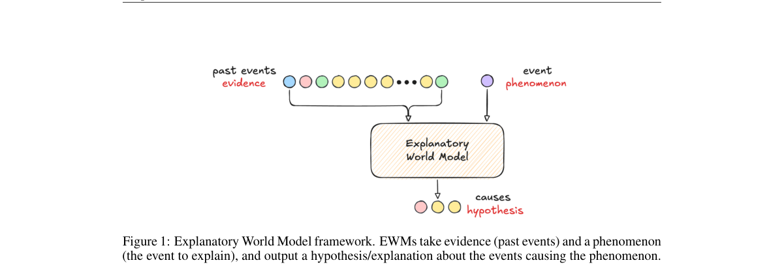

*Main result - Figure 2 Traditional credit assignment (red) propagates a reward to temporally adjacent events, regardless of their relevance. EWM’s conservative hierarchical operator (CHO, purple) instead uses the*

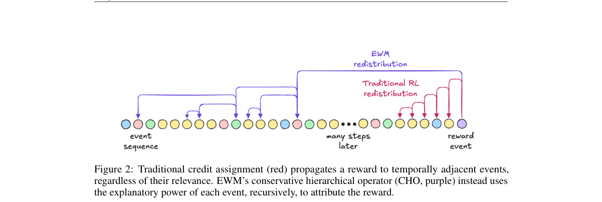

**Why this ranks #3**: 把「时间邻近 ≠ 重要性」讲成一个可测量的样本效率来源，并给出替代机制。

---

### 4. SimVTA: Simulation-Grounded Video-Trajectory Alignment for Driving World Action Models

**arXiv**: [2610.13781](https://arxiv.org/abs/2610.13781) | **Score**: 8.0 (relevance 8 x 0.7 + quality 8 x 0.3) | **Tags**: world-model, rl-algorithm | **Categories**: cs.CV | **Pages**: 21

**Authors**: Changhui Jing, Haochen Tian, Hongchen Li, Tianyu Li, Caojun Wang, Zihao Zhang, Yanhao Liu, Chengen Xie, Bailin Li, Hao Zhao, Zhenjie Yang

**Affiliation**: 1Shanghai Innovation Institute | 2OpenDriveLab at The University of Hong Kong | 3Li Auto Inc. | 4Tongji University

**Abstract**

> Driving world action models (WAMs) learn from paired trajectories and future observations. Post-training with reinforcement learning allows the policy to explore alternative trajectories and improve planning using driving rewards. However, driving logs contain future videos only for the recorded trajectories, leaving these alternatives without corresponding visual supervision. Thus, we introduce SimVTA, a simulation-grounded post-training framework that combines trajectory optimization with video supervision. First, we sample candidate trajectories for each observation and use a real-world simulator (e.g., World Engine) to render future videos for high-reward candidates in real-world scenes reconstructed with 3D Gaussian Splatting (3DGS). This provides trajectory-matched supervision independent of the model's own predictions. Under a limited rendering budget, we prioritize video supervision for higher-error futures among these rendered candidates. Finally, we optimize trajectory planning with Group Relative Policy Optimization (GRPO) and use a flow-matching loss on the matched videos to update shared representations. At inference time, the model predicts trajectories directly, without simulator calls. On NAVSIM v1, applying SimVTA to a WAM initialization improves PDMS from 86.2 to 91.3 (+5.1). It achieves 88.2 EPDMS on NAVSIM v2 and an average HD-Score of 38.8 in closed-loop evaluation on HUGSIM. Ablations show that updating shared representations with video supervision improves planning, while prioritizing higher-error futures among high-reward trajectories further improves performance.

**Key findings**

- **Finding**: 驾驶日志只对记录轨迹含未来视频，因此 RL 探索出的替代轨迹**缺乏视觉监督**。

- **Finding**: SimVTA 用仿真给这些替代轨迹补上对应的视觉监督，实现轨迹对齐。

- **Inference**: 这解释了为什么 WAM 类模型的 RL 后训练难以见效：探索越远，监督越稀疏。用仿真补齐是把「探索」与「监督」解耦的通用做法。

- **Recommendation**: 与本批具身线的 Grounded-Dreamer、10-09 日报的 SimVLA 同属「用仿真为 RL 探索补监督」的一族。

**Key figures**

*Framework / architecture - Figure 1 From logged futures to candidate-matched supervision. (1) WAM pretraining uses the ground-truth (GT) trajectory and its logged future video. (2) Trajectory GRPO explores candidate trajectori*

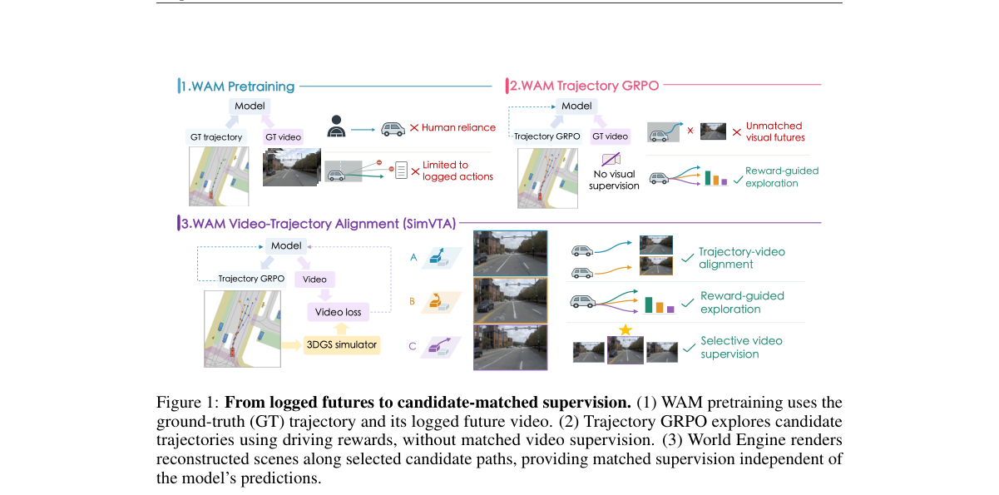

*Main result - Figure 2 Simulation-grounded video–trajectory alignment. (a) Training overview. (b) Trajectory learning combines GRPO with a behavior-cloning (BC) regularizer. (c) Video supervision selects high-rewa*

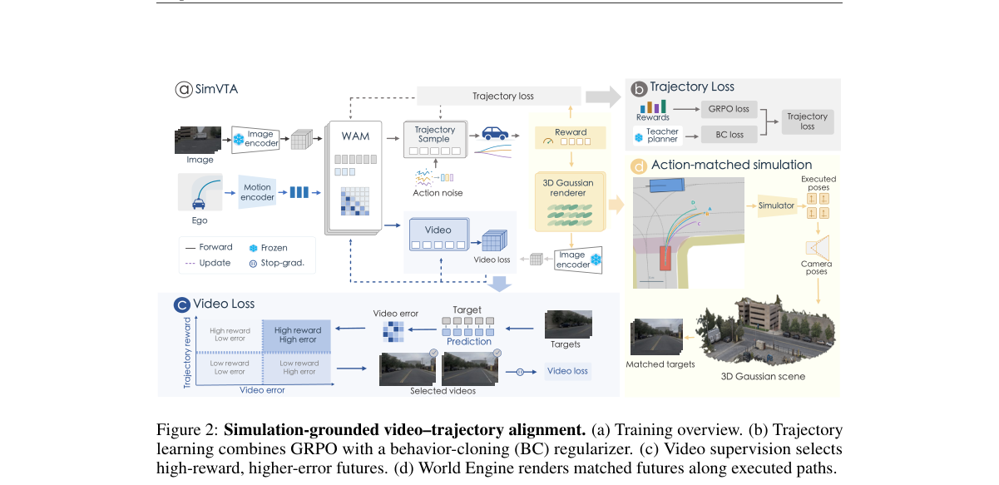

**Why this ranks #4**: 「探索出来的轨迹没有视觉监督」是一个 RL 与世界模型交叉时的结构性缺口。

---

### 5. EmoGavel: Grounding-Aware Reinforcement Learning with Verifiable Rewards for Multimodal Emotion Preference Learning

**arXiv**: [2610.13353](https://arxiv.org/abs/2610.13353) | **Score**: 8.0 (relevance 8 x 0.7 + quality 8 x 0.3) | **Tags**: rlhf, multi-agent-rl | **Categories**: cs.LG, cs.MM, eess.AS | **Pages**: 5

**Authors**: Zilong Huang, Kong Aik Lee, Zezhong Jin, Man-Wai Mak, Tatsuya Kawahara

**Affiliation**: 1The Hong Kong Polytechnic University, Hong Kong SAR, China | 2Kyoto University, Japan

**Abstract**

> Multimodal emotion preference learning uses pairwise comparisons to identify which open-ended emotion descriptions align more closely with human judgments. However, existing methods primarily focus on the final preference decision and provide little explicit supervision for localizing and correcting erroneous content. To address this limitation, we propose EmoGavel, a Grounding-Aware reinforcement learning framework with Verifiable rewards for multimodal Emotion preference Learning. We first introduce grounded supervised fine-tuning (Grounded SFT), which exploits controlled-error construction information to jointly learn preference prediction, error localization, repair, and missing-evidence recovery. We then optimize these verifiable outcomes with grounding-aware group relative policy optimization (GA-GRPO), combining preference-gated grounding rewards with dynamic zero-variance rescue to prioritize preference correctness and recover learning signals from all-wrong groups. Experiments on EmoPrefer and controlled-error evaluation sets show that EmoGavel improves both natural preference prediction and controlled-error discrimination while maintaining strong error-grounding performance. Our code and model checkpoints will be released once the paper is accepted.

**Key findings**

- **Finding**: 既有方法主要关注最终偏好决策，对定位并纠正错误内容提供的显式监督很少。

- **Finding**: EmoGavel 提出 grounding 感知、可验证奖励的多模态情感偏好强化学习。

- **Inference**: 成对偏好信号只告诉你 A 比 B 好，不告诉你为什么；因此错误无法被定位，纠正也就无从下手。补充局部监督是把偏好信号变成学习信号的必要一步。

- **Recommendation**: 与本批 TreeHCA 同属「细化过粗的信用分配」，一篇在轨迹内、一篇在偏好判断内。

**Key figures**

*Framework / architecture - Figure 1 Overview of the proposed EmoGavel framework for multimodal emotion preference learning. Grounded SFT learns preference prediction and error grounding from natural and controlled-error pairs, a*

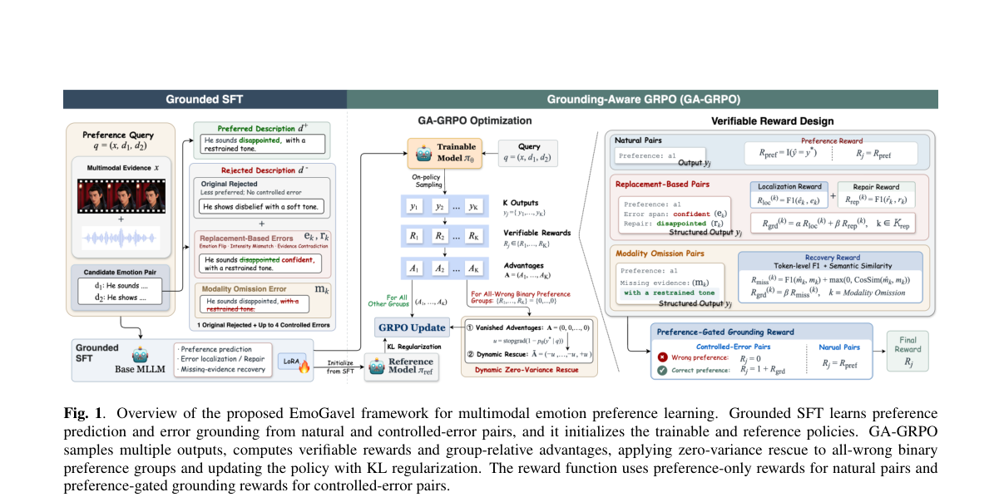

**Why this ranks #5**: 「只监督最终决策，不监督错误在哪」是偏好学习一个被长期忽略的结构缺陷。

---

### 6. AdaC-GRPO: Towards Mastering Long-Horizon Visual Sudoku Puzzles via Adaptive Curriculum Learning

**arXiv**: [2610.13184](https://arxiv.org/abs/2610.13184) | **Score**: 7.7 (relevance 8 x 0.7 + quality 7 x 0.3) | **Tags**: rlhf | **Categories**: cs.AI | **Pages**: 20

**Authors**: Sida Li, Yuanxin Liu, Linli Yao, Shicheng Li, Xu Sun, Haoli Bai, Xiaohui Li

**Affiliation**: 1National Key Laboratory for Multimedia Information Processing, Peking University | 2Huawei Technologies Co., Ltd.

**Abstract**

> While reinforcement learning with verifiable reward (RLVR) enhances reasoning in large language models, its efficacy in long-horizon multimodal tasks remains underexplored. Visual Sudoku puzzles pose a representative challenge, requiring multi-step deductive reasoning over both local constraints and global dependency chains. To this end, we introduce FG-Sudoku, a fine-grained benchmark categorized by grid size and required deductive steps. Evaluations reveal that frontier MLLMs fail on complex long-range dependencies (e.g., 9*9 puzzles). During post-training, this near-zero success rate causes severe reward sparsity, halting standard RLVR. We propose Adaptive Curriculum Group Relative Policy Optimization (AdaC-GRPO) to overcome this. Unlike rigid or prior-based schedules, AdaC-GRPO dynamically constructs training batches by tracking the model's "Zone of Proximal Development" via online rollout accuracy. Experiments demonstrate that AdaC-GRPO enables Qwen2.5-VL-7B to approach the performance of Gemini-2.5-Flash while bridging 62.2% of the overall accuracy gap to Gemini-2.5-Pro, with its generalizability further validated across InternVL-3.5 and Qwen3-VL.

**Key findings**

- **Finding**: RLVR 在长时程**多模态**任务上的效力仍少被探索；视觉数独需要局部约束与全局依赖链上的多步演绎推理。

- **Finding**: 作者引入 FG-Sudoku 精细化基准与 AdaC-GRPO（自适应课程）方法。

- **Inference**: 视觉数独是少数真正需要全局依赖链的基准——这使它能暴露长时程 RLVR 在非语言推理上的能力边界，而不只是语言推理。

- **Recommendation**: 与本批 A Step Harder（GRPO 课程难度）同属课程学习线，但一篇在多模态、一篇纯文本。

**Key figures**

*Framework / architecture - Figure 1 Overview of AdaC-GRPO. The policy dynamically selects FG-Sudoku groups within the Zone of Proximal Development (ZPD) based on online rollout accuracy, excluding trivially solved and reward-s*

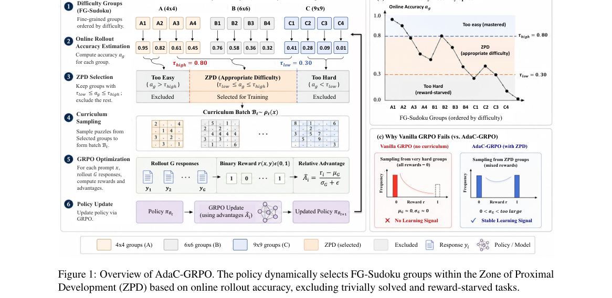

*Main result - Figure 2 Overview of the dataset, showing a representative Sudoku sample, model-measured difficulty steps across subsets, and the metadata structure of individual entries. Panel (B) reports Gemini-2.*

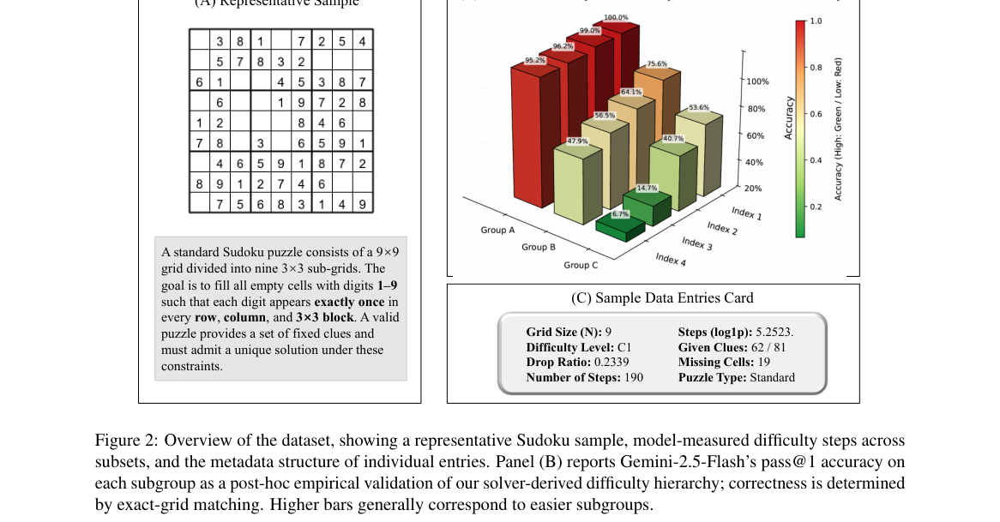

**Why this ranks #6**: 把长时程 RLVR 从纯文本搬到多模态，是能力边界的一次真实测试。

---

### 7. SafeDiSTL: Decomposing Joint Constraints for Safe Multi-Agent Reinforcement Learning

**arXiv**: [2610.13737](https://arxiv.org/abs/2610.13737) | **Score**: 7.7 (relevance 8 x 0.7 + quality 7 x 0.3) | **Tags**: multi-agent-rl, rl-algorithm | **Categories**: cs.AI, cs.LG | **Pages**: 26

**Authors**: Hongrui Zheng, Aditya Singh, Rahul Mangharam

**Affiliation**: University of Pennsylvania, Philadelphia, USA

**Abstract**

> Cooperative multi-agent tasks often impose constraints on a shared objective or collective safety. A team level violation cost function can measure this constraint outcome, but does not distinguish which agents' actions most strongly influence that violation. We present SafeDiSTL, a constrained multi-agent reinforcement learning framework that allows for credit assignment even with joint constraint measurements. We use Signal Temporal Logic (STL) robustness to measure episode-level violation through running-maximum cost increments. Smooth full-episode robustness and differentiable dynamics provide action sensitivities, which allocate each cost increment across agents at the same decision time. These sensitivities account for delayed effects when weighting agents' shares of each cost increment. We study the framework in cooperative payload transport, connected navigation, and networked traffic control tasks. SafeDiSTL achieves 1.6-5.1x the safe-success rate in transport, improves navigation safe-success by 11.1%, and delivers 50-68% more throughput in traffic when compared to constrained baselines. Results demonstrate a strong improvement of the learned policy in dealing with shared constraint while retaining the performance of unconstrained policies.

**Key findings**

- **Finding**: 团队级违规代价函数能度量约束结果，但**不区分哪些智能体的动作对违规影响最大**。

- **Finding**: SafeDiSTL 通过分解联合约束来支持信用分配。

- **Inference**: 在安全攸关的 MARL 中，安全信号本身需要信用分配——否则唯一的反应是对全体施加惩罚，而这在多智能体下会导致「大家一起被罚」的均衡。

- **Recommendation**: 安全 MARL 的读者注意；分解方式（是否需要额外结构假设）决定方法的可扩展性。

**Key figures**

*Framework / architecture - Figure 1 An illustration of the responsibility attribution mechanism. (a) A shared payload ap- proaches an obstacle and incurs a constraint violation. (b) Uniform responsibility allocation pro- duces*

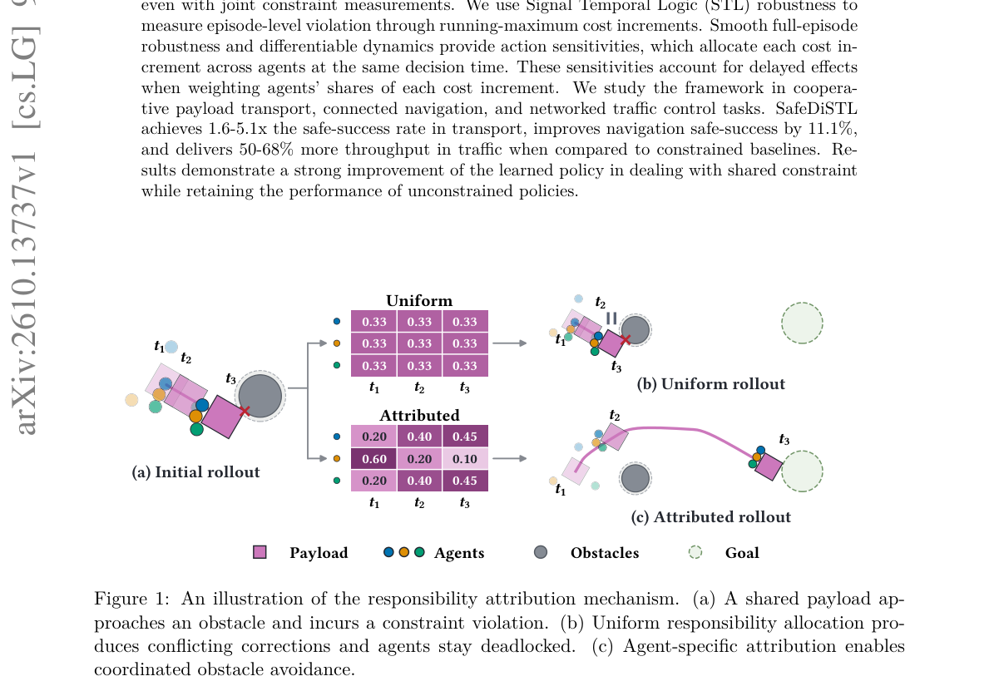

*Main result - Figure 2 Constraint–performance tradeoffs across benchmarks. Points and error bars show means and sample standard deviations across six training seeds. Traffic reports overload-free episode percentage*

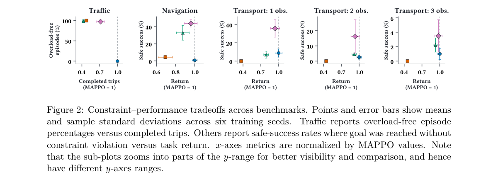

**Why this ranks #7**: 指出团队级代价函数丢掉了「是谁导致的」这一必需信息。

---

### 8. Trajectory-Aware Policy Optimization: Closing the State Distribution Gap in Long-Horizon LLM RL

**arXiv**: [2610.13020](https://arxiv.org/abs/2610.13020) | **Score**: 7.3 (relevance 7 x 0.7 + quality 8 x 0.3) | **Tags**: rl-algorithm, rlhf | **Categories**: cs.LG | **Pages**: 17

**Authors**: Zhicheng Cai, Weinan Dai, Yuyan Zhou, Wei-Ying Ma, Ya-Qin Zhang, Hao Zhou

**Affiliation**: Institute for AI Industry Research (AIR), Tsinghua University | SIA-Lab of Tsinghua AIR and ByteDance Seed | capabilities in Large Language Models (LLMs) (Guo et al., 2025; Comanici et al., 2025; OpenAI, | et al., 2024; Anthropic, 2024), and deep search (OpenAI, 2025; Jin et al., 2025).

**Abstract**

> Reinforcement learning (RL) has become a dominant paradigm for enhancing LLMs' reasoning capabilities. Yet long-horizon autoregressive rollouts introduce a fundamental limitation: local policy mismatch can compound into severe state distribution shift over trajectories. Existing LLM RL methods, such as GRPO and GSPO, control policy mismatch at the token or sequence level, but overlook this trajectory-induced shift, causing training instability and eventual collapse as the horizon grows. To close the state distribution gap, we propose Trajectory-Aware Policy Optimization (TAPO), a principled framework that theoretically derives the state-distribution correction from the off-policy policy gradient and incorporates it into the RL objective. TAPO further employs a geometric-mean estimator for variance reduction, together with a length-aware dynamic clipping that prevents overly deviated updates across the trajectory. Extensive experiments demonstrate that TAPO significantly surpasses existing LLM RL algorithms across eight competition-level benchmarks, achieving up to 48% and 12% improvement over GRPO on mathematical reasoning and algorithmic coding, with substantially enhanced training stability.

**Key findings**

- **Finding**: 长时程自回归 rollout 使**局部**策略不匹配沿轨迹累积成严重的状态分布偏移。

- **Finding**: 既有方法（GRPO、GSPO）在 token 或序列层面控制不匹配；轨迹感知的策略优化直接闭合这一差距。

- **Inference**: 控制粒度不足是根本原因——在 token 层面控制不匹配，等于假设每一步的不匹配独立，而它们通过状态分布耦合。轨迹层面的控制才对应真实的耦合结构。

- **Recommendation**: 与本批广义 PPO 合并读：两篇分别从信任域几何与控制粒度批评 LLM RL 的现有设计。

**Key figures**

*Framework / architecture - Figure 1 Policy shifts along long-horizon token positions, measured by token- and state-level policy ratios and KL divergences. The dots are randomly sampled through the training process of GRPO. Whi*

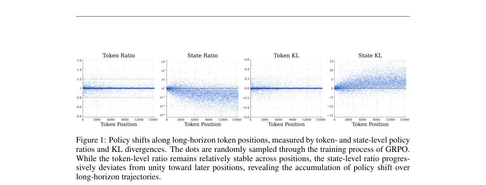

*Main result - Figure 2 Formulations (upper) and training dynamics (bottom) of GRPO, GSPO, and TAPO. GRPO and GSPO apply policy-ratio correction at the token and sequence levels, respectively, whereas TAPO explicit*

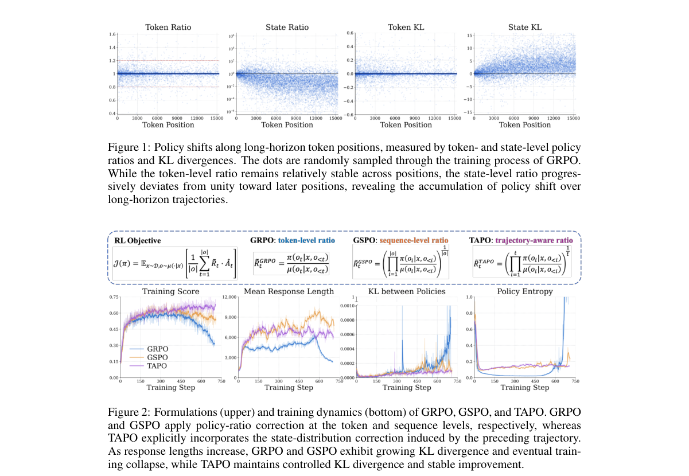

**Why this ranks #8**: 指出 token/序列层面的不匹配控制无法阻止误差沿轨迹累积——这是控制粒度的问题。

---

### 9. Reinforcement Learning via Fixed-point Flow Matching

**arXiv**: [2610.12848](https://arxiv.org/abs/2610.12848) | **Score**: 7.0 (relevance 7 x 0.7 + quality 7 x 0.3) | **Tags**: rl-algorithm | **Categories**: cs.LG, cs.RO | **Pages**: 40

**Authors**: Denis Blessing, Onur Celik, Gerhard Neumann

**Affiliation**: Karlsruhe Institute of Technology (KIT)

**Abstract**

> In maximum entropy and behavior-constrained reinforcement learning (RL), the optimal policy is given by a Boltzmann distribution. Generating samples from this distribution can be challenging, as it is often complex and multimodal. While flow policies trained with flow matching provide a powerful framework for representing such distributions, they traditionally rely on access to training data, which is generally unavailable in online RL. To address this limitation, we propose fixed-point flow matching (FFM), a data-free procedure for training and fine-tuning flow policies in RL. FFM leverages the target flow identity to formulate the actor update as a fixed-point iteration, utilizing a flow-matching-style regression objective where the critic's action gradients serve as regression targets. We show that the optimal policy is a fixed point of this iteration. Through extensive experiments, we demonstrate that FFM effectively fine-tunes pretrained flow policies in the offline-to-online setting and enables efficient and accurate training of flow policies from scratch in online RL. These results establish fixed-point flow matching as a principled approach for learning expressive flow-based policies without requiring training data.

**Key findings**

- **Finding**: 最大熵与行为约束 RL 的最优策略是 Boltzmann 分布，它往往复杂且多模，使采样困难。

- **Finding**: 流匹配训练的流策略能表示这类分布，但传统上依赖……（该处摘要截断，依赖的具体对象需查正文）。

- **Finding**: 该文用不动点流匹配（fixed-point flow matching）来构造。

- **Inference**: 「Boltzmann 分布难采样」是一个 RL 的经典难题；若流匹配能在不额外假设下解决它，对离线 RL 与行为约束策略尤其有价值。

- **Recommendation**: 与 10-07 日报的 QF3、10-09 日报的 RFPO 构成流策略 × RL 的连续四天线索。

**Key figures**

*Framework / architecture - Figure 1 The FFM policy-improvement step. FFM repeats: (1) Clean actions X1 are generated from the current policy by integrating Equation (5) (forward only, no gradients); the grey curves are samplin*

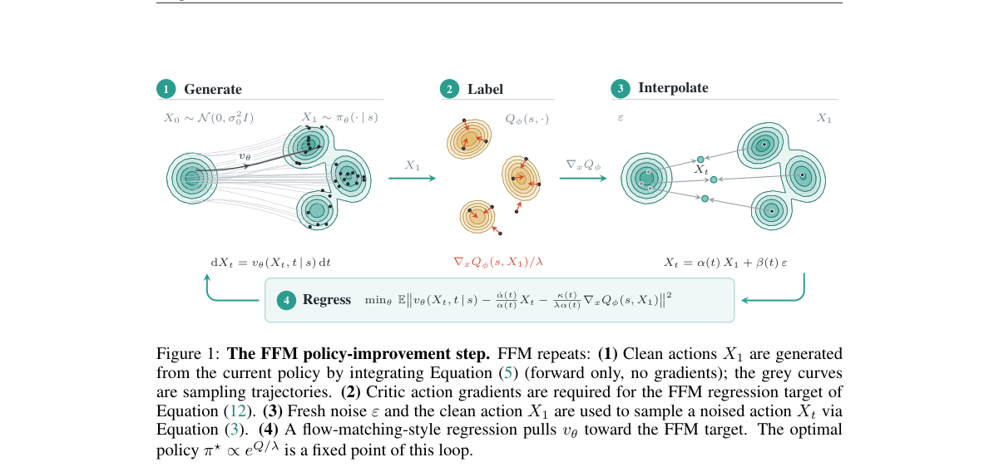

*Main result - Figure 2 Per-domain aggregated offline-to-online success rate (mean over the five tasks and all seeds). Offline (≤1M) and online (> 1M) phases are shaded; FFM (ours) is drawn in bold with a ±1 standa*

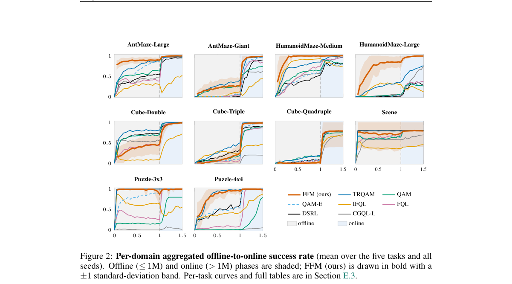

**Why this ranks #9**: 流策略与 RL 的结合本批出现了两次（这篇 + SimVTA），说明它正在成为一个独立方向。

---

### 10. A Step Harder, Not a Step Too Far: The Benefits and Limits of Curriculum Difficulty Progression in GRPO

**arXiv**: [2610.13669](https://arxiv.org/abs/2610.13669) | **Score**: 7.0 (relevance 7 x 0.7 + quality 7 x 0.3) | **Tags**: rlhf `[wild-card]` | **Categories**: cs.AI | **Pages**: 30

**Authors**: Ronghan Li, Fei Chen, Mingyu Lu

**Affiliation**: 1College of Artificial Intelligence, Dalian Maritime University, Dalian, | 2*Information Science and Technology College, Dalian Maritime | University, Dalian, 116026, Liaoning, China.

**Abstract**

> Curriculum learning typically organizes training samples from easy to hard. In GRPO, medium-difficulty samples are attractive for online selection because they are more likely to yield informative group-relative learning signals, and prioritizing them can improve training efficiency. However, it remains unclear whether persistently selecting such samples also leads to the strongest final model performance, or whether training can benefit from progressing toward harder samples. Meanwhile, sample difficulty changes as the policy evolves, so fixed difficulty estimates can become misaligned with the current policy. We therefore re-estimate sample difficulty under the current policy and, inspired by the easy-to-hard principle of curriculum learning, design and evaluate a staged curriculum that progressively shifts the active difficulty band toward harder samples. Experiments on GSM8K show that persistent medium-difficulty selection does not achieve the strongest observed performance. Across three random seeds, progressing to a moderately harder difficulty band improves test accuracy to $0.6591 \pm 0.0077$, compared with $0.6449 \pm 0.0024$ for the fixed-medium curriculum. However, further progression to a harder difficulty band reduces accuracy to $0.6405 \pm 0.0053$. These results show that staged difficulty progression can outperform persistent medium-difficulty selection, but its benefit is non-monotonic. Effective GRPO curricula can therefore benefit from progressing beyond medium difficulty, while avoiding excessive progression toward overly difficult samples.}

**Key findings**

- **Finding**: GRPO 中中等难度样本更可能产生信息丰富的组相对学习信号，优先选择它们能提升训练效率。

- **Finding**: 但持续选择此类样本是否会带来负面后果仍不清楚；标题即结论方向——「再难一步，而非太远一步」。

- **Finding**: 该文系统给出课程难度推进在 GRPO 中的收益与**限制**。

- **Inference**: 持续选中等难度意味着模型训练分布被锁在一个窄带上——这与 10-08 日报的 GRPODropout 熵坍塌是同一类风险：效率优化反过来收窄了分布。

- **Recommendation**: wild-card 项，但与本批 AdaC-GRPO（本线 #6）同属课程学习，建议对照读。

**Key figures**

*Main result - Figure 2 provides a visual comparison of the training paradigms considered in this study, highlighting the differences between static difficulty ordering, online sample selection, and staged difficult*

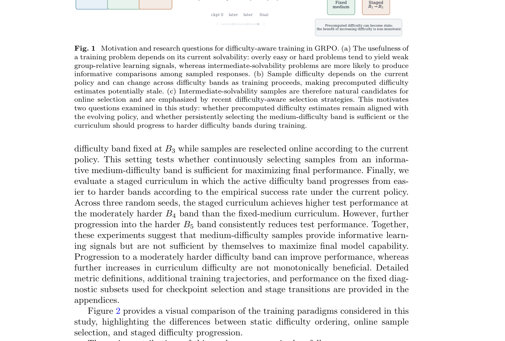

**Why this ranks #10**: 「优先选中等难度」在 GRPO 里已是共识，本文追问持续这样做会不会反噬。

---

## Footer

- Total papers reviewed across all 5 tracks: 50 (from 488 scanned)
- rl track final top-10: 10
- Wild-cards in this track: 1
- Figure assets: `res/` (shared across tracks)

Generated by `mine-arxiv-daily-digest` skill. Sister file: `2026-10-12_rl_entry.md`.
