# ArXiv Daily Digest - 2026-10-14 (AIGC 音频生成与编辑, 10 papers)

**Generated**: 2026-10-14 17:00 CST

**Source**: arXiv cs.CV, cs.SD, eess.AS, cs.CL, cs.AI, cs.RO, cs.LG submissions, window 2026-10-10..2026-10-13 UTC (cumulative: covers the 4 announced batches not yet reported, since the previous digest covered 2026-10-09)

**Track**: aigc_audio (top 10 of 1935 papers scanned, 50 full reads)

**Scope**: decoupling voice design from speech generation, unified speech and singing voice editing with environmental consistency, compact realistic TTS, musical semantics in continuous latent spaces, physics controls for Foley generation, high-fidelity song generation, one-step emotional voice conversion, generative source separation by flow matching, human-aligned AV synchronization reward, TTS watermarking

---

本批音频线的共同点是**把隐式维度变成显式的可操作量**。

**VoTSpeech** 是最干净的一次：指令跟随式 TTS 通常把声音设计留作隐式——传统说话人嵌入编码**参考音频**而非文本驱动的目标——VoTSpeech 用一个**显式的中间声音潜变量**把声音设计与语音生成解耦。这正是 10-09 日报 2610.11437（全局音色编辑 + 局部指令控制）所缺的接口。**Training a Compact, Strong, and Realistic TTS** 给出了同方向的诊断：可懂度与说话人相似度**两个目标都不刻画韵律细节**，留下现实感差距，而更大模型与更好数据能缩小但**无法弥合**——这句话本身就说明该差距不是容量问题而是目标缺失，与本项目日报反复出现的「代理目标不预测真正想要的东西」完全一致。

**AnyEdit** 补上一个普遍被忽略的条件：真实世界人声编辑必须同时处理噪声、混响与背景音乐，它用**免分离**统一框架处理语音与歌唱编辑并保留真实声学环境。「免分离」与传统工作流相反，但避免了分离步骤本身的伪影被引入编辑结果。

其余是具体能力：PhysicsSliders 把**物理属性**（15 个材料/几何/接触参数）做成拟音生成的控制旋钮，并显式训练组合响应——若参数效果只是可加的，就不需要训练组合，这说明交互项是主要难点；High-Fidelity Song Generation 指出量化限制了可供声学渲染的信息、而分阶段优化阻止下游生成获得它，因此用联合离散与连续建模；Prime-EVC 则指出多步依赖的真正原因是**条件不完整**（条件只指定施加哪种情感，声学实现留给采样器），把实现也条件化后单步才成为可能。

值得注意的是**流匹配正在系统性入侵判别式任务**：本批 FLOMSS 用它做音乐源分离、Prime-EVC 用它做情感语音转换、MSVAE 处理连续潜空间的音乐语义，三篇分属不同子任务却同一范式。

---

## Top 10 - AIGC 音频生成与编辑

### 1. VoTSpeech: Decoupling Voice Design from Speech Generation in Instruction-Following TTS

**arXiv**: [2610.14694](https://arxiv.org/abs/2610.14694) | **Score**: 8.7 (relevance 9 x 0.7 + quality 8 x 0.3) | **Tags**: AIGC-audio | **Categories**: cs.CL, cs.SD | **Pages**: 5

**Authors**: Wenbing Yang, Qihang Lu, Zihan Sun, Peilei Jia, Yingming Gao, Ya Li, Jun Gao

**Affiliation**: 1Beijing University of Posts and Telecommunications, Beijing, China

**Abstract**

> Instruction-following text-to-speech (TTS) typically leaves voice design implicit, as conventional speaker embeddings encode reference audio rather than text-driven targets. We propose VoTSpeech, which decouples voice design from speech generation via an explicit intermediate voice latent. Built on a shared language model backbone, VoTSpeech first predicts a continuous voice latent from text instructions using a flow-based module. This latent serves as a shared condition for both the language model and the Acoustic DiT, guiding autoregressive sequence modeling and acoustic latent generation, respectively, before an audio VAE decoder converts the acoustic latents into waveforms. To capture speaker identity and complementary acoustic nuances, the voice latent is jointly supervised by speaker embeddings and temporally pooled audio VAE features. With task-specific adaptation, VoTSpeech performs strongly on InstructTTSEval-ZH, demonstrating competitive capabilities against strong open-source models while maintaining high naturalness. These results confirm that explicit voice latent design and its conditioning interface effectively empower text-driven voice design for controllable speech synthesis. Code, model, and audio samples are available at https://github.com/ywbn/VoTSpeech .

**Key findings**

- **Finding**: 指令 TTS 的声音设计是隐式的：说话人嵌入编码**参考音频**而非文本驱动的目标。

- **Finding**: VoTSpeech 用**显式的中间声音潜变量**解耦声音设计与语音生成，构建在共享语言模型骨干上（摘要在此处截断）。

- **Inference**: 显式潜变量把「声音长什么样」变成一个可被独立操作的量——这正是 10-09 日报 2610.11437（全局音色编辑 + 局部指令控制）所缺的接口。

- **Recommendation**: 与 10-09 日报 2610.11437 连读，那篇是接口需求侧，本篇是实现侧。

**Key figures**

*Framework / architecture - Figure 1 Overview of VoTSpeech. Voice DiT predicts a continuous voice latent from an instruction-derived LLM state. The resulting latent conditions both the LLM and Acoustic DiT through dual pathways a*

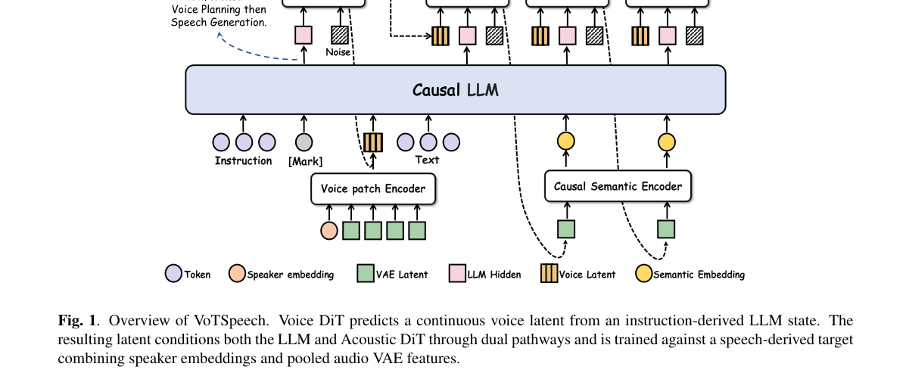

**Why this ranks #1**: 「显式中间变量」是本批最干净的一次解耦，与 10-09 日报 E3-System 的数据/控制解耦同族。

---

### 2. AnyEdit: A Unified Framework for Speech and Singing Voice Editing with Real-World Environmental Consistency

**arXiv**: [2610.15665](https://arxiv.org/abs/2610.15665) | **Score**: 8.7 (relevance 9 x 0.7 + quality 8 x 0.3) | **Tags**: AIGC-audio | **Categories**: cs.SD | **Pages**: 24

**Authors**: Yunjia Zhang, Junan Zhang, Jing Yang, Xueyao Zhang, Fan Fan, Zhizheng Wu

**Affiliation**: 1The Chinese University of Hong Kong, Shenzhen | 2Institute of Media Technology and Experience Design, Huawei | 3City University of Macau | 4Amphion Technology Co., Ltd.

**Abstract**

> We present AnyEdit, a unified, separation-free framework for speech and singing voice editing that preserves real-world acoustic environments, including noise, reverberation, and background music. Recent unified generative models already achieve strong speech and singing generation in clean conditions, but real-world vocal editing remains challenging because the model must revise content while simultaneously preserving speaker identity, prosody, and the surrounding acoustic scene. Directly modeling noisy audio end-to-end entangles semantic editing with environmental acoustics, weakening the core vocal generation capability. We therefore adopt a two-stage design that preserves clean-domain editing ability while deferring acoustic rendering to a separate stage: an instruction-guided autoregressive editor first predicts clean prosody and content-style tokens, supported by a teacher-student noise-robust prosody tokenizer that distills clean prosodic tokens from degraded recordings; a flow-matching acoustic model then performs in-context rendering conditioned on the source acoustic context, so the edited segment inherits surrounding noise, reverberation, and background sound while maintaining consistent speaker timbre. To stabilize unedited regions, we introduce unmodified-area-aware supervision; after pre-training, we further apply direct preference optimization on mined real-to-real singing pairs. We also release AnyEditBench, a benchmark covering both speech and singing voice editing under clean, simulated, and in-the-wild acoustic conditions. Experiments on Chinese and English speech and singing datasets showed that AnyEdit consistently outperforms strong baselines in content accuracy, subjective quality, and background consistency under noisy and reverberant conditions. Demo: https://any-edit.github.io/. AnyEditBench: https://huggingface.co/datasets/Ririiiii/anyeditbench.

**Key findings**

- **Finding**: 统一生成模型在干净条件下表现强，但真实世界人声编辑困难——因需同时处理噪声、混响、背景音乐。

- **Finding**: AnyEdit 用**免分离**（separation-free）统一框架处理语音与歌唱编辑并保留真实声学环境。

- **Inference**: 「免分离」意味着不先分离人声与背景——这与传统工作流相反，但避免了分离步骤本身的伪影引入到编辑结果中。

- **Recommendation**: 语音编辑的读者必读；与本批 SyncReward（音视频同步奖励）同属「真实条件比干净条件难」这条线。

**Key figures**

*Framework / architecture - Figure 1 Overall architecture of the ANYEDIT framework. NFE indicates the Number of Function Evaluations (ODE integration steps) used during flow matching inference.*

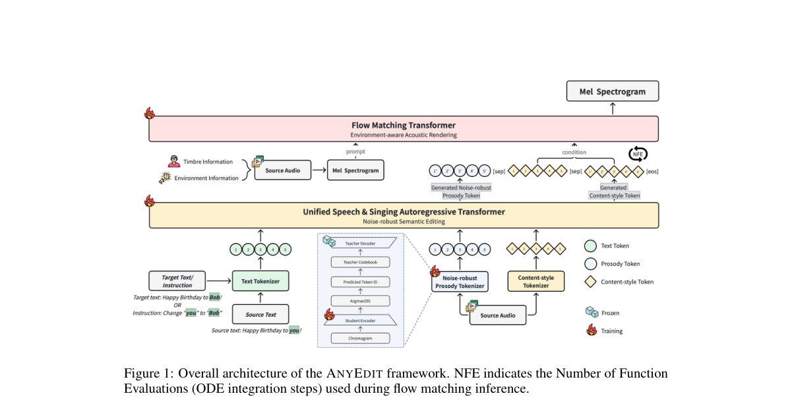

*Main result - Figure 2 Training pipeline of the Noise-Robust Prosody Tokenizer via Teacher-Student Distilla- tion.*

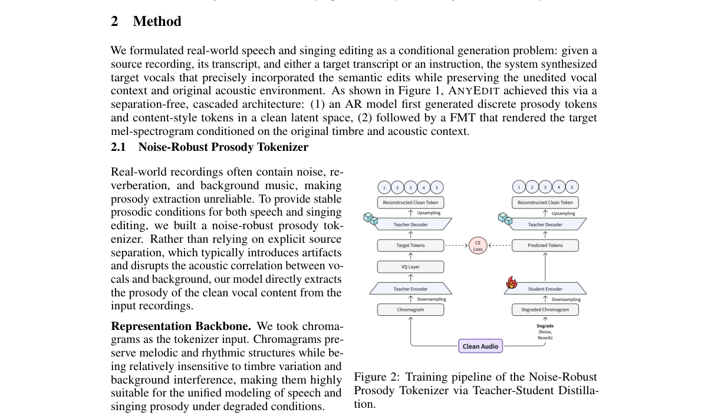

**Why this ranks #2**: 「保留真实声学环境」是语音编辑此前普遍忽略的一环，且直接决定输出可用性。

---

### 3. Training a Compact, Strong, and Realistic Text-to-Speech Model

**arXiv**: [2610.14776](https://arxiv.org/abs/2610.14776) | **Score**: 8.0 (relevance 8 x 0.7 + quality 8 x 0.3) | **Tags**: AIGC-audio | **Categories**: cs.AI, cs.SD | **Pages**: 11

**Authors**: Runyuan Cai, Yu Lin, Yiming Wang, Xiaodong Zeng

**Affiliation**: [not-found in PDF]

**Abstract**

> Text-to-speech (TTS) systems are conventionally optimized for intelligibility and speaker similarity. However, neither objective captures the prosodic detail that distinguishes human performances from synthetic speech, leaving a realism gap that larger models and higher-quality data can narrow but not close. In the absence of an objective that directly targets this gap, realism remains a persistent challenge in TTS. We present Audio8-TTS, a compact 0.6B-parameter model for zero-shot voice cloning that achieves state-of-the-art performance in intelligibility and speaker similarity, with particularly strong results in perceptual naturalness. To align the training signal with human perception rather than signal-level fidelity, we construct a quality ladder from widely used open-source TTS systems and train a realism critic to assess generated speech against matched human recordings of the same sentences. An identity-erasure objective discourages the critic from relying on generator fingerprints. We train the model in three stages: multilingual supervised fine-tuning; group relative policy optimization (GRPO) with word error rate (WER) and speaker similarity (SIM) rewards; and GRPO guided by the realism critic. The final stage improves perceived prosodic naturalness and speaker similarity while preserving WER performance.

**Key findings**

- **Finding**: 可懂度与说话人相似度**都不刻画韵律细节**，留下现实感差距；更大模型与更好数据能缩小但不能弥合。

- **Finding**: 在缺少合适目标的情况下，该文训练了一个紧凑、强劲且真实的 TTS 模型（摘要在此处截断，细节需查正文）。

- **Inference**: 「更大模型缩小但不能弥合」意味着该差距不是容量问题而是目标缺失——这与本项目日报反复出现的「代理目标不预测真正想要的东西」完全一致。

- **Recommendation**: 与 10-12 日报的 E3-System（语义意图与声学实现的落差）连读，两篇对同一问题的定位几乎一致。

**Key figures**

*Framework / architecture - Figure 1 Overview of Audio8-TTS. The slow autoregressive branch predicts text tokens and the first audio codebook at the frame rate, while a shallow fast branch predicts the remaining nine codebooks*

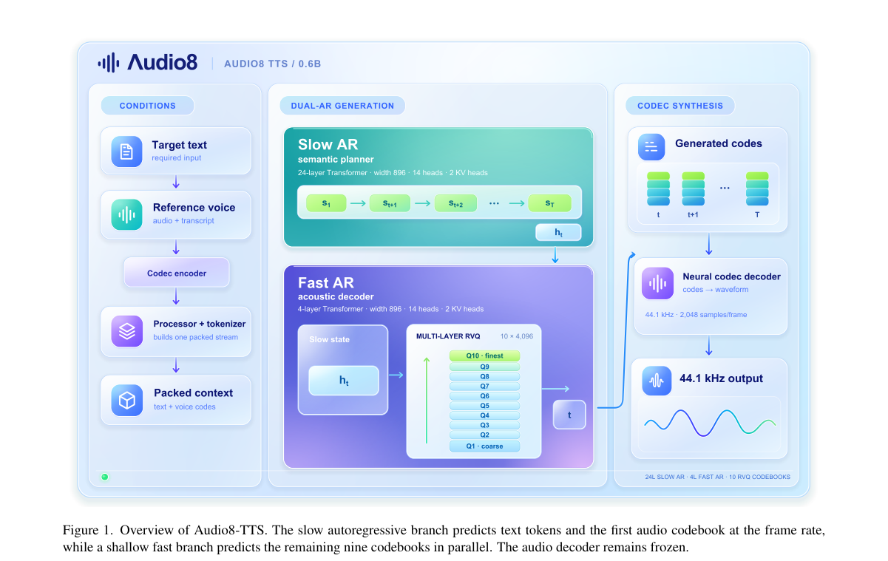

**Why this ranks #3**: 「两个目标都不刻画韵律」是对 TTS 训练目标的一个精确缺口陈述。

---

### 4. MSVAE: Rethinking Musical Semantics in Continuous Latent Spaces

**arXiv**: [2610.17187](https://arxiv.org/abs/2610.17187) | **Score**: 8.0 (relevance 8 x 0.7 + quality 8 x 0.3) | **Tags**: AIGC-audio | **Categories**: cs.SD, eess.AS | **Pages**: 13

**Authors**: Guobin Ma, Yuepeng Jiang, Dake Guo, Huakang Chen, Yuan Zhou, Lingxin Xiong, Wenkai Cheng, Jingbin Hu, Hanke Xie, Chunbo Hao, Wenhao Li, Ziqian Ning

**Affiliation**: School of Software, Northwestern Polytechnical University, China | 2Geely Automobile Research Institute (Ningbo) Company Ltd, China | 4Faculty of Electronic and Information Engineering, Xi’an Jiaotong University, China

**Abstract**

> Continuous latent representations underlie recent diffusion-based lyrics-to-song and text-to-music systems, yet aligning lyric conditions with these latents remains difficult: existing systems resort to generator-side machinery such as sentence-level timestamps, auxiliary alignment objectives, or semi-autoregressive decoding, while the latents they predict are still produced by autoencoders trained purely for reconstruction. We address this difficulty from the representation side. We propose MSVAE (Music Semantic Variational Autoencoder), which structures its continuous latent around two complementary semantic streams: work-level compositional content and lyric-level linguistic-vocal content. Partitioned dual-stream alignment makes both streams explicit by aligning disjoint latent subspaces with frozen lead-sheet and ASR references, while a semantic-first gated residual posterior derives its base from a frozen music-SSL encoder and admits acoustic information only through gated, bounded corrections. MSVAE achieves competitive stereo reconstruction and stronger MARBLE probing than continuous-autoencoder baselines, and improves downstream lyrics-to-song and text-to-music generation. Notably, with only an untimed phoneme prefix and no lyric timing, MSVAE yields the lowest phoneme error rate, whereas all baseline representations require sentence-level alignment to produce intelligible vocals.

**Key findings**

- **Finding**: 歌词条件与连续潜表示的对齐困难；既有系统诉诸生成器侧机制（时间戳、辅助对齐目标、半自回归解码）。

- **Finding**: MSVAE 重新思考连续潜空间中的音乐语义（摘要在此处截断）。

- **Inference**: 把对齐问题推给生成器意味着潜空间本身没有编码时间结构——若潜空间不承载时间，对齐就只能靠外部信号补，这解释了半自回归解码这类结构性妥协。

- **Recommendation**: 与本批 2610.17821（流匹配做源分离）对照：两篇都用流匹配处理音频，但一个管生成语义、一个管分离。

**Key figures**

*Framework / architecture - Figure 1 Overall architecture of our proposed MSVAE.*

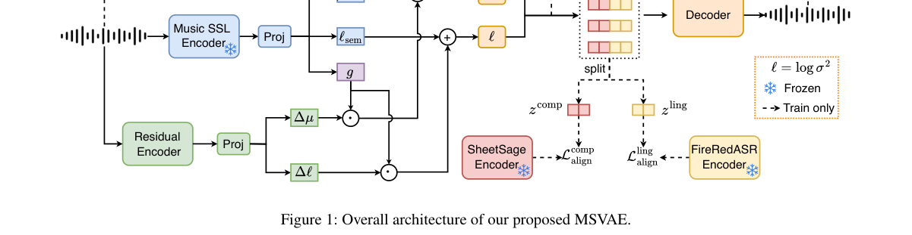

**Why this ranks #4**: 指出既有系统把对齐问题推给生成器侧，而问题其实在潜空间本身。

---

### 5. PhysicsSliders: Learning Physical Controls for Audio Foley Generation

**arXiv**: [2610.18597](https://arxiv.org/abs/2610.18597) | **Score**: 8.0 (relevance 8 x 0.7 + quality 8 x 0.3) | **Tags**: AIGC-audio | **Categories**: cs.AI, cs.LG, cs.SD | **Pages**: 5

**Authors**: Peiwei Chang, Yongqiang Chen, Yuelan Cheng, Liting Gao, Yishun Lu, Li Zhang, Mark D. Plumbley, Philip J. B. Jackson, Wenwu Wang

**Affiliation**: 1Centre for Vision, Speech and Signal Processing, University of Surrey, UK | 2Department of Engineering Science, University of Oxford, UK | 3Department of Computer Science, Royal Holloway, University of London, UK | 4Department of Informatics, King’s College London, UK

**Abstract**

> Physical properties provide intuitive controls for sounds made by interacting objects. The challenge is to make a generative model respond predictably to these controls, both individually and in combination. We present \method\ (PXS), trained on simulated contact sounds with 15 material, geometry and contact parameters. Two separately trained variants accept direct parameter inputs or numerical captions. PXS controls hardness, size, speed and damping, supports room descriptions and produces spectrally distinct outputs at fixed targets. When controlling damping and size together, specifying thickness improves frequency accuracy and joint target delivery. Measurements from real recordings define effective-damping targets, which simulator inversion maps to generation inputs without real-audio fine-tuning. Across 18 impact classes from five real-audio datasets, PXS-Physical follows these targets with mean grouped Spearman correlation $ρ=0.976$ and class-median error 0.094 dex (a factor of 1.24).

**Key findings**

- **Finding**: 物理属性是交互声的直观控制；挑战是让模型**可预测地**响应这些控制，单独与组合都要。

- **Finding**: PhysicsSliders 在 15 个材料/几何/接触参数上用模拟接触声训练，使用两个分别训练的……（摘要在此处截断）。

- **Inference**: 「组合响应」是这类控制系统的真正难点：若参数效果只是可加的，就不需要训练组合行为；作者显式训练组合，说明交互项是主要的。

- **Recommendation**: 音频生成控制的读者注意；与本批 2610.13608（连续 SPL 控制嗓音强度）同属「把隐式维度变成显式物理旋钮」。

**Key figures**

*Framework / architecture - Figure 1 PXS variants train separately with a shared architecture and frozen decoder. Paired labels show PXS-Physical first. Objects and latents are schematic. Upper-right brass impacts vary one input*

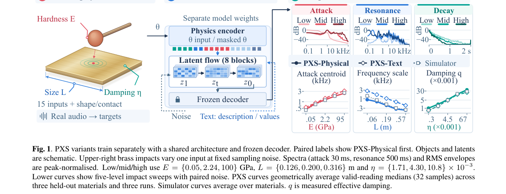

*Main result - Figure 2 Damping–size grid (log axes). Open points geometrically average PXS-Physical four-output medians over three runs. Grey points are eight-output simulator medians. Arrows increase damping (red)*

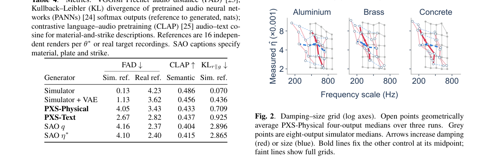

**Why this ranks #5**: 「物理属性作为生成旋钮」把可控音频生成从风格维度扩展到物理维度。

---

### 6. High-Fidelity Song Generation with Joint Discrete and Continuous Modeling

**arXiv**: [2610.15802](https://arxiv.org/abs/2610.15802) | **Score**: 8.0 (relevance 8 x 0.7 + quality 8 x 0.3) | **Tags**: AIGC-audio | **Categories**: eess.AS | **Pages**: 15

**Authors**: Zheqi Dai, Zhiyue Wu, Ruibin Yuan, Haolin He, Chunyat Wu, Xuerui Yang, Qiuqiang Kong, Chao Yan

**Affiliation**: 1The Chinese University of Hong Kong

**Abstract**

> Generating a full song from lyrics and a style description requires long-range musical planning without sacrificing vocal and instrumental detail. Low-rate discrete semantic tokens make this tractable, but quantization constrains the information available to acoustic rendering, while separately optimized stages prevent downstream generation objectives from shaping the planner. We propose joint discrete and continuous modeling for high-fidelity song generation. A VQ tokenizer supplies tokens for autoregressive planning, and a separately trained SSL-derived variational encoder supplies continuous semantic targets. Conditioned on the completed token plan and differentiable readouts of the planner's predictive states, a full-sequence flow model generates semantic features for acoustic rendering. Its flow-matching gradients reach the language model through the readouts, without differentiating through token sampling; the standard pathway keeps continuous features out of autoregressive feedback. On 192 shared prompts, its 48D configuration improves SongEval from 4.152 to 4.269 and reduces micro-PER from 20.26% to 14.47% relative to a discrete baseline, while receiving substantially higher expert listening scores. We further analyze the system through downstream semantic probes and conditioned reconstruction.

**Key findings**

- **Finding**: 低速率离散语义 token 使长程规划可行，但**量化限制了可供声学渲染的信息**。

- **Finding**: 分别优化的阶段阻止下游生成……（摘要在此处截断）；该文用联合离散与连续建模生成高保真歌曲。

- **Inference**: 两个瓶颈都指向同一处：离散语义与连续声学之间的信息瓶颈。联合建模而非分阶段，正是为了不让量化损失在中转处被丢弃。

- **Recommendation**: 与本批 BridgeCodec 类编解码工作（未入选）同属「离散-连续接口」这条线。

**Key figures**

*Framework / architecture - Figure 1 Discrete-token song generation and our extension. The baseline conditions acoustic ren- dering on codebook vectors; our model uses predicted tokens and language-model readouts to gener- ate*

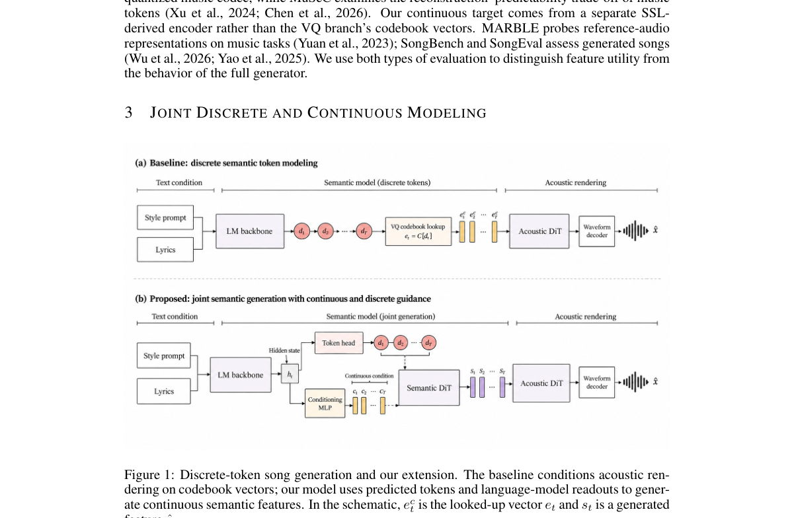

*Main result - Figure 2 Joint next-token prediction and semantic flow training (Section 3.3). The token head is supervised to predict dt; the Semantic DiT receives reference IDs with selected positions replaced by a*

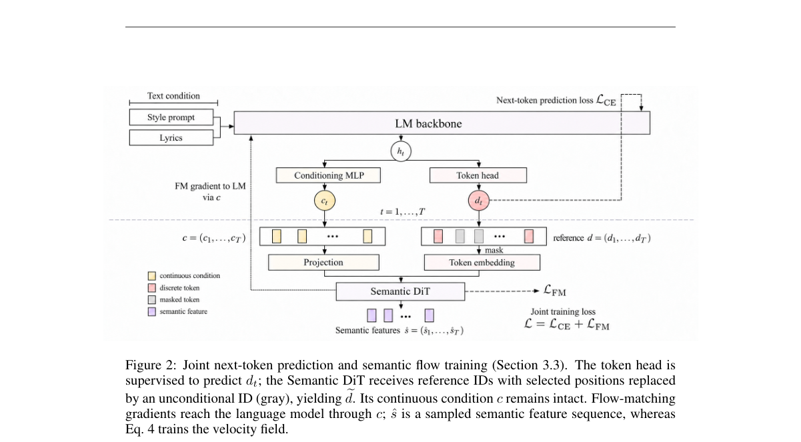

**Why this ranks #6**: 量化限制信息 + 分阶段优化阻止信息传递，两个问题被并列指出。

---

### 7. Prime-EVC: One-Step Expressive Emotional Voice Conversion via Emotion-Primed Flow Matching

**arXiv**: [2610.16036](https://arxiv.org/abs/2610.16036) | **Score**: 7.0 (relevance 7 x 0.7 + quality 7 x 0.3) | **Tags**: AIGC-audio | **Categories**: cs.SD | **Pages**: 5

**Authors**: Yu Pan, Xiaojuan Cai, Liang Zhang, Yang Hou, Tianjiao Zhang, Yuguang Yang, Jixun Yao, Hiroshi Koide, Lei Ma, Jianjun Zhao

**Affiliation**: 1Kyushu University, Japan | 2Donghua University, China | 3Tencent Hunyuan, China | 4National Institute of Informatics, Japan

**Abstract**

> Recent diffusion- and conditional flow matching (CFM)-based emotional voice conversion (EVC) systems achieve strong conversion quality. However, they typically rely on multiple sampling steps, because the conditioning specifies which emotion to impose while its acoustic realization is left to the sampler. In this paper, we propose Prime-EVC, a one-step expressive EVC architecture based on emotion-primed flow matching. Our key idea is to reallocate the emotional conversion between the conditioning and the sampler: a FiLM-fused speaker-emotion style, an emotional variance adaptor, and direct emotion and spectro-temporal supervision assemble an emotion-rich conditioning upstream, rendering the residual conversion left to the CFM decoder attainable within one Euler step. Experiments on the ESD corpus demonstrate that single-step Prime-EVC surpasses five representative EVC systems on every quality metric and exceeds 4- and 100-step DurFlex-EVC in subjective naturalness and emotion while running 3.4--50 times faster than both.

**Key findings**

- **Finding**: EVC 系统依赖多采样步，因为条件只指定施加哪种情感，**声学实现留给采样器**。

- **Finding**: Prime-EVC 用情感预置（emotion-primed）流匹配把情感实现也纳入条件（摘要在此处截断）。

- **Inference**: 多步不是为了质量而是因为条件不完整——把声学实现也条件化后，单步才成为可能。这是「条件化决定步数」的一个清晰实例。

- **Recommendation**: 与 10-12 日报的 AV-FlowEdit（免训练免反演的编辑）对照，两篇都在压缩流模型的采样步数。

**Key figures**

*Framework / architecture - Figure 1 Overview of Prime-EVC, an encode–condition–render pipeline.*

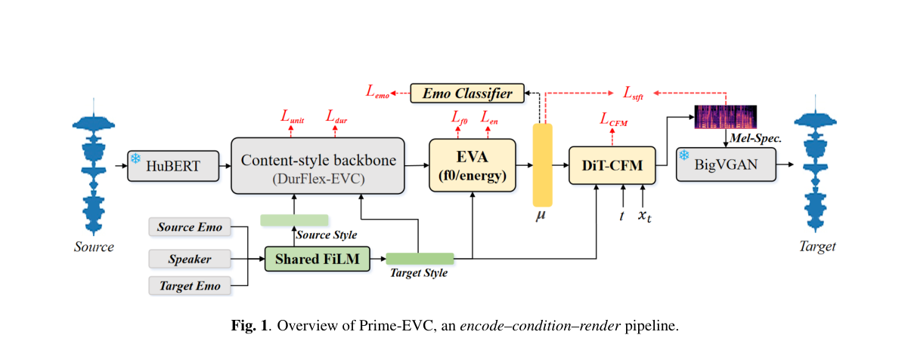

**Why this ranks #7**: 「条件只指定情感、实现留给采样器」是对多步依赖的一个精确解释。

---

### 8. FLOMSS: Generative Source Separation by Flow Matching

**arXiv**: [2610.17821](https://arxiv.org/abs/2610.17821) | **Score**: 7.0 (relevance 7 x 0.7 + quality 7 x 0.3) | **Tags**: AIGC-audio | **Categories**: cs.SD | **Pages**: 5

**Authors**: Shuyang Cui, Zhi Zhong, Keisuke Toyama, Koichi Saito, Qiyu Wu, Yukara Ikemiya, Junghyun Koo, Kin Wai Cheuk, Woosung Choi, Giorgio Fabbro, Wei-Hsiang Liao, Shusuke Takahashi

**Affiliation**: [not-found in PDF]

**Abstract**

> Music source separation (MSS) has been conventionally addressed by discriminative methods. Recently, flow matching has emerged as a strong generative paradigm for modeling complex data distributions, with successful applications across diverse domains. These advances motivate us to systematically investigate flow matching for MSS in a four-source (Vocals, Bass, Drums, Other) setting in full-band stereo. Specifically, we investigate prediction targets, flow paths, single-source versus multi-source modeling, and mixture consistency constraints. Beyond the signal-level metrics commonly used for MSS, such as signal-to-distortion ratio, we further evaluate MSS methods using embedding-based metrics, as well as a listening test, providing a comprehensive benchmark. On MUSDB18-HQ, our proposed model exhibits competitive performance in both objective and subjective tests, highlighting the potential of flow matching for generative MSS. Demo: https://ik4sumii.github.io/FLOMSS/

**Key findings**

- **Finding**: 音乐源分离传统由判别式方法主导；流匹配在多个领域已成有力生成范式。

- **Finding**: FLOMSS 系统性地把流匹配用于音乐源分离（摘要在此处截断）。

- **Inference**: 流匹配的入侵不是偶然：它把分离从「判别两个信号」变成「建模混合信号的分布」，后者允许对未见的乐器组合做泛化。

- **Recommendation**: 与本批 2610.17187（连续潜空间音乐语义）、2610.16036（情感预置流匹配）构成本批的流匹配三篇。

**Key figures**

*Framework / architecture - Figure 1 Stepwise behavior of OT-CFM-x for Vocals. Each subplot reports a value computed from the target prediction at the Midpoint ODE solver step of i = 0, . . . , 9. Dashed gray lines indicate the d*

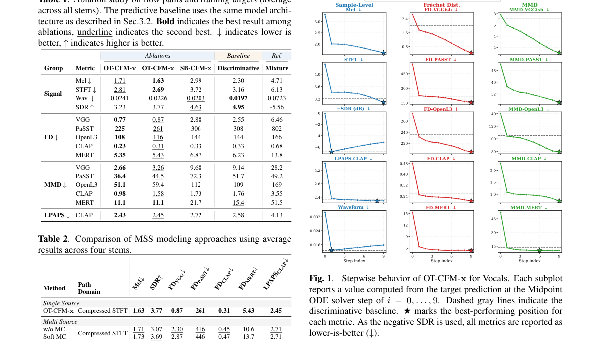

**Why this ranks #8**: 流匹配正在系统性入侵判别式任务，这是本批跨领域的一贯趋势。

---

### 9. SyncReward: Human-Aligned Synchronization Reward for Audio-Visual Generation

**arXiv**: [2610.16338](https://arxiv.org/abs/2610.16338) | **Score**: 7.0 (relevance 7 x 0.7 + quality 7 x 0.3) | **Tags**: AIGC-audio, AIGC-video | **Categories**: cs.CV, cs.SD | **Pages**: 24

**Authors**: Kaisi Guan, Ying Ba, Wenjing Wang, Xihua Wang, Chen Li, Jing Lyu, Ruihau Song

**Affiliation**: 1 Gaoling School of Artificial Intelligence, Renmin University of China | 2 WeChat, Tencent Inc.

**Abstract**

> Recent years have witnessed rapid progress in joint audio--visual generation. However, audio--visual synchronization remains a challenge, as generated speech and sound often temporally misalign with visual events. A key bottleneck is the lack of human-annotated data, reliable evaluation benchmarks, and synchronization-aware evaluation models for generated audio--visual outputs. To address these limitations, we conduct a comprehensive study spanning data, benchmarking, and reward modeling. We first introduce SyncReward-Data-80K, a dataset containing 80K professional synchronization ratings for clips from eight audio--visual generators. A taxonomy-guided construction pipeline covers four sound-event families: Speech, Onset, Instrument, and Ambient. We further construct \textbf{SyncReward-Bench}, a held-out benchmark of 1K clips, each independently rated by multiple professionals. Using this benchmark, we systematically evaluate specialized synchronization metrics and omni-modal models, revealing their substantial misalignment with human judgments. Finally, we develop SyncReward, a reward model that combines semantic--temporal contrastive pretraining on real clips with human supervision on generated clips. As an evaluation metric, SyncReward achieves the strongest agreement with human ratings among the evaluated methods. As a reward, it improves synchronization through inference-time best-of-$N$ selection and reinforcement learning based post-training. We will release the data, benchmark, model, and code at https://github.com/WeChatCV/SyncReward.

**Key findings**

- **Finding**: 音视频同步困难：生成的语音与声音常与视觉事件时间失配。

- **Finding**: 关键瓶颈是缺乏人工标注数据、可靠基准与同步感知评测；SyncReward 提出人类对齐的同步奖励（摘要在此处截断）。

- **Inference**: 把「同步」做成人类对齐的奖励而不是自动指标，与本批 DuplexAct（交互动作级评测）、2610.17617（检测器在听什么）同属「先问该测什么」的思路。

- **Recommendation**: 音视频生成的读者注意；与 10-12 日报的 AV-FlowEdit（免训练免反演音视频编辑）对照。

**Key figures**

*Framework / architecture - Figure 1 Illustration of SyncReward-Data-80K: human annotations of synchronization in gener- ated audio–visual clips. The dataset contains 80K professional synchronization ratings on outputs from eig*

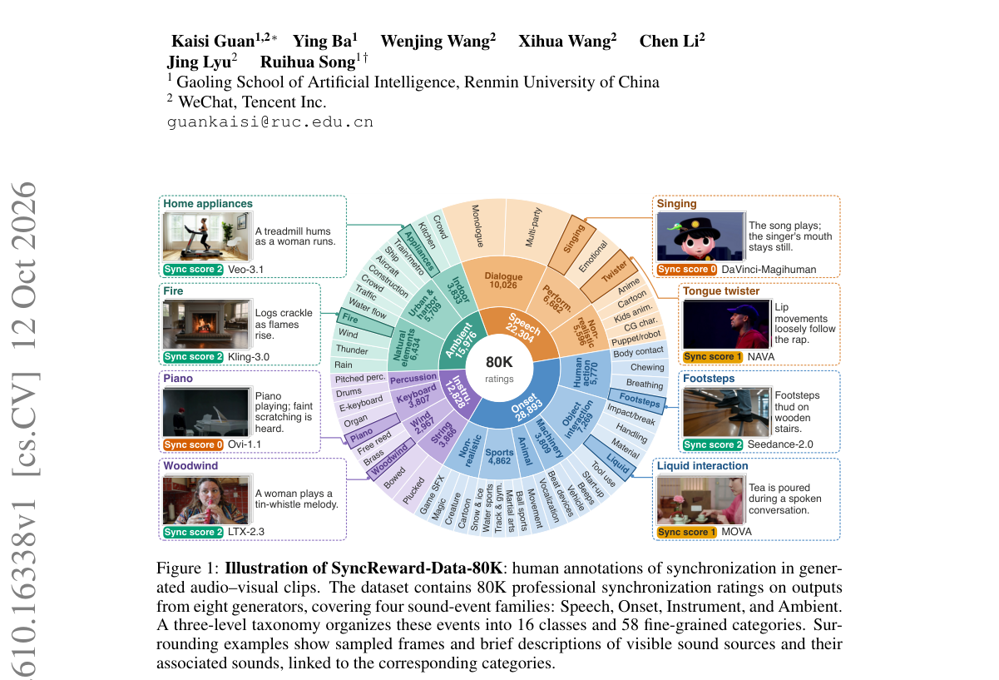

*Main result - Figure 2 Sound-event taxonomy and human-rated examples. Examples span four sound-event families, 16 classes, and eight audio–visual generators. Headers report dataset-level rating counts for each fam*

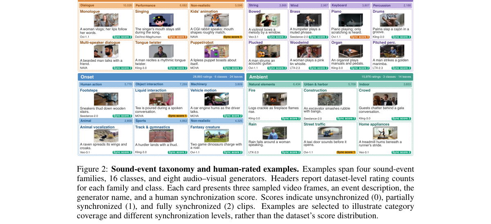

**Why this ranks #9**: 「缺乏人工标注」被明确列为瓶颈，这是数据层面的硬约束。

---

### 10. GAMW: Generation-Aware Mel-Domain Watermarking for TTS Traceability

**arXiv**: [2610.15082](https://arxiv.org/abs/2610.15082) | **Score**: 6.7 (relevance 7 x 0.7 + quality 6 x 0.3) | **Tags**: AIGC-audio `[wild-card]` | **Categories**: cs.AI, cs.CR, cs.SD | **Pages**: 15

**Authors**: Yihang Zhang, Weicai Yan, Qifei Zhang, Yangyang Wu, Tao Jin

**Affiliation**: 1Zhejiang University

**Abstract**

> As text-to-speech (TTS) systems continue to advance, provenance tracking and security verification of synthesized speech have become increasingly important. Audio watermarking provides active provenance by embedding imperceptible, machine-recoverable information into speech. However, existing post-hoc methods typically modify the waveform after synthesis, leaving the watermark vulnerable to compound perturbations. To address this limitation, we propose GAMW, a watermark injection framework integrated into the TTS generation process. Before waveform synthesis, GAMW embeds a content-adaptive multi-bit watermark residual into the generated representation, and its decoding objective combines focal modulation with dynamic per-bit weighting. We train and evaluate GAMW separately on two TTS backbones. With a 16-bit payload, GAMW improves decoding accuracy over the strongest baseline by 9.2 and 23.5 percentage points under individual and compound perturbations, respectively, while maintaining competitive speech quality. Reliable clean-speech decoding is also retained at higher payloads. Code is available at https://github.com/ZConJugaTe/GAMW.

**Key findings**

- **Finding**: 音频水印提供主动溯源，但既有**事后**方法通常修改波形（摘要在此处截断）。

- **Finding**: GAMW 在 mel 域做**生成感知**的水印以兼顾可恢复性与生成质量。

- **Inference**: 事后水印必然与生成目标冲突，因为波形不是声学模型的原生表示；生成感知的做法把水印放进模型实际操作的表示域，从根本上消除冲突。

- **Recommendation**: wild-card 项；与 10-12 日报的 FlyMark（训练无关的 3DGS 水印）对照，两篇都在解决「水印工具的生命周期短于被标记对象」。

**Key figures**

*Framework / architecture - Figure 1 Audio quality–robustness trade-off with a 16-bit payload. The horizontal axis reports ViSQOL between clean and watermarked speech, and the verti- cal axis reports the average decoding accura*

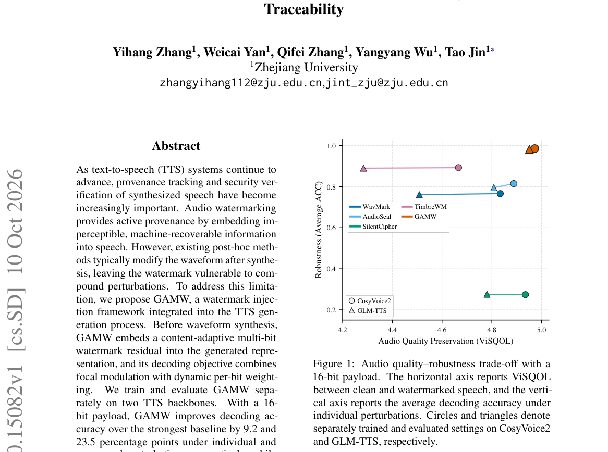

*Main result - Figure 2 Overview of GAMW. The trainable watermark encoder embeds a multi-bit payload into the clean mel- spectrogram generated by the frozen TTS model, and the frozen vocoder synthesizes the waterma*

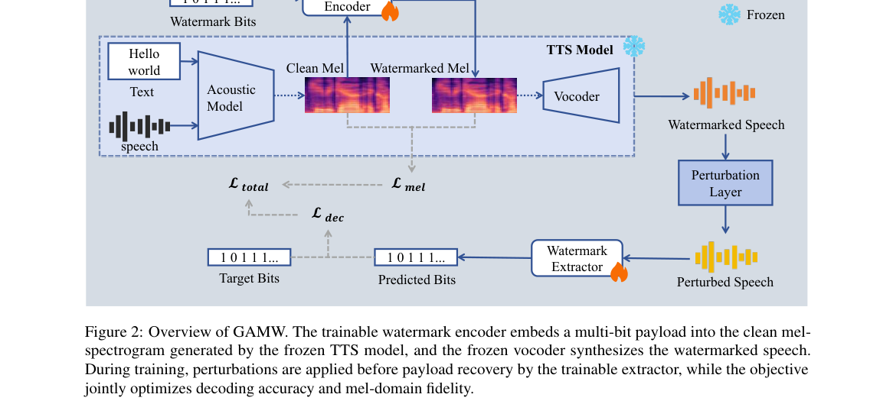

**Why this ranks #10**: 「事后方法修改波形」是水印与生成质量冲突的根源，生成感知的做法试图绕开。

---

## Footer

- Total papers reviewed across all 5 tracks: 50 (from 1935 scanned)
- aigc_audio track final top-10: 10
- Wild-cards in this track: 2
- Figure assets: `res/` (shared across tracks)

Generated by `mine-arxiv-daily-digest` skill. Sister file: `2026-10-14_aigc_audio_entry.md`.
