# ArXiv Daily Digest - 2026-10-14 (AIGC 图像 / 视频 / 3D 生成与编辑, 10 papers)

**Generated**: 2026-10-14 17:00 CST

**Source**: arXiv cs.CV, cs.SD, eess.AS, cs.CL, cs.AI, cs.RO, cs.LG submissions, window 2026-10-10..2026-10-13 UTC (cumulative: covers the 4 announced batches not yet reported, since the previous digest covered 2026-10-09)

**Track**: aigc_visual (top 10 of 1935 papers scanned, 50 full reads)

**Scope**: navigable 4D worlds via autoregressive video rerendering, on-policy distillation for few-step diffusion, adversarial gradient forcing, frequency-step cache decoupling, prospective forcing multi-head lookahead, predictive KV cache quantization, historical trajectory guidance, response-guided KV cache consolidation, head-heterogeneous sparse attention domains, agentic revisit for compositional generation

---

**本批七篇论文在打同一个问题：自回归长视频生成如何处理历史与缓存。** 这是本项目日报已连续追踪五天的一条线（10-05 的 ID-Forcing 指出 KV-provenance 问题、10-08 的 Memory Forcing 命名「中程遗忘」、今天七个方案），密度足以说明这不是零散修补而是一个正在成形的子领域。

七个方案沿三个维度展开。**缓存决策**：Frequency-Step Cache 把既有控制器**耦合**的两个决策（何时精确同步缓存、同步之间投入多少计算修复）**分离**为两个独立旋钮——耦合意味着两个正交机制被迫一起调，可达策略空间远小于参数量暗示的；FrameFold 则从「按历史长度保留」转向**响应引导**的整合（保留哪些 KV 由它们对当前输出的影响决定），这与 10-07 日报 DiReTAL、10-08 日报 VLA-ACL 的剪枝思路相同。**缓存压缩**：TempoKV 指出既有 KV 量化方法**专为 LLM 设计、迁移到视频效果差**，因为视频激活的统计特性与时空冗余完全不同。
**预测时程**：Prospective Forcing 直指一个被普遍默认的事实——自回归视频生成器**通常只被训练预测紧邻的未来**，而受限的预测时程正是长 rollout 中质量难以维持的原因。

另外两篇方法论上值得单独注意：**Simplifying and Improving On-Policy Distillation** 表明**简单的在策略速度回归**已为 4-NFE 生成提供坚实基础——既有方法常需辅助分数模型或专用架构，若基线可简化，此前大量围绕辅助模型的工作其实在解决一个被自己引入的问题。**Competition Domains Matter** 则指出免训练稀疏注意力在每行每头**固定**竞争域，而域本身是否该随注意力头异质性自适应从未被问过——这与 10-12 日报 GeZo-SAC（评论家聚合规则处处相同、无论分歧多大）是完全同构的论证。

**Demiurge** 是本线相关性最高的一篇：它指出既有 novel-view 视频方法**独立处理每条相机轨迹**，缺乏形成连贯可导航 4D 世界所需的跨轨迹一致性——单条轨迹的 NVS 只需轨迹内一致，而可导航世界要求跨轨迹的同一性，这是强得多的约束，也是世界模型真正需要的性质。

---

## Top 10 - AIGC 图像 / 视频 / 3D 生成与编辑

### 1. Demiurge: Forging Navigable 4D Worlds via Autoregressive Video Rerendering

**arXiv**: [2610.14685](https://arxiv.org/abs/2610.14685) | **Score**: 9.0 (relevance 9 x 0.7 + quality 9 x 0.3) | **Tags**: AIGC-video, world-model | **Categories**: cs.CV | **Pages**: 52

**Authors**: Hanxin Zhu, Jianqi Ma, Cong Wang, Zhihao Hu, Junyao Gao, Tianyu He, Junyan Lin, Jiayin Xiao, Jiateng Shou, Sen Liang, Weidong Zhang, Zhibo Chen

**Affiliation**: 4Tongji University

**Abstract**

> Recent advances in video diffusion enable novel-view video synthesis from a single input video, supporting world modeling, embodied intelligence, and robotic simulation. However, existing methods process camera trajectories independently, lacking the cross-trajectory consistency needed for coherent, navigable 4D worlds. We introduce Demiurge, an autoregressive video rerendering pipeline built on a dynamic 4D point-cloud memory cache. It promotes cross-trajectory consistency through four components: (1) an appearance video diffusion model that synthesizes photorealistic novel-view videos conditioned on the 4D memory; (2) a memory-consistent video depth completion model that aligns known-region depths with cached geometry and completes missing regions, mitigating scale ambiguity and discontinuities during memory updates; (3) memory-aware dual-stream warping that provides high-fidelity visual guidance and occlusion cues for novel-view synthesis; and (4) geometry-aware video refinement that enhances perceptual quality. Extensive experiments demonstrate state-of-the-art performance and three key capabilities: coherent spatiotemporal lattice construction over dense multi-view trajectories; large-parallax video rerendering under challenging camera motions, including 180-degree rotations with no input-view overlap; and geometry-faithful outputs that can be directly optimized into high-quality 3D Gaussian Splatting representations with minimal artifacts. Project page: https://hanxinzhu-lab.github.io/demiurge_project_page/.

**Key findings**

- **Finding**: 既有 novel-view 视频方法**独立处理每条相机轨迹**，缺乏跨轨迹一致性，因此无法形成可导航的 4D 世界。

- **Finding**: Demiurge 用自回归视频重渲染（rerendering）来构造可导航的 4D 世界（摘要在此处截断，架构细节需查正文）。

- **Inference**: 把「渲染」与「导航」分开是一个重要区分：单条轨迹的 NVS 只需要轨迹内一致，而可导航世界要求跨轨迹的同一性——后者是更强的约束，也是世界模型真正需要的性质。

- **Recommendation**: 本批第一篇；与 10-08 日报的 RoboRender（机器人导向视频生成）、今天的 World Models' Last Exam 系列对照，四个方向都指向「视频生成的用途决定其约束」。

**Key figures**

*Framework / architecture - Figure 1 Comparison of our pro- posed method with existing meth- ods. (a) Existing methods indepen- dently synthesize videos along dif- ferent target trajectories, resulting in cross-trajectory incon*

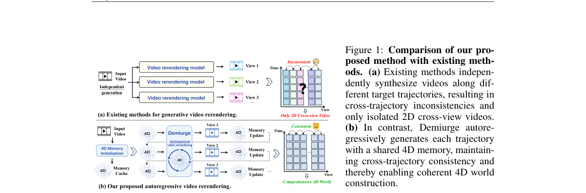

*Main result - Figure 2 Overview of Demiurge. Demiurge performs autoregressive video rerendering with an evolving 4D point-cloud memory through a generate–recover–update cycle. By integrating dual- stream warping,*

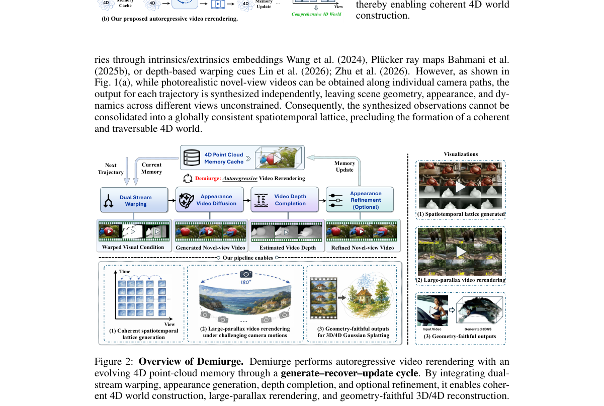

**Why this ranks #1**: 本批相关性最高的一篇，且直接连接 AIGC 视频与世界模型两个用户核心兴趣。

---

### 2. Simplifying and Improving On-Policy Distillation for Few-Step Diffusion

**arXiv**: [2610.18472](https://arxiv.org/abs/2610.18472) | **Score**: 9.0 (relevance 9 x 0.7 + quality 9 x 0.3) | **Tags**: AIGC-image, AIGC-video | **Categories**: cs.CV, cs.LG, eess.IV | **Pages**: 59

**Authors**: Jiawei Zhang, Ziyu Wan, Nanye Ma, Long Zhao, Dong Chen, Hongyu Liu, Qifeng Chen, Dongdong Chen

**Affiliation**: Microsoft Research | 1Microsoft Research

**Abstract**

> Few-step distillation reduces the sampling cost of diffusion and flow models, but existing approaches often require auxiliary score models or specialized architectures. We show that simple on-policy velocity regression already provides a strong foundation for 4-NFE generation. To represent teacher velocity variation within each coarse transition, we introduce Pivot, a training-only residual proxy that separates local corrections from the student's interval-mean prediction. We further repel the student from weaker teacher predictions, providing a lightweight mechanism for avoiding undesirable modes. The resulting framework, Simplified Matching Distillation (SMD), remains entirely regression-based, requires neither online score estimation nor adversarial training, and leaves the deployed generator unchanged. We evaluate SMD on image generation and editing, 3D generation, video synthesis, and joint audio--video generation, scaling to 33 billion parameters. At 4-NFE, SMD outperforms strong few-step baselines and surpasses multi-step teachers on several benchmarks. It also supports cross-model, multi-teacher, and causal-video distillation.

**Key findings**

- **Finding**: 少步蒸馏的既有方法常需要辅助分数模型或专用架构——这两者都增加了部署与训练负担。

- **Finding**: 作者表明**简单的在策略速度回归**已为 4-NFE 生成提供坚实基础，并额外引入机制以表示每个粗略转移内的教师速度变化。

- **Inference**: 若基线可以简化到「在策略回归 + 一个速度变化表示」，那么此前大量围绕辅助模型的工作其实在解决一个被自己引入的问题——这会显著改变该方向的入门成本。

- **Recommendation**: 与 10-09 日报的 Phase-wise Velocity Distillation、Parametric Trajectory Distillation 构成少步蒸馏的三篇连读（本项目日报已连续四天记录该子方向）。

**Key figures**

*Framework / architecture - Figure 1 Simplicity scales. SMD at 4-NFE across image, video, editing, multi-teacher, and audio–video generation. Radial scales are truncated per metric. Column scales start at zero. All metrics are*

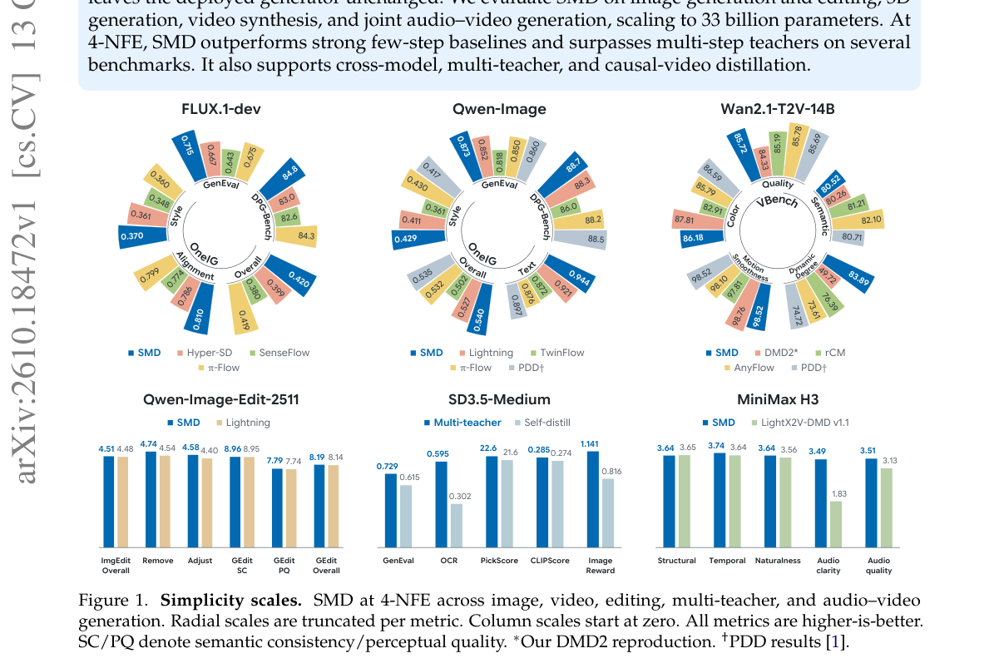

*Main result - Figure 2 Few-step image generation with Qwen-Image. The SMD-distilled 4-NFE student generates images with varied compositions, embedded text, and visual styles.*

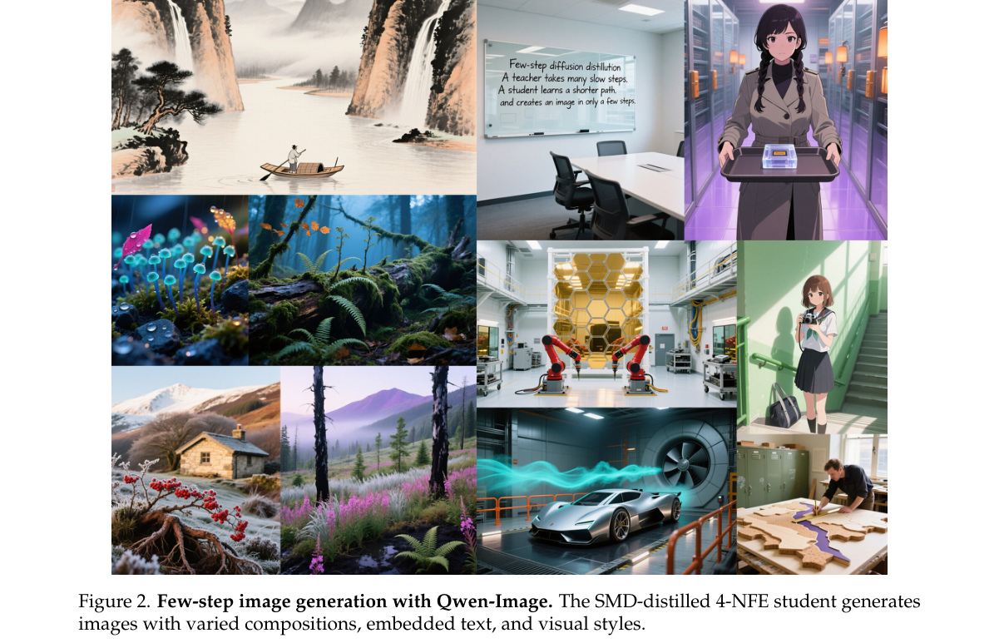

**Why this ranks #2**: 「去掉辅助模型与专用架构」是一个高杠杆的简化，且直接给出 4-NFE 的基线。

---

### 3. Frequency-Step Cache: Separating Synchronization and Repair for Efficient Autoregressive Video Diffusion

**arXiv**: [2610.15922](https://arxiv.org/abs/2610.15922) | **Score**: 9.0 (relevance 9 x 0.7 + quality 9 x 0.3) | **Tags**: AIGC-video | **Categories**: cs.CV, cs.LG | **Pages**: 30

**Authors**: Kerry Xu, Param Misra, Zachary Stenglein, Athri Karunamurthy, Fanjiang Ye, Yuke Wang

**Affiliation**: Rice University

**Abstract**

> Autoregressive (AR) video generation enables long-horizon synthesis but requires repeated forward passes through large diffusion transformers. Training-free caching reduces this cost by reusing intermediate computation, yet existing controllers often couple two decisions: when to synchronize the cache exactly and how much computation to repair between synchronizations. We introduce Frequency-Step Cache (FSC), which separates these roles. FSC schedules exact full-computation anchors on a dense-to-sparse trajectory, while a lightweight latent-space risk based on frequency-resolved drift and token age controls inter-anchor repair through whole-step replay, selective token recomputation, or full repair. On SkyReels-V2, whole-step reuse provides most of the acceleration, while selective token computation is most effective as fidelity repair. A controlled ablation shows that using one reactive signal for both synchronization and repair reduces fidelity at matched latency, with the same separation advantage observed on FramePack and Matrix-Game. Across multiple autoregressive video backbones, FSC improves speed-quality trade-offs. On SkyReels-V2, FSC-Speed reaches 2.36x speedup versus MotionCache's 2.275x while improving SSIM by 0.019 and PSNR by 0.5 dB. At MotionCache-matched speed, FSC-Quality improves SSIM by 0.031 and PSNR by 1.0 dB and lowers LPIPS by 0.024. Without retuning, FSC-Quality transfers to SkyReels-V2 14B at 2.12x speedup versus 1.79x for MotionCache.

**Key findings**

- **Finding**: 免训练缓存通过复用中间计算降低成本，但既有控制器把两个决策**耦合**：何时精确同步缓存、同步之间投入多少计算修复。

- **Finding**: Frequency-Step Cache 把「同步」与「修复」**分离**为两个独立决策（Frequency 决定频率/步进，Step 决定修复量）。

- **Inference**: 耦合意味着「同步频率」与「修复强度」被迫一起调：一个决策变量控制两个正交的机制，实际可达到的策略空间远小于参数数量暗示的。

- **Recommendation**: 本批 AR 视频缓存七篇里最值得先读的一篇；拆解式设计往往比端到端方案更容易迁移到你的具体部署。

**Key figures**

*Main result - Figure 2 Anchors are fixed before generation; full repairs are chosen by the risk ρs and leave the schedule unchanged. (a) When: dense warmup, then dense-to-sparse anchors. (b) How much: drift from X*

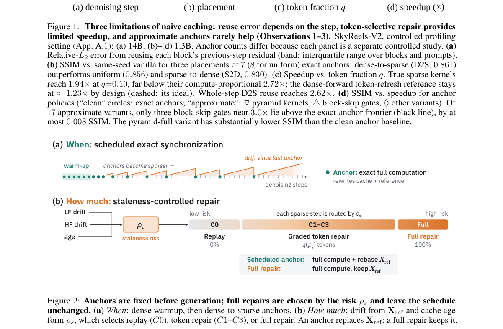

**Why this ranks #3**: 把一个耦合决策拆成两个，是本批 AR 视频缓存集群里方法论最清晰的一篇。

---

### 4. Prospective Forcing: Learning to Look Ahead for Autoregressive Long Video Diffusion

**arXiv**: [2610.14654](https://arxiv.org/abs/2610.14654) | **Score**: 8.3 (relevance 8 x 0.7 + quality 9 x 0.3) | **Tags**: AIGC-video | **Categories**: cs.AI, cs.CV | **Pages**: 22

**Authors**: Yifan Shen, Yewei Xia, Gongxu Luo, Peiyuan Zhu, Boyang Sun, Zhenhao Chen, Guangyi Liu, Guangyi Chen, Kun Zhang

**Affiliation**: 1Mohamed bin Zayed University of AI | 2Carnegie Mellon University

**Abstract**

> Autoregressive video generators synthesize long videos through chunk-wise rollouts, yet they are typically trained to predict only the immediate future. This limited prediction horizon makes it challenging to maintain video quality over extended rollouts. To address this problem, we introduce Prospective Forcing, a multi-head prediction framework that injects long-range predictive signals into autoregressive video representations. Built on a rolling-window generator, Prospective Forcing attaches lightweight, offset-specific heads that share the same conditioning information and independently predict chunks at different future temporal offsets. By extending supervision beyond the next chunk, these heads encourage the shared history representation to retain information useful for longer-horizon prediction, supporting temporally consistent generation. At inference time, we accelerate sampling by using accepted future-chunk predictions to skip full-window backbone executions. We equip the head with learnable embeddings to generate multiple candidates for the next chunk, and a learned verifier either selects a candidate or rejects all and falls back to standard autoregressive generation.

**Key findings**

- **Finding**: 自回归视频生成器通常**只被训练预测紧邻的未来**，这个受限预测时程使长 rollout 中质量难以维持。

- **Finding**: Prospective Forcing 用多头预测框架注入更远的预测时程（摘要在此处截断，注入方式需查正文）。

- **Inference**: 把「预测时程」作为一个显式的训练目标而非被动继承，是把长视频质量问题从架构层移到训练层的做法——与 10-12 日报的 Beyond Actions（预测目标从命令换成效果）是同一种思路。

- **Recommendation**: 与本批 TGuide（历史轨迹引导）、FrameFold（KV 整合）对照，三篇分别从训练时程、特征历史、缓存压缩三个方向处理同一问题。

**Key figures**

*Framework / architecture - Figure 1 By learning to predict future, Prospective Forcing generates long videos that remain dy- namic, temporally consistent, and visually stable from a single text prompt.*

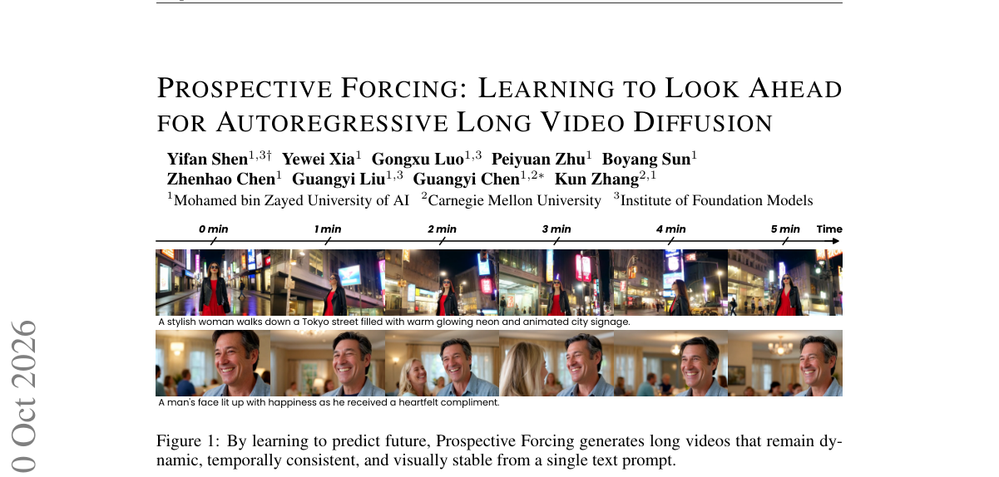

*Main result - Figure 2 Temporal shortsightedness. The car gradually drives out of view with only next-chunk prediction, and fore- seeing future chunks keeps it in frame.*

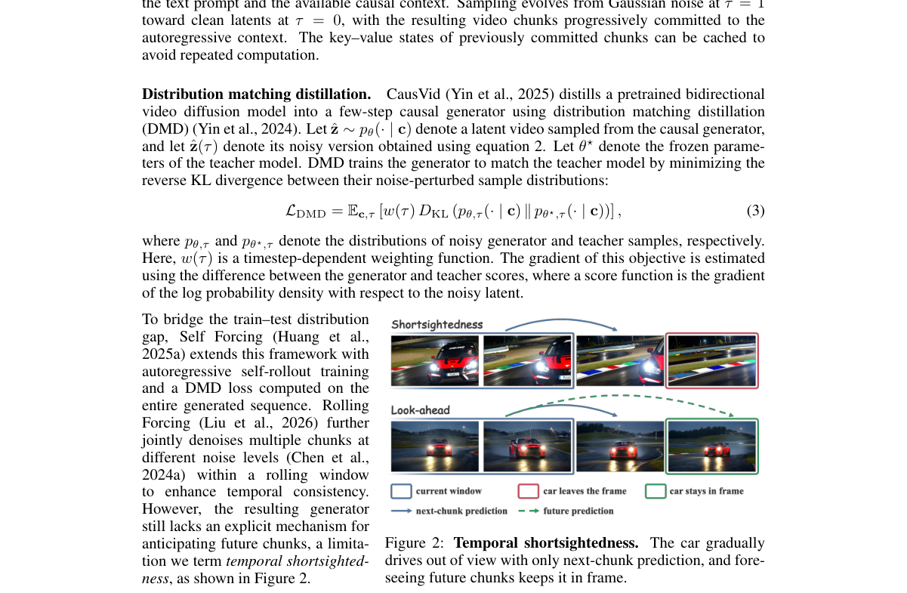

**Why this ranks #4**: 「只训练预测紧邻未来」是自回归视频的一个结构性局限，与本项目日报追踪的长期记忆问题同源。

---

### 5. Adversarial Gradient Forcing for Robust Few-Step Autoregressive Video Generation

**arXiv**: [2610.14553](https://arxiv.org/abs/2610.14553) | **Score**: 8.0 (relevance 8 x 0.7 + quality 8 x 0.3) | **Tags**: AIGC-video | **Categories**: cs.CV | **Pages**: 33

**Authors**: Chenxi Xia, Yixuan Xu, Shan Liu, Jiapeng Wang, Maohua Li, Hanlin Tang, Kan Liu, Tao Lan, Weiyi Lu, Xinggao Liu

**Affiliation**: 1Zhejiang University, 2Alibaba Group, 3Nanjing University

**Abstract**

> Autoregressive video generation models generate videos sequentially, with each new block conditioned on previously generated blocks. By training on the model's own rollouts, Self Forcing and its follow-up methods substantially mitigate exposure bias caused by the mismatch between training- and inference-time history distributions. However, these models still suffer from error accumulation during long-horizon generation. We identify a key underlying limitation: the model remains highly sensitive to errors in its generated history, allowing small deviations to be amplified through subsequent generations. We refer to this underexplored problem as the local history robustness gap. To address this gap, we introduce Adversarial Gradient Forcing (AGF), a framework designed to improve the robustness of few-step autoregressive video models to perturbations and accumulated errors in their own generated histories. AGF uses distribution matching gradients from future block predictions to select adversarial perturbations of self-generated histories. It then jointly trains the generator on the original and perturbed histories to improve the robustness of future generation. Extensive experiments show that AGF achieves the highest VBench Total score on 60-second video generation and the best visual quality on four-minute video generation. Notably, AGF achieves such long-horizon robustness while requiring only 5-second rollouts for training.

**Key findings**

- **Finding**: 在模型自身 rollout 上训练（Self Forcing 系列）显著缓解了训练-推理历史分布不匹配导致的**暴露偏差**。

- **Finding**: 但这些模型仍然……（摘要在此处截断，残余问题需查正文）。

- **Inference**: 自训练消除分布不匹配是第一个正确步骤，但它只解决「历史来自同一分布」，不解决「同一分布内的历史仍是自我强化的」——残余问题的性质决定了后续方法的方向。

- **Recommendation**: 与 10-08 日报的 SGF+（去噪与 KV 写入梯度负对齐）连读；两篇都在处理自回归视频生成中「自身历史」的病理效应。

**Key figures**

*Framework / architecture - Figure 1 An example of four-minute video generation. Self Forcing and AGF generate four-minute videos using the same ODE initialization. With Self Forcing, visual artifacts emerge and progressively wo*

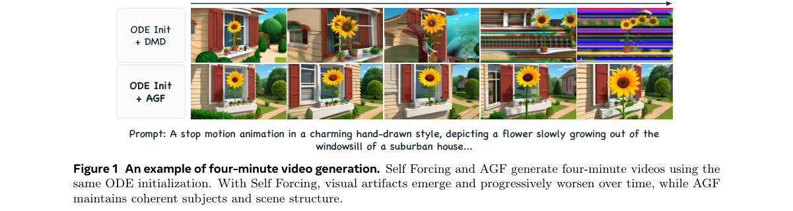

*Main result - Figure 2 A single perturbation leads to severe visual degradation in long-horizon autogressive video generation. The top row shows an unperturbed Self-Forcing rollout, while the bottom row uses the sa*

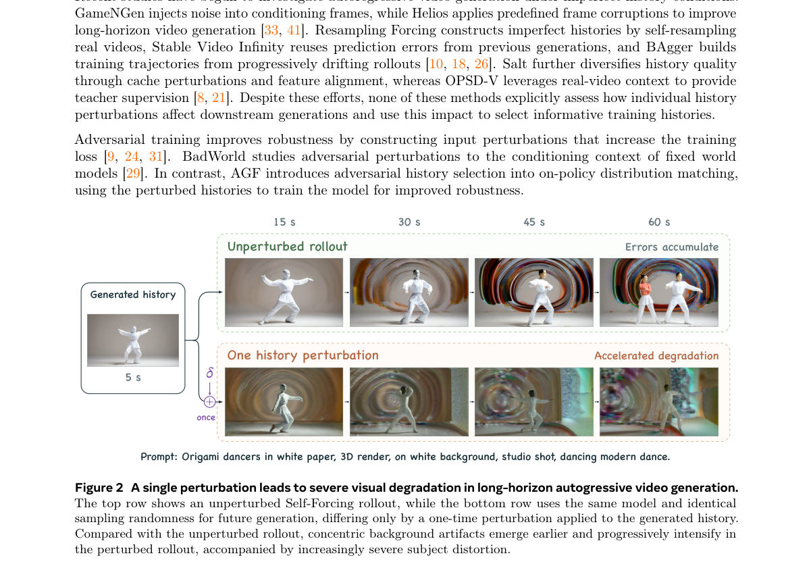

**Why this ranks #5**: 接续 10-08 日报 SGF+ 的梯度冲突线索，把暴露偏差的残余部分再往前推了一步。

---

### 6. TempoKV: Predictive KV Cache Quantization for Autoregressive Video Generation

**arXiv**: [2610.15324](https://arxiv.org/abs/2610.15324) | **Score**: 8.0 (relevance 8 x 0.7 + quality 8 x 0.3) | **Tags**: AIGC-video | **Categories**: cs.CV | **Pages**: 16

**Authors**: Jiahui Hu, Weile Mo, Peiliang Cai, Jiacheng Liu, Jinkui Ren, Xiantao Zhang, Xiaobing Tu, Linfeng Zhang

**Affiliation**: 1 Shanghai Jiao Tong University | 2 South China University of Technology | 3 Alibaba Group

**Abstract**

> Autoregressive (AR) video diffusion models enable streaming generation of long videos but suffer from significant memory overhead due to the rapidly growing KV cache. Existing KV cache quantization methods are primarily designed for LLMs and transfer poorly to video models, where activations exhibit different statistics and strong spatiotemporal redundancy. We observe that the video KV cache is largely predictable over time, with a clear asymmetry. Keys are highly predictable from their temporal history, while values depend primarily on the current key and need a short history of preceding values. Based on these observations, we propose \textbf{\method}, a training-free predictive KV cache quantization framework for AR video generation. \method predicts keys and values according to their distinct dependencies and stores only the residuals at low precision. Both predictors are lightweight, calibrated once offline by linear regression on a small set of BF16 samples, and remain fixed across prompts and generation runs. Experiments on Self-Forcing, Causal Forcing, and LongCat-Video-13B show that \method consistently achieves higher generation quality than existing KV cache quantization methods at comparable or higher compression ratios, reaching up to $6.71\times$ KV cache compression with the best overall quality--efficiency tradeoff. Our code will be released on GitHub.

**Key findings**

- **Finding**: KV 缓存快速增长带来内存开销；既有量化方法主要为 LLM 设计。

- **Finding**: 作者指出这些方法迁移到视频**效果差**，原因是视频激活用具有不同的统计特性与**强时空冗余**。

- **Inference**: 「LLM 方法迁移效果差」这一判断把问题定位在分布差异上：LLM KV 的重要性集中在少数 token，而视频时空冗余意味着重要性分布是连续且均匀的，两者的量化策略应当相反。

- **Recommendation**: 与本批 FrameFold（KV 整合）对照：一篇压缩数值精度、一篇压缩条目数量，两者可叠加。

**Key figures**

*Framework / architecture - Figure 1 Magnitudes of KV caches and their prediction residuals on Self-Forcing. Top: the original KV cache magnitudes at representative layers and heads. Bottom: the corresponding residual magnitude*

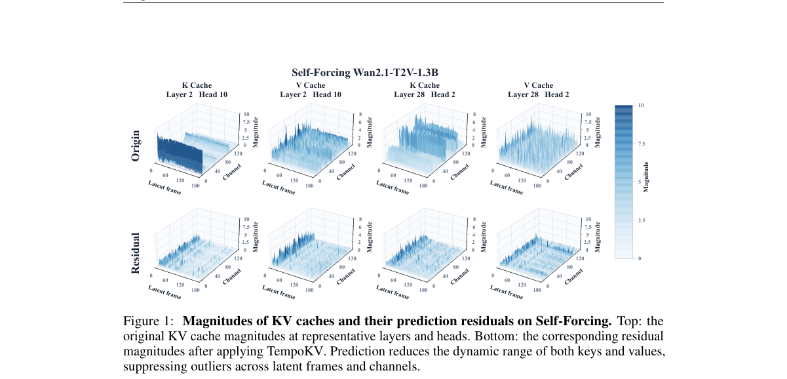

*Main result - Figure 2 TempoKV Framework. (a) Offline Calibration: a clean BF16 KV trace is collected from 8 calibration prompts, and predictors are fitted on it by linear regression. (b) Online Inference:*

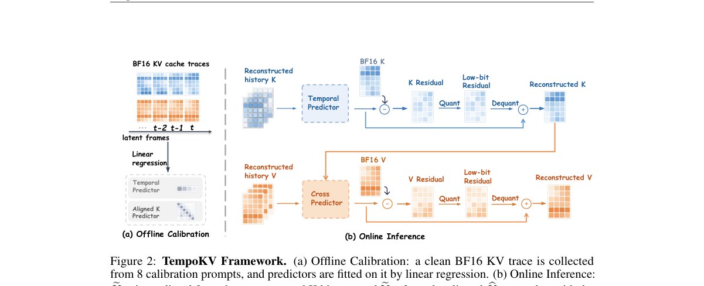

**Why this ranks #6**: 「LLM 的 KV 方法迁移到视频无效」是一个具体的定量起点，不是泛泛而谈。

---

### 7. TGuide: Faster Autoregressive Video Diffusion via Historical Trajectory Guidance

**arXiv**: [2610.14657](https://arxiv.org/abs/2610.14657) | **Score**: 8.0 (relevance 8 x 0.7 + quality 8 x 0.3) | **Tags**: AIGC-video | **Categories**: cs.CV | **Pages**: 23

**Authors**: Zhuo Chen, Bin Zou, Fanyue Wei, Lixin Duan, Angela Yao, Wen Li

**Affiliation**: 3National University of Singapore | For example, on an NVIDIA A100 GPU, 4-step Self Forcing requires 32.9 seconds of denoising to

**Abstract**

> Can autoregressive video diffusion be accelerated further when only four denoising steps remain? Existing feature caching approaches struggle in this regime, as large feature changes between denoising timesteps undermine both direct reuse and lightweight predictors. We observe that features across video chunks remain strongly correlated at matching denoising timesteps, offering a complementary source of guidance. Building on this insight, we introduce TGuide, a framework that accelerates autoregressive video diffusion through a lightweight Anchor-Transport-Correct (ATC) predictor guided by historical sampling trajectories. Our ATC combines two complementary references: the current chunk's preceding-step features preserve its spatial structure, while the previous chunk's same-timestep features provide information at the target denoising stage. By integrating these references through spatial retrieval and adaptive correction, ATC improves velocity prediction accuracy despite the large gaps between denoising steps. To mitigate error accumulation across both denoising steps and video chunks, we train the predictor on its own autoregressive rollouts, allowing it to adapt to states shaped by its own earlier predictions. An optional confidence-aware scheduler further adjusts the quality-efficiency trade-off. Experiments on Self Forcing, Causal Forcing, and HY-WorldPlay show that TGuide preserves generation quality while achieving denoising speedups of up to $1.89\times$ over the original 4-step generators. On Self Forcing, TGuide generalizes from 81-frame training videos to 333-frame generation, approximately four times the training length, while exceeding the original model's VBench score.

**Key findings**

- **Finding**: 既有特征缓存方法在极少步区间（≤4 步）失效：时间步之间特征变化大，直接复用与轻量预测器都被破坏。

- **Finding**: TGuide 的观察是：视频块之间的特征在**匹配的去噪步**上仍保持强相关——即相关性与时间步对齐而非时间步距离有关。

- **Inference**: 「相关性与时间步对齐」这一观察给出了一个之前被忽略的维度：缓存可以跨块但必须跨相同相位，这是对缓存键设计的直接改动。

- **Recommendation**: 做少步视频部署的读者注意；这个「跨块同相位」的想法可能推广到图像与音频生成。

**Key figures**

*Framework / architecture - Figure 1 Motivation and overview of TGuide. Curves and arrows schematically illustrate sam- pling trajectories and velocity relationships. (a) With many denoising steps, nearby velocities can be simi*

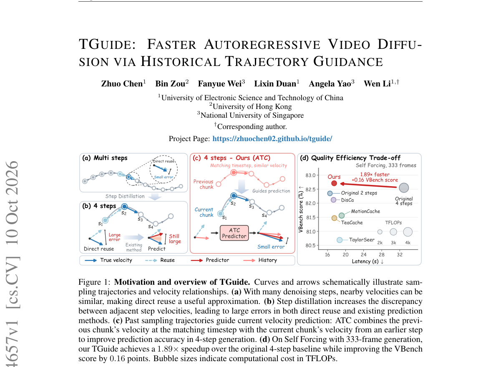

**Why this ranks #7**: 明确限定「四步以内」这个区间，是本批唯一针对极少步场景的缓存工作。

---

### 8. FrameFold: Response-Guided KV Cache Consolidation for Autoregressive Long Video Generation

**arXiv**: [2610.14568](https://arxiv.org/abs/2610.14568) | **Score**: 8.0 (relevance 8 x 0.7 + quality 8 x 0.3) | **Tags**: AIGC-video | **Categories**: cs.CV | **Pages**: 26

**Authors**: Muyu Liu, Mingming Liu, Hong Gu, Yuyao Zhang, Qin Lu

**Affiliation**: 1ShanghaiTech University | 2vivo BlueImage Lab, vivo Mobile Communication Co., Ltd., China

**Abstract**

> In autoregressive video generation, retaining all historical key-value (KV) states increases memory usage and per-step attention costs as videos grow longer. A fixed cache budget bounds these costs but raises the challenge of preserving historical content that supports consistent, high-quality generation. Existing methods control cache size through history selection or consolidation, yet deciding what to retain and how to limit the loss of useful content remains a shared challenge. Our analysis shows that spatial queries depend on different historical content and that higher current attention coverage does not necessarily yield better long-video quality. We introduce FrameFold, a training-free KV cache consolidation method that compares the content retrieved by the same recent historical queries before and after merging to guide both representative construction and merge selection. Exploiting temporal redundancy between adjacent historical entries, FrameFold merges their KV states into shared representatives while retaining complete spatial grids. It fits value-merging coefficients in closed form by matching conditional attention responses, then selects the merge with the lowest remaining response distortion. Under matched KV cache budgets, experiments on Self Forcing and Causal Forcing at 30 and 60 seconds and on LongLive at 120 seconds demonstrate improved consistency and visual quality. Continuous eight-minute Self Forcing rollouts further show less quality degradation than the baselines.

**Key findings**

- **Finding**: 保留全部历史 KV 随长度增长；固定缓存预算界定成本但使保留变得非平凡。

- **Finding**: 既有方法通过历史摘要（history summarization）控制缓存大小；FrameFold 改为**响应引导**的整合（consolidation）。

- **Inference**: 「响应引导」意味着保留哪些 KV 由它们对当前输出的影响决定，而非它们的新近程度——这正是 10-07 日报 DiReTAL 与 10-08 日报 VLA-ACL（按动作一致性剪枝）用过的同一思路。

- **Recommendation**: 本批 AR 缓存七篇里思路最干净的一篇；与 10-05 日报的 ID-Forcing（KV-provenance 问题）连续五天构成本项目最厚的一条追踪线。

**Key figures**

*Framework / architecture - Figure 1 Token selection and shared representation. (a) Attention-based Top-K selection retains subsets of historical tokens; (b) FrameFold consolidates adjacent history into a representative grid. A*

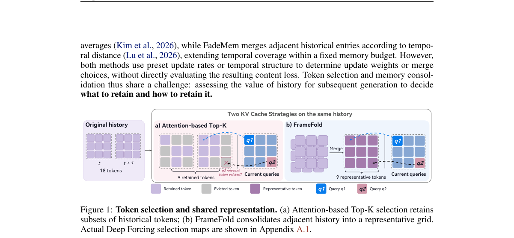

*Main result - Figure 2 Shared Top-K leaves query-level coverage gaps; higher coverage need not yield better generation quality. (a) Candidate-region attention coverage for Top-K, Bottom-K, and a per-query oracle (*

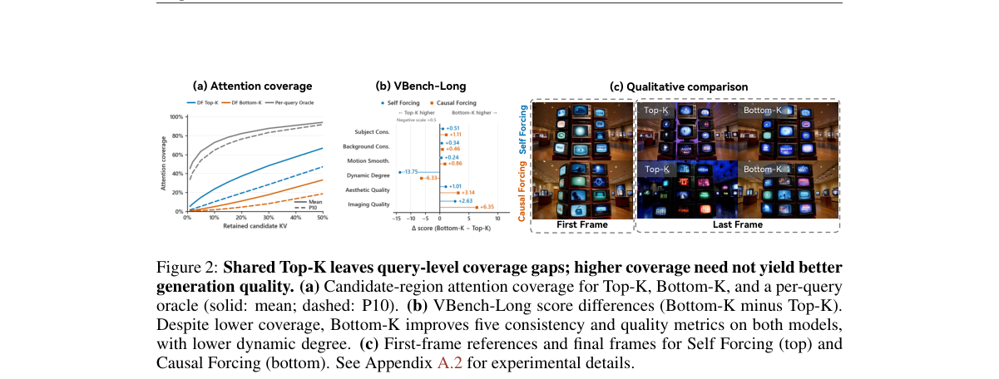

**Why this ranks #8**: 「固定预算下保留什么」被表述为由响应引导，而非由历史长度决定。

---

### 9. Competition Domains Matter: Selective Head Globalization for Training-Free Sparse Attention in Video Diffusion Transformers

**arXiv**: [2610.14672](https://arxiv.org/abs/2610.14672) | **Score**: 7.3 (relevance 7 x 0.7 + quality 8 x 0.3) | **Tags**: AIGC-video | **Categories**: cs.CV | **Pages**: 9

**Authors**: Tiantian Liu, Meng Wan, Zhiqiang Liang, Jue Wang, Ningming Nie, Yangang Wang

**Affiliation**: University of Chinese Academy of Sciences, Beijing, China

**Abstract**

> Training-free sparse attention is a practical route to efficient video diffusion transformer inference, yet existing methods typically fix the competition domain at each query row for every attention head. Prior work primarily addresses how to estimate token-level importance within this fixed domain; whether the domain itself should adapt to head heterogeneity remains under-specified. We introduce EG-Sparse, a training-free framework that routes low-entropy heads to a grouped cross-head pool while retaining per-row local selection for high-entropy heads, using only scores already materialized by the sparse pipeline. A controlled diagnostic fixes the ranking score and varies only the competition rule: grouped cross-head selection reduces low-entropy-head reconstruction error by 9.8%, whereas forcing high-entropy heads into an all-head global pool increases it by 7.9%. Across four configurations, EG-Sparse achieves higher video quality while reducing attention density and GPU denoising latency compared with strong training-free sparse-attention baselines. Mechanism ablations further show that selective domain adaptation outperforms uniform, random, and fixed domain-assignment policies. These results support competition-domain adaptation as a distinct design axis within centroid-guided training-free sparse attention.

**Key findings**

- **Finding**: 既有方法在每行每头固定竞争域，先前工作只研究域内的重要性估计。

- **Finding**: 作者追问域本身是否应随**注意力头的异质性**自适应，并提出选择性头全局化（Selective Head Globalization）。

- **Inference**: 不同注意力头承担不同功能（局部纹理、全局构图、时间对应），让它们共享同一竞争域等于假设它们需要同样的信息——与 GeZo-SAC 的批评结构完全一致。

- **Recommendation**: 视频生成部署的读者注意；与 10-12 日报的 GeZo-SAC 一起读，两篇在不同领域做了同一个「固定设计应当自适应」的论证。

**Key figures**

*Framework / architecture - Figure 1 Attention heads exhibit substantial structural heterogeneity. (a) Normalized attention entropy eHh = Hh/ log Ck varies across layers and heads. (b–c) Two rep- resentative heads from the same*

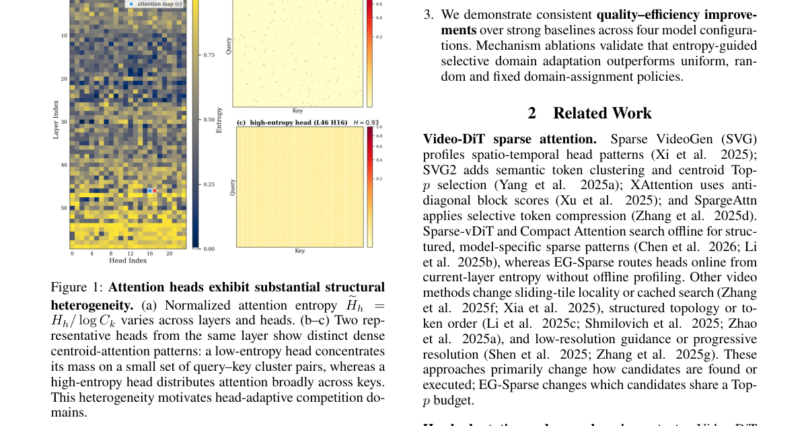

*Main result - Figure 2 Overview of EG-Sparse. A fixed row-wise domain constrains low-entropy heads because the budget cannot flow across rows to where it is most needed, whereas indiscriminate all-head global comp*

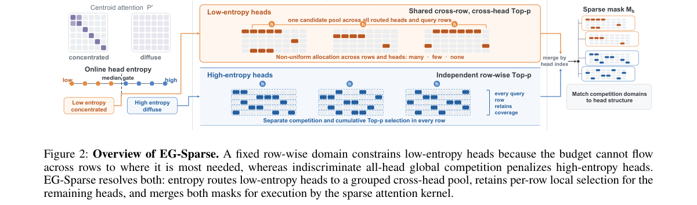

**Why this ranks #9**: 「域是否也应自适应」是一个被默认固定的设计，与 10-12 日报的 GeZo-SAC（评论家聚合规则处处相同）同构。

---

### 10. Look Back to Move Forward: Learning to Revisit for Agentic Compositional Image Generation

**arXiv**: [2610.16224](https://arxiv.org/abs/2610.16224) | **Score**: 7.0 (relevance 7 x 0.7 + quality 7 x 0.3) | **Tags**: AIGC-image, AIGC-edit | **Categories**: cs.AI, cs.CV | **Pages**: 50

**Authors**: Zixu Wang, Xiaoran Zhao, Yahui Liu, Feng-ao Wang, Junhao Xiao, You Shu, Bing Liu, Yiting Liu, Songlei Jian, Zhiliang Tian, Dongsheng Li

**Affiliation**: [not-found in PDF]

**Abstract**

> Text-to-image models have made remarkable progress in visual fidelity and instruction following, yet complex compositional generation remains challenging. Existing agentic approaches address this limitation through iterative generation and editing, adapting their actions based on interaction history. However, they typically fix the continuation state (i.e., the image from which refinement proceeds) to the latest image. Since iterative editing is not necessarily monotonic, the agent may continue refining from the latest image even when it has already degraded. In this work, we introduce GenRevisit, an agentic framework that extends action selection to joint continuation-state and action selection. The agent can not only use interaction history to adjust editing instructions but also select an image candidate to edit, jointly deciding where to continue from and how to refine. We train GenRevisit with SFT followed by agentic reinforcement learning. To address the coarse credit assignment of final outcome reward in GRPO, which assigns the same trajectory-level advantage to all actions, we further propose Normalized Action Credit Assignment (NACA) to redistribute positive advantage according to each action's contribution to reducing the remaining objective. On GenEval2, GenRevisit achieves GM scores of 84.3 and 74.4 with Qwen-Image-2512 and Z-Image-Turbo, surpassing the strongest baselines using the same generators by 12.7 and 10.9 points respectively. GenRevisit achieves state-of-the-art performance on GenEval, GenEval++, and GenEval2 among baselines.

**Key findings**

- **Finding**: 既有 agentic 方法通过迭代生成与编辑处理组合生成，依据交互历史调整动作。

- **Finding**: 但它们通常**固定了续写状态**；Look Back to Move Forward 提出让智能体学会**回访**（revisit）。

- **Inference**: 固定续写状态意味着智能体只能向前累积修正，无法回到某个中间状态重新决策——而组合生成里很多错误只有回到前一步才看得见。

- **Recommendation**: 与本批 10-12 日报的 ThinkDrag（视觉推理）对照，一篇改指令解释、一篇改搜索空间。

**Key figures**

*Framework / architecture - Figure 1 An illustrative comparison between latest-state refinement and our GenRevisit.*

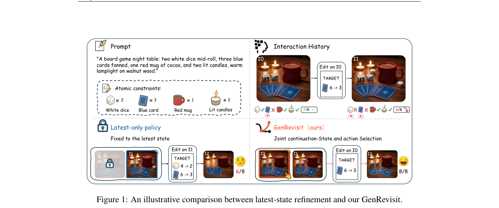

*Main result - Figure 2 Overview of GenRevisit. Panel (a) presents the overall workflow. At each decision step, the multimodal planner selects the next action based on the decision context and, when editing, jointl*

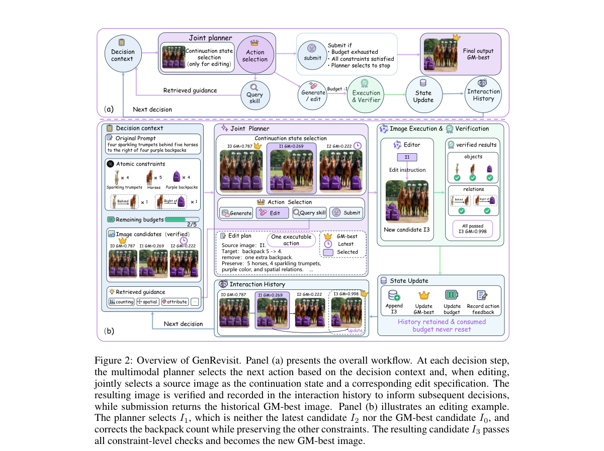

**Why this ranks #10**: 「固定续写状态」是 agentic 编辑路线的一个未检验前提。

---

## Footer

- Total papers reviewed across all 5 tracks: 50 (from 1935 scanned)
- aigc_visual track final top-10: 10
- Wild-cards in this track: 2
- Figure assets: `res/` (shared across tracks)

Generated by `mine-arxiv-daily-digest` skill. Sister file: `2026-10-14_aigc_visual_entry.md`.
