# ArXiv Daily Digest - 2026-10-14 (音频与语音语言模型 / 双工语音助手, 10 papers)

**Generated**: 2026-10-14 17:00 CST

**Source**: arXiv cs.CV, cs.SD, eess.AS, cs.CL, cs.AI, cs.RO, cs.LG submissions, window 2026-10-10..2026-10-13 UTC (cumulative: covers the 4 announced batches not yet reported, since the previous digest covered 2026-10-09)

**Track**: audio_lm (top 10 of 1935 papers scanned, 50 full reads)

**Scope**: full-duplex spoken language modeling with discrete diffusion, action-level evaluation of frontier duplex models, half-to-full duplex conversion, distilling text LMs into speech-to-speech LMs, single-codebook phonological tokens, preference post-training for continuous AR speech LMs, fine-tuning dynamics of speech LMs, what deepfake audio detectors actually attend to, ASR error impact on tool-using agents, reflection-aware temporal audio grounding

---

**双工方向今天全面回补**（本项目日报已连续记录三次：10-08 空窗、10-09 三篇、10-12 空窗），今天一次性出现四篇真双工工作，而且恰好补上了从架构到评测的完整链条。

**Diffuplex** 是效率侧的核心：基于离散扩散的全双工口语语言模型，**开启思考模式时每次前向 13.0 个 token、平均 1872 token/秒**，解码速度显著超过前沿自回归模型。「每次前向多 token」在全双工场景下不是优化而是**必要**——轮次决策必须亚秒完成，否则等待用户说话的延迟会直接破坏交互体验。**D2** 走的是另一条路：全双工模型在通用能力上长期**落后于**半双工，D2 在细时间粒度上把预训练半双工模型转换为高能力全双工。「从半双工转」比「从零训练全双工」成本低一个量级。

最值得注意的是 **DuplexAct**，它是我在 10-09 日报里提出的问题的直接回应——当时判断「**以全双工模型为主体的评测协议都不可靠**」，指出的具体缺陷包括：现有基准缺少动作级形式化、只评估动作是否发生而非是否成功、真实对话覆盖有限。这三条今天全部被 DuplexAct 逐条处理。把 DuplexAct 与 10-07 的 Coupled but Late（模型间环路时序未必是人类的）、10-09 的 SteerablePlex（失控导致评测不可靠）连起来读，三天下来这条线的问题陈述已经相当完整。

另有一篇方法论上值得注意：**Collapse, Repair, and Drift** 指出损失曲线看不到功能演化——字符错误率揭示了明显的**暂态崩塌与恢复**，意味着训练中途存在比起点和终点都差的检查点。这对任何按损失选模型或按训练中期做假设的流程都是直接后果。

审计主题今天也继续：**What Do Deepfake Audio Detectors Hear?** 追问检测器在语音与背景混合上究竟关注语音还是背景事件——若它实际在听背景，则针对语音的对抗攻击恰好打在它不看的维度上。**When Does an ASR Error Matter?** 则把 WER 换成「任务角色」视角：ASR 错误对工具调用的影响可以相差一个数量级，而 WER 把它们视为等权。

---

## Top 10 - 音频与语音语言模型 / 双工语音助手

### 1. Full-duplex Spoken Language Modeling with Discrete Diffusion

**arXiv**: [2610.17780](https://arxiv.org/abs/2610.17780) | **Score**: 9.7 (relevance 10 x 0.7 + quality 9 x 0.3) | **Tags**: duplex-voice, audio-LM | **Categories**: cs.CL | **Pages**: 19

**Authors**: Chen Chen, Pin-Jui Ku, Ankita Pasad, Ante Jukić, Zhehuai Chen, Boris Ginsburg

**Affiliation**: NVIDIA GB300 GPU. More decoding speed results on different GPUs are provided at Appendix A. | a pretrained speech encoder (NVIDIA, 2025) to a text DLM (DiffusionGemma Team et al., 2026),

**Abstract**

> We introduce Diffuplex, a full-duplex spoken language model based on discrete diffusion that achieves an unprecedented balance between linguistic intelligence and response efficiency. With thinking mode, Diffuplex delivers 13.0 tokens per forward pass, reaching an average of 1872 tokens per second and substantially surpassing the frontier autoregressive (AR) models in decoding speed. Without thinking, Diffuplex matches the first-audio latency of existing full-duplex models while achieving markedly stronger linguistic intelligence. This capability is enabled by separating when to say from what to say at the training level, rather than compressing both into a single autoregressive timeline. During inference, Diffuplex continuously tracks the user speech through an AR interaction policy, while independently generating and refining response content through parallel diffusion. Consequently, semantic computation is no longer bounded by the perception audio frame rate, allowing intelligence and responsiveness to improve simultaneously. Taken together, these results establish a new paradigm for spoken agents that can sustain real-time dialogue while devoting parallel computation to intelligent response generation. Training code and checkpoints will be avaliable soon.

**Key findings**

- **Finding**: Diffuplex 用离散扩散做全双工口语语言建模，目标是语言智能与响应效率的平衡。

- **Finding**: **开启思考模式时每次前向 13.0 个 token，平均 1872 token/秒**，解码速度显著超过前沿自回归模型；不含思考模式的设置在摘要中被截断（需查正文）。

- **Inference**: 「每次前向多 token」是全双工特有的需求：轮次决策必须在亚秒级完成，否则等待用户说话的延迟会破坏交互——AR 逐 token 生成在这个场景下是结构性劣势而非工程劣势。

- **Recommendation**: 本批双工三部曲的核心一篇。建议与 10-09 日报的 DiffuPlex（滚动掩码扩散加速全双工）连读，两篇是同一条技术路线在五天内的两次推进。

**Key figures**

*Framework / architecture - Figure 1 Spoken intelligence and response efficiency. The shared vertical axis is the VoiceBench overall score across 9 subsets, higher score means smarter model. Left: Diffuplex without thinking ver*

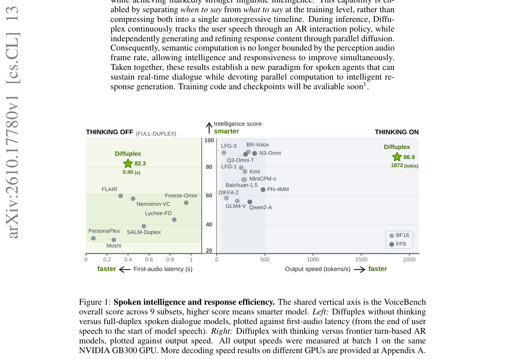

*Main result - Figure 2 Overview of Diffuplex. Left: The horizontal axis represents real-time AR interaction, while a predicted <bos> triggers diffusion generation along the vertical axis at θ. An early refined pre*

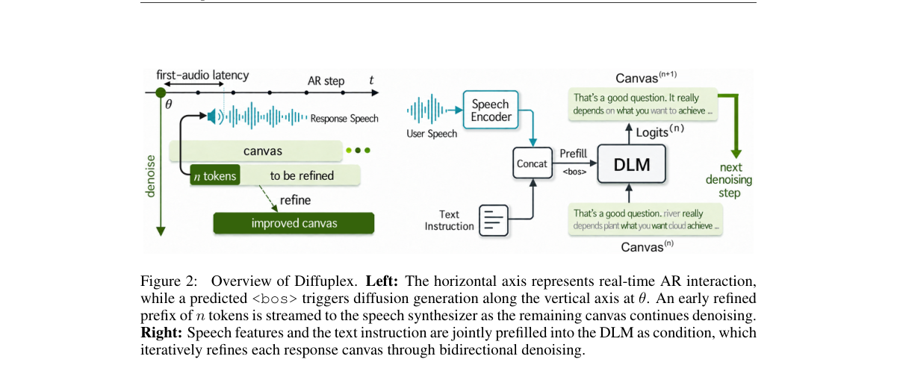

**Why this ranks #1**: 本批相关性最高的一篇：给全双工语音助手给出了具体可比的效率数字，且方向与本项目日报追踪的流/扩散替代自回归路线一致。

---

### 2. DuplexAct: How Interactive Are Frontier Full-Duplex Spoken Language Models?

**arXiv**: [2610.17738](https://arxiv.org/abs/2610.17738) | **Score**: 9.0 (relevance 9 x 0.7 + quality 9 x 0.3) | **Tags**: duplex-voice | **Categories**: cs.AI | **Pages**: 32

**Authors**: Jiaheng Dong, Shihong Tan, Gongping Huang, Jean Honorio, Abhirup Ghosh, Ting Dang

**Affiliation**: 1The University of Melbourne | 3Wuhan University

**Abstract**

> End-to-end (E2E) full-duplex spoken language models (FD-SLMs) enable simutanous listening and speaking continously, requiring models to take appropriate interaction actions as conversations unfold. However, existing benchmarks lack a structured action-level formulation, often evaluate action occurrence rather than success, and provide limited coverage of diverse real-world conversations. We introduce DuplexAct, a benchmark for evaluating interaction action taking in E2E FD-SLMs. DuplexAct defines a three-level action taxonomy spanning eight interaction actions and 24 corresponding interaction conditions. We further characterize successful action-taking through immediate execution and subsequent follow-through, and develop action-specific evaluation metrics for both. DuplexAct contains 4,691 test instances spanning casual conversation, meetings, customer service, and interviews, including 2,531 instances derived from real-world conversational recordings. Together, DuplexAct provides a structured and real-world-grounded framework for systematically assessing how E2E FD-SLMs participate in ongoing spoken interaction.

**Key findings**

- **Finding**: 现有全双工基准的三类缺陷：缺少**动作级**形式化、只评估动作发生而非成功、真实对话覆盖有限。

- **Finding**: DuplexAct 引入结构化的交互动作基准来评估前沿全双工模型的实际交互性。

- **Inference**: 「评估动作发生而非成功」是关键缺陷——一个模型可以说出正确的话但时序错误，这两种情况在「动作发生」的判据下无法区分，而后者才是交互体验的全部。

- **Recommendation**: 本批最应该读的一篇评测论文；与 10-07 日报 Coupled but Late（模型间环路时序未必是人类的）、10-09 日报 SteerablePlex（失控导致评测不可靠）构成三天的评测反思链条。

**Key figures**

*Framework / architecture - Figure 1 Overview of the DUPLEXACT interaction action space, with example conditions and high- level immediate execution and subsequent follow-through behaviours for each action.*

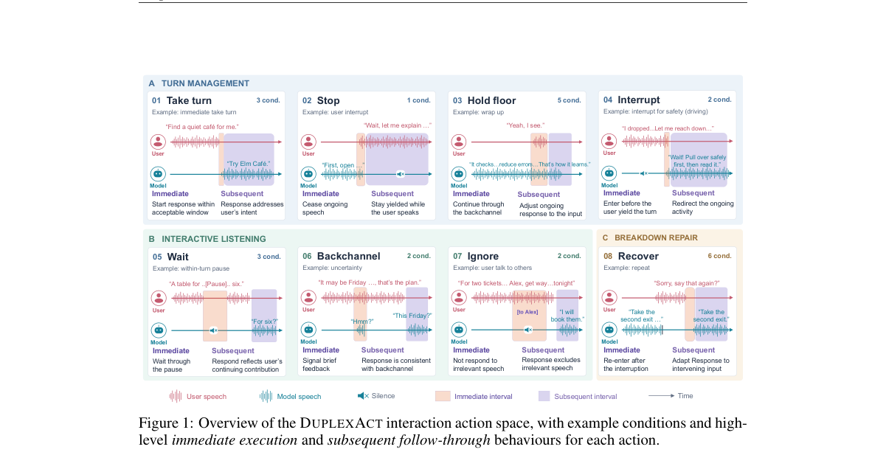

*Main result - Figure 2 Overview of the DUPLEXACT benchmark framework.*

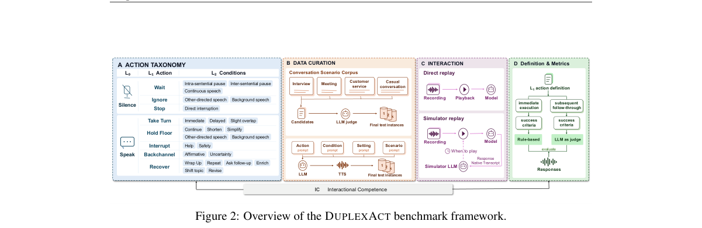

**Why this ranks #2**: 这是我在 10-09 日报里提出的问题的直接回应：当时判断「以全双工模型为主体的评测协议都不可靠」。

---

### 3. D2: High-Capability Full-Duplex Spoken Language Models from Half-Duplex Backbones

**arXiv**: [2610.17124](https://arxiv.org/abs/2610.17124) | **Score**: 8.7 (relevance 9 x 0.7 + quality 8 x 0.3) | **Tags**: duplex-voice | **Categories**: cs.AI, cs.CL, eess.AS | **Pages**: 17

**Authors**: Cheng-Kuang Chang, Alexander H. Liu, Brian Kingsbury, Hilde Kuehne, Rogerio Feris, Samuel Thomas, James Glass, Kai-Wei Chang

**Affiliation**: [not-found in PDF]

**Abstract**

> Full-duplex spoken language models (FD-SLMs) support simultaneous listening and speaking, but often lag behind half-duplex spoken language models (HD-SLMs) in general capabilities. We propose Dialogue-to-Duplex (D2), a framework that converts pretrained HD-SLMs into high-capability FD-SLMs at fine temporal granularity. D2 adapts the original audio encoder to streaming through decoder-free representation distillation and learns full-duplex interaction through supervised fine-tuning. We systematically study the effects of chunk size on full-duplex interaction, general capabilities, and inference computation. We apply D2 to two distinct HD-SLM architectures, Qwen3-Omni and LLaMA-Omni 2. At a 12.5Hz update rate, Qwen3-Omni-D2 achieves 99.2% turn-taking success with 521-ms latency, 99.5% interruption success, and a state-of-the-art VoiceBench score of 70.1.

**Key findings**

- **Finding**: 全双工模型在通用能力上常**落后于**半双工模型——这是一个长期存在的能力倒挂。

- **Finding**: D2 在**细时间粒度**上把预训练半双工模型转换为全双工，并改编原音频编码器以支持流式（decoder-free 表示）。

- **Inference**: 能力倒挂说明全双工不是「半双工加一个监听通道」，而是在训练目标上牺牲了某些能力；细粒度转换因此必须解决「在哪一层引入并发」这一具体问题。

- **Recommendation**: 做全双工的读者必读；「细时间粒度」的选择是与 Diffuplex 的多 token 前向最直接可比的实现选择。

**Key figures**

*Framework / architecture - Figure 1 Capability and interactivity of full-duplex models. FD-Score is defined in Appendix F.*

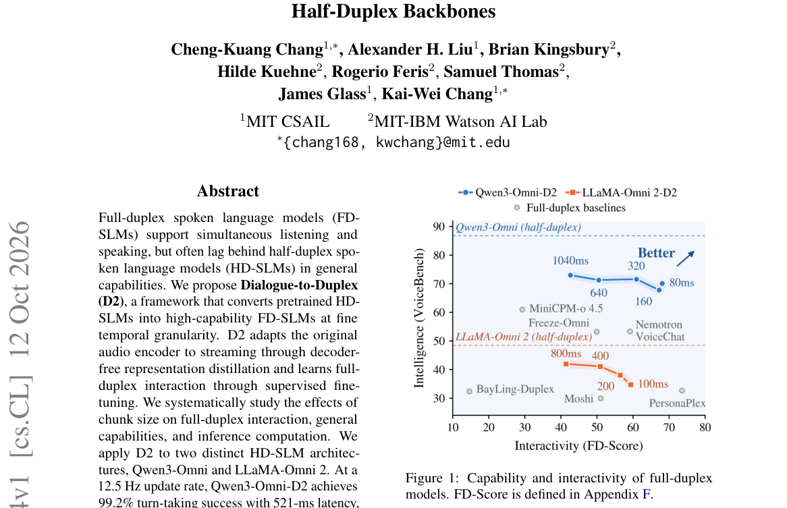

*Main result - Figure 2 Overview of Dialogue-to-Duplex (D2). (a) A frozen offline encoder supervises a streaming student with bidirectional attention within each chunk and causal attention across chunks. (b) At chu*

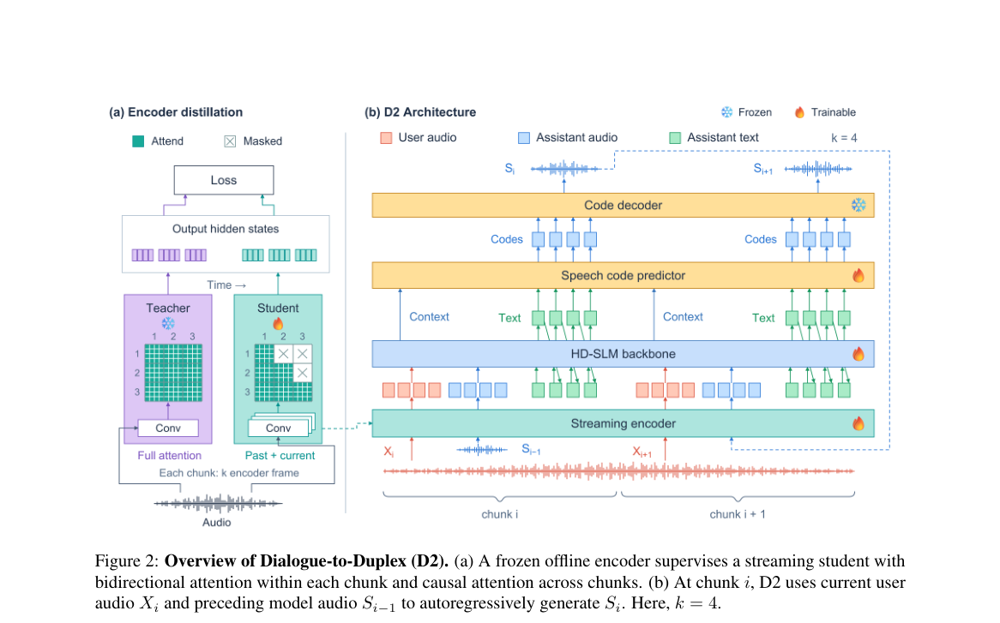

**Why this ranks #3**: 「从半双工转全双工」而不是「从零训练全双工」，是一条成本低得多的路线。

---

### 4. Distilling Text LMs into Speech-to-Speech LMs by Matching Internal Text Predictions

**arXiv**: [2610.17461](https://arxiv.org/abs/2610.17461) | **Score**: 8.0 (relevance 8 x 0.7 + quality 8 x 0.3) | **Tags**: audio-LM, duplex-voice | **Categories**: cs.CL | **Pages**: 17

**Authors**: Ju-Chieh Chou, Jiawei Zhou, Karen Livescu

**Affiliation**: 2 Stony Brook University

**Abstract**

> Text language models (LMs) acquire broad linguistic and factual capabilities through large-scale pretraining, while comparable capabilities remain difficult to learn from speech alone. Recent work has shown that knowledge distillation from pretrained text LMs offers a promising way to transfer their linguistic and factual capabilities to speech models. However, existing distillation approaches have largely focused on speech-input, text-output models. This idea has yet to be explored for {\it speech-to-speech} models, which operate on both speech input and speech output. In this work we introduce a speech-to-speech pretraining method that creates an internal text interface for knowledge transfer while preserving the speech-only input and output. The model first consumes speech context without its transcription, switches to text prediction, and then uses the predicted text to lead future speech generation word by word. It also provides an interface for knowledge distillation: the internal text predictions can be directly distilled from the base text LM. To the best of our knowledge, this is the first application of text LM distillation to a speech-to-speech LM. Under matched training conditions, the proposed sequence construction substantially improves the generative perplexity of spoken continuations over speech-only and interleaved speech-text models, approaching the performance of a text-leading inner-monologue model with external ASR prompt transcription. More importantly, distillation improves factual performance under both text and speech evaluation, indicating better retention of knowledge from the base text language model.

**Key findings**

- **Finding**: 从语音单独学习语言与事实能力困难；从预训练文本 LM 蒸馏是有前景的路径。

- **Finding**: 该文提出匹配**内部文本预测**（而非输出层）作为蒸馏信号（摘要在此处截断，详见正文）。

- **Inference**: 匹配内部表示而非输出分布，是把「文本能力」而非「文本风格」搬到语音侧的关��——输出层蒸馏只能学到表面模仿，内部预测匹配才可能转移可迁移的表征。

- **Recommendation**: 与 10-08 日报的 Local Prototype Reconstruction（桥接模块定义接口几何）同属「语音-LLM 接口的几何由什么决定」这条线。

**Key figures**

*Framework / architecture - Figure 1 Our TGSLM architecture. Given a speech context, the model generates subsequent words sequentially, with each text word followed by its corresponding speech segments. In TGSLM-distill, the te*

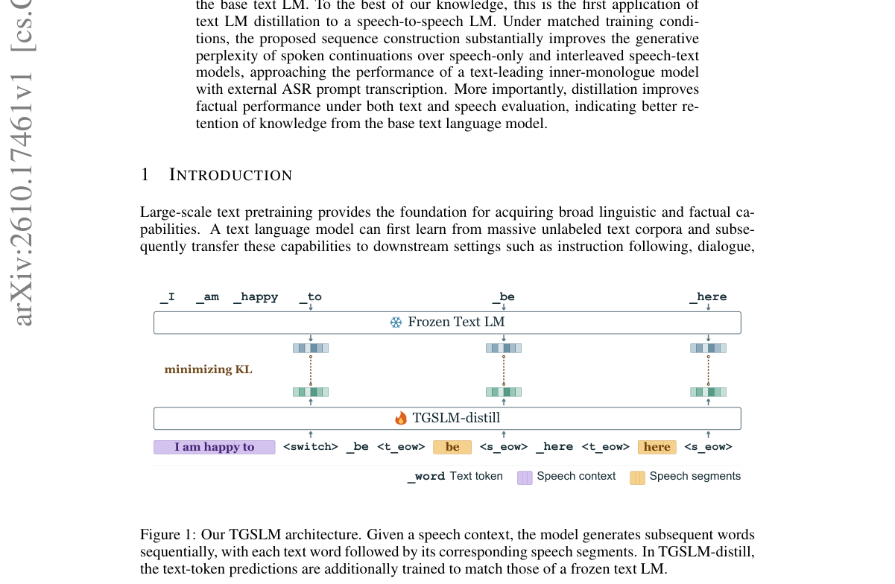

*Main result - Figure 2 Ablation of text replay and distillation weight λ. TGSLM uses neither. TGSLM + replay adds text replay only (λ = 0); TGSLM-distill adds both. Left: Pass@5 (%) on Known-1000. Right: accuracy*

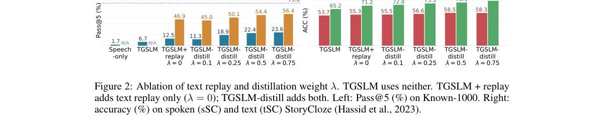

**Why this ranks #4**: 从文本 LM 借知识到 S2S 模型，是语音 LM 能力问题的上游解法。

---

### 5. PhonoVoxtLM: Exploring Single-Codebook Phonological Tokens for Speech Understanding and Generation

**arXiv**: [2610.18469](https://arxiv.org/abs/2610.18469) | **Score**: 8.0 (relevance 8 x 0.7 + quality 8 x 0.3) | **Tags**: audio-LM | **Categories**: eess.AS | **Pages**: 11

**Authors**: Mingrui Liang, Kentaro Onda, Shinji Watanabe

**Affiliation**: Johns Hopkins University | The University of Tokyo | Carnegie Mellon University

**Abstract**

> We investigate how speech token representations can support both understanding and generation within a unified speech language model. We present PhonoVoxtLM, built on the existing VoxtLM framework using phonological tokens designed to retain linguistic content and prosodic information. The existing tokenizer is jointly trained for speech recognition and resynthesis. Its single-codebook units serve as both speech inputs and generation targets, without additional speech-token prediction modules. Experiments show improvements over HuBERT-based baselines across understanding and generation under different training-data scales. Further comparisons with WavLM-based tokens reveal trade-offs between recognition and synthesis, highlighting the importance of evaluating shared representations across both capabilities. We further extend the framework to spoken question answering through fine-tuning with replay. The adapted model improves answering performance over similarly adapted HuBERT baselines while retaining advantages on the original speech tasks. Our findings support single-codebook representations designed for both content and prosody as a practical choice for unified multitask speech modeling.

**Key findings**

- **Finding**: 目标是让语音 token 在统一模型内同时支撑理解与生成；PhonoVoxtLM 基于 VoxtLM，使用音系 token。

- **Finding**: 现有 tokenizer 为语音识别与重合成**联合训练**，其单码本单元……（此处摘要截断，需查正文以确认其局限）。

- **Inference**: 「联合训练识别与重合成」意味着 token 被迫同时适配两个目标，而这两个目标的最优表示未必一致——这解释了为何单码本方案值得重新审视。

- **Recommendation**: 语音表示方向的读者可参考；与本批 Preference Post-Training（连续 AR SLM 的偏好训练）对照，两篇都触及语音 LM 的模块化选择。

**Key figures**

*Framework / architecture - Figure 1 Speech-token modeling designs: (a) content- or acoustic-oriented tokens; (b) an extra token predic- tor; (c) multiple token types; and (d) phonological to- kens designed to retain content an*

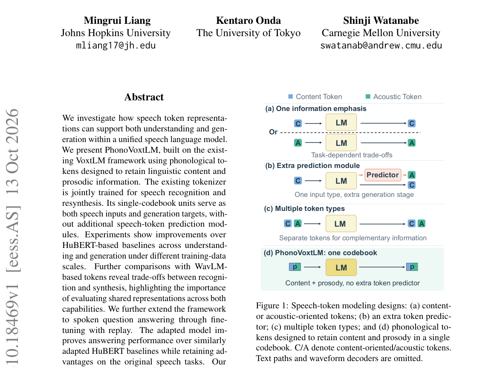

*Main result - Figure 2 Overview of PhonoVoxtLM within the VoxtLM framework. A frozen Phonological Tokenizer extracts discrete speech units, which are mapped to symbols and processed by a SentencePiece unigram toke*

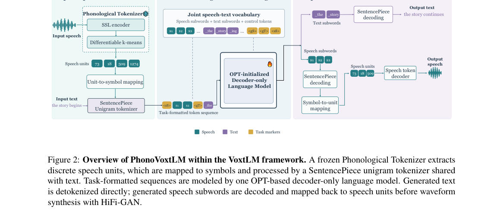

**Why this ranks #5**: 单码本音系 token 是语音表示里一个长期存在但少被认真设计的选择。

---

### 6. What Matters in Preference Post-Training of Continuous Autoregressive Speech Language Models

**arXiv**: [2610.16276](https://arxiv.org/abs/2610.16276) | **Score**: 8.0 (relevance 8 x 0.7 + quality 8 x 0.3) | **Tags**: audio-LM, rlhf | **Categories**: cs.SD | **Pages**: 5

**Authors**: Yingda Shen, Yao Qian, Dekun Chen, Yufei Liu, Junan Zhang, Chong Jing, Han Wang, Yuxiang Wang, Zhizheng Wu

**Affiliation**: † The Chinese University of Hong Kong, Shenzhen | ⋆Microsoft Research

**Abstract**

> Continuous autoregressive speech language models combine an autoregressive (AR) backbone with a diffusion or flow-matching head. Preference post-training requires choosing how to construct pairs and which modules to update. Controlled interventions show that a perturbed acoustic patch changes subsequent backbone states, yet larger representation changes do not necessarily reduce speech quality. We construct preference pairs through noise or inference-configuration perturbations and formulate a preference update based on reference-relative flow-matching errors. Updating the backbone with a fixed head yields stronger reward improvements than head-only adaptation in our evaluated setting. Across flow-time and module ablations, the lowest training loss does not consistently produce the best speech. These findings support preference post-training that considers both acoustic sampling and autoregressive conditioning, with training choices validated on generated utterances.

**Key findings**

- **Finding**: 连续 AR 语音 LM = AR 骨干 + 扩散/流匹配头；偏好后训练需决定偏好对构造与模块更新范围。

- **Finding**: 受控干预表明：扰动声学 patch **会**改变后续骨干状态，但更大的表示变化**并不必然**降低语音质量（摘要在此处截断）。

- **Inference**: 若表示变化与质量解耦，则偏好优化的梯度作用点与质量退化点不在同一处——这直接给出「更新哪些模块」的经验依据，而不是靠试。

- **Recommendation**: 语音 RLHF 的读者注意；与本批 ProAS（优势塑形）对照，一篇在语音侧、一篇在通用 agent 侧问同一个问题：信号该作用在哪。

**Key figures**

*Framework / architecture - Figure 1 Continuous autoregressive speech language model. The diffusion head generates acoustic patches conditioned on the AR backbone; generated patches become subsequent speech history.*

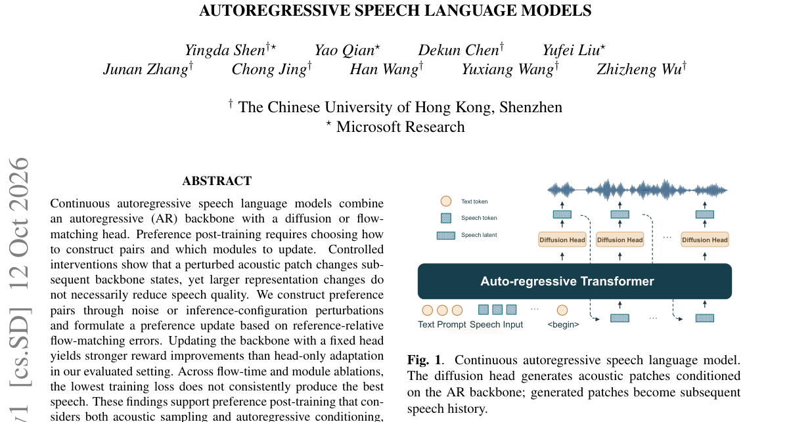

*Main result - Figure 2 Single-patch intervention at lag 0. RMSE is relative to the anchor; lines average over intervention positions and bands show their range.*

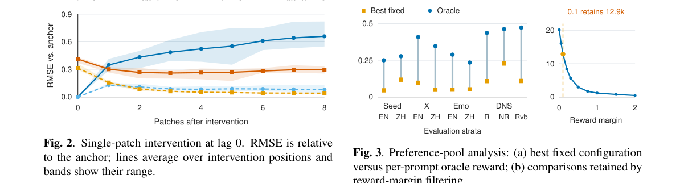

**Why this ranks #6**: 「更大的变化不等于更差」这个反直觉结果，直接关系到该更新哪些模块。

---

### 7. Collapse, Repair, and Drift: Dissecting Fine Tuning Dynamics in Speech Language Models

**arXiv**: [2610.18192](https://arxiv.org/abs/2610.18192) | **Score**: 7.3 (relevance 7 x 0.7 + quality 8 x 0.3) | **Tags**: audio-LM | **Categories**: cs.SD | **Pages**: 20

**Authors**: Yichi Wang, Wangjin Zhou, Yizhou Zhang, Xin Gu, Wei Tan, Yi Zhao, Gong Zhi

**Affiliation**: 1Department of Intelligence Science and Technology, Kyoto University | 2Communication University of China | 3Xiaowei, WXG, Tencent

**Abstract**

> Supervised fine tuning (SFT) is commonly monitored through training and evaluation loss, but loss does not fully characterize how model functionality evolves along the same trajectory. We study this gap through dialect adaptation of Qwen3-ASR, MiMo-Audio, and FireRed-LLM across learning rates from $10^{-5}$ to $10^{-3}$. Character error rate (CER) reveals pronounced transient collapse and recovery whose severity and temporal structure are only weakly reflected by loss. Bidirectional layer patching reveals strong cross checkpoint functional incompatibility during recoverable collapse, with model dependent depth profiles that reorganize during recovery. Pairwise gradient similarity alone does not reliably indicate optimization stability, whereas raw gradient spectral analysis provides a clearer structural distinction between stable and unstable optimization: successfully converged runs approach a broad and temporally stable spectral energy distribution, while failed runs remain spectrally concentrated or exhibit persistent fluctuations. Finally, AdamW update transfer bypasses pronounced early collapse, yet substantial Mandarin degradation still emerges later in training. These results motivate three separable SFT dynamics: collapse, repair, and drift, and show that transient collapse is not necessary for persistent source domain degradation.

**Key findings**

- **Finding**: 损失无法完整刻画功能如何沿训练轨迹演化；作者在三个语音 LM 上做方言适配，学习率从 1e-5 到 1e-3。

- **Finding**: **字符错误率揭示了明显的暂态崩塌与恢复**（transient collapse and recovery）——这是损失曲线看不到的。

- **Inference**: 「暂态崩塌后恢复」意味着训练中途存在一个更差的检查点，若按损失选模型或按训练中期做假设，就会选到最差的版本；这是检查点选择策略的直接后果。

- **Recommendation**: 做语音微调的读者必读；CER 曲线与 loss 曲线的错位程度是该文最实用的产出。

**Key figures**

*Framework / architecture - Figure 1 Evaluation loss and recognition CER can exhibit qualitatively different trajectories during SFT.*

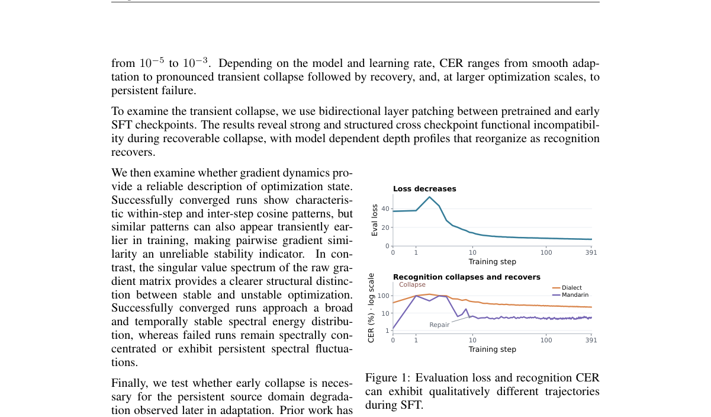

*Main result - Figure 2 Evaluation loss trajectories during SFT across three models and learning rates.*

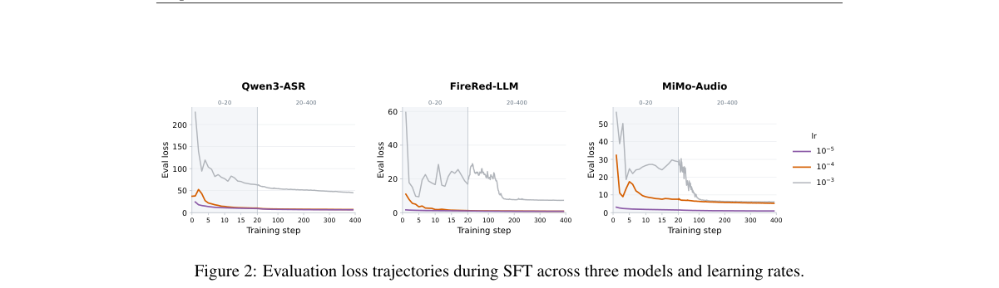

**Why this ranks #7**: 「损失看不出的功能演化」是一个被广泛默认但很少被量化的问题。

---

### 8. What Do Deepfake Audio Detectors Hear? From Self-Supervised Models to Audio LLMs

**arXiv**: [2610.17617](https://arxiv.org/abs/2610.17617) | **Score**: 7.3 (relevance 7 x 0.7 + quality 8 x 0.3) | **Tags**: audio-LM | **Categories**: cs.SD | **Pages**: 6

**Authors**: Wanying Ge, Xin Wang, Junichi Yamagishi

**Affiliation**: National Institute of Informatics

**Abstract**

> Real-world audio recordings for deepfake detection rarely consist solely of speech; they often are mixtures of speech and background events that themselves may also be synthetic. When processing these mixtures, it remains unclear whether detectors attend to the speech or the background event, and where their spectral evidence lies. We study this on the CompSpoof V2 database, whose mixtures pair independently real-or-fake speech and event components. Our results show that all systems detect fake events more accurately than fake speech. However, this performance gap is largely driven by poor generalization to an unseen fake speech domain, rather than a true difference in difficulty. Furthermore, sub-band probing reveals that the front-end encoder dictates where a countermeasure focuses its frequency evidence. To enable reliable deployment in real-world scenarios, future countermeasures should address out-of-domain generalization failures and carefully select front-end encoders aligned with their target acoustic evidence. Our source code and checkpoints are released at https://github.com/nii-yamagishilab/AntiDeepfake-AudioLLM.

**Key findings**

- **Finding**: 真实录音是语音与（可能同样合成的）背景事件的混合；检测器在混合上究竟关注语音还是背景事件并不清楚。

- **Finding**: 作者在 CompSpoof V2（其混合把真实与合成事件配对）上研究这一点，比较自监督模型与音频 LLM。

- **Inference**: 若检测器实际在听背景而非语音，则针对语音的对抗攻击（语音深伪）恰好打在检测器不看的维度上——这解释了为何语音深伪攻击的成功率长期偏高。

- **Recommendation**: 与本批 When Does an ASR Error Matter（共 10 篇审计类工作）一起读；做深伪检测的团队应先确认自己的模型在看什么。

**Key figures**

*Framework / architecture - Figure 1 Comparison between different CM architectures.*

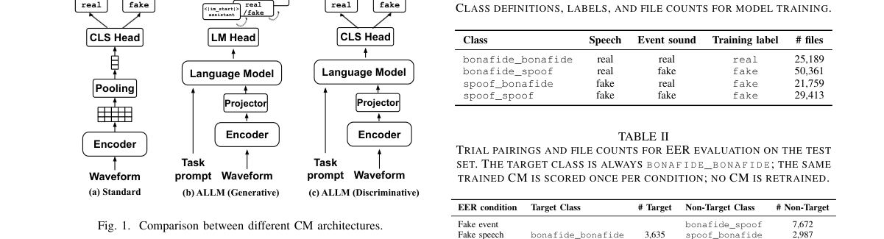

*Main result - Figure 2 Score distributions of the Qwen2-Audio (gen) system under no filtering (first column) and with 7.2–8 kHz muted (second column). Top row: fake event condition. Bottom row: fake speech condition*

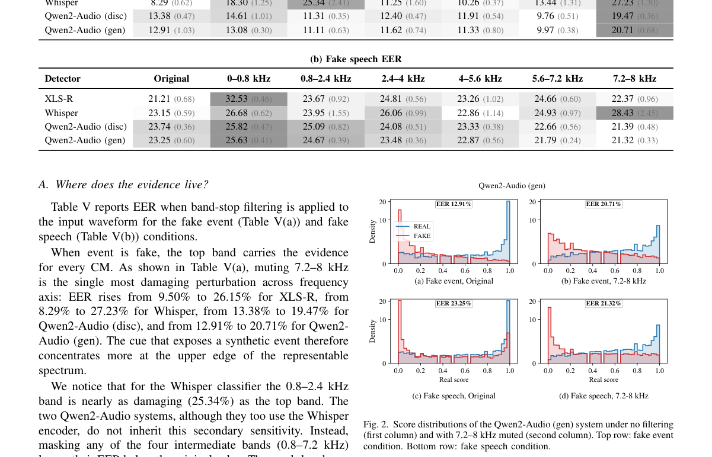

**Why this ranks #8**: 本批审计主题的又一例，且对象是深伪检测器——一个已被广泛部署的安全组件。

---

### 9. When Does an ASR Error Matter? Task-Role Diagnostics for Tool-Using Voice Agents

**arXiv**: [2610.17619](https://arxiv.org/abs/2610.17619) | **Score**: 7.3 (relevance 7 x 0.7 + quality 8 x 0.3) | **Tags**: duplex-voice, audio-LM | **Categories**: cs.CL | **Pages**: 5

**Authors**: Xiaolong Wang, Shijie Su, Naqi Xiong

**Affiliation**: Leibniz University Hannover, Hannover, Germany

**Abstract**

> In cascaded voice agents, ASR errors can have markedly different downstream consequences: a small transcription error may leave a tool call unchanged or alter its intent or arguments. Conventional word error rate (WER), however, does not capture these differences. We introduce SpeechEvalX, a paired diagnostic protocol that evaluates how task roles affected by ASR errors influence structured tool calls. Controlled edits are matched by source utterance, edit count, and operation, while task-role labels are compared with lexical severity, BERT cosine distance, Semantic-WER, and binary criticality. Across 594 source utterances, joint call accuracy falls from 82.3% with reference transcripts to 71.9-74.9% across three ASR front ends. Number and negation edits cause 21.9-25.7 percentage-point losses, versus 1.4-2.9 points for control edits. Detailed task-role labels improve source-grouped ROC-AUC from 0.73 to 0.78 over binary criticality, showing that downstream impact depends strongly on the task role affected.

**Key findings**

- **Finding**: ASR 错误对工具调用的影响高度异质：可能不改变调用，也可能改变意图或参数。

- **Finding**: 常规 **WER 捕捉不到**这些差异；作者提出 SpeechEvalX 这一配对诊断协议，评估受 ASR 错误影响的任务角色如何影响结构化工具调用。

- **Inference**: WER 把所有错误视为等权，而下游影响可能相差一个数量级——这意味着按 WER 优化的 ASR 组件与按真实任务影响优化之间存在系统性错配。

- **Recommendation**: 做级联语音智能体的读者必读；配对诊断协议可以直接替换现有 WER 报告方式。

**Key figures**

*Framework / architecture - Figure 1 Matched example: equal lexical severity, but only the number edit changes the structured action relative to the original reference.*

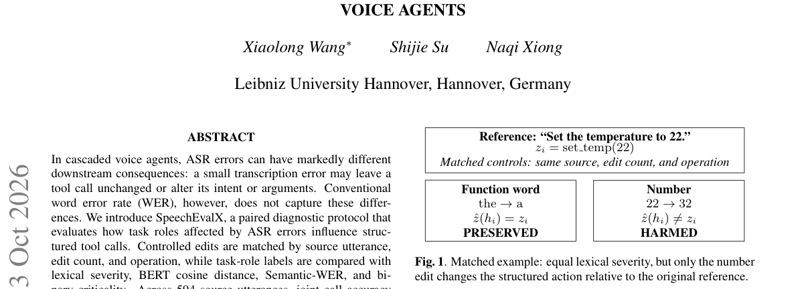

**Why this ranks #9**: 把 WER 换成「任务角色」视角，是一个具体且立即可用的评测替换方案。

---

### 10. RefTAG: Reflection-aware Temporal Audio Grounding in Large Audio Language Models

**arXiv**: [2610.16217](https://arxiv.org/abs/2610.16217) | **Score**: 7.0 (relevance 7 x 0.7 + quality 7 x 0.3) | **Tags**: audio-LM | **Categories**: eess.AS | **Pages**: 5

**Authors**: Yuhang Dai, Xin Shu, Zhennan Lin, Mingchen Shao, Chengyou Wang, Xiangang Li, Jianwei Yu, Lei Xie

**Affiliation**: Northwestern Polytechnical University

**Abstract**

> Temporal audio grounding requires locating every occurrence of a queried target, making both occurrence counts and interval boundaries essential. We propose RefTAG, a post-training framework for verifiable temporal self-correction. Its Reflection Chain-of-Thought (Re-CoT) protocol combines draft intervals, discrete count and boundary actions, and revised intervals in one response. Supervised fine-tuning on these trajectories (Re-CoT-SFT) teaches the protocol; reinforcement learning (RL) jointly rewards final localization and revision outcomes. Across 8,228 queries, Re-CoT-SFT improves query-weighted mIoU over final-answer SFT by 1.74 percentage points. RL further improves TAG-Bench multi-target mIoU by 0.40 points and R@0.5 by 0.86 points. The final model achieves 38.50% TAG-Bench mIoU and 51.01% mean mIoU across three datasets, outperforming the evaluated open-source MOSS-Audio and FireRedAudio models and the commercial Gemini-3.1-Pro on both measures. These results demonstrate that explicitly coupling count- and boundary-aware revision with joint reward optimization provides an effective and verifiable path to temporal audio grounding.

**Key findings**

- **Finding**: 任务要求找出目标的所有出现，因此**出现次数**与区间边界同等重要。

- **Finding**: RefTAG 的 Reflection CoT 协议在**一次响应内**组合草稿区间、离散计数与边界动作、以及修正后的区间，用于可验证的时序自我纠正。

- **Inference**: 把计数做成响应中的显式离散动作，使「我数错了」成为可被奖励惩罚的可观测事件——这与 10-12 日报 AudioTETRIS 的 token 重要性、10-09 日报的数量校准是同一类把隐式变成可监督的做法。

- **Recommendation**: 与 10-09 日报的 TiTok（无法校准事件数量）对照，一篇指出问题、一篇给出解法。

**Key figures**

*Framework / architecture - Figure 1 RefTAG data construction and training. Ground-truth-conditioned LLM generation and rule-based correction produce balanced Re- CoT-SFT trajectories. Re-CoT-RL generates fresh rollouts on 5K SFT*

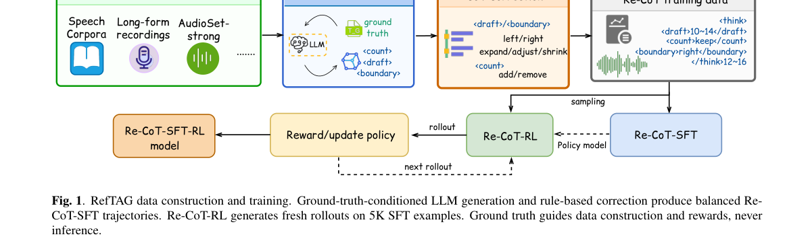

*Main result - Figure 2 Reward-weight sensitivity under matched initialization, 5K data, and schedule (single run). Each panel sweeps α, the weight on final quality, while 1 −α weights reflection. Panel (c) averages*

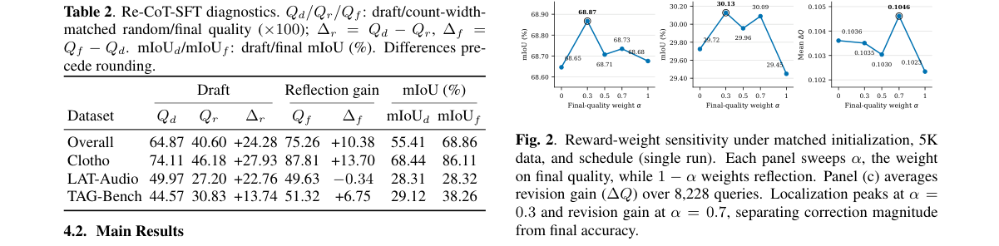

**Why this ranks #10**: 「定位每一次出现」把计数问题引入了定位任务，而计数恰好是本批多处诊断出的薄弱环节。

---

## Footer

- Total papers reviewed across all 5 tracks: 50 (from 1935 scanned)
- audio_lm track final top-10: 10
- Wild-cards in this track: 0
- Figure assets: `res/` (shared across tracks)

Generated by `mine-arxiv-daily-digest` skill. Sister file: `2026-10-14_audio_lm_entry.md`.
