# ArXiv Daily Digest - 2026-10-14 (具身智能与世界模型, 10 papers)

**Generated**: 2026-10-14 17:00 CST

**Source**: arXiv cs.CV, cs.SD, eess.AS, cs.CL, cs.AI, cs.RO, cs.LG submissions, window 2026-10-10..2026-10-13 UTC (cumulative: covers the 4 announced batches not yet reported, since the previous digest covered 2026-10-09)

**Track**: embodied (top 10 of 1935 papers scanned, 50 full reads)

**Scope**: behavior-grounded world models for action consequence, neuro-symbolic JEPA predictors, world model as reliable simulator with hallucination control, quadruped navigation from egocentric web video, real-to-sim-to-Real dexterous cutting, stage-localized force specialization, force world action models, counterfactual predictive recovery, bridging VLA and WAM with latent future prediction, unified multimodal world model

---

**力与接触在本批具身线成为一条独立主线**，五篇论文从数据、表征、架构三侧处理同一个问题。诊断最清晰的是 **DEFT-VLA**，它把阶段依赖的感知冲突讲得很具体：定位与接近阶段视觉与本体感知关键、**力信息基本无用甚至可能干扰**；而接触之后力变得关键，此时无关视觉细节与机器人状态可能成为捷径。那个「状态成为捷径」的失效在接触后最严重，因为那时状态变化最剧烈。**ForceWAM** 的思路是数据分工：专家演示覆盖任务目标但不覆盖力响应，任务无关的 play 覆盖力响应却不指定目标——因此**解耦**未来学习与响应学习。**DexNinja** 则点出切割任务的数据困境：每次真实试验都会污染或损坏食物，这使该任务上的在线/RL 路线格外昂贵。

世界模型侧四篇共同关注**可靠性而非逼真度**。**From Pixels to Executable Physics** 的问题设定很具体：户外环境中地形与接触条件变化会使**相同的动作命令**产生不同运动结果，而既有视频世界模型能生成视觉合理的未来却难以捕捉与动作后果相关的内容——这解释了为什么视觉上合理的 rollout 无法支撑路径选择。**WoVR+** 把风险说得更重：动作条件世界模型能减少 VLA-RL 的真实交互成本，但**幻觉会误导策略优化**。把世界模型当模拟器用于 RL 时，幻觉的性质变了——预测误差会被策略当成真实后果来利用，因此 RL 会主动放大世界模型的分歧区域，这比单纯预测不准更危险。

效率侧值得注意 **Vision-Predictor-Action**：VLA 模型通过 LLM 解码器逐 token 生成动作，使延迟随动作序列长度增长、限制**闭环控制频率**；VPA 用轻量神经符号式 JEPA 预测器替换自回归解码器。控制频率是硬约束而非软指标——延迟直接决定控制器能否跟上物理事件，这与本批 audio_lm 线 Diffuplex 的「多 token 前向」是完全同构的选择。

---

## Top 10 - 具身智能与世界模型

### 1. From Pixels to Executable Physics: Behavior-Grounded World Models for Embodied Action Consequence Prediction

**arXiv**: [2610.17630](https://arxiv.org/abs/2610.17630) | **Score**: 9.0 (relevance 9 x 0.7 + quality 9 x 0.3) | **Tags**: world-model, embodied-ai | **Categories**: cs.CV, cs.RO | **Pages**: 20

**Authors**: Ruo Chen, Jiahua Pang, Yingjie Niu, Hongyi Lin, Jun Tian, Yang Zhu, Chao Li

**Affiliation**: 2Zhejiang University | 3Beijing Institute of Technology | 4Massachusetts Institute of Technology | 5Tsinghua University

**Abstract**

> In outdoor environments, varying terrain and contact conditions can cause identical action commands to produce different motion outcomes for quadruped robots. Predicting these outcomes is essential for reliable navigation and informed path selection. Existing video world models can generate visually plausible futures, yet often struggle to capture robot dynamics and terrain interactions, leading to overly optimistic predictions of action outcomes. We present DR-WM, a physically consistent world model that incorporates robot-terrain contact dynamics to predict the consequences of quadruped actions. Starting from an initial RGB image, our method reconstructs scene geometry and integrates dense, dimensionless priors over terrain contact properties, calibrated using real-world action-response data. The resulting terrain model supports the simulation of physics with spatially varying contact properties such as friction. Given the initial state of the robot and candidate action sequences, we simulate its future motion and use the resulting camera trajectories and rendered geometry to guide the training of a video world model. The generated future observations are then used to update the terrain reconstruction, enabling iterative model rollouts without additional real-world images. Extensive experiments demonstrate that DR-WM substantially outperforms geometry-only baselines and baselines with uniform physical parameters on key physical metrics characterizing action outcomes, while achieving the best performance among the evaluated baselines. These physically grounded predictions support more informed action selection: across 90 challenging scenarios, an 8B vision-language model augmented with DR-WM outperforms an unassisted 32B vision-language model on five of six evaluation metrics.

**Key findings**

- **Finding**: 相同动作命令在不同地形/接触条件下产生不同运动结果，因此后果预测是路径选择的前提。

- **Finding**: 既有视频世界模型生成视觉上合理的未来，却难以捕捉与动作后果相关的内容（摘要在此处截断）。

- **Inference**: 视频世界模型的评测普遍基于视觉保真度，而这里需要的恰恰是**视觉相同但物理不同**的区分——这解释了为什么视觉上合理的 rollout 无法支撑路径选择。

- **Recommendation**: 与本批 WoVR+（世界模型作为可靠模拟器）对照：一篇做四足后果预测、一篇做策略优化可靠性，共同点是把「可靠」而非「逼真」放在首位。

**Key figures**

*Framework / architecture - Figure 1 Overview of DR-WM. The model constructs an executable terrain representation from visual observations, then simulates terrain dynamics to predict future observations and terrain-dependent ac*

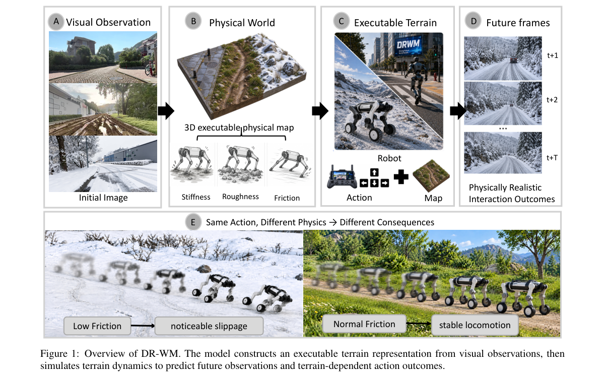

*Main result - Figure 2 VLM action-selection pipeline. For each candidate action, DR-WM predicts future observations and iteratively feeds them back into scene reconstruction and physics simulation. The VLM compare*

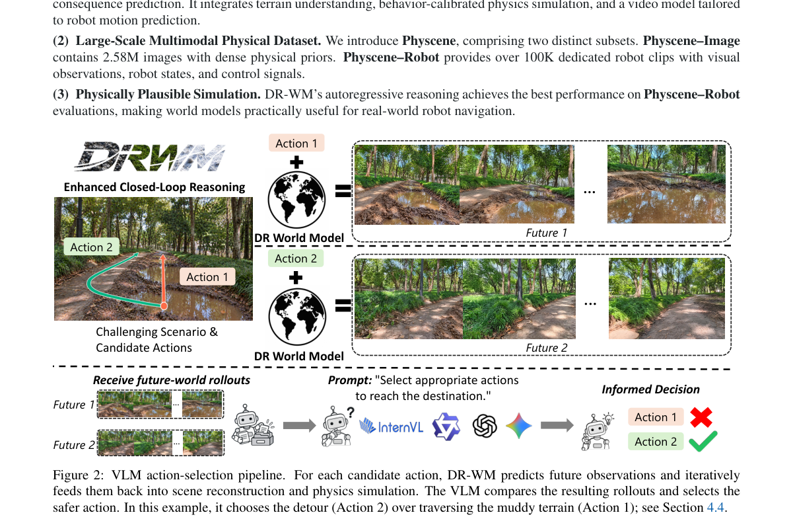

**Why this ranks #1**: 「同一命令、不同结果」把物理后果预测摆到了导航之前，是本批世界模型线最具体的问题设定。

---

### 2. Vision-Predictor-Action: Towards Efficient Embodied AI via Neuro-Symbolic JEPA Predictors

**arXiv**: [2610.15556](https://arxiv.org/abs/2610.15556) | **Score**: 9.0 (relevance 9 x 0.7 + quality 9 x 0.3) | **Tags**: embodied-ai, world-model | **Categories**: cs.LG, cs.LO, cs.RO | **Pages**: 26

**Authors**: Yeonseok Lee

**Affiliation**: SLING AI Inc. | on an Apple M4

**Abstract**

> Vision-Language-Action (VLA) models commonly generate robot actions token by token through Large Language Model (LLM) decoders, causing inference latency to grow with action sequence length and limiting closed-loop control frequency. We present Goal-Conditioned Vision-Predictor-Action (VPA), which replaces autoregressive decoders with a lightweight latent control loop. A shared vision encoder and a frozen text encoder embed observations, goal images, and instructions; a neuro-symbolic selector chooses a discrete skill; a Joint-Embedding Predictive Architecture (JEPA) predictor forecasts the next latent state; and a flow-matching solver generates an entire action chunk in a few integration steps, so that sequential network evaluations per decision step do not depend on the action horizon. We analyze inference complexity, regularization against representation collapse, and conditions under which latent sub-goal thresholding limits error accumulation across task phases. As an initial proof of concept, we evaluated VPA on the LIBERO-10 suite. The trainable model has under 20M parameters (checkpoint under 75 MB, excluding a frozen 63.4M-parameter CLIP text encoder); a decision step of a single-camera reference configuration takes 10-14 ms on an Apple M4; and trained only on LIBERO-10 demonstrations in under three hours on a single GPU, a two-camera policy succeeded in 40.0% of 200 evaluation episodes. These preliminary results from a single training run suggest the approach is workable. Code and weights are available at https://github.com/ylee-sling/Vision-Predictor-Action and https://huggingface.co/ylee-sling/vpa-libero10, and archived at https://doi.org/10.5281/zenodo.22960920.

**Key findings**

- **Finding**: LLM 解码器逐 token 生成使延迟随动作序列长度增长，限制**闭环控制频率**。

- **Finding**: VPA 用轻量预测器替换自回归解码器，并以神经符号式 JEPA 预测器为结构。

- **Inference**: 控制频率是一个硬约束而非软指标——延迟直接决定控制器能否跟上物理事件，因此「一次前向出整段动作」在具身场景的价值远高于文本生成。

- **Recommendation**: 与本批 aigc_visual 的 Diffuplex（每次前向 13 token）对照：两篇在语音与机器人上做了同一个「多 token 前向」的选择。

**Key figures**

*Framework / architecture - Figure 1 VPA at a glance. Top: autoregressive VLAs decode actions token by token through a large language model, so the number of sequential forward passes grows with the action horizon; inference ra*

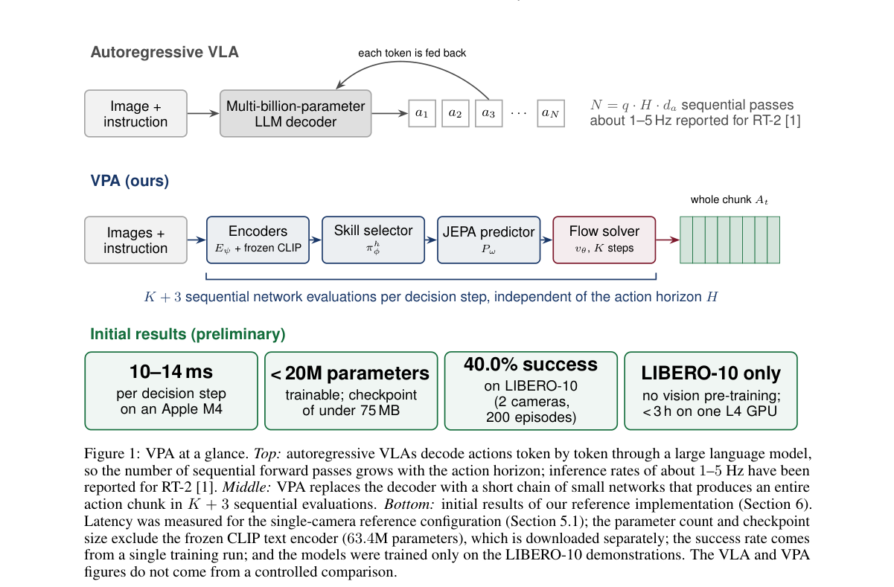

*Main result - Figure 2 High-level architectural overview of the Goal-Conditioned Vision-Predictor-Action (VPA) framework. Multimodal observations are projected into latent and text embeddings that condition the se*

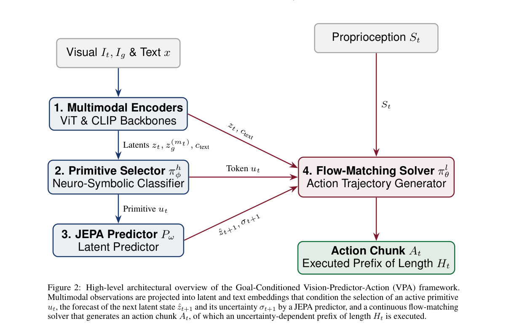

**Why this ranks #2**: 「用预测器替换 AR 解码器」是对具身控制频率瓶颈的正面攻击，且引入 JEPA 结构。

---

### 3. WoVR+: World Model as Reliable Simulator for Versatile VLA Policy Optimization with RL

**arXiv**: [2610.17922](https://arxiv.org/abs/2610.17922) | **Score**: 8.7 (relevance 9 x 0.7 + quality 8 x 0.3) | **Tags**: world-model, embodied-ai | **Categories**: cs.RO | **Pages**: 19

**Authors**: Shangqing Zhou, Zhennan Jiang, Ning Ma, Xin Fu, Yupeng Zheng, Shuai Tian, Huangrui Li, Jiahao Liu, Chao Yu, Zhongpu Xia, Haoran Li, Dongbin Zhao

**Affiliation**: 1 Institute of Automation, Chinese Academy of Sciences. | 2 School of Artificial Intelligence, University of Chinese Academy of | 4 Xi’an Jiaotong-Liverpool University. | 5 Tsinghua University.

**Abstract**

> Action-conditioned world models can reduce costly real-robot interaction in reinforcement learning for Vision-Language-Action models (VLA-RL), but hallucinations can mislead policy optimization. Extending them to richer VLA interfaces and long-horizon tasks raises challenges in spatiotemporal and cross-modal consistency, exploration-reliability balance in RL, and compounding rollout errors. We present WoVR+, extending WoVR's hallucination-aware WM-RL framework by redesigning the learned environment and imagined interaction protocol: A VLA-interface-aligned world model provides multi-view prediction and proprioceptive updates while mitigating hallucinations. Chunk-wise noise preserves flow-based policy exploration while limiting prediction-degrading action jitter. For long-horizon tasks, stage-local imagined training combines stage-entry resets, stage-specific rewards, local horizons, and controllable sampling to shorten generated prefixes and balance training across stages. WoVR+ improves success over SFT by 21.09% and 16.7% on RoboTwin and 6 real-robot tasks. Long-horizon phone-packaging success rises from 30% to 75%. Videos are available at https://youmo445.github.io/WoVR_Plus.github.io/.

**Key findings**

- **Finding**: 动作条件世界模型可减少 VLA-RL 的真实交互成本，但**幻觉会误导策略优化**。

- **Finding**: WoVR+ 面向更丰富的 VLA 接口与长时程任务，处理时空与跨模态一致性、探索-可靠性平衡（摘要在此处截断）。

- **Inference**: 把世界模型当模拟器用于 RL 时，幻觉的性质变了：预测误差会被策略优化当作真实后果来利用，因此 RL 会主动放大世界模型的分歧区域——这比单纯预测不准更危险。

- **Recommendation**: 本批审计线索的具身侧实例，与 10-12 日报的 Does Location Matter（审计 AAD）、今天的 What Do Deepfake Audio Detectors Hear 并列。

**Key figures**

*Framework / architecture - Figure 1 Overview of motivation, extensions, and evaluation of WoVR+. (A) Shared core problem. World-model hallucinations can produce spurious imagined successes that fail to transfer to real execution*

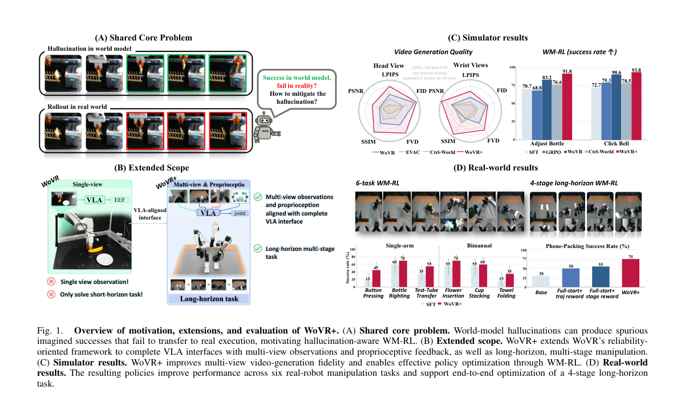

*Main result - Figure 2 WM-RL framework in WoVR, redrawn based on [25]. WoVR treats the world model as a generative simulator and controls hallucination across three levels.*

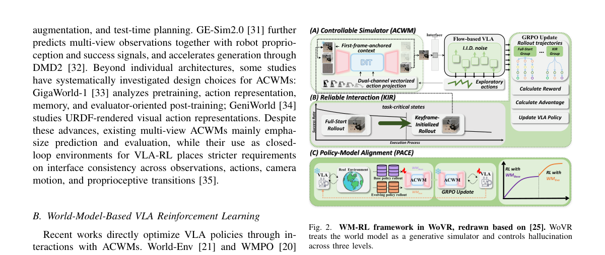

**Why this ranks #3**: 「世界模型幻觉会误导 RL」——这是本批审计主题在具身领域的直接对应，且后果被明确定位为策略优化被误导。

---

### 4. DR-VLA: Learning Human-Like Quadruped Navigation from Egocentric Web Videos via Domain-Invariant Scene Representations

**arXiv**: [2610.18373](https://arxiv.org/abs/2610.18373) | **Score**: 8.0 (relevance 8 x 0.7 + quality 8 x 0.3) | **Tags**: embodied-ai | **Categories**: cs.RO | **Pages**: 16

**Authors**: Jun Tian, Yingjie Niu, Ruo Chen, Hongyi Lin, Chao Li

**Affiliation**: 3Zhejiang University | 4Tsinghua University | 5Massachusetts Institute of Technology

**Abstract**

> Quadruped robots performing outdoor deliveries must interpret complex scenes, anticipate changes, and navigate in socially compliant ways. Robot demonstrations are costly to collect at the scale needed for generalization. Egocentric web videos offer abundant human navigation experience, but differences in viewpoint and motion make this experience difficult to transfer to robots. We introduce DR-VLA, a Mixture-of-Transformers framework that transfers human navigation experience through a domain-invariant scene representation (DISR). The framework combines vision-language understanding and latent world modeling with a flow-matching action expert. We introduce EgoLynx, comprising 10,000 hours of curated egocentric web video (EgoLynx-Web) and 2,000 clips of teleoperated robot navigation collected during real-world deliveries (EgoLynx-Robot). We pretrain the understanding and world experts on EgoLynx-Web without action labels, then adapt the model to robot observations and train the action expert on EgoLynx-Robot to predict executable trajectories. We also propose the Quadruped Navigation Score (QNS), a pseudo-closed-loop metric combining safety, instruction compliance, comfort, and progress. On the held-out EgoLynx-Robot test split, DR-VLA improves QNS by approximately 5% and reduces open-loop final heading error (FHE) by 14.6%, each relative to the best competing result for that metric. Ablations show that web-video pretraining improves generalization and that the model's key components contribute to performance. As a future-prediction target, DISR outperforms five generic visual representations and yields performance close to task-specific 3D perception without dedicated geometric labels or point clouds for target construction. Trained separately on NAVSIM v1 without web pretraining, DR-VLA achieves 92.1 PDMS, suggesting that the framework also applies to autonomous driving.

**Key findings**

- **Finding**: 机器人演示采集成本高到无法支撑泛化；第一人称网络视频是人类导航经验的丰富来源。

- **Finding**: 但视角与运动差异使经验难以直接迁移；DR-VLA 用**域不变场景表示**弥合（摘要在此处截断）。

- **Inference**: 视角差异（四足第三人称 vs 人第一人称）是这一数据路线最难的部分，「域不变场景表示」的赌注是存在一个与视角无关的场景表征——若成立，这比逐篇做运动重定向更根本。

- **Recommendation**: 与本批 2610.15556（神经符号式预测器）对照，一篇换结构、一篇换表示，都针对人类数据迁移。

**Key figures**

*Framework / architecture - Figure 1 Overview. DR-VLA learns to understand and anticipate scenes from egocentric web videos (left) and to act from teleoperated quadruped clips (center bottom). Three experts (center top) map fou*

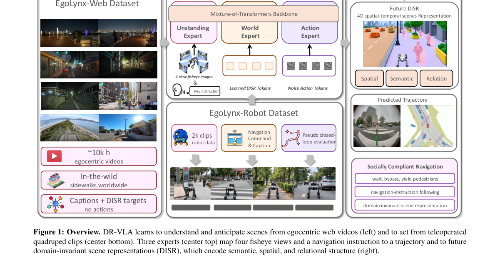

*Main result - Figure 2 DR-VLA and the DISR Pretraining. Top: Combined Spatial and Semantic information are encoded by Eϕ into the DISR latent z and reconstructed by Dϕ. Bottom left: the understanding, world, and a*

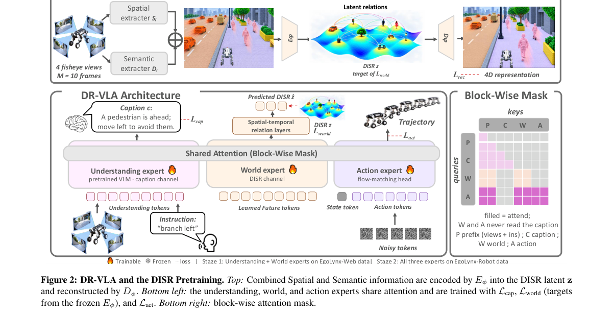

**Why this ranks #4**: 把「人类视频迁移到四足」这条数据路线做到域不变表示上，是一个务实的选择。

---

### 5. DexNinja: Learning Robust Dexterous Cutting Policy with a Real-to-Sim-to-Real Data Engine

**arXiv**: [2610.17208](https://arxiv.org/abs/2610.17208) | **Score**: 8.0 (relevance 8 x 0.7 + quality 8 x 0.3) | **Tags**: embodied-ai, sim-to-real | **Categories**: cs.CV, cs.RO | **Pages**: 28

**Authors**: Haozhe Lou, Runyi Yang, Wanqi Zhong, Caiyun Liu, Yicheng Liu, Wenhao Liu, Wenlong Ma, Jiawei Xia, Kanzhi Wu, Danda Pani Paudel, Luc Van Gool, Hang Zhao

**Affiliation**: 1College of AI, Tsinghua University | 2INSAIT, Sofia University “St. Kliment Ohridski” | 3Peking University | 4IIIS, Tsinghua University

**Abstract**

> Cutting a piece of food looks effortless in human hands. For a robot, however, every cut is a high-contact interaction with a deformable, elasto-plastic object whose behavior changes with pose, contact mode, and cutting stage. Collecting real-world data is expensive and wasteful: each trial typically contaminates or damages the food, so obtaining scalable real world data for dexterous cutting is expensive and difficult. Simulation is an appealing alternative, but a large sim-to-real gap exists in both physics and perception. This gap is especially severe for topology-changing interactions like cutting, where small errors in contact, friction, or material and elasticity responses quickly compound. We propose \textsc{DexNinja}, a real2sim2real framework that turns a handful of real demonstrations into a dense and realistic training distribution. \textsc{DexNinja} (i) reconstructs object instances from real captures, (ii) randomizes physically meaningful parameters under category-level constraints, and (iii) produces augmented dexterous manipulation episodes using a custom differentiable simulator that couples robot dynamics, tactile contact, and deformable cutting. We evaluate \textsc{DexNinja} on a dexterous food-slicing task and show that (1) with tens of real demonstrations and hundreds of augmented simulator data, the success rate could reach more than 60\%. (2) the augmented data consistently improves success rates when only using real data with more than 20\% via sim-to-real, and (3) the resulting policies generalize to out-of-distribution objects with varying shapes and sizes.

**Key findings**

- **Finding**: 切割是可变形弹塑性物体上的高接触交互，行为随位姿、接触模式与切割阶段变化。

- **Finding**: 真实数据采集昂贵且**每次试验都会污染或损坏食物**；DexNinja 用 real-to-sim-to-real 数据引擎应对。

- **Inference**: 数据会被破坏这一点使在线/RL 路线在该任务上尤其昂贵，而 sim2real 的难点在于可变形物的物性建模——这比刚体接触高一个数量级。

- **Recommendation**: 与本批 ForceWAM（力世界动作模型）对照，一篇做数据引擎、一篇做力表征，切割任务两者都需要。

**Key figures**

*Framework / architecture - Figure 1 Real2Sim data densification pipeline. (a) Real-world demonstration sample via tele- operation. (b) Real-world multi-modal sensing, and register object into a unified coordinate frame. (c) Si*

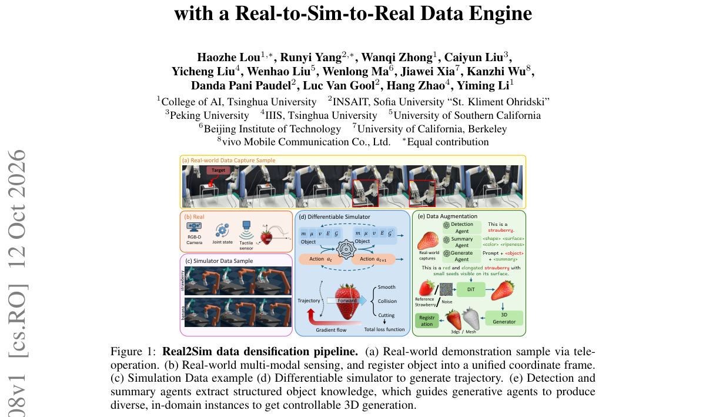

*Main result - Figure 2 Tactile perception visualization of representative food-cutting examples.*

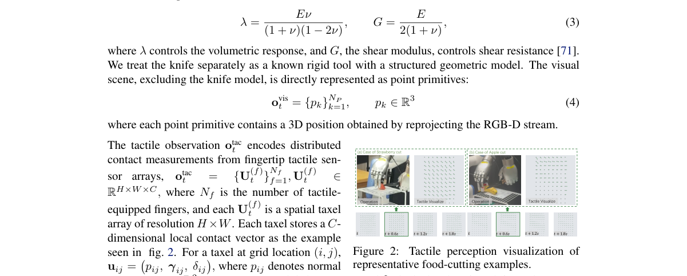

**Why this ranks #5**: 「每次试验都污染物体」是一个硬性数据瓶颈，逼出了 real-to-sim-to-real 的数据引擎设计。

---

### 6. DEFT-VLA: Stage-Localized Force Specialization for Contact-Rich Robotic Manipulation

**arXiv**: [2610.14854](https://arxiv.org/abs/2610.14854) | **Score**: 8.0 (relevance 8 x 0.7 + quality 8 x 0.3) | **Tags**: embodied-ai | **Categories**: cs.RO | **Pages**: 8

**Authors**: Zan Huang, Yibo Qiu, Kan Ding, Xuanping Zhang, Ao Tian, Ronald X Xu, Mingzhai Sun

**Affiliation**: Sun are with the Suzhou Institute for Advanced Research, University of | School of Biomedical Engineering, Division of Life Sciences and Medicine, | University of Science and Technology of China, Hefei, Anhui, China. | 2Xuanping Zhang is with the School of Robotics, Xi’an Jiaotong-

**Abstract**

> Contact-rich manipulation poses a stage-dependent sensory conflict: vision and proprioception are essential for localization and approach, when force is largely uninformative and potentially distracting, whereas force becomes critical after contact, when irrelevant visual details and correlated robot states may become shortcuts. We propose DEFT-VLA (Dual-Expert Force-specialized Training for Vision-Language-Action Manipulation), which retains the task-adapted base expert for vision-dominated non-contact behavior and introduces a force-aware contact expert for critical contact stages, localizing force-conditioned adaptation to where it is needed. We further introduce a contact-localized force-attending curriculum that applies force-attending post-training only to the contact expert, progressively restoring vision and masking state tokens to suppress shortcuts. Real-robot experiments on pipette tip attachment, bimanual pipette aspiration, and whiteboard wiping show that DEFT-VLA effectively exploits force feedback to improve contact-stage performance while maintaining strong non-contact behavior and robustness to held-out grasp heights. It improves overall task success by 20-40 percentage points over the strongest baseline on each task.

**Key findings**

- **Finding**: 定位/接近阶段：视觉与本体感知关键，**力信息基本无用甚至干扰**；接触之后：力关键，而视觉细节与机器人状态可能成为捷径。

- **Finding**: DEFT-VLA 做阶段定位的力特化（stage-localized force specialization）。

- **Inference**: 「状态成为捷径」是模仿学习里的经典失败模式：策略学会读自己的历史状态而非环境，而这个失效在接触后最严重——因为那时状态变化最剧烈。

- **Recommendation**: 本批力/接触主线里诊断最清晰的一篇；与 ForceWAM、Force-Modulated Dexterity 构成三篇。

**Key figures**

*Framework / architecture - Figure 1 Overview of DEFT-VLA. The task-adapted base expert preserves vision-dominated alignment and approach during non-contact stages (a). During contact, visually similar observations may correspond*

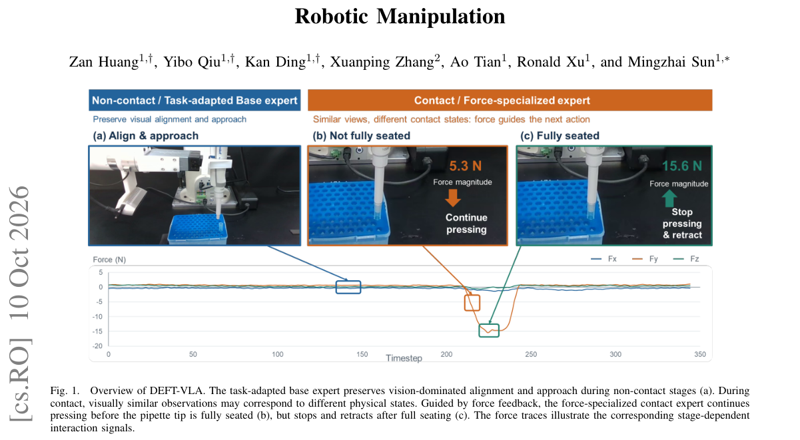

*Main result - Figure 2 Overview of DEFT-VLA. A shared VLM conditions a task-adapted base expert for non-contact behavior and a force-specialized contact expert for critical contact stages. The contact expert is init*

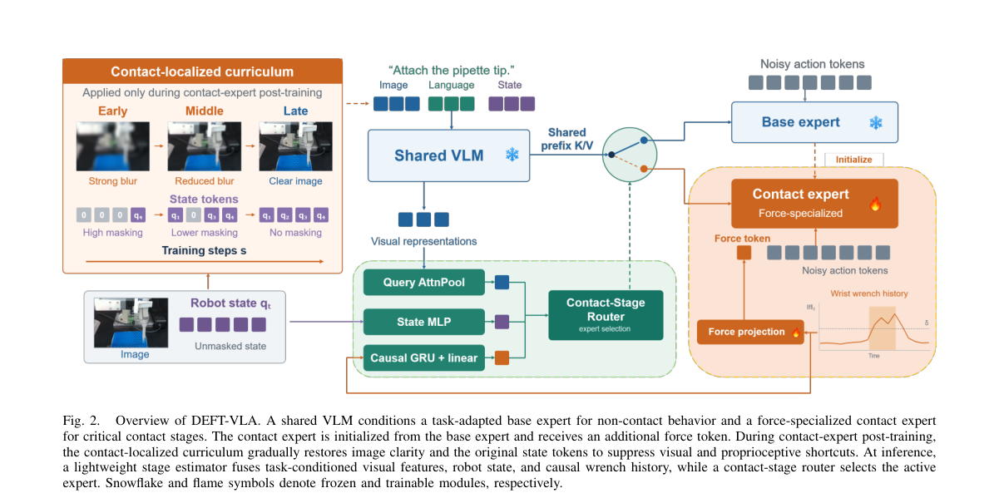

**Why this ranks #6**: 「阶段依赖的传感器重要性」是一个被清晰表述的观察，直接给出条件化设计。

---

### 7. ForceWAM: Decoupling Future and Response Learning from Demo and Play Data for Contact-Rich Manipulation

**arXiv**: [2610.18852](https://arxiv.org/abs/2610.18852) | **Score**: 8.0 (relevance 8 x 0.7 + quality 8 x 0.3) | **Tags**: world-model, embodied-ai | **Categories**: cs.RO | **Pages**: 15

**Authors**: Zijun Xu, Wendi Chen, Xinkai Wang, Jiachen Zou, Hongjin Chen, Hairuo Liu, Bokai Lin, Shihao Ma, Ke Ma, Zhiwei Zhang, Zhuohao Yan, Ke Wu

**Affiliation**: 1Fudan University | 2Shanghai Jiao Tong University | 3Southeast University | 4Shanghai Innovation Institute

**Abstract**

> Expert demonstrations show how to complete contact-rich tasks, but provide limited coverage of how interaction forces respond to different actions. Task-agnostic play provides broader experience of contact dynamics without specifying task goals. To fully leverage these two types of data, we introduce ForceWAM, a force world action model that decouples knowledge of task-compatible interaction outcomes from knowledge of how local actions change contact. A world model learns from successful demonstrations to jointly predict future video and six-axis force/torque trajectories. Together, these futures describe the expected evolution of motion and contact during the task. A separate inverse dynamics model (IDM) learns from both task and play, mapping current observations and recorded visual-wrench futures to their associated robot actions. Play data thus provide knowledge of force responses for goal-directed execution. At deployment, the IDM reactively translates generated futures into actions, reusing them with fresh wrench feedback between world-model updates. Across real-robot force-regulated sliding, box flipping with and without disturbances, and ring placement, ForceWAM achieves $85$-$95\%$ mean success, surpassing world-modeling and reactive baselines. Our experiments further show that adding task-agnostic play data improves success by $15$-$45$ percentage points, demonstrating its value for learning contact-rich execution. Project page and code are available at https://force-wam.github.io/.

**Key findings**

- **Finding**: 专家演示覆盖任务目标但不覆盖力响应；任务无关 play 覆盖力响应但不指定目标。

- **Finding**: ForceWAM（力世界动作模型）通过**解耦**未来学习与响应学习来同时利用两类数据。

- **Inference**: 解耦的依据是「未来」属于任务目标、「响应」属于物理动力学——两者有不同的数据来源与不同的标签需求，因此不应由同一个头承担。

- **Recommendation**: 与本批 WAVE-0（用轻量潜未来预测连接 VLA 与 WAM）对照，两篇都在重新划分世界模型各头的职责。

**Key figures**

*Framework / architecture - Figure 1 Motivation of ForceWAM. The illustrated end-to-end force-conditioned and force- envisioned policies use only task demonstration data: the former lack pretrained video-world-model priors, whi*

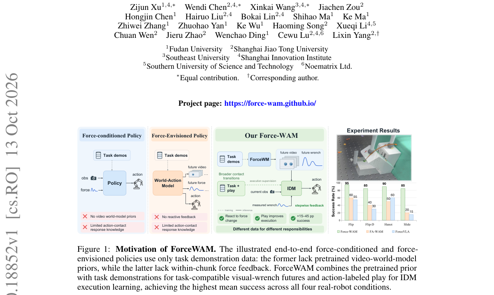

*Main result - Figure 2 ForceWAM training and deployment. Task demonstrations train the visual-wrench future generator, while task and play data train the IDM from recorded futures and associated actions. During de*

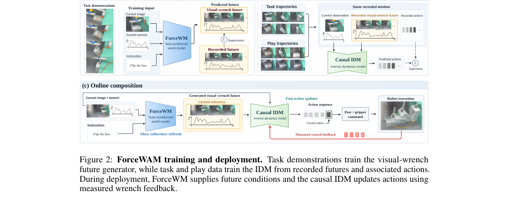

**Why this ranks #7**: 把「演示」与「play」两类数据按它们各自擅长的部分分工，是数据工程的正确思路。

---

### 8. ForkCast: Predictive Recovery for Vision-Language-Action Policies via Counterfactual Futures

**arXiv**: [2610.18650](https://arxiv.org/abs/2610.18650) | **Score**: 8.0 (relevance 8 x 0.7 + quality 8 x 0.3) | **Tags**: embodied-ai, world-model | **Categories**: cs.RO | **Pages**: 9

**Authors**: Chenru Wen, Huajian Zeng, Haokai Ding, Jian Kang, Anqing Duan, Dawei Zhou, Dezhen Song, Xingxing Zuo

**Affiliation**: 1 Mohamed bin Zayed University of Artificial Intelligence (MBZUAI),

**Abstract**

> Vision-language-action (VLA) policies perform manipulation tasks using camera images and language instructions, but object slip or visual occlusion can disrupt execution. Recovery is typically learned during policy training or delegated to a monitor that triggers a scripted repair after detecting a failure. We introduce ForkCast, a predictive recovery framework that compares counterfactual futures to determine whether and how to intervene in a frozen VLA policy. At each decision point, ForkCast evaluates three candidates: executing the policy's nominal action chunk (Commit), adjusting the camera viewpoint (Reobserve), and replanning the arm trajectory (Replan). A candidate-conditioned world model forecasts the latent outcome of each candidate at a common future horizon, and a shared task-progress head scores the predicted outcomes. By evaluating the policy's own continuation alongside the repair candidates, a single comparison based on task progress determines both whether and how to intervene, without a failure detector, an intervention threshold, or updates to the VLA backbone. On five simulated RoboTwin 2.0 tasks with injected occlusion and object slip, ForkCast increases pooled success from 13.3% for the frozen $π_{0.5}$ policy to 30.0% and transfers to two additional VLA backbones without updating ForkCast. After adaptation on real-robot candidate rollouts, ForkCast also improves success over the base policy under both clean and visibility-limited conditions. Code will be released to benefit the research community.

**Key findings**

- **Finding**: 物体滑移或视觉遮挡会打断执行；既有恢复或在训练时学习、或由监视器触发**脚本化修复**。

- **Finding**: ForkCast 用**反事实未来**实现预测性恢复（摘要在此处截断）。

- **Inference**: 「脚本化修复」预设了失败类型已知，而真实失败种类远多于脚本；反事实未来的思路是让策略自己预测「如果不滑移会怎样」，从而在滑移发生时仍能推理。

- **Recommendation**: 与本批 2610.17630（动作后果预测）同属「后果预测用于决策」的一族。

**Key figures**

*Framework / architecture - Figure 1 Predictive recovery with ForkCast. At a common prediction horizon, ForkCast ranks COMMIT and available REOBSERVE and REPLAN candidates. (a) Candidate-view acquisition and policy re-query prece*

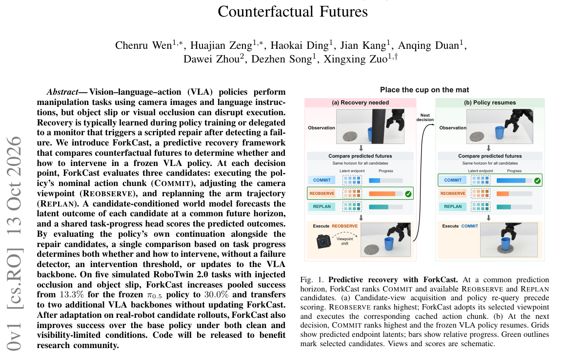

*Main result - Figure 2 Overview of ForkCast. COMMIT retains the nominal plan, REOBSERVE acquires views and re-queries the frozen policy before scoring, and REPLAN generates an arm correction. A frozen visual encoder*

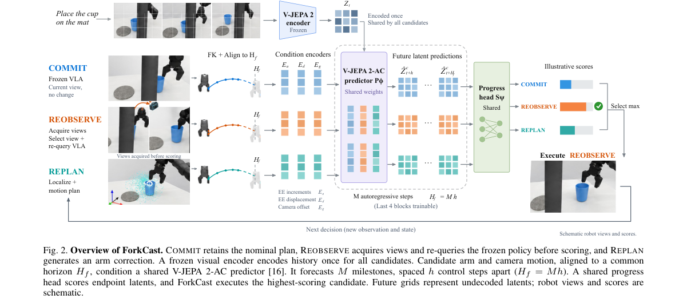

**Why this ranks #8**: 把「恢复」从脚本化改为预测性，是一个方向性转变。

---

### 9. WAVE-0: Bridging VLA Policies and WAMs with Lightweight Latent Future Prediction

**arXiv**: [2610.18568](https://arxiv.org/abs/2610.18568) | **Score**: 7.3 (relevance 7 x 0.7 + quality 8 x 0.3) | **Tags**: world-model, embodied-ai | **Categories**: cs.RO | **Pages**: 17

**Authors**: Haomin Wang, Anqiong Ji, Ke Wang, Zhongshan Liu, Ru Ying, Ran Zheng, Zhipeng Zhang

**Affiliation**: 1AutoLab, School of Artificial Intelligence, Shanghai Jiao Tong University | 3Baidu AI Cloud | 4Zhejiang University

**Abstract**

> Vision-language-action (VLA) policies excel at generalist robotic manipulation but generate actions without explicitly modeling their environmental consequences. World action models (WAMs) incorporate future prediction, yet most rely on costly video generation, while latent alternatives either use predicted futures only as auxiliary targets or infer latent actions from suboptimal visual transitions through costly large-scale video pretraining. We introduce WAVE-0 (World-model-Augmented VLA Execution), a framework that bridges VLAs and WAMs through a lightweight latent world model. By connecting the semantic understanding of pretrained VLAs with explicit future prediction, WAVE-0 allows anticipated action consequences to directly guide action generation. Built on a pretrained VLA, its 257M world model translates VLM-generated latent action plans into predicted future representations that condition the action expert, unifying latent planning, future prediction, and action generation. The world model is trained directly on ground-truth robot actions with a counterfactual ranking objective, requiring neither pixel reconstruction nor large-scale video pretraining. WAVE-0 achieves success rates of 91.47% on RoboTwin 2.0 and 98.7% on LIBERO, along with 88.0%, 61.4%, and 75.0% on LIBERO-Plus, LIBERO-Pro, and LIBERO-Para, respectively. On real-world tasks, it improves the success rate of $π_{0.5}$ from 38.3% to 73.3%. These results demonstrate strong manipulation performance and generalization across diverse distribution shifts.

**Key findings**

- **Finding**: WAM 多数依赖昂贵的视频生成；潜空间替代方案要么只把预测未来当作**辅助目标**，要么推断不足（摘要在此处截断）。

- **Finding**: WAVE-0 用**轻量潜未来预测**连接 VLA 策略与 WAM。

- **Inference**: 「只当辅助目标」之所以不充分，是因为辅助损失不改变策略的决策依据——除非未来预测以某种方式进入动作生成本身，这正是 WAVE-0 要解决的问题。

- **Recommendation**: 接上 10-08 日报 ΔWAM（动作依赖性筛选）、10-12 日报 Beyond Actions（预测目标换成效果），是同一条线的第四、第五篇。

**Key figures**

*Framework / architecture - Figure 1 Comparison of representative robot policy paradigms. (1) Standard VLAs map vision-language context directly to actions. (2) Video-based WAMs model dynamics through costly video generation. (3*

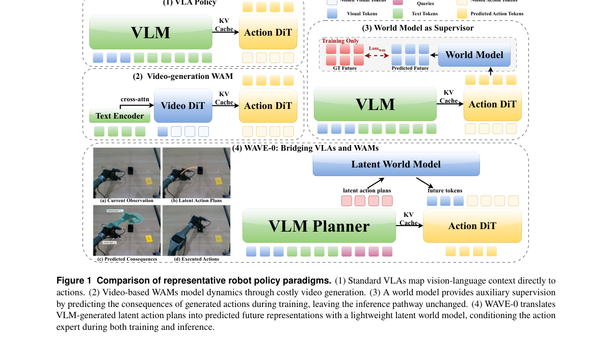

*Main result - Figure 2 Overview of WAVE-0. Stage 1: The latent world model learns action-conditioned dynamics in a fixed visual embedding space, trained with future-representation prediction, latent residual superv*

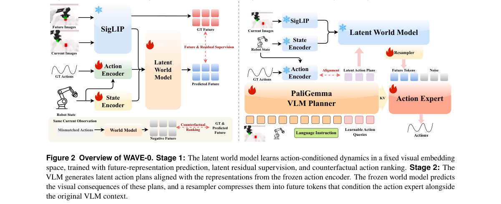

**Why this ranks #9**: 直接指出 WAM 现有两条路（视频生成太贵、潜空间只当辅助目标）都不可行。

---

### 10. Thinker-WM: A Unified World Model with Shared Multimodal Representations for Embodied Intelligence

**arXiv**: [2610.18447](https://arxiv.org/abs/2610.18447) | **Score**: 7.0 (relevance 7 x 0.7 + quality 7 x 0.3) | **Tags**: world-model `[wild-card]` | **Categories**: cs.AI, cs.CV, cs.RO | **Pages**: 39

**Authors**: Thinker Team, Peng Gao, Jichao Jiao, Chen Liao, Daqin Luo, Yiming Ma, Baiyu Pan, Hailin Shi, Jiyuan Wang, Xiangming Xu, Xiongwei Zhao

**Affiliation**: [not-found in PDF]

**Abstract**

> World models have emerged as a promising paradigm for embodied AI, yet existing systems often remain fragmented in the modalities they model and the functions they support. In particular, visual dynamics, geometric structure, and executable action are commonly coupled through separate interfaces or downstream modules rather than being jointly represented and evolved within a shared dynamics model. In this work, we present Thinker-WM, a unified multimodal world model that jointly models and generates RGB, metric depth, and robot action through a shared intermediate Unified Dynamics Transformer with modality-specific encoders and decoders. The model performs multimodal unification at the representation level: appearance, geometry, and action are transformed into a common dynamic representation and jointly evolved by shared parameters, while their distinct output structures are preserved. The same parameterization supports multiple functions, including joint video-action generation, world prediction, policy inference, action-conditioned generation, video-to-action generation, and inverse dynamics. To examine whether the shared representation captures action-related information, we introduce a lightweight motion probe that shows the frozen visual representation contains recoverable motion information. Thinker-WM is trained on a heterogeneous corpus comprising approximately 20K hours of egocentric video, 10K hours of real-robot data, and 1K hours of simulation data, including approximately 4K hours of real-robot data with aligned depth supervision. Extensive experiments demonstrate strong performance across embodied world-model evaluations. Thinker-WM ranks first on EWMBench, WorldOlympiad and WorldArena, while controlled studies further demonstrate the benefits of action conditioning, geometric interaction, and multi-function training within the shared representation.

**Key findings**

- **Finding**: 既有世界模型在模态与功能上碎片化：视觉动力学、几何结构、可执行动作通过独立接口或下游模块耦合，而非联合表征。

- **Finding**: Thinker-WM 用共享多模态表示构建统一世界模型（摘要在此处截断）。

- **Inference**: 碎片化的代价是跨模态推理缺失——模型无法回答「这个几何结构在下一帧会如何运动」这类必须跨两个模态的问题，而具身决策恰恰需要这类答案。

- **Recommendation**: wild-card 项；与 10-12 日报的 Grounded-Dreamer（物理 grounding）对照，一篇做 grounding、一篇做统一表征。

**Key figures**

*Framework / architecture - Figure 1 Thinker-WM overview. Left: the pre-training mixture, which combines egocentric, robot, and simulation data. Middle: every modality is lifted into and decoded back from one unified representa*

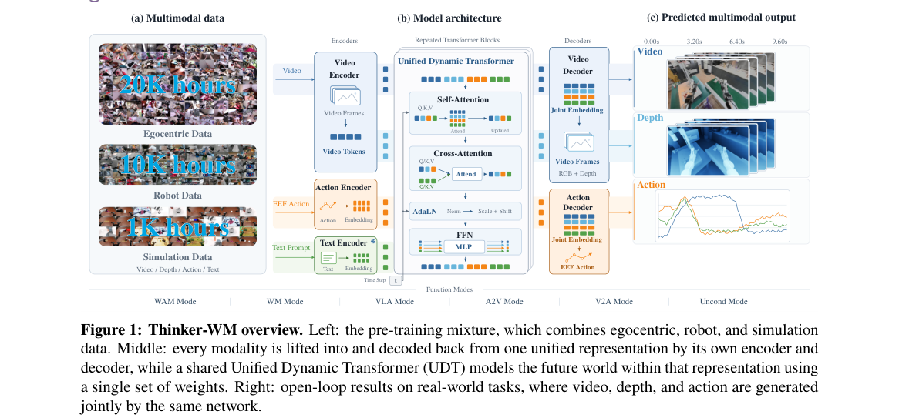

*Main result - Figure 2 Multimodal encoding and decoding pipelines. RGB video, metric depth, and action are mapped into the unified latent space through modality-specific encoders and processed back into their resp*

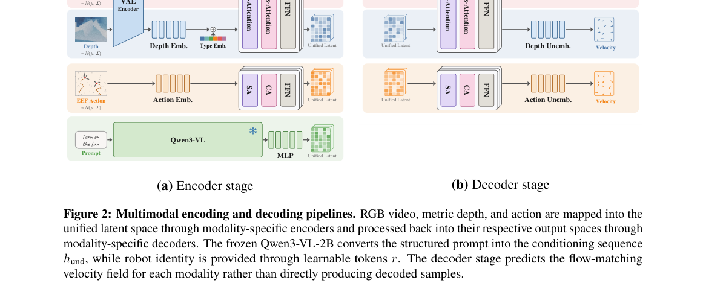

**Why this ranks #10**: 「碎片化」被明确列为问题：模态与功能分离的代价是跨模态推理缺失。

---

## Footer

- Total papers reviewed across all 5 tracks: 50 (from 1935 scanned)
- embodied track final top-10: 10
- Wild-cards in this track: 2
- Figure assets: `res/` (shared across tracks)

Generated by `mine-arxiv-daily-digest` skill. Sister file: `2026-10-14_embodied_entry.md`.
