# ArXiv Daily Digest - 2026-10-14 (强化学习, 10 papers)

**Generated**: 2026-10-14 17:00 CST

**Source**: arXiv cs.CV, cs.SD, eess.AS, cs.CL, cs.AI, cs.RO, cs.LG submissions, window 2026-10-10..2026-10-13 UTC (cumulative: covers the 4 announced batches not yet reported, since the previous digest covered 2026-10-09)

**Track**: rl (top 10 of 1935 papers scanned, 50 full reads)

**Scope**: LLM value functions for credit assignment, recursive self-improvement via skill-policy co-evolution, adaptive-group process rewards for GUI agents, embedding-space directional exploration, rubric-based selective self-distillation, progress-aware advantage shaping, removing responder noise from GRPO, variance-optimal state resampling, double-rollout reward estimation, two-clock analysis of rollout batch size

---

**本批十篇全部在处理同一件事：GRPO 家族的信用分配与信号质量。** 这是本项目日报连续记录的同一条线索的集中爆发——10-12 日报已经出现 TreeHCA（事后信用分配依赖替代方案）、Beyond Temporal Proximity（按时间邻近而非相关性传播奖励）、EmoGavel（只监督最终偏好决策），今天这篇集群把它们推到了系统性处理。

**核心矛盾被反复陈述**：GRPO 把相同的轨迹级优势**同等广播给所有动作**，而评论家方法需要额外学习一个价值函数。**ProAS** 把这称为「统一信用分配困境」，并指出这种均匀性会**持续强化多数模式**——已发生的动作（多数）被强化，未尝试的动作无法获得优势，因此组相对优势在多轮场景下会退化为隐式多数投票。**LLM Value Functions** 试图绕开这个二选一：不用额外评论家，而是用 LLM 本身充当价值函数。

**信号被压缩或失真**是第二类问题，四个独立实例：**Many Right Answers** 指出 Rank-GRPO 每个训练样本只选一条回复，而开放任务（推荐、摘要）天然有多个正确答案——单参考设计把偏置写进了奖励；**RELAY** 指出 rubric 评分用许多标准打分却塌缩成**单一奖励**，且组内响应并列时 GRPO 得到**零梯度**——而 rubric 打分天然产生大量并列；**Double-Rollout** 指出可验证结果奖励对推理质量是不完美度量，**正确答案可能并不由推理轨迹支撑**；**Adaptive-Group Process Rewards** 则指出 GUI 场景下准确评估一个中间动作需要在长轨迹中识别证据。

**探索预算该投在哪**是第三类，且这一类最实用：**Variance-Optimal State Resampling** 把问题重述为「固定 rollout 预算下哪个状态分布最小化梯度估计量方差」，并给出**闭式 Neyman 型解**——这把预算分配从调参变成了可计算问题。**Beyond Policy Rollouts** 则指出组相对优势失效的数据侧原因（重复采样产生高度相似轨迹削弱组内奖励变化），并提出在**嵌入空间**做方向性探索：温度提升是全局扰动会破坏已学分布，而表示空间偏移可在不损失分布精度的前提下增加多样性。

最后 **Two Clocks** 给出一个反直觉的工程结论：更大的 rollout 批次**学得更慢但会「按计划」失败**——失败时点是批次规模的函数而非随机的，这与 10-12 日报 GRPODropout（熵坍塌限制进一步改进）的观察相容：某些崩塌是确定性的、可预测时点的。

---

## Top 10 - 强化学习

### 1. LLM Value Functions for Credit Assignment in Agentic RL

**arXiv**: [2610.15840](https://arxiv.org/abs/2610.15840) | **Score**: 9.0 (relevance 9 x 0.7 + quality 9 x 0.3) | **Tags**: rlhf, rl-algorithm | **Categories**: cs.AI, cs.LG | **Pages**: 29

**Authors**: Kaijie Zhu, Weixiang Yan, Omar Attia, Abbas Kazerouni, Alexander Toshev, Andrew Szot

**Affiliation**: [not-found in PDF]

**Abstract**

> Reinforcement learning (RL) for large language model (LLM) agents remains challenging in long-horizon tasks with sparse outcome rewards, where assigning credit to individual actions is difficult. Methods such as GRPO assign the same trajectory-level advantage to all actions, while critic-based methods require learning an additional value function that can be costly and unstable. We introduce LLM Value Function RL (LVRL), which uses the pretrained knowledge and in-context learning ability of an LLM to estimate policy-aware state values without finetuning a separate critic. LVRL conditions the value model on group context and calibrates its predictions using known values at the initial and terminal states, enabling step-level credit assignment from estimated value differences. We further extend this idea to learning from an expert policy through on-policy distillation (OPD), introducing LLM Value Function OPD (LVOPD), which focuses teacher supervision on actions associated with decreases in estimated value. We evaluate our approach across diverse agentic benchmarks: AppWorld, BabyAI, and SWE-bench Verified. Across policy scales (4B to 32B), LVRL consistently and substantially outperforms both GRPO and PPO. On AppWorld and SWE-bench Verified, LVRL yields absolute improvements of up to 13.6 and 8.6 percentage points over GRPO. Notably, on tasks requiring extended exploration like BabyAI, LVRL bridges the gap from total failure to 75.0% success. Furthermore, LVOPD yields consistent improvements over standard distillation baselines on AppWorld. Finally, Monte-Carlo analysis confirms that our frozen critic accurately identifies semantic pitfalls and recoveries, proving that LVRL extracts robust, policy-aware step-level credit from sparse terminal outcomes.

**Key findings**

- **Finding**: GRPO 把**相同的**轨迹级优势分配给所有动作；评论家方法则需要学习额外的价值函数。

- **Finding**: 该文用 LLM 价值函数来做智能体 RL 的信用分配（摘要在此处截断，具体机制需查正文）。

- **Inference**: 这对矛盾此前被当成二选一：要么粗信用、要么多训一个评论家。用 LLM 本身充当价值函数是一个绕开二选一的思路——代价是它把信用分配的正确性绑定到了 LLM 的判断质量上。

- **Recommendation**: 本批 RL 第一篇；与本批 ProAS（优势塑形）、RSIPO（技能-策略共演化）构成信用分配主题的三篇核心。

**Key figures**

*Framework / architecture - Figure 1 Overview of the proposed framework. (1) Group rollout: We sample a group of trajectories from the current policy and use their sparse outcome rewards to compute the empirical group success ra*

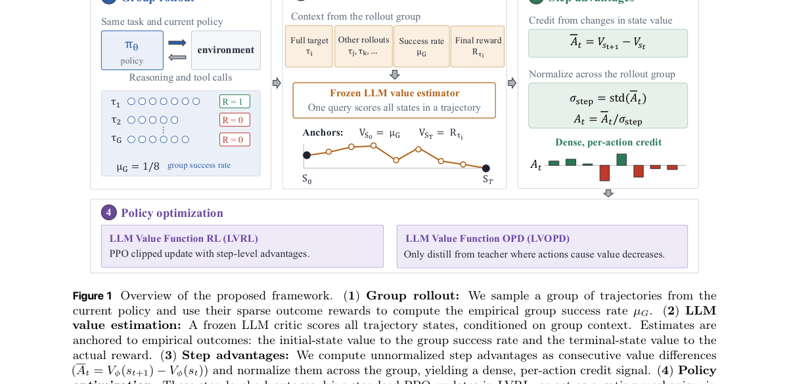

**Why this ranks #1**: 本批 RL 线最核心的一篇：它正面处理「不要额外评论家」与「要细粒度信用」这对矛盾。

---

### 2. RSIPO: Recursive Self-Improving Policy Optimization for Agentic Reinforcement Learning via Skill-Policy Co-Evolution

**arXiv**: [2610.15772](https://arxiv.org/abs/2610.15772) | **Score**: 8.7 (relevance 9 x 0.7 + quality 8 x 0.3) | **Tags**: rlhf, multi-agent-rl | **Categories**: cs.CL | **Pages**: 15

**Authors**: Fan Zhang, Hao Wu, Jinyang Wu, Hongyu Qu, Zheng Lian, Xiao Luo, Yefeng Zheng, Bo Zhang, Haoxuan Li, Pheng-Ann Heng

**Affiliation**: 4Tongji University | 6Westlake University | 7Shanghai AI Laboratory

**Abstract**

> Recent focus in agentic reinforcement learning (RL) seeks to improve credit assignment in long-horizon tasks. One promising direction combines reinforcement learning with verifiable rewards (RLVR) and on-policy self-distillation (OPSD), integrating trajectory-level advantages with dense token-level supervision. This line of work often conditions a teacher model on privileged context, such as agentic skills, to score tokens generated by the student policy. Despite their progress, they largely overlook the on-policy evolution of agentic skills and the reliability of teacher supervision. Towards this end, we introduce Recursive Self-Improving Policy Optimization (RSIPO), a self-evolving agentic RL framework that enables agentic skills and the policy model to co-evolve throughout the training process. Specifically, RSIPO enables the policy itself to extract skills from completed trajectories and explicitly optimizes its skill-generation capability through trajectory replay. It further employs empirical Bayes shrinkage to dynamically calibrate the student's trust in teacher scores, accounting for the fact that skill-enhanced teacher guidance can sometimes be less reliable. Experiments with Qwen-family models on embodied interaction and search-based agentic tasks demonstrate that RSIPO outperforms all the compared baseline approaches. With Qwen2.5-7B as the base model, RSIPO achieves an average success rate of 98.6\% on ALFWorld, yielding absolute improvements of 2.5\% and 17.4\% over the second-best baseline and standard GRPO, respectively.

**Key findings**

- **Finding**: RLVR + 在策略自蒸馏的组合把轨迹级优势与密集 token 级监督整合，是当前主流方向。

- **Finding**: RSIPO 通过**技能-策略共演化**实现递归式自我改进（摘要在此处截断，条件化于何种内容需查正文）。

- **Inference**: 递归自我改进之所以难，是因为改进的产物（技能）本身会成为下一轮的条件——若技能质量不随策略提升，共演化就退化为自我强化的错误累积。

- **Recommendation**: 与 10-09 日报的 SynCo（数据需随模型演进）同属「自进化的配套件必须一起进化」这条线。

**Key figures**

*Framework / architecture - Figure 1 Comparison of three paradigms of agentic RL. (a) RLVR-based methods assign equal trajectory-level advantages to all response tokens. (b) OPSD-based methods provide token-level supervision fr*

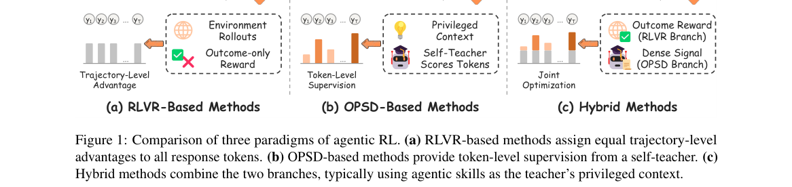

*Main result - Figure 2 Preliminary analysis with Qwen2.5-7B-Instruct on ALFWorld. (a) Success rate of the skill generator rollouts on SFT data and of the policy rollouts during RL training. (b) Share of training t*

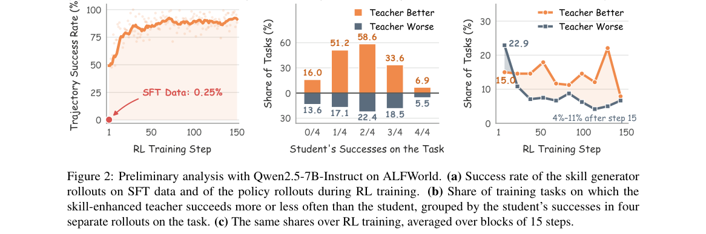

**Why this ranks #2**: 「技能-策略共演化」把信用分配问题与技能库维护问题合并处理，是一个系统性的尝试。

---

### 3. Adaptive-Group Process Rewards for GUI Agents

**arXiv**: [2610.17710](https://arxiv.org/abs/2610.17710) | **Score**: 8.3 (relevance 8 x 0.7 + quality 9 x 0.3) | **Tags**: rlhf | **Categories**: cs.AI | **Pages**: 21

**Authors**: Zirui Shang, Yang Liu, Xin Shu, Zhi Gao, Xinxiao Wu, Lifeng Fan

**Affiliation**: 2,3BIGAI, Wuhan University | 2,4BIGAI, Shenzhen MSU-BIT University | 1,4BIT, Shenzhen MSU-BIT University | ∗1Beijing Key Laboratory of Intelligent Information Technology, School of Computer Science & Technol-

**Abstract**

> Training graphical user interface (GUI) agents with reinforcement learning suffers from sparse outcome rewards, leading to inefficient learning. Process rewards offer a promising direction for credit assignment to intermediate actions; however, accurately evaluating an action requires identifying evidence across long-horizon GUI trajectories, as its value may depend on information beyond its immediate state and observation. In this paper, we propose an adaptive-group process reward framework that dynamically partitions a GUI trajectory into semantically coherent subgoal groups, enabling process reward estimation at both the action and group levels. At the action level, a critic evaluates each action based on the visual changes and subsequent actions within the group for action correctness and contribution to the subgoal. At the group level, the framework aggregates action-level evaluations to assess subgoal completion and contribution to the overall task, and further refines these assessments by leveraging the context of all groups in the trajectory. The process reward of each action is obtained by combining its action-level evaluation with the refined group-level evaluation. We further augment GRPO's outcome advantage with the proposed process rewards to provide finer-grained guidance for GUI agent training. Experiments on process reward benchmarks and downstream RL training demonstrate the effectiveness of the proposed framework.

**Key findings**

- **Finding**: GUI 智能体的 RL 训练受稀疏结果奖励困扰；过程奖励可改善中间动作的信用分配。

- **Finding**: 但准确评估一个动作需要在长时程 GUI 轨迹中**识别证据**（摘要在此处截断）。

- **Inference**: 过程奖励的质量上限由「中间动作的可验证性」决定——GUI 环境中「点击是否正确」本身就需要看后果，这使过程奖励在某些任务上不可能比结果奖励更便宜。

- **Recommendation**: 与本批 RELAY（rubric 被压成单一奖励）对照，两篇都在解决「细粒度信号从哪来」。

**Key figures**

*Framework / architecture - Figure 1 Fixed-window step rewards, milestone rewards, and adaptive-group process rewards on an executed GUI trajectory. (a) A fixed local window can include irrelevant context and miss later evidenc*

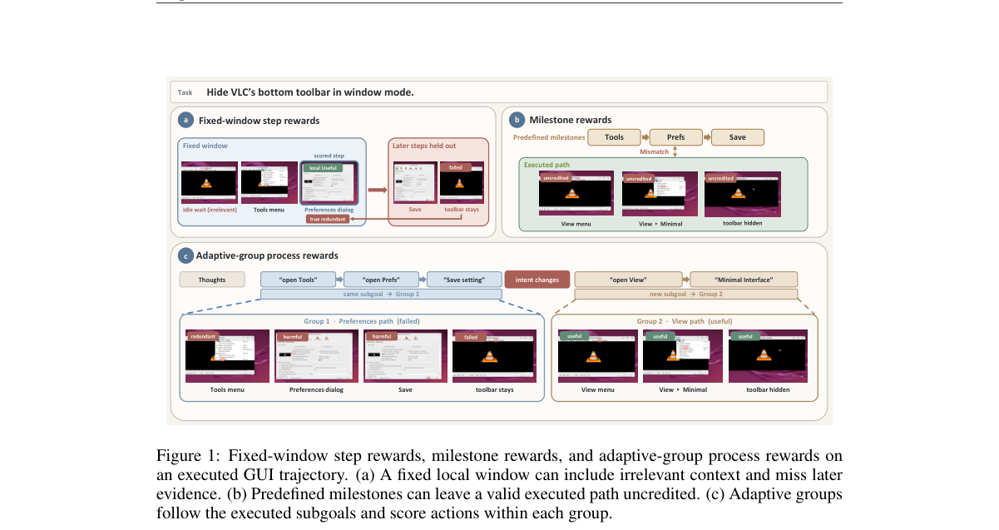

*Main result - Figure 2 Overview of the proposed framework. (a) A grouping critic partitions the trajectory from the instruction and responses into subgoal groups. (b) Two-level scoring produces an action-level sco*

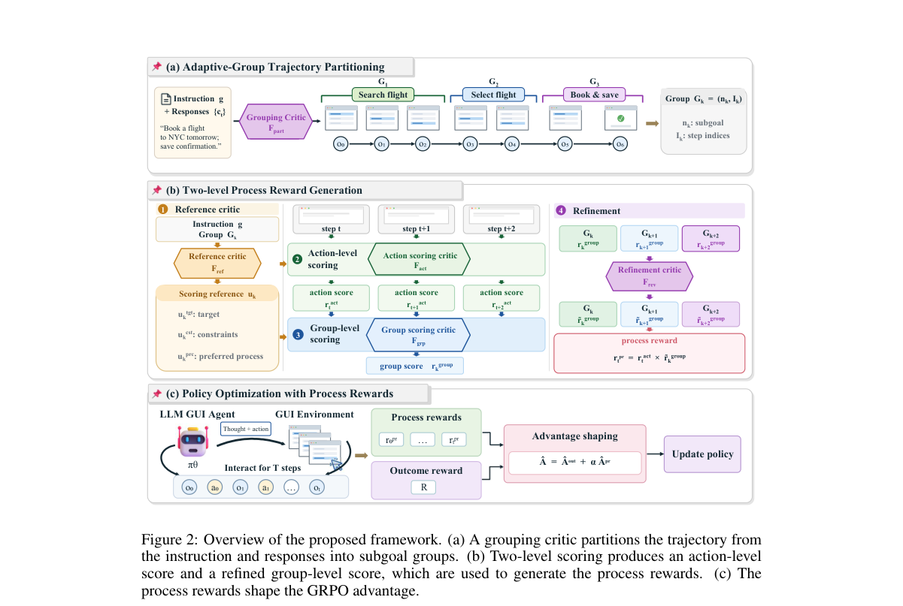

**Why this ranks #3**: 「评估一个中间动作需要跨长轨迹识别证据」是过程奖励在该场景下的具体困难。

---

### 4. RELAY: Selective Self-Distillation with Adaptive Hand-off for Rubric-Based Reinforcement Learning

**arXiv**: [2610.17623](https://arxiv.org/abs/2610.17623) | **Score**: 8.0 (relevance 8 x 0.7 + quality 8 x 0.3) | **Tags**: rlhf | **Categories**: cs.AI, cs.CL, cs.LG | **Pages**: 17

**Authors**: Kunwang Zheng, Xinyu Sun, Yu Cao, Shuocheng Li, Lei Cheng, Ying Liu, Qilong Zhang, Jinlong Chen, Hua Yang, Qianglong Chen

**Affiliation**: 2Fudan University | 3Alibaba Group

**Abstract**

> Rubric-based reinforcement learning grades a response against many written criteria but collapses them into one reward, which discards the detail the rubric carries and gives no GRPO reward gradient when a group's responses tie. A frozen teacher that reads the rubric as privileged context provides token-level supervision, but we observe an early plateau in the gains over GRPO. RELAY uses advantages and rewards to select positive-advantage and low-scoring zero-advantage rollouts, and monitors the distillation loss to decide when to retire the teacher. Stage 1 combines selective distillation from a frozen teacher with GRPO; a plateau detector then removes the teacher, and Stage 2 continues with GRPO alone. Calibrated on one model-domain pair and reused unchanged in three others, the plateau detector fires between steps 122 and 171. RELAY scores highest in-domain among the compared methods in all four settings, ahead of GRPO on RaR-Medicine by 4.62 points with Qwen3-1.7B and 6.02 with Qwen3-4B. On Qwen3-1.7B/Medicine, removing the teacher from a shared checkpoint outperforms keeping, weakening or refreshing it. Distilling selected rollouts covering about half the response tokens also outperforms distilling all rollouts at a matched average coefficient.

**Key findings**

- **Finding**: rubric 评分为多个标准却塌缩成**单一奖励**，丢弃了 rubric 携带的细节；当组内响应并列时 GRPO 得到零梯度。

- **Finding**: 冻结教师读取 rubric 作为特权上下文可提供 token 级监督，但作者观察到早期……（截断）。

- **Inference**: 并列时零梯度是一个被低估的问题：rubric 打分天然产生大量并列（多条标准同时满足或不满足），因此基于 rubric 的 GRPO 实际可用的信号远少于预期。

- **Recommendation**: 与本批 CoCA 类的准则感知信用分配、ProAS 的优势塑形并读；本批 RL 有四篇在处理「信号被压缩」这一问题。

**Key figures**

*Framework / architecture - Figure 1 The signal RELAY reads (Qwen3-1.7B/Medicine). Top: in-training validation score; the three distillation runs share one Stage-1 trajectory and branch where they retire the teacher. Bottom: di*

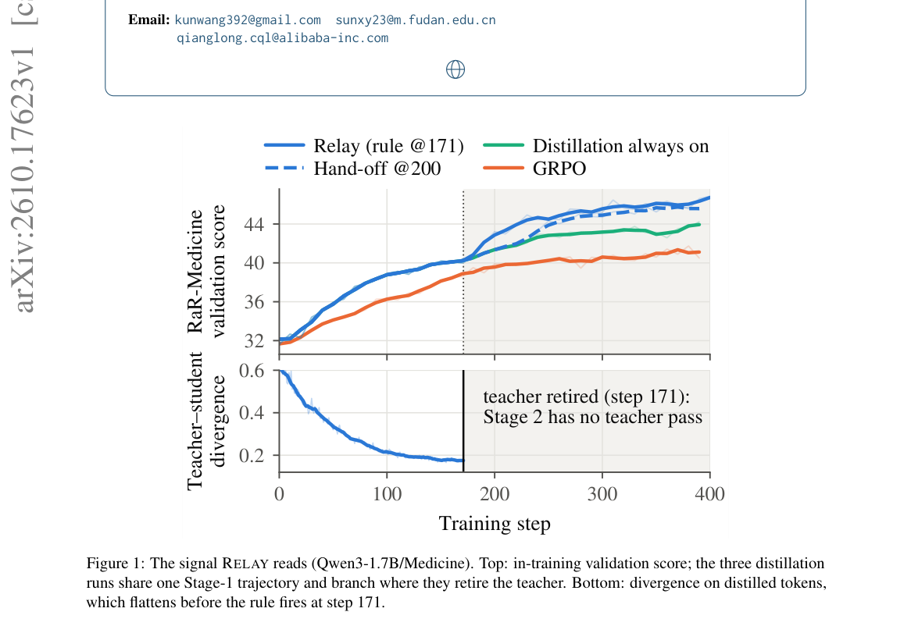

*Main result - Figure 2 Overview of RELAY. Stage 1 adds distillation to GRPO on selected rollouts. A plateau detector then removes the teacher, and Stage 2 continues with GRPO alone.*

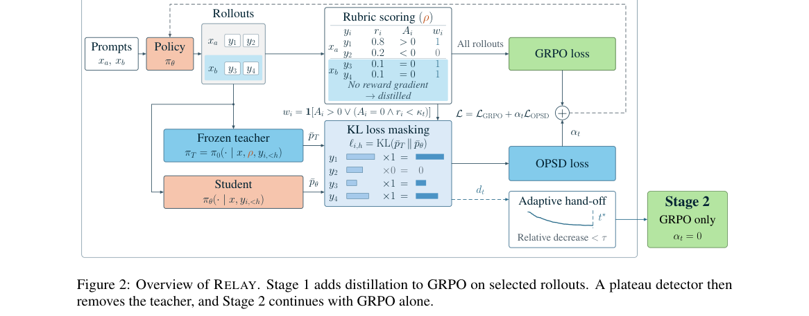

**Why this ranks #4**: 「rubric 被塌缩成一个奖励」是一个被明确命名的信息损失，且给出了双向解法。

---

### 5. ProAS: A Progress-Aware Advantage Shaping Framework for Multi-Turn Agentic Reinforcement Learning

**arXiv**: [2610.18683](https://arxiv.org/abs/2610.18683) | **Score**: 8.0 (relevance 8 x 0.7 + quality 8 x 0.3) | **Tags**: rlhf | **Categories**: cs.AI, cs.LG | **Pages**: 23

**Authors**: Bowen Ding, Mingda Wan, Yuhan Chen, Jiyao Yuan, Qi Zhu, Futing Wang, Heyuan Deng, Fei Mi, Lifeng Shang, Tao Lin

**Affiliation**: 1 Zhejiang University 2 School of Engineering, Westlake University | 3 Institute of Advanced Technology, Westlake Institute for Advanced Study | 4 Huawei Noah’s Ark Lab

**Abstract**

> Reinforcement learning (RL) has emerged as the primary paradigm for optimizing Large Language Model (LLM) agents, yet efficient critic-free algorithms (e.g., GRPO) suffer from a fundamental uniform credit assignment dilemma that broadcasts trajectory-level advantages equally to all actions. Our analysis reveals that this uniformity inherently reinforces structurally invalid actions in preferred trajectories and ignores the downstream cascading influence of early pivotal deviations in unpreferred ones. To resolve this without introducing critic overhead, we propose Progress-Aware Advantage Shaping (ProAS), a plug-and-play framework that leverages a dynamically evolving Agentic Reference Graph (ARG) to achieve fine-grained credit assignment via Masking Unreasonable Incentives (MUI) and Asymmetric Penalty Redistribution (APR). Extensive experiments across Qwen2.5-1.5B-Instruct and Qwen2.5-7B-Instruct demonstrate that ProAS universally elevates mainstream group-based baselines to new state-of-the-art performance, achieving peak success rates of 91.9\% and 94.3\% on ALFWorld, alongside 66.7\% and 70.8\% on WebShop, respectively. Furthermore, it accelerates training convergence by up to $2.44\times$ while maintaining strong robustness against imperfect or distilled ARGs. Codes: https://github.com/LINs-lab/ProAS.

**Key findings**

- **Finding**: GRPO 把轨迹级优势**同等广播给所有动作**；作者称之为统一信用分配困境。

- **Finding**: 分析揭示这种均匀性会**持续强化**某种模式（摘要在此处截断）；ProAS 用进度感知的优势塑形应对。

- **Inference**: 「均匀广播强化多数模式」这一后果意味着组相对优势在多轮场景下会变成一种隐式的多数投票——已发生的动作（多数）被强化，未尝试的动作无法获得优势。

- **Recommendation**: 与本批 Many Right Answers（移除响应者噪声）对照：后者处理「奖励给谁」的问题，前者处理「奖励如何塑形」。

**Key figures**: 无可用图示（正文以表格与证明为主）。

**Why this ranks #5**: 把「统一广播」命名为困境并证明其后果，是本批信用分配主题里诊断最直接的一篇。

---

### 6. Beyond Policy Rollouts: Embedding-Space Directional Exploration with Anchored Noise for LLM RLVR

**arXiv**: [2610.16105](https://arxiv.org/abs/2610.16105) | **Score**: 8.0 (relevance 8 x 0.7 + quality 8 x 0.3) | **Tags**: rlhf, rl-algorithm | **Categories**: cs.LG | **Pages**: 23

**Authors**: Daijiao Liu, Huiyi Wang, Lina Yao, Dong Gong

**Affiliation**: University of New South Wales (UNSW Sydney)

**Abstract**

> Reinforcement learning with verifiable rewards (RLVR) typically uses small rollout groups per prompt, where repeated sampling from the same policy can yield highly similar trajectories, reducing within-group reward variation and weakening group-relative advantage signals. Existing remedies such as higher sampling temperature, entropy bonuses, asymmetric clipping, and larger rollout budgets broaden sampling or modify policy updates but leave rollout conditioning unchanged. In this paper, we propose EDEN (Embedding-space Directional Exploration via anchored Noise), which intervenes at the rollout source through anchored input perturbations. EDEN explores beyond the policy's own rollouts. Within the same rollout budget, it replaces a small fraction of standard rollouts in each group with rollouts that the same policy generates from the prompt plus a single appended, perturbed embedding position, rather than from the prompt alone. Gaussian noise drives variation, while a shared anchor provides a common conditioning direction within each prompt group. Selected perturbed rollouts contribute to GRPO updates with downweighted advantages, and the model architecture, discrete decoding, and test-time inference remain unchanged. Across model scales and mathematical reasoning benchmarks, EDEN outperforms GRPO and the exploration controls evaluated in the same pipeline, with the largest gains in sampled solution coverage. Analyses show that more prompt groups provide non-zero group-relative learning signals and that noise and anchoring play complementary roles. Intervening at the rollout source is thus an effective lever for exploration in RLVR.

**Key findings**

- **Finding**: 从同一策略重复采样产生高度相似轨迹，降低组内奖励变化并**削弱组相对优势信号**。

- **Finding**: 既有补救是提高采样温度/熵奖励等；该文改在**嵌入空间**做方向性探索，用锚定噪声（摘要在此处截断）。

- **Inference**: 温度提升是全局扰动，会同时破坏已学到的分布；嵌入空间的方向性探索只在表示空间中偏移，因此能在不损失分布精度的前提下增加轨迹多样性。

- **Recommendation**: 与本批 Variance-Optimal State Resampling（重采样状态分布）并读：两篇都在问「固定预算下该把探索投在哪」。

**Key figures**

*Framework / architecture - Figure 1 EDEN explores beyond the policy’s rollouts. (a) An- chored conditioning yields rollouts from a shifted proposal. (b) Af- ter training, EDEN achieves broader coverage of correct trajec- torie*

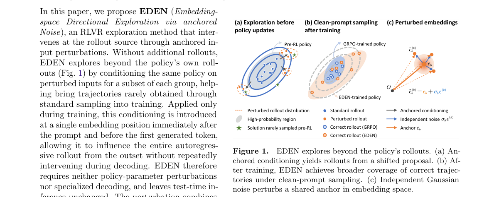

*Main result - Figure 2 Overview of EDEN. EDEN augments RLVR with a small fraction of noise-perturbed rollouts to broaden trajectory-level exploration without increasing the total rollout budget.*

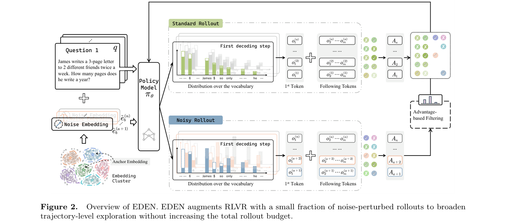

**Why this ranks #6**: 指出组相对优势失效的**数据侧**原因，且提出在嵌入空间而非采样温度上做探索。

---

### 7. Many Right Answers, One Training Example: Removing Responder Noise from GRPO for LLM Recommenders

**arXiv**: [2610.17771](https://arxiv.org/abs/2610.17771) | **Score**: 8.0 (relevance 8 x 0.7 + quality 8 x 0.3) | **Tags**: rlhf | **Categories**: cs.CL | **Pages**: 32

**Authors**: Xin Li, Hao Jiang, Jinghao Guo, Weisi Lin, Chau Yuen

**Affiliation**: Nanyang Technological University, Singapore

**Abstract**

> A recommendation request on Reddit draws several replies, each naming different titles. When an LLM recommender is trained on such threads with reinforcement learning (RL), which replies should a generated list be rewarded against? The state-of-the-art recipe, Rank-GRPO, picks one reply per training example, so the advantage mostly records which reply was drawn (85% of its variance) rather than how good the list is. We argue that RL should train on the request, not on each answer, and propose ReMaRk: it scores every list once against the union of all replies' titles and samples each request equally. This makes RL cheaper. On seven backbones and three datasets, ReMaRk reaches the validation recall of 2,000 per-reply RL steps in 25 to 53% of the steps and leads at that budget; trained until neither improves, it is never significantly behind Rank-GRPO and in four of seven pairs reaches Rank-GRPO's best with fewer GPU-hours. The same reward helps on ProtoQA, where about 100 people answer each question, which points to a simple rule for RL with several valid human answers: reward them jointly.

**Key findings**

- **Finding**: 一个推荐请求有多个各自不同的正确回复；Rank-GRPO 每个训练样本**只选一条**，因此优势主要记录了被选中的那一条。

- **Finding**: 作者主张移除响应者噪声（摘要在此处截断，方法细节需查正文）。

- **Inference**: 「多正确答案」在推荐、摘要、开放式生成中是常态而非特例；单参考设计把模型偏好的那一条当作唯一正确答案，等于把偏置写进奖励。

- **Recommendation**: 本批最容易被直接借鉴的一篇诊断；任何用 GRPO 做开放任务的团队都会遇到这个问题。

**Key figures**

*Framework / architecture - Figure 1 One request, five responders and one gener- ated list. Rank-GRPO credits the list against one drawn responder, so its reward depends on which one was drawn; ReMaRk credits it once against th*

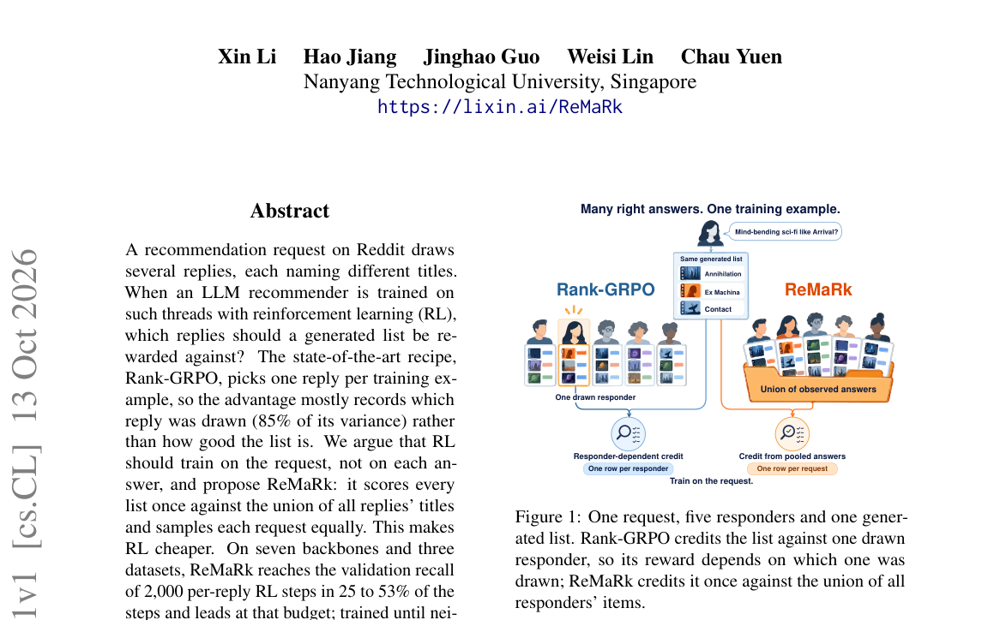

*Main result - Figure 2 Rank-GRPO scores each sampled list against one drawn responder; ReMaRk scores it once against all of them. Top: one row per responder, drawn by row sampling, rewarded by that responder alone*

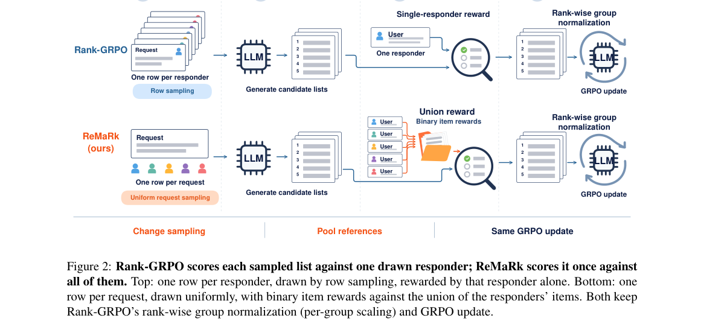

**Why this ranks #7**: 「多个正确答案」在开放任务中普遍存在，而 GRPO 的单参考设计把它变成了噪声。

---

### 8. Variance-Optimal State Resampling for Reinforcement Learning with Verifiable Rewards

**arXiv**: [2610.15888](https://arxiv.org/abs/2610.15888) | **Score**: 7.7 (relevance 8 x 0.7 + quality 7 x 0.3) | **Tags**: rlhf | **Categories**: cs.AI, cs.LG | **Pages**: 26

**Authors**: Yibo Wang, Yuanxin Liu, Zhaoran Wang

**Affiliation**: Northwestern University

**Abstract**

> Reinforcement learning with verifiable rewards spends much of its rollout budget on states that yield no learning signal. We recast this as a question about the sampling distribution itself: under a fixed rollout budget, which distribution over states minimizes the variance of the policy-gradient estimator? The answer admits a closed-form Neyman allocation, $μ_{\mathrm{var}}^π(s) \propto d^π(s)\,σ_π(s)$, which connects naturally to GRPO's group-relative advantage and induces an emergent reverse curriculum as the policy improves, with no externally imposed schedule. Building on this principle, we propose VSR (Variance-driven State Resampling), a plug-in modification to GRPO using a prefix replay buffer and a zero-cost variance proxy. On mathematical reasoning benchmarks and long-horizon agentic tasks (Sokoban, BabyAI), VSR outperforms GRPO and GiGPO on most benchmarks with fewer generated tokens per update.

**Key findings**

- **Finding**: RLVR 把大量预算花在**无学习信号**的状态上；作者重述为采样分布的选择问题。

- **Finding**: 在固定 rollout 预算下，最小化策略梯度估计量方差的状态分布有**闭式 Neyman 型解**（摘要在此处截断）。

- **Inference**: 把「探索投在哪」从启发式变成有闭式解的优化问题，意味着预算分配可以被直接计算而非调参——这是本批 RL 线工程价值最高的一篇。

- **Recommendation**: 与本批 Beyond Policy Rollouts（嵌入空间探索）对照：一篇改采样位置、一篇改采样方向，两者可组合。

**Key figures**

*Framework / architecture - Figure 1 Continuations from early prefixes mostly fail and from late prefixes mostly succeed; both yield low signal. VSR samples states in proportion to dπ(s) σπ(s) to capture the highest signal.*

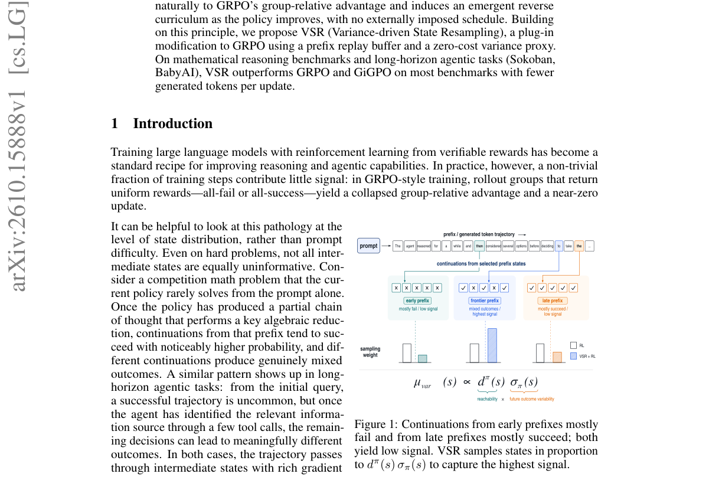

*Main result - Figure 2 An emergent curriculum from the variance-optimal proposal. µπ*

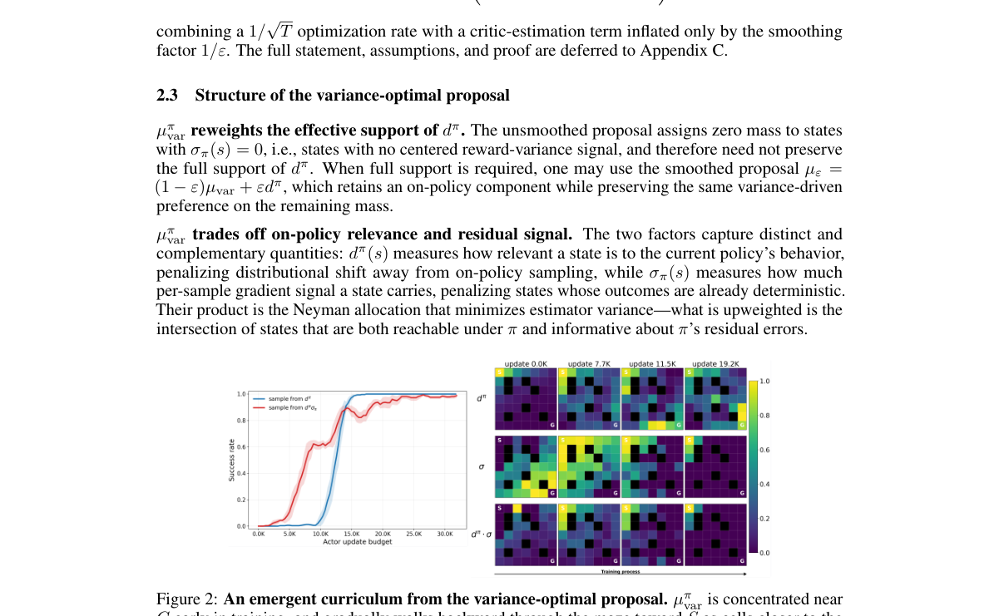

**Why this ranks #8**: 「预算该花在哪种状态上」有一个闭式解，这是本批最实用的一篇。

---

### 9. Double-Rollout Reinforcement Learning with Sampling-based Reward Estimation

**arXiv**: [2610.16593](https://arxiv.org/abs/2610.16593) | **Score**: 7.7 (relevance 8 x 0.7 + quality 7 x 0.3) | **Tags**: rlhf | **Categories**: cs.AI | **Pages**: 7

**Authors**: Haifeng Qian, David Mosallanezhad, Christian Munley, Adithya Renduchintala, Oleksii Kuchaiev

**Affiliation**: [not-found in PDF]

**Abstract**

> Reinforcement learning with verifiable rewards (RLVR) implemented with Group Relative Policy Optimization (GRPO) has driven substantial progress in training reasoning language models. However, verifiable outcome rewards provide an imperfect measure of reasoning quality: a correct final answer may not be supported by the reasoning trace, whereas an incorrect rollout may contain a nearly correct reasoning trajectory. We present empirical evidence for this mismatch and hypothesize that the resulting reward noise contributes to instability in reinforcement learning for both reasoning accuracy and token efficiency. To address this credit assignment challenge, this paper proposes double-rollout reinforcement learning. For each sampled rollout, we truncate its reasoning trace, sample multiple continuations from the truncated prefix, and replace the original reward with the mean continuation reward, yielding a more robust estimate of reasoning quality. This double-rollout algorithm incurs only a moderate increase in compute cost and yet reaches substantially higher accuracies across math and coding tasks and across Qwen and Nemotron models than baseline algorithms with fewer RL steps. For example, using only DAPO data it trains Nemotron-3-Nano-30B-A3B to reach 95.4% on AIME 2026, versus 91.5% by GRPO and substantially above state of the art for this model size, within 30 RL steps. When combined with length-based rewards, the same algorithm further improves the accuracy-efficiency Pareto frontier over existing efficiency optimizations. These findings suggest that the double-rollout reward estimation is an effective and cost-efficient way to improve both the accuracy and token efficiency of reasoning RL.

**Key findings**

- **Finding**: 可验证结果奖励是不完美度量：**正确答案可能并不由推理轨迹支撑**（摘要在此处截断）。

- **Finding**: Double-Rollout RL 用采样式的奖励估计应对（摘要在此处截断）。

- **Inference**: 这与 10-09 日报的 Beyond Speech Captions（对齐好≠能控制）、10-12 日报的 AAD 审计属同一类：**结果可验证不等于过程正确**，而当前主流 RL 只能看到前者。

- **Recommendation**: 与本批 Responder Noise（正确答案有多个）构成一组二元诊断：前者是「多个正确答案被当成一个」，本篇是「错误答案被当成正确」。

**Key figures**

*Framework / architecture - Figure 1 Average correctness of a re-generation continuing from 90% of a correct rollout’s thinking trace. X-axis is the length of the original correct rollout. The prompts are DAPO prompts divided i*

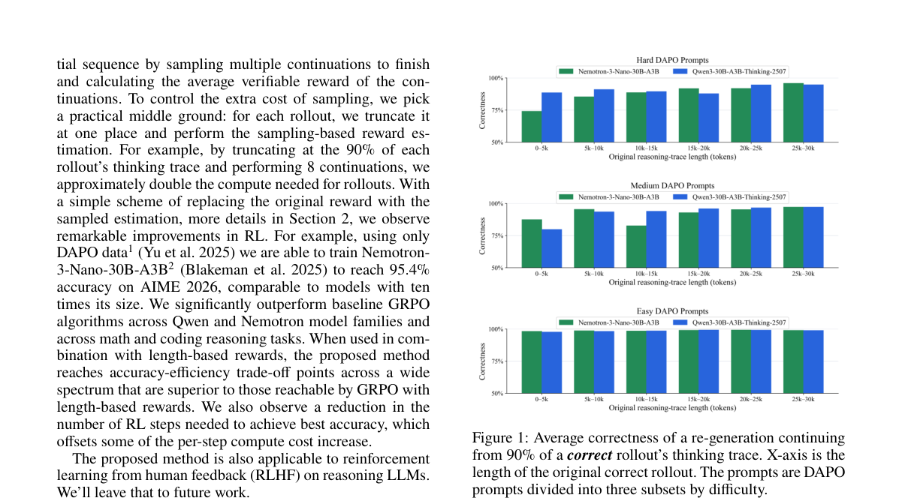

*Main result - Figure 2 Average correctness of a re-generation continuing from 90% of an incorrect rollout’s thinking trace. X-axis is the length of the original incorrect rollout. The prompts are DAPO prompts divi*

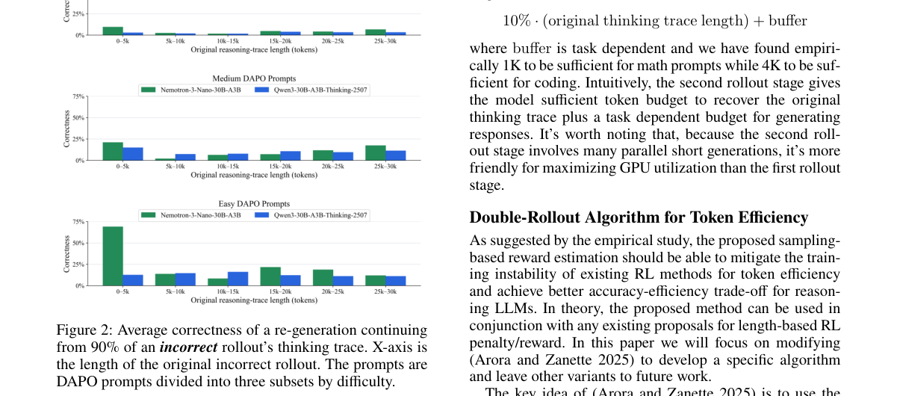

**Why this ranks #9**: 「答案对但推理错」是结果奖励的系统性盲区，与本项目日报的审计主题同源。

---

### 10. Two Clocks: Why Larger Rollout Batches Learn Slower but Fail on Schedule in Reinforcement Learning with Verifiable Rewards

**arXiv**: [2610.18853](https://arxiv.org/abs/2610.18853) | **Score**: 7.3 (relevance 7 x 0.7 + quality 8 x 0.3) | **Tags**: rlhf | **Categories**: cs.AI, cs.LG | **Pages**: 19

**Authors**: Yuante Li, Junwei Quan, Kai Qiu, Kate Zhang, Yicheng Tao

**Affiliation**: 1 Carnegie Mellon University, | 2 University of Toronto

**Abstract**

> Reinforcement learning with verifiable rewards (RLVR) relies on costly model-generated responses, motivating larger rollout batches and square-root learning-rate scaling. Reported to approximately preserve progress per sample with one optimizer step per rollout, this rule is less understood in practical multi-step training. We develop a two-clock framework that separates the samples needed to make progress from those consumed before collapse. Under a local quadratic model, the square-root rule preserves first-order drift per sample but not progress: larger batches take fewer, longer updates and lose more to curvature, yielding a learning-rate-dependent critical batch beyond which sample efficiency degrades. A drift-threshold hypothesis predicts a complementary failure clock whose sample count remains approximately invariant along the square-root rule. Controlled GRPO experiments on Qwen2.5-Math-1.5B across a $16\times$ batch range support both predictions. Ratio clipping delays failure, especially for larger batches, but the progress gap persists without it. Widening the clip trades stability for a transient speed gain. The progress gap reappears on another dataset, a general-purpose checkpoint, and a 7B model. Finally, we use the two-clock framework to derive a simple multi-step RLVR schedule: start below the critical batch and switch to a larger batch before failure. Our code is available at: https://github.com/WinstonLiyt/two-clocks-rlvr.

**Key findings**

- **Finding**: 平方根学习率缩放规则在「一 rollout 一优化步」时保持每样本进展，但在**多步训练**中理解不足。

- **Finding**: 作者提出**双时钟**框架（摘要在此处截断），标题给出结论：更大的 rollout 批次学得更慢但会「按计划」失败。

- **Inference**: 「按计划失败」暗示失败时点是批次规模的函数而非随机的——这与 10-12 日报 GRPODropout（熵坍塌限制进一步改进）的观察相容：某些崩塌是确定性的、可预测时点的。

- **Recommendation**: 做大规模 RL 训练的读者注意；与 10-12 日报的 GRPODropout、A Step Harder（课程限制）连读，三篇都在刻画 RL 的确定性失效模式。

**Key figures**

*Framework / architecture - Figure 1 The two clocks under the square-root rule with µ=8. Color marks the rollout batch, from 512 in blue to 8,192 in dark red. Left, with the clip: samples to reach 15% and 20% accuracy, with the*

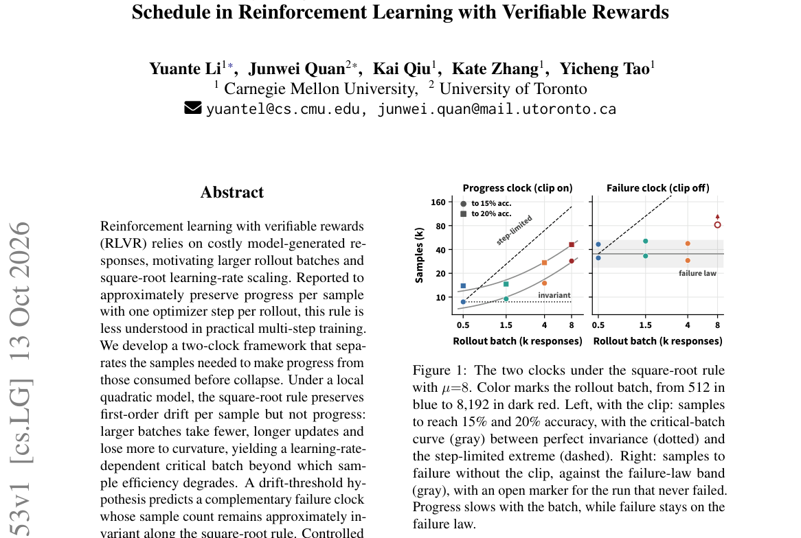

*Main result - Figure 2 Schematic of the two-clock model, with small (blue) and large (red) batches at the same first-order drift per sample. (A) The large batch covers this drift in fewer, longer steps that lose m*

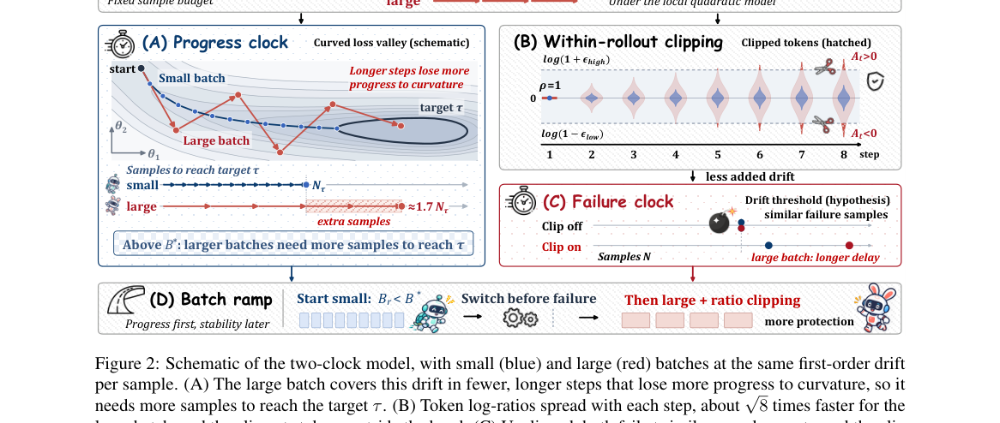

**Why this ranks #10**: 「更大的批次学得更慢但按计划失败」是一个反直觉的工程结论，值得注意。

---

## Footer

- Total papers reviewed across all 5 tracks: 50 (from 1935 scanned)
- rl track final top-10: 10
- Wild-cards in this track: 1
- Figure assets: `res/` (shared across tracks)

Generated by `mine-arxiv-daily-digest` skill. Sister file: `2026-10-14_rl_entry.md`.
