# ArXiv Daily Digest - 2026-10-15 (AIGC 音频生成与编辑, 10 papers)

**Generated**: 2026-10-15 17:00 CST

**Source**: arXiv cs.CV, cs.SD, eess.AS, cs.CL, cs.AI, cs.RO, cs.LG submissions, window 2026-10-14 UTC (latest announced batch as of 2026-10-15 17:00 CST)

**Track**: aigc_audio (top 10 of 570 papers scanned, 50 full reads)

**Scope**: long-prompt zero-shot TTS prosody reproduction, instrument timbre cloning from music mixtures, noise-aware Lombard speech synthesis via Flow-GRPO, non-masking refinement for masked diffusion TTS, quantizer redundancy in frozen neural audio codec, AI-generated music detection benchmark, blind voice separation, perceptual transparency of lossy music compression, paralinguistic captioning, long-tail multilingual speech dataset

---

本批音频线的两篇核心论文，都接上了本项目日报此前建立的线索。

**Long-Prompt Zero-Shot TTS** 把**音色**与**韵律**明确分开：零样本 TTS 通常以短语音提示为条件，它传达音色但对说话人韵律模式只提供有限证据；而长提示零样本 TTS 用长语音提示复现韵律。其隐含判断很锋利——音色是说话人**身份**的稳定属性，韵律是**状态**的属性；短提示在前者上信息充足、在后者上不足，因此「音色克隆任务」系统性地绕开了韵律这一更难的问题。这与 10-09 日报的 Beyond Speech Captions（描述保真度不蕴含有效控制）互补：那篇说「文字描述不够」，本篇说「语音提示也不够」。

**Noise-Aware Lombard Speech Synthesis via Flow-GRPO** 则把 10-07 日报那篇 Lombard 效应 TTS 激活引导（Loud and Clear，免训练、推理时引导）推进到**强化学习版本**。两条路线分别对应「无训练的手工控制」与「有训练的自动优化」，在可懂度优化这个目标上形成对照。

其余是具体子任务：乐器音色克隆从音乐混合中直接克隆（作者指出「先分离再克隆」的误差串联问题）、掩码扩散 TTS 的**非掩码精化**（掩码只能表达删除而非替换）、冻结神经音频编解码器的**精确索引重编码**（不需要重训即可省存储）、AI 生成音乐检测与伪影分析基准、野外盲语音分离（自回归生成各条人声流而非输出掩码）、以及真实电视剧语音的副语言标注（录音棚数据缺失的正是「情绪与环境耦合」这一最难情形）。

---

## Top 10 - AIGC 音频生成与编辑

### 1. Long-Prompt Zero-Shot TTS: Benchmarking Prosody Reproduction Beyond Voice Cloning

**arXiv**: [2610.19774](https://arxiv.org/abs/2610.19774) | **Score**: 9.0 (relevance 9 x 0.7 + quality 9 x 0.3) | **Tags**: AIGC-audio | **Categories**: cs.SD | **Pages**: 5

**Authors**: Dekun Chen, Renjie Xu, Yingda Shen, Qinke Ni, Zhizheng Wu

**Affiliation**: 1The Chinese University of Hong Kong, Shenzhen | 2Amphion Technology Co., Ltd.

**Abstract**

> Zero-shot text-to-speech (TTS) typically conditions on a short speech prompt, which conveys timbre but provides only limited evidence of a speaker's prosodic patterns. We formulate Long-Prompt Zero-Shot TTS, a task that uses long speech prompts at inference time to reproduce speaker-specific prosody without target-speaker fine-tuning. We introduce LP-TTS-Bench, a bilingual benchmark of 37 speakers with 63.95 prompt hours and 2,728 held-out test utterances. Beyond intelligibility and timbre similarity, LP-TTS-Bench evaluates timing, prominence, intonation, and model-based prosody metrics, enabling multidimensional evaluation of prosody reproduction. As a reference system, we develop LPTTS, whose hierarchical Long-Prompt Encoder compresses long speech prompts into a fixed number of continuous prosody vectors. Experiments show improvements in several prosodic dimensions over a short-prompt baseline, with overall gains as prompt duration increases up to approximately 10 minutes and saturation at longer durations.

**Key findings**

- **Finding**: 短提示传达**音色**，但对说话人**韵律模式**只提供有限证据。

- **Finding**: 作者提出长提示零样本 TTS：用长语音提示在推理时复现说话人特有韵律，无需目标说话人数据（摘要在此处截断）。

- **Inference**: 音色是说话人**身份**的稳定属性，韵律是**状态**的属性；短提示在前者上信息充足、在后者上不足，因此「音色克隆任务」的系统性地绕开了韵律这一更难的问题。

- **Recommendation**: 被精读的三篇之一。它与 10-09 日报的 Beyond Speech Captions（描述保真度不蕴含有效控制）形成互补：那篇说「描述不够」，本篇说「提示也不够」。

**Key figures**

*Framework / architecture - Figure 1 Illustration of Long-Prompt Zero-Shot TTS. Compared with a short prompt, a long prompt provides richer evidence of speaker- specific prosody, enabling the model to reproduce both timbre and pr*

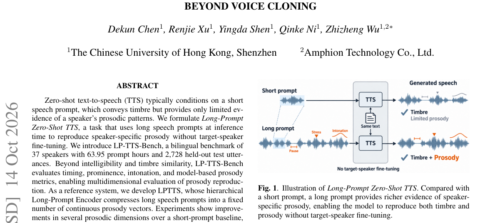

*Main result - Figure 2 Overview of the LPTTS system. The Long-Prompt Encoder extracts global and target-conditioned prosodic representations from long speech prompt and injects them into Qwen3TTS by gated cross-atte*

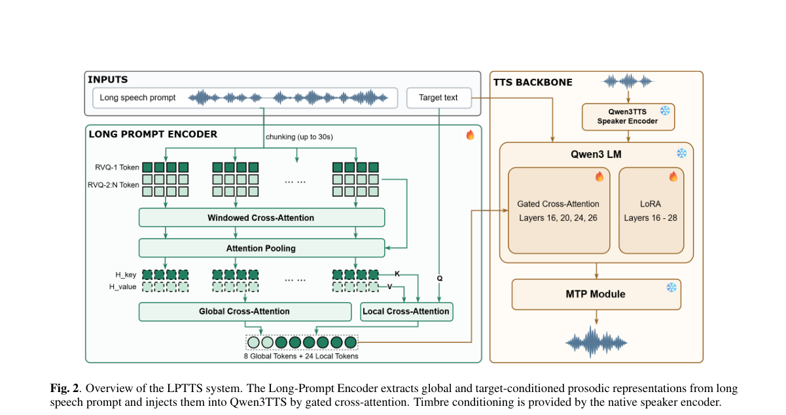

**Why this ranks #1**: 它把「音色克隆」与「韵律复现」明确分开，而这正是本项目日报追踪的语音控制线索的核心区分。

---

### 2. Noise-Aware Lombard Speech Synthesis via Flow-GRPO for Intelligibility Optimization

**arXiv**: [2610.20181](https://arxiv.org/abs/2610.20181) | **Score**: 8.7 (relevance 9 x 0.7 + quality 8 x 0.3) | **Tags**: AIGC-audio, rl-algorithm | **Categories**: cs.SD | **Pages**: 14

**Authors**: Zhaoyang Wang, Dingding Yao, Chengzhong Wang, Junfeng Li

**Affiliation**: with the Key Laboratory of Speech Acoustics and Content Understanding, | Institute of Acoustics, Chinese Academy of Sciences, Beijing 100190, China, | and also with University of Chinese Academy of Sciences, Beijing 100049, | objectives [24], [25]. Yet, its potential for Lombard speech

**Abstract**

> Voice-based conversational agents are increasingly deployed in real-world settings, where environmental noise often degrades the interactive experience. Therefore, robust acoustic adaptability is essential to maintain natural and intelligible human-computer communication. However, most existing systems remain acoustically insensitive and fail to emulate the human Lombard effect, in which speakers involuntarily adjust their vocal production to preserve intelligibility in the presence of noise. As a result, their communicative reliability degrades under adverse acoustic conditions. To remain intelligible in noisy environments, conversational agents require a mechanism to emulate noise-induced adaptive behavior during synthesis. We propose NIL-TTS, a noise-induced Lombard TTS framework. We integrate a feature-wise linear modulation (FiLM) mechanism into a flow-matching backbone for dynamic vocal adaptation. A two-stage training paradigm is utilized: initial supervised fine-tuning on paired Lombard corpora, followed by Flow-GRPO post-training to optimize for intelligibility. Evaluations confirm that NIL-TTS autonomously adjusts its output in response to varying noise conditions, exhibiting key correlates of the human Lombard effect. Driven by these adaptive modulations, the synthesized speech achieves significant intelligibility improvements that scale proportionally with noise intensity. Ultimately, this work presents a flow-matching and reinforcement learning-based advancement within the adaptive Lombard speech synthesis paradigm for challenging real-world scenarios.

**Key findings**

- **Finding**: 环境噪声损害语音对话智能体的交互体验，鲁棒声学适应性因此必要。

- **Finding**: 该文用 **Flow-GRPO** 做噪声感知的 Lombard 语音合成以优化可懂度（摘要在此处截断）。

- **Inference**: Lombard 效应（人在噪声中自发提高音量、过度发音）在 10-07 日报是由激活引导实现的（免训练、推理时）；改用 GRPO 则把它变成可优化目标——两条路线分别对应「无训练的手工控制」与「有训练的自动优化」。

- **Recommendation**: 与 10-07 日报的 Loud and Clear（激活引导）连读，两篇构成 Lombard 语音合成的两条路线对照。

**Key figures**

*Framework / architecture - Figure 1 An overview of the NIL-TTS pipeline. Left: The supervised fine-tuning (SFT) stage, where the model is trained with a conditional flow matching loss on paired plain and Lombard speech. Middle:*

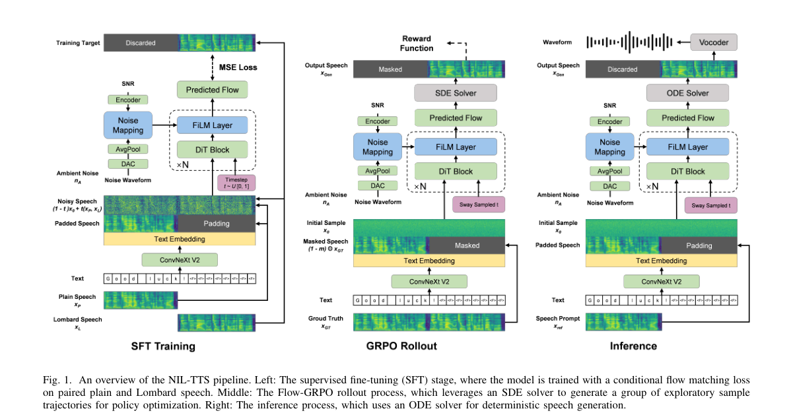

*Main result - Figure 2 Reward computation in Flow-GRPO. The objective function acts as a proxy for human auditory feedback. The intelligibility reward (Racc) mixes rollouts with ambient noise before ASR transcriptio*

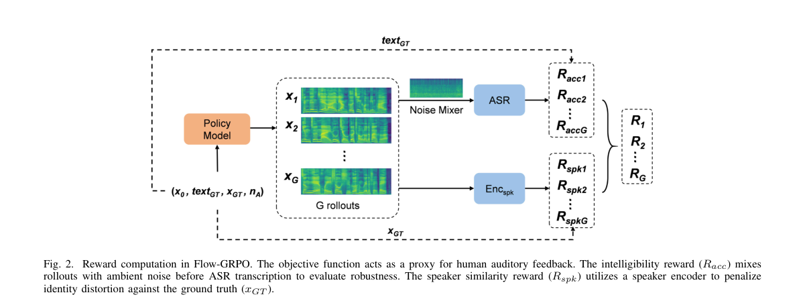

**Why this ranks #2**: 它把 10-07 日报那篇 Lombard 效应 TTS 激活引导的研究推进到强化学习版本，且是本批唯一把 Flow-GRPO 用于语音生成的。

---

### 3. Point-and-Play: Instrument Timbre Cloning from Music Mixtures

**arXiv**: [2610.19445](https://arxiv.org/abs/2610.19445) | **Score**: 8.0 (relevance 8 x 0.7 + quality 8 x 0.3) | **Tags**: AIGC-audio | **Categories**: cs.SD, eess.AS | **Pages**: 5

**Authors**: Baotong Tian, Zhiyao Duan

**Affiliation**: Department of Electrical and Computer Engineering, University of Rochester, Rochester, NY, USA

**Abstract**

> Neural instrument synthesizers can clone the timbre of a solo instrument, letting music producers make music with the sound they desire. However, an instrument of interest is often embedded in a fully produced, multi-instrument recording, beyond the reach of existing methods. Source separation before timbre cloning is an approach, but it may suffer from separation artifacts and is also likely a detour for the task. In this work, we propose Point-and-Play, a system that clones the timbre of a cued source directly from a polyphonic mixture and uses it to synthesize new pitches and velocities. To achieve this, we introduce a Cue-Gated Statistics Pooling (CGSP) module that extracts the timbre code of the cued instrument from adapted CLAP embeddings of the music mixture. This extracted timbre code is then used to condition a separately trained note synthesizer together with pitch and velocity inputs. Experiments show that our proposed system outperforms separate-then-clone baselines in terms of timbre fidelity and synthesis quality, achieving comparable performance with that cloned from a clean solo instrument.

**Key findings**

- **Finding**: 目标乐器常嵌在完整制作的多乐器录音中，超出既有方法的范围。

- **Finding**: 作者指出「先源分离再音色克隆」这一常规流程的局限（摘要在此处截断）。

- **Inference**: 分离误差与克隆误差串联，意味着最终音色继承了分离器的所有缺陷；而直接在混合上克隆则需要模型自己解决「哪部分是目标乐器」——后者更难但误差不串联。

- **Recommendation**: 与本批 FLOMSS 类生成式源分离思路对照（本篇未入选该篇），分离与克隆的耦合是这一族的共同问题。

**Key figures**

*Framework / architecture - Figure 1 Overview of Point-and-Play. Given a polyphonic mixture and an audio or text cue, the system extracts the cued source’s timbre from the mixture and uses it to render new pitches and velocities.*

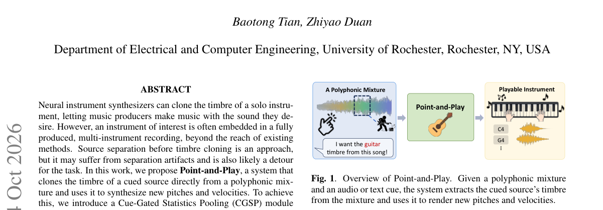

*Main result - Figure 2 Point-and-Play architecture. A CLAP encoder fine-tuned with LoRA encodes the mixture, while a frozen CLAP encoder encodes the source cue. Cue-Gated Statistics Pooling combines both representat*

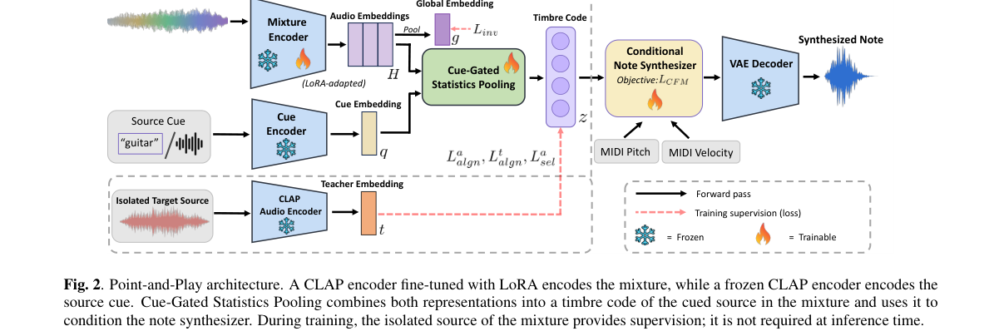

**Why this ranks #3**: 「先分离再克隆」被明确指出为局限，分离误差会直接污染克隆结果。

---

### 4. Revise-TTS: A Non-Masking Refinement Framework for Masked Diffusion Models in Text-to-Speech

**arXiv**: [2610.19499](https://arxiv.org/abs/2610.19499) | **Score**: 7.7 (relevance 8 x 0.7 + quality 7 x 0.3) | **Tags**: AIGC-audio | **Categories**: cs.SD, eess.AS | **Pages**: 5

**Authors**: Wanli Sun, Dan Su, Anton Ragni

**Affiliation**: 1 School of Computer Science, University of Sheffield, Sheffield, UK

**Abstract**

> Text-to-speech (TTS) based on masked diffusion models (MDMs) achieves competitive zero-shot speech synthesis performance. Unlike autoregressive (AR) models, MDMs define a corruption process that maps clean speech-token sequences to masked maps and learn a reverse denoising process to recover the reference tokens. However, MDMs commit to intermediate predictions that cannot be revised in subsequent inference steps. Consequently, prediction errors accumulate and propagate, degrading synthesized speech quality. We present Revise-TTS, a single-stage framework that applies hierarchical binary quantization (HBQ) and generative refinement networks (GRN) to zero-shot speech generation. First, we replace finite scalar quantization (FSQ) with HBQ to introduce a scalable binary representation for speech tokens with an explicit coarse-to-fine structure. Second, GRN is trained to reconstruct the token sequence from a mixture of ground-truth and random tokens. During inference, iterative refinement enables self-correction by randomly discarding a small proportion of previously predicted tokens with new predictions. Experiments and ablation studies demonstrate that Revise-TTS achieves competitive zero-shot speech synthesis performance using HBQ. It can further be extended to any MDM-based TTS task as an alternative training and inference method.

**Key findings**

- **Finding**: 掩码扩散模型定义「干净→掩码」的退化过程并学习反向去噪以恢复参考 token。

- **Finding**: Revise-TTS 提出**非掩码**的精化框架（摘要在此处截断）。

- **Inference**: 掩码只能表达「删除」而不能表达「替换」——若真实需要的是修正某个已生成的 token（而非揭示未知 token），掩码范式就缺少了必要的操作。

- **Recommendation**: 与 10-12 日报的 Beyond Token Revision（质疑掩码替换的增益是否来自自我纠错）对照，一篇质疑机制解释、一篇提供替代操作。

**Key figures**

*Framework / architecture - Figure 1 Illustration of HBQ. Each round halves the selected quan- tization interval. For z = −0.113, three rounds produce the bit sequence 011, corresponding to the discrete index 3.*

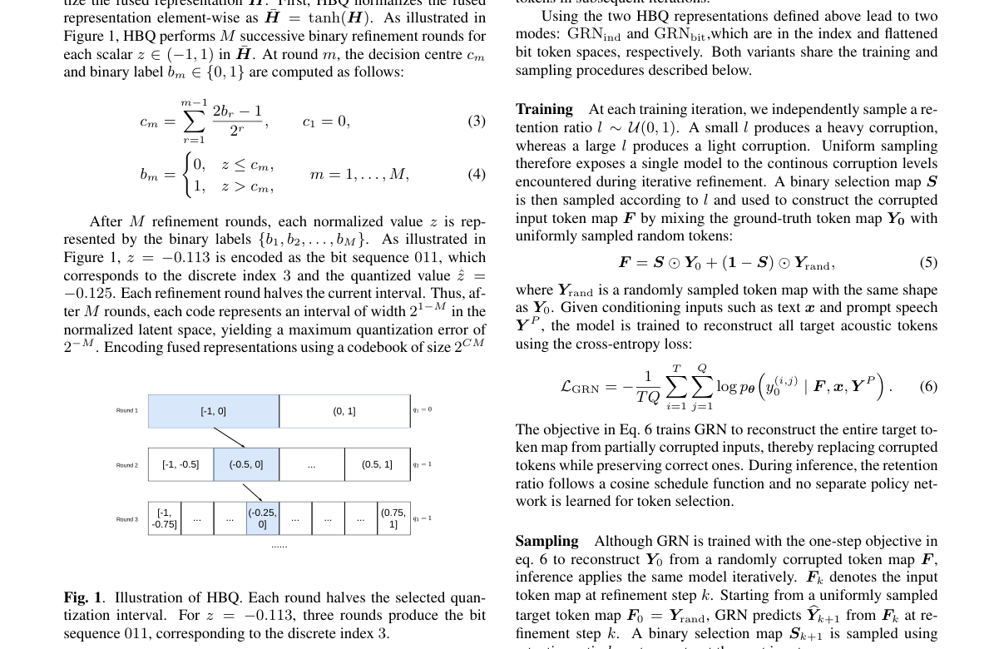

**Why this ranks #4**: 「非掩码精化」是对掩码扩散固有约束的一次针对性放宽。

---

### 5. Quantizer Redundancy and Exact Index Recoding in a Frozen Neural Audio Codec

**arXiv**: [2610.20471](https://arxiv.org/abs/2610.20471) | **Score**: 6.6 (relevance 6 x 0.7 + quality 8 x 0.3) | **Tags**: AIGC-audio | **Categories**: cs.SD, eess.AS | **Pages**: 18

**Authors**: Youssef Hemimy

**Affiliation**: St. Thomas University, Miami Gardens, Florida, USA

**Abstract**

> Residual scalar quantization can produce highly dependent indices when successive stages reuse identical, unscaled grids. This case study examines that behavior in a frozen neural audio codec and develops an exact recoding procedure that reduces storage while preserving its decoder inputs. Analysis of the repeated-grid recurrence identifies predictable stage sequences; finite-precision checks motivate preserving every original index through explicit exception records. The model weights and reconstruction graph remain fixed. On the studied 62- and 512-file cohorts, a predictor, adaptive coding and explicit file selection reduce complete stored bytes. The final 512-file rate is 129.591 kbps including headers, 25.943% below an original-index XZ control. Original recorded CPU runs establish bitwise latent and waveform preservation; independent readers verify exact index and metadata recovery in subsequent saved-stream experiments. Later coding choices use previously studied cohorts, and fresh encoding requires generating three alternatives. The engineering result is implementation-specific storage reduction with exact index recovery; the underlying lossy reconstruction quality remains unchanged.

**Key findings**

- **Finding**: 残差标量量化在多阶段复用相同未缩放网格时会产生**高度依赖的索引**（即信息冗余）。

- **Finding**: 作者在冻结编解码器上分析重复网格行为，并开发**精确重编码**以降低存储同时保持解码器输入。

- **Inference**: 「精确」是关键——如果重编码改变了索引到解码器输入的映射，就需要重训；保持映射不变则意味着任何使用该编解码器的系统都零成本获益。

- **Recommendation**: 做音频编解码的读者注意；这是本批少数不需要重新训练的优化。

**Key figures**

*Framework / architecture - Figure 1 Frozen reconstruction system with the final three-mode storage path. Gray boxes change index storage; saved grids and neural parameters remain un- changed. Independent readers verify restore*

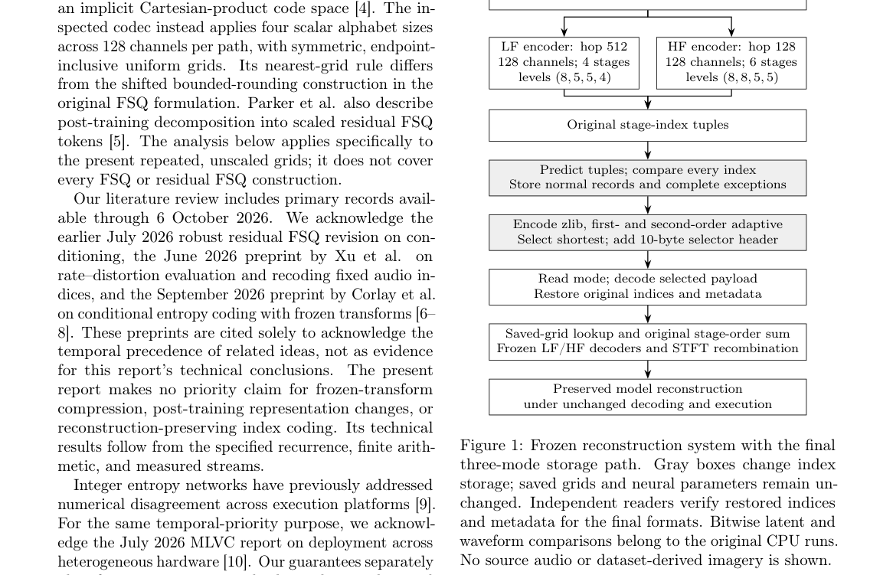

**Why this ranks #5**: 「冻结编解码器 + 精确重编码」是一条不需要重训的存储优化路径。

---

### 6. MUSEBENCH: A Benchmark for AI-Generated Music Detection and Artifact Analysis

**arXiv**: [2610.20310](https://arxiv.org/abs/2610.20310) | **Score**: 7.0 (relevance 7 x 0.7 + quality 7 x 0.3) | **Tags**: AIGC-audio | **Categories**: cs.SD | **Pages**: 30

**Authors**: Yi Chen Liu, Syed Irfan Ali Meerza, Jiawei Yu, Xi Guo, Samuel Bright, Jian Liu

**Affiliation**: University of Georgia | College of Engineering | Virginia Commonwealth University | University of Tennessee, Knoxville

**Abstract**

> Advances in generative AI have made it possible to produce music that is nearly indistinguishable from human compositions, raising the question of whether such works can be reliably distinguished from human compositions. We present MUSEBENCH, a large-scale benchmark for AI-generated music detection and artifact analysis, comprising over 361K tracks. The dataset includes human compositions, stylistically matched music generated by ten state-of-the-art open-source and commercial models, such as Suno and Udio, as well as human-AI co-creations and variants processed with adversarial perturbations, compression, and acoustic post-processing. Using MUSEBENCH, we benchmark 11 automated detectors and evaluate their accuracy, generalization, and robustness, under default, out-of-domain, and transformed-variant experiment settings. We further conduct a comprehensive artifact analysis through acoustic feature inspection, identifying recurring signatures such as non-idiomatic harmonic progressions, upsampling induced spectral periodicities, and violations of physical performance constraints. Our findings reveal key strengths and vulnerabilities of existing detectors and provide practical insights for building more reliable AI music detection systems.

**Key findings**

- **Finding**: 生成音乐已几乎与人类创作难以区分，问题由此转向能否可靠区分。

- **Finding**: MUSEBENCH 提供大规模检测与**伪影分析**基准（摘要在此处截断）。

- **Inference**: 「伪影分析」比二分类检测更有用：检测器给出的是标签，而伪影分析给出的是可被生成器消除的具体缺陷，从而形成检测—改进的闭环。

- **Recommendation**: 与本批 MUSEBENCH 类的检测思路对照，也接上 10-12 日报「审计评测工具」的主题——检测器本身也需要被审计。

**Key figures**

*Framework / architecture - Figure 1 Overview of MUSEBENCH.*

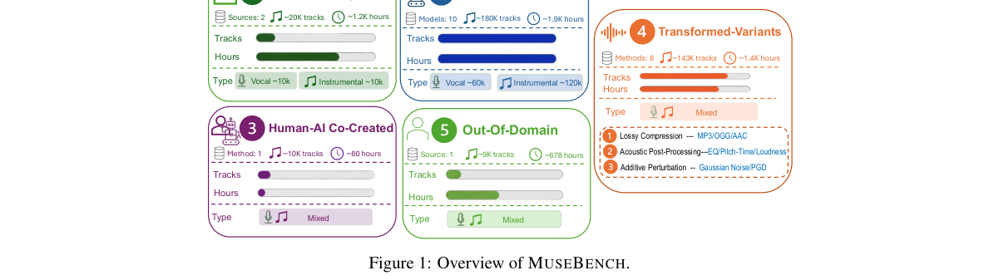

*Main result - Figure 2 Detector performance under default and LOMO settings. Complete numerical results are reported in Appendix Table 8 and Table 9. Bubble size is proportional to the model parameters (Ap- pendix*

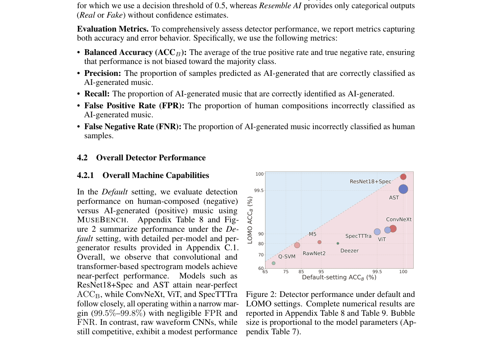

**Why this ranks #6**: 「生成质量已到难以区分」意味着检测方向的时钟刚刚被启动。

---

### 7. Soloist: A Generative Model for Blind Voice Separation in the Wild

**arXiv**: [2610.19716](https://arxiv.org/abs/2610.19716) | **Score**: 7.0 (relevance 7 x 0.7 + quality 7 x 0.3) | **Tags**: AIGC-audio | **Categories**: cs.SD | **Pages**: 28

**Authors**: Chen Yang, ChuFan Yu, Botian Jiang, Jingqi Chen, Wenxuan Wang, Yitian Gong, Zhaoye Fei, Xipeng Qiu

**Affiliation**: ¹Fudan University | ²Shanghai Innovation Institute

**Abstract**

> Real-world voice separation must recover individual voices from overlapping speech, environmental noise, and music, yet isolated source recordings are rarely available for supervision. We introduce Soloist, a generative model for blind voice separation that autoregressively generates individual voice streams as audio-codec sequences conditioned on the mixture, without requiring a target-speaker query or a predefined voice count. We propose a two-stage training paradigm to learn from synthetic mixtures and adapt to real recordings. The first stage combines supervised separation on synthetic mixtures with isolated source targets and an auxiliary task that predicts speaker timelines from real recordings, learning who speaks when from natural acoustics. The second stage applies reinforcement learning to real recordings, with rewards supplied by a model judge that compares candidate separations based on voice purity and content preservation without isolated source targets. Across diverse scenarios, Soloist recovers clean speech from multi-speaker overlap and noisy recordings, and extracts singing vocals from music accompaniment while maintaining relatively high pitch accuracy and intelligibility. On real-world recordings with unknown voice counts, Soloist also separates voices well. Finally, we integrate Soloist into a full-duplex conversation processing pipeline that assembles separated outputs into continuous speaker tracks, demonstrating its practical utility in real conversations.

**Key findings**

- **Finding**: 孤立源录音极少可用于监督，因此监督式分离方法受限。

- **Finding**: Soloist 自回归地生成**每条**人声流（而非输出掩码）（摘要在此处截断）。

- **Inference**: 输出掩码是判别式范式，其误差会在重叠区域非线性放大；生成每条流则把问题变成「给定已生成的部分，预测下一条人声是什么」，后者天然处理重叠。

- **Recommendation**: 语音分离的读者可参考；与本批 Point-and-Play（分离与克隆的耦合）对照，两者都处理「无干净监督」。

**Key figures**

*Framework / architecture - Figure 1 Training with incomplete references. (a) Paired-stem supervision compares predicted audio with known sources; natural recordings usually lack these targets. (b) Our recipe combines audio targ*

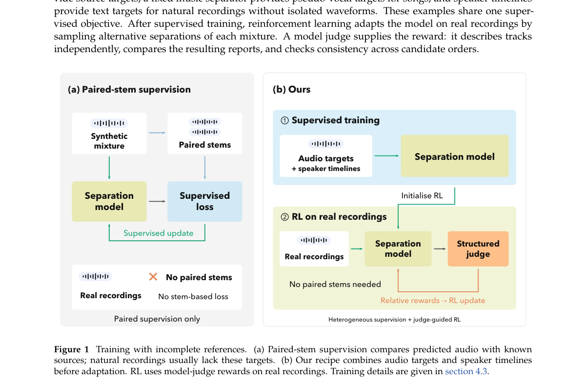

*Main result - Figure 2 Generative separation architecture of Soloist. Continuous audio features and discrete mixture codes condition the backbone. The text head predicts control tokens, and a local transformer gene*

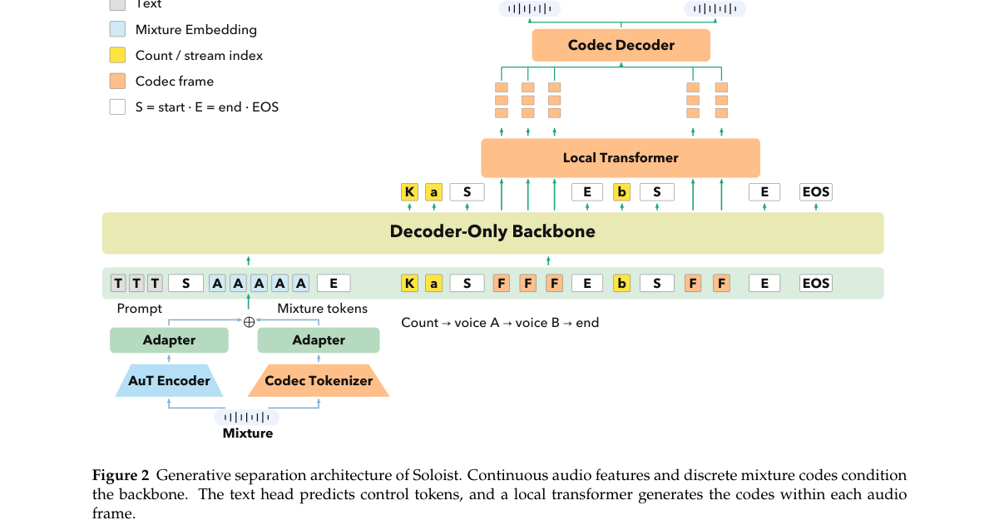

**Why this ranks #7**: 「自回归生成各条人声流」把分离当作多轨迹生成，而非掩码预测。

---

### 8. TVPara: Paralinguistic Captioning of Expressive TV-Series Speech in Complex Acoustic Environments

**arXiv**: [2610.19678](https://arxiv.org/abs/2610.19678) | **Score**: 6.3 (relevance 6 x 0.7 + quality 7 x 0.3) | **Tags**: AIGC-audio | **Categories**: cs.SD | **Pages**: 5

**Authors**: Ziyang Zhang, Wenyi Yu, Wen Wu, Xuenan Xu, Chao Zhang

**Affiliation**: 1Tsinghua University, China | 2Shanghai Artificial Intelligence Laboratory, China

**Abstract**

> Large audio-language models (LALMs) struggle to parse paralinguistics (e.g., emotion, pace, pitch) in speech that combines intense emotion with complex acoustic environments. Strengthening this ability calls for training data that reflects such conditions. However, existing corpora rely heavily on studio-recorded speech, offering limited emotional and acoustic diversity. To address this gap, we introduce TVPara, a paralinguistic captioning dataset built from TV series. Speech in TV series often carries diverse emotional expression and co-occurs with scene-specific background sound, providing expressive emotion and complex acoustic environments at scale. Constructed via LALM pre-annotation and human correction, TVPara includes two tasks: Single-Utterance (~492h) and Multi-Utterance (~213h) Paralinguistic Captioning. Fine-tuning open-source LALMs on TVPara yields an average relative improvement of 31.26% in paralinguistic understanding under complex acoustic environments. The gains further generalize to an unseen TV series and to cleaner, cross-domain speech.

**Key findings**

- **Finding**: LALM 难以解析**强烈情绪 + 复杂声学环境并存**的语音中的副语言信息。

- **Finding**: 既有语库依赖录音棚录音；TVPara 用真实电视剧语音构建（摘要在此处截断）。

- **Inference**: 录音棚数据缺失的正是「情绪与环境耦合」这一最难的情形，因此模型在真实影视素材上的表现系统性弱于基准——这是训练分布与使用分布不匹配的典型。

- **Recommendation**: 与本批 Long-Prompt TTS（韵律复现）对照，两篇都指向韵律/副语言数据的稀缺。

**Key figures**

*Framework / architecture - Figure 1 Overview of the two TVPara tasks. (a) Single-Utterance Paralinguistic Captioning describes the paralinguistic attributes of a single utterance, including emotion, pace, pitch, and volume. (b)*

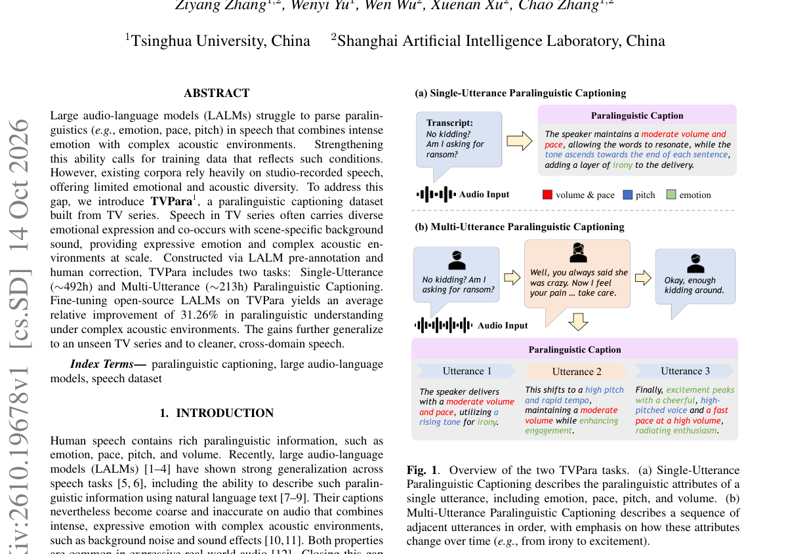

*Main result - Figure 2 Emotion word clouds of (a) TVPara and (b) VoxCeleb. Vox- Celeb is dominated by neutral and calm states, whereas TVPara cov- ers many expressive emotions (e.g., frustration, sarcasm, anger).*

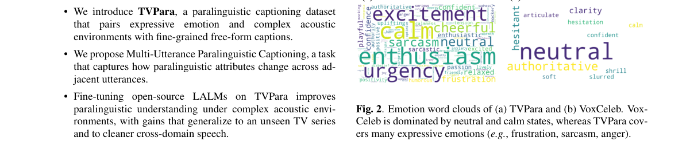

**Why this ranks #8**: 「情绪强烈 + 声学复杂」的组合条件被明确指为数据缺口。

---

### 9. ELARSpeech: A 30K-Hour Dataset Across 675 Underrepresented Languages for Long-Tail Multilingual Speech Technologies

**arXiv**: [2610.19388](https://arxiv.org/abs/2610.19388) | **Score**: 6.3 (relevance 6 x 0.7 + quality 7 x 0.3) | **Tags**: AIGC-audio `[wild-card]` | **Categories**: cs.AI, cs.CL, cs.SD | **Pages**: 22

**Authors**: Sangmin Lee, Yejin Jeon, David Ifeoluwa Adelani

**Affiliation**: 1Yonsei University, 2McGill University, 3Mila - Quebec AI Institute, 4Canada CIFAR AI Chair | Google USM

**Abstract**

> Massively multilingual speech modeling has made remarkable progress in recent years, yet existing training resources and benchmarks still underrepresent much of the linguistic long tail. To address this gap, we introduce ELARSpeech, a large-scale multilingual speech resource comprising 30,202 hours of speech across 675 underrepresented languages, curated from the Endangered Languages Archive. Combining human-annotated and unlabeled recordings, the corpus spans diverse recording conditions, domains, and language families. Beyond corpus construction, our experiments show how ELARSpeech supports extending ASR and TTS capabilities to diverse underrepresented languages, with further benefits from pseudo-labeling unlabeled data. At the same time, our speech representation analysis reveals remaining limitations in transferring existing multilingual models to the linguistic long tail. Together, ELARSpeech provides both a resource and a testbed for extending multilingual speech technology further into the linguistic long tail. We publicly release the dataset, all trained ASR and TTS models, and the complete data construction pipeline to facilitate research on long-tail multilingual speech technologies.

**Key findings**

- **Finding**: 既有训练资源与基准严重低估大部分**语言长尾**。

- **Finding**: ELARSpeech 覆盖 675 种语言、30,202 小时（摘要在此处截断）。

- **Inference**: 675 种语言的真正价值不在数量而在分散：每种语言的绝对时长可能很少，但跨语言迁移所需的表征多样性由此获得。

- **Recommendation**: wild-card 项；与本批 Anuvani-LID（22 种印度语言）对照，一个做语言识别、一个做长尾资源。

**Key figures**

*Framework / architecture - Figure 1 Geographic, domain, and language family distributions of ELARSpeech.*

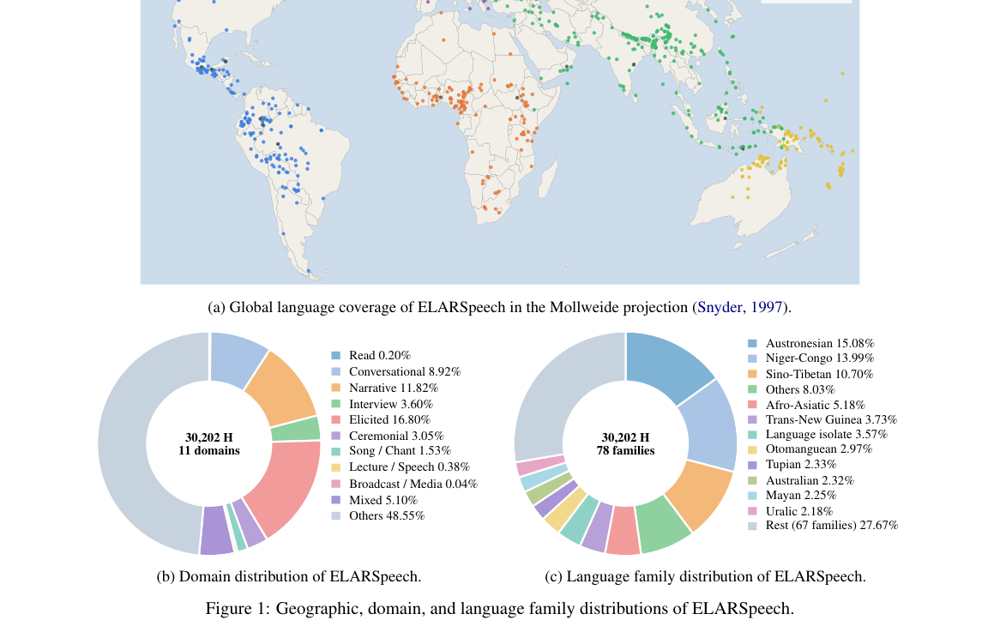

*Main result - Figure 2 ASR performance with increasing amounts of pseudo-labeled ELARSpeech-U.*

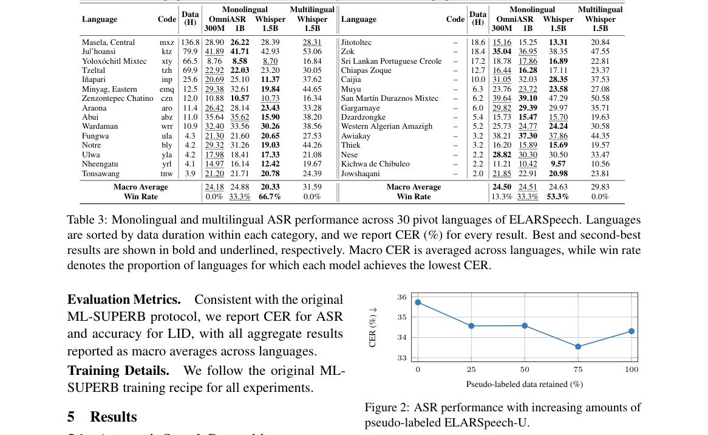

**Why this ranks #9**: 「675 种语言、3 万小时」的规模值得注意——长尾语言的资源缺口长期被忽视。

---

### 10. Evaluating perceptual transparency of lossy music audio compression with Opus codec

**arXiv**: [2610.20246](https://arxiv.org/abs/2610.20246) | **Score**: 5.6 (relevance 5 x 0.7 + quality 7 x 0.3) | **Tags**: AIGC-audio `[wild-card]` | **Categories**: cs.SD | **Pages**: 5

**Authors**: Benjamin Martin, Romain Hennequin

**Affiliation**: [not-found in PDF]

**Abstract**

> Although the open-source Opus audio codec is widely used for digital audio streaming, its perceptual transparency threshold for high-bitrate music compression remains insufficiently evaluated. To establish this threshold, this study evaluates Opus across a two-phase ITU-R BS.1116-3 double-blind framework, analyzing Difference Grades using a Linear Mixed-Effects Model (LMM) and Two One-Sided Tests (TOST) for statistical equivalence. In a first phase with 21 qualified listeners and 23 music excerpts, 128 kbps achieves statistical in-distinguishability ($p = 0.456$) but narrowly fails strict equivalence to the uncompressed reference ($p = 0.064$). In Phase 2, Best Linear Unbiased Predictors (BLUPs) isolate the 10 most critical listeners and 8 most challenging samples for a stress-test. Under these worst-case conditions, 128 kbps is conclusively detected as degraded ($p = 0.030$), whereas 160 kbps successfully reaches perceptual transparency ($p = 0.747$) and strict statistical equivalence ($p = 0.024$). The study concludes that 160 kbps demonstrates perceptual transparency to uncompressed CD quality in critical listening environments. For reproducibility, we publicly release results for both phases, anonymized subject background info and sample characteristics.

**Key findings**

- **Finding**: Opus 高码率音乐压缩的**感知透明阈值评估不足**，而该编解码器被广泛用于流媒体。

- **Finding**: 该研究在 ITU-R BS.1116-3 双盲框架下评估（摘要在此处截断）。

- **Inference**: 感知透明阈值是「何时可以停止提高码率」的判据；没有它，工程决策只能靠经验，而高码率音乐正是最容易被听出差异的内容。

- **Recommendation**: wild-card 项；做音乐生成系统输出的读者可参考——若你的输出经过有损压缩再评测，阈值未知会污染所有结论。

**Key figures**

*Framework / architecture - Figure 1 BLUPs from subject random effect (left) from least to most critical, and sample random effect (right) from least to most audible artifacts. Highlighted regions show the selected candidates for*

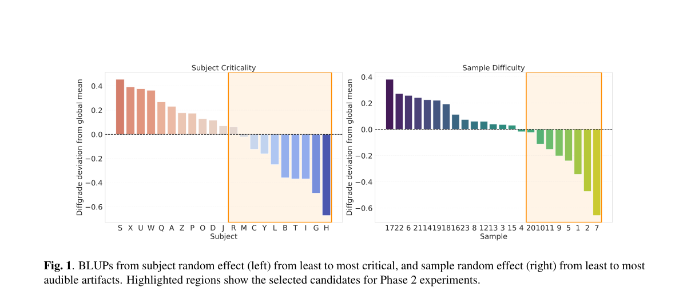

*Main result - Figure 2 TOST equivalence forest plot of Diffgrades for all bitrate conditions and ∆= ±0.25. Green intervals are condi- tions statistically equivalent to uncompressed quality.*

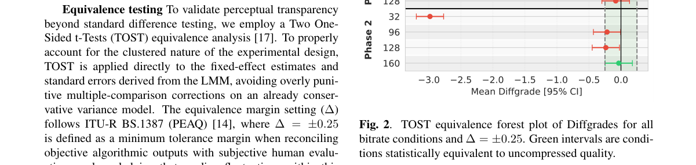

**Why this ranks #10**: 「广泛使用但阈值未评估」是一个具体的基础设施缺口。

---

## Footer

- Total papers reviewed across all 5 tracks: 50 (from 570 scanned)
- aigc_audio track final top-10: 10
- Wild-cards in this track: 3
- Figure assets: `res/` (shared across tracks)

Generated by `mine-arxiv-daily-digest` skill. Sister file: `2026-10-15_aigc_audio_entry.md`.
