# ArXiv Daily Digest - 2026-10-15 (AIGC 图像 / 视频 / 3D 生成与编辑, 10 papers)

**Generated**: 2026-10-15 17:00 CST

**Source**: arXiv cs.CV, cs.SD, eess.AS, cs.CL, cs.AI, cs.RO, cs.LG submissions, window 2026-10-14 UTC (latest announced batch as of 2026-10-15 17:00 CST)

**Track**: aigc_visual (top 10 of 570 papers scanned, 50 full reads)

**Scope**: representation-space initialization for AR video distillation, making bidirectional diffusion autoregressive cheaply, native 4K agentic image editing, speculative sampling in interactive video generation, whether one-step generation is overthought, self-conditioning for sequential reasoning in flow matching, 3DGS compression with image codecs, video generation pretraining for human motion recovery, world-state-centric agentic video generation, e-commerce main-image generation

---

本批 AIGC 视觉线的主线是**自回归化的成本**，它接上了本项目日报过去三天建立的追踪：10-09 的 Conditional Residual Prediction（训练因果模型而无需双向教师）、10-12 的 Unified Generative Video Compression（把双向与自回归变成同一框架下的参数）、10-14 的七篇 AR 长视频缓存方案。

今天这一环补的是**转换本身有多贵**。**Glance Forcing** 明确指出主流做法（把双向扩散蒸馏为因果少步学生）代价高昂，因为需要**离线的概率流 ODE 轨迹**——每次转换都要跑一遍完整求解器，而蒸馏本身已需要大量采样，成本是叠加的。**RepForcing** 则把初始化与蒸馏分开：中间 AR 教师能提供因果兼容的 ODE 目标，但**因果兼容本身并不保证高质量生成**。

值得单独指出的是 **Speculative Sampling in Interactive Video Generation** 的观察：交互式视频通常用小双向块以降低延迟，但实验显示**更大的块提升视频质量**且更好地利用 GPU 并行，采样时间仅小幅增加。这直接推翻了「块越小越好」这一部署默认——小块的低质量可能来自其自身的表达限制而非速度代价。配合 **Are We Overthinking One-Step Generation?**（质疑一步生成研究的复杂度投入），两篇共同指向：过去几年在「更少步数」上的努力，可能不如「接受稍多步数换质量」划算。

其余：4K agentic 图像编辑（指出此类编辑器的训练方式未公开，且单端到端编辑器无法同时满足精确参数调整、匹敌专用专家、解释模糊指令三类需求）、自条件化使流匹配获得深度序列推理能力（从电路复杂度视角检验「每采样步≈一推理步」这一类比）、3DGS 的率失真压缩、用视频生成先验做人体网格恢复、世界状态中心的 agentic 视频生成（指出帧传递无法支持**非连续请求**之间的场景重访与事件重播）。

---

## Top 10 - AIGC 图像 / 视频 / 3D 生成与编辑

### 1. RepForcing: Representation-Space Initialization for Autoregressive Video Distillation

**arXiv**: [2610.20111](https://arxiv.org/abs/2610.20111) | **Score**: 8.7 (relevance 9 x 0.7 + quality 8 x 0.3) | **Tags**: AIGC-video | **Categories**: cs.CV | **Pages**: 17

**Authors**: Siming Fu, Zheming Fu, Lianrui Mu, Haoyang Huang, Chaojie Gu, Ruizhe He

**Affiliation**: 2Zhejiang University

**Abstract**

> Distilling pretrained video diffusion models into few-step autoregressive (AR) generators typically combines student initialization with distribution matching distillation (DMD). An intermediate AR teacher can provide causally compatible targets for ODE initialization. However, causally compatible targets alone do not ensure high-quality generation under a short sampling schedule. We analyze the posterior-mean predictions favored by direct latent regression and empirically find that causal ODE initialization alleviates blur but still leaves fine detail unresolved. To address this limitation, we propose Representation Forcing, which learns few-step causal initialization through representation-space supervision rather than intermediate-teacher trajectory regression. The student is trained with teacher forcing by comparing clean predictions and training targets through normalized features of a frozen video diffusion transformer. This phase reuses the synthetic videos generated by a bidirectional model for AR teacher training and replaces both teacher training and causal ODE distillation, without generating additional causal ODE trajectories. The subsequent asymmetric DMD procedure remains unchanged. Empirical results show that, at four sampling steps, RepForcing better preserves generation quality than intermediate-teacher-based initialization before DMD. After DMD, our four-step chunk-wise model improves VBench Total from 84.04 to 84.66 (+0.62 points) and VisionReward from 6.326 to 10.074 (+59.25%) over the reported causal-ODE-based baseline.

**Key findings**

- **Finding**: 常规做法：学生初始化 + 分布匹配蒸馏（DMD）；中间 AR 教师可提供因果兼容的 ODE 初始化目标。

- **Finding**: 但**因果兼容的目标本身并不保证高质量生成**（摘要在此处截断）。

- **Inference**: 初始化目标与方法目标是两件事：前者只要求「在因果约束下可用」，后者要求「质量高」；把两者混同会让所有蒸馏方法都在解一个偏易的问题。

- **Recommendation**: 与本批 Glance Forcing（让双向扩散变自回归）连读，两篇同属「自回归化的成本」这一子问题。

**Key figures**

*Framework / architecture - Figure 1 High-Quality Videos Generated by RepForcing. The examples span human activities, animal behavior, and stylized scenes, showing details such as clothing folds, fur, and vegetation. Across the*

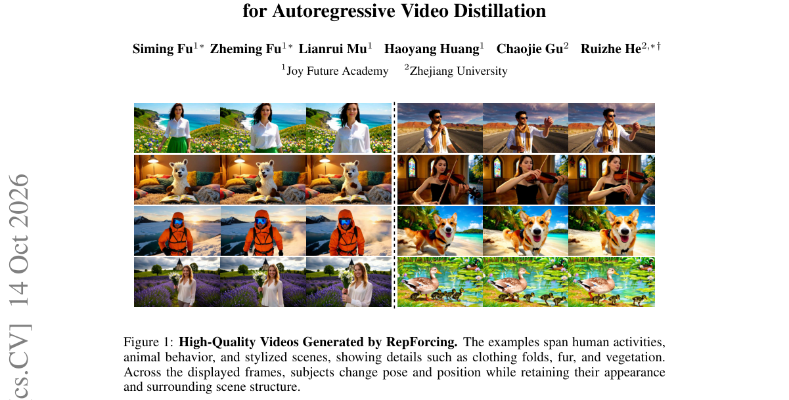

*Main result - Figure 2 RepForcing Initialization Better Preserves Generation Quality as Sampling Steps Decrease. Rows compare three initialization strategies: teacher-forced AR training followed by ODE distillatio*

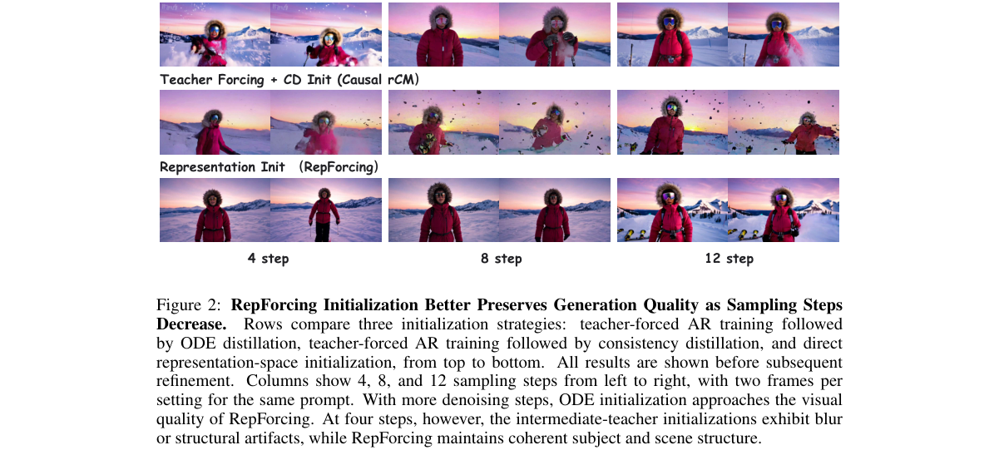

**Why this ranks #1**: 「因果兼容 ≠ 高质量」这个区分把初始化问题与蒸馏问题分开了。

---

### 2. Glance Forcing: Making Bidirectional Diffusion Autoregressive at a Glance

**arXiv**: [2610.20220](https://arxiv.org/abs/2610.20220) | **Score**: 8.7 (relevance 9 x 0.7 + quality 8 x 0.3) | **Tags**: AIGC-video | **Categories**: cs.CV | **Pages**: 19

**Authors**: Zhuobai Dong, Junchao Yi, Hu Jian Guo, Linjie Li, Rui Zhao, Alex Jinpeng Wang

**Affiliation**: 1Wuhan University | 3Sun Yat-sen University | 5National University of Singapore | 6Central South University

**Abstract**

> Autoregressive generation underlies real-time, causal video synthesis and is the backbone of video world models. Today's dominant approach distills a bidirectional diffusion model into a causal few-step student, but existing pipelines make this conversion prohibitively expensive, requiring offline Probability Flow ODE} (PF-ODE) trajectories that cost tens of thousands of GPU-hours and terabytes of storage. We show it can be made dramatically more efficient. Pushing this efficiency to its extreme, we reduce trajectory supervision to a single sample, the strictest setting possible, and find that it causes severe quality collapse. We trace this to the teacher's trajectory geometry: the high-noise regime, governing semantic layout and motion, and the low-noise regime, governing fine texture exhibit fundamentally different curvature and optimization behavior, so a single monolithic student cannot jointly fit both, causing severe representation interference. Motivated by this, we propose Glance Forcing, a lightweight distillation framework that decouples the denoising trajectory into two complementary slow and fast experts, each guided by a tailored, stage-specific objective, while keeping the pretrained teacher entirely frozen. This decoupling further reveals a general mechanism underlying few-step distillation: PF-ODE distillation mainly straightens the few-step trajectory geometry, while the subsequent distribution-matching stage independently governs distributional quality. Using only one PF-ODE trajectory, Glance Forcing already surpasses the fully-trained state-of-the-art baseline, raising the VBench Total score from 84.04 to 84.22 while cutting trajectory-collection cost from thousands of GPU-hours to about one A100-GPU-hour, with markedly larger gains in dynamic degree, VisionReward, and instruction-following, and consistent preference from human raters over strong baselines.

**Key findings**

- **Finding**: 主流做法是把双向扩散蒸馏为因果少步学生，但转换**代价高昂**——需要离线 PF-ODE 轨迹。

- **Finding**: Glance Forcing 的目标是让这一转换变得廉价（方法细节需查正文）。

- **Inference**: 离线 PF-ODE 轨迹意味着每次转换都要跑一遍完整求解器，而蒸馏本身已需要大量采样——成本是叠加的。这解释了为什么很多工作选择沿用预训练双向教师而非重新转换。

- **Recommendation**: 与 10-09 日报的 Conditional Residual Prediction（训练因果模型而无需双向教师）、10-12 的 Unified Generative Video Compression 构成三天的自回归化主线。

**Key figures**

*Framework / architecture - Figure 1 Overall framework of our Glance Forcing and the comparison with existing methods. (a) Causal Forcing (CF) fixes Self Forcing (SF)’s architecture gap but remains costly; our Glance Forcing (G*

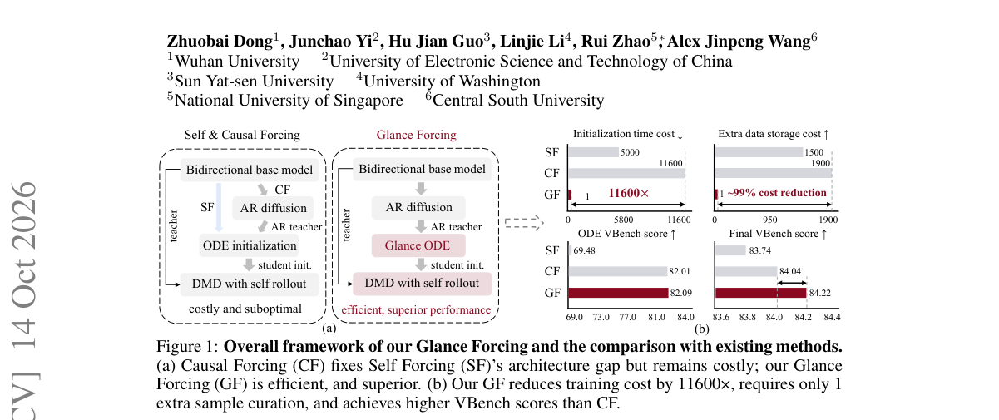

*Main result - Figure 2 Motivation and Trajectory Analysis. (a) VBench performance drops significantly for both forcing methods when trained on a single sample on the ODE stage. (b) Relative trajectory- curvature p*

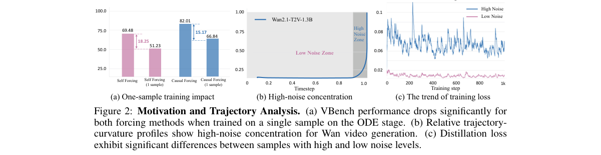

**Why this ranks #2**: 它精确指出了这条主流路线的成本所在（离线 PF-ODE 轨迹）。

---

### 3. BluePixel: Toward Native 4K Agentic Image Editing

**arXiv**: [2610.19882](https://arxiv.org/abs/2610.19882) | **Score**: 8.0 (relevance 8 x 0.7 + quality 8 x 0.3) | **Tags**: AIGC-edit, AIGC-image | **Categories**: cs.CV | **Pages**: 24

**Authors**: Shanyan Guan, Shiyu Li, Xin Li, Zhizhou Chen, Yunzhe Xu, Yuehao Liu, Ruixue Shen, Shiju Zhang, Min Jin, Qiang Liu, Junbo Liu, Penggang Shi

**Affiliation**: 1vivo Mobile Communication Co., Ltd., 2Nanjing University, 3Shanghai Jiao Tong University

**Abstract**

> Instruction-driven image editing has reached native 4K, yet how such editors are trained remains undisclosed, and pretraining one from scratch is beyond most teams. The task itself compounds the difficulty: a single end-to-end editor cannot make precise parametric adjustments, match specialized experts, or interpret the vague instructions users actually write. We argue that 4K editing is a system problem rather than a single-model problem, and present BluePixel, which couples a native-4K editing model with an agent harness; the complete training recipe is disclosed in this paper. The model makes 4K training practical: it turns a 1K-pretrained editor into a native-4K one through progressive VAE adaptation that keeps 4K training as affordable as 1K, absorbs a long tail of vertical editing skills through continual learning, and refines the aesthetic-fidelity trade-off with reinforcement learning. Distillation via source-anchored target projection (SATP) then compresses 50 denoising steps to 4, completing a 4K edit in 8.7 s on a single Kunlunxin P800 XPU while preserving task success rate and background consistency. The harness, BluePixel Agent, makes editing controllable: it decomposes user instructions into specialist and general operations, verifies every result with the same reward model that guided training, and retries within bounded attempts. On VINS-4KEval++ (3,305 native-4K cases), BluePixel ranks second among seven models, behind only GPT Image 2 in non-edited-region consistency.

**Key findings**

- **Finding**: 4K 指令编辑器的**训练方式未公开**，从零预训练超出多数团队能力。

- **Finding**: 单个端到端编辑器无法做精确参数调整、匹敌专用专家或解释模糊指令；BluePixel 提出 agentic 方案（摘要在此处截断）。

- **Inference**: 把三类失败归因于「单个端到端编辑器」的结构性限制，意味着解法不是更大的模型而是**多个专精组件 + 分派**——这与 10-12 日报 ThinkDrag（指令需要推理而非直接执行）指向同一结论。

- **Recommendation**: 与本批 CommerceGen-Studio（同样用 agent 架构）对照，两篇都在用多组件分派处理复杂指令。

**Key figures**

*Framework / architecture - Figure 1 BluePixel editing showcase. Diverse 4K editing capabilities including text editing, pose editing, scene re- composition, anime-style expression editing, and low-level image editing. The model*

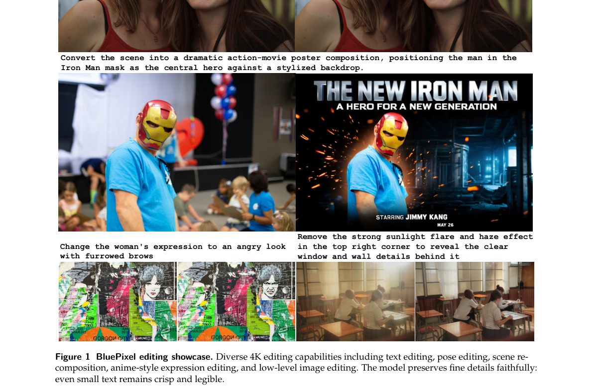

*Main result - Figure 2 Phase 1 vs. final model. The Phase 1 checkpoint produces usable but limited results; after Phase 2 enhance- ment (progressive SFT, benchmark-driven fine-tuning, continual learning, and reinfo*

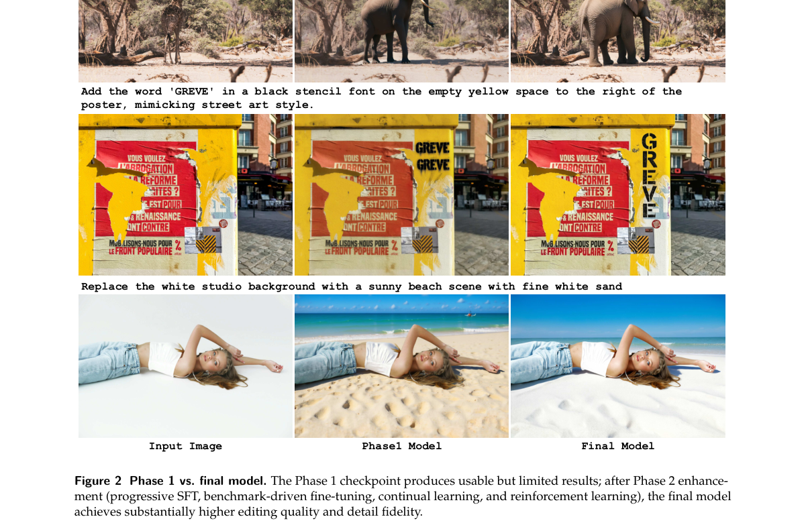

**Why this ranks #3**: 「如何训练未公开」是一个直接影响可复现性的判断。

---

### 4. Speculative Sampling in Interactive Video Generation

**arXiv**: [2610.20556](https://arxiv.org/abs/2610.20556) | **Score**: 8.0 (relevance 8 x 0.7 + quality 8 x 0.3) | **Tags**: AIGC-video | **Categories**: cs.CV, cs.HC | **Pages**: 18

**Authors**: Yubo Huang, Yuxuan Zhang, Jiaming Liu, Sirui Zhao, Enhong Chen

**Affiliation**: 2The Chinese University of Hong Kong

**Abstract**

> Interactive video generation commonly relies on small bidirectional chunks to reduce response latency. Yet our preliminary experiments show that larger chunks improve video quality and better utilize GPU parallelism, allowing more latents to be sampled with only a modest increase in sampling time. Motivated by these observations, we propose Speculative Sampling, a strategy that combines the modeling power of large bidirectional windows with the low-latency interaction of small ones. It expands the modeling window by appending noise latents as padding and caches the resulting predictions for reuse when the condition remains unchanged. Predictions are delivered incrementally, while the uncommitted future remains replaceable. Our latency analysis shows that this removes the waiting-time lower bound imposed by chunk boundaries, shifting the optimization focus from reducing chunk size to accelerating per-chunk sampling. Bidirectional window size thus becomes a decision variable for jointly optimizing visual quality and sampling time, rather than a necessary constraint on low-latency interaction. This opens a path to serving large bidirectional models in interactive streaming systems without complex streaming post-training.

**Key findings**

- **Finding**: 交互式视频通常用小双向块降低延迟；实验显示**更大的块提升质量**并更好利用 GPU 并行。

- **Finding**: 在采样时间仅小幅增加的前提下，更多 latent 得以采样；作者据此提出推测采样（摘要在此处截断）。

- **Inference**: 「更大的块质量更好」意味着延迟与质量此前被误认为存在权衡；实际上小块的低质量可能来自其自身的表达限制而非速度代价，这与本批 Glance Forcing 同属「自回归的块大小不该太小」。

- **Recommendation**: 交互式视频部署的读者注意；这是本批最直接可用于工程决策的观察。

**Key figures**

*Framework / architecture - Figure 1 Fine-grained interaction without shrinking generation chunks. Our method preserves large-chunk joint sampling while allowing updates beyond the protected prefix, rather than only at chunk bo*

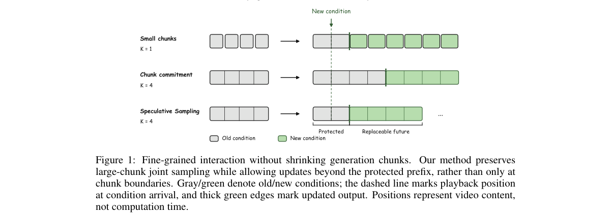

*Main result - Figure 2 Generation speed alone does not determine response latency. In this periodic reference schedule, the highlighted update waits R for generation, takes C to produce deliverable output, and wai*

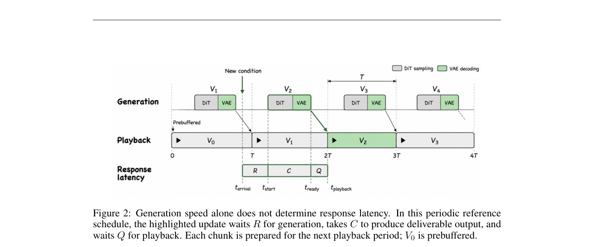

**Why this ranks #4**: 一个直接推翻部署默认假设的观察：块越小越好并不成立。

---

### 5. Are We Overthinking One-Step Generation?

**arXiv**: [2610.20331](https://arxiv.org/abs/2610.20331) | **Score**: 7.7 (relevance 8 x 0.7 + quality 7 x 0.3) | **Tags**: AIGC-image, AIGC-video | **Categories**: cs.LG | **Pages**: 45

**Authors**: Woobin Park, Jaeyeon Kim, Yilun Du, Sitan Chen, Bohyung Han

**Affiliation**: 1Seoul National University | 2Harvard University

**Abstract**

> Diffusion and flow matching are now dominant frameworks for generative modeling in continuous domains, but they typically require multiple network evaluations at inference. This has motivated extensive research on one-step generative modeling primarily built on diffusion and flow, though existing approaches often rely on complex training machinery. In this work, we introduce Priming Models, a simple two-stage framework for training one-step generators. Motivated by the difficulty of distributional training from scratch, Priming Models are first trained on a reconstruction objective, e.g., pixel-space denoising at a fixed noise level, before undergoing feature-space distributional post-training. Our central scientific finding is that this simple reconstruction stage is already enough to entirely alleviate the difficulty of distributional training. Empirically, across class-conditional image generation, text-to-image generation, and world modeling, Priming Models significantly advance the Pareto frontier of training compute vs. generation quality. On ImageNet at $256 \times 256$ resolution, we achieve a state-of-the-art FID of $1.19$ among one-step generators using approximately one-tenth the training compute of prior methods with comparable FID. We open-source our codebase at https://github.com/JaeyeonKim01/priming.

**Key findings**

- **Finding**: 一步生成研究「往往依赖复杂的训练机制」；作者据此重新评估其必要性。

- **Finding**: Are We Overthinking One-Step Generation?（摘要在此处截断，核心主张需查正文）。

- **Inference**: 若复杂机制的作用是补偿一步生成的结构性弱点，那么更好的路径可能是接受稍多步数——这与本批 2610.20556 的「大块质量更好」观察方向一致：牺牲一点速度换质量可能比硬推一步更划算。

- **Recommendation**: 与 10-14 日报的 Simplifying and Improving On-Policy Distillation（简单在策略回归已足够）连读，两篇都在质疑少步方向的复杂度投入。

**Key figures**

*Framework / architecture - Figure 1 Priming Models dramatically improve the training compute vs. FID trade-off on Ima- geNet (left). Simple reconstruction pretraining provides an effective initialization that makes subse- quen*

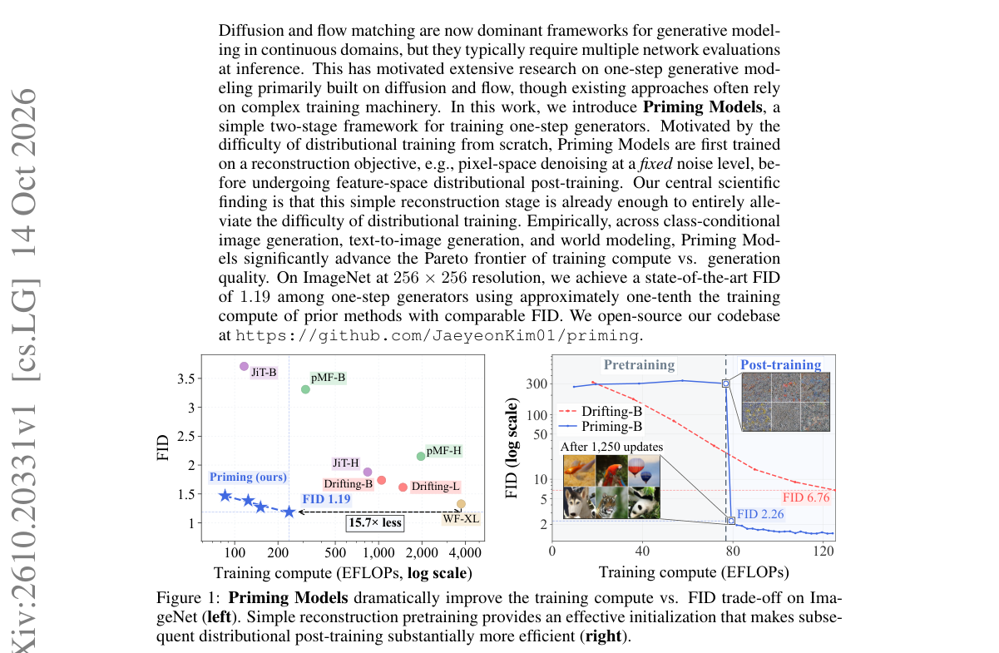

*Main result - Figure 2 One-step samples from Priming Models across three visual domains.*

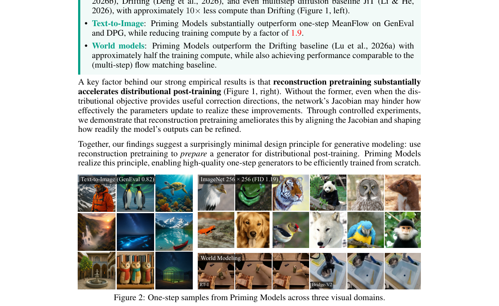

**Why this ranks #5**: 标题即是对整个一步生成研究纲领的质疑。

---

### 6. Self-Conditioning Enables Deep Sequential Reasoning in Flow Matching

**arXiv**: [2610.19628](https://arxiv.org/abs/2610.19628) | **Score**: 7.3 (relevance 7 x 0.7 + quality 8 x 0.3) | **Tags**: AIGC-image | **Categories**: cs.CV, cs.LG | **Pages**: 55

**Authors**: Zeyang Zhang, Linxiang Gao, Meiqi Gu, Xingyan Chen, Minrui Luo, Kaifeng Lyu, Tianxing He

**Affiliation**: 1Shanghai Qi Zhi Institute | 2Institute for Interdisciplinary Information Sciences, Tsinghua University | 3Xiongan AI Institute | 4Georgia Institute of Technology

**Abstract**

> Recent work has explored visual reasoning through image generation, where models solve visual-reasoning problems by directly generating solution images. Intuitively, iterative samplers such as flow matching are well suited to this task, since each sampling step may resemble one reasoning step. However, in this work, from a circuit complexity perspective, we show that this intuition is misleading. We prove that as long as the model outputs satisfy certain mild regularity conditions, the trajectory of the vanilla flow-matching sampler can be simulated by a constant number of sequential rounds of parallel model evaluations. Consequently, additional sampling steps cannot increase the expressive power of a constant-depth backbone model under the standard complexity-theoretic model of transformers. We then reveal that self-conditioning, which conditions the model on the previous step's estimate of the final image, plays a previously unrecognized role in removing this bottleneck. Controlled experiments on diverse visual-reasoning tasks show that flow matching with self-conditioning achieves higher accuracy and greater reasoning depth than vanilla flow matching, and its performance improves with more sampling steps. Theoretically, we prove that with self-conditioning, a constant-depth backbone can achieve expressive power equivalent to that of space-bounded Turing machines. Our study suggests a design principle for future visual reasoning research: carry more information between sampling steps, so that additional steps translate into deeper reasoning.

**Key findings**

- **Finding**: 直觉认为流匹配等迭代采样器适合视觉推理，因为每个采样步类似一个推理步。

- **Finding**: 作者从电路复杂度视角重新检验这一直觉，并提出自条件化使深度序列推理成为可能（摘要在此处截断）。

- **Inference**: 「每步 = 一个推理步」是一个隐含的类比，但类比成立需要迭代器具备推理所需的状态保持能力；自条件化正是提供该能力的机制。

- **Recommendation**: 与本批 RepForcing、Glance Forcing 对照，三篇分别从初始化、转换、推理能力切入自回归/迭代生成的结构问题。

**Key figures**

*Framework / architecture - Figure 1 Controlled experiments on three synthetic tasks: line tracing, long multiplication, and long text rendering (§4.2). The top row shows an example input and target output for each task, and th*

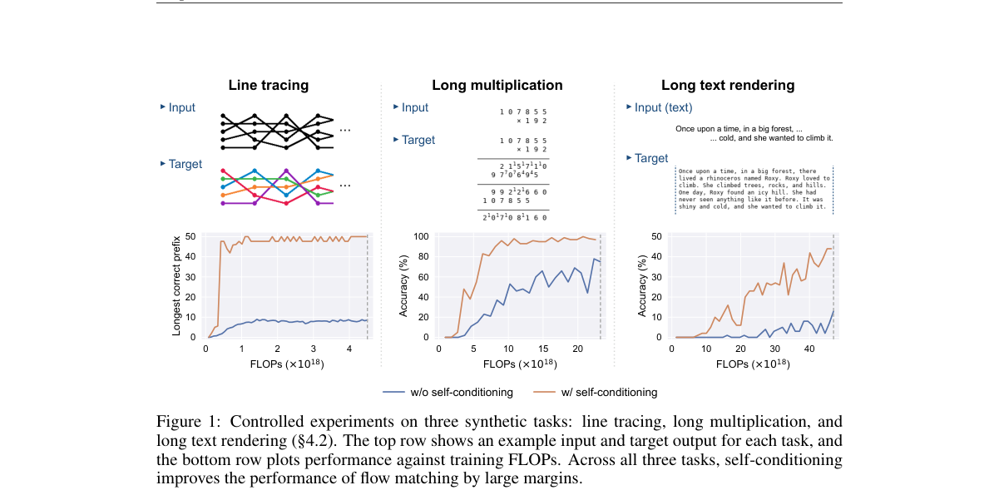

*Main result - Figure 2 Overview of self-conditioning. Each prediction zi+1 is obtained by extrapolating the state xi along its velocity vi to t = 1.*

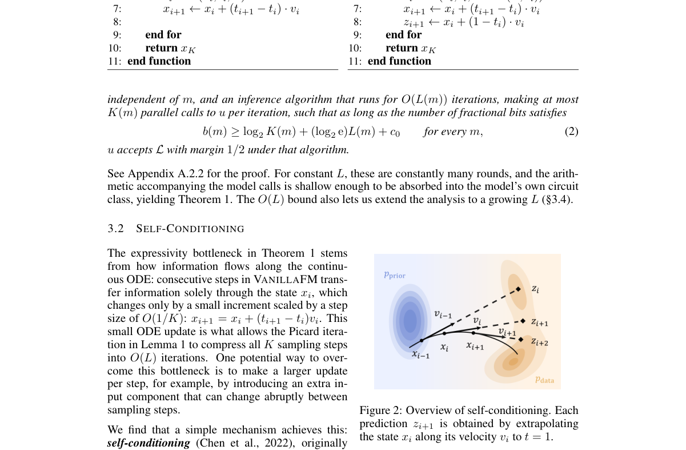

**Why this ranks #6**: 从电路复杂度论证「迭代采样器适合推理」这一直觉，是一个理论侧的独立检验。

---

### 7. RDCompGS: Rate-Distortion Optimization for Compression of 3D Gaussian Splatting with Image Codecs

**arXiv**: [2610.19538](https://arxiv.org/abs/2610.19538) | **Score**: 7.0 (relevance 7 x 0.7 + quality 7 x 0.3) | **Tags**: AIGC-3D | **Categories**: cs.CV | **Pages**: 10

**Authors**: Huiping Ren, Shuai Wan, Luqian Bai, Zhang Chen, Fuzheng Yang

**Affiliation**: Huiping Ren, Shuai Wan and Luqian Bai are with the School of Electron- | ics and Information, Northwestern Polytechnical University, Xi’an 710129, | Zhang Chen is with the School of Electronics and Information, North- | western Polytechnical University, Xi’an 710129, China, and also with the

**Abstract**

> 3D Gaussian Splatting (3DGS) enables high-quality, real-time novel view synthesis but requires significant storage and transmission resources. Mapping Gaussian attributes to 2D representations enables efficient compression using mature image codecs. However, Gaussian representations that achieve comparable rendering quality are generally treated similarly during optimization, despite substantial differences in coding rate, leading to limited rate-distortion (R-D) performance after compression. To address this limitation, we propose RDCompGS, a 3DGS compression method that enables overall R-D optimization of Gaussian representations with respect to subsequent coding. A differentiable estimate of the coding rate is incorporated into the R-D optimization with rendering distortion. The rate constraint adjustment model further regulates the R-D trade-off across different compression conditions. Extensive experiments on three benchmark datasets demonstrate that RDCompGS achieves average Bjøntegaard Delta Rate reductions of 37.84% and 49.31% with H.265/HEVC and JPEG XL, respectively. The estimated rate also shows a strong correlation with the actual bit-rate under different compression conditions.

**Key findings**

- **Finding**: 把高斯属性映射到 2D 表示可复用成熟图像编解码器；但达到可比渲染质量的高斯表示通常被当作……（摘要截断）。

- **Finding**: RDCompGS 用率失真优化处理（摘要在此处截断）。

- **Inference**: 「率失真优化」意味着压缩目标不再是像素重建误差而是渲染误差——这两者在 3DGS 上差异显著，因为不可见区域的高斯对渲染无贡献却占存储。

- **Recommendation**: 做 3DGS 部署的读者注意；与 10-14 日报的 TempoKV（KV 量化迁移失效）同属「为特定模态重新设计压缩」。

**Key figures**

*Framework / architecture - Figure 1 General pipeline for converting 3DGS into 2D representations and compressing them using image codecs.*

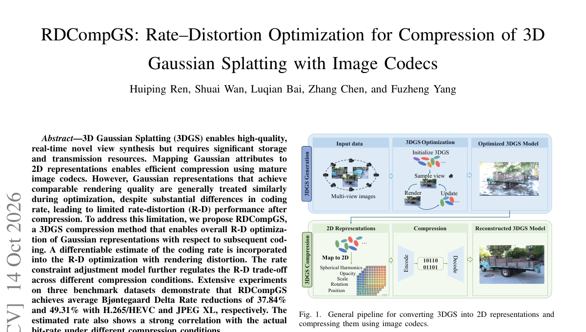

*Main result - Figure 2 Overview of the proposed RDCompGS. To enable overall R-D optimization of Gaussian representations with respect to subsequent coding, RDCompGS first introduces differentiable rate estimation ba*

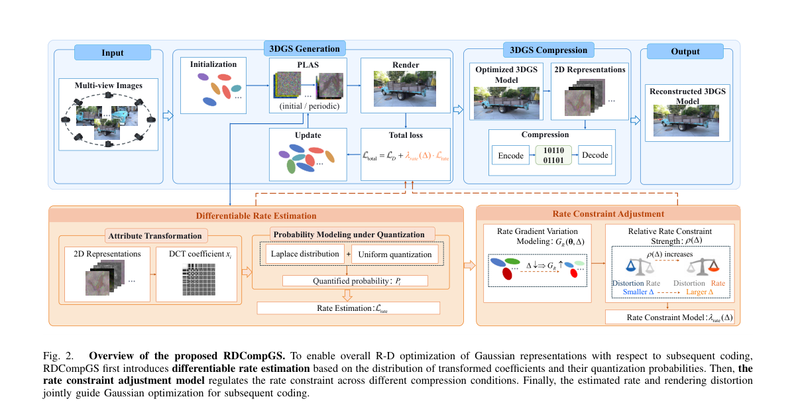

**Why this ranks #7**: 复用成熟图像编解码器是 3DGS 压缩最实用的路线，但需要解决表示不匹配。

---

### 8. DreamHMR: From Video Generation to Human Motion Modeling via Structural Focusing

**arXiv**: [2610.20124](https://arxiv.org/abs/2610.20124) | **Score**: 7.0 (relevance 7 x 0.7 + quality 7 x 0.3) | **Tags**: AIGC-video, embodied-ai | **Categories**: cs.AI, cs.CV | **Pages**: 25

**Authors**: Zhengjie Xu, Ruihao Gong, Xianglong Liu

**Affiliation**: Beihang University

**Abstract**

> Human mesh recovery (HMR) provides a geometric foundation for understanding human motion, but accurately reconstructing both body motion and fine hand articulation from videos remains challenging, especially in real-world scenes where occlusion and partial visibility are common. Video generation pretraining offers rich spatial and temporal priors for this task, but its focus on visual synthesis leaves a gap between these representations and explicit human geometry. We present DreamHMR, a general framework that adapts video generation priors for complete body-and-hand reconstruction. It follows a global-to-local strategy, first grounding video representations in human geometry and then refining body and hand detail with reliable local evidence. Global Body Representation Transfer trains the video backbone to predict complete human renderings, turning its native prediction task into a means of learning surface correspondence and posed geometry. Local Joint Feature Enhancement combines contextual estimates with reliable local evidence to recover fine body and hand detail, while limiting interference from occluders and background. Experiments on five datasets with four video backbones demonstrate strong reconstruction performance across backbone families. Under a unified evaluation protocol, our best model outperforms the best existing methods on all reported metrics of 3DPW, EMDB-1, and RICH, reducing body MPJPE by 4.2%, 4.7%, and 6.1%, respectively. In more challenging occlusion settings on held-out BEDLAM and EgoBody sequences, DreamHMR reduces overall body and hand MPJPE by 7.0% and 10.0%, respectively. Our code will be made publicly available.

**Key findings**

- **Finding**: 从视频重建身体运动与手部articulation 在遮挡场景下困难；视频生成预训练提供丰富的空间与时间先验。

- **Finding**: DreamHMR 通过**结构聚焦**（structural focusing）利用这些先验（摘要在此处截断）。

- **Inference**: 生成模型学到了「合理的运动与形状如何排布」的先验，这对重建的遮挡补全是直接可用的——生成预训练的价值不止于生成本身。

- **Recommendation**: 人体重建的读者可参考；与本批 KinoGen 类人形 loco-manipulation 参考生成本属同一「生成先验服务具身」路线。

**Key figures**

*Framework / architecture - Figure 1 DreamHMR architecture. Global Body Representation Transfer adapts a video DiT with complete SMPL-X renderings. Local Joint Feature Enhancement samples joint-local features, weights their cor*

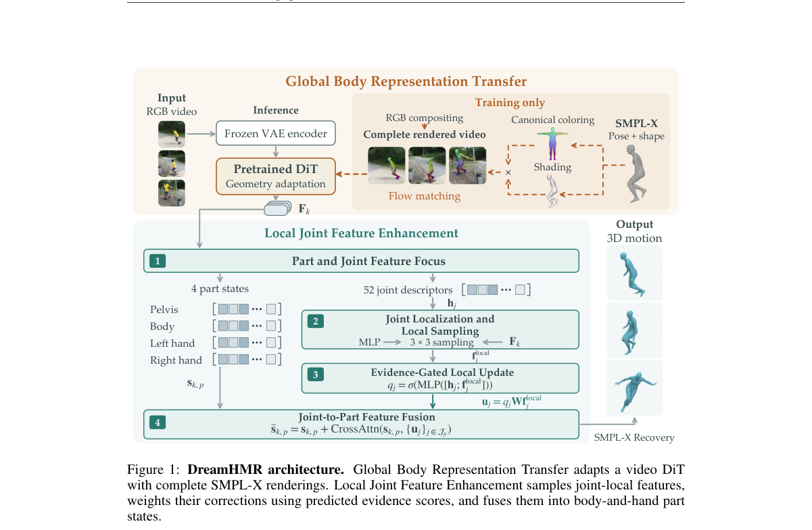

*Main result - Figure 2 From SMPL-X to rendered video. Fixed template coordinates provide canonical colors; posed normals determine shading. Their product is rasterized and composited with source RGB across frames.*

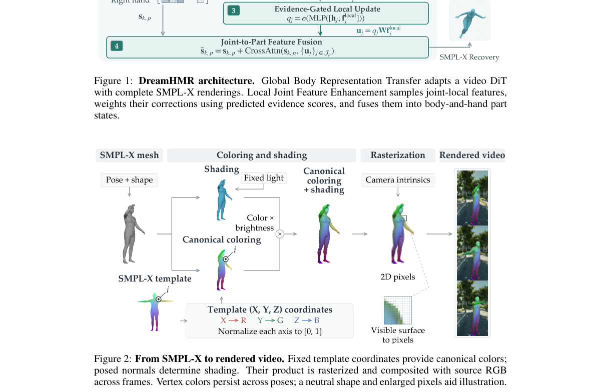

**Why this ranks #8**: 「用视频生成的先验做重建」是一条跨领域迁移的路径。

---

### 9. Any Time, Any Space: A World-State-Centric Framework for Agentic Video Generation

**arXiv**: [2610.20571](https://arxiv.org/abs/2610.20571) | **Score**: 7.0 (relevance 7 x 0.7 + quality 7 x 0.3) | **Tags**: AIGC-video | **Categories**: cs.CV | **Pages**: 37

**Authors**: Weijie Wang, Haomin Zhang, Ye Li, Akide Liu, Zeyu Zhang, Haoyu Zhao, Yefei He, Donny Y. Chen, Feng Chen, Bohan Zhuang

**Affiliation**: 1 Zhejiang University | 2 Monash University | 3 BAIR, UC Berkeley | 4 Adelaide University

**Abstract**

> Long-form agentic video generation must turn a screenplay into shots that remain spatially and temporally consistent across nonconsecutive requests. Passing prompts or recent frames between shots does not provide a shared spatial frame for revisiting a scene or a time-indexed record for replaying an earlier event. We present Any Time, Any Space (ATAS), which compiles a screenplay into shot requests with explicit location, camera, and event-time references. Before generation, it retrieves relevant evidence from a scene memory of registered static geometry and an event memory of dynamic observations indexed by scene, event, and time. After generation, ATAS reconstructs and registers the clip. It updates memory only when review and state checks accept the observation, while film delivery remains independent of memory admission. Across four video generators, ATAS improves all reported cross-shot consistency measures and achieves the highest aggregate benchmark score for each backbone. It also outperforms the compared agents and 3D-guided methods on target-image spatial revisit, leads three event-recapture criteria, and receives the highest human ratings on all six criteria. The video results and code are available on our project page: https://lhmd.top/atas/.

**Key findings**

- **Finding**: 在镜头间传递提示或最近帧，**无法**为重访场景提供共享空间框架，也无法为重播事件提供时间索引记录。

- **Finding**: Any Time, Any Space 提出世界状态为中心的框架（摘要在此处截断）。

- **Inference**: 「重访场景」要求一个与镜头无关的场景状态，「重播事件」要求一个与镜头无关的时间索引——两者都不在帧序列里，因此必须有一个显式的世界状态表示。

- **Recommendation**: 与本批 Demiurge（跨轨迹一致性，10-14）、今天 DreamHMR 对照，三篇都在解决「生成的产物需要一个跨请求一致的状态」。

**Key figures**

*Framework / architecture - Figure 1 World-state-centric agentic video generation. ATAS treats a multi-shot film as a sequence whose spatial and temporal information can be reused. Shared scene geometry anchors consistent return v*

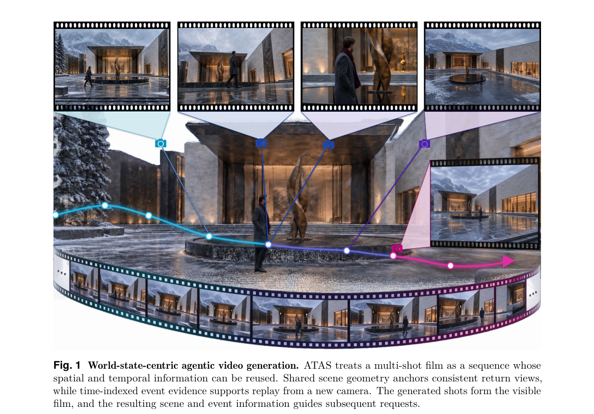

*Main result - Figure 2 Workflow of ATAS. A high-level prompt is parsed into multi-shot requests and bounded shot requests. Each request contains a description, scene, spatial anchor, camera, time interval, and option*

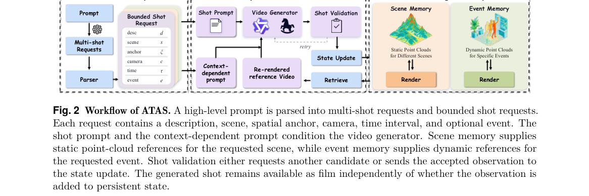

**Why this ranks #9**: 「非连续请求」是多镜头生成的真实需求，而现有做法只处理相邻帧传递。

---

### 10. CommerceGen-Studio: An End-to-End Framework for Commercial-Grade Main-Image Generation

**arXiv**: [2610.20603](https://arxiv.org/abs/2610.20603) | **Score**: 6.3 (relevance 6 x 0.7 + quality 7 x 0.3) | **Tags**: AIGC-image `[wild-card]` | **Categories**: cs.CV | **Pages**: 19

**Authors**: Xiaoli Xu, Zhengtao Wu, Zhengze Xu, Tao Liu, Yongchao Du, Zuan Gao, Xingjian Wang, Hao Yan, Mengting Chen, Wei Li, Bo Zheng

**Affiliation**: Alibaba Group

**Abstract**

> We present CommerceGen-Studio, an end-to-end framework for generating commercial-grade main images for e-commerce Stock Keeping Units (SKUs). Our framework is organized along a three-stage pipeline of information extraction, semantic rewriting, and multi-condition generation: Prompt-Eval-Refine-Loop Agent (PERL-Agent) distills heterogeneous SKU metadata into concise selling-point text lists through an iterative closed loop of VLM and LLM roles scored by a reference-free rubric. Layout Thinker Optimization (LTO) aligns the rewriter with both caption and rendered-image quality via alternating domain-specific policy optimization. SKU-DiT, trained under Reinforce-Distill-Reinforce (RDR) progressive training, conditions jointly on the white-background product image, the trademark crop, and the structured layout to hold subject fidelity, trademark integrity, and character-level text accuracy together. The framework runs in production at a scale of millions of main images per day with a latency of a few seconds per image, which we believe makes it among the first systems of this kind to operate at commercial scale. We also release CommerceGen-Bench, a benchmark of hard cases collected from live traffic across all product categories. On it, our framework achieves the highest overall scores among the evaluated open-source baselines on both editing tracks, with and without prompt enhancement. It also matches much larger closed-source models, and beats several of them at Instruction Following and Product Integration - the two properties that determine whether an image can be published.

**Key findings**

- **Finding**: 三阶段流水线：信息抽取、语义改写、多条件生成。

- **Finding**: PERL-Agent 从异构 SKU 元数据中蒸馏结构化信息（摘要在此处截断）。

- **Inference**: 商业主图的核心约束是「不能编造」——生成内容必须严格来自 SKU 元数据，因此抽取与改写阶段承担了绝大部分的约束检查职责，生成阶段反而是最后一步。

- **Recommendation**: wild-card 项；与本批 BluePixel（agentic 分派处理复杂指令）同属 agent 分阶段架构。

**Key figures**

*Framework / architecture - Figure 1 Showcase of CommerceGen-Studio. Given a product main image, an SKU image, and structured product information, the system automatically generates commercial-grade images with subject fidelity*

*Main result - Figure 2 Overall framework of CommerceGen-Studio. The training pipeline combines supervised fine-tuning, RDR progressive training, and LTO. The inference pipeline performs selling-point text list ext*

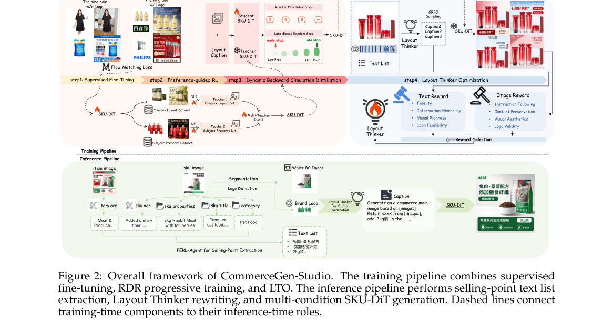

**Why this ranks #10**: wild-card：工业落地案例，其 agent 分阶段结构可借鉴。

---

## Footer

- Total papers reviewed across all 5 tracks: 50 (from 570 scanned)
- aigc_visual track final top-10: 10
- Wild-cards in this track: 2
- Figure assets: `res/` (shared across tracks)

Generated by `mine-arxiv-daily-digest` skill. Sister file: `2026-10-15_aigc_visual_entry.md`.
