# ArXiv Daily Digest - 2026-10-15 (音频与语音语言模型 / 双工语音助手, 10 papers)

**Generated**: 2026-10-15 17:00 CST

**Source**: arXiv cs.CV, cs.SD, eess.AS, cs.CL, cs.AI, cs.RO, cs.LG submissions, window 2026-10-14 UTC (latest announced batch as of 2026-10-15 17:00 CST)

**Track**: audio_lm (top 10 of 570 papers scanned, 50 full reads)

**Scope**: floor control benchmark in multi-party spoken dialogue, what LALM post-training actually learns, in-band full-duplex self-interference cancellation, full-stream long-form TTS, word-by-word commitment for robots, multilingual ASR-LLM pipeline evaluation, language identification for 22 Indian languages, context-sensitive code-switching, selective reasoning for typed decision models, zero-shot diarization across 22 languages

---

**本批是本项目日报审计线索的第五次出现，而且对象是「后训练是否真的学到东西」这个更根本的问题。**

**What Does LALM Post-training Learn?** 指出后训练带来的基准提升**可能反映的是对特定问题格式（如选择题）的适应**，而非音频理解与推理能力的真正进步。选择题的后训练收益可以来自「学会排除干扰选项」这一格式技巧，而这在开放式生成中完全无用——若评测只用选择题，该能力的价值被系统性高估。用 LALM 基准分数做选型前建议先看这篇。

另一条主线是**话语权与时机**，它是本项目日报追踪最久的音频议题（10-07 Coupled but Late → 10-09 DuplexAct → 10-14 Diffuplex/D2 → 今天）。**MultiPartyTurnBench** 把它推进到多方场景，并明确提出**易混淆的非事件**这一关键设计——附和（backchannel）在声学上与真正的话轮转换几乎不可分，因此只测正例的基准会奖励「对任何声音都让出话语权」的策略。**EarlyCommit** 则从决策侧介入：人类能在指令结束前几个词识别意图物体，而机器人通常等说完才行动；提前承诺把「等说完」这一保守假设替换为一个**需要校准的置信度**问题。

诚实说明：本批**双工语音论文稀缺**（cs.SD 19 + eess.AS 11 篇中仅一篇真双工，且属通信域的带内全双工自干扰消除），因此这条线用了 5 个 wild-card。MultiPartyTurnBench 是本线唯一可直接归入该议题的工作。

---

## Top 10 - 音频与语音语言模型 / 双工语音助手

### 1. MultiPartyTurnBench: Benchmarking Floor Control in Multi-Party Spoken Dialogue

**arXiv**: [2610.20172](https://arxiv.org/abs/2610.20172) | **Score**: 9.0 (relevance 9 x 0.7 + quality 9 x 0.3) | **Tags**: duplex-voice, audio-LM | **Categories**: cs.AI, cs.CL, cs.SD | **Pages**: 31

**Authors**: Puneet Mathur, Dinesh Manocha

**Affiliation**: University of Maryland College Park, USA | respond prematurely or unnecessarily abandon its | Gemini-3.8-Live (Google, 2026) yields almost in-

**Abstract**

> Full-duplex speech systems must decide when to enter, hold, or relinquish the conversational floor, even as multiple speakers overlap or backchannel without taking it. Existing evaluations study dyadic turn-taking or end-to-end agent behavior, but lack a unified, controlled evaluation of genuine floor transitions against confusable non-events in multi-party settings. We introduce MultiPartyTurnBench (MPTB), a benchmark of 240 synthetically generated, channel-separated conversations spanning two to five speakers and six interaction types. MPTB evaluates two complementary tasks: End-of-Turn (EOT) detection distinguishes genuine turn completion from temporary holds, while Interruption (INT) detection distinguishes successful floor takeovers from non-floor-taking speech. Exact event-conditioned annotations enable causal evaluation using false-positive-constrained recall and signed latency. Across acoustic, semantic, and turn-projection baselines, we find a stark asymmetry: learned systems achieve 82.5-92.6% EOT recall at 4.3-11.8% false-positive rates, while INT detection suffers from missed takeovers or excessive false activations. This asymmetry extends to five full-duplex agents which achieve 86.1-95.8% balanced accuracy on turn entry, yet perform near chance (46.9-54.7%) on selective interruption handling. Gemini-3.8-Live yields to 97.7% of backchannels, whereas MiniCPM-o-4.5 yields to only 1.4% of genuine interruptions. These findings establish selective floor control as a distinct, unresolved challenge for reliable multi-party voice interaction.

**Key findings**

- **Finding**: 全双工系统需决定何时进入、保持、让出话语权，即使存在重叠语音与不夺话语权的附和。

- **Finding**: 既有评测研究双对话（dyadic）或端到端行为，**缺乏多方设定下**针对真实话语权转换的统一受控评测。

- **Finding**: MultiPartyTurnBench 特别强调**易混淆的非事件**（confusable non-events）——即看起来像话语权转移但实际不是的情形。

- **Inference**: 「易混淆非事件」是这类基准的核心难点：附和（backchannel）在声学上与真正的话轮转换几乎不可分，因此只测正例的基准会奖励那些对任何声音都让出话语权的策略。

- **Recommendation**: 本批音频 LM 第一篇，且是本项目日报追踪的话轮议题的最新一环——接上 10-07 Coupled but Late（模型间环路时序未必是人类的）、10-09 DuplexAct（动作级评测）、10-14 DuplexAct/D2/Diffuplex。

**Key figures**

*Framework / architecture - Figure 1 MultiPartyTurnBench evaluation tracks. The End-of-Turn (EOT) track distinguishes genuine floor relinquishment from mid-turn pauses where the speaker retains the floor. The Interruption (INT)*

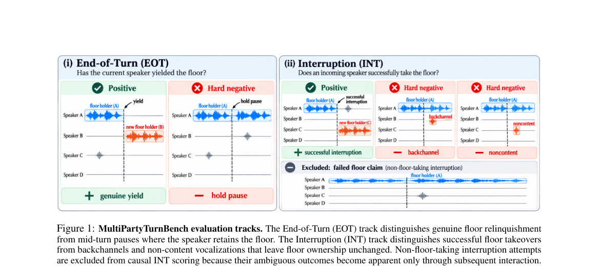

*Main result - Figure 2 MultiPartyTurnBench conversation generation pipeline. Five-stage pipeline transforms event-conditioned dialogue scripts into synchronized multi-speaker audio with exact floor-transition anno*

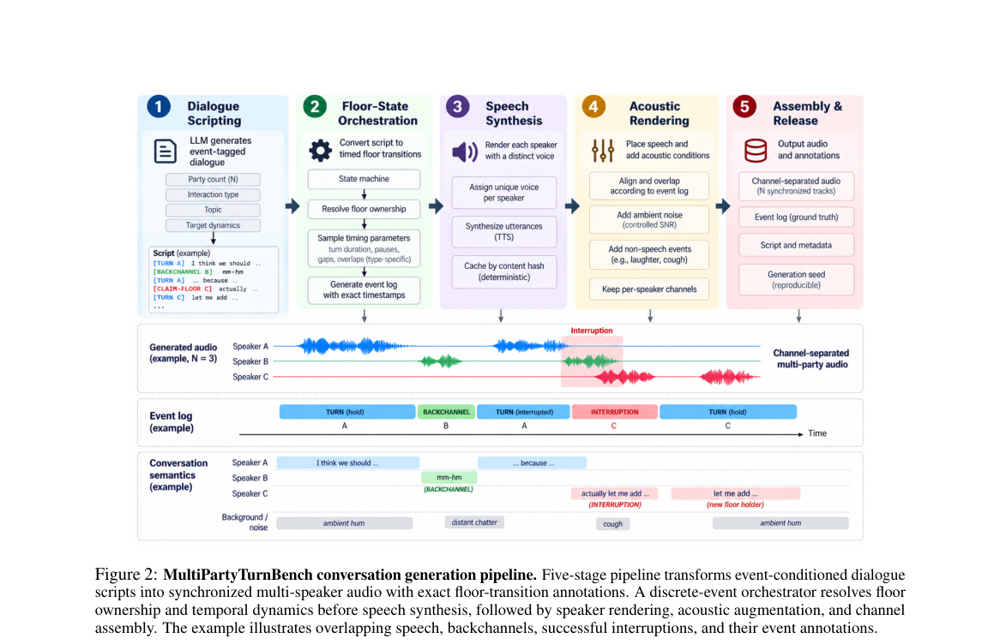

**Why this ranks #1**: 这条线是我在本项目日报里追踪最久的音频议题，本篇把它推进到多方场景，并明确提出了「易混淆非事件」这一关键设计。

---

### 2. What Does LALM Post-training Learn? Rethinking Audio Understanding and Reasoning Capabilities

**arXiv**: [2610.19476](https://arxiv.org/abs/2610.19476) | **Score**: 8.7 (relevance 9 x 0.7 + quality 8 x 0.3) | **Tags**: audio-LM | **Categories**: cs.CL, cs.MM, cs.SD, eess.AS | **Pages**: 12

**Authors**: Hua-Hsuan Chen, Xuanjun Chen, Wei-Chung Lu, Chih-Kai Yang, Yu-Xiang Lin, Sung-Feng Huang, Haibin Wu, Hung-yi Lee

**Affiliation**: National Taiwan University1 | NTU AI-Core4

**Abstract**

> Post-training often improves the performance of large audio-language models on audio understanding and reasoning benchmarks. However, these improvements may reflect adaptation to specific question formats, such as multiple-choice questions, rather than genuine advances in audio understanding and reasoning capabilities. To investigate what LALMs actually learn from post-training, we conduct controlled experiments that disentangle improvements in audio understanding from adaptation to specific question formats. Across different models and post-training methods, we find that much of the reported improvement persists even without informative audio, but largely disappears when the question format changes. These findings suggest that post-training often teaches models to exploit task-specific textual cues and answer patterns rather than developing generalizable audio understanding and reasoning capabilities.

**Key findings**

- **Finding**: 后训练带来的基准提升**可能反映对特定问题格式（如选择题）的适应**，而非音频理解与推理能力的真正进步。

- **Finding**: 作者系统探究 LALM 从后训练中实际学到了什么（摘要在此处截断，分析方法需查正文）。

- **Inference**: 选择题的后训练收益可以来自「学会排除干扰选项」这一格式技巧，而这在开放式生成中完全无用——若评测只用选择题，则该能力的价值被系统性高估。

- **Recommendation**: 本项目日报审计线索的第五例（前四例：Mind the Execution Gap、World Models' Last Exam、Selective Listening、Does Location Matter）。用 LALM 基准分数做选型前建议先看这篇。

**Key figures**

*Framework / architecture - Figure 1 Schematic overview of LALM post-training. The illustration demonstrates that models achieve com- parable performance gains (e.g., ∼+40) whether post- trained with informative audio (a) or si*

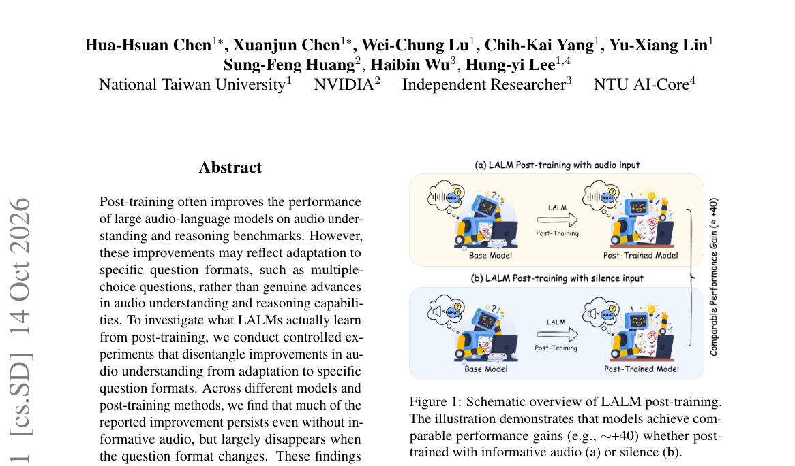

*Main result - Figure 2 Case Study: Revealing option priors and the impact of question phrasing on model predictions.*

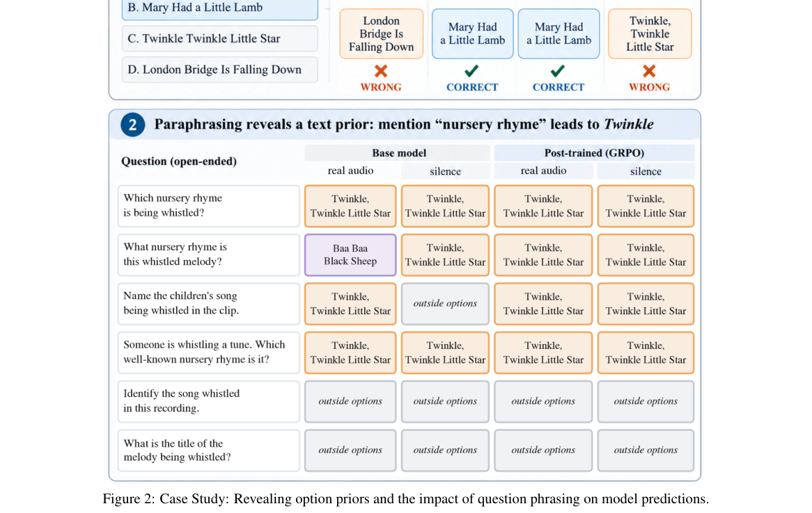

**Why this ranks #2**: 本批审计主题最尖锐的一例：它质疑的正是「后训练提升了基准分数」这个我们默认成立的结论。

---

### 3. Speaking Longer Than Learned: Training-Free Long-Form Generation for Full-Stream Text-to-Speech

**arXiv**: [2610.19553](https://arxiv.org/abs/2610.19553) | **Score**: 7.3 (relevance 7 x 0.7 + quality 8 x 0.3) | **Tags**: audio-LM | **Categories**: cs.SD | **Pages**: 5

**Authors**: Jeseung Lim, Jiseong Woo, Heeseung Kim

**Affiliation**: 1Department of Physics, University of Seoul, Seoul, Republic of Korea | 2Department of AI, University of Seoul, Seoul, Republic of Korea

**Abstract**

> Recent full-stream text-to-speech (TTS) models enable low-latency personalized synthesis as input text arrives. However, sustaining generation beyond the lengths seen during training without additional training remains largely unexplored. We systematically analyze VoXtream2, which extends generation by periodically discarding past context while retaining the acoustic prompt. We find that this strategy does not prevent degradation: pronunciation accuracy deteriorates near the end of the training range due to the range of positions in which the model operates rather than the loss of past context, while speaker similarity gradually declines throughout generation. Based on these findings, we propose two training-free modifications that reduce the attention window and strengthen attention to the acoustic prompt. Experiments show that these modifications preserve pronunciation accuracy and speaker similarity throughout long-form generation while retaining the naturalness of the original model. Ablations further show complementary effects of the two modifications.

**Key findings**

- **Finding**: 全流式 TTS 支持随文本到达而合成，但在**无额外训练**下超出训练长度仍基本未被探索。

- **Finding**: 作者系统分析 VoXtream2，它通过**周期性丢弃过去上下文**同时保留声学提示来延长生成（摘要在此处截断）。

- **Inference**: 丢弃上下文之所以可行，是因为语音合成的「未来」主要依赖声学提示（音色与韵律基线）而非长程文本历史——这与语言模型必须保留全部上下文形成对照。

- **Recommendation**: 做流式 TTS 的读者注意；与本批 Revise-TTS（掩码扩散 TTS 的非掩码精化）同属流式/扩散 TTS 路线。

**Key figures**

*Framework / architecture - Figure 1 Segment-wise WER and SPK-SIM of VoXtream2, to- gether with the corresponding ground truth speech.*

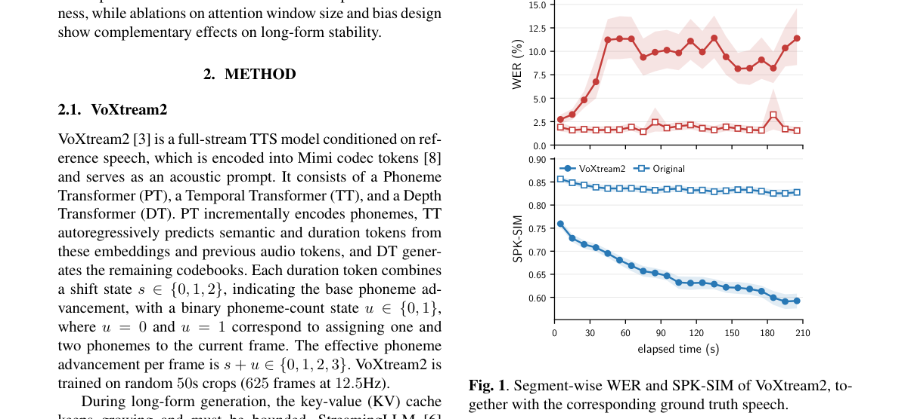

*Main result - Figure 2 Expected number of phonemes advanced per frame versus position for W = 400, 625, and 900. Shaded bands show standard errors over 8 randomly selected utterances.*

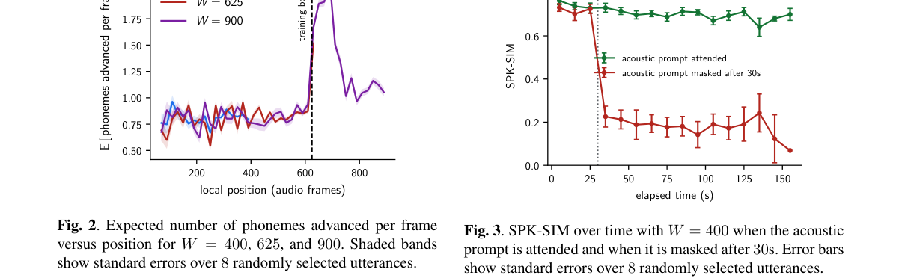

**Why this ranks #3**: 「丢弃上下文以延长生成」是一个反直觉但实用的流式推理策略。

---

### 4. EarlyCommit: Calibrated Word-by-Word Commitment for Robots Acting Before You Finish Speaking

**arXiv**: [2610.20531](https://arxiv.org/abs/2610.20531) | **Score**: 7.0 (relevance 7 x 0.7 + quality 7 x 0.3) | **Tags**: duplex-voice, embodied-ai | **Categories**: cs.RO | **Pages**: 8

**Authors**: Muhammad Haris Khan

**Affiliation**: MUHAMMAD HARIS KHAN, University of Copenhagen, Denmark

**Abstract**

> Human listeners can often identify the intended object several words before an instruction ends. Robots, however, are typically designed to wait until the speaker has finished before deciding how to act. We present EarlyCommit, an open-source tool that lets a robot commit to the intended object while the instruction is being spoken. After every recognized word, a fine-tuned text encoder scores each object in the scene. The robot acts when the calibrated probability of the best object reaches a threshold tau set by the user, so 1 - tau is the accepted risk of choosing the wrong object. Otherwise, it waits or asks. The tool includes a streaming speech front end, a scene and instruction generator with exact word-by-word ground truth, and scripts to train, calibrate, and evaluate. On instructions containing words never seen in training, EarlyCommit commits correctly 1.6 to 2 times as often as keyword matching, is right at least 92 percent of the time when it commits at tau = 0.9, and needs 31 to 35 ms per word on consumer GPUs.

**Key findings**

- **Finding**: 人类能在指令结束前几个词识别意图物体；机器人通常**等说话人说完**才决定。

- **Finding**: EarlyCommit 在每个被识别的词之后，由微调的文本……（摘要在此处截断）给出对目标物体的承诺。

- **Inference**: 提前承诺把「等对方说完」这一保守假设替换为一个**需要校准的置信度**问题——若过早承诺会导致不可恢复的错误动作，则校准精度比提前量更重要。

- **Recommendation**: 语音交互的读者注意；与本批 MultiPartyTurnBench（话语权时机）对照，一篇测时机、一篇做提前决策。

**Key figures**

*Framework / architecture - Figure 1 EarlyCommit architecture. Left: the build pipeline. Generated scenes and instructions are labelled after every word by an incremental oracle. Three word pools with no shared words supply unsee*

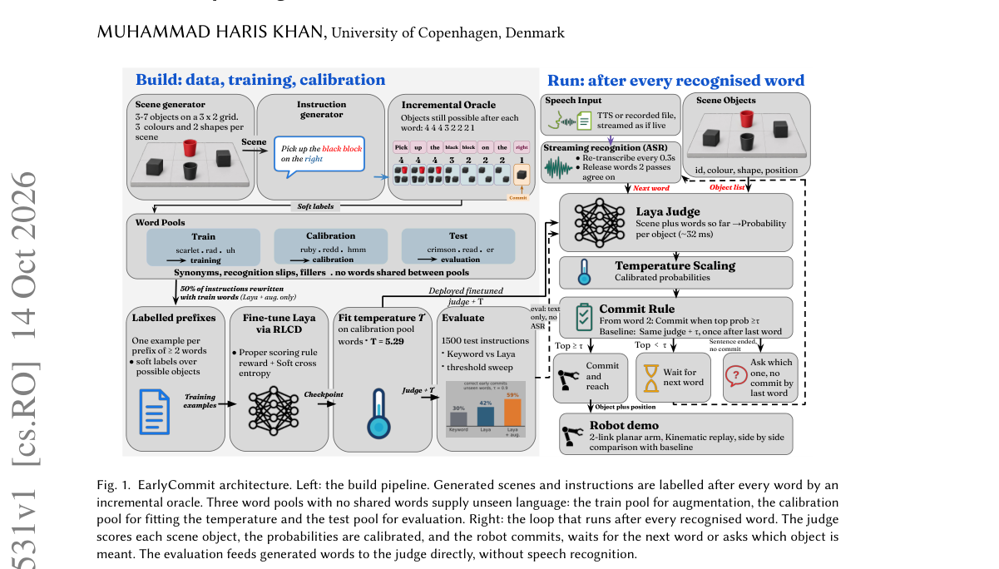

*Main result - Figure 2 Correct against wrong commits as 𝜏varies on unseen language. Up and to the left is better. Keyword matching does not depend on 𝜏and appears as one point. Points for 𝜏between 0.85 and 0.95 coin*

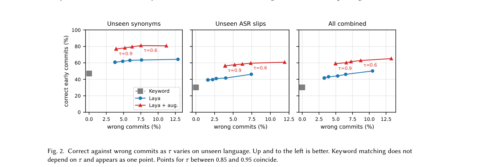

**Why this ranks #4**: 「不等说完就行动」把交互延迟从感知层面挪到决策层面，是一个具体的交互设计问题。

---

### 5. Digital Self-Interference Cancellation for In-Band Full-Duplex Systems Based on Transformer Neural Operators

**arXiv**: [2610.19490](https://arxiv.org/abs/2610.19490) | **Score**: 6.3 (relevance 6 x 0.7 + quality 7 x 0.3) | **Tags**: duplex-voice | **Categories**: cs.IT, cs.LG | **Pages**: 24

**Authors**: Zhijie Su, Shiquan Zhang, Qiaolin He

**Affiliation**: aDepartment of Mathematics, Sichuan University, Chengdu 610065, China

**Abstract**

> Digital-domain self-interference cancellation is essential in in-band full-duplex radios after passive suppression and analog cancellation. It is particularly challenging when the desired signal is strong relative to the residual self-interference. In this regime, conventional iterative digital cancellers update their coefficients from desired-signal-contaminated received samples and may suffer substantial performance degradation. This paper reformulates digital-domain self-interference cancellation as an operator-learning problem. The proposed framework learns the temporal evolution of the residual self-interference channel from historical observations and uses the learned operator together with the known local transmit signal to reconstruct the current residual self-interference. A Transformer neural operator is used to realize this framework. The resulting method is trained in a desired-signal-free setting and then applied in the presence of a desired signal. A continuity-based analysis characterizes the sensitivity of the learned operator to the resulting input perturbation. Numerical experiments in static and time-varying channels, including time-varying SIR conditions, demonstrate stable cancellation performance over a wide range of interference levels. At 30 dB SIR, the proposed method improves the cancellation performance by 5--15 dB over the considered conventional methods.

**Key findings**

- **Finding**: 当期望信号相对残余自干扰**很强**时，常规迭代数字消除器因用被污染的采样更新系数而失效。

- **Finding**: 该文基于 transformer 神经算子做带内全双工的自干扰消除（摘要在此处截断）。

- **Inference**: 这是语音助手回声消除的一个更严格的版本——语音助手面对的是自己的 TTS 回声（可预测），而带内全双工面对的是未知干扰，两者的信息条件差异决定了方法不能直接迁移。

- **Recommendation**: 双工方向稀缺，本篇作为「通信域全双工」的唯一代表入选；语音双工的读者可对照思考信息条件的差异。

**Key figures**: 无可用图示（正文以表格与证明为主）。

**Why this ranks #5**: 这是本批唯一的真双工论文，但属通信域而非语音域——仍值得对照，因为「自干扰」的物理问题与语音助手的回声消除同源。

---

### 6. SEA-HELM Audio: Evaluating Multilingual ASR-LLM Pipeline Performance Across SEA-HELM Subsets

**arXiv**: [2610.19869](https://arxiv.org/abs/2610.19869) | **Score**: 6.3 (relevance 6 x 0.7 + quality 7 x 0.3) | **Tags**: audio-LM | **Categories**: cs.CL, cs.SD | **Pages**: 4

**Authors**: Yixian Tan, Aulia Adila, Jonathan Heng, Kunat Pipatanakul, Donghang Wu, Anocha Sutaveephamochanon

**Affiliation**: [not-found in PDF]

**Abstract**

> We introduce SEA-HELM Audio, a Southeast Asian (SEA) multilingual evaluation framework that extends the text-based SEA-HELM benchmark to assess performance degradation in cascaded automatic speech recognition and large language model (ASR-LLM) pipelines. Using synthesized speech, we compare speech-input and text-input performance across five languages (Chinese, English, Malay, Indonesian, and Tamil) on multiple-choice reasoning and instruction-following tasks. We evaluate open-weight and commercial ASR-LLM systems using identical verifiers and quantify the speech gap as the difference between text and speech accuracy. Results show substantial degradation, with accuracy drops of 9.00 to 18.50 percentage points for multiple-choice reasoning and 20.00 to 42.86 points for instruction following. Tamil exhibits the largest degradation, exceeding 40 percentage points. Our findings highlight the limitations of text-only benchmarks in predicting voice-agent reliability and demonstrate the value of SEA-HELM Audio for evaluating multilingual voice-agent systems.

**Key findings**

- **Finding**: 评估级联 ASR-LLM 流水线的性能**衰减**（文本基准 → 语音输入）。

- **Finding**: 用合成语音在五种语言上比较语音输入与文本输入（摘要在此处截断）。

- **Inference**: 同一模型、同一文本，只换输入模态，两者的差值就是流水线的纯损失——这个对照设计比直接报告 ASR 的 WER 更有信息量，因为后者把识别错误与理解错误混在一起。

- **Recommendation**: 多语 ASR 系统的读者可参考；合成语音作为可控输入是该设计的优势（但也带来合成器偏差）。

**Key figures**

*Framework / architecture - Figure 1 SEA-HELM Audio evaluation: speech path (TTS →Speech →LLM) vs. text path (LLM only).*

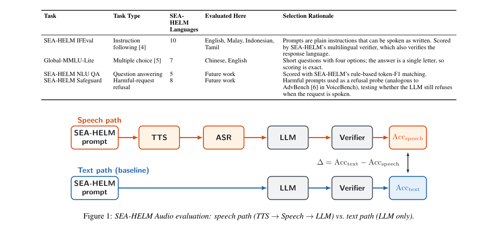

**Why this ranks #6**: 「语音输入 vs 文本输入」的对照设计能干净地隔离级联流水线的损失。

---

### 7. Anuvani-LID: Robust and Calibrated Spoken Language Identification for Indian Languages

**arXiv**: [2610.20263](https://arxiv.org/abs/2610.20263) | **Score**: 6.3 (relevance 6 x 0.7 + quality 7 x 0.3) | **Tags**: audio-LM | **Categories**: cs.CL | **Pages**: 25

**Authors**: Stephen Fernandes, Narayan Choudhary

**Affiliation**: Central Institute of Indian Languages | Mind, 2026; OpenAI, 2024). Dedicated LID mod-

**Abstract**

> Every multilingual speech pipeline begins with a language decision, an error there propagates silently through recognition, translation and routing. In India it spans 22 scheduled languages across four language families, heard over short, noisy, narrowband and code-mixed audio. Foundational speech models increasingly present language identification (LID) as an inherent latent, generalized capability. Autoregressive decoders in speech models emit a special language ID token, and modern LLMs with audio capabilities can name the language when prompted. We test this assumption on identical clips and find that whisper and similar speech models has tokens for only 15 of the 23 languages, on one second inputs Gemini 3.5 Flash reaches 0.52 macro-F1 and GPT-audio 0.14. We present Anuvani LID, a dedicated 115M parameter LID conformer model trained on 54,643 hours of Indian speech spanning 22 Indian languages and Indian accented English. Along with designed and controlled studies on 102 condition benchmark with speaker and corpus held out tests. Across 37 conditions, it reaches 0.914 mean macro-F1, 5.2 points above Gemini 3.5 Flash and ahead of 14 other systems. It is 24 points ahead of Gemini at one second, scores 0.897 on all 23 languages where no other system exceeds 0.713, and is calibrated to an ECE of 0.008. Reliable Indian LID still requires a robust, dedicated and calibrated model.

**Key findings**

- **Finding**: LID 错误会**静默地**传播到识别、翻译与路由——没有任何下游信号提示出错。

- **Finding**: 印度场景涉及 22 种官方语言、四个语系，音频短、噪、窄带且代码混合。

- **Finding**: 基础语音模型越来越多地把 LID 呈现为内在潜变量，作者对此做鲁棒且**校准**的显式 LID（摘要在此处截断）。

- **Inference**: 「静默传播」要求 LID 输出**校准**的概率而非仅是 argmax 决策——否则下游无法在低置信时降级到「询问用户」。

- **Recommendation**: 与本批 Anuvani-Diarization（同为印度 22 语言的配套工作）一起读，两者覆盖同一语言生态的两个入口任务。

**Key figures**

*Framework / architecture - Figure 1 Anuvani-LID against the field on SUITE-42 (macro-F1, identical clips). The radar covers nine domains from 32 of the 37 core conditions, with its axis from 0.3; the leaderboard averages all 3*

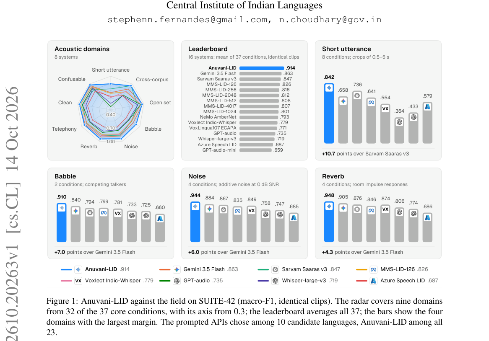

*Main result - Figure 2 Speaker population versus training data. Speech resources do not track population: Urdu has more than 50M first-language speakers but less audio than Maithili or Nepali, and English is abund*

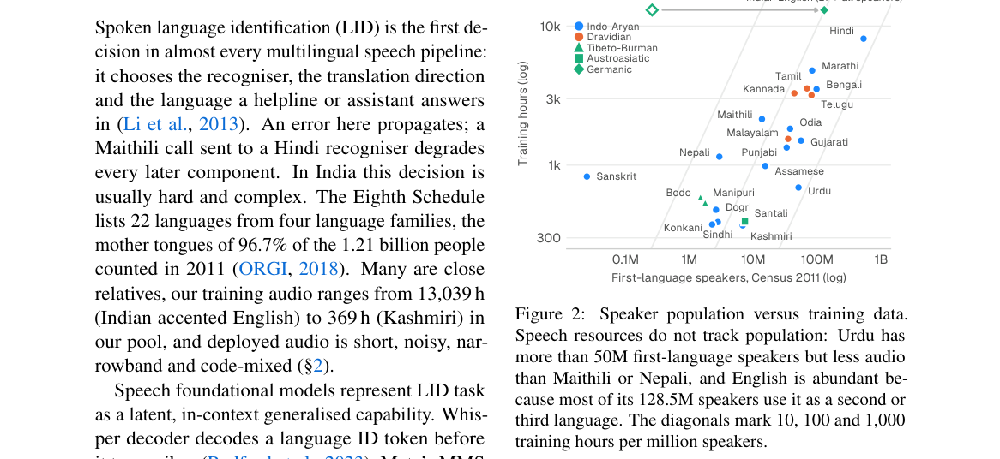

**Why this ranks #7**: 「错误静默传播」是这个问题的本质——LID 错了，下游全错且无告警。

---

### 8. Selective Reasoning for Typed Decision Models: When to Start, Read, and Stop

**arXiv**: [2610.19644](https://arxiv.org/abs/2610.19644) | **Score**: 6.3 (relevance 6 x 0.7 + quality 7 x 0.3) | **Tags**: audio-LM, rl-algorithm | **Categories**: cs.CL | **Pages**: 24

**Authors**: Bin Zheng, Zheng Chen

**Affiliation**: University of Electronic Science and Technology of China

**Abstract**

> Typed decision models need an interface that can use additional reasoning while retaining candidate outputs. We train a shared candidate-answer reader on a frozen Qwen3.5-4B backbone to unify direct decisions with on-demand, interruptible reasoning. The reader returns distributions from empty and partial reasoning prefixes. A benefit gate starts reasoning, a natural-state trigger requests explicit reads, and an entropy rule accepts acquired answers and cancels generation. Measurements distinguish answer-query work, generated output, and pipeline time. Across 768 questions from ProofWriter, LogiQA 2.0, and ARC-Challenge, accuracy rises from 70.96% for direct reading to 84.38%. Relative to 512-token terminal reading, accuracy improves by 7.29 percentage points with 2.25% more mean output work. Relative to 1,024-token terminal reading, pipeline time falls by 46.30% with an accuracy difference of -1.17 points. Exact-prefix controls isolate the saving from interruption, while read-scheduling controls distinguish reduced observation work from shorter response time.

**Key findings**

- **Finding**: 读取器从空与部分推理前缀返回分布，用**收益门控**（benefit gate）决定何时启动推理。

- **Finding**: 自然状态触发与可中断性使直接决策与按需推理统一（摘要在此处截断）。

- **Inference**: 「收益门控」把「何时推理」变成一个可学习的成本-收益决策，而不是固定预算——这与本批 RL 线 Where to Start, How to Move（课程决定从哪里开始）是同一类问题的不同层。

- **Recommendation**: 语音助手若要实现打断能力，这套门控机制可直接借鉴。

**Key figures**

*Framework / architecture - Figure 1 Accuracy and mean pipeline time for ten configurations on the same 768 questions. The star marks Ours at τ = 0.70. Parenthesized numbers are reasoning-token caps; Fixed budget denotes termina*

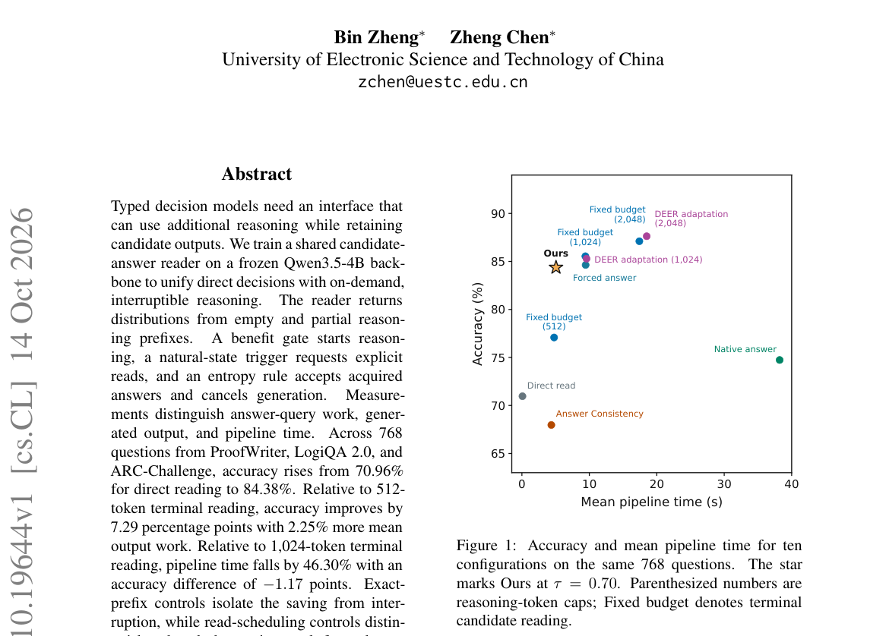

*Main result - Figure 2 On-demand, interruptible reasoning through a shared candidate interface. The abridged ProofWriter example shows reasoning correcting a direct answer and intermediate acceptance avoiding late*

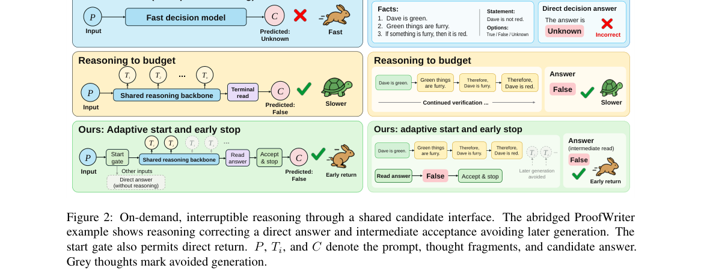

**Why this ranks #8**: 「可中断推理」在语音场景有直接对应——用户打断时推理必须能停下。

---

### 9. CSWBench: Evaluating Context-Sensitive Code-Switching in Creative Writing

**arXiv**: [2610.20272](https://arxiv.org/abs/2610.20272) | **Score**: 6.0 (relevance 6 x 0.7 + quality 6 x 0.3) | **Tags**: audio-LM | **Categories**: cs.AI, cs.CL | **Pages**: 38

**Authors**: Zewen Jiang, Yahan Li, Chenlu Guo, Diana Inkpen, Yuan Wu, Yi Chang

**Affiliation**: 1School of Artificial Intelligence, Jilin University, China | 2College of Software, Jilin University, China | 3Xingchen AGI Lab, China Telecom Artificial Intelligence Technology (Beijing) Co., Ltd., China | 4Bilibili Inc., China

**Abstract**

> Large language models (LLMs) have demonstrated multilingual capabilities across diverse language generation and understanding tasks. Yet effective code-switching requires more than multilingual proficiency: models must decide when, where, and why to switch languages in ways that fit the surrounding context. This context-sensitive ability remains insufficiently evaluated. We introduce CSWBench, a benchmark for evaluating context-sensitive code-switching in creative writing through two complementary settings: Focused Narrative and Extended Narrative. We further propose CSWEval, a theory-informed framework with two complementary levels: event-level evaluation of Licensing, Contextual Appropriateness, and Functional Gain, and whole-text evaluation of task-specific quality---overall literary and narrative quality in Focused Narrative and quality emphasizing multilingual organization in Extended Narrative. Evaluating twelve LLMs, we find that models exhibit meaningful but uneven code-switching competence across narrative contexts. Model differences are particularly pronounced in multilingual literary integration, while multilingual-focused dimensions show stronger difficulty effects overall than the general narrative dimensions; narratively salient switches are associated with stronger contextual and functional realization; and event-level CS quality is moderately associated with whole-text performance.

**Key findings**

- **Finding**: 有效代码切换需要模型决定何时、何地、为何切换语言以契合语境，此前评估不足。

- **Finding**: CSWBench 针对**创意写作**场景评测上下文敏感的代码切换（摘要在此处截断）。

- **Inference**: 创意写作是代码切换最难的场景——语用正确性没有唯一答案，因此基准若不给人工标准，测的就是模型与标注者的偏好一致度。

- **Recommendation**: 多语生成的读者可参考；与本批 SEA-HELM、Anuvani-LID 共同构成本批的多语评估三篇。

**Key figures**

*Framework / architecture - Figure 1 Illustrative distinction between genuine code- switching and surface multilingual material. The exam- ples distinguish meaningful language switches from En- glish expressions that do not con*

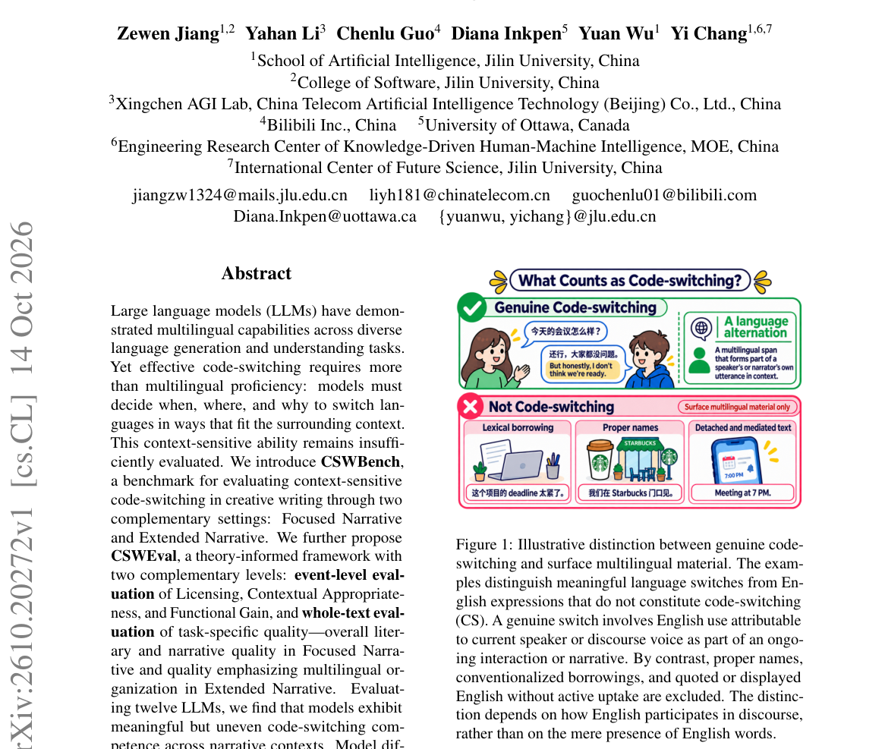

*Main result - Figure 2 Overview of the CSWBench construction and CSWEval evaluation pipeline. Source records are screened and transformed into Seed-conditioned prompts; CSWEval defines event-level and whole-text a*

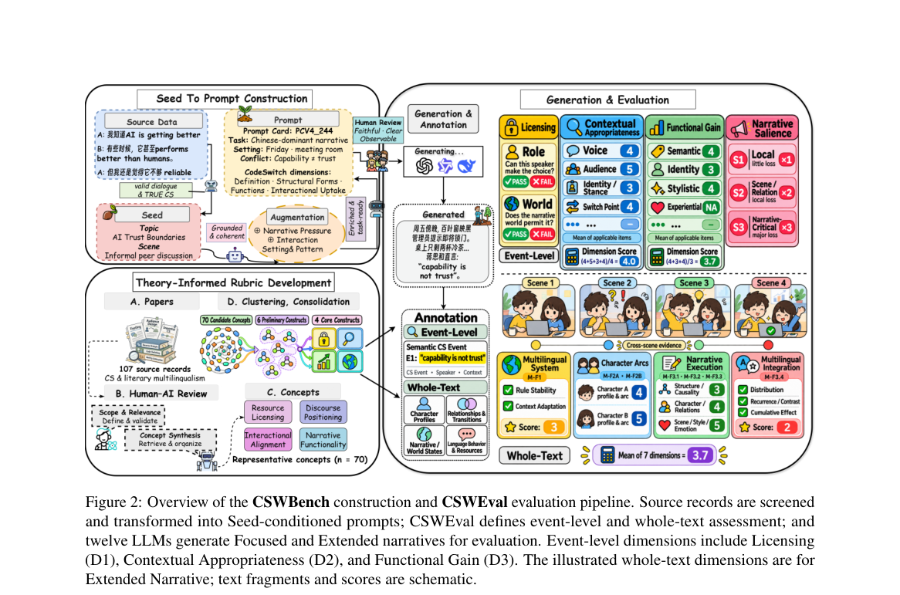

**Why this ranks #9**: 「何时何地为何切换」把代码切换从语言能力问题变成语用问题。

---

### 10. Anuvani-Diarization: Zero Shot Speaker Diarization and Annotation Conventions Across 22 Languages

**arXiv**: [2610.20327](https://arxiv.org/abs/2610.20327) | **Score**: 5.6 (relevance 5 x 0.7 + quality 7 x 0.3) | **Tags**: audio-LM | **Categories**: cs.CL | **Pages**: 14

**Authors**: Stephen Fernandes, Narayan Choudhary

**Affiliation**: Central Institute of Indian Languages | 1.60 lower than NVIDIA Nemotron 3

**Abstract**

> India's 22 scheduled languages are spoken by over a billion people in conversations that mix languages, often within one turn, overlap freely, and take place over telephones, in meetings, and in media. Knowing who spoke when, the task of speaker diarization, is essential to speech applications for such conversation: voice agents conversing with several people at once, speaker attributed transcription of meetings and calls, contact center analytics, and media monitoring. We present a systematic study of speaker diarization across all 22 languages on IndicDiarBench and introduce Anuvani-Diarization, which adapts a self-supervised end-to-end segmentation model to Indian conversation with uncertainty aware silver supervision. Evaluated zero shot alongside nine recent diarization systems, it reaches a duration weighted diarization error rate (DER) of 16.78% on all 1,164 recordings, the lowest of all systems we ran and second only to the best published result (16.0%), and leads the three strongest rivals in 14 of 22 languages. It matches its parent on six international benchmarks. We also show that the benchmark's utterance level annotation convention is a hidden variable worth 1.9 to 4.1 DER points, depending on the system, and that a convention learned from other Indian transcriptions does not transfer.

**Key findings**

- **Finding**: 印度 22 种语言的对话常在**一个话轮内**混合语言并自由重叠，出现在电话、会议与媒体中。

- **Finding**: 作者提供跨 22 种语言的零样本说话人日志与标注规范（摘要在此处截断）。

- **Inference**: 话轮内混语会让基于话轮的日志假设失效——系统必须能在同一话轮内切换说话人标签，这比常规的「切分话轮再贴标签」两级结构更复杂。

- **Recommendation**: 多语对话系统的读者可参考；与本批 Anuvani-LID 是同一语言生态的一对配套工作。

**Key figures**

*Framework / architecture - Figure 1 Anuvani-Diarization on Indic DiarBench and global benchmarks. DER (%); bars start at zero.*

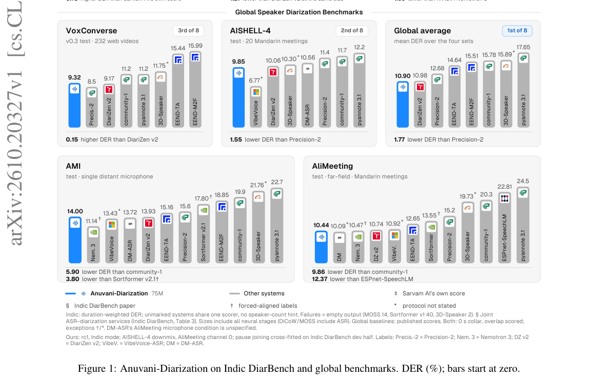

*Main result - Figure 2 Anuvani-Diarization is the most accurate of all systems we ran on IndicDiarBench. Duration weighted DER on all 1,164 recordings (zero collar, overlap scored). †Joint transcription and diariz*

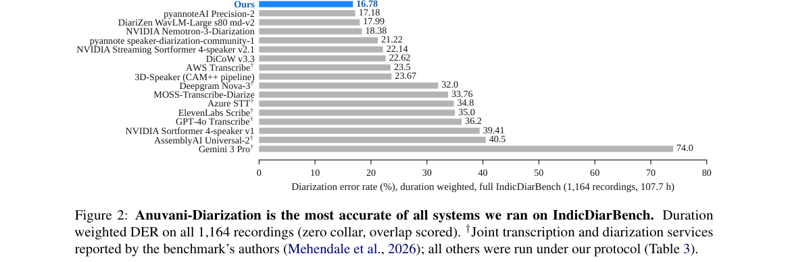

**Why this ranks #10**: 「一个话轮内混合语言」这个条件对说话人日志是一个特殊挑战。

---

## Footer

- Total papers reviewed across all 5 tracks: 50 (from 570 scanned)
- audio_lm track final top-10: 10
- Wild-cards in this track: 5
- Figure assets: `res/` (shared across tracks)

Generated by `mine-arxiv-daily-digest` skill. Sister file: `2026-10-15_audio_lm_entry.md`.
