# ArXiv Daily Digest - 2026-10-15 (具身智能与世界模型, 10 papers)

**Generated**: 2026-10-15 17:00 CST

**Source**: arXiv cs.CV, cs.SD, eess.AS, cs.CL, cs.AI, cs.RO, cs.LG submissions, window 2026-10-14 UTC (latest announced batch as of 2026-10-15 17:00 CST)

**Track**: embodied (top 10 of 570 papers scanned, 50 full reads)

**Scope**: survey of tactile-guided robot learning from representation to foundation models, modular whole-body mobile manipulation, vision-tactile-language-action dataset, automated real-to-sim-to-real data generation, hierarchical residual mobile manipulation, coordination-aware dual-hand action representation, deployment-time policy improvement via world model planning, navigation-conditioned world model dreaming for driving, force-feedback manipulation interface, perturbation-informed VLA execution

---

**触觉在本批收束成一篇综述**。本项目日报已连续三天记录这条趋势——10-08 出现五篇触觉工作（因子化表征、500 小时视触数据、时序触觉、磁纤毛传感器、统一基准），我当时判断这是「从方法期进入基准期」；10-14 又有五篇力/接触工作；今天则出现综述与数据集。**Tactile-Guided Robot Learning** 的关键论断是触觉的角色已从接触检测与反应式控制，扩展到**学习可迁移表示**、条件化策略与支撑具身物理推理——换言之它提供的是视觉无法获得的物理接触信息，而非更精细的接触信号。配套的 **TacClaw-Infinity** 则点出数据瓶颈的真实位置：触觉数据的难点不是采集量而是**标注结构**（视觉可自动弱标注，触觉需要与接触事件对齐的时序标签）。

其余是结构与接口层面的工作。**RoboSpan** 把全身移动操作的两个挑战并列：运动模块间的**固有异质性**（接口设计问题）与长时程的**渐进误差累积**（闭环反馈问题）——混为一谈会导致用错方法。**Coordi-pi** 指出既有双手 VLA 在每个控制步**简单拼接**左右臂-手动作，这意味着表示中不含「两臂之间的关系」，协调必须由策略隐式学出。**HiRe-MoMa** 则用分层残差把耦合留在基础策略内部、只在低维自由度上修正。

部署侧两篇同属「用世界模型在部署时提供信号」：**Back on Track** 的出发点是策略可能在部署中以**自己无法预测或自行恢复**的方式失败，而世界模型规划的价值在于它能在动作前预测后果，从而把不可预测的失败变成可检测的；**SafeDriveVLA** 则从接口角度指出导航从固定命令集扩展到**自由形式自然语言**扩大了攻击面——这是接口设计带来的安全性回退，而非模型能力问题。

---

## Top 10 - 具身智能与世界模型

### 1. Tactile-Guided Robot Learning: From Representation Learning to Foundation Models

**arXiv**: [2610.20134](https://arxiv.org/abs/2610.20134) | **Score**: 9.0 (relevance 9 x 0.7 + quality 9 x 0.3) | **Tags**: embodied-ai | **Categories**: cs.RO | **Pages**: 24

**Authors**: Kiyanoush Nazari, Luchen Li, Haoshu Fang, Nima Fazeli, Zhibin Li, Fumiya Iida, Thomas George Thuruthel

**Affiliation**: Thomas George Thuruthel are with the School of Computer Science, Uni- | versity College London. Haoshu Fang is with MIT CSAIL, Massachusetts | Institute of Technology; Nima Fazeli is with the Department of Robotics, | University of Michigan; and Fumiya Iida is with the School of Engineering,

**Abstract**

> Tactile sensing is becoming central to robust, adaptive, and dexterous robotic manipulation. Beyond its traditional role in contact detection and reactive control, touch is increasingly used to learn transferable representations, condition manipulation policies, and support embodied physical reasoning. Yet existing surveys largely emphasize tactile hardware and perception, leaving the rapid shift toward learning-based tactile manipulation insufficiently synthesized. This paper reviews tactile-guided skill learning from a learning-centric perspective, organized by the functional role of touch across the learning and control pipeline. We examine tactile representation and policy learning, tactile foundation models, predictive and adaptive control, and generalization across objects, tasks, sensors, embodiments, and simulation-to-real transfer. Across these directions, we identify common design principles and remaining challenges in learning transferable physical representations, integrating semantic reasoning with contact-level control, and scaling tactile learning across heterogeneous data and hardware. Finally, we outline emerging directions toward tactile foundation and world models that can predict, reason about, and adapt physical interactions. Together, this review characterizes the transition of touch from a task-specific feedback signal toward a core modality for general-purpose embodied intelligence. An accompanying database of the reviewed literature and associated resources is available at https://sites.google.com/view/touch-in-robot-learning-review.

**Key findings**

- **Finding**: 触觉的用途已从接触检测与反应式控制，扩展到**学习可迁移表示**、条件化策略与支撑具身物理推理。

- **Finding**: 既有综述大多强调……（摘要在此处截断，该文的不同之处需查正文）。

- **Inference**: 触觉从「传感器」变成「表示学习的数据来源」，这一步转变决定了它在基础模型时代的角色——它提供的是视觉无法获得的物理接触信息，而非更精细的接触信号。

- **Recommendation**: 被精读的三篇之一。综述的价值在于给一个正在升温的子方向划定边界；本项目日报已连续三天记录该趋势（10-08 的五篇触觉、10-14 的力/接触五篇、今天的三篇）。

**Key figures**

*Framework / architecture - Figure 1 Scope of tactile-guided skill learning for robotic manipulation. We organize the literature according to the functional role of touch, spanning tactile representation learning, tactile-conditi*

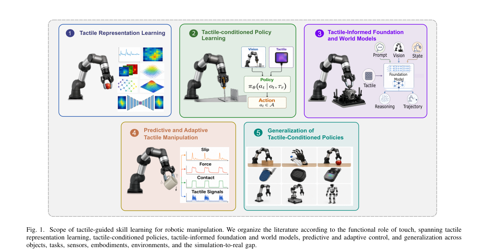

*Main result - Figure 2 Self-supervised representation learning paradigms for tactile sensing. Reconstruction-based methods (a-d) recover a masked or transformed observation; contrastive methods (e-h) pull positive p*

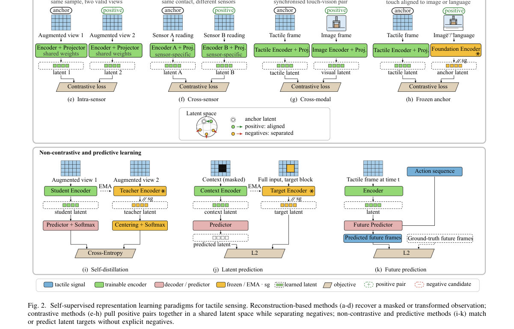

**Why this ranks #1**: 本批关键词得分最高的一篇（21.5），且它把本项目日报已追踪三天的触觉趋势**收束成一篇综述**。

---

### 2. RoboSpan: Learning Modular Coordination Policies for High-DoF Whole-Body Mobile Manipulation with Teleoperation

**arXiv**: [2610.19594](https://arxiv.org/abs/2610.19594) | **Score**: 8.7 (relevance 9 x 0.7 + quality 8 x 0.3) | **Tags**: embodied-ai | **Categories**: cs.RO | **Pages**: 8

**Authors**: Keqiang Ren, Xuecheng Ye, Hanyu Liu, Zhihua Wang, Tao Jian, Yunsheng Ma, Jiayi Wen, Xinran Li, Zhigong Song

**Affiliation**: 1Jiangsu Key Laboratory of Advanced Food Manufacturing Equipment | and Technology, School of Mechanical Engineering, Jiangnan University, | Co., Ltd.

**Abstract**

> Whole-body mobile manipulation suffers from two fundamental challenges: inherent motion heterogeneity across locomotion, arm, and hand modules, and progressive error accumulation over long-horizon multi-stage tasks. Existing teleoperation platforms also lack integrated dexterous tactile sensing to support coordinated whole-body decision-making. This paper presents RoboSpan, a high-DoF whole-body teleoperation and demonstration platform, and the Hierarchical Modular Framework (HMF) for learning modular coordination policies. HMF functionally decouples the 29-DoF action space into fine hand manipulation, arm pose adjustment, and mobile-base spatial configuration branches, and introduces the Coordinated Modular Embodied Transformer (COMET) with inter-modular cross-attention to enable dynamic information exchange and action coordination. Vision-language model driven hierarchical task decomposition structurally suppresses temporal error propagation, while a full-palm 2D tactile representation encodes distributed contact signals for cross-module tactile empowerment. Experiments on a physical 29-DoF robot demonstrate that the proposed method achieves over 20\% higher task success rate than mainstream baselines across a range of long-horizon whole-body tasks, markedly improving stability and robustness in contact-rich manipulation.

**Key findings**

- **Finding**: 两个根本挑战：**运动异质性**（移动/臂/手模块）与长时程多阶段任务的**渐进误差累积**。

- **Finding**: RoboSpan 学习模块化协调策略并结合遥操作（摘要在此处截断）。

- **Inference**: 「异质性」与「误差累积」需要不同的应对：前者是接口设计问题（模块间如何通信），后者是闭环反馈问题（误差如何被观测与修正）——把它们混为一谈会导致用错方法。

- **Recommendation**: 与本批 HiRe-MoMa（分层残差）对照，一篇做模块化协调、一篇做分层误差修正。

**Key figures**

*Framework / architecture - Figure 1 Overview of the RoboSpan framework for high-DoF whole-body mobile manipulation. RoboSpan integrates whole-body teleoperation, multimodal perception, and modular policy learning, enabling VLM-g*

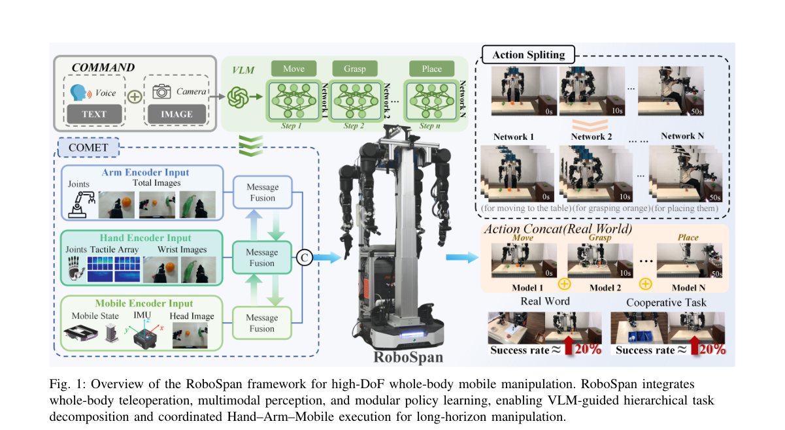

*Main result - Figure 2 RoboSpan teleoperation demonstration.*

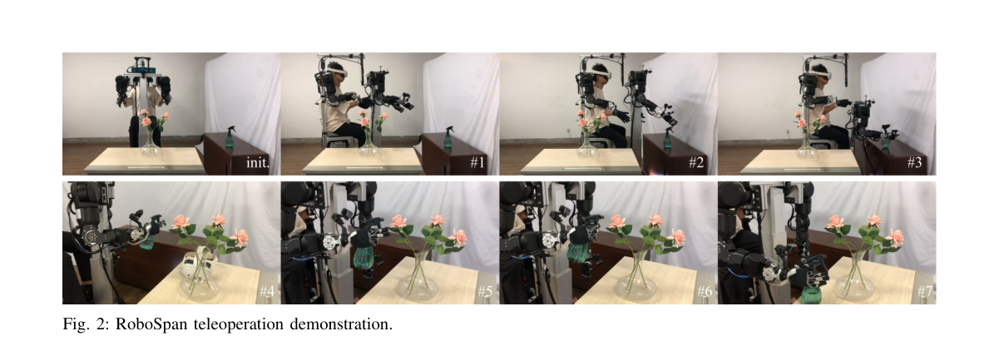

**Why this ranks #2**: 把「模块异质性」与「误差累积」并列为两个独立挑战，是清楚的分解。

---

### 3. TacClaw-Infinity: A Large-Scale Vision-Tactile-Language-Action Dataset for Dexterous Manipulation

**arXiv**: [2610.20320](https://arxiv.org/abs/2610.20320) | **Score**: 8.7 (relevance 9 x 0.7 + quality 8 x 0.3) | **Tags**: embodied-ai | **Categories**: cs.RO | **Pages**: 9

**Authors**: Fucai Zhu, Xidong Zhang, Yichi Zhang, Yipan Wang, Fubo Wang, Zibin Wu, Kaiqi Li, Jianhao Jiao, Shihan Lu, Di Hu, Mengdi Xu, Siyu Zhu

**Affiliation**: 2Nanjing University | 3Great Bay University | 4Tohoku University | 5Southern University of Science and Technology

**Abstract**

> Large-scale robot learning increasingly relies on diverse human demonstrations, yet tactile manipulation data remain difficult to scale, and existing multimodal datasets often lack consistent quality control and structured supervision. We present TacClaw-Infinity, a large-scale structured Vision-Tactile-Language-Action (VTLA) dataset for contact-rich manipulation, collected with TacClaw, a tactile-enabled UMI-style handheld interface that records synchronized visual observations, fingertip tactile signals, and end-effector trajectories without requiring a target robot during data collection. TacClaw-Infinity is built through a distributed worldwide collection across homes, laboratories, industrial workplaces, retail stores, and outdoor environments including tasks contributed by academic and industrial collaborators. Together, these efforts yield over 10,000 hours, 1 million episodes, and 1 billion frames spanning more than 1,000 task types. We develop a scalable pipeline for trajectory reconstruction, multimodal quality control, embodiment-aware filtering, and structured annotation, covering contact-centric segmentation, subtask description, and spatial grounding. We validate TacClaw-Infinity at both the data and model levels: At the data level, we assess the collection interface, the action-space compatibility of the curated demonstrations, and the structured annotations, while for the model level, we demonstrate cross-embodiment transfer across three heterogeneous robots without robot-specific demonstrations.

**Key findings**

- **Finding**: 触觉操作数据难以规模化；既有多模态数据集缺乏一致的**质量控制与结构化监督**。

- **Finding**: TacClaw-Infinity 提供大规模结构化 VTLA 数据集（摘要在此处截断，规模与构成需查正文）。

- **Inference**: 触觉数据的瓶颈不是采集量而是**标注结构**：视觉数据可自动弱标注，而触觉需要与接触事件对齐的时序标签，这正是「结构化监督」被强调的原因。

- **Recommendation**: 触觉方向的读者必读；与本批 Tactile-Guided Survey 对照，一篇给综述、一篇给数据。

**Key figures**

*Framework / architecture - Figure 1 Overview of TacClaw-Infinity. A tactile-enabled UMI-style interface supports distributed large-scale collection of synchronized visual, tactile, language, and action data across diverse tasks*

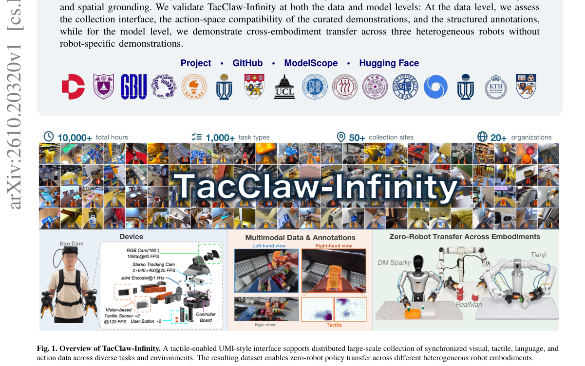

*Main result - Figure 2 Contact-anchored structured annotation. (a) Tactile contact and release events partition a demonstration into manipulation stages and provide boundaries for segment-level language annotation.*

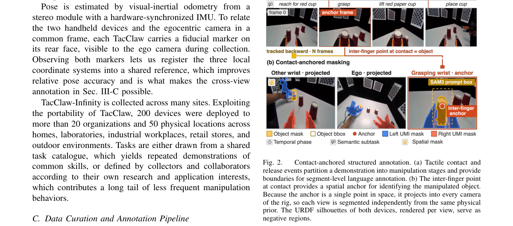

**Why this ranks #3**: 「数据集缺乏质量控制与结构化监督」是本项目日报反复出现的主题——10-14 的 Anuvani-Diarization 也在提标注规范。

---

### 4. AutoRSR: Automated Real-to-Sim-to-Real Data Generation for Scalable Robot Learning

**arXiv**: [2610.20336](https://arxiv.org/abs/2610.20336) | **Score**: 8.0 (relevance 8 x 0.7 + quality 8 x 0.3) | **Tags**: embodied-ai, sim-to-real | **Categories**: cs.RO | **Pages**: 8

**Authors**: Jiawei Zhang, Chang Liu, Litao Deng, Tao Zhang, Qin Jin

**Affiliation**: Renmin University of China

**Abstract**

> Scaling embodied robot learning requires large and diverse manipulation datasets, but collecting real-world demonstrations remains expensive in human effort and robot time. Simulation provides a scalable alternative, yet converting a real workspace into a robot-learning-ready environment still requires substantial manual effort for object extraction, asset processing, coordinate calibration, and trajectory specification. We present AutoRSR, a highly automated real-to-sim-to real framework that converts scanned real-world workspaces into reusable embodied simulation assets and scalable manipulation data. Given multi-view observations, robot states, and open-vocabulary semantic queries, AutoRSR reconstructs the workspace, extracts individual object assets, and automatically registers the reconstructed scene to the robot base frame at metric scale. Starting from a small number of reference motions, AutoRSR then generates executable manipulation trajectories and scales them through trajectory interpolation and domain randomization. After workspace scanning and semantic queries, the remaining pipeline requires no manual object annotation, scene-to-robot calibration, or robot teleoperation. Across three real-world manipulation tasks, policies trained on 1K automatically generated episodes per task achieve 73.3--86.7% real-world success rates, comparable to pi 0.5 trained from 150 human teleoperated demonstrations, while reducing the human time required for data generation by an order of magnitude. These results demonstrate that real-world observations can be converted into metrically aligned, executable, and scalable simulation data with substantially reduced human effort.

**Key findings**

- **Finding**: 真实演示采集在**人力与机器人时间**上都昂贵；仿真可扩展但转换过程仍需人工。

- **Finding**: AutoRSR 提供自动化的 real-to-sim-to-real 数据生成（摘要在此处截断）。

- **Inference**: 自动化的价值在于把人工从「逐物体建模」转到「定义流程」，这决定了它能覆盖多少物体——若流程本身需要专家判断，自动化只是减少了点击次数。

- **Recommendation**: 与 10-14 日报的 DexNinja（real-to-sim-to-real 数据引擎）对照，两篇同属该路线但一个面向切割这类接触任务。

**Key figures**

*Framework / architecture - Figure 1 Overview of AutoRSR. We first perform a hybrid scan of the workspace while recording robot states and wrist-camera poses, together with a reference manipulation motion. Given open-vocabulary s*

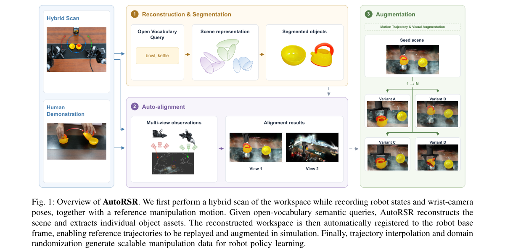

**Why this ranks #4**: 「仍需大量人工」这个限定词划出了仿真替代的边界。

---

### 5. Back on Track: Deployment-time Policy Improvement via World Model Planning

**arXiv**: [2610.19579](https://arxiv.org/abs/2610.19579) | **Score**: 8.0 (relevance 8 x 0.7 + quality 8 x 0.3) | **Tags**: world-model, embodied-ai | **Categories**: cs.RO | **Pages**: 9

**Authors**: Colton Crosby, Hao Wang, Mac Schwager, Somil Bansal

**Affiliation**: ment, Stanford University. {cjcrosby, haowwang, schwager, | and Computer Engineering, University of Southern California.

**Abstract**

> State-of-the-art visuomotor policies are increasingly capable of executing complex tasks, yet can fail during deployment in ways they cannot predict or recover from on their own. Improving their performance and robustness typically requires collecting more data, retraining, or modifying the policy architecture, all of which are time- and resource-intensive in practice. We instead propose an offline-trained monitoring-and-intervention framework that improves a policy during deployment using only black-box query access. From a limited set of labeled on-policy rollouts, we learn a policy-conditioned liveness value that measures the nominal policy's progress toward task completion; we additionally train a compact latent world model using these rollouts together with play data. At deployment, the liveness value continuously monitors execution. When it detects a loss of progress, a short-horizon planner searches the world model for corrective actions using the same value as its planning objective, after which control returns to the nominal policy. We evaluate our method on the LIBERO-Goal task suite and on a Franka Panda manipulator, using the vision-language-action model $π_{0.5}$ and a diffusion policy as nominal policies, and demonstrate significant improvements in task success rates, while supporting real-time control. Additional results and videos are available on the project website (https://policy-improvement-wm.pages.dev/).

**Key findings**

- **Finding**: 策略可能在部署中以**无法自行预测或恢复**的方式失败。

- **Finding**: 常规改进手段（更多数据、重训练、改架构）都……（摘要在此处截断）；Back on Track 用世界模型规划做**部署时**策略改进。

- **Inference**: 「无法自行恢复」是关键限定：若失败不可预测，部署时的检测就无从触发；而世界模型规划的价值恰恰在于它能在动作前预测后果，从而把不可预测的失败变成可检测的。

- **Recommendation**: 与本批 SafeDriveVLA（导航条件化的世界模型做梦）对照，两篇都是「用世界模型在部署侧提供信号」。

**Key figures**

*Framework / architecture - Figure 1 We address deployment-time improvement of visuomotor manipulation policies, without retraining or otherwise modifying the nominal policy; assuming only black-box access. We cast policy improve*

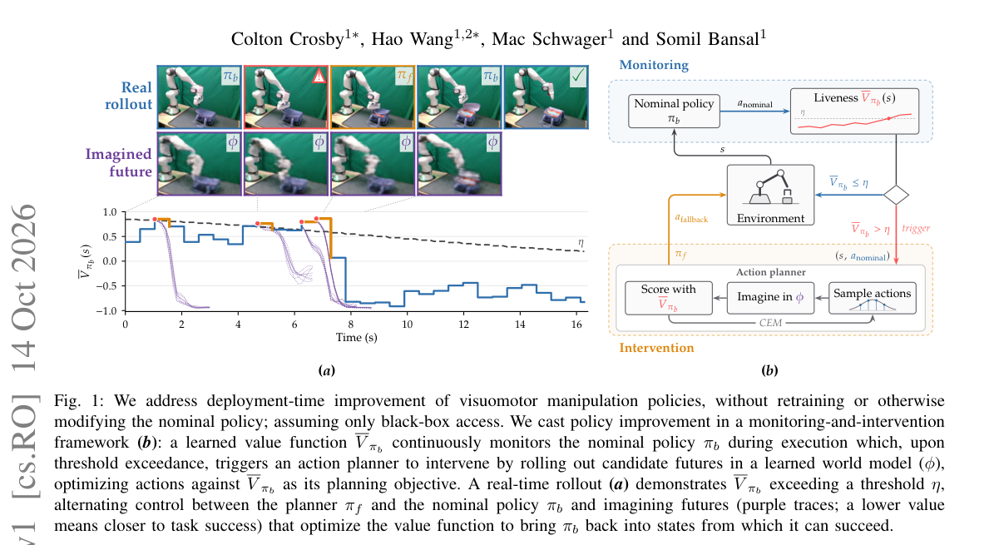

*Main result - Figure 2 A sample visualization of the wrist camera in Task 0 (open the middle drawer). The proposed method (top) guides the robot towards the correct middle drawer, while the nominal policy (bottom) e*

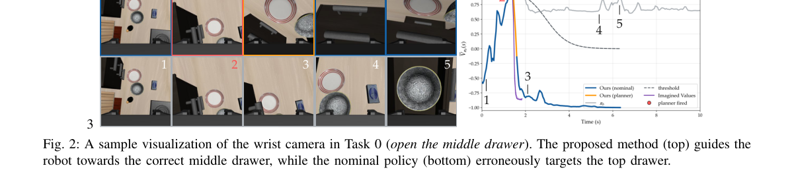

**Why this ranks #5**: 把改进放在部署时而非训练时，是一个重要的工程位置判断。

---

### 6. Hierarchical Residual Policy Learning for Real-World Mobile Manipulation with Sparse Human Guidance

**arXiv**: [2610.20607](https://arxiv.org/abs/2610.20607) | **Score**: 7.7 (relevance 8 x 0.7 + quality 7 x 0.3) | **Tags**: embodied-ai | **Categories**: cs.AI, cs.LG, cs.RO | **Pages**: 20

**Authors**: Zhefei Gong, Hefeifei Jiang, Zehao Wang, Jiachen Li

**Affiliation**: 1Northeastern University | 3Georgia Institute of Technology

**Abstract**

> Mobile Manipulation (MoMa) is a cornerstone of autonomous robotic systems, yet real-world fine-tuning remains a formidable challenge because of high-dimensional action spaces and intricate coupling between heterogeneous modules. In this paper, we propose HiRe-MoMa (Hierarchical Residual Mobile Manipulation), a systematic framework for stable and sample-efficient real-world fine-tuning of complex MoMa systems. At its core, HiRe-MoMa adopts a Hierarchical Residual Architecture that fine-tunes a frozen base policy. A Policy-Agnostic Residual learns additive corrections atop the base policy, while Hierarchical Decoupling splits the residual into mobile-base and manipulator-arm heads with unidirectional conditioning, mitigating gradient interference and aligning corrections with the platform's physical hierarchy. To improve sample efficiency in data-expensive real-world settings, we propose Expert-Guided Value Alignment, which leverages sparse human interventions with under 20% training coverage to reshape the critic's value landscape, effectively guiding autonomous exploration through expert priors. Extensive real-world experiments on the TIAGo++ platform demonstrate that HiRe-MoMa consistently enhances task performance with only around 30 minutes of online interaction, regardless of the base policy architecture. To our knowledge, this is among the first frameworks to enable efficient on-robot fine-tuning for mobile manipulation in the real world, providing a practical paradigm for deploying complex robotic systems in dynamic, human-centric environments. Further details can be found on our project website: https://hire-moma.github.io/

**Key findings**

- **Finding**: 真实世界微调困难源于**高维动作空间**与**异质模块间的紧密耦合**。

- **Finding**: HiRe-MoMa 用分层残差策略学习应对（摘要在此处截断）。

- **Inference**: 「残差」意味着只在基础策略之上修正低维自由度，把高维耦合留在基础策略内部——这与 10-14 日报的 ForceWAM（解耦未来与响应学习）是同一种降低耦合的思路。

- **Recommendation**: 与本批 RoboSpan（模块化协调）对照：两篇都针对模块耦合，一篇改接口、一篇改残差层次。

**Key figures**

*Framework / architecture - Figure 1 HiRe-MoMa System Overview. (a) Training Paradigm: A real-world dual-unit configuration consisting of an onboard controller for real-time interaction and a computing unit for policy optimizat*

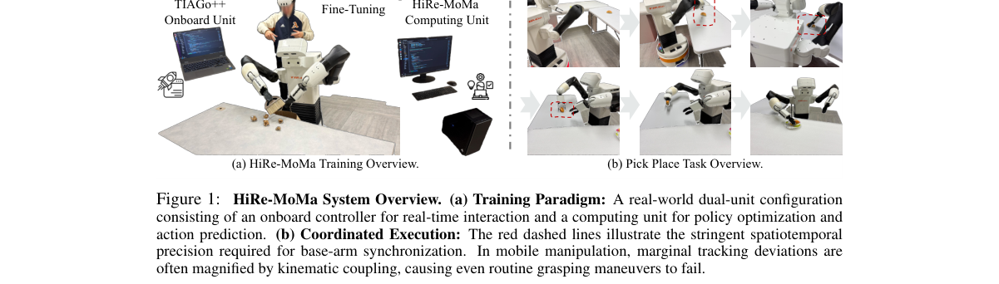

*Main result - Figure 2 HiRe-MoMa Framework enables policy-agnostic real-world fine-tuning of mobile manipulators through an asynchronous residual reinforcement learning paradigm. (Right) Shared-Control Rollout: an*

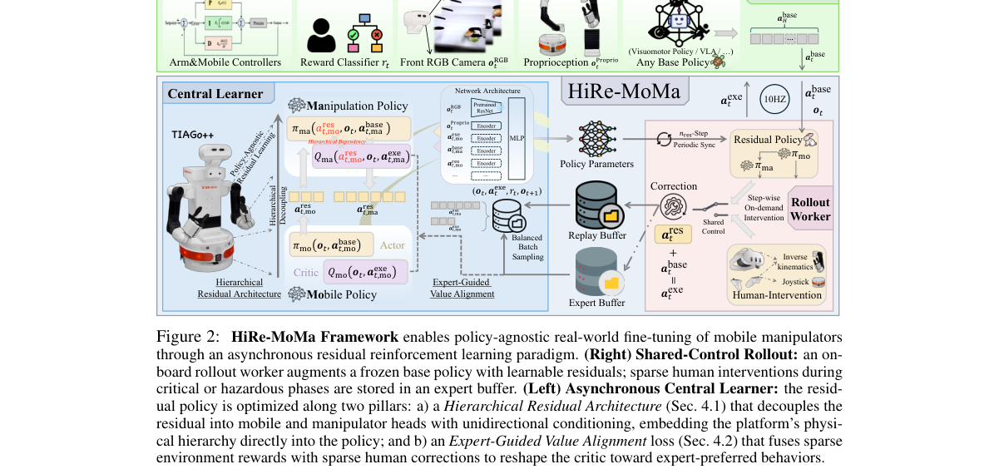

**Why this ranks #6**: 「高维动作空间 + 异质模块耦合」被作为微调难度的两个来源明确列出。

---

### 7. Coordi-pi: Coordination-Aware Dual-Hand Action Representation for Bimanual Dexterous Manipulation

**arXiv**: [2610.19753](https://arxiv.org/abs/2610.19753) | **Score**: 7.7 (relevance 8 x 0.7 + quality 7 x 0.3) | **Tags**: embodied-ai | **Categories**: cs.RO | **Pages**: 8

**Authors**: Yiming Meng, Yanming Shao, Weijie Shen, Kunyang Lin, Jiayu Sun, Ping Luo, Yao Mu

**Affiliation**: 1Shanghai Jiao Tong University, 2The University of Hong Kong

**Abstract**

> Vision-language-action (VLA) models have shown strong potential for general-purpose robotic manipulation, but extending them to bimanual dexterous manipulation introduces a high-dimensional and structured action space. Existing bimanual VLA policies commonly concatenate right- and left-side arm--hand actions at each control timestep, leaving cross-hand interactions implicit within a single action vector. We introduce Coordi-$π$, a structured action representation for bimanual dexterous manipulation. Coordi-$π$ represents the right- and left-side arm--hand actions as individual action tokens and organizes them into an interleaved sequence, explicitly exposing the two sides within the action sequence. To explicitly encode hand identity and temporal synchronization in this interleaved representation, a learnable hand-identity embedding distinguishes the two sides, while sequence--control-timestep factorized rotary positional encoding (RoPE) separates sequence position from control timestep, allowing actions at the same control timestep to share a temporal coordinate while retaining distinct sequence positions. Across all five bimanual dexterous manipulation tasks in DexJoCo, Coordi-$π$ achieves state-of-the-art performance under both \textit{rand-obj} and \textit{rand-full}, improving the average success rate over $π_{0.5}$ from 31.9\% to 51.3\% and from 18.3\% to 32.3\%, respectively. Coordi-$π$ also consistently outperforms $π_{0.5}$ across four real-world bimanual dexterous manipulation tasks.

**Key findings**

- **Finding**: 双手灵巧操作引入高维且结构化的动作空间；既有做法在每个控制步**简单拼接**左右臂-手动作。

- **Finding**: Coordi-pi 提出协调感知的双手动作表示（摘要在此处截断）。

- **Inference**: 拼接意味着动作表示不含任何「两臂之间的关系」信息，协调必须由策略隐式学出；把关系编码进表示本身是一个低成本的先验注入。

- **Recommendation**: 与本批 Tactile 综述中「具身物理推理」一节对照，一篇是表示设计、一篇是能力分类。

**Key figures**

*Framework / architecture - Figure 1 Action representations and coordination performance. (a) Concatenation packs both arm–hand actions into one token per control timestep. (b) Interleaving separates the two sides, but token adja*

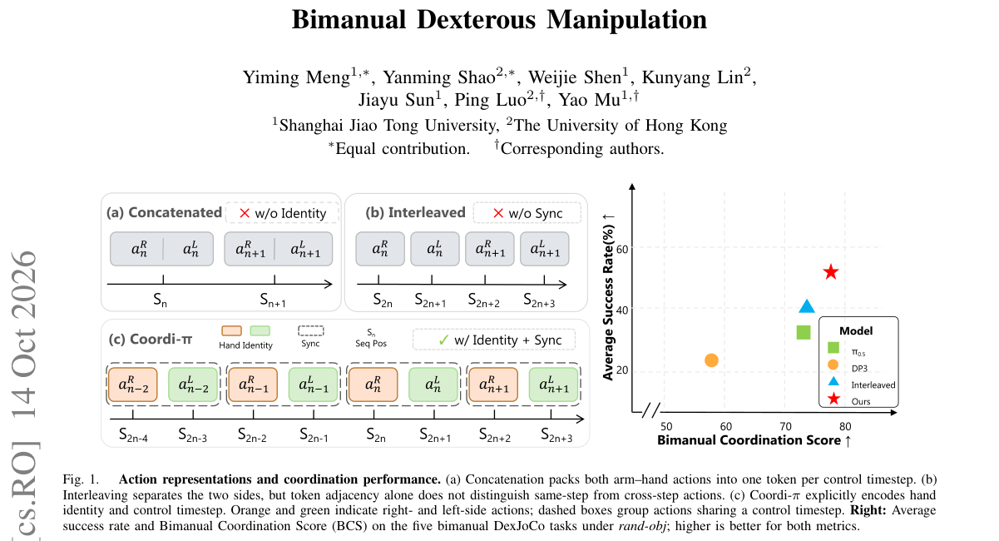

*Main result - Figure 2 Overview of Coordi-π. Within the action expert, (a) joint bimanual actions are split into interleaved right- and left-side tokens, and (b) learnable hand-identity embeddings distinguish the tw*

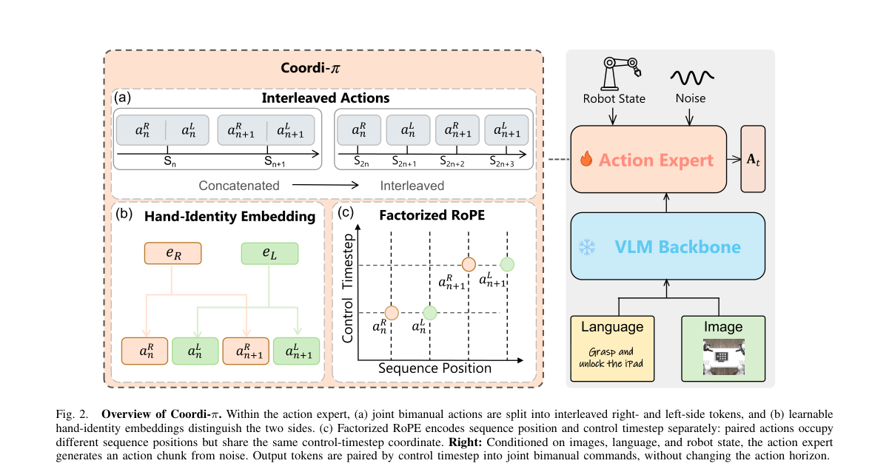

**Why this ranks #7**: 「每个控制步简单拼接」被指为结构化动作空间的浪费。

---

### 8. SafeDriveVLA: Navigation-Conditioned World Model Dreaming for Conflict-Aware End-to-End Autonomous Driving

**arXiv**: [2610.20609](https://arxiv.org/abs/2610.20609) | **Score**: 7.7 (relevance 8 x 0.7 + quality 7 x 0.3) | **Tags**: world-model, embodied-ai | **Categories**: cs.RO | **Pages**: 39

**Authors**: Shaoyuan Xie, Zihan Zhang, Jingxuan Wang, Jiashu Qu, Xiaoqing Liang, Lingdong Kong, Junchi Lu, Henrik I. Christensen, Qi Alfred Chen

**Affiliation**: 4National University of Singapore | cars [10], and NVIDIA is bringing its Alpamayo VLA [7] to production in the Mercedes-Benz CLA [11].

**Abstract**

> Vision-Language-Action (VLA) models are gaining attention in autonomous driving, inheriting commonsense priors from large language models (LLMs) and widening the navigation interface from a fixed command set to free-form natural-language instructions. However, this open-ended interface exposes a new vulnerability surface: an inattentive driver may issue instructions that are unsafe given the current scene, and a malicious user may issue dangerous ones on purpose. We present the first benchmark suite that evaluates navigation following and conflict awareness together, along with adversarial robustness. Existing VLAs fall short on both: SimLingo completes no language-instructed lane change in closed loop, and all models degrade sharply under conflicting signals. We propose SafeDriveVLA, the first driving VLA that (1) explicitly predicts a three-level navigation-compliance mode to decouple conflict reasoning from action generation, and (2) uses navigation-conditioned world model dreaming to inform this prediction. Unlike prior world models that roll out expert or planned actions, ours dreams of strictly following the navigation signal, showing when following is safe. SafeDriveVLA reaches 88.16 Driving Score (DS) and 68.64% Success Rate (SR) on Bench2Drive, lifts closed-loop language following by 49.3% and reduces collisions under unsafe instructions from 60 to 38 compared to the best SimLingo variant. Video demonstrations are available on our project page.

**Key findings**

- **Finding**: 导航接口从固定命令集扩展到**自由形式自然语言**，同时暴露出新的脆弱面。

- **Finding**: SafeDriveVLA 用导航条件化的世界模型「做梦」实现冲突感知的端到端驾驶（摘要在此处截断）。

- **Inference**: 固定命令集把「什么指令被接受」限制在有限集合内，自然语言指令则让攻击面等于整个语言空间——这是接口设计带来的安全性回退，而非模型能力问题。

- **Recommendation**: 自动驾驶的读者注意；与本批 Back on Track 同为「部署时提供信号」的思路。

**Key figures**

*Framework / architecture - Figure 1 Navigation-scene conflict in VLA models. In modular stacks, the behavior planner resolves the navigation signal against perception. VLAs must instead learn this implicitly, although the navig*

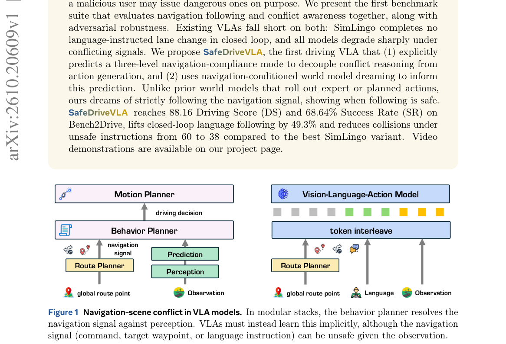

*Main result - Figure 2 CARLA-F closed-loop examples. Each route has sequential language instructions: a target speed, followed by other maneuvers. The curve is the ego trajectory driven by SafeDriveVLA (light to da*

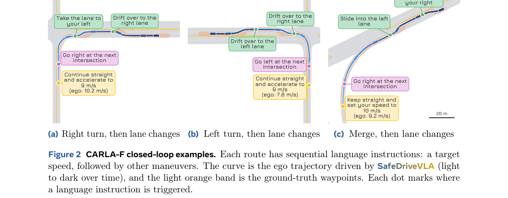

**Why this ranks #8**: 「开放式接口扩大了攻击面」是一个从 NLP 迁移到驾驶的具体推论。

---

### 9. FOMI: A Force-Feedback Manipulation Interface for Teaching Contact-Rich Manipulation

**arXiv**: [2610.19839](https://arxiv.org/abs/2610.19839) | **Score**: 7.0 (relevance 7 x 0.7 + quality 7 x 0.3) | **Tags**: embodied-ai | **Categories**: cs.RO | **Pages**: 16

**Authors**: Yishu Shen, Yiming Luo, Ruilin Wang, Bowen Yang, Shuai Yang, Fangyi Xu, Yujun Shen, Fu Zhang, Boyu Zhou, Yinghao Xu

**Affiliation**: 1The Hong Kong University of Science and Technology | 2The University of Hong Kong | 4Southern University of Science and Technology

**Abstract**

> Robot-free collection with handheld interfaces enables scalable acquisition of human demonstrations for policy learning. However, existing handheld interfaces often provide limited intuitive force feedback, making contact-rich demonstration collection challenging for human operators. To address this, we present FOMI, a force-feedback manipulation interface with a scissor-shaped mechanism, which transmits object interaction forces directly to the operator's hands through actuation links without force sensors. This intuitive force feedback supports real-time action adjustment during robot-free collection of contact-rich demonstrations. Around FOMI, we build a demonstration collection system that integrates sensor calibration, data acquisition, and synchronization for robot-free collection. By further mapping pose changes and gripper opening of FOMI to robot end-effector poses and gripper commands, the system also supports teleoperation. Across four contact-rich tasks, FOMI improves collection efficiency by approximately 29% and 18% over the best baselines in robot-free collection and teleoperation, respectively. Demonstrations collected with FOMI in both modes enable policies to perform challenging contact-rich manipulation tasks with high success rates.

**Key findings**

- **Finding**: 既有手持接口只提供有限的直觉力反馈，使接触丰富的演示采集对操作者仍然困难。

- **Finding**: FOMI 提供力反馈操作接口用于教授接触丰富操作（摘要在此处截断）。

- **Inference**: 这与 10-14 日报的 TACROSS（人类手套与机器人触觉传感器的根本差异）在同一问题两侧：一篇做设备对齐、一篇做操作者反馈，缺一则数据仍不可用。

- **Recommendation**: 与本批 TacClaw-Infinity（VTLA 数据集）对照：数据集的采集质量直接取决于这类接口。

**Key figures**

*Framework / architecture - Figure 1 Overview of FOMI. The force-feedback manipulation interface incorporates a scissor-shaped mechanism to provide human operators with intuitive force feedback in robot-free collection of conta*

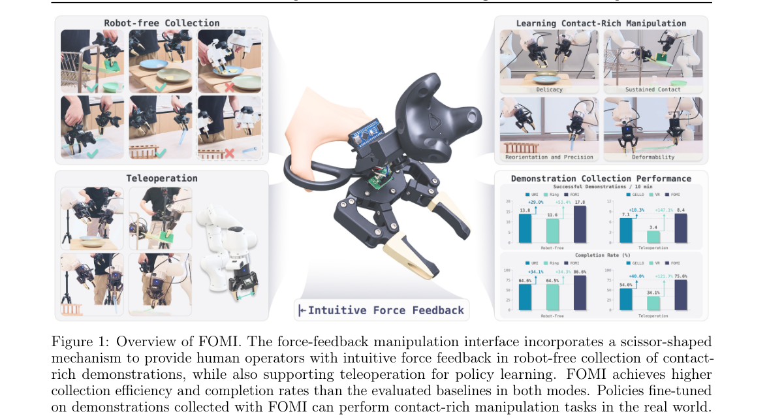

*Main result - Figure 2 Mechanical design of FOMI. (a) Exploded view with the main components. (b) Direct force transmission path from the gripper to the handles in robot-free collection, with the handle pivot, han*

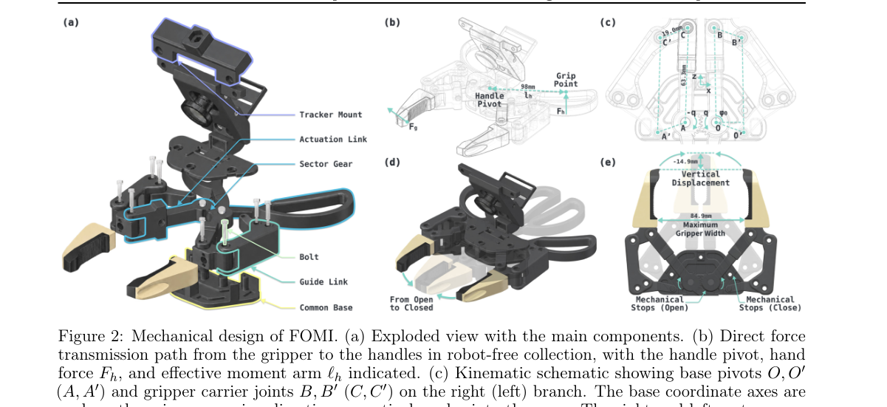

**Why this ranks #9**: 「力反馈缺失」被定位为人类演示采集的瓶颈，而不只是接口的便利性问题。

---

### 10. Accelerating VLA Inference with Perturbation Informed Execution

**arXiv**: [2610.19656](https://arxiv.org/abs/2610.19656) | **Score**: 7.0 (relevance 7 x 0.7 + quality 7 x 0.3) | **Tags**: embodied-ai | **Categories**: cs.RO | **Pages**: 23

**Authors**: Jehun Lee, Hajun Lee, Jimin Ryu, Youhan Lee, Beomseok Kang, Jonghyun Choi, Jae-Joon Kim

**Affiliation**: Seoul National University

**Abstract**

> Action-chunking vision-language-action (VLA) models predict sequences of future robot actions. Under fixed-horizon execution, the robot executes a fixedlength prefix of each predicted chunk before invoking the policy again, leaving the remaining predictions unused. For a given number of executed actions, short execution horizons require more policy calls. Extending the execution horizon amortizes policy inference cost over more actions. However, uniformly applying long horizons across episodes can limit opportunities for precise corrections. To address this limitation, we propose PICES (Perturbation-Informed Chunk and Execution Horizon Selection), a training-free method that jointly selects an action chunk and the number of actions executed before the next policy call. Within a single policy call, the action expert generates a batch of action chunks from multiple initial noise samples and their locally perturbed counterparts, using the same conditioning features across all samples. PICES exploits differences between corresponding actions in each nominal chunk and its counterpart to determine candidate-specific execution horizons and select a nominal chunk for execution. Experiments on simulation benchmarks and real-world manipulation tasks demonstrate that PICES achieves speedup by up to 2.3x in wall-clock policy inference time on Jetson Orin and Thor relative to fixed horizon baselines while improving the success rate.

**Key findings**

- **Finding**: 固定时程执行使每个动作块的一部分预测**被闲置**。

- **Finding**: 在给定执行动作数下，短执行时程需要……（摘要在此处截断）；该文用扰动信息引导（perturbation informed）加速 VLA 推理。

- **Inference**: 这与 10-07 日报的 Commit While Futures Agree（应提交多长动作前缀）在同一问题上给出相反的取向：那篇按「后果一致性」决定前缀，这篇按「推理成本」决定——两者结合才完整。

- **Recommendation**: VLA 部署的读者注意；与 10-07 日报那篇对照阅读。

**Key figures**

*Framework / architecture - Figure 1 High-level idea of the PICES. (a) Fixed execution horizon generates a nominal action chunk from a single initial noise sample at each policy call and executes a fixed-length actions before r*

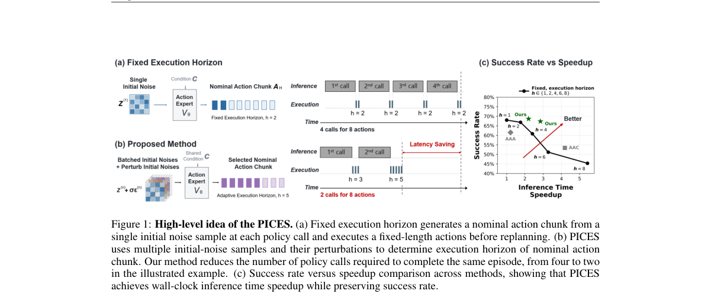

*Main result - Figure 2 Root-mean-square-error (RMSE) be- tween reference and oracle-selected action chunk. The dashed horizontal line marks the baseline single- candidate, one-step baselin (N = 1, h = 1).*

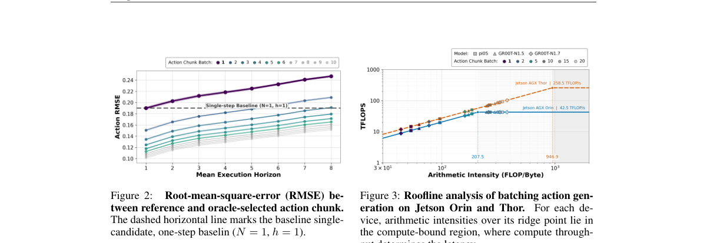

**Why this ranks #10**: 「剩余预测被闲置」把执行时程选择变成一个显式的成本-收益问题。

---

## Footer

- Total papers reviewed across all 5 tracks: 50 (from 570 scanned)
- embodied track final top-10: 10
- Wild-cards in this track: 1
- Figure assets: `res/` (shared across tracks)

Generated by `mine-arxiv-daily-digest` skill. Sister file: `2026-10-15_embodied_entry.md`.
