# ArXiv Daily Digest - 2026-10-15 (强化学习, 10 papers)

**Generated**: 2026-10-15 17:00 CST

**Source**: arXiv cs.CV, cs.SD, eess.AS, cs.CL, cs.AI, cs.RO, cs.LG submissions, window 2026-10-14 UTC (latest announced batch as of 2026-10-15 17:00 CST)

**Track**: rl (top 10 of 570 papers scanned, 50 full reads)

**Scope**: single-rollout token credit without group sampling, GRPO for diffusion language models, curricula under GRPO for long-horizon agents, confidence-guided credit correction, preference cycles in video GRPO, on-policy distillation for generative reward models, self-play with decomposable verifiable rewards, momentum in RLVR, reality check on self-distillation, theory-of-mind rules via RL

---

**本批 RL 线的共同起点被反复陈述**：GRPO 在所有 rollout 获得相同奖励时不提供任何奖励相对的学习信号。**Hindsight-Privileged RLVR**（本线第一）把攻击点放在最结构性的地方——它提供**单次 rollout 的 token 级信用分配，完全不需要组采样**。组采样的成本不只是算力：它是熵退化与组内无变化的根源，因为组必须来自同一策略的窄分布；用事后（hindsight）信息替代同策略采样，等于绕开了这个循环依赖。

**Where to Start, How to Move** 从课程侧给出同一问题的另一半：**训练早期全失败组很常见**，而长时程任务的奖励只在成功时给出，因此全失败组**阻止了后续步骤被练习**——因为到达后续步骤本身就要求先成功。这使长时程训练在早期陷入自锁：不会到达，就不会被练到。

**ForkGRPO** 把这套诊断移植到扩散语言模型上：任意顺序生成同样会熵退化。这说明退化不是自回归的固有属性，而是「组内优势需要组内多样性」这一 GRPO 前提的必然后果。

其余三篇处理信号正确性而非可得性：**C3** 指出纯结果 RL 会产生**误导性强化**——即使轨迹成功，不良的局部行为也可能拿到**正的** token 级优势并被偏爱（成功只证明存在一条好路径，不证明这条路径上的每一步都对）；**When Pairwise Preferences Cycle** 指出成对偏好可能成环，而 A>B、B>C 不蕴含 A>C，因此偏好图成环时任何基于成对比较的优势归一化都会失效；**When Does Momentum Help in RLVR?** 用 bandit 形式化质疑一阶动量在 RLVR 中的有效性——动量在凸优化中有效的前提是梯度序列近似同向，而 RLVR 的梯度方差极大、方向随组采样随机波动。

还有一篇方法论上值得注意：**More Methods, Better Agents?** 指出既有评测常常在不同实验条件下**复用已发表的基线分数**，缺少同时期方法的直接比较。这意味着比较的不是方法而是**评测设置**——这是本项目日报审计线索在 RL 评测侧的实例（前几例：音频裁判探针、UTMOS 口音偏见、UMOS 双任务文本音频架构）。

---

## Top 10 - 强化学习

### 1. Hindsight-Privileged RLVR: Single-Rollout Token Credit Without Group Sampling

**arXiv**: [2610.20497](https://arxiv.org/abs/2610.20497) | **Score**: 9.0 (relevance 9 x 0.7 + quality 9 x 0.3) | **Tags**: rlhf, rl-algorithm | **Categories**: cs.AI, cs.LG | **Pages**: 14

**Authors**: Wei Chen, Yubing Wu, Zhou Xu, Haoyue Zhang, Delu Zeng, Jiahao Wang, Junmei Yang, Pan tiewen, Jingfeng Liu, Zhiheng Zhou, Bo Li, Min Chen

**Affiliation**: 1South China University of Technology | 2Tsinghua University | 3The Hong Kong University of Science and Technology | 4Huawei 2012 Laboratories

**Abstract**

> Reinforcement learning with verifiable rewards (RLVR) trains language models from checked task outcomes, but assigning a terminal reward to individual reasoning tokens or actions remains difficult. Group-relative methods such as Group Relative Policy Optimization (GRPO) sample several attempts per prompt, but lose their reward-based learning signal when all attempts receive the same outcome. We propose Hindsight-Privileged RLVR (HP-RLVR), a single-rollout method that turns a completed trajectory's own future into token-level update weights. The generating policy snapshot scores each eligible token under its causal history and under a hindsight context containing the realized future and verifier feedback. A normalized Jensen--Shannon divergence between the two views weights the reward relative to a historical baseline, yielding bounded token credit for both successful and failed attempts, with no reference solution or learned critic. In paired Qwen3-8B runs over a shared $100$-step schedule, HP-RLVR trains $1.21\times$, $1.46\times$, and $2.30\times$ faster than GRPO on mathematics, code generation, and ALFWorld, using one eighth the rollouts per prompt. Accuracy is comparable overall, with HP-RLVR ahead on mathematics at all three sizes and GRPO ahead on code and ALFWorld. In ALFWorld, $43.2\%$ (4B) and $49.0\%$ (8B) of GRPO's gradient-norm records are zero, versus none for HP-RLVR.

**Key findings**

- **Finding**: 把终端奖励分配给单个推理 token 或动作仍然困难；组相对方法需为每个提示采样**多次尝试**。

- **Finding**: 作者提出单次 rollout 的 token 信用分配，**无需组采样**（摘要在此处截断，「hindsight-privileged」的具体机制需查正文）。

- **Inference**: 组采样的成本不只是算力——它是**熵坍塌与组内无变化**的根源（因为组必须来自同一策略的窄分布）。用事后（hindsight）信息替代同策略采样，等于绕开了这个循环依赖。

- **Recommendation**: 本批 RL 第一篇；与本批 Where to Start, How to Move（GRPO 全失败组）合读——两篇分别从信号与课程两端攻击同一个成本结构。

**Key figures**

*Framework / architecture - Figure 1 Qwen3-8B training cost at four prompts per step and 100 steps. HP-RLVR uses group size G=1, versus GRPO’s G=8. Bars are relative to GRPO, with labels above each pair showing speedup.*

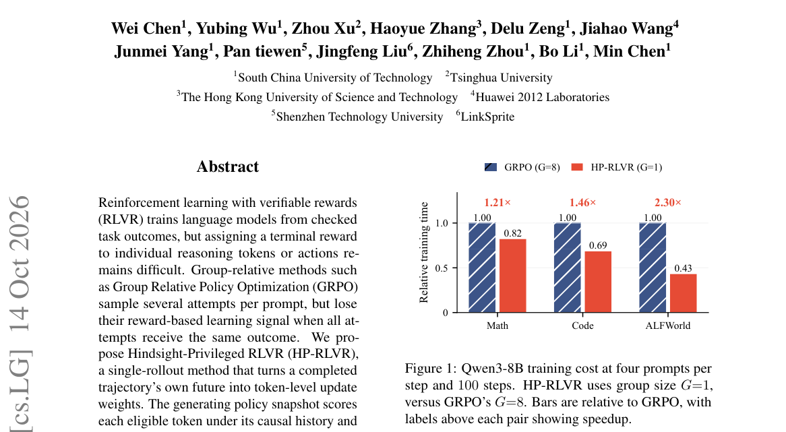

*Main result - Figure 2 Overview of HP-RLVR’s single-rollout training pipeline with training-only hindsight. After generation, the frozen generating policy scores the trajectory under causal and hindsight contexts,*

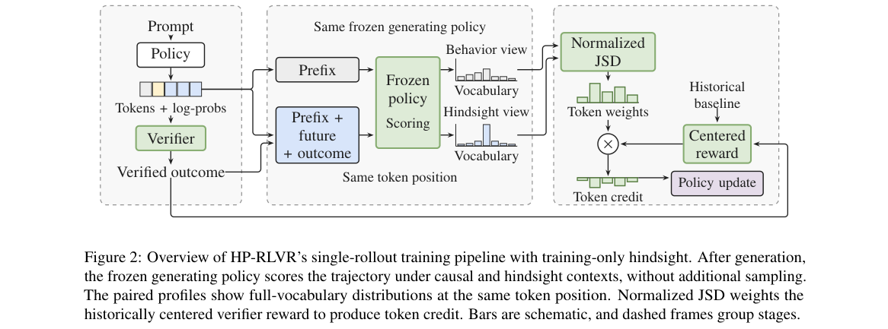

**Why this ranks #1**: 本批 RL 第一篇：它攻击的不是 GRPO 的信用分配粒度，而是 GRPO **必须多次采样**这个结构性成本。

---

### 2. ForkGRPO: Efficient Exploration and Fine-Grained Credit Assignment for Diffusion Language Models

**arXiv**: [2610.19408](https://arxiv.org/abs/2610.19408) | **Score**: 8.7 (relevance 9 x 0.7 + quality 8 x 0.3) | **Tags**: rlhf, rl-algorithm | **Categories**: cs.CL | **Pages**: 20

**Authors**: Zhaoyan Jia, Chengwei Zhou, Gourav Datta, Massoud Pedram

**Affiliation**: 2Case Western Reserve University, Cleveland, USA

**Abstract**

> Diffusion large language models (dLLMs) have advanced rapidly, yet strengthening their reasoning through reinforcement learning (RL) remains an open challenge. Any-order generation can suffer from entropy degradation, which narrows the reasoning paths available for exploration. Recent work mitigates this issue by applying standard GRPO with left-to-right generation. However, independently generating every rollout from the input prompt can leave alternative continuations from intermediate states underexplored, while trajectory-level advantages assign uniform credit to all tokens without distinguishing the contributions of individual reasoning segments. We propose ForkGRPO, an RL framework that couples efficient exploration with fine-grained segment-level credit assignment. It samples multiple continuations from high-entropy intermediate states along a reference trajectory, prioritizing textual boundaries and reusing shared prefixes. The continuations provide complementary learning signals: within-state group-relative advantages guide which continuations to reinforce, while Monte Carlo state-value differences indicate which reasoning segments improve expected outcomes. Among the evaluated architecture-preserving RL methods, ForkGRPO achieves the best performance on three of four benchmarks, while improving over the directly comparable JustGRPO by up to 1.2 percentage points and using up to 27.8% fewer generated tokens. ForkGRPO-Fast further achieves a $2.49\times$ training wall-clock speedup with negligible accuracy loss.

**Key findings**

- **Finding**: 扩散 LLM 的任意顺序生成会遭受**熵退化**，收窄可供探索的推理路径。

- **Finding**: 近期工作以标准 GRPO 加从左到右生成缓解；ForkGRPO 改用细粒度信用分配与更高效的探索（摘要在此处截断）。

- **Inference**: 熵退化是自回归解码的结构性产物，但作者指出扩散 LLM 的**任意顺序**生成同样出现——这说明退化的根源不是自回归本身，而是「组内优势需要组内多样性」这一 GRPO 前提。

- **Recommendation**: 做扩散 LLM 的必读；与本批 Hindsight-Privileged RLVR（去掉组采样）对照，两者从不同方向拆解同一前提。

**Key figures**

*Framework / architecture - Figure 1 Overview of FORKGRPO. FORKGRPO samples multiple continuations from high-entropy intermediate states along a reference trajectory and uses their terminal rewards to estimate intermediate stat*

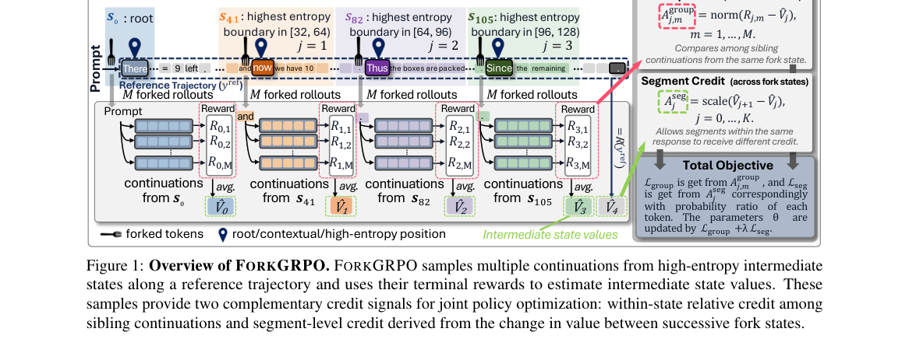

**Why this ranks #2**: 把 GRPO 家族的诊断移植到扩散 LLM，说明这些问题是架构无关的。

---

### 3. Where to Start, How to Move: Analyzing Curricula under GRPO for Long-Horizon LLM Agents

**arXiv**: [2610.19349](https://arxiv.org/abs/2610.19349) | **Score**: 8.7 (relevance 9 x 0.7 + quality 8 x 0.3) | **Tags**: rlhf | **Categories**: cs.CL, cs.LG | **Pages**: 7

**Authors**: Minchan Kim, Sungho Bae, Youngjin Kim, Hyunwoo Park

**Affiliation**: 1Graduate School of Data Science, Seoul National University | 2Department of Computer Science and Engineering, Konkuk University

**Abstract**

> Group Relative Policy Optimization (GRPO) provides no reward-relative learning signal when all rollouts receive identical rewards. In long-horizon tasks that require multiple interactions, rewards are given only upon successful task completion, making all-fail groups common early in training and limiting opportunities to practice later steps. Guide Assisted GRPO replays a successful reference prefix before the learner continues. We study how initial positions, handoff units, and movement rules affect unassisted task completion. Across three model sizes on BFCL, starting near completion is more effective under a fixed turn-level threshold rule. Finer handoffs alone do not consistently help, but outcome-informed tool-call selection outperforms GRPO on trained and untrained task categories. Guided starts also improve AppWorld success on both evaluation splits. These findings highlight where learning starts and how starting positions move as key curriculum choices.

**Key findings**

- **Finding**: GRPO 在所有 rollout 奖励相同时**不提供任何奖励相对的学习信号**。

- **Finding**: 长时程任务只在成功时给奖，因此**训练早期全失败组很常见**，限制了练习后续步骤的机会。

- **Finding**: 作者系统分析 GRPO 下的课程设计（从哪开始、如何移动）。

- **Inference**: 全失败组不只是「信号为零」，它还**阻止了后续步骤被练习**——因为到达后续步骤本身就要求先成功。这使长时程任务在早期陷入一个自锁：不会到达，就不会被练到。

- **Recommendation**: 与本批 Hindsight-Privileged RLVR 合读：一篇诊断课程侧的死锁、一篇提供信号侧的替代。

**Key figures**

*Framework / architecture - Figure 1 GRPO with original and guide-assisted starts.*

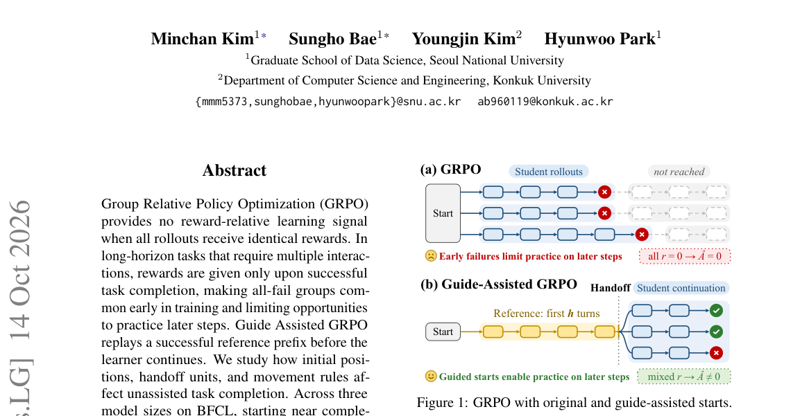

*Main result - Figure 2 BFCL validation accuracy (%) over training rollouts with Qwen3-8B.*

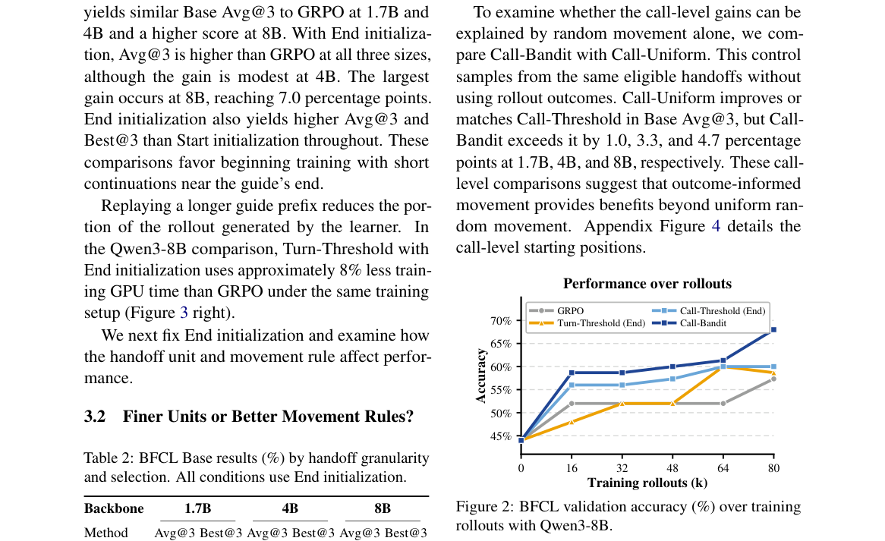

**Why this ranks #3**: 「全失败组」被明确命名为长时程训练的结构性障碍，而不只是实现细节。

---

### 4. C3: Rethinking Process Supervision via Confidence-Guided Credit Correction in Multi-Turn Reinforcement Learning

**arXiv**: [2610.19695](https://arxiv.org/abs/2610.19695) | **Score**: 8.0 (relevance 8 x 0.7 + quality 8 x 0.3) | **Tags**: rlhf | **Categories**: cs.AI | **Pages**: 26

**Authors**: Ai Jian, Haoran Pan, Eryu Guo, Haojin Yang, Jinghan He, Xiaoyun Zhang, Jiangbo Pei, Peiyu Liu

**Affiliation**: 1 Beijing University of Posts and Telecommunications | 2 Peking University | 3 Institute of Automation, Chinese Academy of Sciences | 4 University of Chinese Academy of Sciences

**Abstract**

> Large language models are increasingly trained as multi-turn agents that interact with external tools. However, outcome-only reinforcement learning can produce a form of misguided reinforcement: even on successful trajectories, undesirable local behaviors may receive positive token-level advantages and be favored by the policy update. To address this issue, we propose Confidence-Guided Credit Correction (C$^3$), a plug-in method for local credit correction. C$^3$ identifies spans corresponding to undesirable behaviors and selectively corrects positive credit after advantage estimation, with the correction strength adaptively controlled by the behavior policy's confidence in the corresponding behavior, while leaving the task reward and original credit estimation unchanged. Across multiple multi-turn benchmarks, C$^3$ improves performance under both {critic-based and critic-free reinforcement learning methods}. Injecting the same behavioral signals as turn-level or outcome rewards does not consistently improve performance. Our results show that local credit correction provides an effective form of process supervision for outcome-driven RL.

**Key findings**

- **Finding**: 纯结果 RL 产生**误导性强化**：即使轨迹成功，不良的局部行为也可能拿到**正的** token 级优势。

- **Finding**: 作者把问题重新表述为需要**纠正信用**而非增加信用，用置信度引导（摘要在此处截断）。

- **Inference**: 成功只证明存在一条好路径，不证明这条路径上的每一步都对——用成功轨迹做全 token 正优势，等于把「碰巧成功」的部分也当作「应该学会」的。

- **Recommendation**: 与 10-14 日报的 ProAS（统一广播导致持续强化多数模式）对照，两篇从不同角度处理同一污染问题。

**Key figures**

*Framework / architecture - Figure 1 Misguided reinforcement under outcome-only training. (a) Incorrect tool use and redun- dant search receive mixed token-level credit, with positive and negative advantages shown in rose and b*

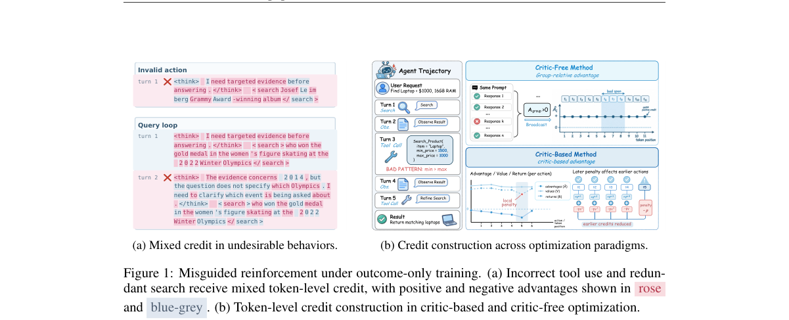

*Main result - Figure 2 Overview of confidence-guided advantage correction for multi-turn agent reinforcement learning. A detector localizes an undesirable-behavior span, the actor-side correction is applied only w*

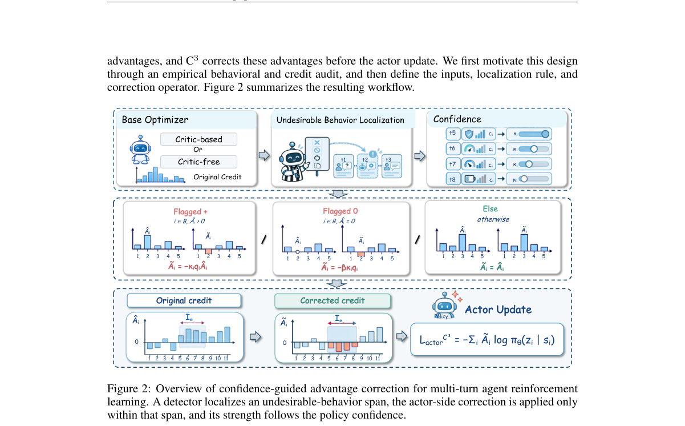

**Why this ranks #4**: 「成功轨迹上仍存在被强化的坏行为」是本批最精确的一个失效命名。

---

### 5. When Pairwise Preferences Cycle: A Reliability-Anchored Preference Walk for Video GRPO

**arXiv**: [2610.20089](https://arxiv.org/abs/2610.20089) | **Score**: 7.7 (relevance 8 x 0.7 + quality 7 x 0.3) | **Tags**: rlhf, rl-algorithm | **Categories**: cs.CV | **Pages**: 9

**Authors**: Xinrui Lin, Fan Li, Shumin Wang, Dehong Kong, Yanyong Zhang

**Affiliation**: 2Huawei Noah’s Ark Lab | ing its relational information?

**Abstract**

> Pairwise preference feedback has become a widely adopted supervision signal for reinforcement learning in video generation models, as pairwise comparisons provide a more reliable alternative than pointwise scalar ratings for evaluating the quality of generated videos. Specifically, we define a preference graph for each GRPO group under a pairwise evaluator, where nodes represent sampled rollouts and edges encode pairwise preferences. Auditing 6,976 on-policy comparison graphs, we find that cyclic preferences are prevalent and persist throughout training. Naive pairwise reward aggregation based on average win rates discards the underlying comparison structures and treats each rollout independently, which may introduce unreliable advantage estimates for certain rollouts and consequently affect reinforcement learning optimization. Therefore, we propose the \emph{Reliability-Anchored Preference Walk} (\ours{}), a graph-aware advantage aggregation method that strengthens the global preference signal from win rates with reliable relational evidence from cyclic preference graphs through a reliability-guided preference walk. Under matched evaluator, comparison protocol, group size, prompt schedule, and query budget, \ours{} requires no additional evaluator queries beyond the observed comparisons within each rollout group and improves over Pairwise-GRPO across controlled comparisons, transfer settings, and blind human evaluations.

**Key findings**

- **Finding**: 成对偏好在视频生成 RL 中被广泛采用，作者为每个 GRPO 组定义**偏好图**。

- **Finding**: 标题即问题：**成对偏好可能成环**（pairwise preferences cycle）；作者提出以可靠性为锚的偏好游走。

- **Inference**: 成对比较的可靠性是局部的：A>B、B>C 不蕴含 A>C。偏好图成环意味着在这些任务上不存在一致的总序，任何基于成对比较的优势归一化都会在一个环上失效。

- **Recommendation**: 与本批 Where to Start, How to Move 合读：两篇都在处理「组内信号不可靠」，一篇在课程、一篇在偏好结构。

**Key figures**

*Framework / architecture - Figure 1 Overview of RAP-Walk. Top: methods share the Pairwise-GRPO pipeline and differ only in advantage construction. Bottom: (a) same-prompt videos exhibit quality trade-offs; (b) pointwise reward*

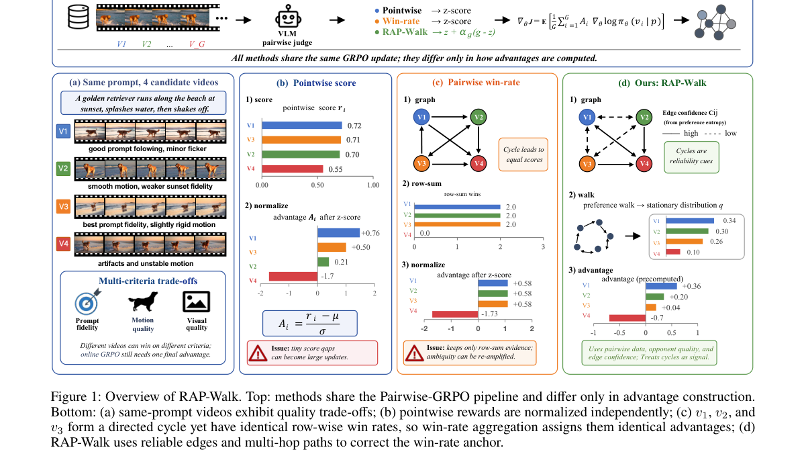

*Main result - Figure 2 Five-node illustration of cyclic preference propa- gation. (a) A cyclic preference graph with reliability-aware propagation. (b) Normalized preference credits from row- wise win-rate aggrega*

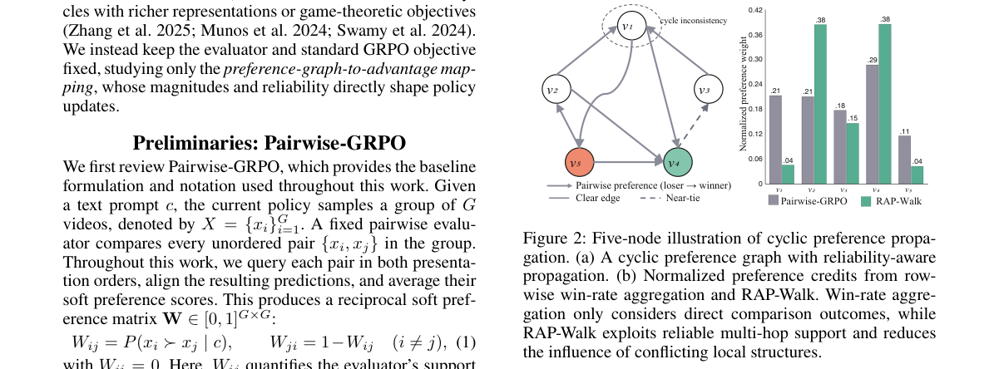

**Why this ranks #5**: 「偏好图会成环」是一个结构性问题——偏好比较在成对可靠并不意味着传递可靠。

---

### 6. RM-OPD: On-Policy Distillation for Generative Reward Models

**arXiv**: [2610.20174](https://arxiv.org/abs/2610.20174) | **Score**: 7.7 (relevance 8 x 0.7 + quality 7 x 0.3) | **Tags**: rlhf, rl-algorithm | **Categories**: cs.CL, cs.LG | **Pages**: 34

**Authors**: Qinglin Su, Licheng Pan, Zhen Fang, Jiakang Wang, Qingnan Ren, Yunsheng Lu, Yan Gao, Zhixuan Chu

**Affiliation**: 1Zhejiang University | 3Xiaohongshu Inc. | DeepSeek-AI, 2026; Xiaomi, 2026; GLM, 2026). On-policy context distillation further shows that a

**Abstract**

> Reinforcement Learning on Mixed-domain preference data (Mix-RL) has become the mainstream approach for training general-purpose Generative Reward Models (GRMs). However, Mix-RL suffers from two critical bottlenecks: the reward sparsity induced by outcome rewards, and the cross-domain interference arising from jointly optimizing heterogeneous capabilities, which together give rise to imbalanced capability acquisition and pervasive reward hacking. Inspired by the success of On-Policy Distillation (OPD) in multi-domain capability integration, we introduce RM-OPD (Reward Modeling via On-Policy Distillation), a two-stage framework that separates specialist acquisition from capability integration. First, we cultivate domain-specialized teacher models via single-domain GRPO fine-tuning, allowing each expert to reach its performance ceiling in isolation; then we consolidate these teachers into one student model through (i) routed on-policy distillation, which provides dense signed token-level supervision on student-generated critiques; (ii) domain contribution reweighting, which reweights token guidance toward target domain shares, preventing specific domains from dominating optimization; and (iii) optional criteria context distillation, which conditions teachers on domain-specific evaluation criteria to sharpen token-level supervision. Across multiple RM benchmarks and two base models, RM-OPD consistently outperforms vanilla Mix-RL and other strong baselines, achieving overall superior performance and exhibiting an emergent "teacher-surpassing" effect. These results establish RM-OPD as a promising paradigm for building generalist GRMs.

**Key findings**

- **Finding**: 生成式奖励模型训练有两个瓶颈：结果奖励导致的**稀疏性**，与联合优化异质能力导致的**跨领域干扰**。

- **Finding**: RM-OPD 用在策略蒸馏处理（摘要在此处截断）。

- **Inference**: 稀疏性与干扰是两类相反的问题（前者信号太少、后者信号互相抵消），用同一个蒸馏机制同时处理暗示奖励模型的信息瓶颈不同于策略——这值得单独验证。

- **Recommendation**: 奖励模型方向的读者可参考；与 10-14 日报的 Residual Advantage（教师 token 信号需相对学生才有效）同属「蒸馏信号如何作用」这条线。

**Key figures**

*Framework / architecture - Figure 1 Performance Comparison in Multi-domain Training. (a) On RM-Bench Math, RM-OPD converges substantially faster than both the specialist RL teacher and Mix-RL, rapidly reaching and even surpass*

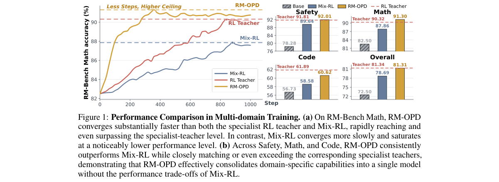

*Main result - Figure 2 Overview of RM-OPD. Independent single-domain GRPO produces frozen math, code, and safety reward teachers. Each student-generated judgment receives token-level supervision from its domain te*

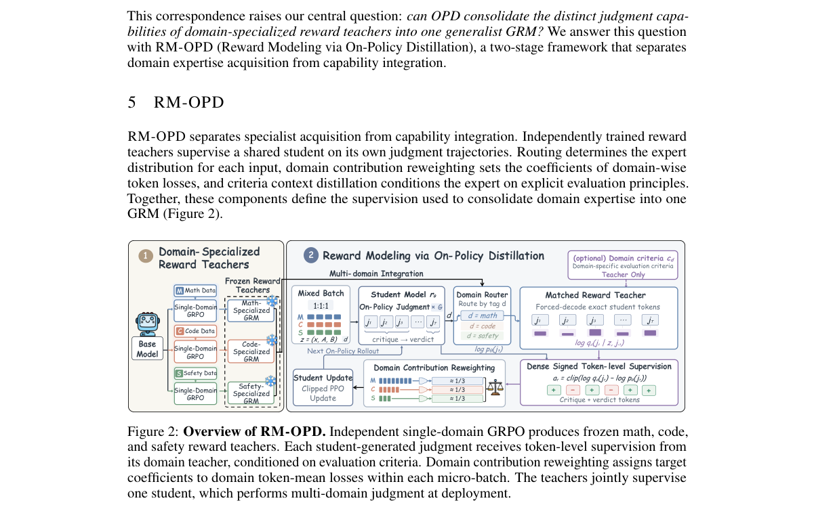

**Why this ranks #6**: 把奖励模型的训练瓶颈与策略训练的瓶颈并置处理，是一个少见的视角。

---

### 7. More Methods, Better Agents? A Reality Check on Self-Distillation in Agentic Reinforcement Learning

**arXiv**: [2610.19789](https://arxiv.org/abs/2610.19789) | **Score**: 7.3 (relevance 7 x 0.7 + quality 8 x 0.3) | **Tags**: rl-algorithm | **Categories**: cs.CL, cs.LG | **Pages**: 39

**Authors**: Linhao Zhong, Bozhen Fang, Xuehao Wang, Duochao Shi, Zekai Luo, Guangming Yao, Yi Yuan, Hao Chen, Jingdong Chen, Chunhua Shen

**Affiliation**: 1Zhejiang University, State Lab of CAD & CG

**Abstract**

> Self-distillation in agentic reinforcement learning has produced a growing number of methods. However, existing evaluations often reuse published baseline scores under differing experimental conditions, provide few direct comparisons among contemporaneous methods, and give limited attention to training stability and computational cost. These limitations obscure the source of reported gains and the practical strengths and weaknesses of competing methods. Costly agent training further motivates a common basis for comparison. To address these gaps, we compare ten representative methods against GRPO on ALFWorld, ScienceWorld, Search-QA, and WebShop across three model sizes. Our study comprises 132 training runs totaling 12,124.4 recorded H800 GPU-hours, with repeated evaluations over eight rollout seeds for the pretrained backbones and all eleven trained methods. Beyond final task performance, we examine training progress, stability, and measured computational cost. Our evaluation yields three key findings. First, gains over GRPO remain limited in scope, with no method consistently outperforming it across settings. Second, strong final performance can mask unstable training. Third, additional training cost does not consistently translate into better performance. We establish this benchmark to support fair, comprehensive comparison and guide future research toward reliable and cost-effective improvements in agent training. Project page: https://aim-uofa.github.io/Self-Distillation-AgentRL/

**Key findings**

- **Finding**: 既有评测**复用已发表基线分数**且实验条件各异，缺少同时期方法的直接比较，对稳定性与算力成本关注有限。

- **Finding**: 作者对自蒸馏方法做了一次「现实检验」（reality check）（摘要在此处截断）。

- **Inference**: 复用基线分数意味着比较的不是方法而是**评测设置**——若各方法的超参预算与 rollout 次数不同，横向排名的信息量接近零。这解释了为何自蒸馏方向看似方法众多却难以判断进展。

- **Recommendation**: 做 agentic RL 的读者建议直接看这篇的对照表；这是本批继 10-09 Selective Listening、10-12 音频裁判探针之后的第三例「评测工具有问题」。

**Key figures**

*Framework / architecture - Figure 1 Motivation and overview of our benchmark for self-distillation in agentic reinforcement learning. Differences in experimental conditions, reused baseline scores, and incomplete evaluation mot*

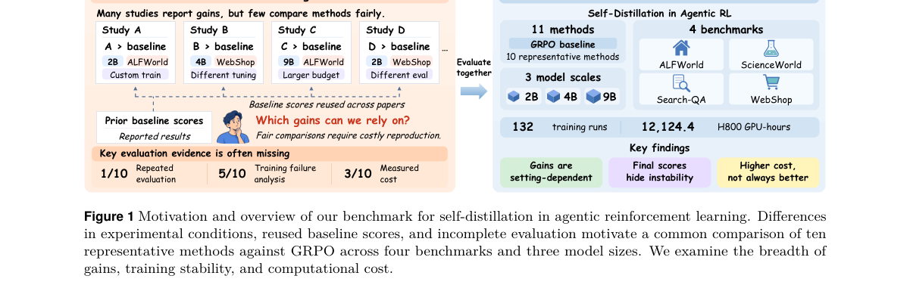

*Main result - Figure 2 Validation trajectories of eleven methods across four benchmarks and three model sizes, covering 132 training runs and 2,772 validation sweeps. Curves show validation scores recorded througho*

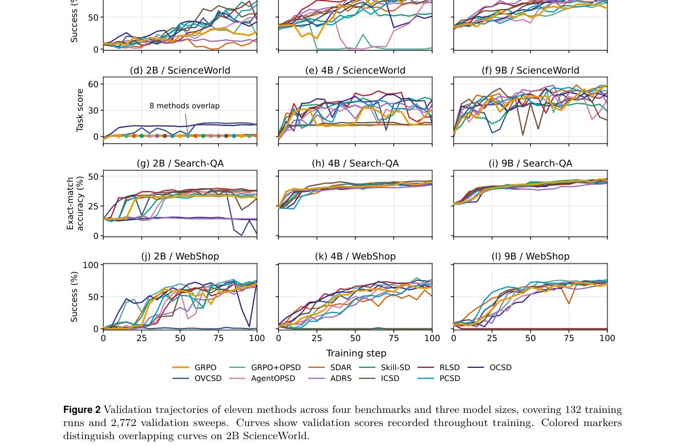

**Why this ranks #7**: 「复用已发表基线分数」是当前自蒸馏方法评测的一个系统性缺陷，值得被明确指出。

---

### 8. Explorer-Zero: Improving Self-Play for Long-Horizon Tasks with Decomposable Verifiable Rewards

**arXiv**: [2610.19868](https://arxiv.org/abs/2610.19868) | **Score**: 7.0 (relevance 7 x 0.7 + quality 7 x 0.3) | **Tags**: multi-agent-rl, rlhf | **Categories**: cs.AI, cs.LG | **Pages**: 28

**Authors**: Tianyu Liu, Davide Belli, Bence Major, Arash Behboodi, Tribhuvanesh Orekondy

**Affiliation**: 1 ETH Zurich | 2 Qualcomm AI Research‡ | ‡Qualcomm AI Research is an initiative of Qualcomm Technologies, Inc.

**Abstract**

> Training LLM agents on long-horizon interactive tasks with reinforcement learning typically relies on human-annotated tasks and reliable verification, both expensive to construct for stateful environments. Self-play offers an alternative, but must generate achievable, compositional tasks and provide feedback beyond binary outcomes. We propose Explorer-Zero, a self-play framework that jointly generates tasks and fine-grained, verifiable rewards through environment interaction. A learned proposer explores the environment, constructs tasks, and records intermediate and final states as verification targets. These checkpoints reward partial completion, while alternating proposer--solver training adapts the generated curriculum. We show theoretically that subtask rewards reduce collapse among unsuccessful rollouts when they complete different numbers of subtasks. Without human-annotated training tasks, Explorer-Zero outperforms the evaluated self-play baselines across ALFWorld, ScienceWorld, and AppWorld; on AppWorld, our 30B agent reaches 59.67% task success, approaching 62.65% for RL on human-annotated tasks. Further analyses support task-relevant composition and benefits on complex tasks, while self-play initialization improves subsequent human-data RL across all three benchmarks.

**Key findings**

- **Finding**: 自博弈必须生成可达成、可组合的任务，并提供**超出二元结果**的反馈。

- **Finding**: Explorer-Zero 用可分解的可验证奖励改进长时程自博弈（摘要在此处截断）。

- **Inference**: 「可组合」是关键约束：任务必须能被拆成可独立验证的子任务，否则自博弈只能生成整体判定，而整体判定在长时程上又回到稀疏问题。

- **Recommendation**: 与本批 Explorer-Zero 类的课程工作对照；自博弈的可组合性设计比自博弈本身更难。

**Key figures**

*Framework / architecture - Figure 1 Overview of Explorer-Zero. Left: the proposer πP explores the environment, declares an initial task intent (declare), completes subtasks (subtask) and the final task x (finish). Each subtask*

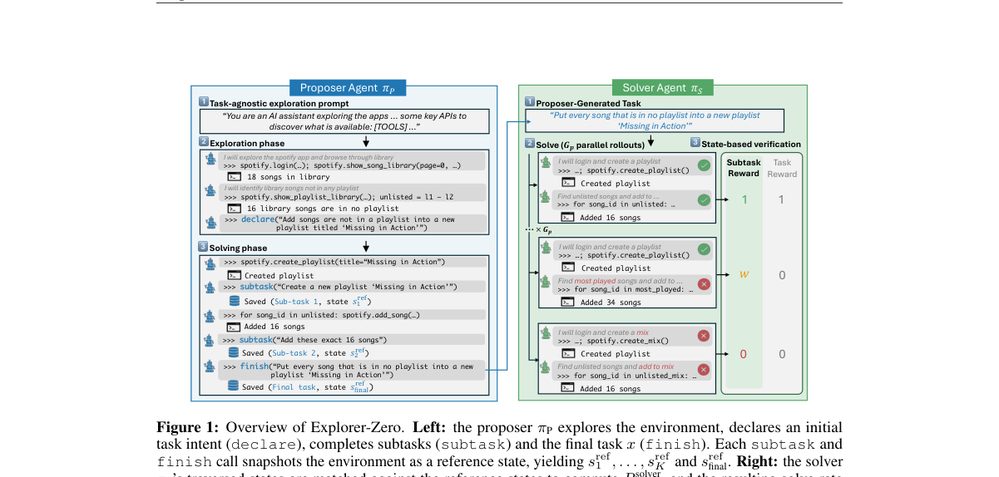

*Main result - Figure 2 Task relevance of AppWorld proposer trajectories with and without subtask supervision. Left two: Trajectory lengths are similar across the two variants, while the proposer with subtasks make*

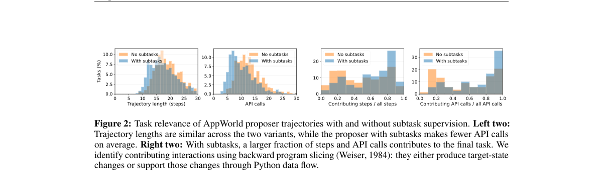

**Why this ranks #8**: 「可组合的可验证奖励」是对自博弈瓶颈的一个精确表述。

---

### 9. When Does Momentum Help in Reinforcement Learning with Verifiable Rewards?

**arXiv**: [2610.20413](https://arxiv.org/abs/2610.20413) | **Score**: 7.0 (relevance 7 x 0.7 + quality 7 x 0.3) | **Tags**: rl-algorithm, rlhf | **Categories**: cs.AI, cs.LG, math.OC, stat.ML | **Pages**: 34

**Authors**: Kaifei Wang, Zikang Shan, Liwei Wang, Yinyu Ye, Han Zhong

**Affiliation**: [not-found in PDF]

**Abstract**

> Momentum is a classical tool for accelerating convex optimization and a standard component of modern large language model training. Yet recent empirical work has questioned the usefulness of first-moment momentum in reinforcement learning with verifiable rewards (RLVR). We study this question through a bandit formulation of RLVR with bias-corrected exponential moving average (EMA) momentum, where the EMA coefficient $β$ controls how quickly the weights on past gradients decay. When policy gradients are evaluated exactly, we prove that increasing $β$ within a range that prevents overshoot strictly accelerates optimization. When gradients are estimated from sampled responses, a positive expected gain can be obscured by sampling fluctuations. We show that as the learning rate $η$ decreases, the expected gain with fixed $β$ vanishes faster than these fluctuations, whereas increasing $β$ to keep $η/(1-β)$ within the safe regime preserves a nonvanishing gain that eventually dominates them. Bandit simulations quantitatively validate these predictions. RLVR experiments on Qwen3-4B-Base using SGD with EMA and AdamW support our principle of choosing larger coefficients in practical LLM post-training. On Qwen2.5-32B with AdamW, simply increasing $β_1$ improves mean validation accuracy by nearly $2$ percentage points over the conventional choice, demonstrating the principle's effectiveness at a larger model scale.

**Key findings**

- **Finding**: 近期实证工作质疑一阶动量在 RLVR 中的**有效性**，而动量是现代 LLM 训练的标准组件。

- **Finding**: 作者用 bandit 形式化与偏差校正（bias-corrected）研究该问题（摘要在此处截断）。

- **Inference**: 动量在凸优化中有效的前提是梯度序列近似同向；RLVR 的梯度方差极大且方向随组采样随机波动，动量的历史平均因此可能只是噪声的累积。

- **Recommendation**: 与 10-14 日报的 Two Clocks（更大批次学更慢但按计划失败）连读：两篇都在说明 RL 训练中「标准凸优化直觉」失效的地方。

**Key figures**

*Framework / architecture - Figure 1 Numerical bandit results with 3 reward-one and 7 reward-zero arms under uniform initialization (1(a), 1(b)) and random policy initialization (1(c), 1(d)).*

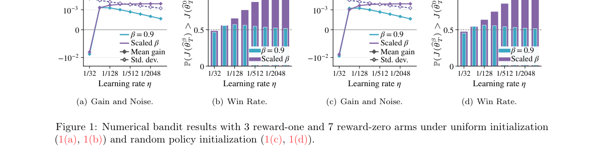

*Main result - Figure 2 RLVR experiments on Qwen3-4B-Base with GRPO. The horizontal axis shows the training step. 2(a) and 2(b) compare momentum coefficients at a fixed learning rate; lines show mean validation acc*

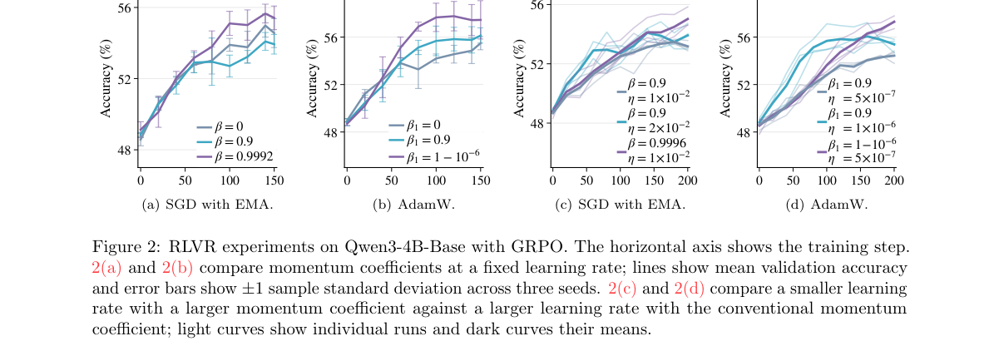

**Why this ranks #9**: 「动量在 RLVR 里可能无用」是一个会改变默认训练配置的问题。

---

### 10. Learning Perception to Action Rules through Reinforcement Learning for Theory-of-Mind Reasoning

**arXiv**: [2610.19796](https://arxiv.org/abs/2610.19796) | **Score**: 6.3 (relevance 6 x 0.7 + quality 7 x 0.3) | **Tags**: rl-algorithm `[wild-card]` | **Categories**: cs.AI, cs.CL | **Pages**: 12

**Authors**: Soyoung Oh, Nursulu Sagimbayeva, Nicholas Jennings, Paulina Hussein, Mehwish Alam, Vera Demberg

**Affiliation**: 1Saarland University, 2Deutsches Forschungszentrum für Künstliche Intelligenz | 3Télécom Paris, 4Max Planck Institute for Informatics

**Abstract**

> In Theory-of-Mind (ToM) reasoning, large language models may correctly infer the agent's mental state but fail to use that inference when predicting or judging the agent's subsequent actions. In this work, we investigate whether explicitly connecting perception, belief, and action with rules improves ToM reasoning. We generate concise \textit{if--then} rules that express relations between perception to action and use Group Relative Policy Optimization (GRPO) to train Qwen2.5 and Llama3 models across four ToM benchmarks. GRPO with rule generation outperforms prompting, supervised fine-tuning, and think reasoning. Moreover, rules generated by larger models ($\geq$3B) provide transferable knowledge that improves downstream performance of GPT-4o-mini. These findings suggest that explicit rules help models bridge the reasoning gap in ToM and support knowledge transfer across models.

**Key findings**

- **Finding**: 通过 RL 学习感知到动作的规则以支持理论心智推理（摘要在此处截断）。

- **Finding**: 该文属于把 RL 应用于社会/认知任务的路线，与本批其余控制类工作不同。

- **Inference**: 「感知到动作的规则」这个抽象层次值得注意：它把心智理论建模为一个可从交互数据中学到的策略，而非固定的推理程序。

- **Recommendation**: wild-card 项；与本批 Embodied 线对照，一篇是物理交互中的规则学习、一篇是社会交互中的。

**Key figures**

*Framework / architecture - Figure 1 Causal structure of ToM, adapted from Baker et al. (2011). An example story and question illustrate the perception-belief-action dependencies required for reasoning about an agent’s mental s*

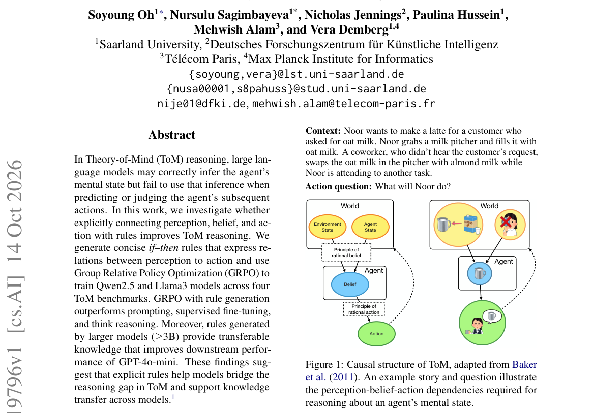

*Main result - Figure 2 Downstream accuracy (%) of GPT-4o-mini augmented with rules generated by each GRPOr models. Dashed line denotes GPT-4o-mini no-rule baseline.*

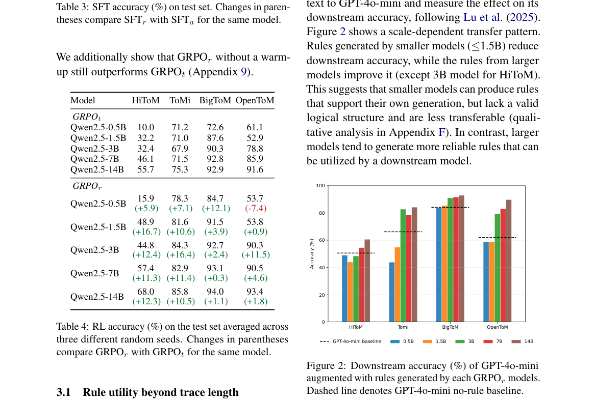

**Why this ranks #10**: wild-card：把 RL 用于社会认知而非控制，设定较特殊。

---

## Footer

- Total papers reviewed across all 5 tracks: 50 (from 570 scanned)
- rl track final top-10: 10
- Wild-cards in this track: 1
- Figure assets: `res/` (shared across tracks)

Generated by `mine-arxiv-daily-digest` skill. Sister file: `2026-10-15_rl_entry.md`.
