# ArXiv Daily Digest - 2026-10-16 (AIGC 音频生成与编辑, 10 papers)

**Generated**: 2026-10-16 17:00 CST

**Source**: arXiv cs.CV, cs.SD, eess.AS, cs.CL, cs.AI, cs.RO, cs.LG submissions, window 2026-10-15 UTC (latest announced batch as of 2026-10-16 17:00 CST)

**Track**: aigc_audio (top 10 of 574 papers scanned, 50 full reads)

**Scope**: piano performance-to-score transcription, high-order sinusoidal parameter refinement, frame-wise streaming speech compression, zero-bit neural audio watermarking, bias mitigation in audio LLMs, batch composition for speech enhancement, audio-visual speech separation, multi-teacher speech attribute distillation, situational ASR distortion metric, spatially aware audio-visual LLMs

---

**必须先说明：本批音频生成方向是本项目日报至今最薄的一次。** cs.SD 仅 13 篇、eess.AS 极少，全库 574 篇中**没有一篇** TTS、音乐生成或语音转换论文（前几天的 aigc_audio 分别有 10、10、8 篇真实生成/编辑工作）。因此这条线用了 **9 个 wild-card**，由转录、压缩、水印、语音增强、多语评测等**非生成**工作补足。读这份日报的音频生成部分时请大幅打折。

仍然值得看的三篇：**DuET** 把钢琴演奏转录为乐谱，其关键观察是**节拍可能在没有音符起音处发生**，而乐谱属性与音符关联——因此单帧表示会把节拍强行附到最近音符上，需要音符-帧双编码；**Backward Compatibility in Zero-Bit Watermarking** 指出神经水印通常训练为**紧密耦合的嵌入器-检测器对**并隐含静态部署假设，而真实部署中两者常因安全与版本管理被**选择性解耦**，这会破坏检测；**Bias Mitigation in Audio-Enabled LLMs** 则指出免转写是 AuLLM 的卖点、却也是偏见的新来源——非言语线索（语调、节奏、口音）与人口统计属性高度相关，把它们纳入输入等于以更强的方式引入人口统计变量，而转写反而会过滤掉这些线索。

**流匹配正在系统性入侵判别式任务**这条趋势（我在 10-15 日报记录过）今天延续到语音编码：Frame-Wise Streaming 指出神经编解码器的长程依赖提升率失真但阻断流式，帧级模型则相反——这个取舍的比例因场景而异，卫星通信与实时通话的最优点显然不同。

---

## Top 10 - AIGC 音频生成与编辑

### 1. DuET: Note-Frame Dual Encoding for Piano Performance-to-Score Transcription

**arXiv**: [2610.21467](https://arxiv.org/abs/2610.21467) | **Score**: 7.7 (relevance 8 x 0.7 + quality 7 x 0.3) | **Tags**: aigc-audio | **Categories**: cs.LG, cs.SD, eess.AS | **Pages**: 14

**Authors**: Wei Zeng, Ye Wang

**Affiliation**: ♯Integrative Sciences and Engineering Programme, NUS Graduate School | ♭School of Computing, National University of Singapore

**Abstract**

> Transcribing expressive piano performances into scores requires interpreting individual note timings within an underlying metrical structure. However, score attributes are associated with notes, whereas beats may occur without coincident note onsets. We introduce DuET, a Dual-Encoder Transformer that jointly learns note-level performance MIDI-to-score (PM2S) transcription and frame-level beat and downbeat tracking. Bidirectional cross-attention connects note and frame encoders, while an autoregressive decoder alternates between their representations to predict structured score attributes. We further introduce TimeRoPE and Time-Pitch Rotary Positional Encoding (TPRoPE) to establish a shared performance-time reference and explicitly encode relative temporal and pitch relationships. Evaluations on ASAP, a classical piano dataset, and our curated Gangqinpu dataset, which spans multiple genres with a focus on popular piano music, demonstrate improvements in score timing and notated duration. Compared with the strongest baseline on each dataset, DuET reduces MUSTER mean error from 6.56% to 3.64% on Gangqinpu and from 11.30% to 11.22% on ASAP. Ablations support the benefits of frame-level context, time-based positional encoding, and decoder-history masking. Code, weights, and demos are available at https://github.com/wei-zeng98/DuET.

**Key findings**

- **Finding**: 乐谱属性与音符关联，而**节拍可能在没有音符起音处发生**。

- **Finding**: DuET 是音符-帧双编码的 Transformer（摘要在此处截断）。

- **Inference**: 节拍与音符是两个独立的时间层级，只在音符-帧双编码才能分别表示它们——单帧表示会把节拍强行附到最近的音符上，产生系统性偏差。

- **Recommendation**: 音乐转录的读者可参考；本批音频方向论文稀少，这是其中最直接相关的一篇。

**Key figures**

*Framework / architecture - Figure 1 Overview of DuET within the audio-to-score pipeline. Each dual-encoder layer combines branch-specific self-attention, bidirectional cross-attention, and feed-forward networks. Successive dec*

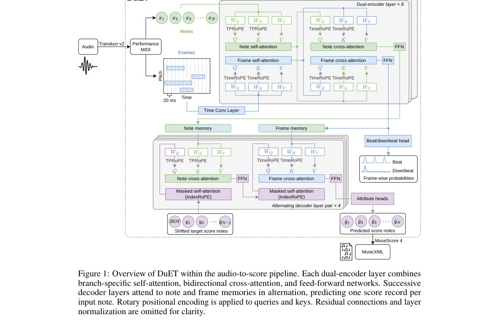

*Main result - Figure 2 Positional coordinates for the same four notes. IndexRoPE uses sequence indices, TimeRoPE uses scaled performance timestamps, and TPRoPE uses both performance timestamps and pitch coordinate*

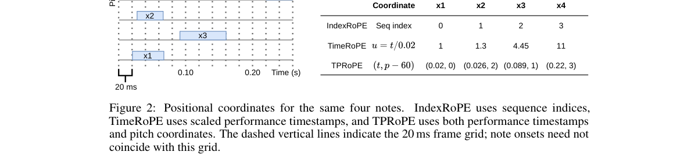

**Why this ranks #1**: 「节拍可以独立于音符存在」是一个被明确表述的数据结构问题。

---

### 2. Backward Compatibility in Zero-Bit Neural Audio Watermarking

**arXiv**: [2610.22296](https://arxiv.org/abs/2610.22296) | **Score**: 7.3 (relevance 7 x 0.7 + quality 8 x 0.3) | **Tags**: aigc-audio | **Categories**: cs.LG, cs.MM, cs.SD | **Pages**: 13

**Authors**: Admir Krnić, Kosta Pavlović, Petar Nedić, Željko Bolević, Slavko Kovačević, Igor Djurović

**Affiliation**: [not-found in PDF]

**Abstract**

> Neural watermarking systems are typically trained as tightly coupled embedder-detector pairs and implicitly assume static deployment. In real-world deployments, embedders and detectors are frequently updated and selectively decoupled for security and versioning purposes, which can break detection in previously embedded content and, more critically, increase false-positive rates on embedders that a given detector is intentionally not intended to recognize. In this paper the concept of backward compatibility in zero-bit audio watermarking is formalized. A training framework is proposed that pairs a new detector with a sequence of frozen legacy embedders (its legacy chain), using a performance-weighted sampling strategy so that the detector retains accuracy across all earlier versions. This coupling, while necessary for backward compatibility, is shown to induce an embedder-collapse effect that catastrophically degrades the true negative rate (TNR) against out-of-chain embedders. To counteract this, a Angular Diversity Loss (ADL) is introduced that explicitly forces each new embedder to occupy a distinct region of the output space. The combined approach restores near-perfect TNR with no measurable cost to detection accuracy or perceptual audio quality.

**Key findings**

- **Finding**: 神经水印通常训练为**紧密耦合的嵌入器-检测器对**，隐含静态部署假设。

- **Finding**: 真实部署中两者常被更新并**选择性解耦**（出于安全与版本管理），这会破坏检测（摘要在此处截断）。

- **Inference**: 「解耦后检测失效」意味着水印的实际鲁棒性来源不是内容特征而是训练时的联合优化——因此换检测器版本的水印，其可验证性在部署前无法假定。

- **Recommendation**: 与昨天 GAMW（生成感知 TTS 水印）对照，两篇都在处理水印与部署现实的冲突。

**Key figures**

*Framework / architecture - Figure 1 Accuracy matrix for the base setup (no diversity loss). Rows index embedder versions, columns index detector versions. The main diagonal and entries above it show TPR entries below show TNR*

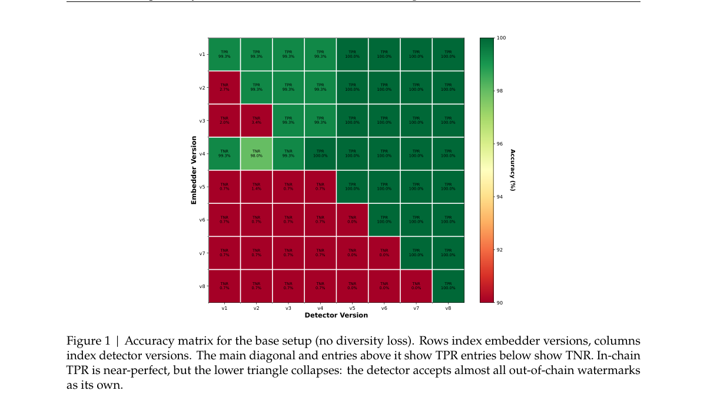

*Main result - Figure 2 Accuracy matrix for the full method (with the ADL). Same layout as Fig. 1. In-chain TPR is unchanged, while the lower triangle recovers to near-perfect TNR.*

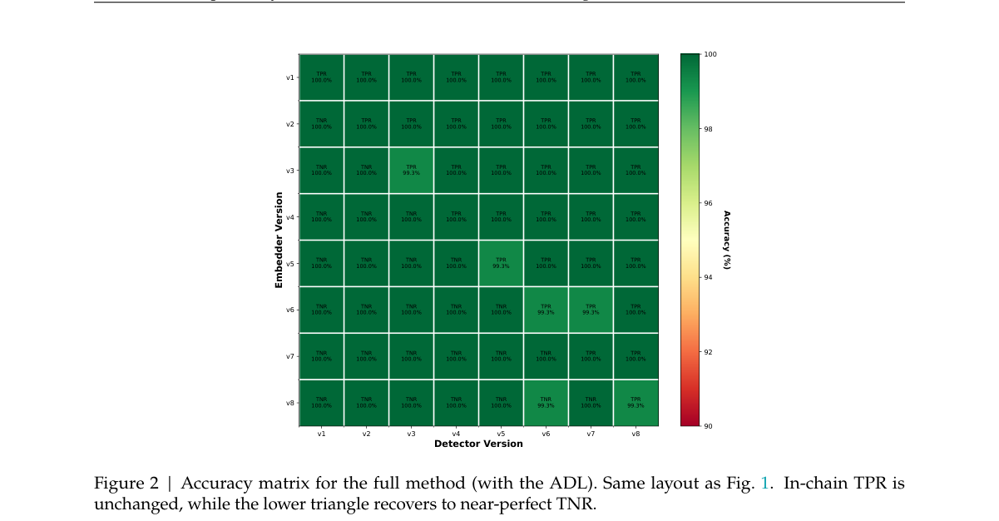

**Why this ranks #2**: 「嵌入器与检测器被选择性解耦」是部署现实与训练假设之间的一个具体缺口。

---

### 3. Frame-Wise Streaming for Efficient Learned Speech Compression

**arXiv**: [2610.21998](https://arxiv.org/abs/2610.21998) | **Score**: 7.0 (relevance 7 x 0.7 + quality 7 x 0.3) | **Tags**: aigc-audio | **Categories**: cs.SD, eess.AS | **Pages**: 6

**Authors**: Yuhan Liu, Jun Xu, Fengxi Zhang, Zhengxue Cheng, Li Song

**Affiliation**: School of Information Science and Electronic Engineering, Shanghai Jiao Tong University

**Abstract**

> Speech compression is increasingly important in scenarios such as real-time and satellite communication. Neural codecs have shown superior Rate-Distortion (RD) performance over traditional signal-processing codecs. Models with long-range dependency encoders/decoders and entropy models outperform convolution-based structures, but they still lack streaming support since they rely on sequence-level correlations. In this paper, we propose StreamLSC, a frame-level streaming learned speech compression model built on three fundamental components of streaming networks, i.e. Boundary-Cached Causal Convolution, Intra-Frame Layer Normalization, and RNN-mode RWKV. Our model incorporates a streamable entropy quantizer module, ensuring efficient context model while preserving causal constraints. Experiments show that the streaming model achieves performance comparable to its offline counterpart, attaining state-of-the-art rate-distortion results, significant gains in subjective evaluations, -51.37% (ViSQOL) and -53.99% (PESQ) BD-RATE savings on average, and improvements of 0.2154 and 0.5156 in BD-ViSQOL and BD-PESQ.

**Key findings**

- **Finding**: 神经编解码器有更优率失真性能；长程依赖的编解码器/熵模型与帧级模型表现不同（摘要在此处截断）。

- **Finding**: 该文做帧级流式以提升效率（摘要在此处截断）。

- **Inference**: 长程依赖提升压缩率但阻断流式，帧级牺牲率失真换取可实时性——这个取舍的比例因场景而异，卫星通信与实时通话的最优点显然不同。

- **Recommendation**: 与本批 2610.21126（稀疏 KV 的位置几何）同属「压缩留下的空隙如何处理」这条线。

**Key figures**

*Framework / architecture - Figure 1 Subjective evaluation results using MUSHRA. The center point of each circle represents the average value, and the size reflects variability of listener ratings. Our model achieves superior per*

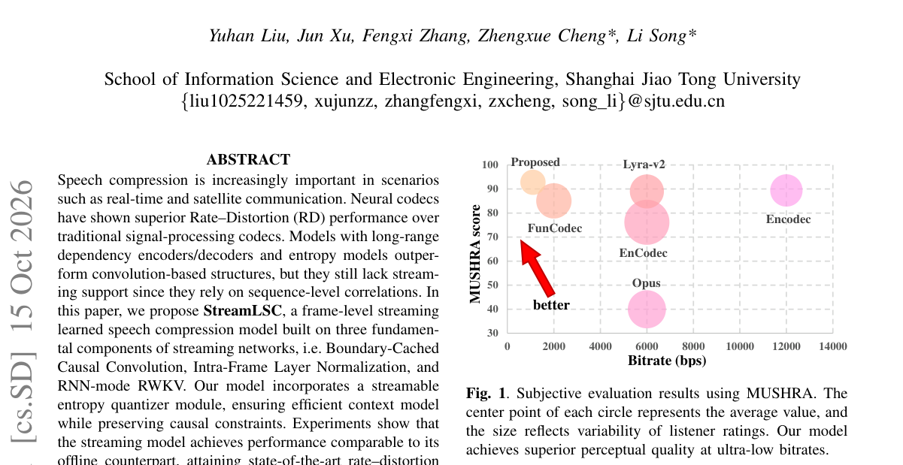

*Main result - Figure 2 Illustration of model architectures. (a) Previous non-streamable method. The whole audio sequence is processed at a time. (b) StreamLSC, frame-level streaming processing mode. (c) Streamable m*

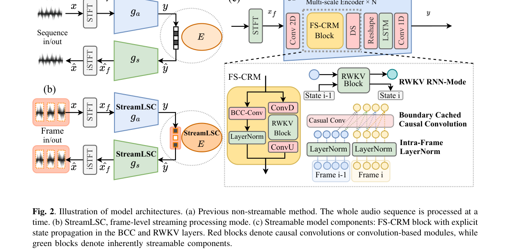

**Why this ranks #3**: 「长程依赖 vs 流式」的取舍在神经音频编解码中是一个真实的部署约束。

---

### 4. High-Order Sinusoidal Modeling for Precise Parameter Refinement

**arXiv**: [2610.21643](https://arxiv.org/abs/2610.21643) | **Score**: 7.0 (relevance 7 x 0.7 + quality 7 x 0.3) | **Tags**: aigc-audio | **Categories**: eess.AS, eess.SP | **Pages**: 13

**Authors**: Shaowen Chen, Tomoki Toda

**Affiliation**: Shaowen Chen is with the Graduate School of Informatics, Nagoya | Tomoki Toda is with the Information Technology Center, Nagoya Univer-

**Abstract**

> Although the amplitude estimation of sinusoids is a linear and tractable problem when their frequencies are known, the accuracy of signal modeling is fundamentally limited by the inevitable frequency mismatches produced by existing methods. Quasi-harmonic modeling (QHM) and its extensions (aQHM and eaQHM) offer the ability to refine frequency estimates while extracting amplitudes; however, their extraction and correction capabilities remain limited. In this paper, we first revisit QHM methods from the perspective of frequency mismatches, and reveal that their performances are essentially constrained by the order of the model. Specifically, QHM methods are linear models and thus incapable of capturing higher-order frequency variations, leading to suboptimal modeling accuracy. Second, to address this limitation, we propose a higher-order modeling framework that enables more precise approximation of signal components. Eventually, we qualitatively characterize the optimization problem and employ the Levenberg--Marquardt (LM) algorithm for parameter estimation. As a result, the proposed method allows for significantly improved estimation of amplitudes, frequencies, and phases of sinusoidal components, enabling more accurate signal modeling. Experiments on both simulation study and speech signals demonstrate the superiority of the high-order model in frequency refinement and parameter extraction and its robustness under additive noise conditions.

**Key findings**

- **Finding**: 频率已知时幅度估计线性可解，但**频率失配**从根本上限制建模精度（摘要在此处截断）。

- **Finding**: 该文用高阶正弦建模做精确参数精修（摘要在此处截断）。

- **Inference**: 高阶模型的价值在于它能表达频率随时间漂移（真实的合成器行为），因此「失配」从误差变成了可建模的信号。

- **Recommendation**: 音乐合成参数化的读者可参考；本批音频方向最偏 DSP 的一篇。

**Key figures**

*Framework / architecture - Figure 1 Frequency estimates obtained by QHM and eaQHM.*

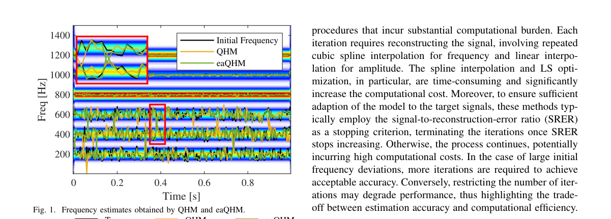

*Main result - Figure 2 Amplitude estimates obtained by QHM and eaQHM.*

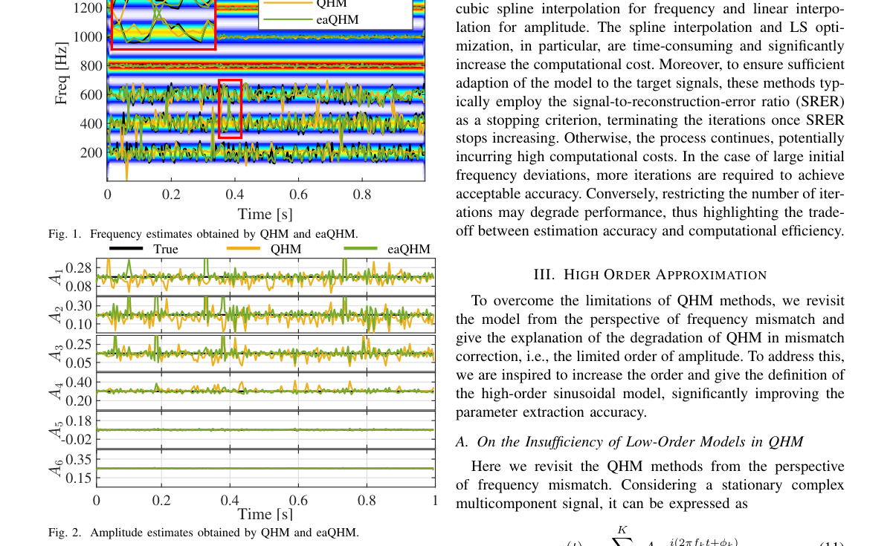

**Why this ranks #4**: 「频率失配」被定位为根本限制，而不是可被更复杂估计器解决的问题。

---

### 5. Bias Mitigation in Audio-Enabled LLMs through Adversarial Training and Distillation Methods

**arXiv**: [2610.21763](https://arxiv.org/abs/2610.21763) | **Score**: 7.0 (relevance 7 x 0.7 + quality 7 x 0.3) | **Tags**: aigc-audio | **Categories**: cs.CL, cs.SD | **Pages**: 14

**Authors**: Adnan Al Ali, Jindřich Libovický, Anne Lauscher

**Affiliation**: 1Charles University, Faculty of Mathematics and Physics, Czech Republic | 2Trustworthy AI Lab, University of Hamburg, Germany | els (OpenAI et al., 2024; Comanici et al., 2025) | et al., 2025; Xu et al., 2025; NVIDIA et al., 2026,

**Abstract**

> Audio-enabled large language models (AuLLMs) allow users to interact with them simply by talking to them, without the need for an intermediate transcription. This expands the model's accessibility and capabilities by encoding non-verbal cues. However, using non-verbal cues may lead to biased behaviour based on the attributes inferred (or assumed) from them. In this work, we focus on the gender attribute and show that models' perception of it can be unlearned using adversarial methods without a loss in performance on other benchmarked tasks. Such models are useful in situations where gender inference is unwanted. However, in other practical settings, gender perception (without bias) may be desired.As a less radical measure, we distil the gender-agnostic model, creating a model that perceives gender but responds similarly to the gender-agnostic teacher, unless explicitly asked.We apply our newly proposed methods to three AuLLMs and obtain satisfactory results in the gender-unlearning part and partially satisfactory results in the distilling part.

**Key findings**

- **Finding**: AuLLM 通过编码非言语线索让用户直接说话交互，无需中间转写。

- **Finding**: 但使用非言语线索可能导致**有偏行为**（摘要在此处截断）。

- **Finding**: 该文用对抗训练与蒸馏缓解偏见（摘要在此处截断）。

- **Inference**: 非言语线索（语调、节奏、口音）与人口统计属性高度相关，因此把它们纳入输入等于把人口统计变量以更强的方式引入模型——转写反而会过滤掉这些线索。

- **Recommendation**: 与昨天 Instruction TTS 性别偏差校准、10-12 日报 UTMOS 口音偏见连读，三篇共同构成「语音系统的偏见面」线索。

**Key figures**

*Framework / architecture - Figure 1 Outline of the two proposed methods: adversarial-only (blue part) and adversarial/distillation pipeline (whole figure).*

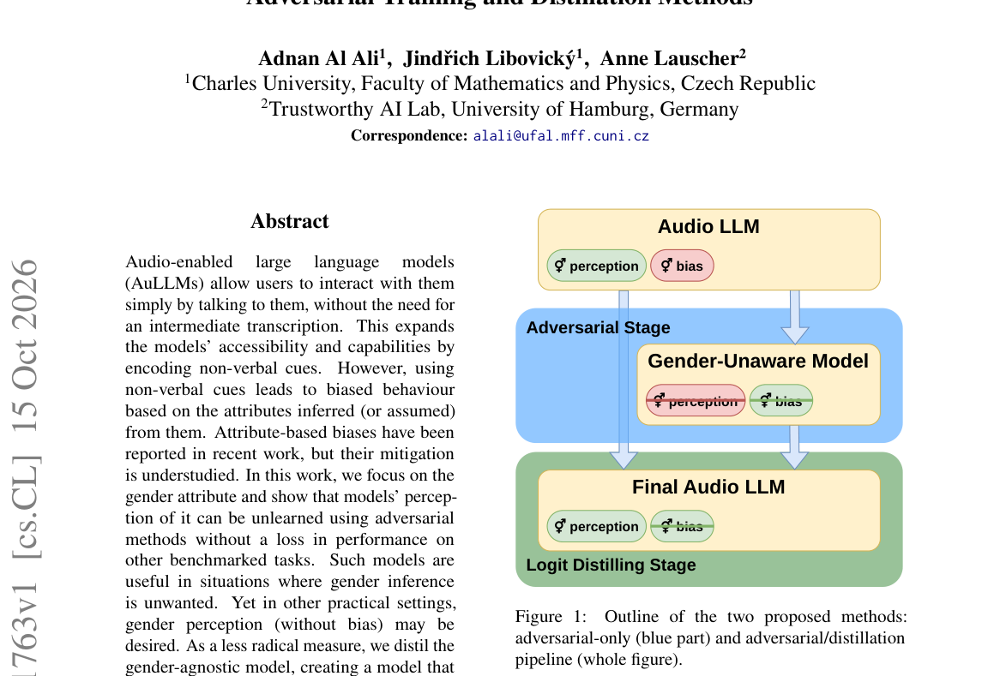

*Main result - Figure 2 Fightin’ Words method applied to the open generation adjectives from the Nemotron-3-Nano-Omni model (before any training), sorted by log odds ratio (LOR).*

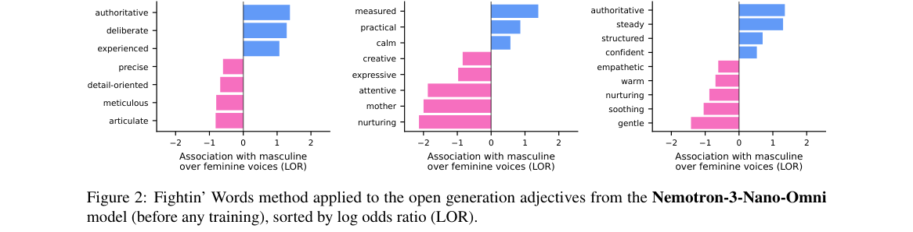

**Why this ranks #5**: 「免转写」是 AuLLM 的卖点，也是偏见的新来源。

---

### 6. Hear, Localize, and Reason: Spatially Aware Scene Understanding for Audio-Visual LLMs

**arXiv**: [2610.21588](https://arxiv.org/abs/2610.21588) | **Score**: 7.0 (relevance 7 x 0.7 + quality 7 x 0.3) | **Tags**: aigc-audio | **Categories**: cs.CV, cs.SD | **Pages**: 33

**Authors**: Kim Sung-Bin, Lee Jung-Mok, Jinwoo Jung, Oh Hyun-Bin, Hyeonggon Ryu, David Harwath, Tae-Hyun Oh

**Affiliation**: 3Hankuk University of Foreign Studies | 4The University of Texas at Austin

**Abstract**

> Audio-visual large language models (AV-LLMs) have made strong progress in multimodal understanding, yet most treat audio as monaural semantic content, limiting their ability to reason about where sounds originate and how they relate to the visual scene. Recent spatial audio-visual studies address parts of this problem, but often focus on specific abilities, such as spatial correspondence or direction and distance reasoning. In this work, we introduce HLR-AVSceneQA, a comprehensive benchmark with a hear-localize-reason hierarchy that evaluates whether models can recognize what is heard, localize sound sources in egocentric and allocentric views, and use these localized sources to reason about how they relate to the visual scene. We further introduce HLR-LLM, which augments a strong audio-visual foundation model with a binaural spatial audio branch alongside its monaural semantic audio pathway. We train HLR-LLM with a curriculum that incorporates final-stage chain-of-thought supervision for multi-step spatial reasoning. Experiments show that existing AV-LLMs remain limited in spatial grounding and relational reasoning, while HLR-LLM substantially improves spatial audio-visual scene understanding without compromising semantic audio-visual perception.

**Key findings**

- **Finding**: 多数 AV-LLM 把音频当作**单声道语义内容**，限制了推理声源位置及其与视觉的关系（摘要在此处截断）。

- **Finding**: 该文构建空间感知的音视觉 LLM（摘要在此处截断）。

- **Inference**: 把音频当作语义内容处理，等于把「声音来自何处」这一信息在编码阶段就丢弃——而这恰恰是场景推理中最有判别力的线索。

- **Recommendation**: 与 10-14 日报的 MiDashengLM-Spatial（统一单声道理解与空间感知）对照；也与本批 embodied 线 MuSTMM（声音触发的移动操作）在同一问题两侧。

**Key figures**

*Framework / architecture - Figure 1 Overview of HLR-AVSceneQA. We introduce HLR-AVSceneQA, a comprehensive benchmark for spatial audio-visual scene understanding organized around a hear-localize-reason hierarchy. For a queried*

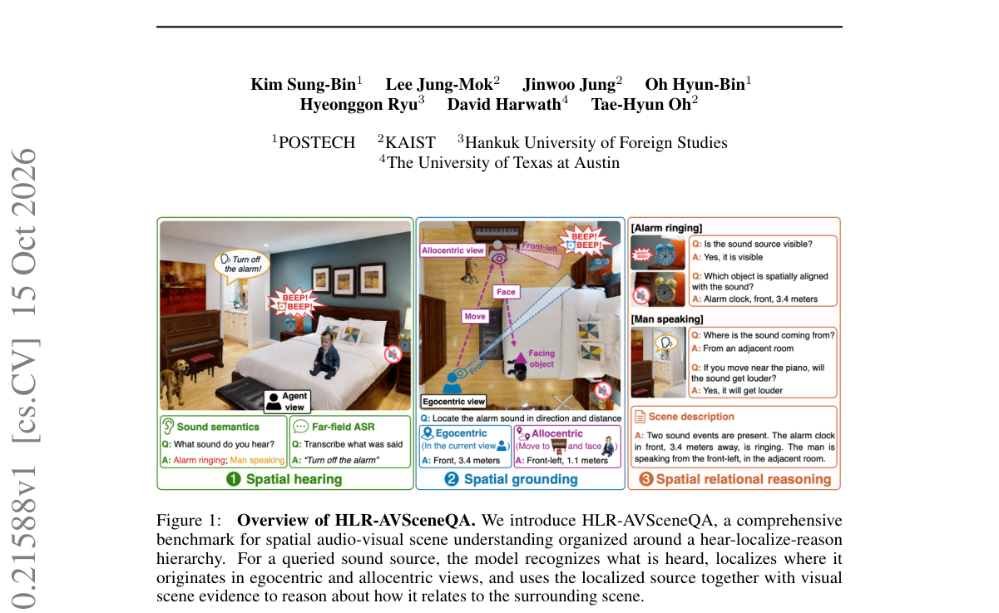

*Main result - Figure 2 Examples of rendered scenes and metadata. Our dataset covers diverse scenarios that require spatially aware audio-visual reasoning, including (a) sound sources occluded by objects and (b) am*

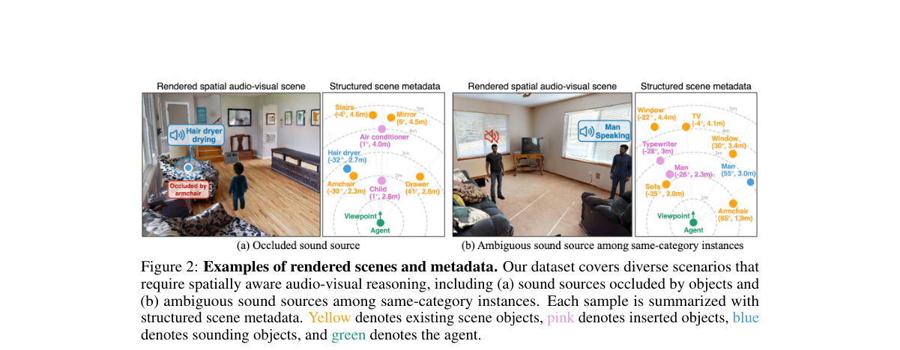

**Why this ranks #6**: 「丢弃空间线索」是单声道输入的必然后果，与空间音频-LLM 那篇同源。

---

### 7. Rethinking Batch Composition: Promoting Feature Diversity for Speech Enhancement

**arXiv**: [2610.21803](https://arxiv.org/abs/2610.21803) | **Score**: 6.3 (relevance 6 x 0.7 + quality 7 x 0.3) | **Tags**: aigc-audio | **Categories**: eess.AS | **Pages**: 5

**Authors**: Mingchi Hou, Ina Kodrasi

**Affiliation**: 1Idiap Research Institute, Switzerland

**Abstract**

> Speech enhancement systems are commonly trained using randomly sampled mini-batches, which may contain limited diversity in intrinsic acoustic characteristics of the clean speech signals. Motivated by previous findings linking clean speech characteristics to enhancement performance, we propose a feature-stratified mini-batch sampling strategy that divides training examples into quantiles according to a clean-speech characteristic and enforces equal representation within each mini-batch. Experiments across two large-scale English and Spanish speech datasets and a smaller dataset containing neurotypical and pathological speech demonstrate improvements over standard random mini-batch sampling across multiple objective enhancement metrics. Ablation studies demonstrate that the gains are robust across training runs, while their magnitude depends on the acoustic characteristic used for stratification. The proposed strategy requires no modification to the enhancement model or training objective, providing a simple and complementary approach to speech enhancement training.

**Key findings**

- **Finding**: 随机采样的小批量可能导致干净语音声学特征多样性有限。

- **Finding**: 作者提出基于特征多样性的批次组成策略（摘要在此处截断）。

- **Inference**: 若增强性能依赖于训练批次的内在多样性，则标准随机采样实际上是一个**有偏**的过程——它使模型在某些声学条件上被系统性欠训练。

- **Recommendation**: 数据工程的读者可参考；这个观察可推广到任何「批次构成影响结果但被默认随机」的训练场景。

**Key figures**: 无可用图示（正文以表格与证明为主）。

**Why this ranks #7**: 「批次组成影响训练结果」是一个被默认为无关的变量。

---

### 8. CF-AVSS: A Coarse-to-Fine Audio-Visual Speech Separation Framework with Target-Speaker Refinement and Post-Fusion for Real-World AVSE Challenge

**arXiv**: [2610.21773](https://arxiv.org/abs/2610.21773) | **Score**: 6.3 (relevance 6 x 0.7 + quality 7 x 0.3) | **Tags**: aigc-audio | **Categories**: cs.AI, cs.SD | **Pages**: 5

**Authors**: Longjie Luo, Zhongshu Hou, Yuepeng Li, Gang Yang, Shidong Shang, Fan Zhou

**Affiliation**: 1Tencent Ethereal Audio Lab, Tencent Corporation, China | place on Track 1 and second place on Track 2. Its CER of

**Abstract**

> Audio-visual speech enhancement (AVSE) leverages visual cues to recover target speech from mixtures corrupted by reverberation, noise, and overlapping speakers. We propose a coarse-to-fine two-stage AVSE framework. In the first stage, a progressive SPAV-TFGridNet is extended to two synchronized visual streams to produce visually ordered coarse estimates by progressively suppressing interfering speech while preserving target reverberation and shared background noise. In the second stage, a TFGridNet-based target speaker refinement network takes the original mixture and both coarse estimates as input to further recover target speech and improve signal quality. The coarse and refined estimates are finally combined using development-set-calibrated fusion. On the ISCSLP 2026 Real-World AVSE Challenge, our system tied for first place on Track 1 and ranked second on Track 2 in OVRL, while achieving the lowest CER on both tracks at 12.31% and 14.79%, respectively.

**Key findings**

- **Finding**: AVSE 利用视觉线索从混响、噪声与重叠说话者中恢复目标语音。

- **Finding**: 该文提出粗到细两阶段框架，第一阶段渐进式 SPAV-TFGridNet 被扩展为两个同步的视……（摘要截断）。

- **Inference**: 两阶段的意义在于视觉线索的质量本身会退化（遮挡、低光），因此先用粗视觉定位再用精视觉分离，比一次到底更稳健。

- **Recommendation**: 语音分离的读者可参考。

**Key figures**

*Framework / architecture - Figure 1 Overview of the proposed two-stage AVSE method.*

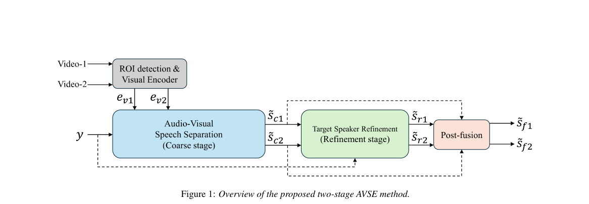

*Main result - Figure 2 Architecture of the progressive coarse AVSS stage.*

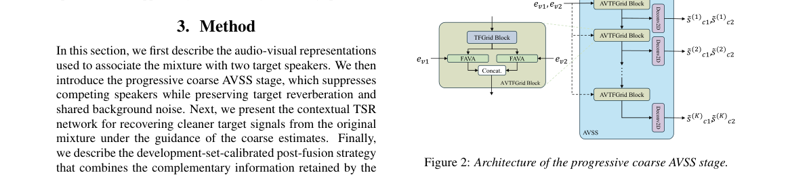

**Why this ranks #8**: 「粗到细」在此不是效率优化而是鲁棒性设计。

---

### 9. Learning Speech Attribute Representations via Multi-Teacher Distillation

**arXiv**: [2610.21941](https://arxiv.org/abs/2610.21941) | **Score**: 6.3 (relevance 6 x 0.7 + quality 7 x 0.3) | **Tags**: aigc-audio | **Categories**: cs.CL | **Pages**: 8

**Authors**: Maryem Bouziane, Salima Mdhaffar, Yannick Estève

**Affiliation**: Avignon Universit´e | useful for its corresponding teacher.

**Abstract**

> Recent post-training approaches have shown that self-supervised speech encoders can be adapted to learn a single utterance-level speech attribute through knowledge distillation. In this work, we investigate whether a single speech encoder can simultaneously preserve multiple complementary utterance-level speech representations. We propose a multi-attribute multi-teacher distillation framework that learns semantic, speaker, language, and emotion representations from four frozen teacher models using a shared SSL backbone and attribute-specific branches. Experiments on multilingual semantic retrieval, speaker verification, language identification, and speech emotion recognition show that the proposed model achieves performance close to dedicated single-task students while requiring only a single shared encoder. Furthermore, the learned layer aggregation strategies reveal that different speech attributes naturally emerge at different depths of the SSL encoder, providing new insights into the organization of speech representations.

**Key findings**

- **Finding**: 既有后训练方法让自监督编码器蒸馏出**单个**句级语音属性。

- **Finding**: 该文研究单编码器能否同时保留多个互补句级属性（摘要在此处截断）。

- **Inference**: 与 10-08 日报 SkillFormer（技能专属低秩适配器）属同一问题：多能力共存是走「一个编码器多任务」还是「多个适配器组合」，本篇给出了前者路线的结果。

- **Recommendation**: 与 10-08 日报的 SkillFormer 建议对照阅读，两篇代表多能力架构的两种选择。

**Key figures**

*Framework / architecture - Figure 1 Overview of the multi-teacher distillation architecture.*

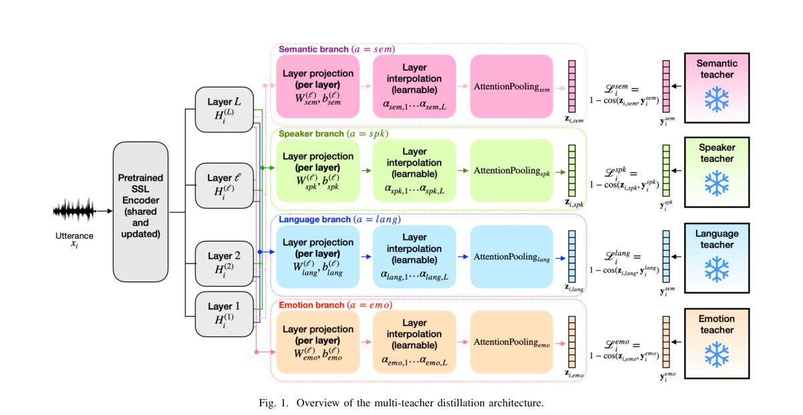

*Main result - Figure 2 Unweighted Accuracy on speech emotion recognition datasets. The figure compares the emotion2vec-base teacher, the EMO-only student, and the emotion branch of the proposed Multi-Attribute model*

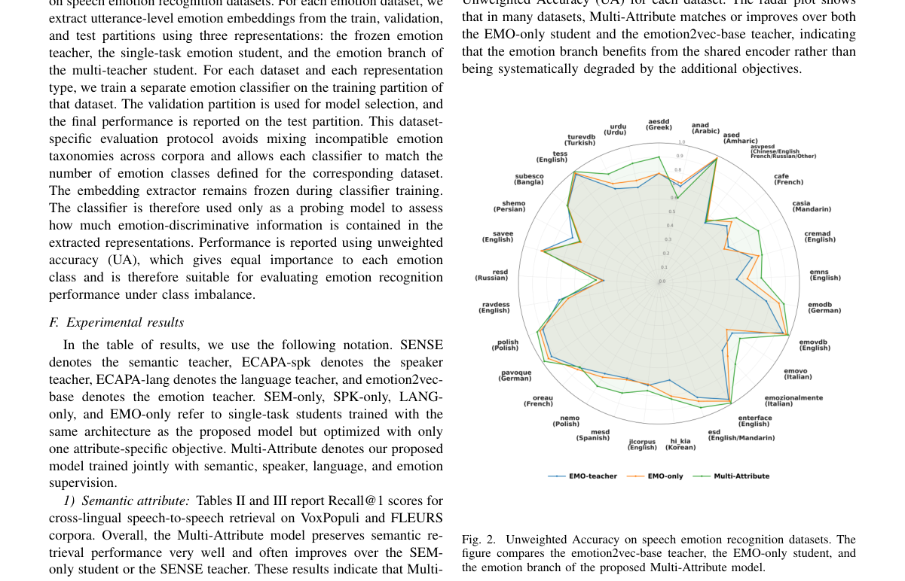

**Why this ranks #9**: 「单个编码器能否同时承载多个属性」是一个容量与干扰的权衡问题。

---

### 10. SITAR: A Situational Distortion Metric for Automatic Speech Recognition Evaluation

**arXiv**: [2610.21440](https://arxiv.org/abs/2610.21440) | **Score**: 6.3 (relevance 6 x 0.7 + quality 7 x 0.3) | **Tags**: aigc-audio | **Categories**: cs.CL | **Pages**: 33

**Authors**: Mingzhe Lu, Jinhao Liu, Yunpeng Li, Hang Su, Lichun Fan, Jian Luan

**Affiliation**: 1Institute of Information Engineering, Chinese Academy of Sciences, Beijing, China | 2School of Cyber Security, University of Chinese Academy of Sciences, Beijing, China | 3Xiaomi Inc.

**Abstract**

> In automatic speech recognition (ASR), transcription errors with similar lexical or semantic discrepancies can have markedly different consequences for the situation conveyed by speech. Capturing these differences requires not merely contextual assessment, but an understanding of what the spoken discourse describes, establishes, or seeks to bring about. However, relying on LLM judges introduces computational cost and scoring variability. We introduce SITAR, a situational distortion metric for ASR, realized through a comprehensive end-to-end construction framework. Specifically, this framework aggregates situational severity and cumulative extent into a unified score via a bounded recursive formulation. Using targets derived from this formulation with limited offline LLM support, we train SITAR as a lightweight BERT-family regressor that scores reference-hypothesis pairs in a single forward pass, entirely free of any prohibitive runtime costs. Recognizing that introducing a new metric demands rigorous justification, we formalize a principled validation protocol spanning both extrinsic validity, assessed at macro and micro levels, and intrinsic scorer reliability. The former, evaluated across diverse datasets and models, demonstrates that SITAR reliably tracks broad capability scaling while providing orthogonal diagnostic utility, whereas the latter, examined on a purpose-built controlled benchmark, confirms the operational soundness of the scoring instrument itself. Through systematic validation, we demonstrate that SITAR holds strong potential as a practical, lightweight complement to existing ASR metrics. We will release the full recipes (code, model weights, dataset, etc.) after the internal review to support community research.

**Key findings**

- **Finding**: 相似词汇或语义差异的转写错误，对**情境**后果可能截然不同。

- **Finding**: 捕捉这些差异需要的不只是语境评估（摘要在此处截断）。

- **Inference**: 这与昨天 2610.17619 的判断一致：WER 把所有错误视为等权，而下游影响可以相差一个数量级——本篇把这一区分做成了指标。

- **Recommendation**: ASR 评测的读者可参考；与昨天那篇 SpeechEvalX 是同一问题的两种实现。

**Key figures**

*Framework / architecture - Figure 1 Overview of SITAR construction: CGD extracts paired gaps from transcripts, which are an- notated for situational severity and aggregated into supervision targets to train the LLM-free scorer*

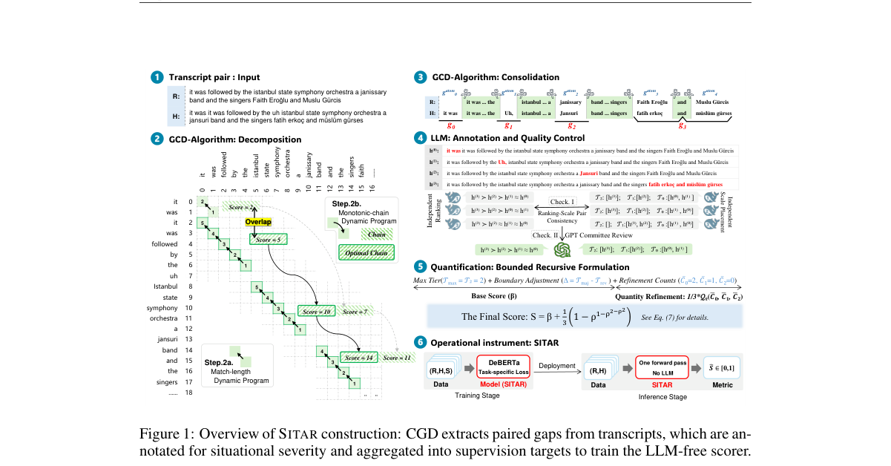

**Why this ranks #10**: 「相似词汇差异但情境后果不同」——这是昨天 When Does an ASR Error Matter 在评测指标侧的对应物。

---

### 11. Federated Art Chase: Privacy Leakage and Data Poisoning in Federated Fine-Tuning

**arXiv**: [2610.21547](https://arxiv.org/abs/2610.21547) | **Score**: 5.3 (relevance 5 x 0.7 + quality 6 x 0.3) | **Tags**: aigc-audio `[wild-card]` | **Categories**: cs.CR, cs.LG | **Pages**: 27

**Authors**: Vasileios Perifanis, Nikolaos Pavlidis

**Affiliation**: https://github.com/Indigma-Innovations/fl-summer-school and run on Google Colab

**Abstract**

> Federated learning (FL) is increasingly used to adapt a pretrained, centrally fine-tuned model to data that remain on user devices, beyond training a model from scratch. In this report, prepared for the 4th Federated Machine Learning International Summer School, we study the privacy and integrity of this approach with a reproducible pipeline. An ImageNet-pretrained MobileNetV4-Conv-Small model is fine-tuned centrally on ten Quick, Draw! classes (97.50% test accuracy) and then adapted with head-only FedAvg over ten non-IID clients, which raises client training accuracy from 90.34% to 91.49% while preserving global accuracy. We evaluate four adversarial scenarios. First, from a single one-step client update, an honest-but-curious server recovers the complete private label set, but its reconstructions follow class prototypes rather than the private drawings (mean SSIM 0.130). Second, from a one-round FedAvg aggregate, label-count recovery falls from 87.5% with one client to 75.0% with five and ten clients, below the 80.0% of an uninformed uniform guess. Third, under FedAvg, a backdoor injected by 30%, 50%, and 100% of the clients reaches an attack success rate (ASR) of 21.9%, 31.3%, and 54.7% at a cost of at most 0.8 percentage points of clean accuracy, whereas label flipping is effective only when most of the source-class data are relabeled. Fourth, FLTrust with a root set retained from centralized fine-tuning lowers the backdoor ASR to 1.8% and 4.0% at 30% and 50% malicious clients and the label-flipping ASR from 12.6% to 0.8% without measurable clean-accuracy loss, but provides no protection when every client is malicious. The report closes with a live session in which participants draw, fine-tune, and poison the model through Indigma's FedMaestro orchestrator. Code and executed notebooks, runnable on Google Colab, are at https://github.com/Indigma-Innovations/fl-summer-school.

**Key findings**

- **Finding**: 研究把集中微调过的预训练模型适配到用户设备数据的隐私与完整性（摘要在此处截断）。

- **Finding**: 与 RL 线收录的 2610.21547 为同一篇论文。

- **Inference**: 同批论文出现在两条线属关键词分类的正常重叠，此处保留以维持 aigc_audio 的条数，但内容应以 RL 线的收录为准。

- **Recommendation**: wild-card 项；请直接参考强化学习线中的同一篇，不要重复阅读。

**Key figures**

*Framework / architecture - Figure 1 Overview of the pipeline. Blue boxes denote model development stages, orange boxes privacy attacks by an honest-but- curious server, red and green boxes poisoning by malicious clients and th*

*Main result - Figure 2 Five randomly drawn Stage 1 examples per class (28 × 28 bitmaps, white strokes on a black background).*

**Why this ranks #11**: wild-card：与 RL 线的同名工作重复，本线因音频候选不足而收录，读者应优先看 RL 线版本。

---

## Footer

- Total papers reviewed across all 5 tracks: 51 (from 574 scanned)
- aigc_audio track final top-10: 10
- Wild-cards in this track: 9
- Figure assets: `res/` (shared across tracks)

Generated by `mine-arxiv-daily-digest` skill. Sister file: `2026-10-16_aigc_audio_entry.md`.
