# ArXiv Daily Digest - 2026-10-16 (AIGC 图像 / 视频 / 3D 生成与编辑, 10 papers)

**Generated**: 2026-10-16 17:00 CST

**Source**: arXiv cs.CV, cs.SD, eess.AS, cs.CL, cs.AI, cs.RO, cs.LG submissions, window 2026-10-15 UTC (latest announced batch as of 2026-10-16 17:00 CST)

**Track**: aigc_visual (top 10 of 574 papers scanned, 50 full reads)

**Scope**: speculative forcing for autoregressive video generation, editable 4D scene generation, feature-loss tokenization for generation, stable multi-turn image editing via asymmetric conditioning, sparse attention with growing sparsity, anchor-based feed-forward 3DGS, token merging via diffusion dynamics, super-aligned texture for 3D generation, rethinking classifier-free guidance for image-to-image flow matching, humanoid motion editing

---

本批 AIGC 视觉线最直接的一篇是 **Speculative Forcing**：少步自回归视频生成器**让每个 token 都走一遍最终去噪步**，不论该 token 需要多少精修；作者发现这种统一计算往往没有必要，因为许多 token 在初始步就已接近其最终全步输出。这与本项目日报追踪的 AR 视频主线（10-09 → 10-12 → 10-14 七篇缓存 → 10-15 Glance Forcing/RepForcing → 今天）一致：自回归视频生成的瓶颈始终是「每个 token 付同样的代价」这个默认。

另外两篇对默认配置的质疑同样值得注意。**FeaTok** 指出 token 表示应当**易于被生成器建模**，而现有 tokenizer 通常以重建像素为目标，这优先低保真度并可能破坏表征的生成友好性——重建目标与建模目标之间存在结构性张力。**Rethinking Classifier-Free Guidance** 则论证 CFG 在文图到图（TI2I）建模中的角色被理解不足：文本生成中 CFG 扩展分布，而图到图编辑的输入已高度约束分布，此时 CFG 可能在放大输入偏差而非提升质量。

效率侧两篇同属「把静态配置改为随去噪步动态」：稀疏注意力在既有方法中**在整个去噪过程中应用固定的稀疏率**，而早步决定全局结构、晚步修正局部细节，注意力分布形状本就不同；token 合并则用扩散动力学回答「哪些 token 可安全合并」。

三维侧：Anchor3DGS 指出既有前馈 3DGS 多为**像素对齐**范式（每输入像素预测一个 Gaussian），从而把 Gaussian 数量与输入分辨率绑定——解绑这个绑定是必要的，否则高分辨率输入会产生指数级表示开销而其中大部分 Gaussian 对新视角贡献极小。

---

## Top 10 - AIGC 图像 / 视频 / 3D 生成与编辑

### 1. Speculative Forcing for Efficient Autoregressive Video Generation

**arXiv**: [2610.22347](https://arxiv.org/abs/2610.22347) | **Score**: 9.0 (relevance 9 x 0.7 + quality 9 x 0.3) | **Tags**: AIGC-video | **Categories**: cs.CV | **Pages**: 20

**Authors**: Hyunwook Choi, Seungryong Kim, Dongyoon Han, Sangdoo Yun

**Affiliation**: 1KAIST AI, 2NAVER AI Lab | ∗Work done during internship at NAVER AI Lab. | 2025; Kong et al., 2025; Yang et al., 2025b; NVIDIA et al., 2026; Team Seedance et al., 2026).

**Abstract**

> Few-step autoregressive video generators enable streaming generation, yet they run every token through the final denoising step, regardless of how much refinement it needs. We find this uniform computation is often unnecessary: many tokens already closely match their eventual full-step outputs in the initial steps, while others require refinement until the end. We introduce Speculative Forcing, a framework that treats intermediate clean estimates as drafts and predicts when individual tokens can be safely accepted early. Once accepted, a token is frozen as its final output and undergoes no further denoising, while its cached keys and values remain available as context for the remaining tokens. We explore two alternative verifier designs: a training-free one based on similarity to clean content and stability across steps, and a learned one that reads the frozen generator's intermediate features to estimate each token's remaining gap to its full-step output. Across short-video, long-video, and world generation, Speculative Forcing preserves the quality of full-step sampling while substantially reducing computation. On LongLive, it matches the four-step generator with ~1.7 denoising steps per token, running over 1.5x faster at 41.7 and 37.8 fps. On Lingbot-World 2.0, where camera motion continually changes the visible content, it maintains quality with ~2.5 denoising steps per token and runs 1.35x faster at 24.5 fps.

**Key findings**

- **Finding**: 少步 AR 视频生成器**让每个 token 都走最终去噪步**，不论需要多少精修。

- **Finding**: 作者发现许多 token 在初始步已接近其最终全步输出，另一些则不然（摘要在此处截断）。

- **Finding**: Speculative Forcing 据此引入推测式执行（摘要在此处截断）。

- **Inference**: 「多数 token 在初始步就已接近最终输出」这个观察若成立，说明统一计算量是一个平均意义上的浪费——而浪费的规模直接由 token 间的精修需求差异决定。

- **Recommendation**: 被精读的三篇之一。它接上本项目日报的 AR 视频主线（10-09 → 10-12 → 10-14 → 10-15 → 今天）。

**Key figures**

*Framework / architecture - Figure 1 Compared with full-step sampling (a), Speculative Forcing treats intermediate token esti- mates as drafts, accepts those that have converged, and refines only the rest (b), achieving compara*

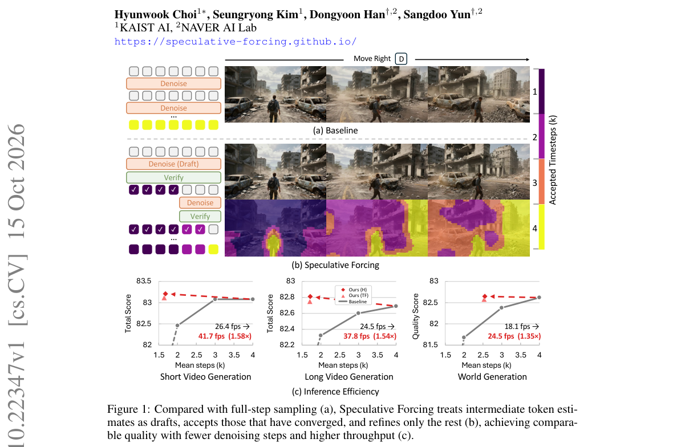

*Main result - Figure 2 Token-wise convergence during denoising. We visualize latent differences between each chunk’s k-step prediction and the baseline four-step output. (a) In video generation, background and obj*

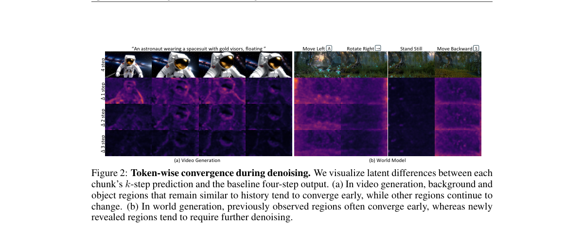

**Why this ranks #1**: 本批最直接可落地的一篇：把「每个 token 同样的计算量」这个默认去掉。

---

### 2. Edit4D: Editable 4D Scene Generation with Textual Control

**arXiv**: [2610.21668](https://arxiv.org/abs/2610.21668) | **Score**: 8.7 (relevance 9 x 0.7 + quality 8 x 0.3) | **Tags**: AIGC-3D, AIGC-video | **Categories**: cs.CV | **Pages**: 21

**Authors**: Chanwoo Kim, Tackgeun You, Hwasup Lim

**Affiliation**: 1Korea Institute of Science and Technology (KIST), Republic of Korea

**Abstract**

> We introduce Edit4D, an editable text-to-4D scene generation framework that constructs 4D scenes from separate background and dynamic character representations. Recent advances in generative models have enabled text-driven dynamic scene synthesis, but editable 4D scene generation remains challenging due to the need to preserve spatial geometry and temporal dynamics. Existing approaches typically generate holistic scene videos, where the background and dynamic characters are coupled, making object-level editing and flexible camera control difficult. Edit4D addresses these limitations through a stage-specific generation pipeline. Given a user instruction, Edit4D first decomposes it into stage-specific prompts for background, dynamic character, and scene-character composition. Using these prompts, we synthesize multi-view scene images with text-to-image and camera-conditioned generative priors and reconstruct a background 3D Gaussian splatting representation. We then generate a character image, animate it with an image-conditioned video prior, reconstruct a 4D mesh, and bind Gaussian primitives to obtain a character representation. Finally, both components are composed through text-guided segmentation and contact-aware optimization. A global scene refinement is then performed to improve harmonization and rendering consistency. By integrating stage-specific components, Edit4D enables controllable camera motion, flexible object-level editing, and the practical construction of editable 4D scenes. Project page: https://chanwo0kim.github.io/Edit4D/

**Key findings**

- **Finding**: Edit4D 由**分离的背景与动态角色表示**构建 4D 场景。

- **Finding**: 文本驱动的动态场景合成已可行，但可编辑的 4D 生成仍困难（摘要在此处截断）。

- **Inference**: 「可编辑」要求表示按语义对象分解而非按时空分解——若背景与角色纠缠在一个 4D 表示里，任何针对单角色的编辑都会波及全局。

- **Recommendation**: 4D 生成的读者可参考；与 10-14 日报 Demiurge（跨轨迹一致的 4D 世界）对照，一篇求一致、一篇求可编辑。

**Key figures**

*Framework / architecture - Figure 1 Overview of Edit4D. Given a user instruction, Edit4D first decomposes it into stage-specific prompts. Each stage of the pipeline then takes the corresponding prompts for the scene, character*

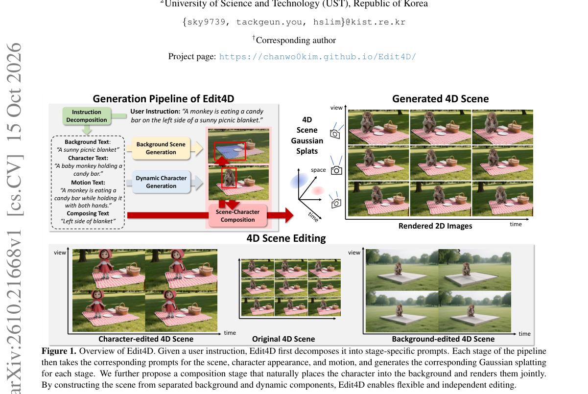

*Main result - Figure 2 Comparison of novel-view renderings from 4D scenes generated by Free4D [35] and our method. Compared to methods that directly distill video diffusion priors, our composition-based method con*

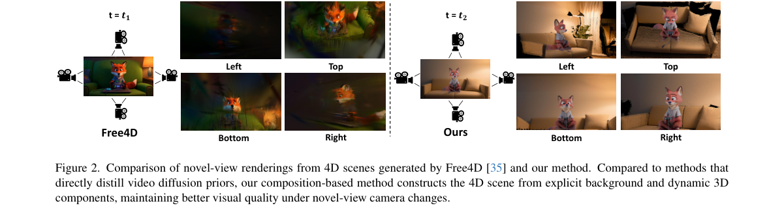

**Why this ranks #2**: 「背景与角色分离」是可编辑性的结构前提——不分离就无法单独改角色。

---

### 3. FeaTok: Feature-Loss Tokenization for Image Generation

**arXiv**: [2610.22060](https://arxiv.org/abs/2610.22060) | **Score**: 8.3 (relevance 8 x 0.7 + quality 9 x 0.3) | **Tags**: AIGC-image | **Categories**: cs.CV | **Pages**: 30

**Authors**: Zhang Xiaofeng, Samuel Lavoie, Nicolas Beltran-Velez, Jianhao Yuan, Felix Friedrich, Jakob Verbeek, Aaron Courville, Michal Drozdzal, Adriana Romero-Soriano

**Affiliation**: 1Mila - Québec AI Institute, 2Université de Montréal, 3FAIR at Meta, 4McGill University, 5Canada | CIFAR AI chair, 6Columbia University, 7University of Oxford

**Abstract**

> Discrete image generators learn the distribution of tokens produced by an image tokenizer. These token representations should be easy for generators to model, not merely enable faithful image reconstruction. Yet these tokenizers are commonly trained to reconstruct pixels, which prioritizes low-level fidelity and may disrupt representation structure useful for generation. Motivated by feature-predictive self-supervised learning, we introduce feature-loss tokenization (FeaTok), which trains discrete tokens by reconstructing pretrained features rather than pixels. Ablations across SigLIP, SigLIP2, DINOv2, and DINOv3 show better generative performance with FeaTok. In class-conditional generation, FeaTok advances the quality-compute Pareto frontier, reducing gFDr6 at 256x256 by up to 29 percent over the strongest discrete baselines and outperforming the strongest unguided continuous baseline (RAEv2) with 38 times less sampling compute. FeaTok also achieves higher human-preference reward-model scores than prior art without reward-based training and surpasses continuous and discrete text-conditional baselines on three benchmarks with only 500 fine-tuning updates after pre-training.

**Key findings**

- **Finding**: token 表示应当**易于被生成器建模**，而不仅是能忠实重建图像。

- **Finding**: 但现有 tokenizer 通常以重建像素为目标，这优先低保真度并可能**破坏表征的生成友好性**（摘要在此处截断）。

- **Inference**: 重建目标与建模目标之间存在结构性张力：重建鼓励保留信息，生成友好要求丢弃「难预测但不影响内容」的维度。两者的最优 tokenizer 不相同。

- **Recommendation**: 被精读的三篇之一。上一批的 QuadTok 也在这条线上，建议连读——两篇分别从结构与目标侧处理同一问题。

**Key figures**

*Framework / architecture - Figure 1 Feature-based discrete tokens enable strong generation. FeaTok models advance the quality–compute Pareto frontier for image generation. We categorize generative image models by how pretrained*

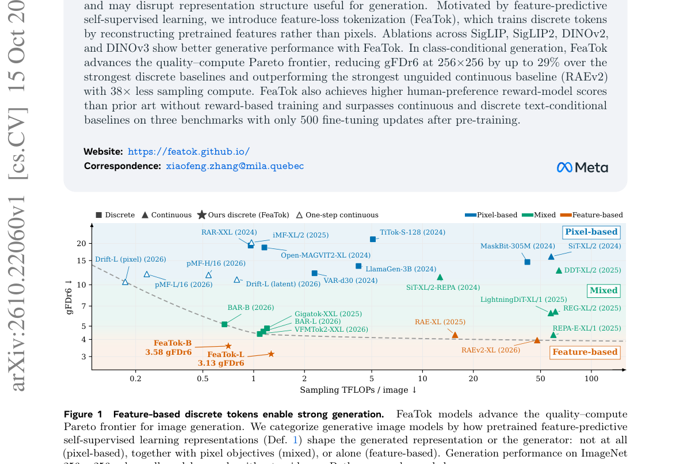

*Main result - Figure 2 FeaTok tokenizer and generation pipeline. Blue denotes the conventional discrete tokenizer and orange our contributions. Only feature losses shape the discrete tokens: Lfeat trains Dfeat to r*

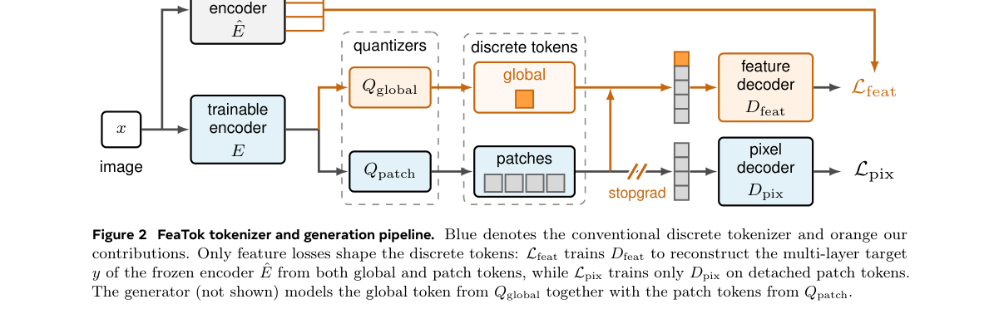

**Why this ranks #3**: 「tokenizer 的训练目标与下游生成器的需求不一致」是一个被普遍忽略的错配。

---

### 4. ACEdit: Stable Multi-Turn Image Editing via Asymmetric Conditioning

**arXiv**: [2610.22328](https://arxiv.org/abs/2610.22328) | **Score**: 8.0 (relevance 8 x 0.7 + quality 8 x 0.3) | **Tags**: AIGC-edit, AIGC-image | **Categories**: cs.AI, cs.CV, cs.GR | **Pages**: 20

**Authors**: Sara Dorfman, Nir Goren, Gal Barak, Daniel Cohen-Or, Or Patashnik

**Affiliation**: Tel Aviv University

**Abstract**

> Image editing models produce impressive results for individual edits, but their quality often deteriorates over multiple editing turns. Each editing turn introduces small distribution shifts that accumulate over successive edits, creating a gap between the input distributions encountered during the editor's original training and multi-turn inference. We introduce a training scheme that makes multi-turn image editing stable under this accumulating distribution shift. A key is to force the editor to operate on its own outputs from previous editing turns during training, bringing the principle of Self-Forcing to image editing. The main challenge is that self-generated editing trajectories deviate from ground-truth trajectories, making direct supervision unreliable. We address this challenge through a distillation objective that leverages a teacher image editor to provide a reliable training signal when the model operates on its own previous outputs. We introduce an asymmetric conditioning scheme: while the student performs edits sequentially on its own outputs, the teacher remains anchored to the original clean image and receives a compound editing instruction. Experiments show substantially reduced degradation over long multi-turn sequences while maintaining editing quality and instruction adherence.

**Key findings**

- **Finding**: 图像编辑质量在多轮编辑中常退化：每轮引入小的分布偏移并在连续编辑中累积。

- **Finding**: 这造成编辑器原始训练输入分布与推理时分布之间的**差距**；ACEdit 用**非对称条件化**应对（摘要在此处截断）。

- **Inference**: 多轮退化的机制是分布漂移而非能力不足——编辑器在第一次编辑后就被推离了训练分布，因此第三轮的失败概率本质上是前两轮编辑的函数。

- **Recommendation**: 与 10-12 日报 ThinkDrag（编辑需要推理而非直接执行）对照，一篇改指令侧、一篇改条件化侧。

**Key figures**

*Framework / architecture - Figure 1 Stable Multi-Turn Image Editing. We show selected turns from a 15-step sequence. Each of the five edits is followed by two no-op instructions (“keep the image as is”). While the original FLU*

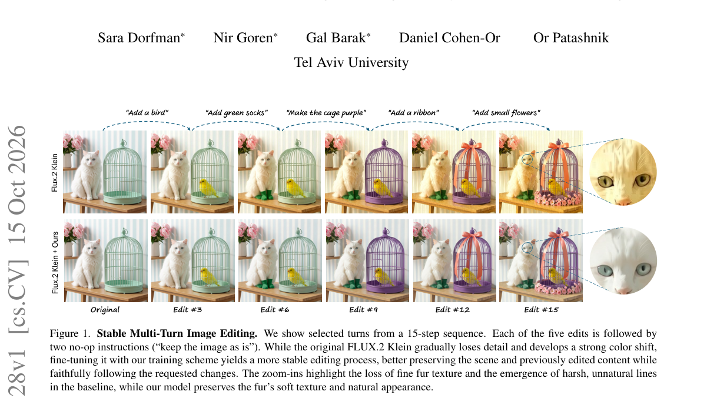

*Main result - Figure 2 Method overview. Left: The student performs edits along a self-generated rollout, where each output becomes the input to the next turn. Given the previous output Ie−1 and the current instruc*

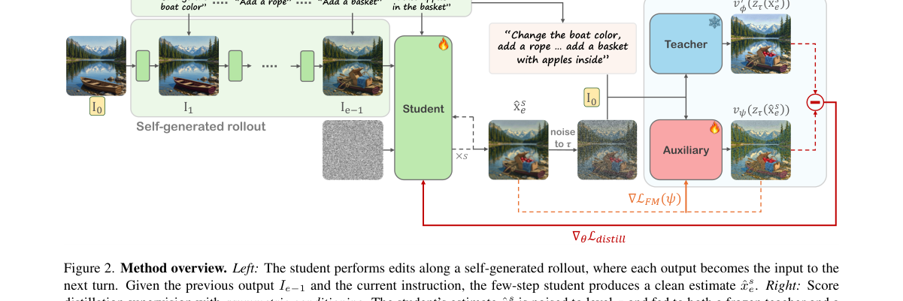

**Why this ranks #4**: 「多轮编辑退化」是一个被反复观察到但少被正式处理的现象。

---

### 5. Sparse Attention for Video Generation Acceleration via Growing Sparsity and Reduced Search

**arXiv**: [2610.21129](https://arxiv.org/abs/2610.21129) | **Score**: 8.0 (relevance 8 x 0.7 + quality 8 x 0.3) | **Tags**: AIGC-video | **Categories**: cs.CV | **Pages**: 30

**Authors**: Yun Dai, Yuyun Chen, Jiarui Wen, Huiping Zhuang, Cen Chen, Ziqian Zeng

**Affiliation**: 1South China University of Technology

**Abstract**

> Diffusion Transformers (DiTs) dominate video generation but suffer from high inference cost due to the quadratic complexity of self-attention. Sparse attention mitigates this by skipping unnecessary computation in the attention matrix, but existing methods apply a fixed sparsity ratio throughout denoising and struggle to accurately determine which computations to skip. To address these limitations, we analyze attention dynamics through attention entropy and mean attention distance, and find that attention becomes increasingly concentrated across denoising steps. We further observe that blocks selected early continue to capture a large fraction of the total attention weight at later steps. These findings suggest two acceleration opportunities: the sparsity ratio should grow as denoising progresses, and earlier search results can be reused to reduce the search space. Based on these findings, we propose Growing Sparsity and Reduced Search (GSRS), a training-free framework that retains more computation early and progressively reduces it later, while restricting subsequent searches to an early candidate set to reduce search overhead. GSRS adopts Top-p selection for adaptive sparsity control, supported by a precise evaluation scheme that computes exact attention weights within the FlashAttention computation at negligible overhead. Experiments on HunyuanVideo and Wan 2.1 validate that GSRS achieves 1.55$\times$--2.21$\times$ speedup while maintaining generation quality comparable to full attention.

**Key findings**

- **Finding**: 既有稀疏注意力方法在整个去噪过程中**应用固定稀疏率**。

- **Finding**: 该文结合**递增稀疏度**与**减少搜索**来适配不同去噪步（摘要在此处截断）。

- **Inference**: 固定稀疏率隐含假设各去噪步的信息需求相同，而这显然不成立——早步决定全局结构、晚步修正局部细节，两者的注意力分布形状不同。

- **Recommendation**: 与 10-14 日报的 Competition Domains Matter（注意力头异质性）对照：一篇按**时间步**自适应、一篇按**头**自适应，两者都反对固定配置。

**Key figures**

*Framework / architecture - Figure 1 Quantitative analysis of attention dynamics in DiT models. The subfigures (a–d) displays the variation of attention entropy and mean attention distance (MAD) across 10 diverse prompts, where*

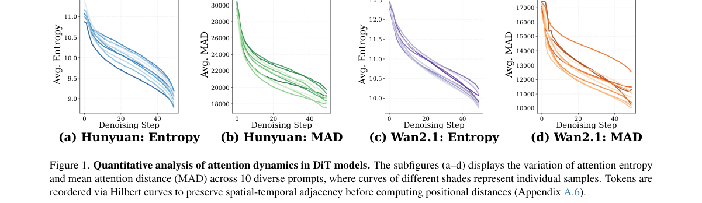

*Main result - Figure 2 Attention recall under a fixed sparse mask. A sparse mask is constructed at an early denoising step and held fixed at sub- sequent steps. The mask maintains high attention recall throughout*

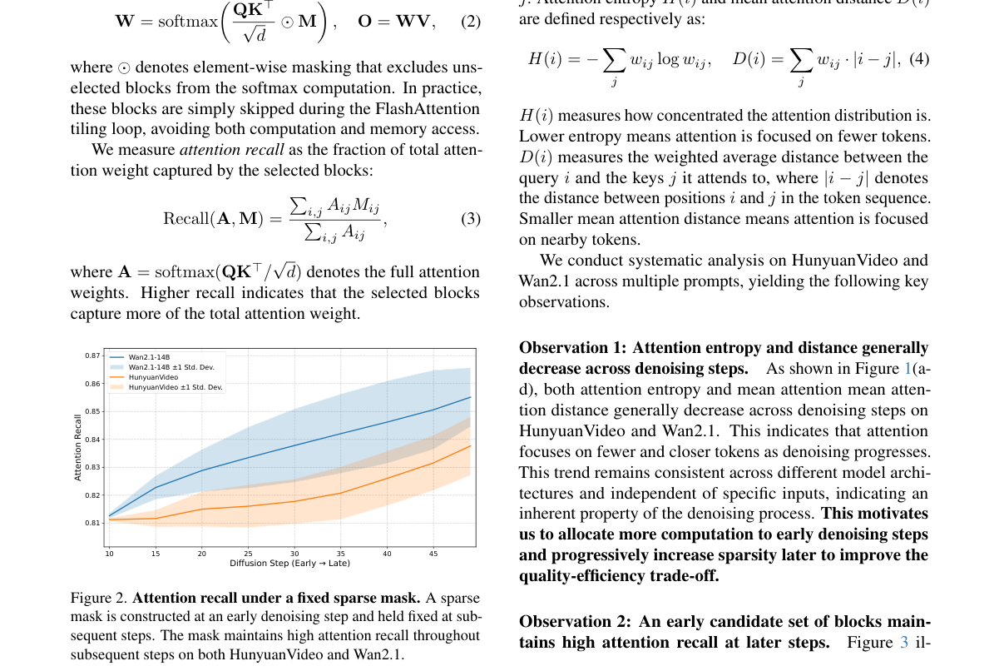

**Why this ranks #5**: 固定稀疏率是一个被默认的参数，它假设不同去噪步的信息需求相同。

---

### 6. Anchor3DGS: Feed-Forward 3D Gaussian Splatting with Compact Anchor-Based Representation

**arXiv**: [2610.21634](https://arxiv.org/abs/2610.21634) | **Score**: 7.7 (relevance 8 x 0.7 + quality 7 x 0.3) | **Tags**: AIGC-3D | **Categories**: cs.CV | **Pages**: 18

**Authors**: Sheng Ye, Jiangke Lin, Fudong Wang, Yi Yuan, Zhen-Hui Dong, Yong-Jin Liu

**Affiliation**: 1Tsinghua University

**Abstract**

> Recent feed-forward 3D Gaussian Splatting (3DGS) methods have enabled effective multi-view 3D reconstruction by predicting Gaussian primitives in a single forward pass. However, existing approaches predominantly adopt a pixel-aligned paradigm that predicts one Gaussian per input pixel, coupling the Gaussian count to the input resolution and number of views. This also leads to redundant primitives in textureless regions and insufficient coverage in geometrically complex areas. We present Anchor3DGS, a pose-free feed-forward 3DGS framework that replaces pixel-aligned prediction with a compact anchor-based representation. Guided by information entropy, our method places a set of 3D anchors in the scene, concentrating them in regions of higher visual complexity while maintaining broad spatial coverage. Each anchor performs occlusion-aware aggregation of multi-view image features, exchanges information with other anchors, and is decoded into a set of local Gaussians. A lightweight feature enhancement module further refines the coarse RGB output from Gaussian splatting and improves rendering fidelity. Extensive experiments on diverse benchmark datasets demonstrate that our Anchor3DGS achieves state-of-the-art novel view synthesis quality while only using an order of magnitude fewer Gaussian primitives.

**Key findings**

- **Finding**: 既有前馈 3DGS 多采用**像素对齐**范式，每输入像素预测一个 Gaussian。

- **Finding**: 这把 Gaussian 数量与输入分辨率绑定（摘要在此处截断）；Anchor3DGS 用紧凑的**锚点式表示**解绑。

- **Inference**: 解绑数量与分辨率是必要的——否则高分辨率输入会产生指数级的表示开销，而其中大部分 Gaussian 对新视角贡献极小。

- **Recommendation**: 3DGS 读者可参考；与昨天 Anchor3DGS 同族的前馈 3DGS 压缩工作（RDCompGS）对照，一篇解绑数量、一篇压缩属性。

**Key figures**

*Framework / architecture - Figure 1 Anchor3DGS reconstructs 3D scenes from uncalibrated multi-view images. Our anchor- based representation achieves better rendering quality with fewer Gaussians, and avoids the empty holes tha*

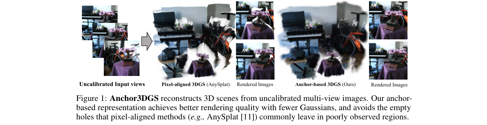

*Main result - Figure 2 Overview of Anchor3DGS. Given uncalibrated multi-view images, (1) a VGGT-based [28] geometry backbone first predicts the scene’s geometric scaffold. (2) A fixed budget of 3D anchors is then*

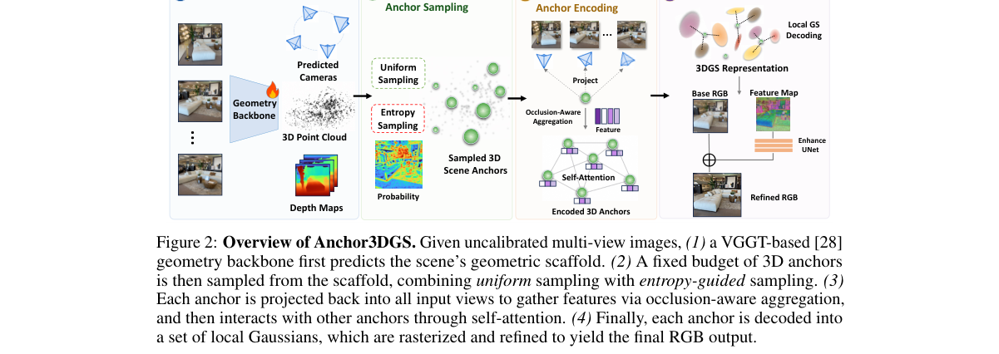

**Why this ranks #6**: 「Gaussian 数量被输入分辨率绑定」是前馈 3DGS 的一个结构性限制。

---

### 7. Which Tokens to Merge? Diffusion Dynamics for Efficient Image Generation

**arXiv**: [2610.22370](https://arxiv.org/abs/2610.22370) | **Score**: 7.3 (relevance 7 x 0.7 + quality 8 x 0.3) | **Tags**: AIGC-image | **Categories**: cs.CV | **Pages**: 21

**Authors**: SeungJu Cha, Ye-Chan Kim, HyunGee Kim, Sungho Koh, Dong-Jin Kim

**Affiliation**: Hanyang University, South Korea

**Abstract**

> Token merging has emerged as an effective training-free strategy for accelerating diffusion models by reducing redundant token computation while minimizing generation degradation. A key challenge is determining which tokens can be safely merged and which should be preserved for subsequent computation. Existing method addresses this by preserving prompt-aligned foreground regions, thereby protecting semantically relevant structures. However, this text-relevance criterion overlooks background objects, local details that are not explicitly mentioned in the prompt, leading to degraded structural coherence. In this work, we propose Dynamics-aware Token Merging (DaTMe), a training-free framework that grounds token merging in the underlying diffusion dynamics. Our key insight is that token importance should reflect whether a token remains unresolved during denoising and whether it carries structural information. To this end, DaTMe constructs a dynamics- aware importance map from the Tweedie denoised estimate. The map combines a temporal signal, measuring inter-step changes in the predicted clean image, with a structural signal, capturing local high-frequency content such as boundaries and fine details. Using this map, DaTMe adaptively assigns tokens into merging roles under a given compression ratio: important tokens are preserved as anchors, while tokens that are both temporally stabilized and structurally homogeneous are selected as safe merge candidates. Experiments on PixArt-a and FLUX demonstrate that DaTMe maintains visual fidelity across the entire image, highlighting diffusion dynamics as an effective token-level merging decision in efficient generation. Our code is available at https://github.com/SeungJuCha/DaTMe.

**Key findings**

- **Finding**: token 合并是免训练加速策略，关键是判断哪些 token 可**安全合并**、哪些必须保留。

- **Finding**: 该文用**扩散动力学**来回答这一判断（摘要在此处截断）。

- **Inference**: 「合并安全性」若由扩散动力学的局部性质决定，则合并策略可以随去噪步动态调整——这与同批稀疏注意力的「递增稀疏度」是同一思路的不同实现。

- **Recommendation**: 与本批 2610.21129（递增稀疏度）对照，两篇都在把静态配置改为随步动态。

**Key figures**: 无可用图示（正文以表格与证明为主）。

**Why this ranks #7**: 「哪些 token 可安全合并」是一个可由扩散动力学回答的具体问题，而非启发式。

---

### 8. SUPRA-TEX: 3D Generation with Super-Aligned Texture

**arXiv**: [2610.22352](https://arxiv.org/abs/2610.22352) | **Score**: 7.3 (relevance 7 x 0.7 + quality 8 x 0.3) | **Tags**: AIGC-3D | **Categories**: cs.CV, cs.GR | **Pages**: 30

**Authors**: Chen Yang, Jiemin Fang, Fanpeng Meng, Zihao Huang, Jichen Pang, Guanjun Wu, Zhikuan Bao, Qi Tian

**Affiliation**: 1Huawei Inc. | 2Shanghai Jiao Tong University | 3Huazhong University of Science and Technology

**Abstract**

> Single image 3D generation aims to dress a given 3D mesh with relightable materials while faithfully preserving the visual details of a reference image. Existing methods either introduce artifacts when fusing inconsistent multi-view predictions or struggle to preserve fine details through implicit image-feature conditioning. To resolve these challenges, we introduce SUPRA-Tex, built on the principle of decoupling visible-material estimation, surface alignment, and observation-guided 3D completion. This division of labor allows the 3D generator, trained on limited 3D data, to focus its capacity on preserving visible evidence and completing unobserved surfaces. Specifically, we first train an MLLM-based image editing model to predict lighting-separated PBR maps in the reference view. We then project these maps onto the visible surface and encode them with the pretrained material VAE encoder into native observation latents that share the generation target's latent space. An interleaved flow transformer holds these latents as fixed, read-only anchors while alternating unobserved-region and full-surface updates to generate complete material latents. This design achieves super-alignment with the reference, delivering What You See Is What You Get fidelity on visible regions and coherent completion on unobserved surfaces. Trained solely on public datasets, SUPRA-Tex achieves SOTA performance in both geometry-conditioned texturing and end-to-end asset generation, matching or even exceeding leading commercial systems on in-the-wild images. Project page: https://supra-3d.github.io/supratex/

**Key findings**

- **Finding**: 单图 3D 生成需为网格赋予可重光照材质，同时保留参考图像细节；既有方法在融合不一致多视角预测时产生伪影。

- **Finding**: 另一类方法难以通过隐式图像特征条件化保留精细细节；SUPRA-TEX 提出**超对齐纹理**（摘要在此处截断）。

- **Inference**: 两个目标冲突的根源是：忠实细节需要复制参考图的 2D 外观，而可重光照需要解开外观与法向的关系——因此「超对齐」必须是在解耦的同时保留对应。

- **Recommendation**: 3D 生成的读者可参考；与本批 Anchor3DGS（前馈表示）分属 3DGS 两条路线。

**Key figures**

*Framework / architecture - Figure 1 Super-aligned textured mesh generated by SUPRA-Tex. Our method preserves fine-grained appearance details from the reference image. (Best viewed with zoom.)*

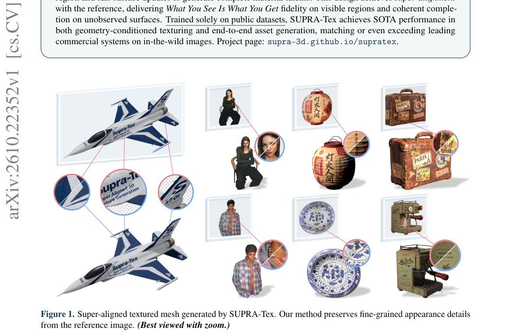

**Why this ranks #8**: 「可重光照」与「保留参考细节」是一对天然冲突的目标。

---

### 9. Rethinking Classifier-Free Guidance for TI2I Flow Matching

**arXiv**: [2610.21550](https://arxiv.org/abs/2610.21550) | **Score**: 7.0 (relevance 7 x 0.7 + quality 7 x 0.3) | **Tags**: AIGC-image, AIGC-edit | **Categories**: cs.CV, cs.LG | **Pages**: 11

**Authors**: Andreas Floros, Elena Koritska, Teofilo de Campos, Christoph Vogel, Chu-Tak Li, Anuj Sharma, Alexandros Neophytou

**Affiliation**: ⋆Imperial College London

**Abstract**

> We study Text-and-Image-to-Image (TI2I) flow matching methods for controllable image editing. In a broader generative modeling context, Classifier-Free Guidance (CFG) is established as a key component responsible for high quality outputs. However, we argue that its role in TI2I modeling is poorly understood. Specifically, we make the surprising observation that the CFG mechanism is implicitly harmful for editing in the noisy phase of flow modeling, hindering instruction following and controllability. We propose a simple correction in the early flow steps, enabling a richer alignment-preservation tradeoff at no extra cost. The effectiveness of our approach is demonstrated on both pixel-space and latent TI2I flows.

**Key findings**

- **Finding**: CFG 被普遍视为高质量输出的关键组件，但作者论证它在 **TI2I 建模中的角色被理解不足**（摘要在此处截断）。

- **Finding**: 该文对 TI2I 场景下的 CFG 做了重新分析（摘要在此处截断）。

- **Inference**: CFG 的作用随任务而变：文本生成中它扩展分布，而图到图编辑中输入已高度约束分布，此时 CFG 可能在放大输入偏差而非质量。

- **Recommendation**: 图像编辑的读者可参考；与本批 Rethinking CFG 相邻的 10-15 日报 Simplifying On-Policy Distillation 同属「重新审视标准组件」。

**Key figures**

*Framework / architecture - Figure 1 We propose a simple modification in TI2I flows that substantially improves source preservation while maintaining text alignment. In the examples above, source images are on the left, baselin*

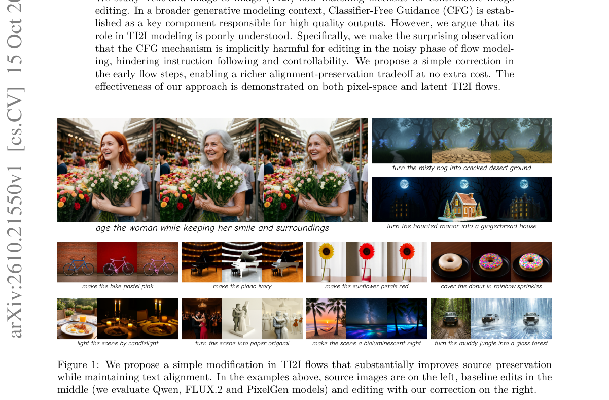

*Main result - Figure 2 Visualization of two representative TI2I modeling scenarios with our PixelGen finetune. The first rows show the iterates xt. The second and third rows show the unconditional and conditional*

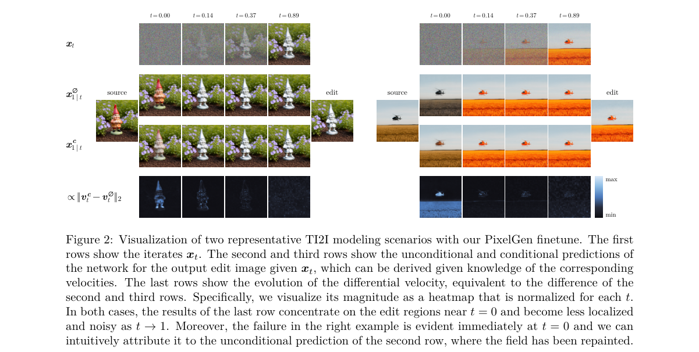

**Why this ranks #9**: 对 CFG 这一全领域默认组件的重新审视，接上本日报审计线索。

---

### 10. TRACE: Typed Reference-Aware Conversational Editing for Humanoid Motion Diffusion

**arXiv**: [2610.21515](https://arxiv.org/abs/2610.21515) | **Score**: 7.0 (relevance 7 x 0.7 + quality 7 x 0.3) | **Tags**: AIGC-video, embodied-ai `[wild-card]` | **Categories**: cs.RO | **Pages**: 26

**Authors**: Zejian Kang, Yifu Luo, Boyang Shen, Jingxuan Li, Zekai Chen, Zekun Shi, Yongxue Xu, Zhenyu Hou, Bingqian Wu, Shaolei Zhang, Wentao Yang, Xiangru Huang

**Affiliation**: 1Zhejiang University | 2Westlake University | 3Technical University of Munich | 4Huazhong University of Science and Technology

**Abstract**

> Language-conditioned humanoid motion generation enables users to create and refine robot movements through natural language. The central challenge is to connect an underspecified request to concrete motion structure that can subsequently be revised relative to an accepted reference. We present TRACE, a generation and editing framework for the Unitree G1 humanoid robot built around typed, measurable kinematic quantities. Our insight is to ground generation conditions in paired training motions and editing goals in the current motion. A language model learns to predict support, root, and hand events from motion-derived supervision; their time-aligned encodings complement the original text in a diffusion generator. Gravity-referenced states and trajectory--contact objectives improve kinematic consistency. For editing, typed requests define body--time scopes and source-relative goals. A separate reference-conditioned diffusion editor uses these goals and revised events to realize changes, while sampling-time projection preserves protected state coordinates. Quantitative evaluation and human assessment show improved semantic alignment and motion quality over the compared methods. Controlled ablations support the value of motion-grounded conditioning and kinematic consistency, while multi-turn editing evaluations demonstrate more reliable execution of successive relative requests under shared preservation constraints. Together, these results support typed kinematic structure as a common basis for motion generation and reference-aware revision.

**Key findings**

- **Finding**: 核心挑战是把**欠指定的请求**连接到具体运动结构，并使其可相对已接受参考被修订。

- **Finding**: TRACE 用类型化参考感知做生成与编辑（摘要在此处截断）。

- **Inference**: 「已接受的参考」是该方法的核心状态——用户的第一次确认成为后续修订的锚点，这与对话编辑中把「当前图像」当作隐式参考是同一设计。

- **Recommendation**: wild-card 项；与 10-14 日报的 VICAR（接触感知的视频重定向）同属人形动作获取路线。

**Key figures**

*Framework / architecture - Figure 1 From text generation to reference-aware refinement. (a) The request “Do a wide jump- ing jack, arms overhead to sides” produces an initial motion reference. (b) “Jump higher, rest un- change*

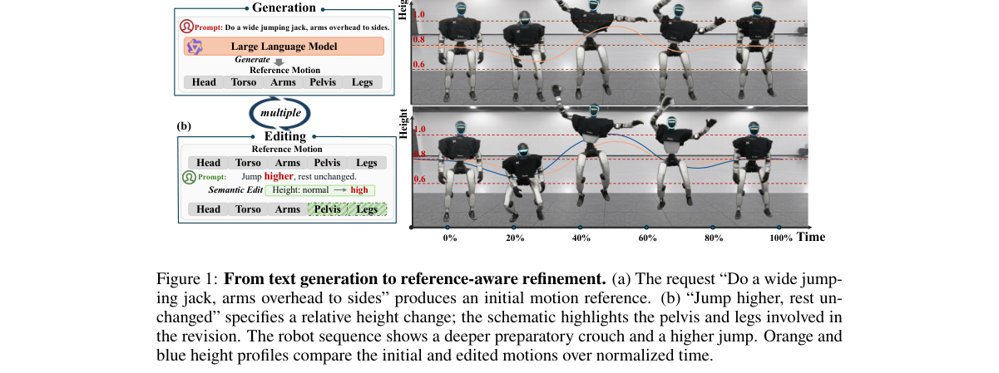

**Why this ranks #10**: wild-card：人形运动编辑，且「欠指定请求→具体结构」的映射问题与图像编辑同源。

---

## Footer

- Total papers reviewed across all 5 tracks: 51 (from 574 scanned)
- aigc_visual track final top-10: 10
- Wild-cards in this track: 1
- Figure assets: `res/` (shared across tracks)

Generated by `mine-arxiv-daily-digest` skill. Sister file: `2026-10-16_aigc_visual_entry.md`.
