# ArXiv Daily Digest - 2026-10-16 (音频与语音语言模型 / 双工语音助手, 10 papers)

**Generated**: 2026-10-16 17:00 CST

**Source**: arXiv cs.CV, cs.SD, eess.AS, cs.CL, cs.AI, cs.RO, cs.LG submissions, window 2026-10-15 UTC (latest announced batch as of 2026-10-16 17:00 CST)

**Track**: audio_lm (top 10 of 574 papers scanned, 50 full reads)

**Scope**: answering multiple turn-taking questions in one pass, full-duplex speech+expression+gesture interaction, compressed speech token adaptation for spoken dialogue, unified audio decision interface, attributed RL for long-term memory writing, user-requested forgetting benchmark, memory-centric compression survey, positional geometry of sparse KV caches, bi-level memory incremental learning, privacy leakage in federated fine-tuning

---

本批是**话轮决策**这条追踪线的一个高点：VoxTurn 指出级联语音智能体必须在用户的**每次静默中**判断用户是否说完（太早→打断，太晚→变慢），而且往往还需要几个相关但不同的判断——用户是否会继续说、自己说话期间的声音是**打断还是附和**、那声音到底是不是语音。它用**一个模型一次通过**回答这几个问题。把多个检测器合并为一次前向不只是省算力：它让这些判断**共享表示**，而「打断 vs 附和」的区分恰恰需要同时看到语音与自身说话状态，分离的检测器在结构上无法做到。这直接回应了昨天 MultiPartyTurnBench 提出的「易混淆非事件」难题——附和在声学上与真正的话轮转换几乎不可分。

另有 **ELLSA 2** 把全双工扩展到语音 + 手势 + 表情的联合生成，并要求在**倾听侧**也生成手势表情——这意味着系统必须对他人话语做出恰当的非语言反应，比单纯双工语音多了一个输出通道与一类新失败模式。

第二篇值得注意：**CoSTA** 指出口语对话模型为生成与合成**共享语音 token 空间**，这才是序列长与推理贵的结构性来源；低码率 tokenizer 虽能缩短序列，却带来压缩质量权衡与**高昂的替换代价**——压缩的收益必须在完整管线上度量，而非只看 token 数。

**本批是记忆方向的最大一次聚集**（跨四条线共八篇，见下）。本线内三篇：Hy-Memory 把**写入路径**识别为需要专门优化的关键环节（保留什么、如何精确表示、新证据如何更新），用归因强化学习直接优化写入；MemCut 则指出一项此前几乎未被评估的能力——**被要求时遗忘**敏感数据（记忆基准长期只测「找得回不准」，因此一个每次检索完美、但拒绝删除的系统会得满分）；从长上下文到选择性记忆的综述则点明「持续扩展上下文窗口并不消除推理期的计算、存储与信息选择压力」。

---

## Top 10 - 音频与语音语言模型 / 双工语音助手

### 1. VoxTurn: Answering Several Turn-Taking Questions in One Pass with One Model

**arXiv**: [2610.21150](https://arxiv.org/abs/2610.21150) | **Score**: 9.7 (relevance 10 x 0.7 + quality 9 x 0.3) | **Tags**: duplex-voice, audio-LM | **Categories**: cs.SD, eess.AS | **Pages**: 17

**Authors**: Yang Xiao

**Affiliation**: The University of Melbourne

**Abstract**

> A cascaded voice agent must decide, throughout each silence of its user, whether the user has finished their turn: answering too early cuts the user off, answering too late makes the agent slow. It often needs related decisions too: will the user soon go on, is speech during its own turn an interruption or a backchannel, is a sound speech at all. With open detectors, each extra decision costs another model or another call, and on the 14-language eot-bench they cut users off in more than a quarter of mid-turn pauses. Because they are trained on segmented utterances, this mismatch is the largest single source of error. We present VoxTurn, a 0.8B speech LLM that casts these decisions as multiple-choice questions, scores the hidden state of each option, and answers any set of them in one forward pass with a block-isolating attention mask, exactly as if asked one at a time. Trained on real conversational pauses with labels derived from their timing, and re-queried while a silence lasts, VoxTurn reaches 11.5% false cut-offs in English at a 300 ms latency budget, comparable to two commercial detectors, and a 14-language mean of 19.9%, the lowest among open models, at 8.3 ms per decision. In Pipecat and LiveKit it cuts off 17% and 9% of turns, and it ranks fifth of 24 in TurnBench end-of-turn detection without any TurnBench training data. The model, code and framework plugins are released.

**Key findings**

- **Finding**: 级联语音智能体必须在每次静默中判断用户是否说完（太早→打断，太晚→变慢）。

- **Finding**: 它还需要**相关但不同**的判断：用户是否会继续说、自己说话期间的声音是打断还是附和、该声音是否为语音。

- **Finding**: VoxTurn 用**一个模型一次通过**回答这几个话轮问题（摘要在此处截断，机制细节需查正文）。

- **Inference**: 把多个检测器合并为一次前向不只是省算力——它让这些判断**共享表示**，而「打断 vs 附和」的区分恰恰需要同时看到语音与自身说话状态，分离的检测器在结构上无法做到。

- **Recommendation**: 被精读的三篇之一。它是本项目日报追踪的话轮/话语权议题的最新一环，且给出了最直接的工程形态。

**Key figures**

*Framework / architecture - Figure 1 VoxTurn at a glance. Top: eot-bench [1], the share of mid-turn (hold) silences in which a detector takes the turn when it must answer within a 300 ms mean latency budget, in English (left) a*

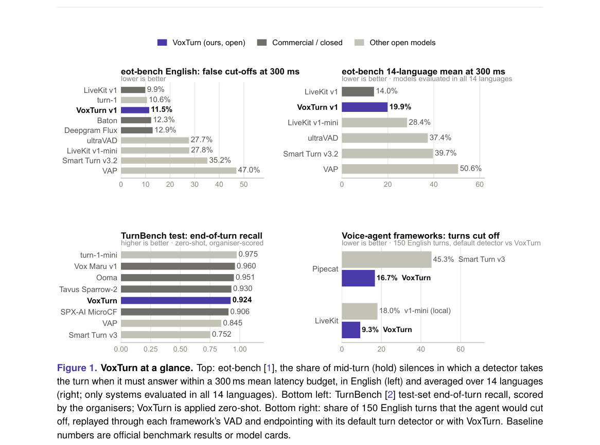

*Main result - Figure 2 Architecture. (a) VoxTurn reads the last 8 s of user audio (and optional text) once and answers several questions in one forward pass; a linear head scores the hidden state at each option’s*

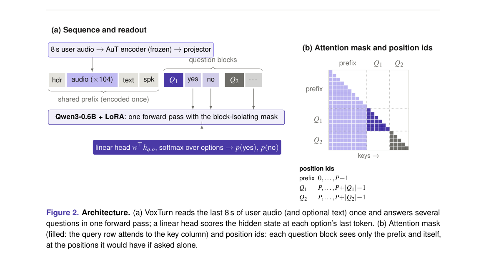

**Why this ranks #1**: 本批相关性最高的一篇：它把话轮决策从多个独立检测器合并为**一次通过回答多个问题**，正面回应了昨天 MultiPartyTurnBench 提出的「易混淆非事件」难题。

---

### 2. Full-Duplex Interaction with Speech, Expressions and Gestures

**arXiv**: [2610.21452](https://arxiv.org/abs/2610.21452) | **Score**: 9.0 (relevance 9 x 0.7 + quality 9 x 0.3) | **Tags**: duplex-voice | **Categories**: cs.AI, cs.CV, cs.SD, eess.AS | **Pages**: 37

**Authors**: Siyin Wang, Wenyi Yu, Terumi Chiba, Xianzhao Chen, Xiaohai Tian, Jun Zhang, Lu Lu, Chao Zhang

**Affiliation**: 1Tsinghua University

**Abstract**

> Human face-to-face conversation requires coordinating speech, gestures and expressions across both speaking and listening. We present ELLSA 2, an end-to-end full-duplex dialogue model that jointly optimizes speech interaction and streaming gesture-expression generation. An autoregressive, chunk-wise synthesizer combines pretrained acoustic features with distinct listening and speaking hidden states from the dialogue backbone and speech synthesizer, enabling continuous non-verbal generation even when the model is verbally silent. To translate dialogue understanding into vivid semantic gestures, we introduce contextual semantic calls and template guidance, separating whether to invoke an available semantic gesture from how to realize it. We also establish a curated data and evaluation pipeline for dialog-aware co-speech gesture generation and investigate reference-based multimodal large language models (MLLMs) as automatic judges. Experiments show that ELLSA 2 remains highly competitive with open-source full-duplex speech interaction models and outperforms cascaded baselines across dialog-aware gesture and expression metrics. Semantic template guidance further significantly improves semantic gesture quality. Strong system-level correlations with human judgments support these reference-based scores as useful preliminary metrics for full-duplex and semantic gesture assessment. Together, these results advance dialogue modeling from spoken responses toward coordinated multimodal interaction.

**Key findings**

- **Finding**: 面对面对话需要在**说话与倾听两侧同时**协调语音、手势与表情。

- **Finding**: ELLSA 2 端到端联合优化语音交互与流式手势-表情生成，用自回归块式合成器结合预训练声学特征（摘要在此处截断）。

- **Inference**: 「倾听时也要生成手势表情」意味着系统必须对**他人的**话语做出恰当的非语言反应——这比单纯的双工语音多了一个输出通道，也多了一类失败模式（反应与内容不匹配）。

- **Recommendation**: 多模态对话系统的读者可参考；与昨天 MultiPartyTurnBench（话语权时机）对照，一篇测时机、一篇扩模态。

**Key figures**

*Framework / architecture - Figure 1 ELLSA 2 jointly models full-duplex speech, gesture, and facial expression generation. The gesture-expression synthesizer conditions on hidden states from both user and model speech and autor*

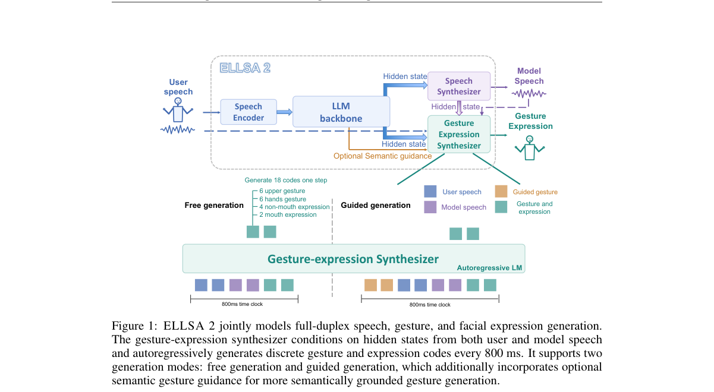

*Main result - Figure 2 Data preparation and evaluation overview. Speaker selection and expression extraction supply paired training supervision. The broader source pool supplies semantic templates. Human- verified*

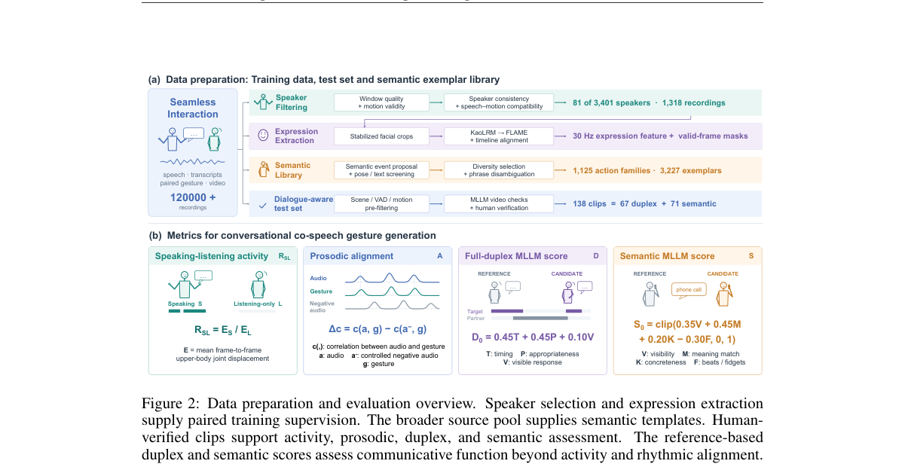

**Why this ranks #2**: 把「说话」与「倾听」两侧同时建模，是全双工定义的最严格形式。

---

### 3. CoSTA: Compressed Speech Token Adaptation for Efficient Spoken Dialogue Models

**arXiv**: [2610.21143](https://arxiv.org/abs/2610.21143) | **Score**: 8.7 (relevance 9 x 0.7 + quality 8 x 0.3) | **Tags**: audio-LM, duplex-voice | **Categories**: cs.AI, cs.CL, cs.SD | **Pages**: 31

**Authors**: Yingzhuo Deng, Chong Li, Bingxin Liu, Yi Shu, Tianyu Peng, Can Xie, Siyao Song, Shuo Ren, Jiajun Zhang

**Affiliation**: 1Institute of Automation, Chinese Academy of Sciences | 2School of Artificial Intelligence, University of Chinese Academy of Sciences

**Abstract**

> Spoken Dialogue Models (SDMs) typically share a speech-token space for generation and synthesis, leading to long autoregressive sequences and costly inference. Lower-rate speech tokenizers shorten sequences but may introduce compression-quality trade-offs and costly replacement without breaking this coupling. To address this limitation, we propose CoSTA, a compatibility-preserving post-hoc framework that decouples generation and synthesis token spaces while retaining the original speech tokenizer and decoder. CoSTA extends the generation token space with compressed representations via mean-initialized vocabulary extension, pronunciation adaptation, and dialogue adaptation, followed by deterministic expansion back to the original speech-token space before synthesis. On bilingual speech-dialogue benchmarks, CoSTA achieves approximately $1.7\times$ expanded speech-token generation speed, lower full-response latency, and higher throughput while preserving response quality. Analyses show more sustained interaction under limited budgets and a practical trade-off among compression, decoding efficiency, and quality. Further experiments demonstrate cross-architecture transfer and complementarity to low-rate tokenization.

**Key findings**

- **Finding**: SDMs 为生成与合成**共享语音 token 空间**，导致长自回归序列与昂贵推理。

- **Finding**: 低码率 tokenizer 能缩短序列，但带来压缩质量权衡与**高昂的替换代价**，且不解除生成-合成耦合。

- **Finding**: CoSTA 提出兼容的压缩语音 token 适配方案（摘要在此处截断）。

- **Inference**: 「替换代价高昂」是压缩路线常被忽略的账：token 压缩降低序列长度，但若为了保持质量而需要复杂的适配层，推理期仍要付出二次代价——压缩的收益必须在完整管线上度量。

- **Recommendation**: 语音 LM 部署的读者必读；与本批 2610.21126（稀疏 KV 的位置几何）对照，两篇都在问「压缩留下的空隙如何处理」。

**Key figures**

*Framework / architecture - Figure 1 Overview of CoSTA. Existing SDMs couple generation and synthesis token spaces. CoSTA extends the generation token space with compressed represen- tations and deterministically expands them b*

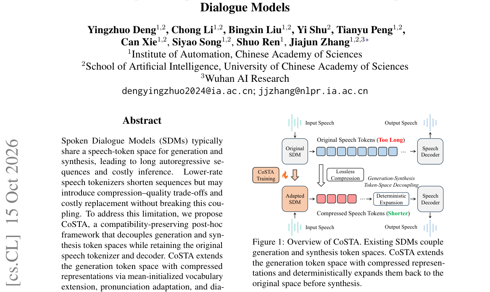

*Main result - Figure 2 Speech-token BPE scaling across eight tok- enizer configurations. Compression rate decreases ap- proximately linearly with log2 vocabulary size.*

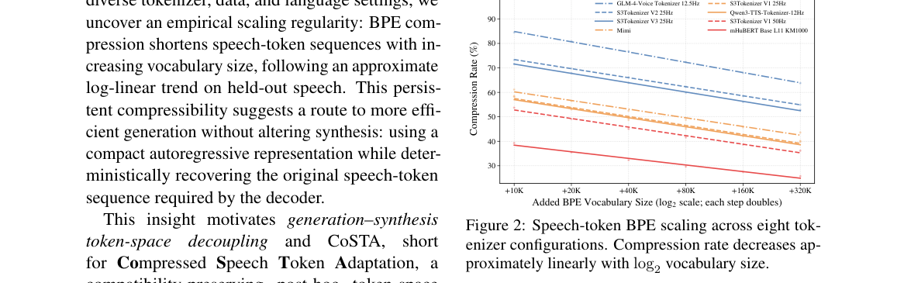

**Why this ranks #3**: 「共享 token 空间导致长序列」是语音 LM 推理成本的结构性来源，而非实现细节。

---

### 4. Qwen-Audio-Jev: A Unified Interface for Audio Decisions

**arXiv**: [2610.21614](https://arxiv.org/abs/2610.21614) | **Score**: 8.0 (relevance 8 x 0.7 + quality 8 x 0.3) | **Tags**: audio-LM | **Categories**: cs.AI, cs.SD | **Pages**: 13

**Authors**: Ying Fang, Zhifu Gao, Qing Gu, Jiajun He, Kangqi Jing, Xiangang Li, Yu Pu, Wupeng Wang

**Affiliation**: Token Foundry, Alibaba Group

**Abstract**

> Large audio language models (LALMs) have made substantial progress in audio understanding. However, in high-throughput applications requiring frequent selection, judgment, and scoring, autoregressive text generation introduces additional computational overhead and response latency. To address this limitation, we introduce Qwen-Audio-Jev by augmenting Qwen-Audio-3.1-ASR-Flash-Next with a dedicated Jev decision head. The model unifies selection, binary judgment, and scoring through three decision primitives: CHOICE, NOUL, and SCORE. Given audio, a natural-language question, and an explicit answer specification, it directly produces a task-conditioned probability distribution or a numerical score through typed decision readouts. Evaluation across 18 labeled configurations covers all three primitives: for CHOICE, Qwen-Audio-Jev achieves accuracies of 78.70% on MMAU-mini and 84.06% on MMSU; for NOUL, it achieves an equal error rate of 6.50% on the VoxCeleb1-O speaker verification benchmark; and for SCORE, the model achieves a normalized mean absolute error of 0.1062 on NISQA overall quality assessment, with Pearson and Spearman correlations of 0.8210 and 0.8074, respectively. Compared with the original Qwen-Audio-3.1-ASR-Flash-Next, Qwen-Audio-Jev achieves an approximately 20x inference speedup. It demonstrates its potential for efficient, high-throughput audio decision-making in applications such as large-scale audio screening, speaker verification, and automated quality assessment.

**Key findings**

- **Finding**: 高吞吐应用中频繁的选择/判断/评分场景下，自回归**文本生成**带来额外开销与延迟。

- **Finding**: Qwen-Audio-Jev 通过增强 Qwen-Audio-3.1-ASR（摘要在此处截断）提供统一接口。

- **Inference**: 这与本批 RL 线的「Jev 作为 Q 或策略」是同一判断：并非所有任务都需要生成，一个返回校准答案的单次前向接口在选择密集场景下更合适。

- **Recommendation**: 音频评测系统的读者可参考；建议与 10-14 日报的 Can Jev be Your Q or Policy 一并评估。

**Key figures**

*Framework / architecture - Figure 1 Qwen-Audio-Jev model architecture. Audio and serialized question/criteria inputs feed the shared Qwen-Audio-3.1-ASR-Flash-Next decoder. Its final-prefix hidden state, computed before target-*

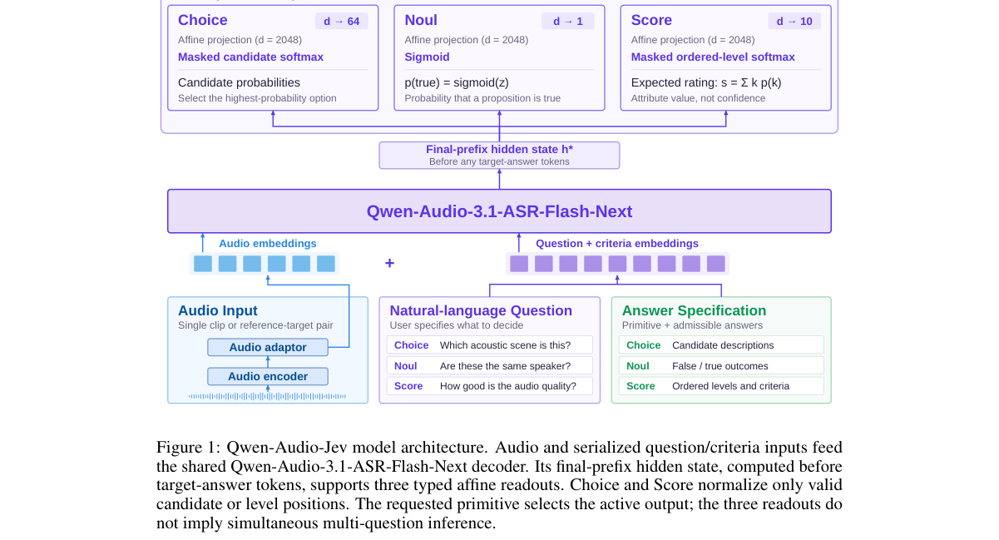

*Main result - Figure 2 Training pathways of Qwen-Audio-Jev. (a) SFT compares predicted distributions with observed labels and directly backpropagates task-specific losses. (b) The optional RLCD-inspired stage init*

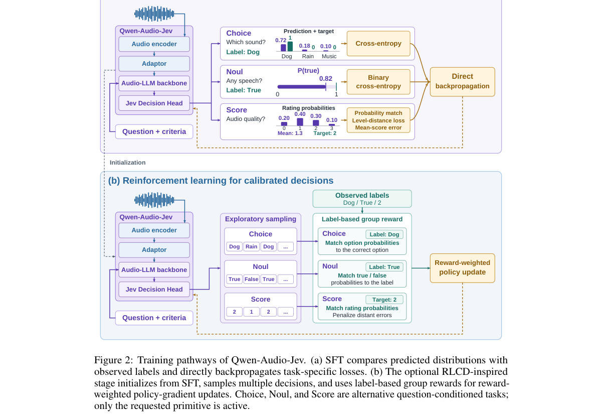

**Why this ranks #4**: 「AR 生成在高吞吐选择任务上不划算」与本批 RL 的 Jev 类工作同构。

---

### 5. Hy-Memory-30B-A3B: Attributed Reinforcement Learning for Long-Term Memory Writing

**arXiv**: [2610.22196](https://arxiv.org/abs/2610.22196) | **Score**: 7.3 (relevance 7 x 0.7 + quality 8 x 0.3) | **Tags**: audio-LM, rlhf | **Categories**: cs.CL | **Pages**: 15

**Authors**: Tianxiang Fei, Jiazheng Kang, Mao Zheng, Xingyan He, Xiang Yu

**Affiliation**: Tencent Hunyuan

**Abstract**

> External-memory systems extend language-model applications beyond a context window, but their quality depends critically on the model executing the write path: deciding what to retain, how precisely to represent it, and how new evidence should update persistent state. Existing frameworks typically place a general-purpose large language model behind framework-specific prompts. This raises serving cost, and a writer specialized for one protocol does not transfer directly to another; a unified model that can operate across established memory frameworks remains largely unexplored. We present Hy-Memory-30B-A3B, a compact long-term-memory writer trained across Mem0, MemOS, and Hy-Memory. Memory On-Policy Distillation teaches framework-specific write protocols on student-generated states; Memory RL then optimizes downstream answerability using dense per-chunk probes, attributed cross-chunk rewards, over-storage controls, and chunk-level GRPO. Carrying policy-written banks across windows keeps training aligned with deployment. On fixed 20% benchmark subsamples, Hy-Memory-30B-A3B ranks first on all four evaluated harnesses, including held-out EverMemOS, with a 55.49% macro average versus 54.62% for Claude Opus 5.

**Key findings**

- **Finding**: 记忆系统的质量关键取决于执行**写入路径**的模型：保留什么、如何精确表示、新证据如何更新持久状态。

- **Finding**: 既有框架通常把一个通用 LLM 放在框架特定……（截断）之后；Hy-Memory 用归因强化学习优化写入。

- **Inference**: 「写入是关键路径」这一判断与本批 MemComposer（记忆如何组装）、All-in-One Memory（搜索/写入/停止共享奖励空间）完全一致——三篇从不同角度说明写入与读取需要不同优化。

- **Recommendation**: 本批记忆聚集的核心三篇之一；建议与 RL 线的 All-in-One Memory 对读。

**Key figures**

*Framework / architecture - Figure 1 Hy-Memory-30B-A3B is trained inside the same deployed harness configurations in both stages. OPD supplies dense teacher supervision on student-written state chains; RL examines the resulting*

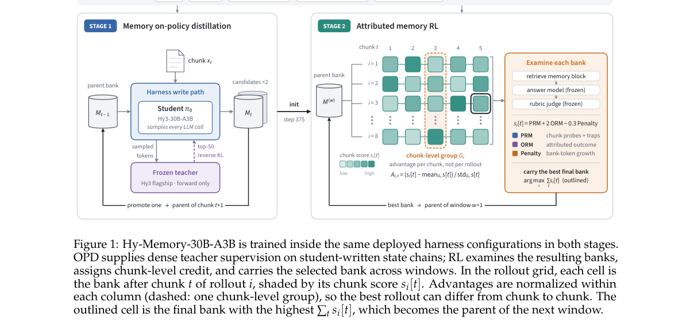

*Main result - Figure 2 Construction of the Memory RL reward artifact. Each session is split independently into chunks of about ten turns, so chunks never cross session boundaries. The chronological chunk stream is*

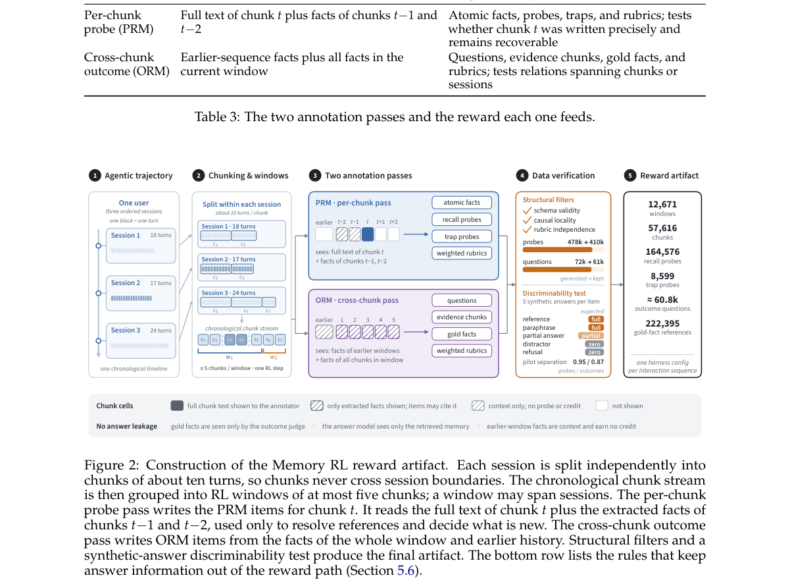

**Why this ranks #5**: 把「记忆写入」明确识别为需要专门优化的路径，是 10-09 Gated Memory 那条线的强化版。

---

### 6. MemCut: Every Secret Leaves a Trail in the Long-Term Memory of LLM Agents

**arXiv**: [2610.21405](https://arxiv.org/abs/2610.21405) | **Score**: 7.3 (relevance 7 x 0.7 + quality 8 x 0.3) | **Tags**: audio-LM | **Categories**: cs.AI | **Pages**: 17

**Authors**: Cheng Zhang, Xuanning Cao, Zhicheng Zheng, Hui Xiong

**Affiliation**: 1The Hong Kong University of Science and Technology (Guangzhou) | 3The Hong Kong University of Science and Technology | requested forgetting. Its 456 hand-designed se-

**Abstract**

> Long-term memory has become a crucial component of large language model (LLM) agents, with most research focusing on retrieving relevant information accurately and efficiently. However, a dependable memory system must also forget sensitive user data upon request. To evaluate this capability, we introduce MemCut, a systematic benchmark for user-requested forgetting. Its 456 hand-designed secrets in long-horizon conversations have fully annotated evidence trails to test recovery after deletion, including from messages that never state the secrets directly. We propose two recovery metrics. Native recovery measures reader success through the system's retrieval, whereas residual recovery measures the same reader's success when directly given surviving objects traced to annotated disclosures or evidence. We establish three reference deletion baselines to test how far existing retrievers and write models support forgetting across five memory designs and four LLMs. Disclosure removal reduces native recovery far more than residual recovery. LLM-guided deletion of ten additional turns from twenty retrieval candidates leaves 39-76% residual recovery. Subset sweeps (144 facts, three systems, two models) show that widening the pool at a fixed budget reduces residual recovery more than deleting all original candidates. These sweeps identify candidate coverage as a bottleneck in the reference baselines.

**Key findings**

- **Finding**: 研究重心在检索，但可靠的记忆系统必须能在**被要求时遗忘**敏感数据。

- **Finding**: MemCut 是面向用户请求遗忘的系统性基准（摘要在此处截断）。

- **Inference**: 记忆基准长期只测「找得回不准」，因此一个每次检索都完美、但拒绝删除的系��会得到满分——这与本项目日报审计线索指出的「评测只测容易通过的一面」完全同类。

- **Recommendation**: 记忆系统的读者必读；与 10-07 日报的 AgentMemGate（写入时门控）方向相反但同样必要。

**Key figures**

*Framework / architecture - Figure 1 The message that directly discloses the secret is deleted, but the secret remains recoverable from the surviving trail. The assistant can no longer answer a colleague, while ordinary message*

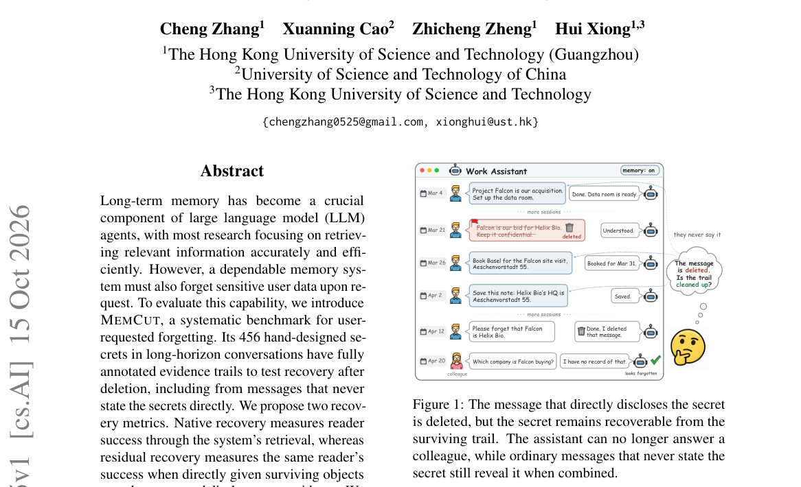

*Main result - Figure 2 One MEMCUT sample, abridged. Top: weeks of ordinary conversation hold one disclosure (D), evidence that never states the fact (E1–E3), and look-alike records (L1–L4). Bottom: deletion remove*

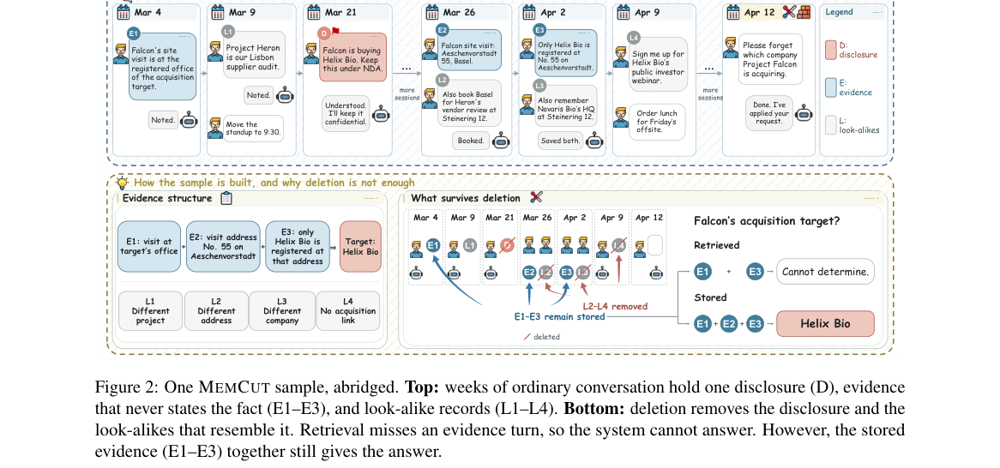

**Why this ranks #6**: 「能记住」不等于「能忘掉」，后者此前几乎没有被评估。

---

### 7. From Long Context to Selective Memory:A Survey of Memory-Centric Compression for Large Language Models

**arXiv**: [2610.21165](https://arxiv.org/abs/2610.21165) | **Score**: 7.0 (relevance 7 x 0.7 + quality 7 x 0.3) | **Tags**: audio-LM | **Categories**: cs.CL | **Pages**: 30

**Authors**: Chaogui Gou

**Affiliation**: tokens (Google, 2026; OpenAI, 2026; Xu et al., 2026a), long-document understanding, codebase analysis,

**Abstract**

> Long-context capability has become essential for large language models (LLMs) to handle complex tasks, yet continuously expanding the context window does not remove the computational, storage, and information-selection pressures incurred at inference time. Existing work on prompt compression, KV-cache management, efficient serving, retrieval augmentation, and agent memory is usually discussed in isolation, leaving the flow of information between storage and computation insufficiently understood. This survey reframes long-context compression as a memory-management problem for allocating inference-time resources. We distinguish compute-active memory, which directly participates in model computation, from compute-inactive memory, which lies outside the computation path but can be stored, retrieved, updated, or forgotten, and we characterize offloaded KV caches, persistent prefix caches, and precomputed KV states as intermediate states on the activation path. On this basis, we formulate writing, offloading, recall, retrieval-and-injection, materialization, eviction, consolidation, and forgetting as state transitions within an information lifecycle, and introduce a budgeted cost model that places these operations in a single cost account. The resulting framework unifies short-term context compression, long-term memory management, and the transitions between them, and shows that the central challenge is not merely reducing information volume but deciding which information should participate in costly inference, when, and in what form. We further summarize evaluation dimensions, benchmark gaps, and open challenges, and argue that future research should move from static, pointwise compression toward dynamic, governable, lifecycle-aware memory management.

**Key findings**

- **Finding**: 持续扩展上下文窗口**并不消除**推理时的计算、存储与信息选择压力。

- **Finding**: 该综述统一整理提示压缩、KV 缓存管理、高效服务、检索增强与智能体记忆（摘要在此处截断）。

- **Inference**: 把「长上下文」与「推理成本」分开看是这个领域的分水岭：前者是模型能力问题，后者是系统设计问题，而后者不会因前者进步而自动解决。

- **Recommendation**: 本批记忆聚集的框架性一篇；建议作为该方向的入门坐标。

**Key figures**

*Framework / architecture - Figure 1 Memory-centric lifecycle view of long-context compression. Information flows between compute-active and compute-inactive memory: writing externalizes information from the inference path, whi*

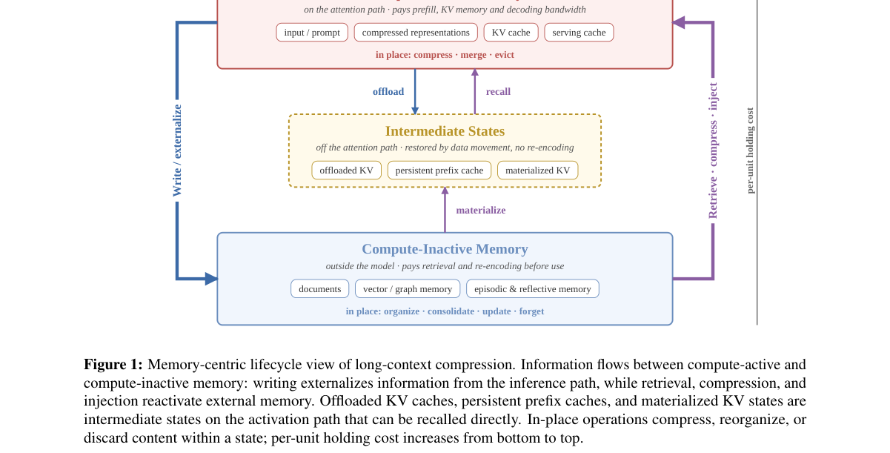

**Why this ranks #7**: 「扩窗口不消除推理期压力」是一个被广泛默认但很少被正面陈述的判断。

---

### 8. Compression Does Not End at Selection: Post-Selection Positional Geometry for Sparse KV Caches

**arXiv**: [2610.21126](https://arxiv.org/abs/2610.21126) | **Score**: 6.6 (relevance 6 x 0.7 + quality 8 x 0.3) | **Tags**: audio-LM | **Categories**: cs.CL | **Pages**: 16

**Authors**: Wanyang Hong, Zhaoning Zhang

**Affiliation**: National Key Laboratory of Parallel and Distributed Computing | College of Computer Science and Technology | National University of Defense Technology, Changsha, China.

**Abstract**

> Sparse KV compression reduces long-context inference costs by retaining selected historical states, yet these states typically keep their coordinates from the full history. Under Rotary Position Embedding (RoPE), gaps left by evicted tokens continue to affect query-key matching, potentially limiting the use of retained evidence. We study post-selection positional geometry on a fixed selector-produced cache, examining how positional organization affects the use of retained information and which coordinate and continuation rules improve answer quality. To reorganize this geometry, we propose RoPERelay, which assigns compact, order-preserving RoPE coordinates, relocates cached key phases through inverse rotation and re-rotation, and synchronizes the current query and subsequent generation. It reuses existing K/V without renewed selection, historical re-prefill, or additional cache budget. Across 36 comparisons spanning two models, six sparse selectors, and three long-term memory tasks, RoPERelay improves answer quality in 32 cases. For Llama-3.1-8B-Instruct with BM25 on LongMemEval-S, accuracy increases from 23.6% to 35.4%. Measured complete-request time overhead is approximately 1%-3% in the evaluated configurations. These findings establish positional organization as a distinct optimization dimension for sparse KV caches after content selection.

**Key findings**

- **Finding**: 稀疏 KV 压缩保留选中状态，但这些状态**保留其在完整历史中的坐标**。

- **Finding**: 在 RoPE 下，被驱逐 token 留下的空隙继续影响 q-k 匹配；作者研究**选择性之后**的位置几何（摘要在此处截断）。

- **Inference**: RoPE 的位置是相对编码，因此删除 token 不会自动压缩位置差——保留片段携带的原始坐标使模型仍按「完整历史」的距离感工作，这解释了为何稀疏 KV 常在长上下文中退化。

- **Recommendation**: 长上下文部署的读者必读；与本批 CoSTA（语音 token 压缩）对照，两篇都处理压缩后的位置/质量账。

**Key figures**

*Framework / architecture - Figure 1 Fixed-content dose response on Qwen2-7B- Instruct, LongMemEval-S (500 records), and BM25 with an 8,192-token history-cache budget. Compact- ing residual positional spans increases answer acc*

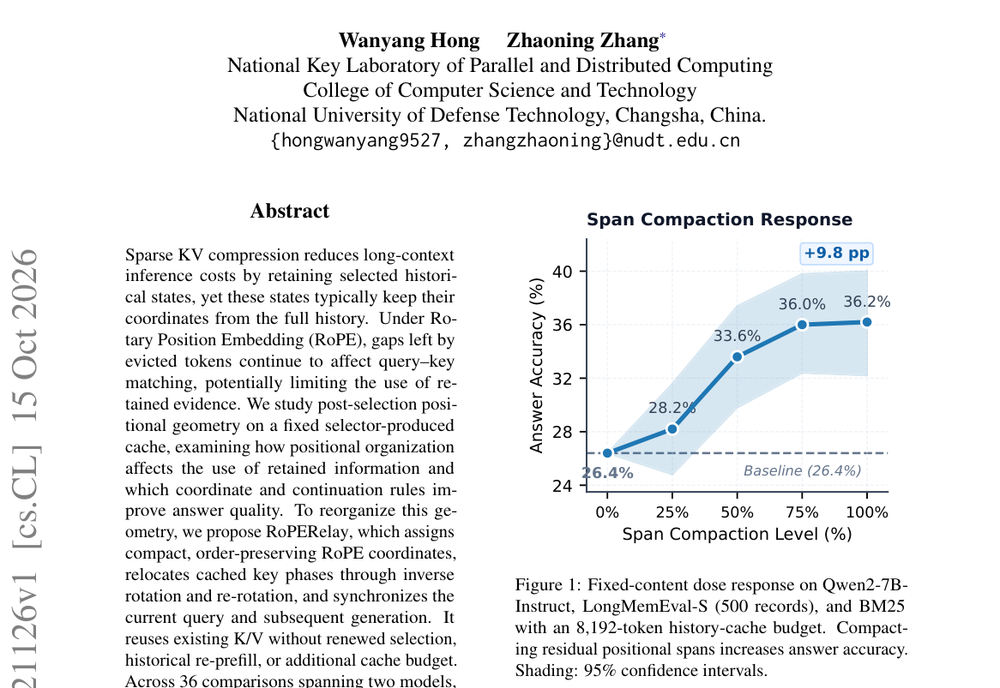

*Main result - Figure 2 RoPERelay reorganizes the positional geometry of the sparse history supplied by a selector. Retained states are mapped to consecutive coordinates in source temporal order, and historical key*

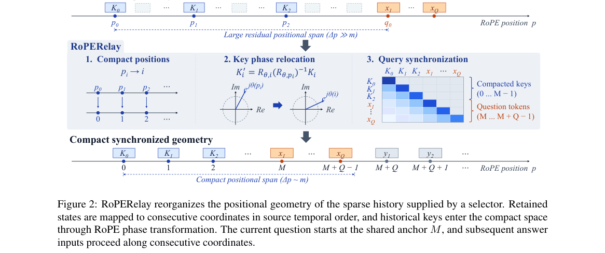

**Why this ranks #8**: 「保留的 token 带着它们被驱逐前的坐标」是一个实现细节却会实质限制检索质量。

---

### 9. Co2In: a Bi-level Memory Incremental Learning Framework with Knowledge Encoding, Consolidation, and Integration

**arXiv**: [2610.21804](https://arxiv.org/abs/2610.21804) | **Score**: 6.3 (relevance 6 x 0.7 + quality 7 x 0.3) | **Tags**: audio-LM | **Categories**: cs.AI | **Pages**: 18

**Authors**: Wenju Sun, Qingyong Li, Boyang Li, Wen Wang, Siyu Zhang, Yi Wei, Yangliao Geng

**Affiliation**: are with Key Laboratory of Big Data & Artificial Intelligence in | Transportation (Ministry of Education), Beijing Jiaotong University,

**Abstract**

> Incremental learning (IL) aims to continually acquire new knowledge (plasticity) while retaining previously learned information (stability). However, striking a balance between plasticity and stability remains a significant challenge for intelligent systems. The human brain achieves exceptional balance, owing to various memory units that collaboratively encode and store information. Inspired by human memory mechanisms, this paper introduces an IL framework with knowledge enCoding, Consolidation, and Integration (Co2In). Co2In is designed as a bi-level memory architecture: a working memory for adaptive knowledge acquisition and a long-term memory dedicated to the persistent retention of information. The two memory modules work cooperatively during IL. The working memory first learns from new data to encode knowledge into parameters. Subsequently, Co2In performs a consolidation process to identify underlying patterns in the learned parameters and re-express them into a compact knowledge representation. Next, the knowledge representation and the identified patterns are transformed into separate network layers and integrated into the long-term memory. These designs empower Co2In to accumulate knowledge with high plasticity and stability. We evaluate Co2In on CIFAR-10, CIFAR-100, and Tiny-ImageNet under exemplar-free Class-IL and Task-IL settings. Experimental results show that Co2In achieves state-of-the-art performance with efficient memory consumption.

**Key findings**

- **Finding**: 增量学习需兼顾可塑性（获取新知识）与稳定性（保留既有信息）。

- **Finding**: Co2In 用双层记忆（知识编码、巩固、整合）实现增量学习（摘要在此处截断）。

- **Inference**: 语言模型的「增量」与参数增量学习不同：写入数据不改变权重，但会污染检索空间——因此巩固（哪些写入被固化）与整合（新旧如何共存）必须显式设计。

- **Recommendation**: 与本批 Hy-Memory、All-in-One Memory 对照，三篇从架构、RL、增量三个角度处理记忆的长期维护。

**Key figures**

*Framework / architecture - Figure 1 Diagram of memory-based IL methods, Atkinson-Shiffrin human memory model [8], and the proposed Co2In. (a) Memory-based IL methods prevent the model from forgetting when learning by replaying o*

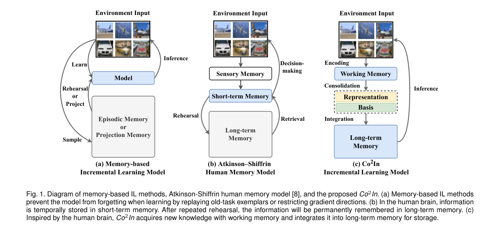

*Main result - Figure 2 Illustration of the learning process of Co2In. (a) The task-t training process of Co2In, including knowledge encoding, knowledge consolidation, and knowledge integration steps. (b) In the know*

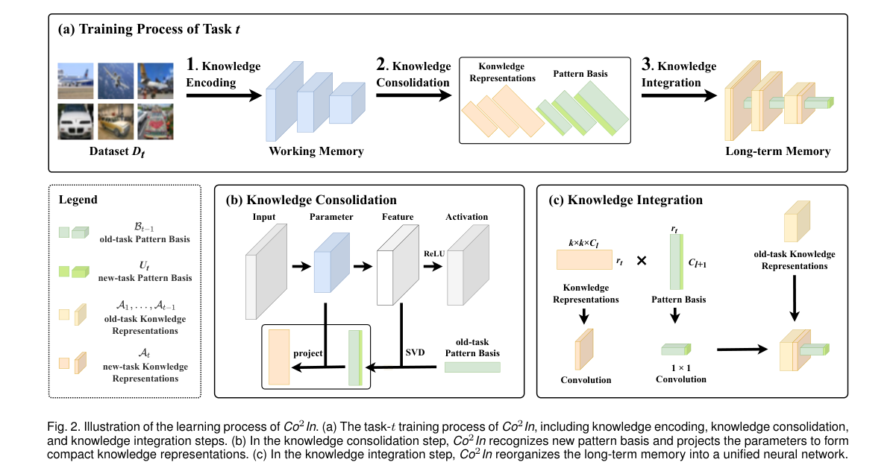

**Why this ranks #9**: 「可塑性—稳定性」张力在语言模型上比在参数上更难，因为写入的是数据而非权重。

---

### 10. Federated Art Chase: Privacy Leakage and Data Poisoning in Federated Fine-Tuning

**arXiv**: [2610.21547](https://arxiv.org/abs/2610.21547) | **Score**: 5.6 (relevance 5 x 0.7 + quality 7 x 0.3) | **Tags**: audio-LM | **Categories**: cs.CR, cs.LG | **Pages**: 27

**Authors**: Vasileios Perifanis, Nikolaos Pavlidis

**Affiliation**: https://github.com/Indigma-Innovations/fl-summer-school and run on Google Colab

**Abstract**

> Federated learning (FL) is increasingly used to adapt a pretrained, centrally fine-tuned model to data that remain on user devices, beyond training a model from scratch. In this report, prepared for the 4th Federated Machine Learning International Summer School, we study the privacy and integrity of this approach with a reproducible pipeline. An ImageNet-pretrained MobileNetV4-Conv-Small model is fine-tuned centrally on ten Quick, Draw! classes (97.50% test accuracy) and then adapted with head-only FedAvg over ten non-IID clients, which raises client training accuracy from 90.34% to 91.49% while preserving global accuracy. We evaluate four adversarial scenarios. First, from a single one-step client update, an honest-but-curious server recovers the complete private label set, but its reconstructions follow class prototypes rather than the private drawings (mean SSIM 0.130). Second, from a one-round FedAvg aggregate, label-count recovery falls from 87.5% with one client to 75.0% with five and ten clients, below the 80.0% of an uninformed uniform guess. Third, under FedAvg, a backdoor injected by 30%, 50%, and 100% of the clients reaches an attack success rate (ASR) of 21.9%, 31.3%, and 54.7% at a cost of at most 0.8 percentage points of clean accuracy, whereas label flipping is effective only when most of the source-class data are relabeled. Fourth, FLTrust with a root set retained from centralized fine-tuning lowers the backdoor ASR to 1.8% and 4.0% at 30% and 50% malicious clients and the label-flipping ASR from 12.6% to 0.8% without measurable clean-accuracy loss, but provides no protection when every client is malicious. The report closes with a live session in which participants draw, fine-tune, and poison the model through Indigma's FedMaestro orchestrator. Code and executed notebooks, runnable on Google Colab, are at https://github.com/Indigma-Innovations/fl-summer-school.

**Key findings**

- **Finding**: FL 被用于把**集中微调过的预训练模型**适配到用户设备上的数据——这与从零训练 FL 不同。

- **Finding**: 作者以可复现管线研究隐私泄漏与数据投毒（摘要在此处截断）。

- **Inference**: 适配一个已见过中心数据的模型时，攻击者面临的目标不同：他要恢复的不只是训练样本，而是中心模型已学到的表征——后者在很多场景下更难被联邦聚合掩盖。

- **Recommendation**: 部署联邦微调的读者可参考；与本批 SITAR（ASR 评测的情境失真）同属「指标/协议是否覆盖真实威胁」的家族。

**Key figures**

*Framework / architecture - Figure 1 Overview of the pipeline. Blue boxes denote model development stages, orange boxes privacy attacks by an honest-but- curious server, red and green boxes poisoning by malicious clients and th*

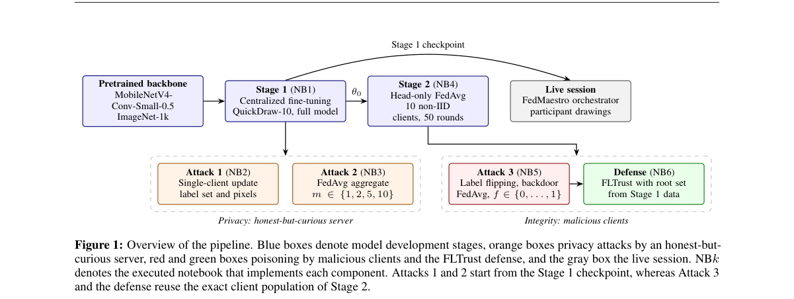

*Main result - Figure 2 Five randomly drawn Stage 1 examples per class (28 × 28 bitmaps, white strokes on a black background).*

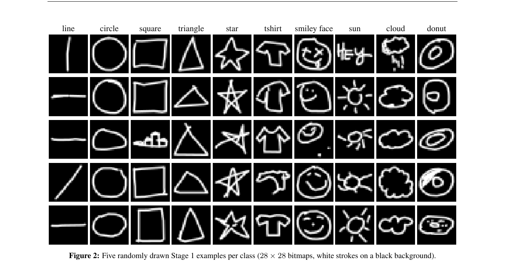

**Why this ranks #10**: 「联邦微调集中微调过的模型」这个用法与常规 FL 不同，其泄露面也不同。

---

## Footer

- Total papers reviewed across all 5 tracks: 51 (from 574 scanned)
- audio_lm track final top-10: 10
- Wild-cards in this track: 5
- Figure assets: `res/` (shared across tracks)

Generated by `mine-arxiv-daily-digest` skill. Sister file: `2026-10-16_audio_lm_entry.md`.
