# ArXiv Daily Digest - 2026-10-16 (具身智能与世界模型, 10 papers)

**Generated**: 2026-10-16 17:00 CST

**Source**: arXiv cs.CV, cs.SD, eess.AS, cs.CL, cs.AI, cs.RO, cs.LG submissions, window 2026-10-15 UTC (latest announced batch as of 2026-10-16 17:00 CST)

**Track**: embodied (top 10 of 574 papers scanned, 50 full reads)

**Scope**: rethinking supervision targets in VLA learning, spatially aligned tactile pretraining, dexterity from supervised play, anticipating interaction anomalies via multimodal world models, test-time verification with latent world models, invoking the VLM once per episode, sound-triggered mobile manipulation, unified egocentric world action model, dexterous manipulation generalization benchmark, spatial memory for world model efficiency

---

**What Should Robot Policies Learn to Predict?** 把本项目日报追踪最久的具身线索又推进一环，并且第一次把「辅助目标」明确表述为**容量竞争**：VLA 通常以动作预测为主要监督，而 latent-action（LA）与未来视觉（FV）预测等辅助目标常被加入以改进策略学习，但它们会与动作预测争夺表示容量。此前「辅助目标越多越好」是本方向的普遍默认，本文把它变成一个可测的取舍——接上 10-12 Beyond Actions（预测目标换成效果）、10-14 WAVE-0/ΔWAM，是这条线的又一环。

**触觉**已连续四天出现在本日报（10-08 五篇、10-14 五篇力/接触、10-15 一篇综述、今天）。昨天的综述给出了该子方向的边界（触觉从接触检测扩展到学习可迁移表示与具身物理推理），今天的 **Spark-0** 则给出了模型形态，其中**空间对齐**是关键设计：触觉的高维信号若不与视觉空间对齐，就只能提供「有接触发生」这类全局信息、无法定位接触位置——这正是触觉此前难以进入预训练的根本原因。

其余是数据与效率。**Dexterity from Supervised Play** 给出两级数据放大方案：机器人从**几分钟人类玩耍**行为克隆学到一个玩耍策略，再自主部署采集**数小时**交互数据——人类玩耍提供任务意图与接触模式，机器人玩耍提供本体执行数据，两者不可互换。
**Fast-VLA** 的论证很干净：任务理解的变化**远慢于**机器人状态，因此每个 episode 只调用一次冻结的 4B VLM 即可。**VeriVLA** 则指出一项由架构性质直接产生的部署缺陷：流式 VLA 本质随机（不同噪声种子给出质量各异的动作块），但测试时通常提交单个样本而**无质量估计**——流策略的随机性本可以变成质量信号，但默认被丢弃。

---

## Top 10 - 具身智能与世界模型

### 1. What Should Robot Policies Learn to Predict? Rethinking Supervision Targets in Vision-Language-Action Learning

**arXiv**: [2610.21915](https://arxiv.org/abs/2610.21915) | **Score**: 9.0 (relevance 9 x 0.7 + quality 9 x 0.3) | **Tags**: embodied-ai, world-model | **Categories**: cs.RO | **Pages**: 26

**Authors**: Haitao Shen, Hanyu Liu, Yihan Lin, Huiping Liu, Junbo Cui, Daoheng Li, Yang Li, Jing Zhang, Wenxin Li, Yuan Yao

**Affiliation**: 1Renmin University of China | 2Peking University | 3Beijing Jiaotong University | 5Tsinghua University

**Abstract**

> Vision-language-action (VLA) policies are typically trained with action prediction as the primary supervision signal, since robots ultimately execute actions. Auxiliary objectives such as latent-action (LA) and future-vision (FV) prediction are often added to improve policy learning, yet they compete with action prediction for the same training budget. We ask whether, under a fixed budget, allocating a substantial share of training samples to such objectives, rather than to further action prediction, can improve policy learning. We build a unified VLA framework that couples a two-stream multimodal diffusion transformer (MMDiT) with a sample-level router, which assigns each training sample to either action prediction or an auxiliary objective and thus makes supervision allocation explicit. Within this framework, we instantiate three LA targets based on LAPA and its DINO-feature variants, and three FV targets based on DINOv3, V-JEPA 2, and Wan2.2 representations. Across LIBERO, CALVIN, and four real-robot tasks, suitable LA and FV supervision outperforms action-only training under the same budget, even when action prediction receives no more than half of the training samples. FV generally outperforms LA, although the strongest LA target remains competitive on CALVIN. Diagnostic analyses suggest that DINO-based LA targets emphasize relative motion, whereas FV targets emphasize absolute position and task identity. We therefore argue that what robot policies learn to predict, and how training is allocated among these targets, should be treated as explicit design choices rather than defaulting to action-dominant training.

**Key findings**

- **Finding**: VLA 通常以动作预测为主要监督；LA（latent-action）与 FV（未来视觉）等辅助目标常被加入。

- **Finding**: 作者指��这些辅助目标会与动作预测**竞争表示容量**（摘要在此处截断）。

- **Inference**: 把辅助目标一律视为「越多越好」是本方向最普遍的默认；本文把它表述为容量竞争，因此「哪些辅助目标值得加」变成一个可测的取舍而非堆叠问题。

- **Recommendation**: 被精读的三篇之一。它接上 10-12 Beyond Actions（预测目标换成效果）、10-14 WAVE-0/ΔWAM，是这条线的第七或第八篇。

**Key figures**

*Framework / architecture - Figure 1 Overview. Left: under a fixed training budget, a router sends each sample to the action loss or one auxiliary loss (LA or FV); Px routes x% of samples to the action loss. Middle: two- stream*

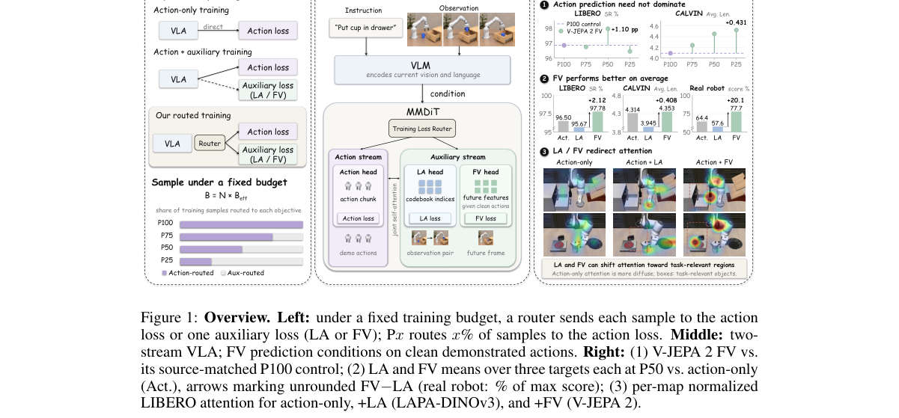

*Main result - Figure 2 VLM–MMDiT architecture. Action and auxiliary (LA/FV) experts interact through joint self-attention; sample-level routing selects the active loss. Future observations are used only for auxili*

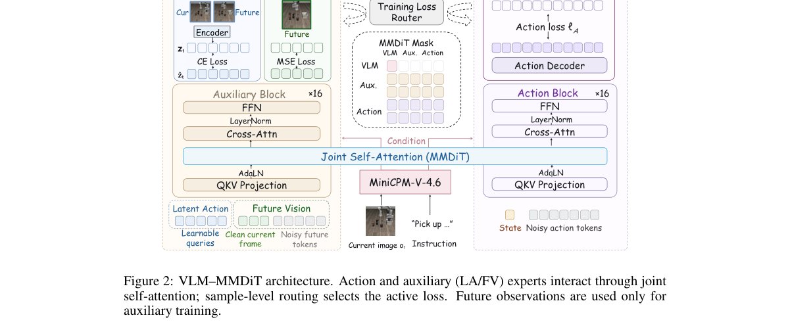

**Why this ranks #1**: 这是本项目日报追踪最久的具身线索的又一环：动作预测之外究竟该预测什么，且第一次把「辅助目标争夺容量」说成一个显式冲突。

---

### 2. Spark-0: Scaling Spatially Aligned Tactile Pretraining for Robot Dexterous Manipulation

**arXiv**: [2610.22342](https://arxiv.org/abs/2610.22342) | **Score**: 9.0 (relevance 9 x 0.7 + quality 9 x 0.3) | **Tags**: embodied-ai | **Categories**: cs.RO | **Pages**: 23

**Authors**: Tianxing Chen, Wenwei Lin, Chuqiao Lyu, Peicheng Xiang, Junyuan Tang, Tian Nian, Zijian Cai, Kehe Ye, Chenze Yu, Wenxuan Zhu, Eric J. Chen, Yan Qin

**Affiliation**: Tian Nian1,∗, Zijian Cai1, Kehe Ye1, Chenze Yu1, Wenxuan Zhu1, Eric J. Chen1, Yan Qin4, Yue Chen5, | 4HKUST (GZ)

**Abstract**

> Generalist robot policies benefit from large-scale visual pretraining but often struggle with contact-rich dexterous manipulation, where force, compliance, and incipient slip are hard to observe from images. We present Spark-0, a spatially aligned vision-tactile-language-action (VTLA) model that uses touch in two complementary ways. During pretraining, image-space contact maps derived from tactile gloves, together with features from a frozen 3D geometry teacher, supervise the visual tokens; these objectives are removed at inference. In parallel, a tactile pathway encodes regional force histories and 3D taxel states to condition the action expert. A single checkpoint therefore supports both vision-only and tactile-conditioned deployment. To scale this supervision, we build HumanTouch, a 1,000-hour dataset of full-hand tactile human manipulation, and pretrain Spark-0 on it together with egocentric video, robot data, and simulation. We also release SparkArena, which pairs vision-only simulated tasks with tactile-conditioned real-robot tasks on one dexterous embodiment. Spark-0 achieves the highest mean success rate on both SparkArena tracks and ranks first on all eight aggregate metrics of the Ego Humanoid Manipulation Benchmark. Compared with vision-only pretraining on the same data and compute with touch discarded, retaining the touch of 1,000 hours of HumanTouch raises vision-only success on Ego Humanoid from 52.5% to 71.7%, and success on SparkArena-Real, where touch is also used at deployment, from 44.0% to 52.0%, indicating that touch serves not only as a policy input but also as scalable supervision for dexterous visuomotor pretraining. The Website is available at: https://xsparkai.com/Spark-0.

**Key findings**

- **Finding**: 接触丰富的灵巧操作中，力、顺应性与初始滑移**难以从图像观察**。

- **Finding**: Spark-0 是空间对齐的 VTLA 模型，以两种互补方式使用触觉（摘要在此处截断）。

- **Inference**: 「空间对齐」是关键设计：触觉的高维信号若不与视觉空间对齐，就只能提供「有接触发生」这类全局信息，无法定位接触位置——这正是触觉此前难以进入预训练的根本原因。

- **Recommendation**: 触觉方向的读者必读；与 10-15 的触觉综述对照，一篇给边界、一篇给模型。

**Key figures**

*Framework / architecture - Figure 1 Spark-0 overview. (a) Pretraining on 1,000 hours of HumanTouch plus egocentric, robot, and simulation data. (b) Train-only alignment supervises where contact occurs; a tactile encoder condit*

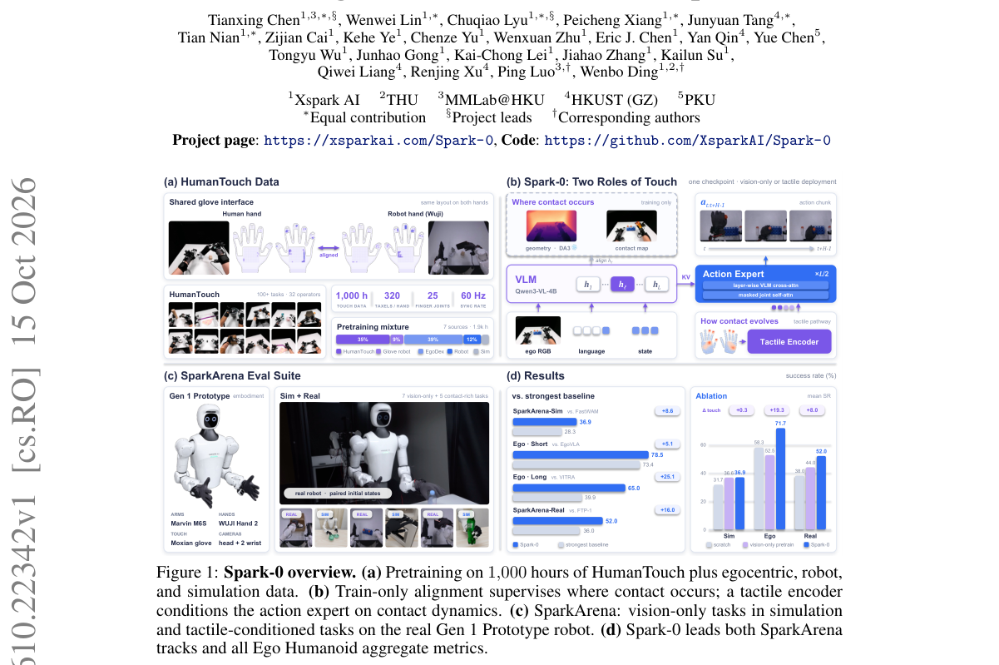

*Main result - Figure 2 HumanTouch overview. Representative in-the-wild tasks spanning diverse objects, scenes, and motions.*

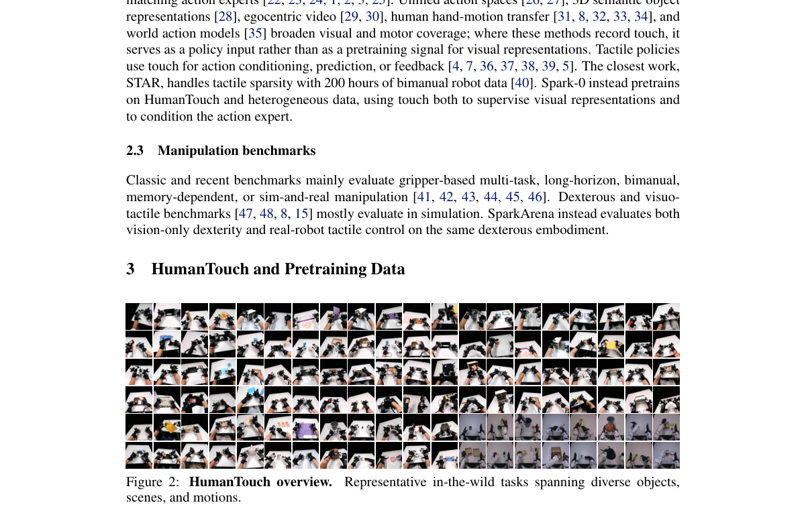

**Why this ranks #2**: 触觉已连续四天出现在本日报（10-08 五篇、10-14 五篇力/接触、10-15 一篇综述、今天这篇），今天是「从综述进入基础模型」的信号。

---

### 3. Dexterity from Supervised Play

**arXiv**: [2610.22340](https://arxiv.org/abs/2610.22340) | **Score**: 8.7 (relevance 9 x 0.7 + quality 8 x 0.3) | **Tags**: embodied-ai | **Categories**: cs.AI, cs.RO | **Pages**: 8

**Authors**: Botao He, Yiming Dou, Yiannis Aloimonos, Jitendra Malik, Akash Sharma, Ruoshi Liu

**Affiliation**: 1Amazon Frontier AI & Robotics (FAR). | 2University of Maryland, College Park.

**Abstract**

> How can robots autonomously collect the contact-rich experience needed to learn dexterous manipulation? We present DSP: Dexterity from supervised play, a framework in which a robot learns a play policy from minutes of human play through behavior cloning, then deploys it autonomously to collect hours of interaction data to train a world model. During inference, the same play policy then guides model-predictive control (MPC) by proposing candidate action sequences for evaluation under the learned world model. To accelerate inference, we also introduce a method for distilling a closed-loop, goal-conditioned policy through self-play within the learned world model. We evaluate this framework on underactuated pushing and any-to-any in-hand pose reorientation with a multifingered hand, in simulation and real world. In real world experiment, our method outperforms hindsight behavior cloning by 69.6% in success rate and achieves comparable success to reinforcement learning with 490 times less interaction data. These results demonstrate that supervised play can autonomously collect interaction data, guide model-based planning, and enable policy learning without any task-specific demonstrations or sim-to-real transfer.

**Key findings**

- **Finding**: DSP 让机器人从**几分钟**人类玩耍通过行为克隆学到一个玩耍策略。

- **Finding**: 随后自主部署该策略，采集**数小时**交互数据用于训练（摘要在此处截断）。

- **Inference**: 人类玩耍提供的是**任务意图与接触模式**，机器人玩耍提供的是**机器人本体的执行数据**；两者不可互换，而两级方案恰好让每一级做它擅长的事。

- **Recommendation**: 数据受限的机器人团队可参考；与本批 MuSTMM（声音触发）对照，一篇做数据放大、一篇做任务触发。

**Key figures**

*Framework / architecture - Figure 1 DSP Pipeline Overview. (1) Human teleoperation trains a goal-agnostic play policy. (2) The policy collects interaction data through autonomous play. (3) These data train a world model to predi*

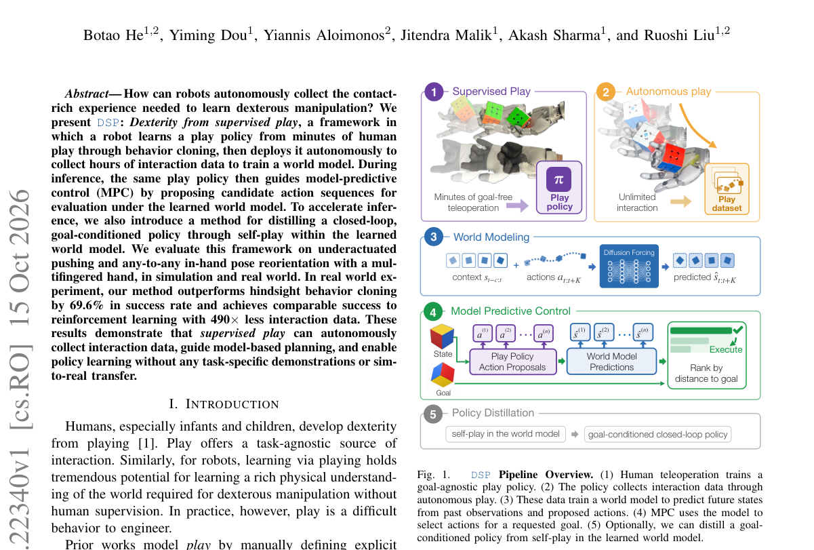

*Main result - Figure 2 Dexterity from Supervised Play. (a) A goal-agnostic play policy is trained by behavior cloning on human teleoperation data. (b) The learned policy interacts autonomously with the environment t*

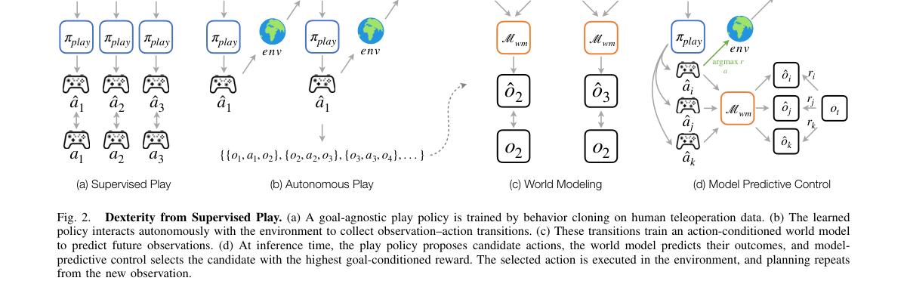

**Why this ranks #3**: 「几分钟人类 → 数小时机器」的两级数据放大是一个清晰且可复制的数据工程方案。

---

### 4. MAIA: Anticipating Interaction Anomalies in Contact-Rich Manipulation via Multimodal World Models

**arXiv**: [2610.21686](https://arxiv.org/abs/2610.21686) | **Score**: 8.0 (relevance 8 x 0.7 + quality 8 x 0.3) | **Tags**: world-model, embodied-ai | **Categories**: cs.RO | **Pages**: 12

**Authors**: Yi Qiao, Maolin Zheng, Haoran Sun, Lujia Dong, Wenzhao Lian

**Affiliation**: 1School of Artificial Intelligence, Shanghai Jiao Tong University

**Abstract**

> Reliable contact-rich manipulation requires detecting execution deviations early enough for corrective action. Yet most monitoring methods are reactive, identifying anomalies only after they become observable. Anticipating such anomalies is challenging because visual observations only partially reveal physical interaction, while planned actions describe intended motion rather than their actual physical consequences. We address this problem with MAIA, a multimodal framework for anomaly anticipation. Its vision-action-force world model learns nominal interaction dynamics and predicts the visual and force responses of planned actions, while a lightweight anomaly head predicts impending interaction anomalies. To enable systematic evaluation, we introduce CRIA, a real-world multimodal dataset of 2,852 trajectories spanning 18 contact-rich manipulation tasks, with frame-level annotations of anomaly onset and evolution. Experiments on both seen and novel tasks show that MAIA achieves more accurate anomaly discrimination than representative baselines while providing earlier warnings, with bACC scores of 0.765 and 0.710 and median anticipation lead times of 28.0 and 25.1 steps, respectively. Moreover, using these predictions for anomaly-aware action selection improves end-to-end task success from 52.6% to 61.5% without retraining the underlying manipulation policy. These results highlight the value of modeling future physical consequences for proactive anomaly anticipation.

**Key findings**

- **Finding**: 多数监控方法是被动的，只在异常**可观测之后**识别；预判很困难，因为视觉只部分揭示物理交互。

- **Finding**: MAIA 用多模态世界模型预判交互异常（摘要在此处截断）。

- **Inference**: 视觉只能部分揭示物理交互，正是「用世界模型补足不可观测物理」的典型场景——这与本批 VeriVLA（用潜世界模型做测试时验证）属同一思路。

- **Recommendation**: 与 10-14 日报的 WoVR+（世界模型幻觉误导 RL）对照：一篇用世界模型做监控、一篇指出其幻觉风险。

**Key figures**

*Framework / architecture - Figure 1 Anticipating anomalous interactions in contact-rich manipulation. A representative path-constrained manipulation sequence progresses from nominal interaction (1–2), through an early warning (3*

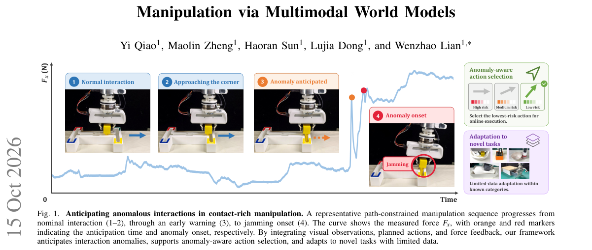

**Why this ranks #4**: 「被动监控 vs 预判」是一个部署可靠性的根本区分。

---

### 5. VeriVLA: Adaptive Test-Time Verification for Flow-Based VLAs with Latent World Models

**arXiv**: [2610.21985](https://arxiv.org/abs/2610.21985) | **Score**: 8.0 (relevance 8 x 0.7 + quality 8 x 0.3) | **Tags**: world-model, embodied-ai | **Categories**: cs.RO | **Pages**: 14

**Authors**: Xueli Sun, Yuxiang Lu, Yantong Liu, Xianzhe Fan, Xi Chen, Zhe Liu, Hengshuang Zhao

**Affiliation**: The University of Hong Kong | clean setting of RoboTwin 2.0, from 62.8% to 69.6% in its

**Abstract**

> Flow-based Vision-Language-Action (VLA) policies are inherently stochastic: different noise seeds can produce action chunks of varying quality from the same observation. At test time, however, the policy typically commits to a single sample without an explicit estimate of its quality. In fine-grained manipulation, executing a suboptimal action can irreversibly disrupt task progress and lead to failure. To exploit policy stochasticity, we introduce a training-free two-axis trigger that uses two initial samples to measure within-chunk temporal variation and cross-sample variance, detecting the critical states. Once triggered, a JEPA-based latent world model ranks candidate action chunks by predicting action-conditioned future latent states and the corresponding changes in task progress. By operating in latent space, the verifier avoids pixel reconstruction and enables efficient and more accurate ranking. Across three real-world tasks, $\textit{i.e.,}$ pen insertion, pipetting, and apple placement), our method raises the average completion score from 50.8% to 65.5%, while adding 326 ms for sampling and verification per triggered decision on a single RTX 4090. Consistent gains are also observed in simulation, where the average success rate rises from 66.4% to 73.6% in the clean setting of RoboTwin 2.0, from 62.8% to 69.6% in its randomized setting, and from 96.9% to 97.6% on LIBERO.

**Key findings**

- **Finding**: 流式 VLA 随机：不同噪声种子在同一观测下产生质量各异的动作块；测试时通常**提交单个样本而无质量估计**。

- **Finding**: VeriVLA 用潜世界模型做自适应测试时验证（摘要在此处截断）。

- **Inference**: 这与 10-14 日报的 Two Clocks 属同一类观察——训练中的统计性质（随机性）未在部署时被利用；流策略的随机性本可以变成质量信号，但默认被丢弃。

- **Recommendation**: 流式 VLA 部署的读者注意；与本批 Fast-VLA（推理期省算力）对照，一篇省时间、一篇用随机性换可靠性。

**Key figures**

*Main result - Figure 2 Conceptual comparison between different paradigms. (a1) Sampling-and-selection with VLM: Directly predict the delta progress with the current observation and the action chunk produced by VLA*

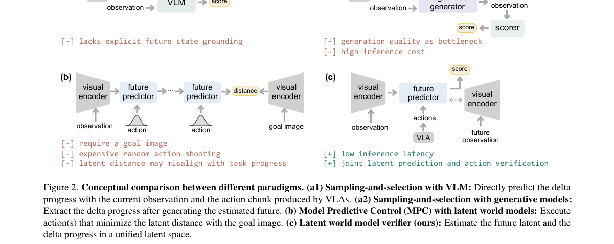

**Why this ranks #5**: 「流策略随机但部署时不评估质量」是一个由架构性质直接产生的部署缺陷。

---

### 6. Fast-VLA: You Only Think Once for Robot Manipulation

**arXiv**: [2610.21389](https://arxiv.org/abs/2610.21389) | **Score**: 7.7 (relevance 8 x 0.7 + quality 7 x 0.3) | **Tags**: embodied-ai | **Categories**: cs.RO | **Pages**: 16

**Authors**: Kehong Gong, Guanli Hou, Xiaoxu Zheng, Qi Wang, Mingxi Xu, Anbang Zhai, Xiaoyu He, Mingyuan Zhang, Michael Bi Mi

**Affiliation**: 1Huawei Technologies Co., Ltd | 2Huawei Central Research Institute

**Abstract**

> Vision-language-action (VLA) policies commonly place a multi-billion-parameter model inside the feedback loop, repeatedly recomputing task context whenever they predict a new action chunk. Yet task understanding changes far more slowly than the robot state. We introduce Fast-VLA, which invokes a frozen 4B VLM once per episode to contextualize the instruction and initial views as fixed, multi-layer key-value task memory. During execution, a lightweight online actor fuses learned time- and arm-indexed queries with current visual and proprioceptive feedback to form action queries. These queries retrieve task context from the fixed memory and predict action chunks without re-running the foundation model. Fast-VLA achieves 92.46% and 92.40% success on RoboTwin 2.0 Clean and Randomized, and 95.95% and 79.11% on LIBERO and LIBERO-Plus evaluation. Against three continually conditioned baselines on the same hardware, it reduces RoboTwin amortized policy inference time by 10.9-17.1x and requires 1.22 GiB of post-prefill online resident memory. Task-memory swaps further show that the actor relies on episode-matched task memory. These results show that task context can be established once while closed-loop control remains responsive throughout execution. Project page: https://garfield-kh.github.io/FastVLA

**Key findings**

- **Finding**: VLA 在每次预测新动作块时反复重算任务上下文，而**任务理解的变化远慢于机器人状态**。

- **Finding**: Fast-VLA 在每个 episode 只调用一次冻结的 4B VLM（摘要在此处截断）。

- **Inference**: 把「任务上下文」与「机器人状态」当作两个变化速率不同的信号对待，是一个正确的问题分解——慢变信号不值得每步重算。

- **Recommendation**: VLA 推理的读者必读；与本批 2610.21626 类（效率）工作对照。

**Key figures**

*Framework / architecture - Figure 1 Fast-VLA thinks once per episode. (a) Success versus amortized inference latency on RoboTwin 2.0; bubble area denotes online resident memory and colour denotes method family. (b) A frozen 4B*

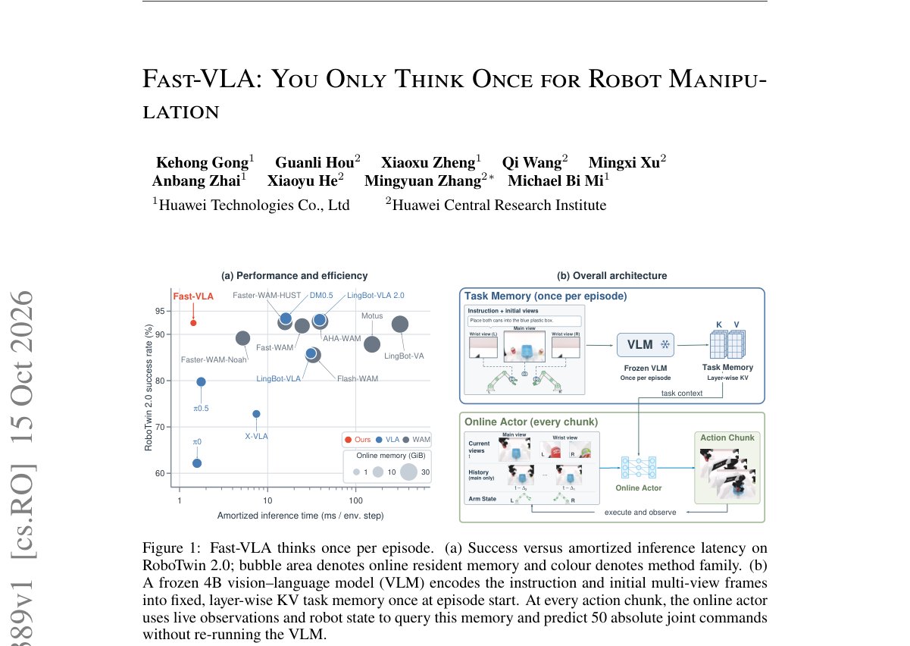

*Main result - Figure 2 Memory-conditioned online control in Fast-VLA. A frozen VLM constructs layer-wise KV task memory from the instruction and initial views once per episode. In the online actor, query fusion co*

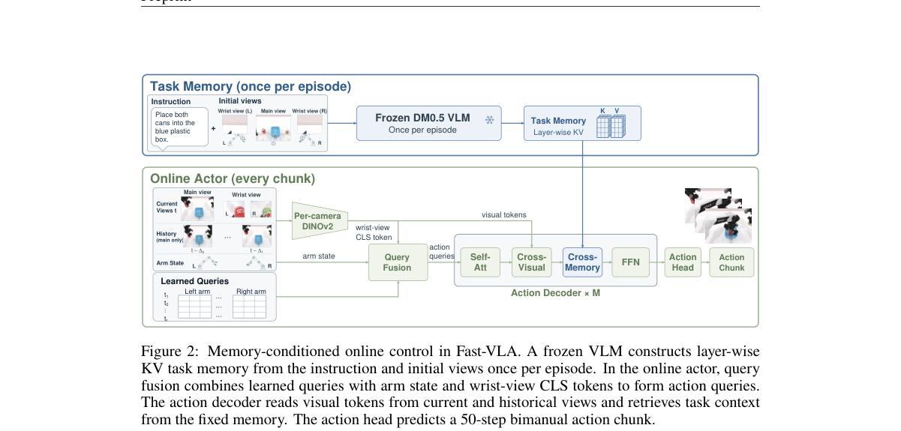

**Why this ranks #6**: 「任务理解变化慢于机器人状态」是一个可量化的时序论证，直接支撑「每 episode 一次」。

---

### 7. Perceive, Predict, and Plan: a Unified World Action Model for Egocentric Dexterous Manipulation

**arXiv**: [2610.22363](https://arxiv.org/abs/2610.22363) | **Score**: 7.7 (relevance 8 x 0.7 + quality 7 x 0.3) | **Tags**: world-model, embodied-ai | **Categories**: cs.CV, cs.RO | **Pages**: 28

**Authors**: Zirui Wu, Chen Guo, Tianjian Jiang, Zeren Jiang, Zeming Li, Lingchen Yang, Longteng Duan, Ying Xue, Handi Yin, Shenyuan Gao, Martin R. Oswald, Jun Zhang

**Affiliation**: 1 HKUST (GZ) | 3 ETH Zurich | 4 Visual Geometry Group, University of Oxford | 5 HKUST

**Abstract**

> We introduce P$^{3}$-WAM, a unified world action model for egocentric dexterous manipulation that learns 3D perception, action-conditioned prediction, and goal-directed planning through three complementary modes: Perceive, which reconstructs articulated hand motion and camera trajectories from video; Predict, which generates visual futures under prescribed actions; and Plan, which jointly generates action trajectories and their anticipated visual consequences conditioned on an initial image, a language instruction, and an optional visual goal. Our model integrates a compact, structured 3D action representation into a pretrained video diffusion transformer through a mixture-of-transformers architecture with shared base weights, modality-specific adaptation, and bidirectional visual-action attention. Randomized modality visibility lets video and 3D actions serve as either conditioning context or prediction targets across the three modes. Experiments show that unified training improves all three capabilities over single-mode training, including gains in planning quality under a vision-language model evaluation. Through unified training, our model outperforms specialized baselines on 3D hand reconstruction and action-conditioned video prediction across four datasets, while producing goal-directed manipulation videos with stronger instruction adherence and action progression than video-generation baselines. Project Page: https://p3-wam.pages.dev/

**Key findings**

- **Finding**: P³-WAM 通过 Perceive / Predict / Plan 三种互补模式学习三维感知、动作条件预测与目标导向规划。

- **Finding**: Perceive 从视频重建关节手部运动与相机轨迹（摘要在此处截断）。

- **Inference**: 把三种模式放进一个模型而非三个模块，意味着它们的输出空间被迫对齐——这既是统一的好处（跨模式推理）也是风险（一种模式可能主导另两种）。

- **Recommendation**: 与 10-15 的 Thinker-WM、10-14 的 ForceWAM（解耦未来与响应）对照，三篇都在划分世界模型各职责的边界。

**Key figures**

*Framework / architecture - Figure 1 P3-WAM unifies perception, prediction, and planning. PERCEIVE recovers hand motion from video; PREDICT generates video under prescribed motion; PLAN jointly generates motion and video guided*

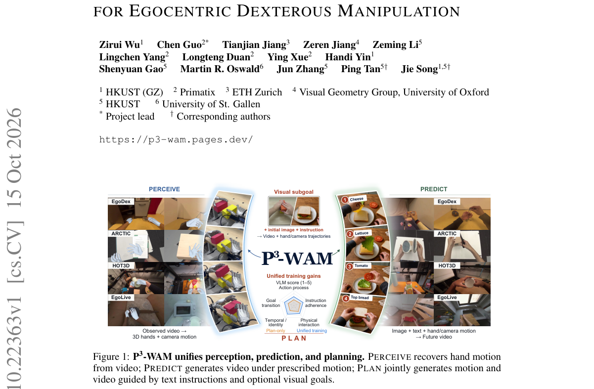

*Main result - Figure 2 Task modes and unified training. Colored tiles denote observed video V and actions A; gray tiles denote missing inputs. Unified training samples these patterns across clips and time.*

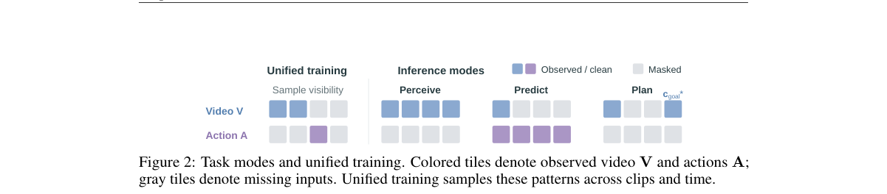

**Why this ranks #7**: 「三种互补模式」把感知/预测/规划放进一个模型，与 10-15 日报的 Thinker-WM（统一多模态世界模型）同属「碎片化 vs 统一」这条线。

---

### 8. MuSTMM: Learning Sound-Triggered Mobile Manipulation across Multiple Scenes

**arXiv**: [2610.21429](https://arxiv.org/abs/2610.21429) | **Score**: 7.0 (relevance 7 x 0.7 + quality 7 x 0.3) | **Tags**: embodied-ai | **Categories**: cs.RO | **Pages**: 16

**Authors**: Hao Ju, Feng Yan, Zhihao Zhong, Heng Yang, Shaofei Huang, Zhedong Zheng

**Affiliation**: University of Macau | Hefei University of Technology

**Abstract**

> Sound-Triggered Mobile Manipulation (STMM) requires robots to respond to sound events by navigating to the associated objects and performing appropriate physical interactions. Existing STMM evaluations primarily vary object layouts within limited architectural structures, leaving challenges to unseen scenes insufficiently explored. We introduce Multi-scene Sound-Triggered Mobile Manipulation (MuSTMM), a dataset that combines spatial audio rendering and physical interaction across 31 scenes with diverse architectures and object layouts. MuSTMM contains 14.36 million precomputed binaural Room Impulse Responses (RIRs) and a scene-disjoint split for evaluating single-event and multi-event settings in unseen scenes. We further augment the Navigation Policy Model with explicit spatial memory that complements acoustic cues with observed geometry. Specifically, we accumulate pose-aligned depth observations in a shared coordinate frame and project this memory into an egocentric Bird's-Eye View (BEV) occupancy map. Fusing map features with sound context produces a goal descriptor that provides both target-location and scene-structure priors, guiding navigation to the target region required for subsequent physical interaction. This policy achieves a 2.60% success rate boost over existing methods, while component ablations further support the effectiveness of spatial memory. MuSTMM and the navigation policy provide a testbed for the new challenge of studying sound-triggered mobile manipulation in unseen scenes. The code and dataset will be released upon acceptance.

**Key findings**

- **Finding**: 声音触发移动操作要求机器人导航到相关物体并执行物理交互。

- **Finding**: 既有 STMM 评测主要在有限建筑结构内变化物体布局，**对未见场景探索不足**（摘要在此处截断）。

- **Inference**: 「声音→物体」的定位是这一任务的独特难点：机器人必须把声源位置映射到物体，而两者在空间上可以不一致（声源在遮挡后）。

- **Recommendation**: 与本批 audio_lm 线的空间音频 LLM（2610.21588）对照，一篇在感知侧、一篇在操作侧处理同一空间映射。

**Key figures**

*Framework / architecture - Figure 1 Example scenes in MuSTMM (Zoom in for a better visualization). MuSTMM supports sound rendering (single event and multiple events) and physical interaction in 31 scenes, ranging from differen*

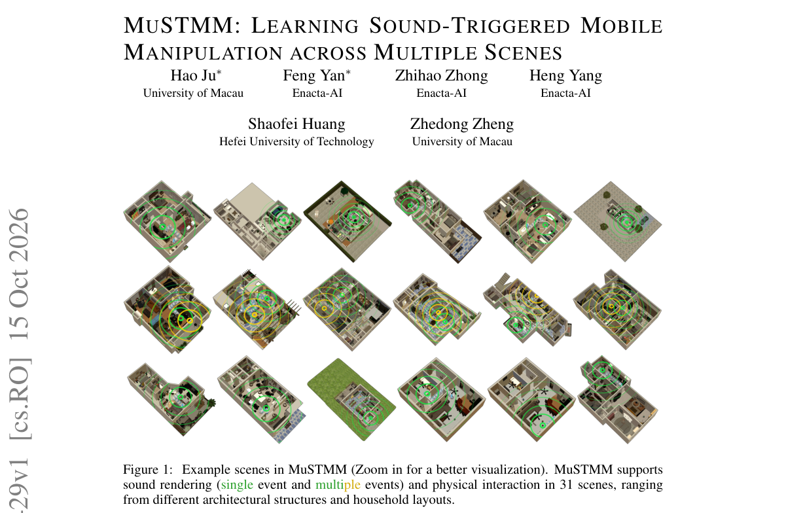

**Why this ranks #8**: 「声音作为任务触发」是一个较少被探索的具身交互形态，且连接了音频与具身两个兴趣。

---

### 9. Evo-DexBench: Benchmarking Generalization across Related Tasks for Dexterous Manipulation

**arXiv**: [2610.21180](https://arxiv.org/abs/2610.21180) | **Score**: 7.0 (relevance 7 x 0.7 + quality 7 x 0.3) | **Tags**: embodied-ai `[wild-card]` | **Categories**: cs.RO | **Pages**: 31

**Authors**: Bing Cheng, Yiran Mao, Zewei Ye, Yifan Jin, Xinyi Chen, Ruifeng Tu, Shuhuai Wang, Tao Lin, Zhimu Zhou, Yuxin Du, Fangwei Zhong, Junchi Yan

**Affiliation**: 1School of AI, Shanghai Jiao Tong University; 2Nanjing University; 3Central South University | 4Beijing University of Posts and Telecommunications; 5Beijing Normal University

**Abstract**

> General-purpose dexterous manipulation requires policies to transfer knowledge from related tasks to new tasks with only a few target demonstrations. Existing benchmarks often provide too many target demonstrations. They also leave the differences between source and target tasks uncontrolled. As a result, they cannot clearly distinguish knowledge transfer from task memorization. Our key insight is the Core-Gen principle. Core tasks are related tasks that share a functional interaction and provide source knowledge, while a Gen task is a novel target within the same functional family that has only a few demonstrations. This setup tests whether a policy can reuse functional interaction knowledge. Based on this principle, we propose Evo-DexBench, which controls both source-task relatedness and target-task exposure. It comprises 30 tasks in six functional families and a VR teleoperation pipeline. The resulting dataset covers three everyday scenes per task. It contains 1,248 multimodal demonstrations collected with simulated Shadow Hands equipped with 123 taxels. Experiments show that even the best-performing method achieves an average success rate of only 38.5%, highlighting the challenges existing methods face in transferring functional interaction knowledge. Further analysis shows that, across the two tasks, joint Core+Gen training improves performance by 12% and 38%, respectively, over training on Core followed by fine-tuning on Gen. This indicates that joint training makes better use of Core knowledge and that functionally matched Core data yields greater gains in success rate than mismatched data. We release the Evo-DexBench dataset and benchmark to support the evaluation of dexterous manipulation policies' generalization across related tasks.

**Key findings**

- **Finding**: 既有基准提供过多目标演示，且未控制源/目标任务之间的差异，因而无法清晰分离（摘要在此处截断）。

- **Finding**: Evo-DexBench 专门评估跨相关任务的泛化（摘要在此处截断）。

- **Inference**: 「目标演示过多」是一个方向性的高估来源——泛化能力的测量本应依赖「少样本」这个前提，若给了大量演示则该前提消失，分数高只说明模仿能力强。

- **Recommendation**: wild-card 项；用灵巧操作基准做选型前值得一读，它指出了分数不可比的原因。

**Key figures**

*Framework / architecture - Figure 1 Overview of the Evo-DexBench. The benchmark comprises six functional task categories, each containing four Core tasks and one Gen task. Each task randomly switches among three scenes within*

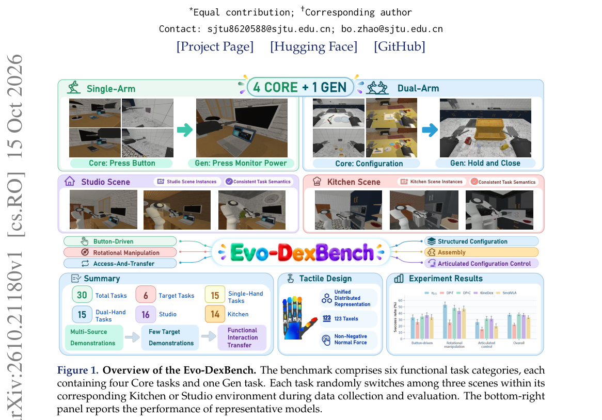

*Main result - Figure 2 Overall framework of the benchmark. The environment covers six task categories, three Kitchen/Studio scenes, 123 hand taxels, and variations in layout, cameras, lighting, and physical proper*

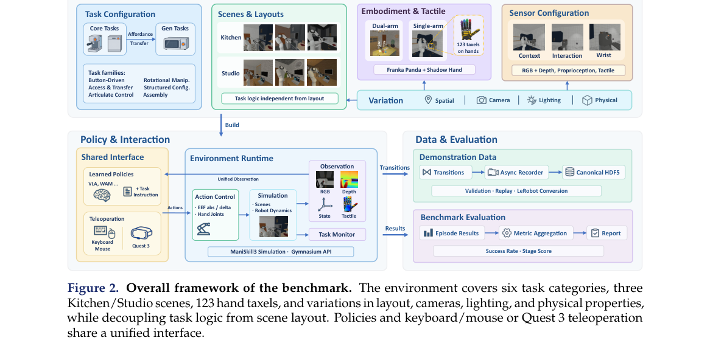

**Why this ranks #9**: wild-card：基准的两个缺陷（目标演示过多、任务差异不受控）都会被高估泛化能力。

---

### 10. Velox: Spatial Memory Makes World Models Efficient

**arXiv**: [2610.22311](https://arxiv.org/abs/2610.22311) | **Score**: 7.0 (relevance 7 x 0.7 + quality 7 x 0.3) | **Tags**: world-model | **Categories**: cs.CV | **Pages**: 22

**Authors**: Qiuhong Shen, Shizun Wang, Xinchao Wang

**Affiliation**: National University of Singapore

**Abstract**

> Video world models turn actions and camera motion into long visual rollouts, making video a natural interface for interactive simulation. Such interaction requires responsive generation, yet coherent rollouts must retain visual memory of what has already been generated. Chunked video diffusion models usually keep this context in growing KV caches, so later chunks become progressively slower. To address this bottleneck, we introduce Velox, a training-free attention router for region-level context selection using frustum slab correspondences from streaming geometry. Velox represents historical blocks as camera frustum slabs with depth intervals and obtains current-block depth through recency-priority multiwarp. For well-covered regions, frustum slab overlap softly modulates each layer's model-derived block importance. Uncovered regions retain the model-derived route without geometric bias. The fixed token-block granularity matches FlashAttention-style tiled execution and reduces the attention term that grows with rollout length. Frustum slab construction runs asynchronously with denoising on the same H200. At chunk 48, Velox accelerates attention by $4.36\times$ and denoising by $2.43\times$. On the full 158-case WBench navigation split, it remains within 0.15 API-free average points of dense LingBot-Fast-Cam. Please see our project page at https://velox-world.com/velox/ for more details.

**Key findings**

- **Finding**: 交互式仿真要求响应式生成，而连贯 rollout 必须保留**已生成内容的视觉记忆**。

- **Finding**: 分块视频扩散模型通常把这一上下文保存在……（摘要在此处截断）；Velox 用**空间记忆**提升效率。

- **Inference**: 「空间记忆」暗示世界模型可以只保留空间结构而丢弃已渲染的像素细节——因为交互需要的是「那里有什么」而非「那里曾经长什么样」。

- **Recommendation**: 与 10-14 日报的 Memory Forcing（中程遗忘）对照：一篇压缩渲染记忆、一篇解决自回归缓存的记忆不可达，两者都在处理同一类状态管理问题。

**Key figures**

*Framework / architecture - Figure 1 Three context-management paradigms for long-horizon world generation. Dense chunked generation keeps an ever-growing visual context. Frame-memory methods retrieve a small set of past views u*

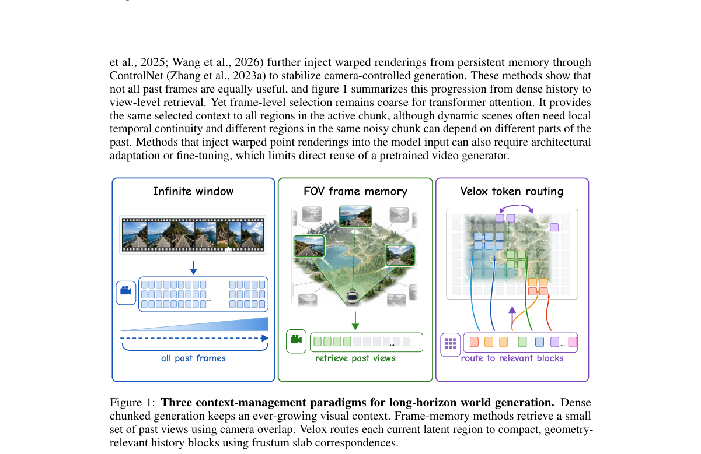

*Main result - Figure 2 Velox overview. Velox leaves the pretrained chunked video generator unchanged and re- places dense historical attention with frustum slab routed attention. Historical chunks are summarized b*

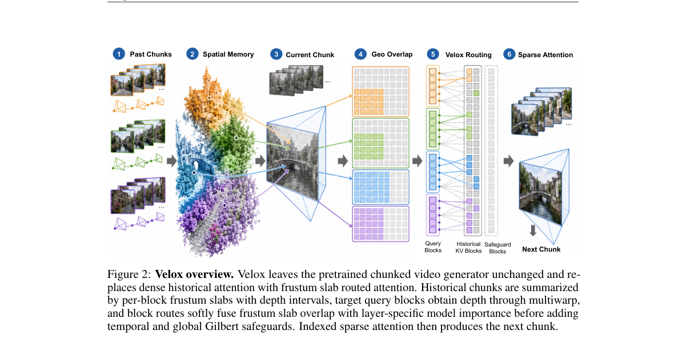

**Why this ranks #10**: 「响应速度 vs 视觉记忆」的张力是视频世界模型部署的核心矛盾。

---

## Footer

- Total papers reviewed across all 5 tracks: 51 (from 574 scanned)
- embodied track final top-10: 10
- Wild-cards in this track: 1
- Figure assets: `res/` (shared across tracks)

Generated by `mine-arxiv-daily-digest` skill. Sister file: `2026-10-16_embodied_entry.md`.
