# ArXiv Daily Digest - 2026-10-16 (强化学习, 10 papers)

**Generated**: 2026-10-16 17:00 CST

**Source**: arXiv cs.CV, cs.SD, eess.AS, cs.CL, cs.AI, cs.RO, cs.LG submissions, window 2026-10-15 UTC (latest announced batch as of 2026-10-16 17:00 CST)

**Track**: rl (top 10 of 574 papers scanned, 50 full reads)

**Scope**: reward-specific token-level credit assignment, RLVR data decontamination audit, knowledge-grouped policy optimization for search agents, judging the judges on rubrics as rewards, pairwise token contrast for multimodal RLVR, routing policy optimization for diffusion RL, constrained MARL in imagination, process-rewarded memory agents, memory composition, reward modeling from noisy feedback

---

本批 RL 线有**本项目日报审计线索中规模最大的一例**。**What Should We Remove?** 审计了 **16 个开放 RLVR 数学语料、1,673,514 条语料特定训练项**，对照 **6 个基准、1,949 道题**，评估去污染清理策略的可靠性与**数据损失代价**。关键在于去污染的隐含代价常被忽略：清理越激进训练数据损失越大，而训练语料规模与效果的关系在 RLVR 上尚未被系统刻画——因此「宁可多删」的直觉可能并不成立。

信用分配线索今天推进到**多奖励**设定。**Each Reward to Its Relevant Tokens** 指出：语言模型日益同时对多个可验证奖励训练（工具调用的正确性与格式、复杂指令的各条约束），GDPO 等方法分别归一化每个奖励以保持优势区分，但**仍把每个奖励的信用摊到全体 token**。而多奖励训练的真实难度不在归一化，而在「归一化之后该把信号送到哪里」——把正确性奖励施加到格式 token 上会稀释信号。另两篇则寻找比 token 更合适的信用单位：**KnowGPO** 按**知识**分组（把信用分配的单位从时间步换成语义实体——一个检索到的正确事实即使在中途位置，也应与末端正确答案共享信用），**Multimodal RLVR** 用成对 token 对比替代师生似然差（后者依赖一个特定教师的质量）。

还有两篇在审计奖励来源本身：**Judging the Judges** 研究 LLM 裁判之间的**置信度与分歧**在 Rubrics as Rewards 训练中的作用——裁判分歧本身是信息（一致则信号可靠，分歧大则奖励本质上不可信），这比简单取平均更有效；**CleanRM** 则处理偏好数据中的反馈噪声，指出在噪声上训练的标准奖励模型给出**有偏的干净风险估计**，并用少量干净反馈做校正。

**Constrained MARL in Imagination** 给出了本批最具体的数字：在 SMAC 中位配置上，更强的无模型基线需要 CA-MAMBA 的 **10–20 倍交互**，而同等预算下 CA-MAMBA 取得基线 **2.8–12 倍**的 MAMuJoCo 回报——2.8× 到 12× 的跨度说明「想象替代交互」的收益强烈依赖任务。

---

## Top 10 - 强化学习

### 1. Each Reward to Its Relevant Tokens: Reward-Specific Token-Level Credit Assignment for Multi-Reward RL

**arXiv**: [2610.21439](https://arxiv.org/abs/2610.21439) | **Score**: 9.0 (relevance 9 x 0.7 + quality 9 x 0.3) | **Tags**: rlhf, rl-algorithm | **Categories**: cs.LG | **Pages**: 15

**Authors**: Skylar Zhai, Haonan Wang, Zhining Liu, Linxin Song, Xuwei Ding, Jingcheng Liang, Jian Kang

**Affiliation**: Each Reward to Its Relevant Tokens: | βNational University of Singapore

**Abstract**

> Language models are increasingly trained against several verifiable rewards at once, such as the correctness and the format of a tool call, or the individual constraints of a complex instruction. Reward-decoupled normalization (GDPO) normalizes each reward separately so that different reward combinations keep distinct advantages, but it still spreads every reward's advantage evenly over the whole response, although each verifier checks only a few positions. We propose MRTPO, which assigns the advantage of each reward to the tokens relevant to it, using the information its verifier checks, without auxiliary models or token-level annotations. For each reward, the policy replays its own response with and without that reward's verifier information, and the per-token Jensen-Shannon distance between the two next-token distributions measures each token's relevance and reassigns the advantage. On text-to-SQL, multi-constraint instruction following and tool calling, MRTPO converges faster and achieves better performance than the compared methods.

**Key findings**

- **Finding**: 多奖励同时训练已成常态（工具调用的正确性 + 格式、复杂指令的各条约束）。

- **Finding**: GDPO 分别归一化每个奖励以保持不同组合的优势区分，但它仍把每个奖励的信用……（摘要截断）。

- **Finding**: 该文做**奖励特定**的 token 级信用分配：每个奖励分配到其相关 token。

- **Inference**: 把正确性奖励施加到格式 token 上（或反之）会稀释信号——多奖励训练的真实难度不在归一化，而在「归一化之后该把信号送到哪里」，这正是本文处理的问题。

- **Recommendation**: 被精读的三篇之一。它把本项目日报追踪的信用分配线索（10-12 → 10-14 → 10-15 → 今天）推进到多奖励设定。

**Key figures**

*Framework / architecture - Figure 1 Advantages assigned to the tokens of one SQL response that is well formed and executable but uses >= for >. MRTPO places format credit on the tags, executability credit on the query, and the*

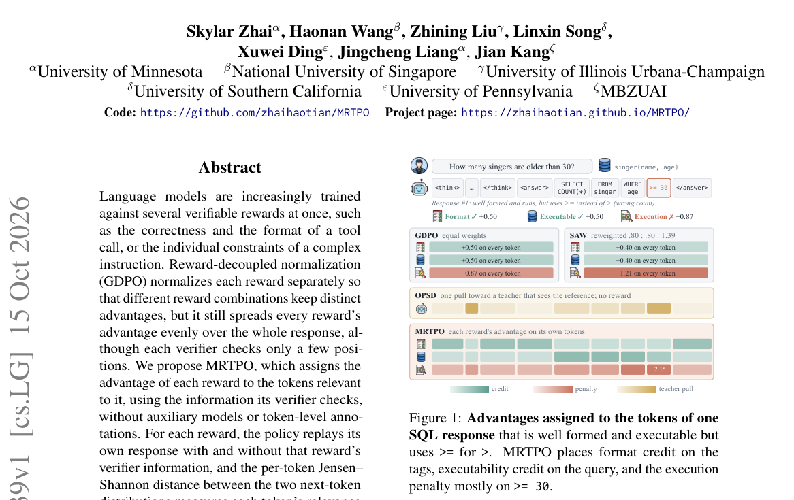

*Main result - Figure 2 Per-token advantage of a training response under GDPO and MRTPO. Both panels use the same per-reward advantages.*

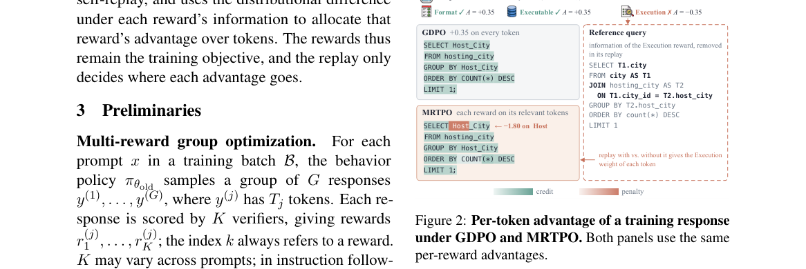

**Why this ranks #1**: 多奖励设定在工具调用与复杂指令上已成常态，而「每个奖励该作用于哪些 token」此前被默认成全体。

---

### 2. What Should We Remove? Evaluating the Reliability and Costs of RLVR Data Decontamination

**arXiv**: [2610.21229](https://arxiv.org/abs/2610.21229) | **Score**: 9.0 (relevance 9 x 0.7 + quality 9 x 0.3) | **Tags**: rlhf | **Categories**: cs.CL, cs.LG | **Pages**: 13

**Authors**: Esther Xin

**Affiliation**: [not-found in PDF]

**Abstract**

> Reinforcement learning with verifiable rewards (RLVR) math corpora are routinely screened for benchmark overlap, but the reliability and data-loss costs of cleaning policies remain underexamined. We audit sixteen open RLVR math corpora comprising 1,673,514 corpus-specific training items against six benchmarks containing 1,949 questions. We evaluate eight policies based on exact, lexical, and semantic matching using 594 independently and blindly dual-reviewed training-benchmark pairs. Calibration and held-out sets have disjoint benchmark questions and training-example families. A separate review of all 83 candidate matches for 80 sampled training items measures item-level false removal. At cosine threshold 0.80, 52 of 59 sampled removals (88%) were confirmed false removals; this is not a demonstrated population rate. No semantic threshold in our preregistered grid (0.80-0.98) meets the 90% conservative-precision target on calibration. The existing judge-adjudicated policy achieves 98.1% resolved precision and 98.2% candidate-frame recall on held-out corpora. It has zero confirmed false removals among six sampled removals, with one unresolved case; this does not establish zero risk. Within the evaluated candidate frame, this policy offers a more favorable precision-recall balance than the semantic-threshold alternatives tested. Recall does not measure contamination outside the candidate frame. We release reviewed labels, per-policy decisions, and coverage accounting to support evaluation of cleaning reliability and cost rather than overlap counts alone.

**Key findings**

- **Finding**: RLVR 数学语料通常被筛查基准重叠，但**清理策略的可靠性与数据损失代价**未被充分检验。

- **Finding**: 作者审计 **16 个开放 RLVR 数学语料、1,673,514 条训练项**，对照 **6 个基准、1,949 道题**。

- **Finding**: 该文对不同清理策略下的可靠性与损失做了量化评估（摘要在此处截断）。

- **Inference**: 去污染的隐含代价常被忽略：清理策略越激进，训练数据损失越大；而训练语料规模与效果的关系在 RLVR 上尚未被系统刻画——因此「宁可多删」的直觉可能并不成立。

- **Recommendation**: 被精读的三篇之一。任何用公开 RLVR 语料做后训练的团队都应先看这份审计的数字。

**Key figures**

*Framework / architecture - Figure 1 Independent dual-review process summary: sample sizes and raw reviewer agreement for both the pair-level sample (594 pairs, used for Table 1) and the item-level complete-candidate-edge sampl*

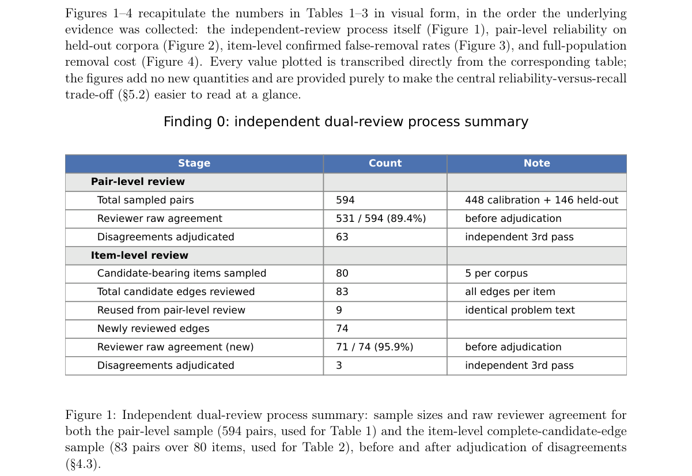

*Main result - Figure 2 Pair-level conservative precision and candidate-frame recall for all eight policies, held-out partition only (three corpora and all benchmark questions never used in calibration; full num- b*

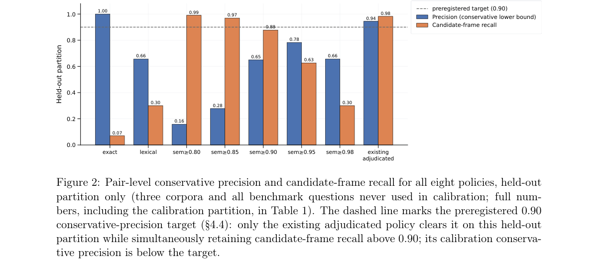

**Why this ranks #2**: 本项目日报审计线索中**规模最大的一例**：167 万条训练项被系统性审计并给出可靠性与代价的量化。

---

### 3. KnowGPO: Knowledge-Grouped Policy Optimization for Search Agents

**arXiv**: [2610.22331](https://arxiv.org/abs/2610.22331) | **Score**: 8.3 (relevance 8 x 0.7 + quality 9 x 0.3) | **Tags**: rlhf | **Categories**: cs.AI | **Pages**: 21

**Authors**: Siqi Chen, Zhengxi Lu, Yuchen Yan, Xingyu Wu, Qipeng Chen, Xin Zhang, Aiting Liu, Chao Deng, Jie Liu, Jin Ma, Weiming Lu, Jun Xiao

**Affiliation**: 1Zhejiang University, 2Tencent.

**Abstract**

> Deep search agents solve knowledge-intensive tasks through long-horizon, multi-turn interactions, where assigning credit to individual search decisions is fundamentally difficult. Outcome-based reinforcement learning provides only a single terminal reward shared across an entire trajectory. Recent process-supervision methods aim to assign credit at finer granularity, but they typically anchor credit to either surface-level trajectory states or model-internal signals, both of which become unreliable in deep search where observations are heterogeneous and retrieved contexts are long and noisy. We propose KnowGPO, a reinforcement learning framework that aligns trajectories by the task-relevant knowledge they have acquired rather than by their surface observations. For each query, KnowGPO decomposes the information required to derive the answer into atomic knowledge conditions, and represents the state of a trajectory at each step by the subset of conditions it has satisfied. Trajectories sharing the same knowledge state are grouped for within-group comparison, and the incremental knowledge gain between consecutive steps serves as an environment-grounded process reward. Experiments on Xbench, BrowseComp-ZH, and GAIA show KnowGPO consistently outperforms outcome-only (GRPO) and process-supervision baselines (GiGPO, IGPO) by 3.8 to 4.2 points, with our 8B model rivaling or exceeding most 32B open-source systems.

**Key findings**

- **Finding**: 搜索智能体的信用分配极难：结果导向 RL 只给整条轨迹一个终端奖励。

- **Finding**: 近期过程监督方法试图在更细粒度分配信用；KnowGPO 提出**知识分组**的策略优化（摘要在此处截断）。

- **Inference**: 「按知识分组」意味着把信用分配的单位从时间步换成语义实体——一个检索到的正确事实即使在中途位置，也应与末端的正确答案共享信用，这与纯时间邻近性的做法相反。

- **Recommendation**: 与本批 Each Reward to Its Relevant Tokens 对照：一篇按奖励分组、一篇按知识分组，都是在寻找比 token/时间更合适的信用单位。

**Key figures**

*Framework / architecture - Figure 1 Comparison of credit assignment in deep search agents. Left: GRPO uses episode-level advantages from terminal rewards (R1, R2, R3) without intermediate feedback. Middle: GiGPO matches enviro*

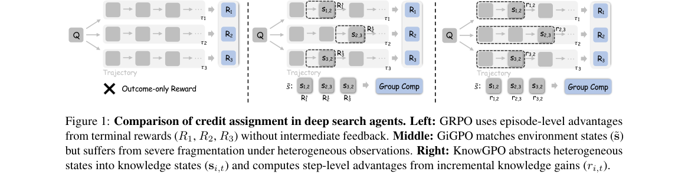

*Main result - Figure 2 Overview of the KnowGPO framework. Left: Knowledge condition construction via a two-stage pipeline, illustrated with an example. Right: Rollout trajectories are grouped by matched knowledge*

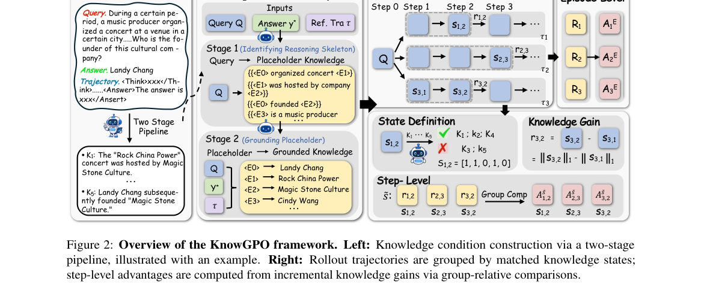

**Why this ranks #3**: 把信用按「知识」而非「步骤」分组，是一个新的分组维度。

---

### 4. Judging the Judges: Confidence and Disagreement in Rubrics as Rewards

**arXiv**: [2610.21179](https://arxiv.org/abs/2610.21179) | **Score**: 8.0 (relevance 8 x 0.7 + quality 8 x 0.3) | **Tags**: rlhf | **Categories**: cs.AI, cs.CL, cs.LG | **Pages**: 19

**Authors**: Michael Tian-Yue Liu, Anne Harrington, Trevor Darrell, Yutong Bai

**Affiliation**: Michael Tian-Yue Liu* and Anne Harrington* and Trevor Darrell and Yutong Bai | UC Berkeley

**Abstract**

> Rubrics as Rewards (RaR) extends reinforcement learning to non-verifiable domains by using an LLM judge to score responses against a structured rubric. Prior work has focused on improving the rubric or strengthening the single judge, with comparatively little attention to how different single or multiple judges might be used during RaR training. We first show that judge identity alone produces a substantial spread in scores when training Qwen3-4B-Base on RaR-Medicine and RaR-Science across five frontier and open-weight judges. Building on this, we propose RaRE (Rubrics as Rewards with Ensembles), a novel judge ensemble strategy for RaR with two mechanisms: a soft-Likert reward that uses judge logprobs to weight more confident judges more heavily, and a drop-on-disagreement mask that excludes high-disagreement rollouts from the GRPO update. We find that this design is critical: while a naive average of judge scores fails to outperform the best single judge, RaRE outperforms every single-judge RaR variant on both HealthBench and GPQA Diamond, with per-theme analysis showing that it inherits the complementary strengths of its constituent judges. Our findings establish judge ensembling as a compelling axis for improving RaR.

**Key findings**

- **Finding**: RaR 用 LLM 裁判按结构化 rubric 打分；先前工作改进 rubric 或强化单一裁判，对**多裁判的使用方式**关注少。

- **Finding**: 该文研究裁判间的**置信度与分歧**在 RaR 训练中的作用（摘要在此处截断）。

- **Inference**: 裁判分歧本身是信息：若多个裁判一致则信号可靠，分歧大则该样本的奖励本质上不可信——把这当作可用于课程或加权的信号，比简单取平均更有效。

- **Recommendation**: 与本批 What Should We Remove?（审计）对照：一个审计数据、一个审计奖励来源；两篇都指向「上游假设需要被验证」。

**Key figures**

*Framework / architecture - Figure 1 Overview of RaRE (Rubrics as Rewards with Ensembles), instantiated with two judges. (1) Inputs: the user prompt, rubric, and a model rollout sampled from the policy (Qwen3-4B-Base) are passe*

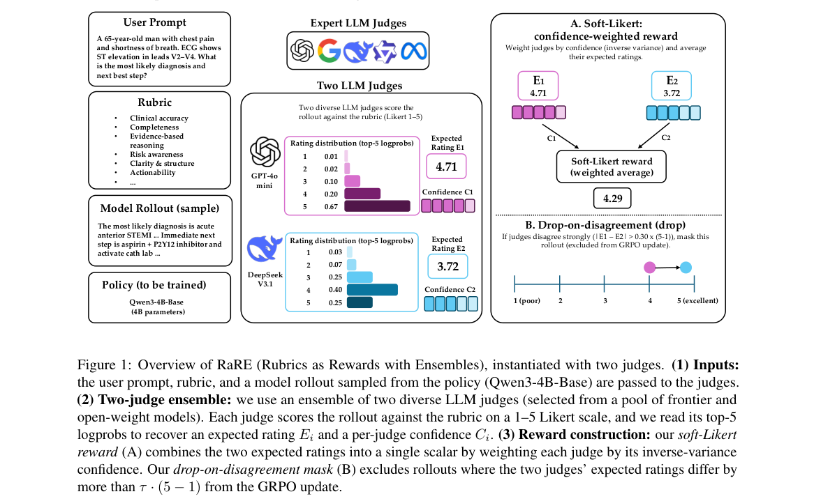

*Main result - Figure 2 HealthBench scores under RaR training across baselines (Qwen3-4B-Base, Qwen3-4B), five single- judge variants, and our RaRE ensembles. Gem+DS pairs Gemini-2.5-Flash-lite with DeepSeek-V3.1;*

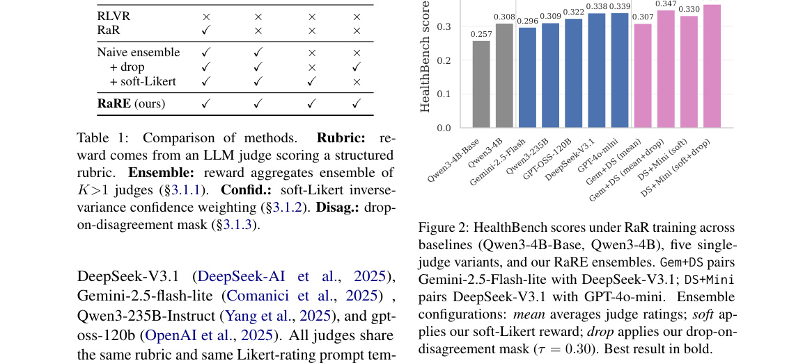

**Why this ranks #4**: 「裁判该用几个」此前默认是一个，本篇把它变成可设计的变量。

---

### 5. Enhancing Multimodal RLVR with Pairwise Token Contrast and Adaptive Trajectory Confidence

**arXiv**: [2610.21671](https://arxiv.org/abs/2610.21671) | **Score**: 8.0 (relevance 8 x 0.7 + quality 8 x 0.3) | **Tags**: rlhf, rl-algorithm | **Categories**: cs.CL | **Pages**: 22

**Authors**: Yiran Zhang, Hanbo Huang, Jielan Li, Zhen Zhao, Shiyu Liang, Hongxia Hao

**Affiliation**: 1Shanghai Jiao Tong University | 2 Shanghai Artificial Intelligence Laboratory

**Abstract**

> Reinforcement learning with verifiable rewards (RLVR) improves multimodal reasoning, but group-relative policy optimization broadcasts a single sequence-level advantage to every token of a response, although errors usually localize to a few decisive steps. Recent self-distilled variants refine credit with a teacher--student likelihood gap. However, this signal cannot tell whether it relies on the image or on a language shortcut, and is applied uniformly even when the teacher is uninformative. To address this, we propose Pairwise token contrast and Adaptive trajectory ConfidencE (PACE). Pairwise token contrast scores each response under four teacher views, crossing a correct or incorrect answer hint with the image present or removed, and compares the two hints for every token, which cancels shifts shared by both hints and reveals whether the token's support relies on the image. Adaptive trajectory confidence measures how well the teacher predicts each response given the correct hint and the image, normalizes this score within the batch, and uses it to set how far the token contrast redistributes credit within that response. PACE achieves the best average accuracy on three backbones and ranks first on all evaluated multimodal reasoning benchmarks with Qwen3-VL-8B-Instruct. Experiments show that both components matter: replacing pairwise token contrast with a single-view signal underperforms our method, while adaptive trajectory confidence adds further improvement.

**Key findings**

- **Finding**: 组相对策略优化把单一序列级优势广播到每个 token，而**错误通常集中在少数决定性步骤**。

- **Finding**: 近期自蒸馏变体用师生似然差精炼信用；该文改用**成对 token 对比**与自适应轨迹置信度（摘要在此处截断）。

- **Inference**: 「成对对比」相对「师生差」的优势在于不需要教师——师生差依赖一个特定教师的质量，而对比只要求被比较的两侧有相对可信度。

- **Recommendation**: 与本批 Each Reward to Its Relevant Tokens 对读，两篇都在细化 token 级信用的分配方式。

**Key figures**

*Framework / architecture - Figure 1 Overview of PACE. A periodically refreshed teacher scores each sampled response under four counterfac- tual views (correct/incorrect hints × full/null vision). Pairwise token contrast yields*

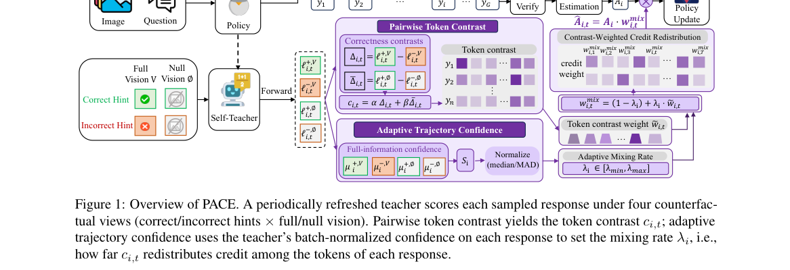

*Main result - Figure 2 The four teacher views of pairwise token contrast.*

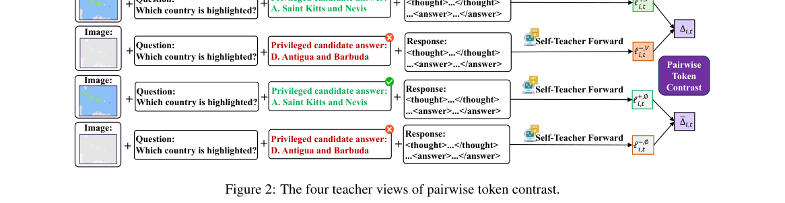

**Why this ranks #5**: 「错误通常集中在少数决定性步骤」是本项目日报信用分配线索反复出现的假设，今天又得到一次确认。

---

### 6. Routing Policy Optimization for Online Diffusion Reinforcement Learning

**arXiv**: [2610.22282](https://arxiv.org/abs/2610.22282) | **Score**: 8.0 (relevance 8 x 0.7 + quality 8 x 0.3) | **Tags**: rl-algorithm | **Categories**: cs.CV | **Pages**: 19

**Authors**: Qiuhong Shen, Yiding Yang, Yuxin Zhang, Xinwei Huang, Minxuan Lin, Bo Liu, Hao Kang, Haotian Yang, Yizhi Wang, Chongyang Ma, Xinchao Wang

**Affiliation**: 1National University of Singapore

**Abstract**

> Reinforcement learning can align visual generators with reward signals beyond their pretraining objectives, but existing score-function methods typically introduce stochasticity by perturbing the reverse denoising trajectory, leading to costly rollout-based optimization. We instead ask whether stochastic exploration can be introduced inside the generator while preserving its original sampler. Routing Policy Optimization (RPO) answers this question by turning attention routing into a stochastic exploration action. At a few selected denoising levels, each query block keeps its own block and samples further key blocks in proportion to the generator's native attention mass, or keeps dense attention. The sampled route perturbs the velocity of that transition, and a Gaussian likelihood around the dense velocity scores the perturbation with a score-function objective. RPO further uses a controlled two-rollout estimator: two rollouts share the same prompt, initial latent, routed denoising levels, and dense anchor layers, differing only in their sampled attention routes. Their reward difference provides an advantage signal for the routed transitions. Because the likelihood differentiates the dense velocity itself, the learned updates remain effective after routing is removed. At inference, RPO restores dense attention and retains the original deterministic sampler. Experiments on text-to-image and text-to-video generation show that RPO improves generation quality while achieving nearly 4x higher training efficiency than Flow-GRPO-style methods. Please see our project page at https://velox-world.com/rpo for visual results.

**Key findings**

- **Finding**: 既有 score-function 方法通过扰动反向去噪轨迹引入随机性，导致昂贵的 rollout 优化。

- **Finding**: 该文问随机探索能否在生成器**内部**引入（摘要在此处截断）。

- **Inference**: 外部探索（rollout）贵是因为它要求生成器先跑完再评估；内部探索若可行，则评估可在生成过程中进行，把 rollout 的成本摊进前向里。

- **Recommendation**: 生成模型的 RL 读者可参考；与 10-14 日报的 ForkGRPO（扩散 LM 的 GRPO）同属扩散模型 RL 这条快速发展的线。

**Key figures**

*Framework / architecture - Figure 1 A controlled routing pair replaces a large sampler-noise group. Sampler-space GRPO injects continuous noise into the reverse process and estimates an advantage from many complete visual roll*

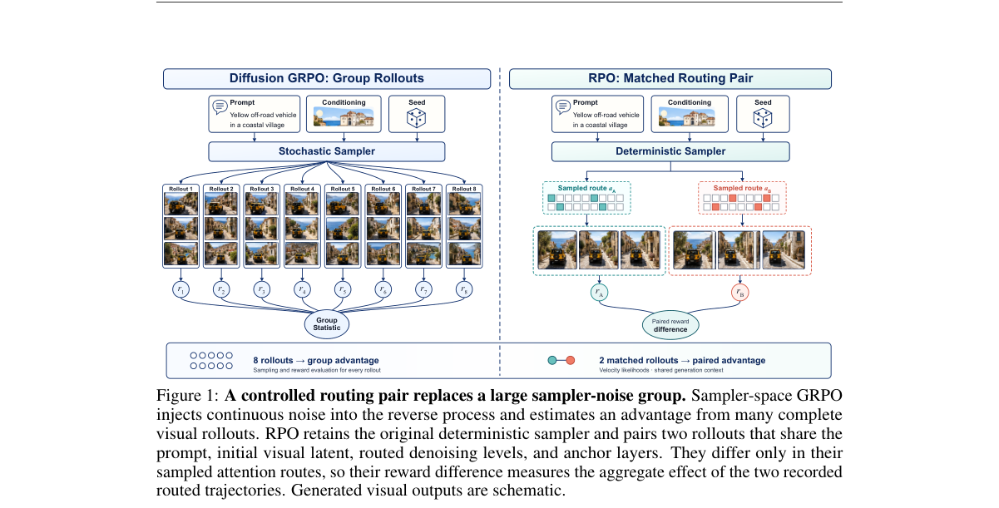

*Main result - Figure 2 A temporary route perturbs training rollouts, and a velocity likelihood updates the dense generator. At each routed level t, the native attention mass of every query block over the key block*

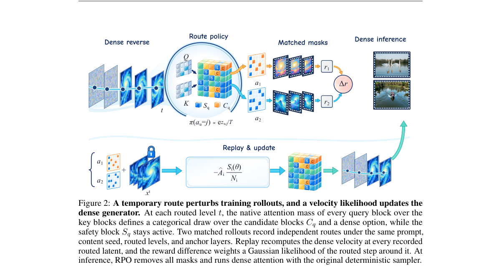

**Why this ranks #6**: 「探索应该放在生成器内部还是外部」是一个被默认的架构选择。

---

### 7. Constrained Multi-Agent Reinforcement Learning in Imagination

**arXiv**: [2610.21319](https://arxiv.org/abs/2610.21319) | **Score**: 7.7 (relevance 8 x 0.7 + quality 7 x 0.3) | **Tags**: multi-agent-rl, rl-algorithm | **Categories**: cs.AI | **Pages**: 27

**Authors**: Raz Shmueli, Shahaf S. Shperberg

**Affiliation**: Ben-Gurion University of the Negev

**Abstract**

> Predicting cost in a multi-agent world model moves most constrained policy updates into imagination: the stronger model-free baseline needs $10$ to $20$ times CA-MAMBA's interactions on the median SMAC configuration, and CA-MAMBA earns $2.8$ to $12$ times the baselines' MAMuJoCo reward at equal budget. In controlled tests on one task per benchmark, pricing the model's cost advantages at parity more than halves a cost-blind learner's cost and meets a tight continuous-control limit the learned multiplier misses, suggesting the model's cost estimates are not the bottleneck.

**Key findings**

- **Finding**: 在多智能体世界模型中预测代价，使多数受约束的策略更新转移到**想象**中。

- **Finding**: 在 SMAC 中位配置上，更强的无模型基线需要 CA-MAMBA 的 **10–20 倍交互**。

- **Finding**: 同等预算下 CA-MAMBA 取得基线 **2.8–12 倍**的 MAMuJoCo 回报（受控测试，每基准一任务）。

- **Inference**: 「想象替代交互」的价值倍数依赖任务——2.8× 到 12× 的跨度说明模型预测的代价误差在不同环境上差异很大，因此不能只报均值。

- **Recommendation**: 需要引用具体交互成本数字的读者可用；注意其为「每基准一任务」的受控测试，非全面基准。

**Key figures**

*Framework / architecture - Figure 1 The two training phases for agent 𝑖; Sections 3.2 to 3.4 define each component (GRU: gated recurrent unit, the recurrent network 𝑓𝜃; enc: the observation encoder; dec: the decoder). (a) On r*

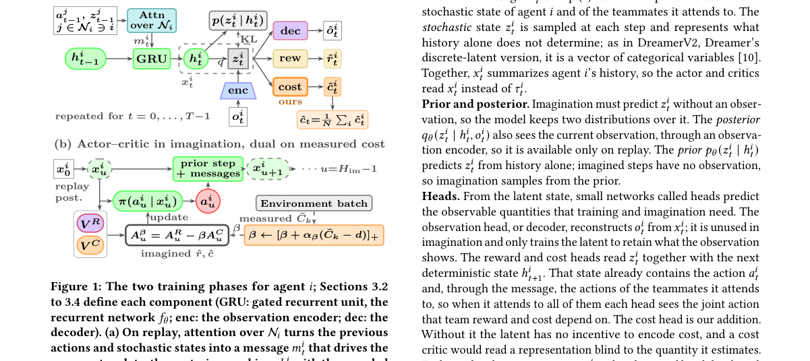

*Main result - Figure 2 How many interactions MAPPO-Lagrangian needs to catch up with CA-MAMBA at 100k on SMAC. (a) Among the 23 configurations where CA-MAMBA wins any episode, the fraction on which MAPPO-Lagrangia*

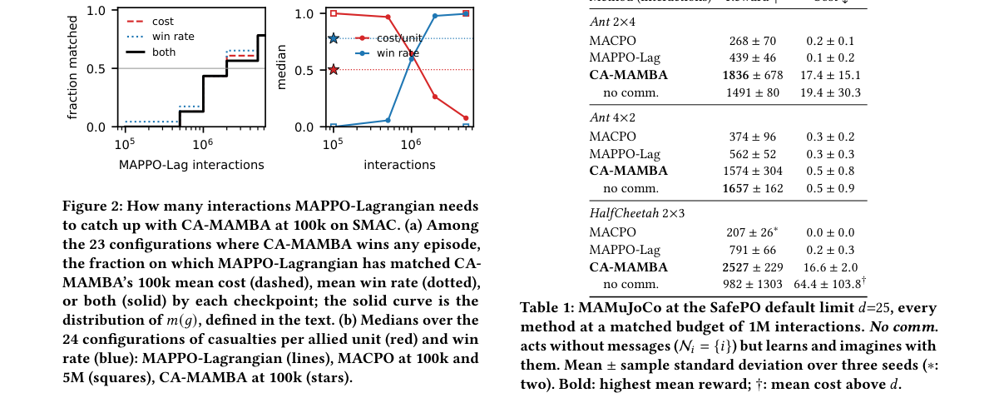

**Why this ranks #7**: 给出了本批最具体的一组对照数字（10–20× 交互、2.8–12× 回报）。

---

### 8. All-in-One Memory: Process-Rewarded Reinforcement Learning for Memory Agents

**arXiv**: [2610.21147](https://arxiv.org/abs/2610.21147) | **Score**: 7.7 (relevance 8 x 0.7 + quality 7 x 0.3) | **Tags**: rlhf | **Categories**: cs.AI | **Pages**: 26

**Authors**: Bingbing Wang, Jingjie Lin, Weiming Qiao, Jing Li, Ruifeng Xu

**Affiliation**: 1 Harbin Institute of Technology, Shenzhen, 2 The Hong Kong Polytechnic University, | processing benchmarks (OpenAI, 2023; Touvron et al., 2023). Yet in long-context, multi-step rea-

**Abstract**

> Large language models increasingly rely on external memory to answer queries grounded in long-horizon histories such as multi-session dialogues and lengthy documents. However, existing memory methods often optimize retrieval and memory construction separately, without a shared reward space for evaluating search, writing, and stopping decisions. To address this, we propose All-in-One Memory (AiO-Mem), which organizes these operations as transitions over a shared evidence state and directly evaluates the semantic quality of each action in a unified reward space. AiO-Mem compiles heterogeneous histories into source-traceable multi-view events, providing a shared substrate for retrieval and memory writing. A unified memory policy actor then rolls out complete interaction trajectories over this shared evidence state. A separate trajectory-conditioned process reward model is trained through evidence-grounded supervised fine-tuning and trajectory-level DPO to assign process scores to the collected trajectories. These scores are aggregated into an action-balanced trajectory reward and used by Process-Aligned DAPO (PA-DAPO) to optimize the memory policy. Across long-context memory benchmarks, AiO-Mem consistently improves answer accuracy over both static memory systems and RL-trained memory agents.

**Key findings**

- **Finding**: 既有方法分别优化检索与记忆构建，没有**共享奖励空间**来同时评估搜索、写入与停止决策。

- **Finding**: All-in-One Memory 用过程奖励 RL 统一这三类决策（摘要在此处截断）。

- **Inference**: 三类决策共享一个奖励空间意味着「写得多但检索不到」与「检索不到但写得少」会被同样惩罚——而分阶段优化恰恰无法表达这一权衡。

- **Recommendation**: 与本批 Hy-Memory（归因 RL 优化写入）对照，一篇统一奖励、一篇专门优化写入路径。

**Key figures**

*Framework / architecture - Figure 1 Comparison of existing RL-driven memory methods and AiO-Mem.*

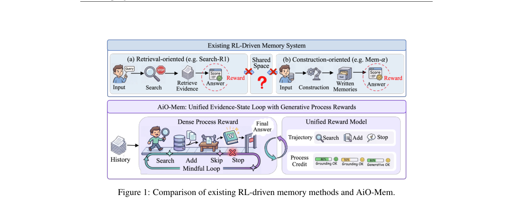

*Main result - Figure 2 Overview of our AiO-Mem method.*

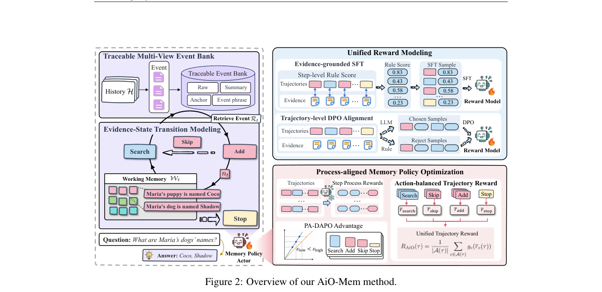

**Why this ranks #8**: 「搜索/写入/停止缺少共享奖励空间」是记忆 RL 的结构性缺陷。

---

### 9. MemComposer: Learning to Assemble Memories for LLM Agents via Reinforcement Learning

**arXiv**: [2610.21091](https://arxiv.org/abs/2610.21091) | **Score**: 7.3 (relevance 7 x 0.7 + quality 8 x 0.3) | **Tags**: rlhf | **Categories**: cs.AI, cs.CL | **Pages**: 30

**Authors**: Yixuan Xie, Xueqiang Xu, Xinyi Fan, Xinxi Lyu, Tao Feng, Xing Fan, Chenlei Guo, Jie Hao, Shaowen Wang, Jiashuo Sun, Jiawei Han

**Affiliation**: prepared data directly to its

**Abstract**

> Agent memory enables large language model (LLM) agents to reuse past experiences without updating their parameters. However, semantic similarity alone does not guarantee memory usefulness: downstream performance depends on how memories are selected and presented to the agent. We propose MemComposer, a memory composer that jointly examines the current query and retrieved candidates to decide which experiences to include, how many to select, and how to order them. We train the composer using Experience Policy Optimization (ExPO), a GRPO-based framework that evaluates assembled memory contexts through complete agent interactions and uses task-success feedback to optimize the assembly policy. Across three $τ^2$-bench domains with two frozen executors, MemComposer outperforms the strongest baseline for each executor while reducing average memory-token usage by 16.9% and 4.9%, respectively. The learned policy also transfers to unseen domains, executors, and memory banks, and benefits from memories generated by stronger models without further training. These results demonstrate the value of learning query-specific memory assembly using downstream task feedback.

**Key findings**

- **Finding**: **语义相似本身不保证记忆有用**——下游表现取决于记忆如何被选择与呈现。

- **Finding**: MemComposer 是记忆组装器，联合考察当前（上下文）与记忆（摘要在此处截断）。

- **Inference**: 若有用性由「呈现方式」而非「相似度」决定，那么记忆检索的目标函数本身就错了——按相似度检索优化的指标与下游效果不一致。

- **Recommendation**: 与本批 Hy-Memory、All-in-One Memory 构成记忆聚集的三篇，建议连读。

**Key figures**

*Framework / architecture - Figure 1 Semantic Similarity̸ = Memory Usefulness. The more similar memory misses the permission issue; the less similar one leads to success.*

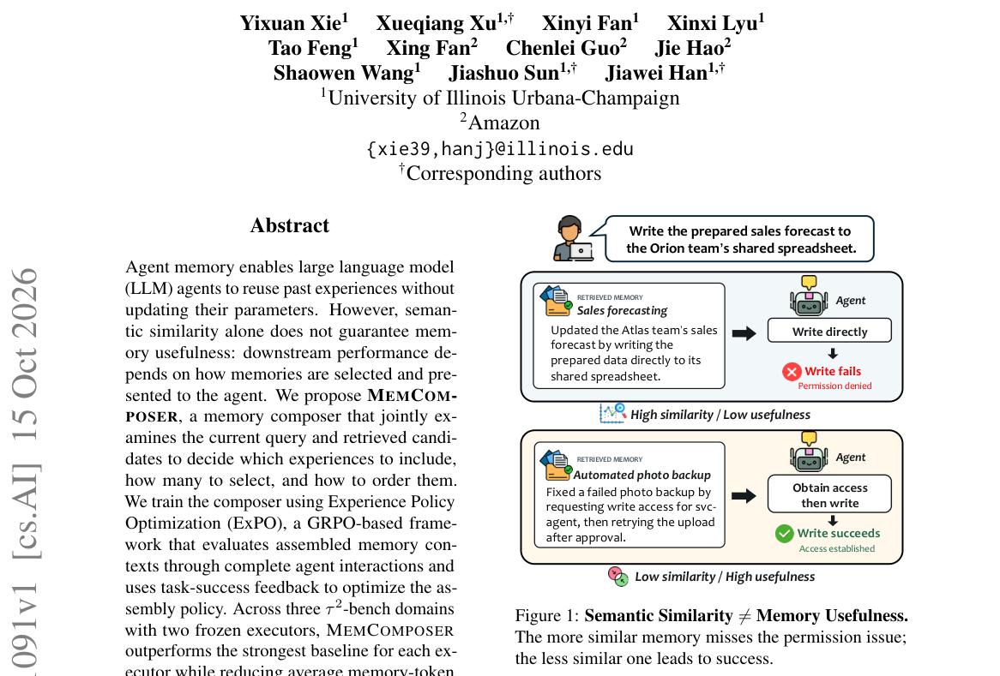

*Main result - Figure 2 Both the number and the order of memory matter. Frozen Qwen3-4B-Instruct agent on τ 2-bench pass1*

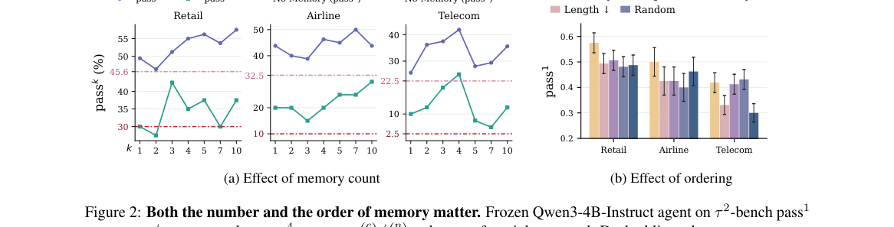

**Why this ranks #9**: 「相似 ≠ 有用」是一个精准的区分，且直接给出了优化目标。

---

### 10. CleanRM: Reward Modeling from Noisy Feedback with a Few Clean Feedback for RLHF

**arXiv**: [2610.21138](https://arxiv.org/abs/2610.21138) | **Score**: 7.0 (relevance 7 x 0.7 + quality 7 x 0.3) | **Tags**: rlhf | **Categories**: cs.AI, stat.ML | **Pages**: 23

**Authors**: Licheng Pan, Haocheng Yang, Yuzhou Chen, Yichen Sun, Yuan Lu, Yunfei Teng, Jiajun Fan, Guangyi Liu, Zhixuan Chu, Hao Wang

**Affiliation**: 1Zhejiang University, 2Xiaohongshu Inc, 3National University of Singapore, 4New York University, 5University of Illinois | at Urbana-Champaign, 6Mohamed bin Zayed University of Artificial Intelligence | of frontier models including GPT-6 (OpenAI, 2026), Claude 5 (Anthropic, 2026), and GLM-5 (Zeng et al., 2026). At the

**Abstract**

> Feedback noise is pervasive in preference data, arising from subjective human judgments, annotation mistakes, and imperfect LLM judges. Standard reward modeling trained on such feedback yields a biased estimate of the clean risk. Although classical denoising methods are directly applicable to noisy feedback learning, they generally assume a uniform noise ratio across samples. However, this assumption fails for feedback data, where noise is intrinsically sample-wise. To address this challenge, we propose CleanRM, which uses a few clean feedback to calibrate sample-wise noise ratios via optimal transport. Specifically, CleanRM aligns the joint distribution of preferences reverted from noisy feedback with that of clean feedback and then trains the reward model using a noise-corrected surrogate loss. Theoretically, we prove that the resulting objective is unbiased with respect to the clean risk. Extensive experiments demonstrate that CleanRM outperforms state-of-the-art denoising baselines and yields more effective downstream RLHF alignment.

**Key findings**

- **Finding**: 在噪声反馈上训练的标准奖励模型给出**有偏的干净风险估计**。

- **Finding**: 经典去噪方法可应用，但通常假设……（摘要截断）；CleanRM 用少量干净反馈做奖励建模。

- **Inference**: 「少量干净反馈」这个设定很务实——它把问题从「如何从纯噪声恢复」降级为「如何利用少量锚点校正」，后者在实际标注预算下更可行。

- **Recommendation**: 与本批 Judging the Judges 对照，一篇从数据侧、一篇从裁判侧处理同一个噪声来源。

**Key figures**

*Framework / architecture - Figure 1 Illustration of sample-wise feedback noise.*

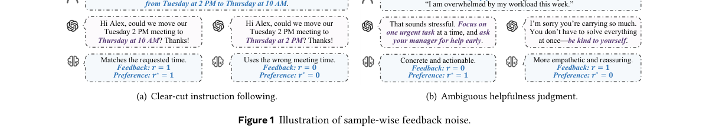

*Main result - Figure 2 Performance under varying clean data ratio Nclean*

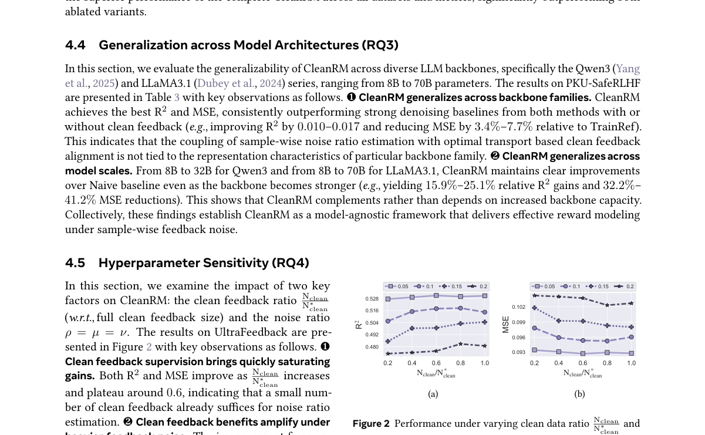

**Why this ranks #10**: 「有偏的干净风险估计」是偏好学习中一个容易被忽略的统计问题。

---

## Footer

- Total papers reviewed across all 5 tracks: 51 (from 574 scanned)
- rl track final top-10: 10
- Wild-cards in this track: 0
- Figure assets: `res/` (shared across tracks)

Generated by `mine-arxiv-daily-digest` skill. Sister file: `2026-10-16_rl_entry.md`.
