# ArXiv Daily Digest - 2026-10-19 (AIGC 音频生成与编辑, 10 papers)

**Generated**: 2026-10-19 17:00 CST

**Source**: arXiv cs.CV, cs.SD, eess.AS, cs.CL, cs.AI, cs.RO, cs.LG submissions, window 2026-10-16 UTC (latest announced batch as of 2026-10-19 17:00 CST)

**Track**: aigc_audio (top 10 of 429 papers scanned, 50 full reads)

**Scope**: conditioning, domains and failure modes of Qwen3-TTS, one-stage single-step TTS via generative drifting, semantic-critical regions for video-to-audio generation, one-step bandwidth extension, identity-masked music understanding benchmark, magnitude compression in DDSP spectral losses, spoof-detection interpretability, emotion-shift failure modes in deepfake detectors, memory-efficient RNN-T, leakage-audited arousal forecasting

---

本批音频线**明显好转**：有真实 TTS 与视频到音频生成工作（昨天的 aigc_audio 有 9 个 wild-card，今天只有 3 个）。

**Beyond the Benchmark: Qwen3-TTS** 是本线第一篇，也是本项目日报审计线索的又一例，但这次对象是一个旗舰开源模型本身。作者指出 Qwen3-TTS 的技术报告留下了三个未回答的问题：**模型应当如何被条件化**、在朗读语音之外表现如何、以及如何失败；并刻画其两种克隆接口（ICL 与 X-Vector），与 Chatterbox、XTTS-v2、F5-TTS 对比。其中「在朗读语音之外表现如何」是最少被测的条件——基准几乎都用朗读语料，而真实使用场景多为自然口语，因此这一项的结论直接决定可用性。

**DriftTTS** 给出了单步 TTS 的第三条实现路径：既有做法要么从多步教师蒸馏、要么在预训练模型上加一个阶段，而它试图直接训练出单阶段单步模型——这与 10-16 日报「是否过度思考一步生成」的质疑形成正反两面。

评测侧有本批的第二条审计线：**MUB** 用**身份遮蔽**的录音构建音乐理解基准，直接切断「搜一下这首歌叫什么再看答案」这条捷径（音乐有强唯一标识，这类泄漏极常见）；**Leakage-Audited Arousal Forecasting** 按**完整歌曲**留出，防止模型靠记忆片段而非预测趋势得分。两篇与本批 RL 线的 Grounded Credit Assignment 属于同一类工作：**先问基准能否被绕过，再谈能力**。

**EmoShift** 则揭示了一对矛盾目标：表达力语音合成已能在单条话语内改变情绪，而深伪检测器若学到「情绪稳定」这一统计特征，只需在话语内改变情绪即可绕过——情绪可控性与深伪检测在技术上直接冲突。

---

## Top 10 - AIGC 音频生成与编辑

### 1. Beyond the Benchmark: Conditioning, Domains and Failure Modes of Qwen3-TTS

**arXiv**: [2610.23678](https://arxiv.org/abs/2610.23678) | **Score**: 9.0 (relevance 9 x 0.7 + quality 9 x 0.3) | **Tags**: AIGC-audio | **Categories**: cs.CL, cs.SD | **Pages**: 5

**Authors**: Séverin Baroudi, Yanis Labrak, Petr Motlicek, Hervé Bredin, Ricard Marxer

**Affiliation**: 1Univ Toulon, Aix Marseille Univ, LIS, CNRS, France; 2Mila – Quebec AI Institute | 3Idiap Research Institute, Martigny, Switzerland; 4Brno University of Technology, Brno, Czech Republic

**Abstract**

> Qwen3-TTS reports state-of-the-art zero-shot voice cloning, but its technical report leaves open how the model should be conditioned, how it behaves outside read speech, and how it fails. We characterise its two cloning interfaces, in-context learning (ICL) and X-Vector, against Chatterbox, XTTS-v2 and F5-TTS on read, meeting, emotional and air-traffic-control (ATC) speech, using eighteen objective measures, an LLM judge, a spoofing countermeasure and a listening test. Neither interface dominates: ICL clones timbre more closely from correctly transcribed references, X-Vector clones timing, and ICL degrades sharply when a short reference transcript is wrong. Domain explains four times more variance than system choice. Qwen3-TTS leads on intelligibility and pitch register but trails on prosody, and the objective measures rank systems differently from listeners. An off-the-shelf countermeasure flags its clones no more often than genuine recordings, and on ATC radio it fails for every system. Code and audio are released.

**Key findings**

- **Finding**: Qwen3-TTS 技术报告留下了三个未答问题：如何条件化、在朗读语音之外的表现、如何失败。

- **Finding**: 作者刻画其两种克隆接口（上下文学习 ICL 与 X-Vector），并与 Chatterbox、XTTS-v2、F5-TTS 对比（摘要在此处截断）。

- **Inference**: 「在朗读语音之外表现如何」是零样本 TTS 最少被测的条件——基准几乎都用朗读语料，而真实使用场景多为自然口语，因此这一项的结论直接决定可用性。

- **Recommendation**: 被精读的三篇之一。选型前用它作为替代评测，比直接采信技术报告的 SOTA 数字更可靠。

**Key figures**

*Framework / architecture - Figure 1 Hallucination rate of Qwen3-TTS ICL against reference tran- script length (shifted condition).*

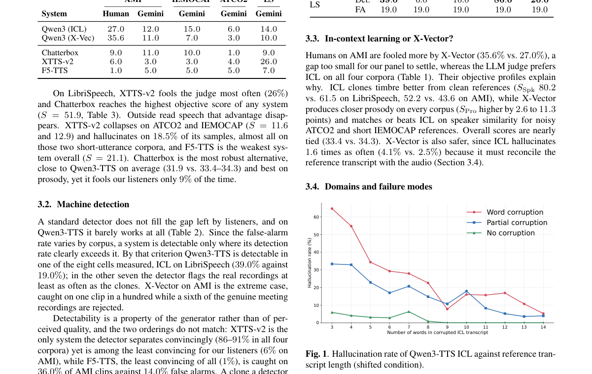

**Why this ranks #1**: 本批音频生成第一篇，也是本项目日报审计线索的又一例：对象是一个旗舰开源模型本身。

---

### 2. DriftTTS: One-stage Single Step Text-to-Speech via Generative Drifting

**arXiv**: [2610.22960](https://arxiv.org/abs/2610.22960) | **Score**: 8.7 (relevance 9 x 0.7 + quality 8 x 0.3) | **Tags**: AIGC-audio | **Categories**: cs.SD | **Pages**: 5

**Authors**: Jaehyun Ahn, Dohyun Kim, Heeseung Kim

**Affiliation**: Department of AI, University of Seoul, Seoul, South Korea

**Abstract**

> Text-to-speech models built on score matching and flow matching produce natural speech, but only by calling the decoder many times, which makes synthesis slow. Existing ways to cut the number of calls either distill from a multi-step teacher or add a stage on top of a pretrained model, leaving single-step TTS without a pretrained TTS model unexplored. We question whether pretraining a TTS model is necessary, and propose DriftTTS, which adopts generative drifting, an objective that moves iterative sampling from inference into training. Drifting assumes samples of fixed shape, whereas speech has variable length; we address this issue with segment drifting. On LJSpeech, DriftTTS matches the multi-step quality of Matcha-TTS and RapFlow-TTS in a single decoder call, while being faster. To our knowledge, this is the first application of generative drifting to text-to-speech.

**Key findings**

- **Finding**: 流匹配 TTS 需多次调用解码器；减步做法此前是**从多步教师蒸馏**或**在预训练模型上加一个阶段**（摘要截断）。

- **Finding**: DriftTTS 用生成式漂移实现单阶段单步 TTS（摘要在此处截断）。

- **Inference**: 既有两条路都保留了预训练模型并在其周围改造，而生成式漂移试图直接训练出单步模型——这与 10-16 日报「是否过度思考一步生成」的质疑同属对一步生成可行性的重新评估。

- **Recommendation**: 与 10-16 日报的 Are We Overthinking One-Step Generation? 对读，两篇是一步生成路线上的正面建构与反向质疑。

**Key figures**

*Framework / architecture - Figure 1 Overview of DriftTTS during training. The text en- coder and MAS construct the prior sample ϵ = µ by repeat- ing each token representation according to its duration, and the decoder maps it to*

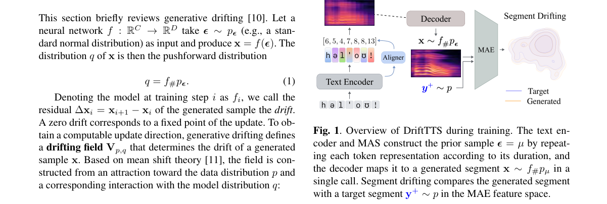

*Main result - Figure 2 Evolution of the generated distribution toward the tar- get distribution during training. Each panel flattens a fixed 80- frame log-mel segment from every evaluation utterance and projects it*

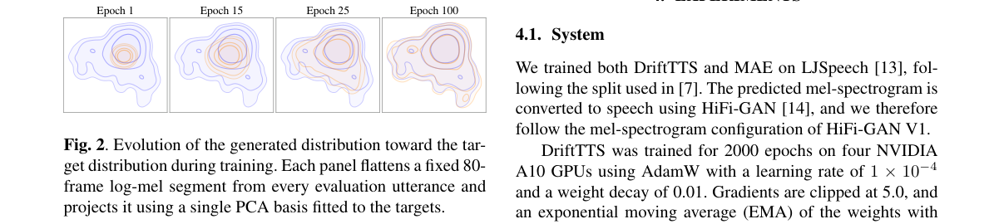

**Why this ranks #2**: 「单步 TTS」的第三种实现路径——不是蒸馏也不是叠加。

---

### 3. Semantic-Critical Regions for Video-to-Audio Generation

**arXiv**: [2610.23021](https://arxiv.org/abs/2610.23021) | **Score**: 8.0 (relevance 8 x 0.7 + quality 8 x 0.3) | **Tags**: AIGC-audio, AIGC-video | **Categories**: cs.CV, cs.MM, cs.SD, eess.AS | **Pages**: 11

**Authors**: Yun Fang, Wei Guo, Zhuonan Liang, Heng Wang, Weidong Cai

**Affiliation**: The University of Sydney | Sydney, Australia

**Abstract**

> In real-world videos, sound events are often associated with localized and fine-grained visual cues, such as object motion, object-part dynamics, contact events, and interactions between objects. Existing video-to-audio (V2A) methods employ implicit conditioning based on global visual representations or explicit control derived from temporal and spatial cues. However, subtle sound-producing and sound-indicative interactions remain insufficiently captured, leaving room for more precise visual conditioning of sound-event semantics and temporal dynamics. Motivated by this observation, we refer to regions containing such sound-relevant visual evidence as Semantic-Critical Regions (SCRs) and introduce SCR-V2A, a V2A generation framework that explicitly localizes and encodes SCRs as fine-grained visual guidance for audio generation. Specifically, we first identify SCRs through sound-related visual localization. We then transform the localized regions into a control representation through adapter-based dual visual encoding, which jointly captures global visual context and fine-grained sound-relevant evidence. The representation is used to condition a downstream audio generation model. Experiments on both in-domain and out-of-domain benchmarks demonstrate that SCR-V2A achieves strong performance in distribution matching and audio quality while remaining competitive in cross-modal alignment and requiring few trainable parameters. These results highlight the value of prioritizing fine-grained, sound-relevant visual regions for V2A generation.

**Key findings**

- **Finding**: 声音事件常与**局部化**视觉线索关联（运动、部件动态、接触、交互）；既有 V2A 用全局表示的隐式条件或显式……（摘要截断）。

- **Finding**: 该文提出语义关键区域（摘要在此处截断）。

- **Inference**: 全局视觉条件把「画面里有什么物体」与「什么在发声」混在一起，因此难以处理同类多物体场景；关键区域条件把发声部位与视觉区域显式对齐。

- **Recommendation**: 与 10-16 日报 Spatial Audio-Visual LLM（丢弃空间线索）对照，两篇都在同一问题的两侧。

**Key figures**

*Framework / architecture - Figure 1 SCR regions highlight fine-grained visual evidence associated with sound-producing events.*

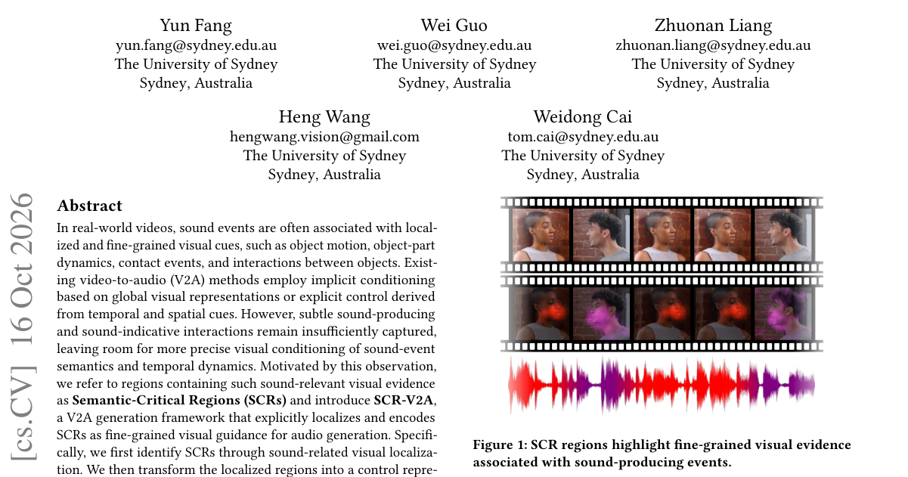

*Main result - Figure 2 Overview of SCR-V2A. Our method formulates Semantic-Critical Regions (SCRs) as the control for V2A generation. The SCRs are identified through Sound-Related Visual Localization, transformed*

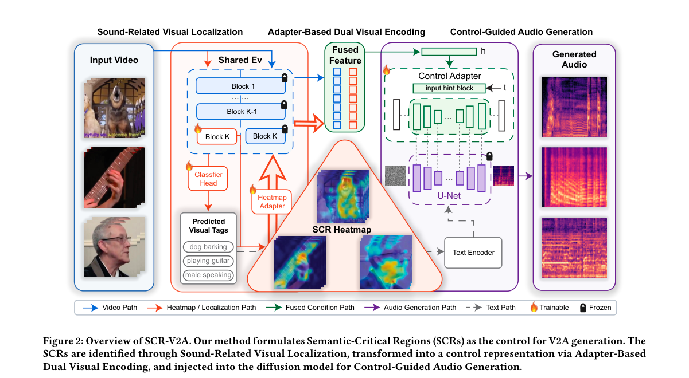

**Why this ranks #3**: 「声音来自物体的哪个部位」比全局视觉条件更接近声音的物理来源。

---

### 4. Bridge, Distill, Refine: High-Fidelity One-Step Generation for Multi-Bandwidth Speech Extension

**arXiv**: [2610.22910](https://arxiv.org/abs/2610.22910) | **Score**: 7.7 (relevance 8 x 0.7 + quality 7 x 0.3) | **Tags**: AIGC-audio | **Categories**: eess.AS | **Pages**: 5

**Authors**: Zhiqi Ai, Xu Shen, Mou Wang, Yongjin Zhou, Shugong Xu

**Affiliation**: 1Shanghai University, Shanghai, China | 3Xi’an Jiaotong Liverpool University, Suzhou, China | 4Waseda University, Japan

**Abstract**

> Speech bandwidth extension (BWE) aims to recover missing spectral content from band-limited speech. However, most generative BWE methods are designed for fixed input bandwidths and rely on iterative sampling, limiting their flexibility and efficiency. We propose BDR-BWE, a three-stage generative framework for multi-bandwidth speech extension. First, to enable conditional generation from the observed band-limited spectrum, we design a cutoff-aware conditional flow bridge in the compressed complex STFT domain, focusing generation on the missing high-frequency band while preserving observed spectral information. Second, progressive consistency distillation compresses the multi-step flow transport into a one-step generator. Third, adversarial refinement further improves high-frequency detail and harmonic coherence. BDR-BWE achieves state-of-the-art log-spectral distance (LSD) on VCTK across all evaluated bandwidths with one-step inference, while maintaining competitive perceptual quality and generalizing well to EARS. Audio samples are available at https://aizhiqi-work.github.io/bdr-bwe-demo.

**Key findings**

- **Finding**: 多数生成式 BWE 方法为**固定输入带宽**设计并依赖迭代采样（摘要截断）。

- **Finding**: BDR-BWE 是三阶段生成式框架（摘要在此处截断）。

- **Inference**: 固定带宽假设在真实通话中不成立——设备与网络条件各异，因此多带宽自适应是部署必需而非加分项。

- **Recommendation**: 语音增强的读者可参考；与本批 DriftTTS（单步）同属「减少迭代采样」的路线。

**Key figures**

*Framework / architecture - Figure 1 Overview of BDR-BWE. Stage 1 learns a cutoff-aware flow bridge for multi-bandwidth spectral reconstruction. Stage 2 progressively distills the multi-step trajectory into few-step generators. S*

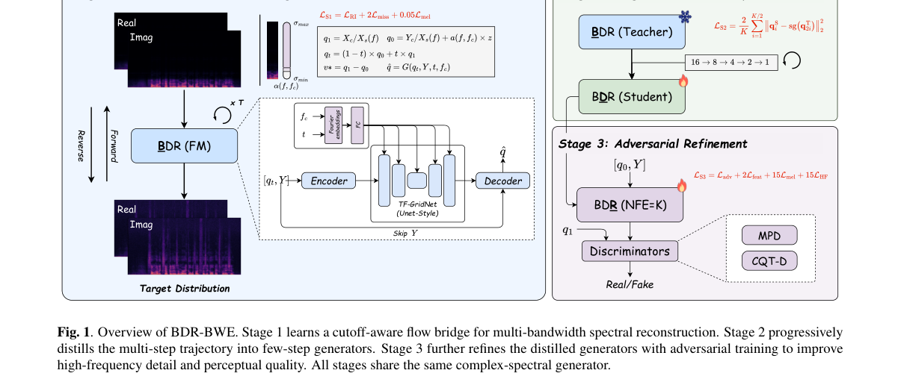

**Why this ranks #4**: 「为固定带宽设计」是一个把部署条件写进架构的限制。

---

### 5. MUB: An Identity-Masked Benchmark for Music Understanding in Multimodal Language Models

**arXiv**: [2610.22989](https://arxiv.org/abs/2610.22989) | **Score**: 7.7 (relevance 8 x 0.7 + quality 7 x 0.3) | **Tags**: AIGC-audio | **Categories**: cs.SD | **Pages**: 9

**Authors**: Kun Liu, Lyra Tao

**Affiliation**: [not-found in PDF]

**Abstract**

> Evaluating musical perception in multimodal language models requires separating audio evidence from answers recoverable through metadata or external tools. We present the Music Understanding Benchmark (MUB), a locally assembled collection of 500 identity-masked recordings with existing annotations for tempo, key, time signature, and structural intervals. The collection covers all 24 major/minor key combinations, tempos of 47--180 beats per minute, and 4,676 annotated intervals. Original titles, artists, and platform identifiers are excluded from evaluation inputs. Relative to recent music question-answering and temporal-grounding work, MUB emphasizes scalar tempo prediction and full-recording interval outputs, together with a documented metadata-masking protocol. Saved baseline predictions yield 53.6\% tempo accuracy for a simple DSP estimator and 98.4\% time-signature accuracy for a constant 4/4 predictor. We identify important limitations, including an asymmetric legacy key metric, unverified independent annotation agreement, extreme metre imbalance, and unresolved recording-level rights clearance. No contemporary multimodal language model comparison has yet been completed. MUB is therefore an evaluation resource and protocol under validation, rather than a completed demonstration of model capabilities.

**Key findings**

- **Finding**: 评估音乐感知需把音频证据与元数据/外部工具可恢复的答案分离。

- **Finding**: MUB 是 500 条**身份遮蔽**录音的集合，带速度等既有标注（摘要在此处截断）。

- **Inference**: 身份遮蔽直接切断了「搜一下这首歌叫什么再看答案」这条捷径——这类泄漏在音乐理解基准中极为常见，因为音乐有强唯一标识。

- **Recommendation**: 与本批 2610.23063（泄漏审计的唤醒度预测）同属「先堵住泄漏再谈能力」的评测设计。

**Key figures**: 无可用图示（正文以表格与证明为主）。

**Why this ranks #5**: 「遮蔽身份」是本项目日报审计线索中一个熟悉的做法——让模型无法绕过音频本身。

---

### 6. Too Emotional to Be Fake? Intra-Utterance Emotion Shifts Expose Failure Modes in Speech Deepfake Detectors

**arXiv**: [2610.22832](https://arxiv.org/abs/2610.22832) | **Score**: 7.3 (relevance 7 x 0.7 + quality 8 x 0.3) | **Tags**: AIGC-audio | **Categories**: cs.CL, cs.SD | **Pages**: 15

**Authors**: Jingyi Chen, Surya Koppisetti

**Affiliation**: [not-found in PDF]

**Abstract**

> Expressive speech synthesis can now change emotion within a single utterance, yet its impact on deepfake detection remains unclear. We introduce EmoShift, a benchmark comparing emotion-stable (AA) and emotion-changing (AB) speech to examine these effects while accounting for static emotion identity and acoustic confounds. It comprises 7,240 bona fide utterances from four source datasets and 9,720 synthetic utterances generated using four expressive TTS systems. Across seven detectors, we find that emotion changes can make synthetic speech appear more genuine, increasing spoof miss rates by up to 25.3 percentage points on OMG-Emotion at fixed thresholds. Conversely, emotion-changing bona fide speech increases false-alarm rates by up to 24.4 percentage points on IEMOCAP. Further analyses reveal detector-specific sensitivities to emotion trajectories, not fully explained by static emotion identity or splicing artifacts. These findings underscore the importance of emotion dynamics in deepfake detection.

**Key findings**

- **Finding**: 表达力语音合成已能在**单条话语内**改变情绪，其对深伪检测的影响不清楚。

- **Finding**: EmoShift 比较情绪稳定（AA）与情绪变化（AB）语音，并控制静态情绪身份与声学条件（摘要在此处截断）。

- **Inference**: 检测器若学到了「情绪稳定」这一统计特征，则表达力 TTS 只需在话语内改变情绪即可绕过——这解释了为何情绪可控性与深伪检测构成一对矛盾目标。

- **Recommendation**: 与 10-16 日报的 Voice Anonymization 多语攻击评测、10-12 的 UTMOS 口音偏见构成语音系统的评测链条。

**Key figures**

*Framework / architecture - Figure 1 Benchmark construction. Each spoof follows the text and emotion targets of its bona fide source. ∆BF and ∆SP measure the (A→B)–(A→A) score difference within each class.*

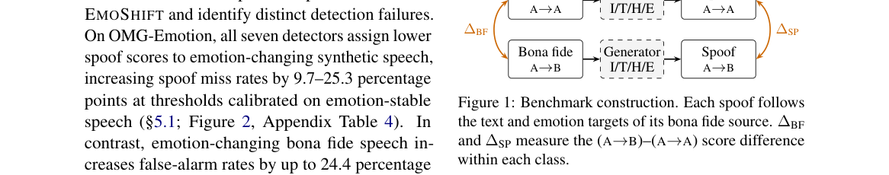

*Main result - Figure 2 Detector score shifts from emotion-stable (A→A) to emotion-changing (A→B) speech. Left: mean logit score differences for synthetic (∆SP) and bona fide (∆BF) speech; bold indicates 95% CIs ex*

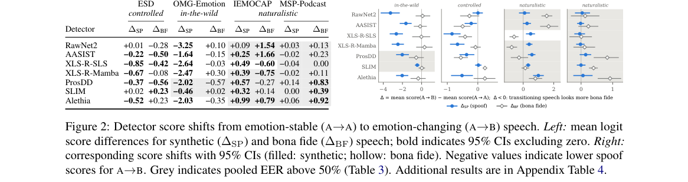

**Why this ranks #6**: 「单条话语内的情绪变化」是表达力 TTS 带来的新攻击面。

---

### 7. Rethinking Magnitude Compression in Spectral Losses for DDSP Parameter Estimation

**arXiv**: [2610.22962](https://arxiv.org/abs/2610.22962) | **Score**: 7.0 (relevance 7 x 0.7 + quality 7 x 0.3) | **Tags**: AIGC-audio | **Categories**: cs.SD | **Pages**: 5

**Authors**: Byunghoo Park, Jayeon Yi, Minje Kim

**Affiliation**: University of Illinois Urbana-Champaign, Siebel School of Computing and Data Science, USA 61801

**Abstract**

> Spectral losses for differentiable digital signal processing (DDSP) commonly compress magnitudes, for example by using log-magnitude terms. Such compression mimics human perception, but whether it helps the optimization is less clear, and is usually found only by comparing trained models. In this work, we show that whether compression helps depends on the system's informative region: the region of its dynamic range that carries the information pointing toward the target. To indicate where this region lies without having to train, we introduce concordance, which measures how well a loss orders candidate parameter settings by their distance from the target. We then compare uncompressed, compressed, and combined losses by fitting a modal plate reverb and a subtractive synthesizer model to target sounds. A third system, selected for its low-energy informative region, tests the relationship in the opposite direction. In every system, the loss that matches the informative region performs best: the uncompressed one where the region lies at high energies, and the compressed one where it lies low. Surprisingly, the common combination of both log-magnitude and linear-magnitude terms performs best in none of the systems. Code and audio examples are available at https://github.com/superstem000/compression-analysis

**Key findings**

- **Finding**: 谱损失常压缩幅度（如对数项）以模仿人类感知，但它**是否有助于优化**并不清楚，且通常只靠训练后比较才发现（摘要截断）。

- **Finding**: 该文重新思考 DDSP 参数估计中谱损失的幅度压缩（摘要在此处截断）。

- **Inference**: 这是一个「损失函数设计直觉」被系统性检验的案例：对数压缩在感知上合理，但对参数回归而言可能抹掉了幅度的高值区，而那恰是决定音质与参数精度的部分。

- **Recommendation**: 做音频参数化合成的读者注意；结论对其他「感知加权损失」同样有参考价值。

**Key figures**

*Framework / architecture - Figure 1 Log concordance as the loss is restricted to bins within F dB of the target’s peak. The rightmost point, past the dotted line, is the unrestricted loss.*

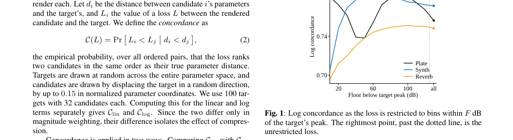

*Main result - Figure 2 Listening test ratings of overall similarity to the reference, over 12 items and seven listeners. Error bars are 95% confidence intervals pooled over all ratings.*

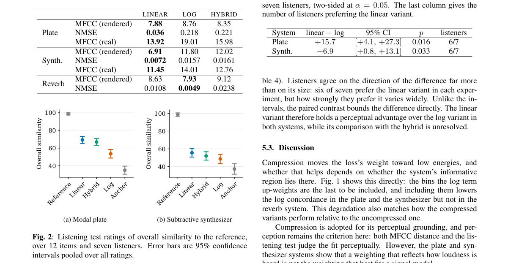

**Why this ranks #7**: 「模仿感知」被默认等同于「优化友好」，而这个等式并��显然。

---

### 8. Interpreting SSL Representations for Spoof Detection: a WavLM Study

**arXiv**: [2610.23526](https://arxiv.org/abs/2610.23526) | **Score**: 7.0 (relevance 7 x 0.7 + quality 7 x 0.3) | **Tags**: AIGC-audio | **Categories**: cs.LG, cs.SD | **Pages**: 6

**Authors**: Mohamed Mallat, Michele Panariello, Massimiliano Todisco, Nicholas Evans, Anthony Larcher

**Affiliation**: [not-found in PDF]

**Abstract**

> Self-supervised speech models such as WavLM achieve strong spoofing detection performance, yet which layers encode the most spoof-relevant information and what acoustic properties they capture remain opaque. We present a layer-wise interpretability study of WavLM using the ASVspoof 5 database, combining three complementary analyses: (i) per-layer linear probing with attack-level evaluation across speech synthesis, voice conversion, and adversarial attacks; (ii) a canonical correlation analysis (CCA) linking layer representations to spoofing-relevant acoustic features; (iii) an exhaustive grid search over layer subsets showing that use of five layers outperforms full thirteen-layer pooling. CCA analysis reveals that, while most acoustic features peak in alignment with mid-layers and then decay, voice quality measures jitter, shimmer, and the harmonics-to-noise ratio show the opposite trend, with correlation increasing toward later layers. Embedding visualisations reveal that deeper layers capture a continuous acoustic similarity among attacks rather than discrete categories, suggesting these layers encode fundamental synthesis artifacts rather than attack-specific signatures.

**Key findings**

- **Finding**: 哪些 WavLM 层编码伪造相关信息、捕获何种声学性质仍不透明。

- **Finding**: 作者结合多种方法做逐层可解释性研究（摘要在此处截断）。

- **Inference**: 逐层归因的直接用途是模型裁剪与早停——若伪造线索集中在浅层，则大模型的深层对这项任务是冗余的。

- **Recommendation**: 伪造检测的读者可参考；与 10-15 日报的综合型音频表示分析属同一「表征在哪里」的问题。

**Key figures**

*Framework / architecture - Figure 1 Overview of the analysis pipeline. Top: WavLM produces frame-level layer representations; each layer is summarised by mean+std pooling to a 1536-D utterance vector. Bottom left (blue): PWCCA p*

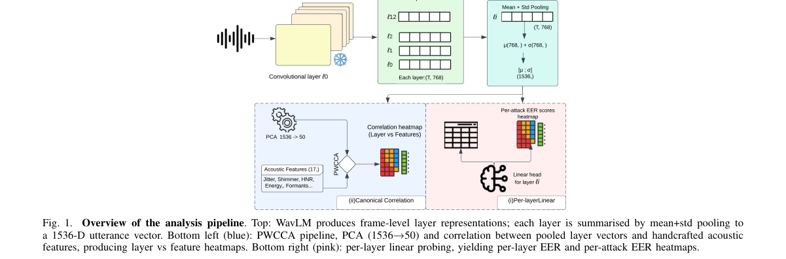

*Main result - Figure 2 Per-attack EER (%) across WavLM layers for the dev (A09–A16) and eval (A17–A32) splits, with overall per-layer EER for each set shown in the two rightmost columns. Green indicates low EER (eas*

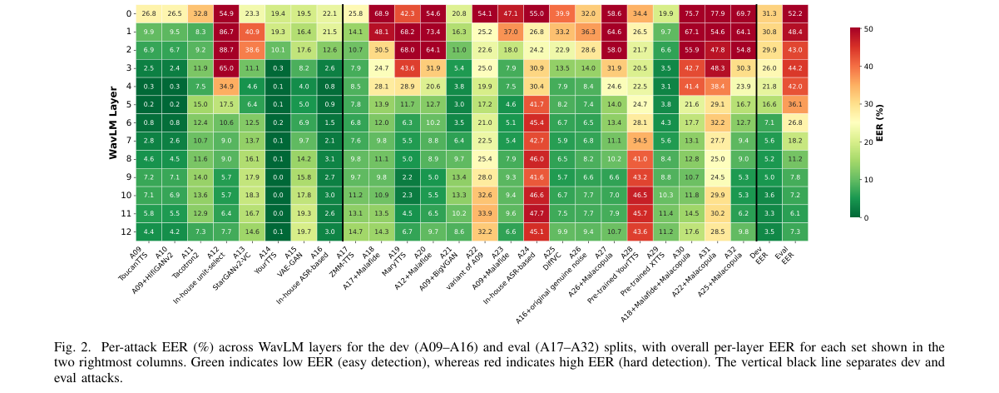

**Why this ranks #8**: 「哪些层负责伪造检测」是可操作的诊断信息，而不只是解释性。

---

### 9. Known Music, Unknown Response: Leakage-Audited Dynamic Arousal Forecasting With Scheduled Future Music

**arXiv**: [2610.23063](https://arxiv.org/abs/2610.23063) | **Score**: 6.3 (relevance 6 x 0.7 + quality 7 x 0.3) | **Tags**: AIGC-audio `[wild-card]` | **Categories**: cs.SD | **Pages**: 17

**Authors**: Bin Wen, Dai-Qiao Zhang, Tien-Ping Tan

**Affiliation**: 1School of Computer Sciences, Universiti Sains Malaysia, 11800, Pulau Pinang, Malaysia | 2School of Mathematical Sciences, Universiti Sains Malaysia, 11800, Pulau Pinang, Malaysia

**Abstract**

> Dynamic music emotion recognition usually estimates concurrent or lag-aligned labels from audio that has already been observed. We instead forecast the change in consensus arousal when the upcoming music is scheduled but all later affect labels remain hidden. Evaluation holds out complete songs, encodes each eligible 4-s chunk independently, predicts arousal innovation, and compares the correct future with displaced segments from the same song. On PMEmo and a 1,494-song DEAM evaluation pool excluded from engineering development, a complete past/future MuQ representation raises concordance correlation coefficient (CCC) by 0.389--0.507 over recent affect and remains 0.268--0.382 above a calibrated nonlinear state model. A future-only trajectory contains no past or current audio and still exceeds that state model by 0.150--0.249. The earliest legal future chunk, which ends 5.5--11 s before the target, also remains informative. Correct placement exceeds an overlapping 5-s shift by 0.100--0.209 and the acoustic-nearest eligible same-song segment by 0.078--0.105, with positive song-cluster lower bounds. These results show that both scheduled content and its within-song position carry forecast information under the stated observation rules. The study provides a leakage-controlled reference for known-future music forecasting without treating predictive substitutions as causal interventions.

**Key findings**

- **Finding**: 常规 MER 从已观测音频估计同时/滞后标签；该文改为预测**未来音乐排定但标签隐藏**时的唤醒度变化。

- **Finding**: 评测按完整歌曲留出（摘要在此处截断）。

- **Inference**: 「完整歌曲留出」是必要的：同一首歌内的片段高度相关，随机划分会让模型靠记忆片段而非预测趋势得分——这正是情感识别基准最常见的泄漏。

- **Recommendation**: wild-card 项；与本批 MUB（身份遮蔽）同属「先堵泄漏」的评测设计。

**Key figures**

*Framework / architecture - Figure 1 Forecast setting. Affect labels after origin t are hidden although the scheduled waveform is known. A valid chunk lies completely inside the permitted future interval. Negative controls pres*

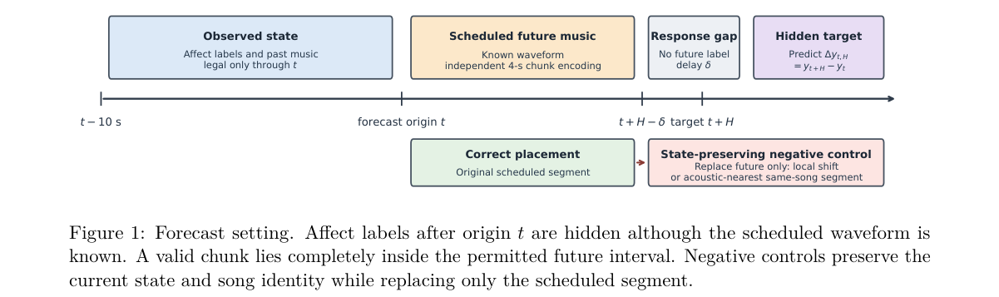

**Why this ranks #9**: 「泄漏审计」被写进方法本身，而不是事后检查。

---

### 10. Flash RNN-T: Memory-Efficient Joint Network and Transducer Loss Computation

**arXiv**: [2610.23409](https://arxiv.org/abs/2610.23409) | **Score**: 6.3 (relevance 6 x 0.7 + quality 7 x 0.3) | **Tags**: AIGC-audio | **Categories**: cs.DC, cs.LG, cs.SD | **Pages**: 6

**Authors**: Mahmoud Ashraf

**Affiliation**: 95% of its peak throughput. | quantify its throughput–memory tradeoffs against exist-

**Abstract**

> The recurrent neural network transducer (RNN-T) remains a practical choice for streaming speech recognition, but training requires large intermediate tensors. We present Flash RNN-T, a joint and loss implementation combining specialized kernels with optional tiled recomputation over the full alignment space and vocabulary. Tiled and untiled Flash form the entire measured throughput-memory frontier on medium and long workloads. On H100, untiled Flash achieves 24-39% higher throughput with 26-56% less memory than the fastest baseline on these workloads wherever it fits. Tiling reduces memory further through recomputation. On medium, tiled Flash uses ninefold less memory than that baseline at 16% lower throughput when both use one backward call per batch. On long, it fits where all tested alternatives with that backward schedule run out of memory with 80 GB. These comparisons use each implementation's lowest-memory configuration reaching at least 95% of its peak throughput.

**Key findings**

- **Finding**: RNN-T 训练需要**大中间张量**；Flash RNN-T 用专用内核与可选分块重计算降低内存（摘要截断）。

- **Finding**: 该文覆盖完整对齐空间上的联合网络与损失计算（摘要在此处截断）。

- **Inference**: RNN-T 的显存瓶颈来自其完整对齐空间（序列 × 帧 × 状态），而注意力方法没有这一维——因此这里的工程收益不能用 Transformer 的经验类推。

- **Recommendation**: 训练流式 RNN-T 的读者可参考。

**Key figures**

*Framework / architecture - Figure 1 Packing two utterances into tiles with an illus- trative limit of R = 6 alignment positions.*

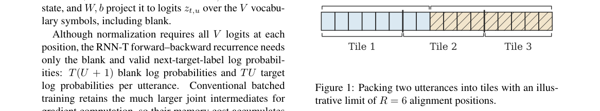

*Main result - Figure 2 Dashed enclosure marks intermediates dis- carded after each tile’s forward computation and recom- puted during backward. Outputs from all tiles feed the loss.*

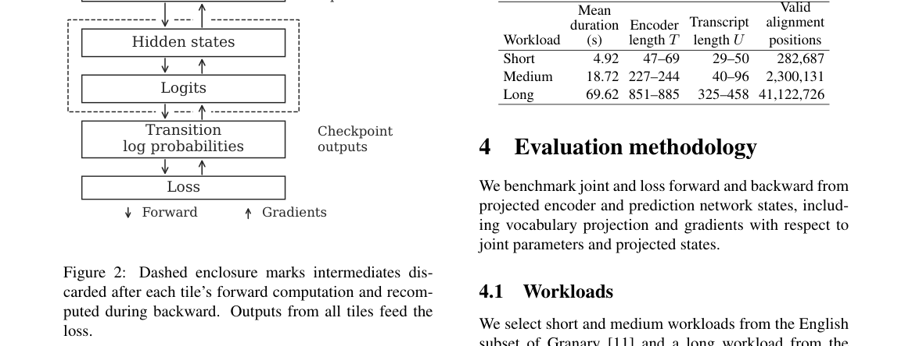

**Why this ranks #10**: 工程优化：让 RNN-T 训练在既有硬件上可行。

---

## Footer

- Total papers reviewed across all 5 tracks: 50 (from 429 scanned)
- aigc_audio track final top-10: 10
- Wild-cards in this track: 3
- Figure assets: `res/` (shared across tracks)

Generated by `mine-arxiv-daily-digest` skill. Sister file: `2026-10-19_aigc_audio_entry.md`.
