# ArXiv Daily Digest - 2026-10-19 (AIGC 图像 / 视频 / 3D 生成与编辑, 10 papers)

**Generated**: 2026-10-19 17:00 CST

**Source**: arXiv cs.CV, cs.SD, eess.AS, cs.CL, cs.AI, cs.RO, cs.LG submissions, window 2026-10-16 UTC (latest announced batch as of 2026-10-19 17:00 CST)

**Track**: aigc_visual (top 10 of 429 papers scanned, 50 full reads)

**Scope**: one-step image editing with semantic transport, protecting image-to-video generation, video diffusion avatars, fast personalization without per-subject optimization, frame-consistent feed-forward 3DGS from sparse unposed images, persistent planar memory for video world models, sink-sparse hybrid attention, packed trajectories for multi-turn editing, learning to correct geometry, language-informed loss for visual generation

---

本批 AIGC 视觉线的一个共同主题是**「被默认的东西其实不必如此」**。

**PreciseEdit** 指出既有一步编辑方法常通过条件预测之间的**简单向量操作**构建全局传输场，而全局传输场假设编辑是方向确定的整体位移——真实编辑常是局部的、非平移的（例如只改材质不改形状），因此在原理上就无法表达。

**Kingfisher** 则拒绝了另一项默认：个性化生成通常依赖对权重、文本嵌入、LoRA 或适配器的**主体特定优化**，即每主体一次训练；它探索了在视觉自回归模型中不为主体做专门优化的路径。把成本从「每主体一次训练」降到「每主体零成本」，代价是个性化程度受限于提示条件的表达力——这是一个清晰的容量与便利权衡。

**Learning to Correct Geometry in Generated Videos** 提出了本批最值得做实验验证的一个论断：生成视频在相机运动下失去几何一致性（结构扭曲、视差不一致、平滑运动坍缩为跳切）这**在很大程度上是数据问题**——网络规模视频语料中大部分可见运动来自手持拍摄，缺少精确相机轨迹，因此相机运动与真实三维运动的对应关系无法从数据中学到。若该论断成立，增加训练规模不会解决它。

其余：I2V-DETACH 指出既有图像免疫防御依赖**降低视觉质量或时序一致性**，把保护成本转嫁给合法用户；Video Diffusion Avatars 用视频扩散先验替代昂贵的 3D 数据采集来生成多视角一致头像；Sink-Sparse Hybrid Attention 把**注意力汇**当作保留依据（比按头或按时间步自适应更细粒度，与 10-15 日报的注意力汇分析形成方法—诊断配对）；MTEdit 用**打包轨迹**替代顺序 rollout 构造多轮编辑数据——打包让模型在同一序列内看到「编辑—回退—再编辑」，而顺序 rollout 的数据里几乎不会出现回退。

---

## Top 10 - AIGC 图像 / 视频 / 3D 生成与编辑

### 1. PreciseEdit: Strong Yet Stable Semantic Transport for One-Step Image Editing

**arXiv**: [2610.23535](https://arxiv.org/abs/2610.23535) | **Score**: 8.7 (relevance 9 x 0.7 + quality 8 x 0.3) | **Tags**: AIGC-edit, AIGC-image | **Categories**: cs.CV | **Pages**: 9

**Authors**: Jingyi Wang, Xiao Lu

**Affiliation**: Hainan University | School of Computer Science and Technology

**Abstract**

> Recent one-step text-to-image (T2I) models enable efficient image synthesis, opening up new possibilities for interactive Web-based image editing. However, existing one-step editing methods often construct a global transport field through simple vector operations between conditional predictions. While such strong transport can effectively drive the image toward the target semantics, it may be released along unreliable directions or over non-edited regions, leading to structural distortions within the editing region and background drift elsewhere. More importantly, stabilizing the editing process through global smoothing or uniformly weakening the transport field often makes large semantic changes overly conservative. In this work, we revisit one-step image editing from the perspective of the tension between semantic strength and transport stability, and identify a key insight: strong semantic transport is not inherently unstable. What matters is whether it is applied along reliable directions and at reliable spatial locations. Motivated by this insight, we introduce PreciseEdit, a model-agnostic, training-free and inversion-free one-step editing framework that strengthens target-semantic alignment while preserving background fidelity and structural consistency. We further propose a dual-noise-scale role decomposition strategy: a higher-noise scale produces the strong target-directed transport used for actual editing, whereas a lower-noise scale jointly serves as a probe for directional agreement and spatial structure. Extensive experiments on PIE-Bench demonstrate that PreciseEdit achieves state-of-the-art performance and effectiveness on various editing tasks.

**Key findings**

- **Finding**: 既有一步编辑方法常通过条件预测间的**简单向量操作**构建全局传输场（摘要截断）。

- **Finding**: PreciseEdit 提出强而稳定的语义传输（摘要在此处截断）。

- **Inference**: 「全局传输场」假设编辑是一个方向确定的整体位移，而真实编辑常是局部的、非平移的（例如只改材质不改形状）——因此全局向量场在原理上无法表达这类编辑。

- **Recommendation**: 交互式编辑的读者可参考；与 10-16 日报的 ACEdit（多轮退化）同属一步/多轮编辑方向。

**Key figures**

*Framework / architecture - Figure 1 Motivation of PreciseEdit. The first row highlights the importance of reliable spatial localization: unconstrained transport may alter non-target content, while inaccurate lo- calization may*

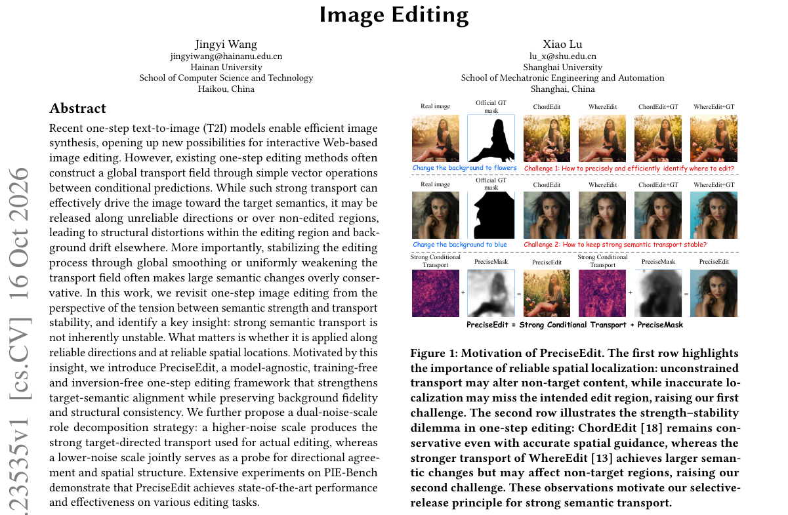

*Main result - Figure 2 Quality–efficiency comparison on PIE-Bench [14]. Each point represents an image-editing method. The horizon- tal axis reports runtime, while the vertical axes report back- ground fidelity me*

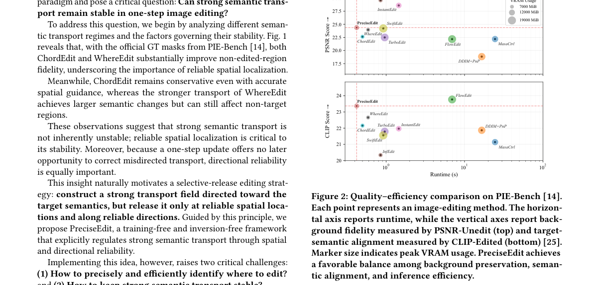

**Why this ranks #1**: 「用简单向量操作构建全局传输场」被明确点为一步编辑的结构性弱点。

---

### 2. I2V-DETACH: Source Grounding Detachment for Unauthorized Image-to-Video Generation

**arXiv**: [2610.23287](https://arxiv.org/abs/2610.23287) | **Score**: 8.7 (relevance 9 x 0.7 + quality 8 x 0.3) | **Tags**: AIGC-video | **Categories**: cs.CV | **Pages**: 40

**Authors**: Chanhui Lee, Yeonghwan Song, Yewon Kang, Jeany Son

**Affiliation**: [not-found in PDF]

**Abstract**

> Recent diffusion models have advanced image-conditioned video generation, but their accessibility raises risks of unauthorized manipulation. Image immunization has emerged as a promising defense for Image-to-Video (I2V) protection, yet existing methods often rely on degrading visual quality or temporal coherence. In this work, we revisit I2V immunization as reducing source-content preservation, shifting the focus from output degradation to weakening source-conditioned content propagation. To this end, we propose I2V-DETACH, an image immunization method that prevents unauthorized I2V generation through source grounding detachment. I2V models preserve source content by propagating source-image cues into video latents during denoising. Accordingly, I2V-DETACH disrupts this process in two complementary ways: it suppresses source-video grounding to reduce source cue propagation, and strengthens intra-video interactions to shift denoising toward video-side dynamics with reduced reliance on the source image. To obtain informative optimization signals, we initialize auxiliary video latents with source-oriented states that remain within the source-conditioned generation regime while deviating from source-preserving trajectories. Extensive experiments across diverse diffusion architectures show that I2V-DETACH substantially reduces source-content preservation, improves over prior immunization methods, and exhibits strong black-box transferability.

**Key findings**

- **Finding**: 既有 I2V 保护方法常依赖**降低视觉质量或时序一致性**（摘要截断）。

- **Finding**: I2V-DETACH 提出源接地分离（Source Grounding Detachment）（摘要在此处截断）。

- **Inference**: 以质量为代价的保护把成本转嫁给了合法用户；而「分离源接地」若有效，意味着可以在不降低质量的前提下阻断特定内容的可动画化，这是一个更有吸引力的威胁模型。

- **Recommendation**: 与 10-14 日报的 I2V 相关水印/溯源工作对照；内容保护与水印是两个方向，值得并行跟踪。

**Key figures**

*Framework / architecture - Figure 1 Goal of I2V-DETACH against diffusion-based I2V generation. Unlike prior baselines that often result in temporal degradation or fidelity reduction, source grounding detachment objective direc*

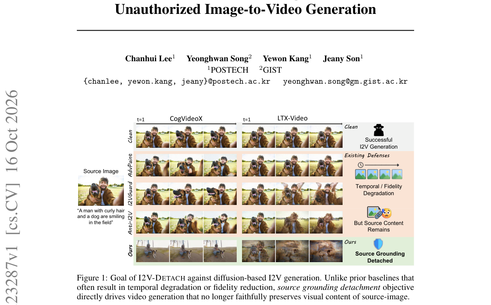

*Main result - Figure 2 Illustration of the framework of I2V-DETACH. Source grounding detachment is achieved by two complementary losses; source-video decoupling and intra-video coupling. Jointly optimized with pro*

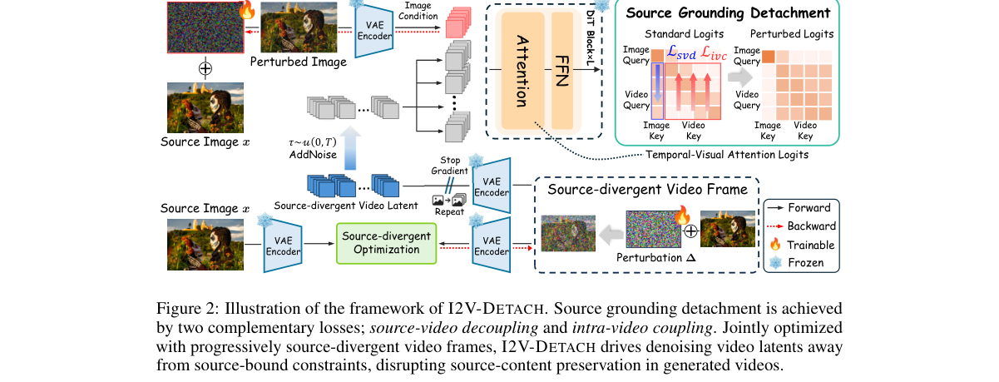

**Why this ranks #2**: 「保护手段以牺牲质量为代价」是内容溯源方向的典型代价结构。

---

### 3. Video Diffusion Avatars: Taming Video Diffusion Models into Controllable 3D Avatars

**arXiv**: [2610.23772](https://arxiv.org/abs/2610.23772) | **Score**: 8.7 (relevance 9 x 0.7 + quality 8 x 0.3) | **Tags**: AIGC-video, AIGC-3D | **Categories**: cs.CV | **Pages**: 28

**Authors**: Simon Giebenhain, Tobias Kirschstein, Liam Schoneveld, Davide Davoli, Zhe Chen, Matthias Nießner

**Affiliation**: 1Technical University of Munich

**Abstract**

> Video diffusion models (VDMs) trained on internet-scale data encode a rich prior on appearance, motion, and physics that is difficult to replicate with explicit 3D rendering and costly 3D data capture. We introduce Video Diffusion Avatars (VDAs), a method that creates photo-realistic, multi-view consistent avatars from a single image by fine-tuning a VDM for precise control over camera viewpoint, facial expression, and upper-body pose. Departing from 3D morphable models (3DMMs), VDAs use a learned expression space that lifts the expressiveness ceiling of 3DMMs, e.g., for the tongue and mouth interior. However, learned expression codes exhibit heavy viewpoint bias, as our DISTRACT benchmark reveals. We show that this bias can be removed through disentanglement, enabling their use as driving signals for multi-view consistent avatars. Camera and upper-body pose are controlled jointly via proxy-mesh renderings, giving independent control over expression, pose, and viewpoint. A camera-triplet training strategy makes the approach efficient: our models train for 34 hours on a single A100 using only public multi-view data. VDAs outperform state-of-the-art single-image 3D avatars on novel-view reenactment, reducing face LPIPS by 29% and improving perceptual quality (JOD) by 66% on BecomingLit. A static 3DGS reconstruction probe further confirms that our generations are the most multi-view consistent. Built on a video prior, VDAs produce effects beyond the reach of explicit renderers, including physically plausible hair dynamics, shadows, reflections, and refractions.

**Key findings**

- **Finding**: 视频扩散模型编码了难以用显式 3D 渲染复现的外观、运动与物理先验。

- **Finding**: VDAs 从视频扩散模型创建照片级真实、多视角一致的头像（摘要在此处截断）。

- **Inference**: 「多视角一致」是头像应用的核心需求，而视频模型的多视角能力并非为一致性而训练——因此把扩散先验转成一致表示是该方法的技术核心。

- **Recommendation**: 数字人与 3D 头像方向的读者可参考；与 10-16 日报的 Edit4D（可编辑 4D 场景）同属「生成先验服务三维资产」。

**Key figures**

*Framework / architecture - Figure 1 Video Diffusion Avatars (VDAs): given a single image, VDAs produce photo-realistic renderings with independent control over camera, upper-body pose, and facial expression, inheriting hair dy*

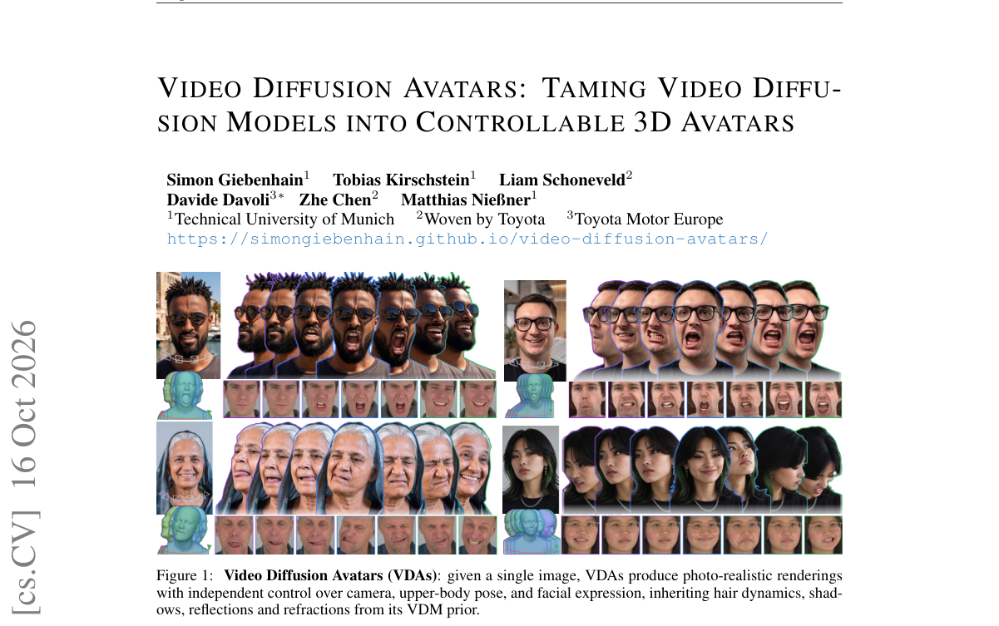

*Main result - Figure 2 Video Diffusion Avatar architecture: Camera, upper-body pose, and facial expression are injected as independent control signals into WAN-Animate-14B. Disentangled X-NeMo expression codes are*

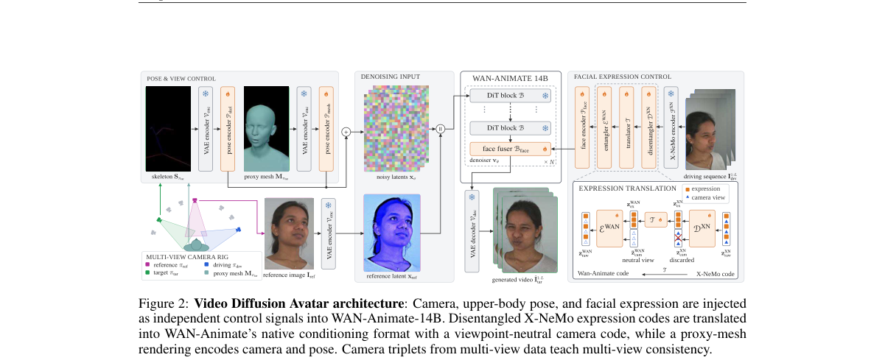

**Why this ranks #3**: 「用视频先验替代 3D 采集」是一条绕过 3D 数据瓶颈的路径。

---

### 4. Kingfisher: Fast Personalized Visual Autoregressive Generation via Scale-Aware Prompt-Conditioned Scale Decomposition

**arXiv**: [2610.23238](https://arxiv.org/abs/2610.23238) | **Score**: 8.0 (relevance 8 x 0.7 + quality 8 x 0.3) | **Tags**: AIGC-image | **Categories**: cs.CV | **Pages**: 20

**Authors**: Dinh-Khoi Vo, Akihiro Sugimoto, Minh-Triet Tran, Trung-Nghia Le

**Affiliation**: 2Vietnam National University, Ho Chi Minh City, Vietnam | 3National Institute of Informatics, Tokyo, Japan

**Abstract**

> Personalized image generation has been extensively studied in diffusion models, often relying on subject-specific optimization of model weights, textual embeddings, LoRA modules, or adapters. In this work, we explore a different direction for fast personalization in visual autoregressive models. Our key observation is that a short prefix of early autoregressive scale codes is sufficient to strongly determine both object structure and global appearance, while later scales primarily refine the established generation trajectory. Based on this insight, we introduce Kingfisher, a model-tuning-free framework that decomposes early residual scale codes into content- and style-related components through prompt-conditioned scale-code subspaces. Given two real images, Kingfisher first decomposes their early scale codes, then recomposes the content components of one image with the style components of the other into a compact semantic prefix. The frozen generator subsequently predicts the remaining scales through bitwise self-correction for coherent refinement. Experiments on CSD-100 show that Kingfisher achieves strong content preservation and the highest style and text alignment among the evaluated methods, while reducing pair-specific preparation time by approximately 54x compared with diffusion-based methods and 7.5x compared with VAR-based alternatives. These results demonstrate that effective personalization can be achieved by directly manipulating the native scale-space representation of a frozen visual autoregressive generator.

**Key findings**

- **Finding**: 既有个性化生成依赖**主体特定的权重/嵌入/LoRA/适配器优化**。

- **Finding**: Kingfisher 探索快速个性化在视觉自回归模型中的另一条路（摘要在此处截断）。

- **Inference**: 免优化的个性化把成本从「每主体一次训练」降到「每主体零成本」，代价是个性化程度受限于 prompt 条件的表达力——这是一个清晰的容量与便利的权衡。

- **Recommendation**: 需要大量主体的个性化服务值得看；与本批 Sink-Sparse Attention 同属「效率」路线但目标不同。

**Key figures**

*Framework / architecture - Figure 1 Kingfisher combines the content of one real image with the appearance of another by decomposing and recomposing early autoregressive scale codes. The remaining scales are predicted by the fr*

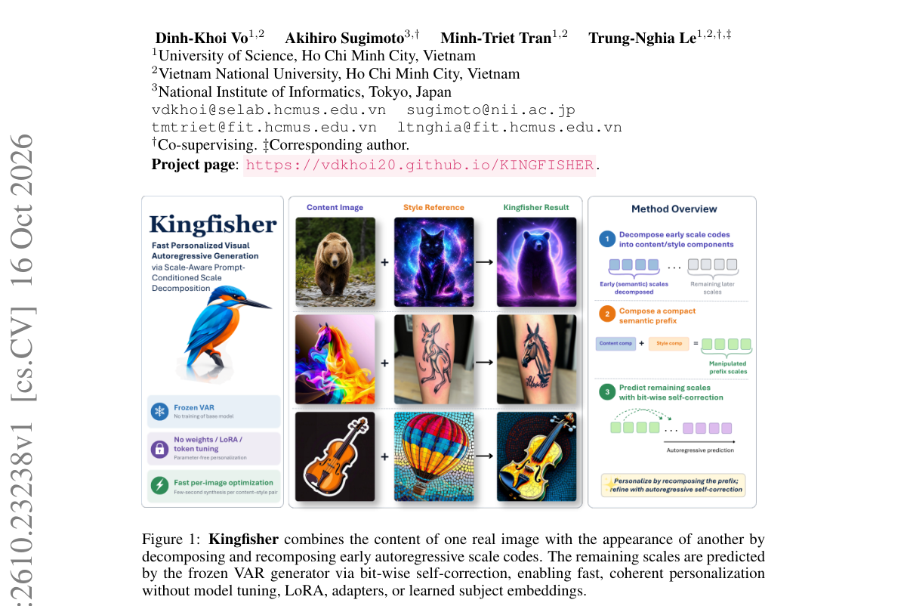

*Main result - Figure 2 Scale-wise analysis of visual autoregressive generation. We analyze residual scales from two complementary views: prefix reconstruction and prompt routing. Prefix reconstruction shows that a*

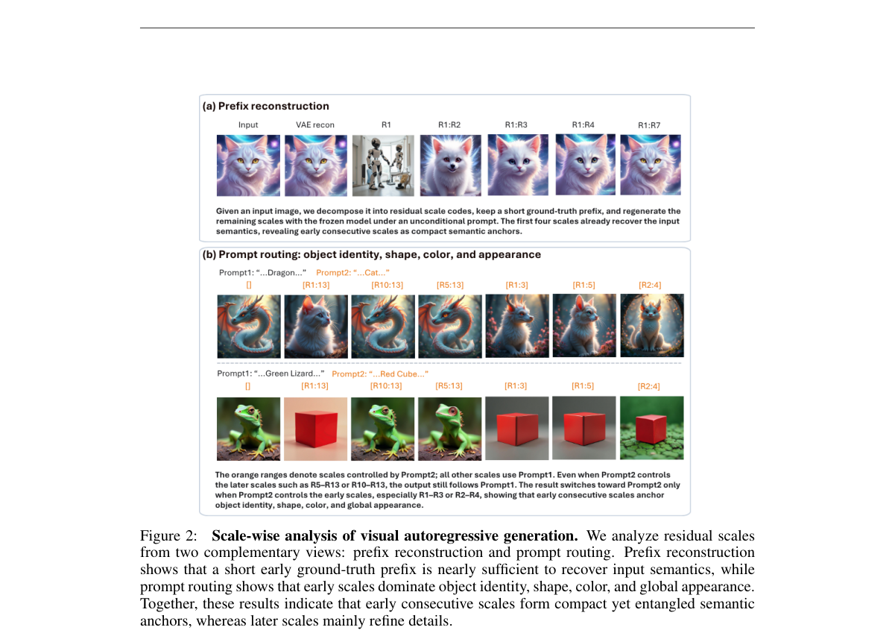

**Why this ranks #4**: 「不为主体做专门优化」是一个与主流相反的取舍。

---

### 5. Frame-Consistent Feed-Forward 3D Gaussian Splatting from Sparse Unposed Images

**arXiv**: [2610.23039](https://arxiv.org/abs/2610.23039) | **Score**: 8.0 (relevance 8 x 0.7 + quality 8 x 0.3) | **Tags**: AIGC-3D | **Categories**: cs.CV | **Pages**: 9

**Authors**: Viruthshaan Vinasirajan, Ranga Rodrigo

**Affiliation**: University of Moratuwa

**Abstract**

> Feed-forward Gaussian models have made novel view synthesis almost instantaneous. Feed-forward methods predict Gaussians directly, either in two stages or in a single merged pass. Using two separately trained models is attractive because each can specialize in its own objective: one for accurate pose estimation and the other for high-quality reconstruction, rather than forcing a single jointly trained network to compromise between the two. A natural instantiation pairs a frozen pose estimator, VGGT, with a frozen reconstruction backbone, TokenGS. Prior work, such as VGGT-X and 3R-GS, also adopts a two-stage design, but attributes the resulting quality degradation to noisy pose estimates and introduces learned refinement. We show that this is not the primary source of the problem. Through per-camera analysis across 107 scenes from two datasets, DL3DV and MipNeRF360, using COLMAP poses as the reference, we find that the rotation error after alignment is small (median 1.6 degrees), whereas the translation scale is offset by a large, dataset-consistent factor. Controlled ablations over 140 DL3DV scenes show that the primary obstacles are two integration failures rather than pose error: a coordinate-frame inconsistency and a translation-scale mismatch, both of which can be corrected deterministically. With these fixes, a frozen VGGT driving a frozen TokenGS achieves 22.47 PSNR, within 0.51 dB of the COLMAP reference, with no additional training, when poses are estimated from all scene views. In the sparse setting, where reconstruction uses only four context images under the standard pose-free protocol, the same pipeline matches this all-view quality, yielding a fully COLMAP-free pipeline without any refinement step.

**Key findings**

- **Finding**: 使用两个分别训练的模型有吸引力：各自专注目标，一个做准确位姿估计，另一个……（摘要截断）。

- **Finding**: 该文关注**帧一致性**（摘要在此处截断）。

- **Inference**: 帧一致性的失效通常源于位姿误差在时间上的累积，因此把位姿估计单独成一个模型并针对它优化，比端到端联合训练更容易定位误差来源。

- **Recommendation**: 与 10-15/10-16 日报的 Anchor3DGS（前馈 3DGS 表示）同属前馈 3DGS 路线。

**Key figures**

*Framework / architecture - Figure 1 Our training-free composition pipeline. A frozen VGGT estimates camera poses, and a frozen TokenGS reconstructs 3D Gaussians; the two are connected by three deterministic, training-free oper*

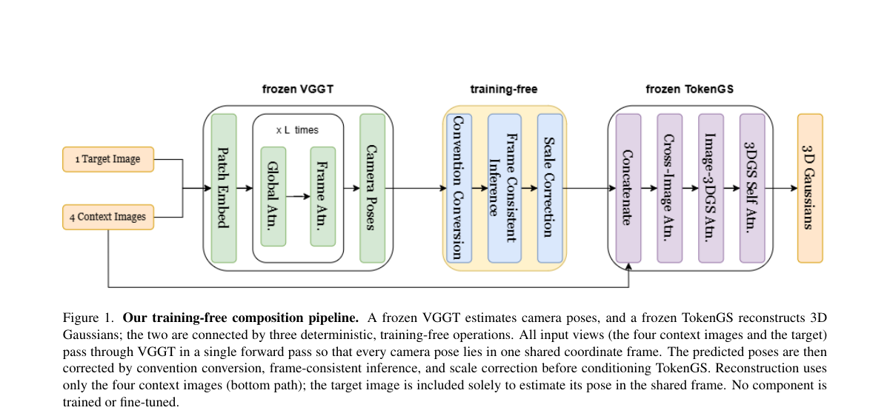

*Main result - Figure 2 VGGT vs. COLMAP pose error decomposition. Left: rotation error after convention alignment is small (median 1.60◦on DL3DV, 1.32◦on MipNeRF360). Right: the translation scale ratio is large and*

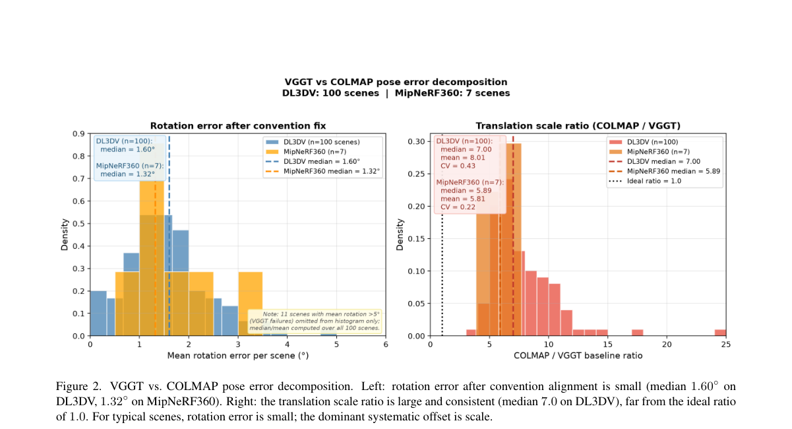

**Why this ranks #5**: 「两模型分别专注各自目标」是一个可解释的分工设计。

---

### 6. Persistent Planar Memory for Video World Models

**arXiv**: [2610.23795](https://arxiv.org/abs/2610.23795) | **Score**: 8.0 (relevance 8 x 0.7 + quality 8 x 0.3) | **Tags**: world-model, AIGC-video | **Categories**: cs.CV | **Pages**: 20

**Authors**: Yuze He, Bin Tan, Zelin Gao, Yujun Shen, Yong-Jin Liu, Nan Xue, Yinghao Xu

**Affiliation**: 1Tsinghua University

**Abstract**

> Video world models that generate and explore environments at scale need a persistent 3D memory of what they have produced. Plane primitives offer a natural candidate: a compact set of oriented planes captures the dominant structural elements (e.g., walls, floors, facades) of indoor and outdoor scenes, while requiring only 7 parameters per primitive. We present PPMem, a video world model that adopts plane primitives as its persistent 3D memory. PPMem augments a video diffusion transformer with a planar prediction head and a Depth Token Fusion (DTF) module: each autoregressive chunk jointly produces RGB video and planar geometry, which merges into a persistent plane memory that conditions subsequent chunks via rendered depth. The resulting memory is three orders of magnitude more compact than per-pixel point clouds (~100K primitives, 5MB for a full scene), geometrically explicit (metric depth, normals, exportable surfaces), cross-view consistent (jointly predicted by the shared backbone), and adaptive (refined by the merging procedure as generation proceeds). On DL3DV and RealEstate10K, PPMem outperforms prior 3D-grounded world models in video quality while jointly producing metric-scale depth, surface normals, and exportable planar geometry, sustaining coherence across hundreds of frames under large viewpoint changes. Project page: https://hyzcluster.github.io/ppmem.

**Key findings**

- **Finding**: 视频世界模型需要对已生成内容保持**持久 3D 记忆**。

- **Finding**: 平面基元可紧凑捕捉场景主导结构元素（墙、地板、立面），且所需……（摘要截断）少得多。

- **Finding**: 该文用持久平面记忆支撑视频世界模型（摘要在此处截断）。

- **Inference**: 平面之所以合适，是因为环境的主导结构本就是平面化的——这是表示选择与被表示对象性质匹配的例子，而非纯粹为省显存。

- **Recommendation**: 与 10-16 日报的 Velox（空间记忆让世界模型高效）同属「世界模型的记忆表示」这条线，建议连读。

**Key figures**

*Framework / architecture - Figure 1 Given a single input image and a camera trajectory, PPMem autoregressively generates video while accumulating a persistent plane-based 3D memory. We show two DL3DV scenes (indoor, outdoor) w*

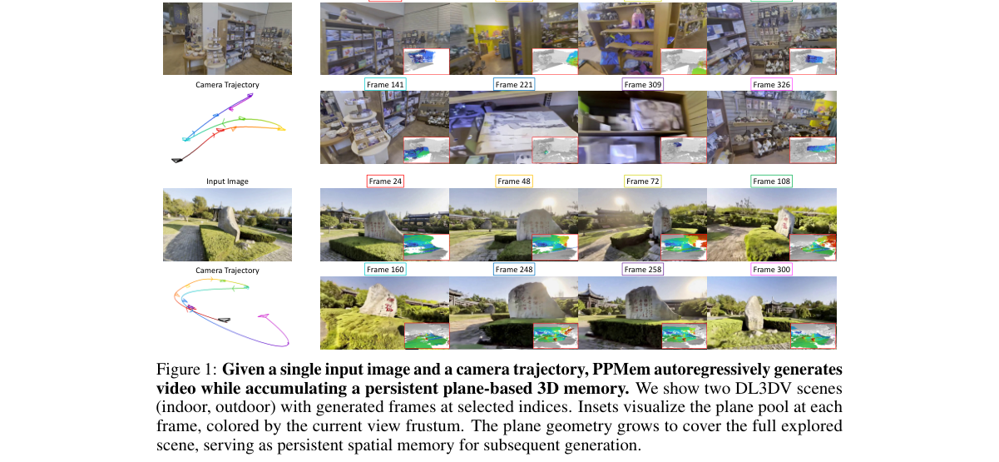

*Main result - Figure 2 PPMem architecture overview. The Wan DiT receives noisy video latents channel- concatenated with projected source-view RGB/masks and partial depth rendered from the plane pool; context frame*

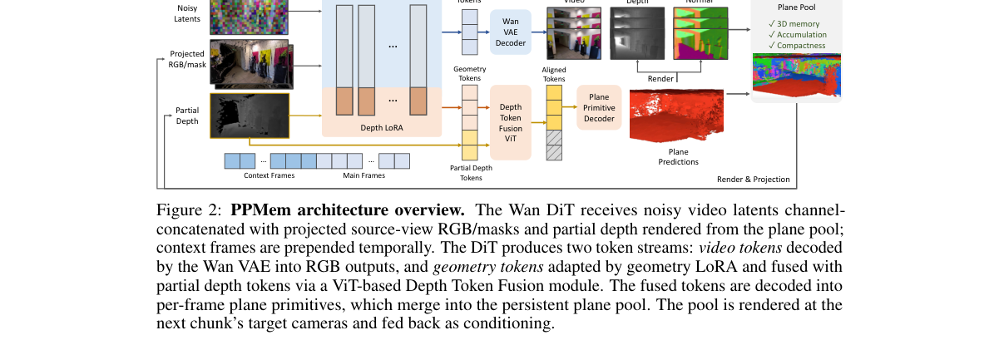

**Why this ranks #6**: 「平面基元作为世界模型记忆」是一个优雅的表示选择。

---

### 7. Sink-Sparse Hybrid Attention for Efficient Inference in T2I/T2V Diffusion Transformers

**arXiv**: [2610.22975](https://arxiv.org/abs/2610.22975) | **Score**: 7.0 (relevance 7 x 0.7 + quality 7 x 0.3) | **Tags**: AIGC-video, AIGC-image | **Categories**: cs.CV | **Pages**: 12

**Authors**: Bingxin Xing, Yu Zhang, Jiatong Ding, Lei Lu, Ping Wang

**Affiliation**: 1Xi’an Jiaotong University | 2Xiamen University | 3Shanghai Jiao Tong University

**Abstract**

> Diffusion Transformers (DiTs) have become a common backbone for high-quality text-to-image and text-to-video generation, but repeated dense self-attention remains a major inference bottleneck as token sequences grow and the same operator is invoked across many denoising steps. Our study suggests that dense attention in pretrained DiTs contains reusable layer/head-specific high-mass structure that can be identified from a small offline calibration set and reused across future generations. This leads to Sink-Sparse Hybrid Attention, a train-free attention replacement that reuses static sink masks and supplements them with a lightweight pooled-KV branch, while leaving model weights and sampling schedules unchanged. On Wan2.1-T2V-1.3B, the method attains 1.54$\times$ end-to-end speedup while maintaining generation quality. On Z-Image-Turbo, it attains 1.57$\times$ end-to-end speedup with competitive GenEval2 performance. These results indicate that reusable importance-aware sparse support can provide an effective train-free acceleration path for both T2V and T2I DiTs.

**Key findings**

- **Finding**: 重复稠密自注意力是 DiT 推理瓶颈，且同一算子跨许多去噪步反复调用。

- **Finding**: 研究表明稠密注意力在……（摘要截断）；该文提出 sink-sparse 混合注意力（摘要在此处截断）。

- **Inference**: 把注意力汇（token 级的重要性集中点）当作保留依据，比按头或按时间步自适应更细粒度——这与 10-15 日报的 Attention Sinks in T2I 分析形成方法与诊断的配对。

- **Recommendation**: 扩散 Transformer 部署的读者可参考；与 10-15 日报的注意力汇分析建议连读。

**Key figures**

*Framework / architecture - Figure 1 Profiling sampling latency in the evalu- ated T2V setting. We decompose the sampling time 𝑇sample (excluding model initialization and video writing) into self-attention time 𝑇attn and the re*

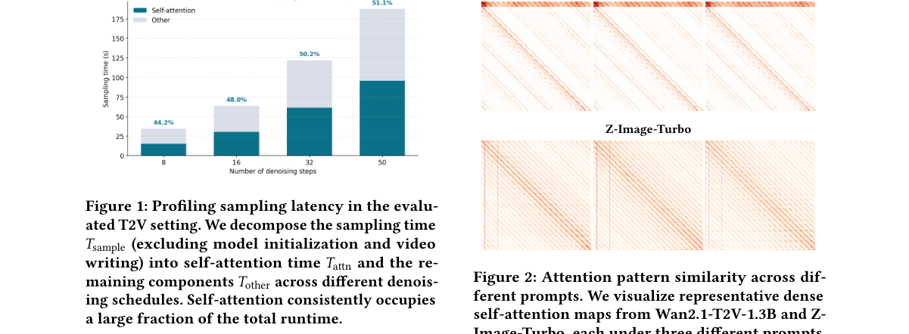

*Main result - Figure 2 Attention pattern similarity across dif- ferent prompts. We visualize representative dense self-attention maps from Wan2.1-T2V-1.3B and Z- Image-Turbo, each under three different prompts. De*

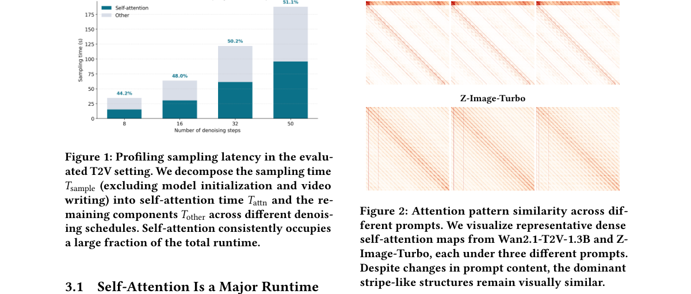

**Why this ranks #7**: 「注意力汇」从 LLM 侧被带到了扩散 Transformer，并成为效率设计的支点。

---

### 8. MTEdit: Packed Trajectories Beat Rollouts for Multi-Turn Image Editing

**arXiv**: [2610.23751](https://arxiv.org/abs/2610.23751) | **Score**: 7.0 (relevance 7 x 0.7 + quality 7 x 0.3) | **Tags**: AIGC-edit, AIGC-image | **Categories**: cs.CV | **Pages**: 41

**Authors**: Houyuan Chen, Fanzhou Wang, Xiangyu Fan, Songlin Yang, Zhitao Yang, Lvmin Zhang, Pei Yang, Hao Zhao, Lei Yang, Anyi Rao

**Affiliation**: 1SenseTime Research | 2HKUST MMLab | 3Stanford University | 4AIR, Tsinghua University

**Abstract**

> Multi-turn image editing aims to modify an image according to a sequence of instructions, making it better aligned with human-AI collaborative creation than single-turn editing. However, constructing high-quality multi-turn training data remains challenging, as conventional sequential rollout accumulates errors and introduces visual-quality drift across editing turns. To address this challenge, we introduce MTEdit, a multi-turn image editing dataset built through a pipeline centered on packed trajectory canvas (PTC) generation. By jointly generating multiple editing states within a unified visual context, this pipeline reduces visual-quality drift across turns. Covering both step-wise and context-aware editing scenarios, MTEdit comprises 500K multi-turn image editing trajectories, with up to 8 turns and an average of 5.38 turns per trajectory, making it one of the most extensive datasets for multi-turn image editing. We further introduce MTEdit-Bench, a benchmark designed to evaluate both scenarios by assessing models' ability to follow editing instructions, maintain content consistency, resist visual-quality drift, and effectively use historical context across turns. Using MTEdit, we fine-tune Qwen-Image-Edit-Causal to obtain Qwen-Image-MTEdit. On MTEdit-Bench, we evaluate a broad range of closed-source and open-source image editing models, including Qwen-Image-MTEdit. Experimental results show that Qwen-Image-MTEdit achieves the best performance among the evaluated open-source models, demonstrating the effectiveness of MTEdit in improving models' multi-turn image editing capabilities.

**Key findings**

- **Finding**: 构造高质量多轮训练数据困难，因为常规顺序 rollout **累积误差**（摘要截断）。

- **Finding**: MTEdit 用**打包轨迹**（packed trajectories）优于 rollout 来构造训练数据（摘要在此处截断）。

- **Inference**: 打包把多次编辑放进一个样本，从而让模型在同一序列内看到「编辑—回退—再编辑」，这正是多轮失败的真实形态，而顺序 rollout 的数据里几乎不会出现回退。

- **Recommendation**: 多轮编辑的读者可参考；与 10-16 日报的 ACEdit（多轮退化是分布漂移）同属多轮编辑方向。

**Key figures**

*Framework / architecture - Figure 1 Overview of our approach. (a,b) Packed trajectory canvas (PTC) generation reduces visual-quality drift compared with sequential rollout. (c) MTEdit offers more trajectories and turns than ex*

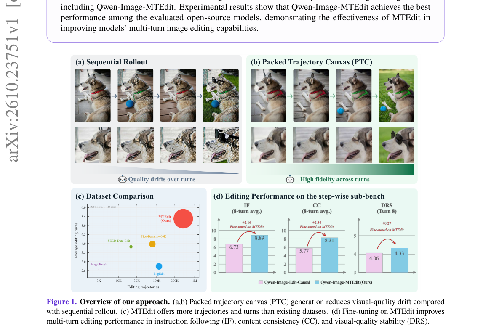

*Main result - Figure 2 Overview of our data construction pipeline. (a) Seed image curation, which selects source images with high resolution and aesthetic quality; (b) PTC generation, in which VLMs derive a PTC pr*

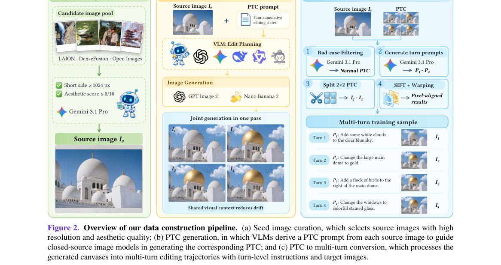

**Why this ranks #8**: 「顺序 rollout 累积误差」是数据构造而非模型能力的问题。

---

### 9. Learning to Correct Geometry in Generated Videos

**arXiv**: [2610.23856](https://arxiv.org/abs/2610.23856) | **Score**: 7.0 (relevance 7 x 0.7 + quality 7 x 0.3) | **Tags**: AIGC-video | **Categories**: cs.CV | **Pages**: 11

**Authors**: Weijie Lyu, Tiancheng Shen, Jason Li, Yujing Wang, Xiaoyuan Wang, Haobo Yuan, Yizhou Zhao, Ming-Hsuan Yang

**Affiliation**: 2Nanyang Technological University | 3Peking University | 4Carnegie Mellon University

**Abstract**

> Generated videos often lose geometric consistency under camera motion: structures warp under viewpoint change, parallax becomes inconsistent, and smooth camera movement may collapse into shot-like transitions. We argue that this failure is largely a data problem. In web-scale video corpora, most visible motion comes from dynamic objects captured by static or weakly moving cameras, leaving only sparse supervision for viewpoint-induced appearance changes. To address this, we propose Video Geometry Corrector (VGC), a post-hoc video-to-video model trained on synthetic paired supervision. Starting from real videos with diverse camera motion and pose annotations, we construct VG-Pairs with a synthetic paired-supervision data generation pipeline. Each video clip is treated as a geometry-consistent target and paired with a distorted counterpart synthesized by a pretrained image-to-video inpainting model using trajectory-adaptive keyframes. VGC learns to map the distorted input to the geometry-consistent target without modifying the source generator, and uses optical flow as an auxiliary cue to help disentangle camera motion from object motion. Experiments on pose-conditioned and prompt-driven benchmarks show that VGC improves geometric consistency across multiple source generators, and scaling to a larger backbone further extends the framework toward more general video refinement.

**Key findings**

- **Finding**: 相机运动下结构扭曲、视差不一致、平滑运动坍缩为跳切。

- **Finding**: 作者论证这**很大程度上是数据问题**：网络规模视频语料中大部分可见运动来自……（摘要截断）。

- **Inference**: 若成因为数据，则训练规模不会解决它——因为「手持拍摄」语料天然缺乏精确相机轨迹，因此相机运动与真实三维运动的对应关系无法从数据中学到。这个论断若成立，会改变该问题的投入方向。

- **Recommendation**: 视频一致性方向的读者注意；这是本批最值得做实验验证的一篇（用合成精确轨迹数据训练即可检验）。

**Key figures**

*Framework / architecture - Figure 1 Video Geometry Corrector (VGC) corrects geometry distortions in generated videos. Under large camera motion, modern video generators often produce warped structures, inconsistent parallax, a*

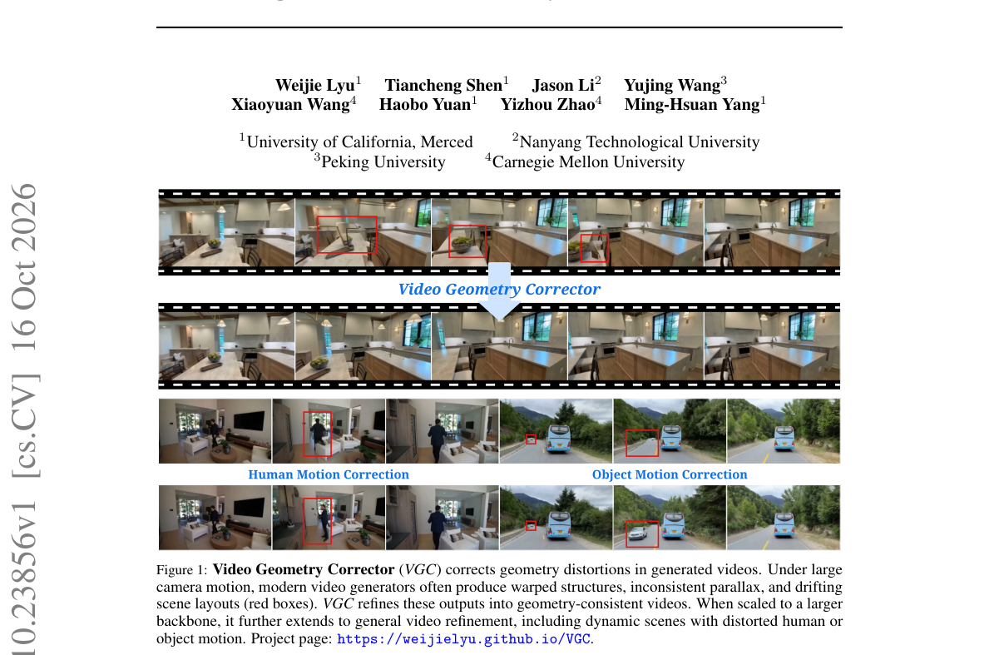

*Main result - Figure 2 Effect of adaptive keyframe selection. The red arrows indicate a constant 3D direction while the camera is moving. For clips with large, nonlinear camera motion, conditioning the image-to-vi*

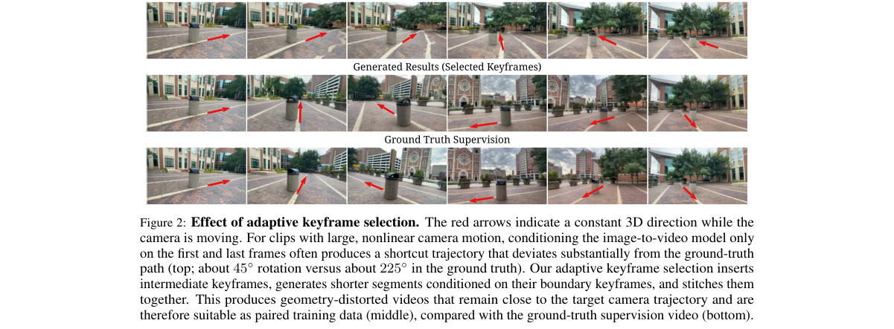

**Why this ranks #9**: 「几何不一致是数据问题而非模型问题」是一个反直觉但可检验的论断。

---

### 10. A Language-Informed Loss for Visual Generation

**arXiv**: [2610.23653](https://arxiv.org/abs/2610.23653) | **Score**: 7.0 (relevance 7 x 0.7 + quality 7 x 0.3) | **Tags**: AIGC-image | **Categories**: cs.CV, cs.LG | **Pages**: 29

**Authors**: Suchir Agarwal, Keshigeyan Chandrasegaran, Ziyu Chen, Kyle Sargent, Juan Carlos Niebles, Li Fei-Fei, Jiajun Wu

**Affiliation**: Stanford University | the foreground, its surface reflecting | foreground, its gray bark rough and

**Abstract**

> End-to-end visual generation with pixel-space loss has recently achieved competitive performance without the need for learned image tokenizers. In this work, we study whether language-informed supervision can provide a richer training signal than pixel loss for visual generation. We introduce LILIE (pronounced "lily"), a Language-Informed and Lossless Image Encoder. LILIE is an invertible image transform trained such that a vision-language model can recover captions from noised features. The encoder uses a normalizing flow transformer trained jointly with a vision-language model via next token prediction. We then use the encoder to extract a simple language-informed loss for text-to-image generation. We train JiT models with LILIE loss, reducing gFD by 14 points (66.84 $\to$ 53.01) against a pixel-only baseline on the GPIC dataset. Our code, encoders, and generative models are available at https://suchiragarwal.com/lilie.

**Key findings**

- **Finding**: 像素空间损失的端到端视觉生成已无需学习式 tokenizer 即可取得竞争力。

- **Finding**: 该文研究语言信息监督能否提供更丰富训练信号，引入 LILIE（摘要在此处截断）。

- **Inference**: 像素损失衡量的是外观相似，语言监督衡量的是**语义一致**——两者失配之处正是生成模型「看起来对但说错了」的区域，因此互补而非替代。

- **Recommendation**: 端到端视觉生成的读者可参考。

**Key figures**

*Framework / architecture - Figure 1 Generation quality with LILIE. Upper left: Pixel and LILIE supervision at two gen- erator sizes evaluated on GPIC Test-50K with 50 Euler steps. CFG scale is selected using GPIC Validation-50*

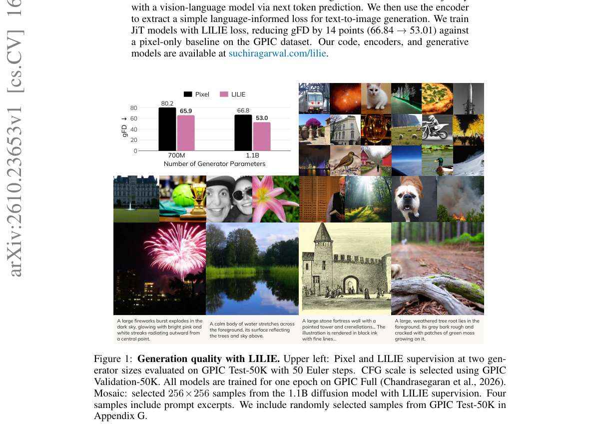

*Main result - Figure 2 Two perturbed image patches (additive Gaussian noise) with equal pixel Euclidean dis- tance of 1000 from the original patches. Caption: “Three airplanes fly in the sky against a cloudy backd*

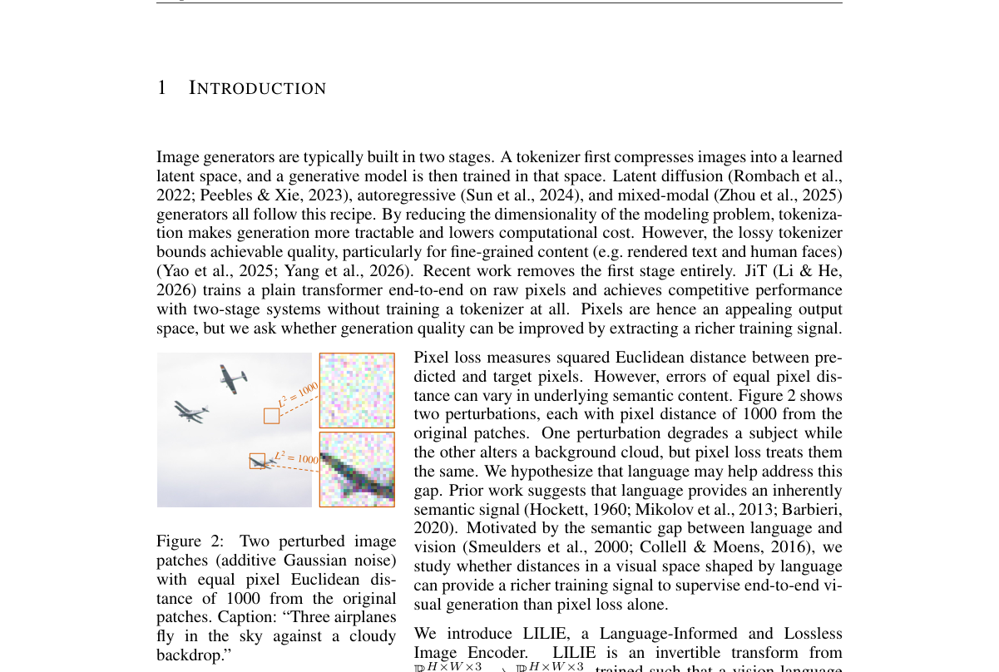

**Why this ranks #10**: 「不学 tokenizer」与「用语言监督」两条路线在此交汇。

---

## Footer

- Total papers reviewed across all 5 tracks: 50 (from 429 scanned)
- aigc_visual track final top-10: 10
- Wild-cards in this track: 1
- Figure assets: `res/` (shared across tracks)

Generated by `mine-arxiv-daily-digest` skill. Sister file: `2026-10-19_aigc_visual_entry.md`.
