# ArXiv Daily Digest - 2026-10-19 (音频与语音语言模型 / 双工语音助手, 10 papers)

**Generated**: 2026-10-19 17:00 CST

**Source**: arXiv cs.CV, cs.SD, eess.AS, cs.CL, cs.AI, cs.RO, cs.LG submissions, window 2026-10-16 UTC (latest announced batch as of 2026-10-19 17:00 CST)

**Track**: audio_lm (top 10 of 429 papers scanned, 50 full reads)

**Scope**: coordination brain for agentic interactive models, convex-hull speech interfaces, situation-based turn-by-turn evaluation, low prompt-injection rates that hide ignored not refused, acoustic perception in audio LMs, pragmatic signal lost in ASR normalization, dysarthric AVSR with test-time adaptation, personalized memory gating from one-sided feedback, temporal localization for agent memory retrieval, speech BCI beyond scaling

---

**Jarvis** 是本批相关性最高的一篇，它把「双工」的定义问题化了。交互模型日益把复杂推理与工具使用交给后台的**慢脑**，让实时前端维持全双工对话——但用户可能在任务运行中修改、取消或替换请求，使**刚刚还合理的计划或结果就过时了**。每一次新话语都必须针对这个不断变化的任务状态来阅读。标题即论点：协调需要一个自己的「脑」。

这暴露了「快慢脑」分工的一个隐含代价：把后台计划与前台实时性解耦之后，**计划失效成为常态而非例外**，因此协调层必须是一等组件而非简单的消息传递。这与本项目日报此前记录的双工工作（Diffuplex / ELLSA 2 / VoxTurn 处理话轮级难题）形成层次差异——那三篇处理**轮次**层面的并发，这篇处理**任务**层面的并发。

**审计线索在本线再次出现且样本量很大**：**Ignored, Not Refused** 指出基准以攻击成功率（ASR）度量间接提示注入安全，把每次失败的攻击都当作成功的防御；作者审计了**十一个开放权重模型的 33,000 条轨迹**，发现低成功率隐藏的是「**被忽略**」而非「被拒绝」——前者意味着注入内容仍进入了上下文并可能影响后续行为，只是恰好没触发工具调用。

另一条数据侧的陷阱值得单独指出：**ASR 归一化移除填充停顿、标点并展开口语形式，而这些恰恰是对话行为分类所依赖的线索**。归一化的动机是可懂度与检索，但对话行为编码在填充词与语调标记里，因此下游任务若直接用标准 ASR 输出，会在训练阶段就失去这些线索。

**诚实说明：本批双工语音论文依然稀缺**（cs.SD 与 eess.AS 之外双工关键词全库零命中），该线用了 5 个 wild-card；本线唯一可直接归入双工议题的是 Jarvis 及其「慢脑-前端」分工。

---

## Top 10 - 音频与语音语言模型 / 双工语音助手

### 1. Jarvis: Coordination Deserves a Brain of Its Own in Agentic Interactive Models

**arXiv**: [2610.23804](https://arxiv.org/abs/2610.23804) | **Score**: 9.0 (relevance 9 x 0.7 + quality 9 x 0.3) | **Tags**: duplex-voice, audio-LM | **Categories**: cs.SD | **Pages**: 31

**Authors**: Yuxiang Wang, Shengbo Cai, Zhixian Zhao, Yingda Shen, Yuancheng Wang, Xueyao Zhang, Liqiang Zhang, Teddy Sun, Steve Yves, Zhizheng Wu

**Affiliation**: Jarvis: Coordination Deserves a Brain of Its Own | 1The Chinese University of Hong Kong, Shenzhen | 2Tencent Hunyuan | 3Amphion Technology Co., Ltd.

**Abstract**

> Interactive models increasingly hand complex reasoning and tool use to a slow brain in the background, leaving a realtime front model free to sustain full-duplex dialogue. Yet the user may refine, cancel or replace a request while its task runs, so a plan or result that made sense a moment ago goes stale. Each new utterance must therefore be read against the work in flight, but the front model follows only the conversation and the back end sees only its own task. Coordination deserves a brain of its own, one that sees both. We introduce Jarvis, a coordination harness where models judge and code enforces. Its typed decision model, JEV, reads each turn against the live tasks and picks among operations built from a versioned task record. Code checks every choice against the current state before applying it, so no decision can act on a task version the user has replaced. Jarvis also rechecks plans before they execute and results before they are spoken, and counts an answer as delivered only once the user has heard it in full. We build two instances of this design. Jarvis-Audio runs unchanged on three full-duplex speech models. Jarvis-Omni adds vision and rechecks the evidence behind an answer before and during playback, since a scene can change while nobody speaks. With the front model and back end held fixed, replacing Qwen Audio Agent with Jarvis raises tau-Voice task success more than sixfold, from 29 to 192 of 278 tasks, and the gains hold on every benchmark and front model. Against published systems, Jarvis-Audio reaches 69% Pass1 on Full-Duplex-Bench v3 with an open 9B front model, versus 60% for GPT-Realtime. These results suggest that how the two brains are coordinated matters as much as how strong they are.

**Key findings**

- **Finding**: 交互模型把复杂推理交给后台慢脑，实时前端维持全双工对话。

- **Finding**: 但用户可能在任务运行中修改、取消或替换请求，使**刚还合理的计划过时**；每次新话语都必须针对……（摘要截断）来阅读。

- **Finding**: 标题即论点：协调需要一个自己的「脑」（Jarvis，摘要在此处截断）。

- **Inference**: 这暴露了「快慢脑」分工的一个隐含代价：后台计划与前台实时性的解耦，使「计划失效」成为常态而非例外——因此协调层必须是一等组件，而非简单的消息传递。

- **Recommendation**: 被精读的三篇之一。与本项目日报此前记录的双工工作（Diffuplex / ELLSA 2 / VoxTurn）相比，它处理的是**任务级**而非话轮级的双工难题。

**Key figures**

*Framework / architecture - Figure 1 Benchmark results for Jarvis (blue) and other systems (gray). Top: the five highest published entries (Tables 3 and 4). Bottom: runtimes on one DeepSeek-V4-Flash back end (Table 2) and cont*

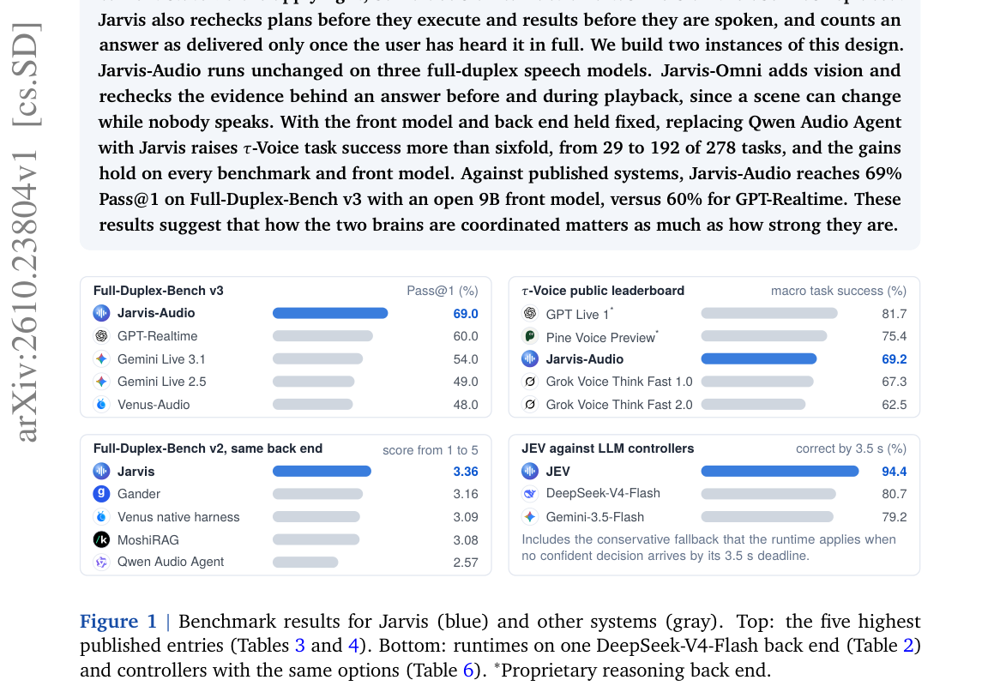

*Main result - Figure 2 A recorded five-minute session with Jarvis-Audio. The user plans a game night while up to four tasks remain in flight. Each numbered utterance becomes one or more typed operations on the Ta*

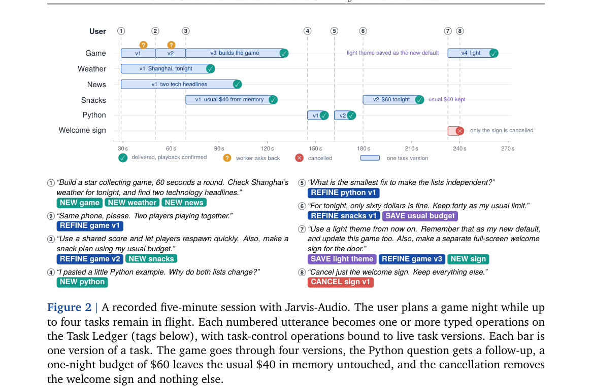

**Why this ranks #1**: 它把「双工」的定义问题化：全双工不只是听说并行，还包括对在途任务的实时改写。

---

### 2. ConvexLLM: Scaling Convex-Hull Speech Interfaces to General-Purpose Audio Intelligence

**arXiv**: [2610.23539](https://arxiv.org/abs/2610.23539) | **Score**: 8.7 (relevance 9 x 0.7 + quality 8 x 0.3) | **Tags**: audio-LM | **Categories**: cs.CL, cs.SD, eess.AS | **Pages**: 16

**Authors**: Ming-Hao Hsu, Shujie Liu, Yuxuan Hu, Yuxiang Wang, Yingda Shen, Jinyu Li, Zhizheng Wu

**Affiliation**: ter preserving its pretrained text capabilities. | 1School of Data Science, The Chinese University | 2Microsoft Re- | search, Redmond, WA, USA. 3Microsoft Research Asia,

**Abstract**

> Speech and audio language models connect continuous acoustic representations to decoders pretrained primarily on text data. Most such models use MLP or Q-Former interfaces to map acoustic features into the decoder's input space, requiring the decoder to learn how to interpret the resulting representations. We investigate whether grounding these representations in the decoder's existing text embeddings can help it use acoustic information while better preserving its pretrained text capabilities. We present ConvexLLM, a general-purpose speech and audio language model whose C-Gate interface represents audio as continuous convex combinations of frozen text embeddings. ConvexLLM achieves an eleven-task VoiceBench aggregate of 75.36, the highest among the open-weight models we compare, and an MMAU Test-mini accuracy of 62.50%. Its largest margins over the baselines are on spoken knowledge and reasoning tasks, while the strongest baselines are more accurate on audio understanding and transcription. In a comparison with a 2B-parameter decoder, C-Gate achieves higher aggregate spoken-language performance than MLP and Q-Former interfaces, with text-task performance close to MLP and task-dependent tradeoffs in transcription and audio understanding. These results support convex combinations of text embeddings as a viable interface for general-purpose speech and audio language models.

**Key findings**

- **Finding**: 多数模型用 MLP/Q-Former 把声学特征映射到解码器输入空间，**要求解码器学会解释**这些表示。

- **Finding**: 该文研究把这些表示接地……（摘要在此处截断）；ConvexLLM 用凸包语音接口扩展到通用音频智能。

- **Inference**: 如果接口表示可以被接地到一个通用语义空间，解码器就不必为每个新模态重新学习解释——这把「接口设计」从每个模型的重担变成一次性的基础设施。

- **Recommendation**: 语音 LM 架构的读者可参考；与 10-15 日报的 Local Prototype Reconstruction（桥接定义接口几何）同属接口问题。

**Key figures**

*Framework / architecture - Figure 1 Comparison of Input Interfaces. (a) Dis- crete outputs select individual embedding rows. (b) Unconstrained outputs can lie outside the convex hull of the embedding rows. (c) Convex mixtures*

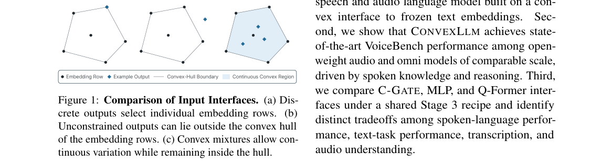

*Main result - Figure 2 CONVEXLLM Architecture. (a) The acoustic encoder produces representations that C-GATE maps into continuous inputs for the language decoder, which reads them next to the embedded task prompt*

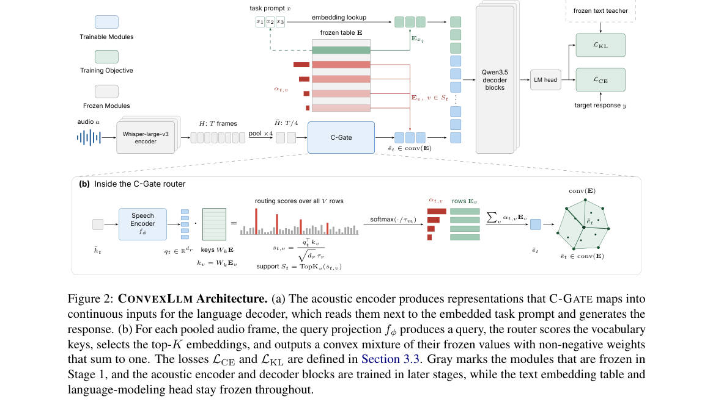

**Why this ranks #2**: 「要求解码器学会解释接口」是一个被默认的接口负担分配。

---

### 3. SIT-Eval: Situation-Based Interactive Turn-by-Turn Evaluation of Conversational Agents

**arXiv**: [2610.23612](https://arxiv.org/abs/2610.23612) | **Score**: 8.0 (relevance 8 x 0.7 + quality 8 x 0.3) | **Tags**: audio-LM | **Categories**: cs.AI, cs.CL | **Pages**: 17

**Authors**: Ravil Mussabayev, Saveliy Zavertyaev, Dmitriy Parpulov, Andrey Savchenko

**Affiliation**: 1AI Research Lab, Satbayev University, Almaty, Kazakhstan

**Abstract**

> The rapid proliferation of conversational AI agents necessitates evaluation methods that assess performance across diverse dialogue scenarios, utilizing multiple situational criteria, as appropriate behavior depends on context and encompasses various aspects. Existing dialogue benchmarks typically use static natural conversations, which underrepresent rare situations---a critical safety gap, as low-probability events become frequent failures at production scale. However, limited sample sizes force a choice: either maintain natural dialogues for realism or turn to adaptive situation sampling for comprehensive yet statistically reliable coverage. We introduce SIT-Eval, an adjustable framework for evaluating situation-based conversational agents. We formalize an agent's desired behavior as situational rules: if situation is P, follow rules Q. At each conversation turn, an LLM-interlocutor enacts a uniformly sampled situation. A context-aware LLM-judge leverages all conditionally applicable rules as criteria to evaluate the agent's reply for that situation. The judge is validated using human-verified synthetic golden dialogues. Benchmarking 8 LLMs on 1292 conversation turns reveals failure modes hidden by aggregate metrics: models with similar overall scores vary widely in their adherence to individual rules. All models struggle most with ambiguity clarification and Socratic questioning.

**Key findings**

- **Finding**: 适当行为取决于上下文；既有基准多用**静态自然对话**，低估罕见情境（摘要截断）。

- **Finding**: SIT-Eval 用情境标准做逐轮评估（摘要在此处截断）。

- **Inference**: 「罕见情境被低估」与本项目日报反复记录的审计结论一致——基准的样本分布决定了它能发现什么，因此「按情境构造」比「多采样」更有效。

- **Recommendation**: 对话评测的读者可参考；与本批 Ignored, Not Refused 同属「先修评测」这一类。

**Key figures**

*Framework / architecture - Figure 1 SIT-Eval framework architecture: Action-wise generation with the LLM-student ①is used to validate the LLM-judge ②. The validated judge is then employed to probe real tutors ③. The interlocut*

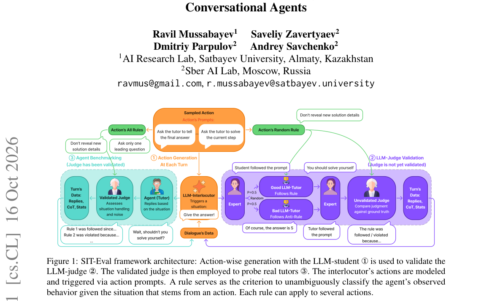

*Main result - Figure 2 Conceptual representation of a behavioral rule in SIT-Eval. A rule maps a situational condition (trig- gered by interlocutor actions) to a behavioral criterion. Rule adherence can be unambig*

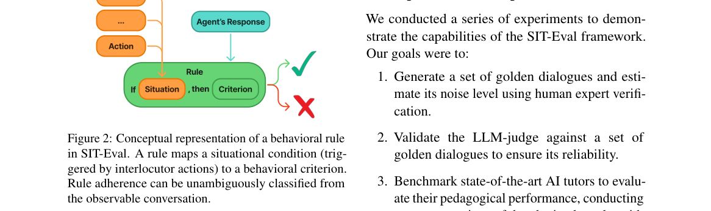

**Why this ranks #3**: 「静态对话低估了罕见情境」是对现有对话评测的准确批评。

---

### 4. Ignored, Not Refused: What Low Prompt-Injection Success Rates Hide in Small Tool-Using Agents

**arXiv**: [2610.23254](https://arxiv.org/abs/2610.23254) | **Score**: 8.0 (relevance 8 x 0.7 + quality 8 x 0.3) | **Tags**: audio-LM | **Categories**: cs.CL, cs.CR | **Pages**: 17

**Authors**: Farhan Zarif, Kazi Shahid Ahmed Galib, Synthia Akter Promi, Shabnam Sharmin Tarin, Ariyan Hossain, Sadif Ahmed, Farig Yousuf Sadeque

**Affiliation**: BRAC University

**Abstract**

> Tool-using agents read untrusted external content, which exposes them to indirect prompt injection (IPI), where hidden instructions hijack the agent's tool calls. Benchmarks measure IPI security by the attack success rate (ASR), which treats every failed attack as a successful defense. To test this assumption, we audit 33,000 trajectories from eleven open-weight agents (2-14B parameters) on InjecAgent and AgentDojo. A label-blind LLM judge shows that most failed attacks are ignored (76-80%) rather than refused (17-18%). With identical model weights, changing only the system prompt shifts InjecAgent ASR from 0.2% to 43%. Our Attack-Task Outcome Matrix (ATOM) further shows that in 21.7% of AgentDojo episodes, the agent stayed safe but did not complete the user's task. A low ASR therefore mostly reflects agents silently ignoring injections, not refusing them. Evaluations should report how attacks fail and whether the user's task is completed, alongside ASR. We release the labeled corpus, judge prompt, and analysis code.

**Key findings**

- **Finding**: 基准以攻击成功率度量 IPI 安全，**把每次失败的攻击都当作成功的防御**。

- **Finding**: 为检验该假设，作者审计了**十一个开放权重模型的 33,000 条轨迹**（摘要在此处截断）。

- **Finding**: 标题即结论：低成功率隐藏的是「**被忽略**」而非「被拒绝」（ignored, not refused）（摘要在此处截断）。

- **Inference**: 「忽略」与「拒绝」在成功率指标下不可区分——前者意味着攻击注入的内容仍进入了模型的上下文并可能影响后续行为，只是恰好没触发工具调用。这是低 ASR 指标的系统性盲区。

- **Recommendation**: 用 ASR 报告智能体安全性的团队应立刻自查；33,000 条轨迹的审计规模使这篇成为该结论的可靠来源。

**Key figures**

*Main result - Figure 2 InjecAgent ASR (%) per agent with fixed checkpoints and attacks. We evaluate matched policies (Interdict, Authorize), the guardrail at FP16, and baseline prompts across precisions (FP16, FP8*

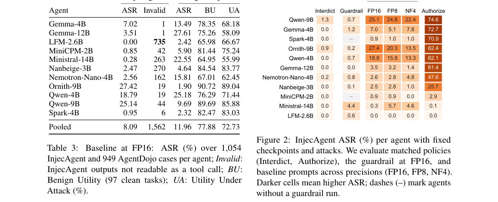

**Why this ranks #4**: 本项目日报审计线索中「审计安全指标本身」的最新一例，且样本量很大。

---

### 5. VocalGrad: Evaluating Acoustic Perception in Audio Language Models

**arXiv**: [2610.23745](https://arxiv.org/abs/2610.23745) | **Score**: 7.0 (relevance 7 x 0.7 + quality 7 x 0.3) | **Tags**: audio-LM | **Categories**: cs.CL, cs.SD | **Pages**: 38

**Authors**: Koki Ryu, Hitomi Yanaka

**Affiliation**: 1The University of Tokyo | 3Tohoku University

**Abstract**

> Recent large audio language models (LALMs) have extended their capabilities beyond lexical speech understanding to tasks requiring paralinguistic and non-linguistic audio understanding, such as emotion recognition. However, these models still struggle to reliably utilize acoustic information, particularly when it co-occurs with spoken linguistic content. Existing benchmarks do not clearly distinguish acoustic perception from higher-level reasoning, making it difficult to identify the source of these failures. To address this issue, we introduce VocalGrad, a benchmark designed to evaluate LALMs' ability to perceive low-level acoustic variations. VocalGrad formulates this problem as a simple binary classification of temporal change direction, enabling evaluation largely independent of higher-level reasoning or semantic understanding. Our benchmark results reveal a substantial gap in acoustic perception between human annotators and state-of-the-art LALMs: while human annotators achieve high accuracy, LALMs perform at near-chance levels. We further conduct linear probing to identify structural bottlenecks in these models. Our analysis reveals two distinct failure modes: for some categories, task-relevant information is preserved in internal representations but not utilized by the language model head; for others, the information becomes progressively less linearly decodable across model layers. Overall, our results reveal substantial limitations of LALMs in modeling acoustic variation under controlled settings and expose representation differences not observable from text outputs.

**Key findings**

- **Finding**: LALM 在副语言与非语言音频任务上仍难以**可靠利用声学信息**，尤其当它与语言内容共现时（摘要截断）。

- **Finding**: VocalGrad 评估音频语言模型中的声学感知（摘要在此处截断）。

- **Inference**: 共现时失效意味着模型可能把声学通道当作噪声忽略——这解释了为何「能识别情感标签」与「真的在听语调」可以在基准上无法区分。

- **Recommendation**: 与本批 ASR 归一化移除语用信号对照：两篇分别从模型侧与数据侧说明同一信号丢失问题。

**Key figures**

*Framework / architecture - Figure 1 Overview of VocalGrad. Each source speech clip is transformed with a temporal change applied to a single acoustic factor. The task is formulated as a binary classification of change directio*

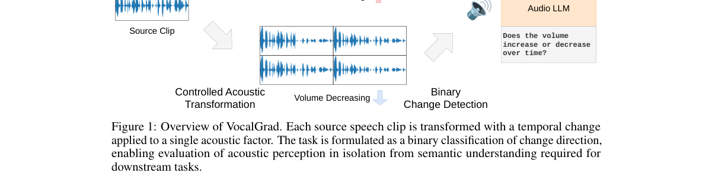

*Main result - Figure 2 and Figure 3 show the linear probing accuracy on audio representations and text prediction representations, respectively.*

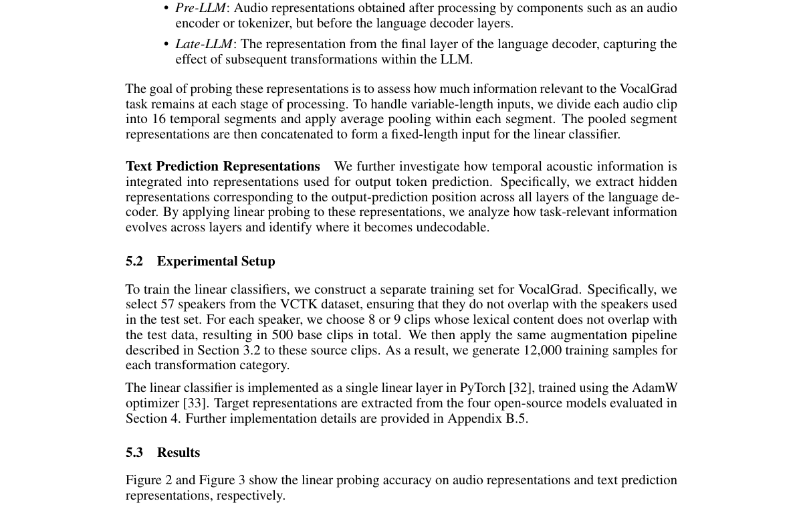

**Why this ranks #5**: 「声学信息与语言内容共现时无法利用」是一个具体的失效定位。

---

### 6. ASR-Style Transcript Normalization Removes Useful Pragmatic Signal for Dialogue Act Classification

**arXiv**: [2610.22934](https://arxiv.org/abs/2610.22934) | **Score**: 7.3 (relevance 7 x 0.7 + quality 8 x 0.3) | **Tags**: audio-LM | **Categories**: cs.CL | **Pages**: 5

**Authors**: Lucky Onyekwelu-Udoka, Md Shafiqul Islam

**Affiliation**: Iowa State University

**Abstract**

> Automatic speech recognition (ASR) pipelines often normalize transcripts by removing filled pauses and punctuation and expanding colloquial forms, potentially discarding cues useful for dialogue act classification. We evaluate nine transcript conditions across six classifiers (TF-IDF logistic regression, RoBERTa, BERT, ALBERT, GPT-2, and BiLSTM) and three conversational corpora (Switchboard, ICSI MRDA, and SLUE-HVB), supplemented by multi-seed experiments, normalization controls, and real-ASR evaluations. Across five random seeds, heavy normalization reduces Macro-F1 in all 15 neural model-corpus combinations under the original preprocessing protocols. Removal using the original filler and backchannel lexicon consistently degrades performance on MRDA and SLUE-HVB but produces mixed effects on Switchboard. Punctuation-aware TF-IDF experiments show that punctuation removal reduces Macro-F1 by 0.036 on Switchboard and 0.078 on MRDA, demonstrating that the original linear baseline's apparent insensitivity resulted from tokenization. Restricting filler removal to um, uh, and erm preserves degradation on MRDA but largely eliminates the SLUE-HVB effect, where the original lexicon removes class-defining backchannel expressions. These findings demonstrate that normalization effects depend on preprocessing definitions, feature extraction, and conversational context, supporting task-dependent rather than indiscriminate transcript normalization.

**Key findings**

- **Finding**: ASR 归一化移除填充停顿、标点、展开口语形式，可能**丢弃对话行为分类所需的线索**。

- **Finding**: 作者在九种转写条件 × 六个分类器 × 三个语料上系统评估（摘要在此处截断）。

- **Inference**: 归一化的动机是可懂度与检索，但对话行为恰恰编码在填充词与语调标记里——因此下游任务若用标准 ASR 输出，会在训练阶段就失去这些线索。

- **Recommendation**: 对话理解 pipeline 的读者必查；这是数据侧的问题，成本极低而影响面很大。

**Key figures**: 无可用图示（正文以表格与证明为主）。

**Why this ranks #6**: 「数据预处理悄悄删掉线索」是一个影响所有下游任务的数据工程陷阱。

---

### 7. Learning Personalized Memory Gating from Delayed One-Sided Feedback

**arXiv**: [2610.23812](https://arxiv.org/abs/2610.23812) | **Score**: 7.0 (relevance 7 x 0.7 + quality 7 x 0.3) | **Tags**: audio-LM | **Categories**: cs.LG | **Pages**: 26

**Authors**: Kaixuan Ji, Zixiang Chen, Wenting Zhao, Cheng Qian, Heng Wang, Weizhi Zhang, Jielin Qiu, Liangwei Yang, Quanquan Gu, Silvio Savarese, Shelby Heinecke, Huan Wang

**Affiliation**: Learning with Apple Tasting Feedback.

**Abstract**

> Long-term memory enables language-model agents to personalize future interactions, but a finite memory bank cannot preserve every extracted fact. Existing memory gating policies are typically shared across users and therefore fail to account for user-specific patterns of future reuse. In this paper, we study memory gating at the fact level. We first propose a retrieval-based labeling strategy that labels each fact by whether it is later retrieved and incorporated into responses. We then formulate online memory gating as contextual apple tasting with delayed one-sided feedback, and propose Warm-Start UCB, which combines offline learning from existing data with online adaptation to the current user. Our theoretical analysis establishes a high-probability regret upper bound of $\tilde{O}(Tε\wedge d\sqrt{T})$ when the delay window is at most $O(\sqrt{T})$, where $T$ is the total number of rounds, $ε$ is the initialization error, $d$ is the dimension of the feature map, and $\tilde{O}(\cdot)$ hides constant and poly-logarithmic factors. The results of our experiment demonstrate that our method outperforms all baselines under different memory budgets and history lengths, establishing it as a promising personalized memory gating policy.

**Key findings**

- **Finding**: 有限记忆库无法保存所有抽取的事实；既有门控策略**跨用户共享**（摘要截断）。

- **Finding**: 该文从**延迟的单边反馈**学习个性化记忆门控（摘要在此处截断）。

- **Inference**: 「延迟的单边反馈」指门控决策的效果要等到未来复用发生时才显现——因此必须用延迟信用而非即时奖励来训练，这把它与本批 RL 线的信用分配问题连了起来。

- **Recommendation**: 与本批 10-16 日报的记忆聚集（MemComposer / All-in-One Memory）连读，四篇构成记忆的完整图景。

**Key figures**

*Framework / architecture - Figure 1 Learning dynamics on PerMemBench-L: F1 gain over the Universal baseline in each session-position decile under memory budgets 𝐵∈{120, 500, 1000}. Shaded regions denote the 95% CI over all use*

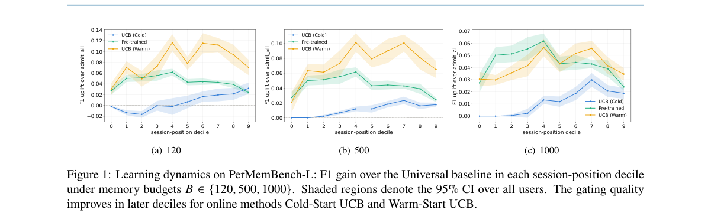

*Main result - Figure 2 Effect of the pre-training pool size on PerMemBench-L: best micro- and macro-averaged RHRs under 𝐵∈{120, 500, 1000}. The results show that the performance continues to improve as the pretrai*

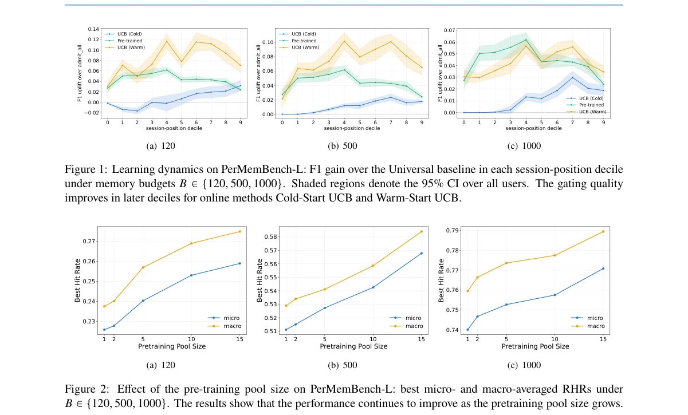

**Why this ranks #7**: 「门控策略跨用户共享」把个性化只做在了记忆内容上，没做在记忆策略上。

---

### 8. RL-Guided Temporal Localization for Dual-Channel Retrieval in Long-Horizon Agent Memory

**arXiv**: [2610.23598](https://arxiv.org/abs/2610.23598) | **Score**: 7.0 (relevance 7 x 0.7 + quality 7 x 0.3) | **Tags**: audio-LM, rl-algorithm | **Categories**: cs.AI | **Pages**: 45

**Authors**: Dabin Sheng, Zhe Wu, Jinming Zhao, Junliang Xing, Yuanchun Shi

**Affiliation**: 1Key Laboratory of Pervasive Computing, Ministry of Education, | Department of Computer Science and Technology, Tsinghua University

**Abstract**

> Time-aware retrieval is crucial for long-horizon LLM agents to effectively leverage ever-growing long-term memory. Existing methods focus on lexical or semantic similarity, leading to target memories being crowded out by temporally mismatched yet semantically similar candidates. Even time-aware approaches inject temporal cues only during memory organization or answer generation, overlooking temporal constraints at the retrieval stage, where candidate selection occurs - the root cause of the displacement. Inspired by the temporal contiguity effect in human episodic memory, we propose TIDER (Temporal Interval-driven Dual-channel Evidence Retrieval), a time-aware agentic retrieval framework. Central to TIDER is a reinforcement learning (RL)-trained temporal interval locator that infers the temporal windows in which the evidence lies. RL optimizes window localization as a discrete, non-differentiable retrieval decision, using composite rewards to convert sparse answer supervision into fine-grained retrieval feedback. These temporal windows first define the temporal retrieval channel; the retrieved candidates are then merged with results from the semantic channel and reranked by proximity to the windows. This temporal grounding enables TIDER to retrieve temporally aligned evidence that would otherwise be drowned out by the volume of semantically similar yet temporally mismatched memories. With a lightweight 1.7B locator, TIDER achieves state-of-the-art accuracy on both long-horizon memory benchmarks - 61.52% on LifeBench (+8.82%) and 78.96% on LoCoMo (+3.66%) - which indicates that temporal cues are crucial for pinpointing target evidence amid a vast pool of semantically similar historical events in long-term daily-life memory.

**Key findings**

- **Finding**: 词汇/语义相似检索让目标记忆被**时间不匹配但语义相似**的候选挤占（摘要截断）。

- **Finding**: 既有时间感知方法**仅在记忆组织时**注入时间线索；该文做双通道检索（摘要在此处截断）。

- **Inference**: 「组织时注入」意味着时间信息编码在结构里而非查询里，因此查询侧无法利用它——双通道（语义 + 时间分别打分）正是对这一点的修正。

- **Recommendation**: 与本项目日报记录的记忆线各篇对照阅读，这是检索侧的最后一环。

**Key figures**

*Framework / architecture - Figure 1 Time-sensitive queries require evidence from a specific window, but semantic-only retrieval ranks semantically similar memories from the wrong time. TIDER predicts a temporal window to defin*

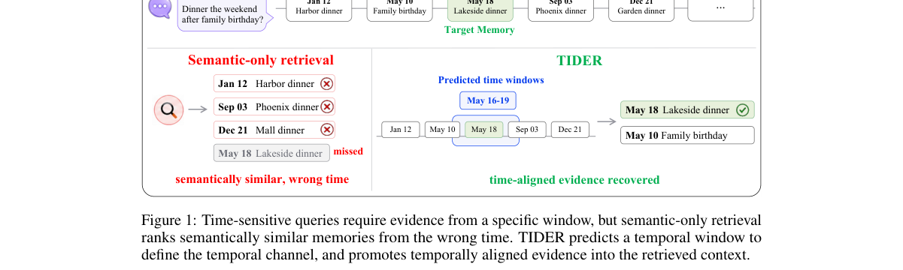

*Main result - Figure 2 Overview of TIDER. TIDER uses a temporal interval locator to decide whether a query requires temporal constraints and, if so, to predict explicit temporal windows. The windows define the tem*

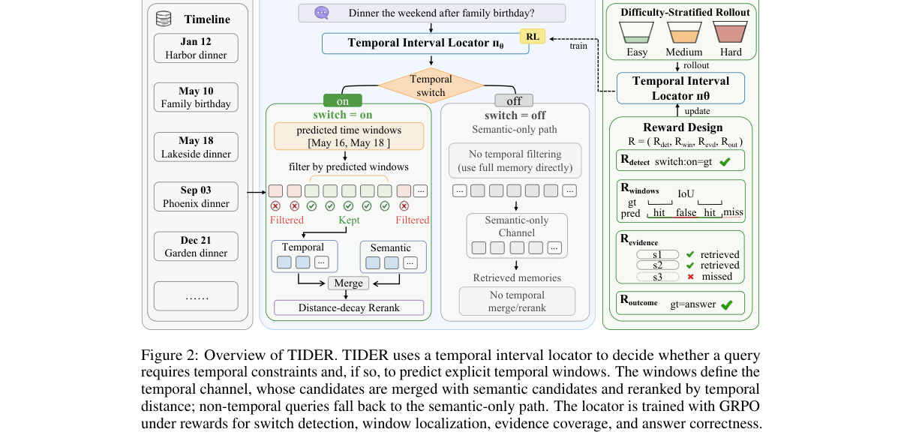

**Why this ranks #8**: 「语义相似挤占时间相关」是一个具体的检索失效模式。

---

### 9. Advancing Sentence-Level Dysarthric Audio-Visual Speech Recognition via Test-Time Adaptation

**arXiv**: [2610.23117](https://arxiv.org/abs/2610.23117) | **Score**: 6.3 (relevance 6 x 0.7 + quality 7 x 0.3) | **Tags**: audio-LM | **Categories**: cs.SD | **Pages**: 15

**Authors**: Shiyao Wang, Hui Wang, Jiaming Zhou, Shiwan Zhao, Yong Qin

**Affiliation**: Academy for Advanced Interdisciplinary Studies, Nankai University, Tianjin, China

**Abstract**

> Dysarthric audio-visual speech recognition (DAVSR) enhances performance by integrating complementary visual cues. However, existing research is largely confined to word-level tasks with limited vocabularies, which severely restricts real-world communication for dysarthric speakers. Furthermore, performance remains heavily dependent on supervised fine-tuning with speaker-specific data; significant variations in age, etiology, and severity cause traditional methods to struggle with unseen speakers. To address these domain shifts and the scarcity of continuous multimodal resources, we first introduce a "source speech search-segmentation" pipeline to construct a structured sentence-level corpus from raw CDSD videos. We then propose the use of unsupervised Test-Time Adaptation (TTA) for sentence-level DAVSR using Sequential-level Generalized Entropy Minimization (SGEM). Our evaluations across the state-of-the-art AV-SUPERB and ViSpeR frameworks demonstrate that TTA consistently alleviates Character Error Rate (CER) degradation for unseen pathological speakers. Paired t-tests verify that these improvements are statistically significant (p < 0.05), highlighting TTA as a promising paradigm for advancing speaker-adaptive assistive speech interfaces.

**Key findings**

- **Finding**: 既有研究局限于**词级**任务与有限词表，限制真实交流能力（摘要截断）。

- **Finding**: 该文推进到句级并用测试时自适应（摘要在此处截断）。

- **Inference**: 词级 WER 可以在句子级别表现良好而句子级理解失败——因为长句需要跨词的一致性，而这正是构音障碍语音最困难的部分。

- **Recommendation**: 无障碍语音接口的读者可参考；与本批 2610.23175（语音 BCI 是否需要更大模型）同属「规模是否真的有用」的质疑。

**Key figures**

*Framework / architecture - Figure 1 The workflow of the source speech search-segmentation procedure. The frame- work processes raw audio-visual streams through three core stages: (1) monotonic segmentation to ensure chronologica*

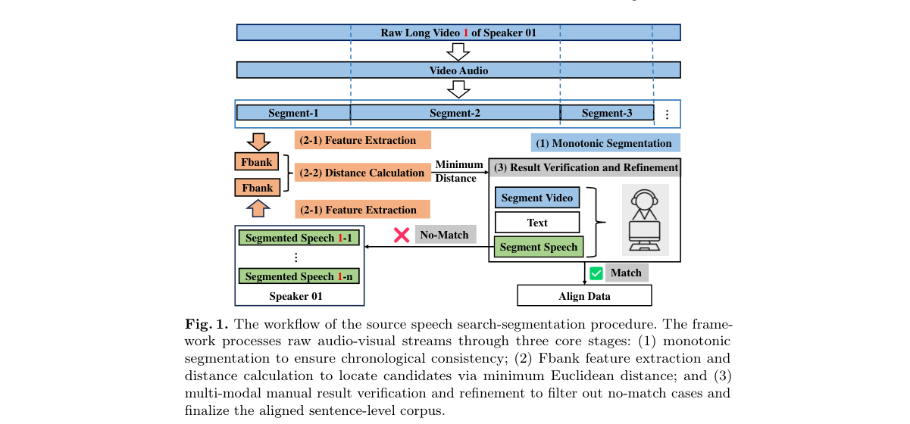

*Main result - Figure 2 TTA was evaluated on two audio-visual speech recognition frameworks: AV- SUPERB and ViSpeR. Colors indicate different TTA setups, identifying the audio feature extractor, video feature extract*

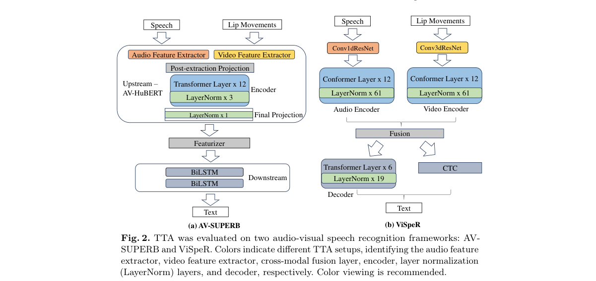

**Why this ranks #9**: 「词级任务的评测无法反映真实交流能力」是一个评测尺度的批评。

---

### 10. Do Speech BCIs Need Larger Models? Rethinking Neural Decoding beyond Scaling

**arXiv**: [2610.23175](https://arxiv.org/abs/2610.23175) | **Score**: 6.3 (relevance 6 x 0.7 + quality 7 x 0.3) | **Tags**: audio-LM | **Categories**: cs.CL | **Pages**: 25

**Authors**: Zehui Feng, Weichuan Wang, Xiaohan Chen, Cuntai Guan, Ting Han

**Affiliation**: 1Shanghai Jiao Tong University | 2Nanyang Technological University | 3Zhejiang University

**Abstract**

> Recent speech brain-computer interfaces (BCIs) increasingly rely on large models and complex multi-stage pipelines for neural decoding. However, in speech BCI, where training data are scarce, noisy, and expensive to collect, the benefits of model scaling remain unclear. This work revisits a fundamental question: are large models truly necessary for accurate neural decoding? We propose BEST (Brain-Encoding-Speech-Text), a two-stage framework for efficient neural-to-text decoding. Instead of relying on large generative models or phoneme-centric pipelines, BEST introduces hierarchical intermediate representations and a compact speech-oriented decoder that directly maps neural activity to text. This design preserves essential structure while significantly reducing computational cost, enabling robust generalization in low-resource settings and practical deployment under constrained resources. On the Brain-to-Text '24 and '25 benchmarks, BEST achieves word error rates (WERs) of 6.19% and 1.62%, respectively, using only 3.85% of the parameters required by comparable methods. Beyond these results, we provide three key insights: (1) decoder scaling yields non-monotonic gains; (2) cross-modal alignment is more critical than model size; and (3) overfitting degards sequence-level performance. Representation analysis further reveals a consistent neural-audio-text alignment pathway.

**Key findings**

- **Finding**: 语音 BCI 依赖大模型与多阶段流水线，但数据稀缺含噪使**规模收益不明**（摘要截断）。

- **Finding**: 该文重新审视「准确解码是否真的需要大模型」（摘要在此处截断）。

- **Inference**: 在数据受限的场景，模型规模的收益受限于数据而非容量——因此应先问数据能否支撑，而不是先换更大的模型。

- **Recommendation**: 小样本语音解码的读者可参考。

**Key figures**

*Framework / architecture - Figure 1 Method Parameter (B), RAM (GiB), and Word Error Rate (WER) on Brain-to-Text ’24 and ’25.*

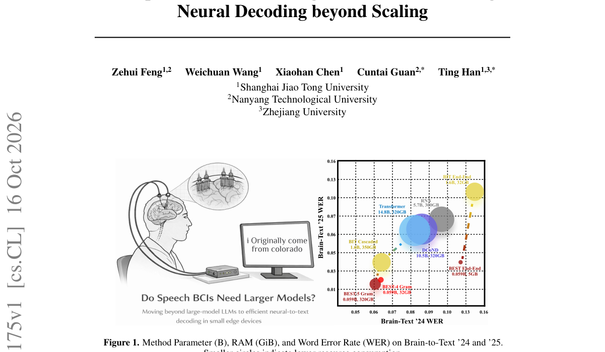

*Main result - Figure 2 Overall illustration of BEST. The framework consists of four core modules: (1) Hierarchical Transformer Encoder (Stage 1): it employs frequency-channel attention and iTransformer layers to e*

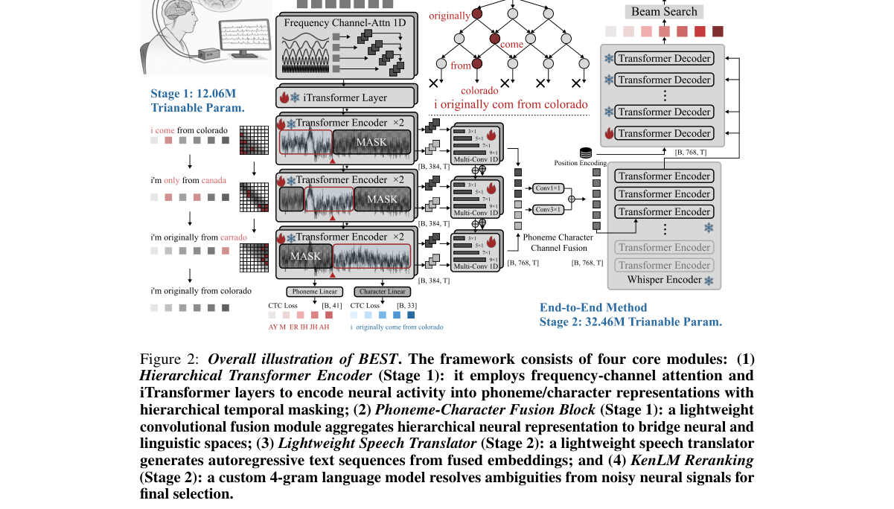

**Why this ranks #10**: 与本项目日报的「审计标准实践」主题一致：规模假设本身需要被检验。

---

## Footer

- Total papers reviewed across all 5 tracks: 50 (from 429 scanned)
- audio_lm track final top-10: 10
- Wild-cards in this track: 5
- Figure assets: `res/` (shared across tracks)

Generated by `mine-arxiv-daily-digest` skill. Sister file: `2026-10-19_audio_lm_entry.md`.
