# ArXiv Daily Digest - 2026-10-19 (具身智能与世界模型, 10 papers)

**Generated**: 2026-10-19 17:00 CST

**Source**: arXiv cs.CV, cs.SD, eess.AS, cs.CL, cs.AI, cs.RO, cs.LG submissions, window 2026-10-16 UTC (latest announced batch as of 2026-10-19 17:00 CST)

**Track**: embodied (top 10 of 429 papers scanned, 50 full reads)

**Scope**: blind manipulation via touch alone, self-evolving code policies from skills to strategies, goal-conditioned humanoid behavior world model, unifying embodied foundation models, active view imagination, object-centric rigid dynamics world model, predicting touch from egocentric video, Mamba action experts for flow-matching VLA, composable multi-arm VLA, adaptive computation budgets for real-time control

---

**触觉连续第五天出现在本日报**，而今天的两篇触觉工作恰好从两个相反方向切入。**No Eyes, No Problem** 把触觉推到极端：人类能仅凭手内触觉操控物体，而机器人**在完全无视觉**下实现持续真实操作仍是开放挑战；这是一个干净的消融设定——它把触觉从「视觉的补充」提升为**独立的操作信息来源**，因此能真正回答触觉的边际价值，而非其在有视觉系统中的增量。**Ego2Contact** 则从数据侧解决同一问题：机器人触觉数据因需专门硬件与平台特定采集而稀缺，而人类第一人称视频更易规模化，因此从后者预测接触。两条路径合起来构成了触觉线从表示到数据的完整路径。

两篇世界模型工作值得注意。**BeJEPA** 指出了一个具体的控制失效：主流人形控制器在**根坐标系**中模仿轨迹，因而**被位移后难以恢复目标世界位姿**——把「我现在的姿态」当原点使位置变化表现为分布外输入；目标条件的世界模型把世界位姿显式放进条件，从表示上消除错配。**Model-to-Policy Formulation** 则第二次尝试统一 VLA 与 WAM（10-15 的 Thinker-WM 是第一次），从表述层面让「什么时候该加世界预测」成为一个可比较的选择。

另有两篇属于**效率与元推理**。**MambaAct** 直指流匹配 VLA（如 π0.5）的推理瓶颈：动作专家在迭代去噪中被反复评估，而 Mamba 的选择性状态空间特性正适合动作演化在时间上近似线性的结构。**Learning Robot Metareasoning** 把「承诺长度」明确表述为计算预算与反馈频率的权衡——与 10-16 的 Fast-VLA（任务理解变化慢于机器人状态）是同一时间尺度论证的推广。

---

## Top 10 - 具身智能与世界模型

### 1. No Eyes, No Problem: What Does Touch Contribute to Blind Baoding Ball Manipulation?

**arXiv**: [2610.23438](https://arxiv.org/abs/2610.23438) | **Score**: 9.0 (relevance 9 x 0.7 + quality 9 x 0.3) | **Tags**: embodied-ai | **Categories**: cs.RO | **Pages**: 9

**Authors**: Ayush Deshmukh, Nalin Agarwal, Elle Miller, Sethu Vijayakumar

**Affiliation**: [not-found in PDF]

**Abstract**

> Humans manipulate objects within their hands through touch alone with remarkable ease, but for robots, achieving sustained real-world manipulation without vision remains an open challenge. Although reinforcement learning (RL) can generate sophisticated blind manipulation policies in simulation, transferring them to a real dexterous hand remains hindered by continuously changing contacts, motion-induced tactile information drift, and the gap between simulated and physical dynamics. We study this problem through Baoding ball rotation on the Shadow Dexterous Hand Lite, using only proprioception and binary tactile feedback as observations. We achieve successful zero-shot transfer through a combination of a sensor-aligned, coupling-aware embodiment in simulation, tactile calibration, and two novel episodic domain randomisations: slew-rate action limits and STuck-AT Taxels. On the physical hand, the policy achieves sustained blind Baoding rotation, completing 225 consecutive $\mathbf{180^\circ}$ rotations (112.5 full rotations) at $\sim0.36 \;\text{rot/s}$ in a single continuous trial without any vision or object-state information. Furthermore, we evaluate the contribution of tactile sensing relative to proprioception alone and identify the hand regions where tactile information is most important. This is the strongest reported hardware result for Baoding ball manipulation in both rotation count and speed, irrespective of the sensing modality used. By effectively bridging the sim-to-real gap, our framework sets a new benchmark for sustained tactile-driven dexterous manipulation on physical hardware.

**Key findings**

- **Finding**: 纯触觉操控对人类轻松，对机器人是开放挑战——RL 能在仿真中生成复杂盲操作策略，但迁移到真实……（摘要截断）。

- **Finding**: 该文以「乒乓球拍运球」为测试床，系统追问触觉在无视觉条件下到底贡献了什么（摘要在此处截断）。

- **Inference**: 「无视觉」是一个干净的消融设定：它把触觉从「视觉的补充」提升为「独立的操作信息来源」，因此能真正回答触觉的边际价值，而非其在有视觉系统中的增量。

- **Recommendation**: 被精读的三篇之一。接上 10-15 触觉综述、10-16 Spark-0（空间对齐触觉预训练），是这条触觉线的第三篇高价值工作。

**Key figures**

*Framework / architecture - Figure 1 Zero-shot sim-to-real transfer of blind dexterous manipulation. A 1.2-second 180◦Baoding ball rotation sequence in simulation (top) and on the physical Shadow Dexterous Hand Lite (bottom) at m*

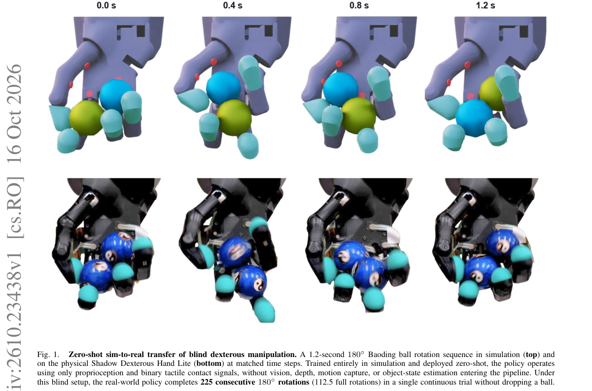

*Main result - Figure 2 FSR setup on the Shadow Dexterous Hand Lite. (a) The physical hand, with the FSR placements labelled. (b) The simulation model of the same hand, with the joints labelled; the FSRs are shown in*

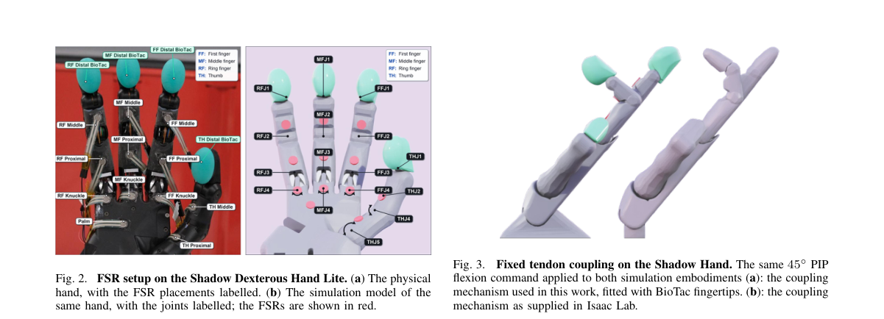

**Why this ranks #1**: 触觉连续第五天出现在本日报，而今天这篇把触觉推到「视觉完全缺席」这一极端设定。

---

### 2. CoEvolve: Self-Evolving Code Policies from Skills to Strategies for Humanoid Robots

**arXiv**: [2610.23288](https://arxiv.org/abs/2610.23288) | **Score**: 8.7 (relevance 9 x 0.7 + quality 8 x 0.3) | **Tags**: embodied-ai | **Categories**: cs.RO | **Pages**: 21

**Authors**: Zicheng Liu, Haochen Wu, Jiawei He, Suyun Zhao, Huan Yang, Cheng Chi, Hao Tang

**Affiliation**: 1Peking University | 2Renmin University of China | 3Beijing XYZ Embodied AI Co., Ltd. | 4Beijing Academy of Artificial Intelligence (BAAI)

**Abstract**

> Recent advances in Vision-Language-Action (VLA) models and World Action Models (WAMs) have expanded the manipulation and whole body capabilities of individual robots. Yet a single robot remains limited by its embodiment, and many real world tasks require capabilities that can only emerge through cooperation. Existing multi robot frameworks largely emphasize task decomposition, allocation, and replanning, while providing limited support for adapting executable coordination when physical execution deviates from the intended behavior. We present CoEvolve, a framework that represents team coordination as executable code over fixed robot motor skills. CoEvolve introduces Verifier Guided Coordination Evolution, where a multimodal foundation model instantiates coordination strategies through motion primitives, semantic objectives, temporary robot roles, and bounded execution parameters. Physical verification evaluates each executed transition, rejected behaviors trigger structured coordination revision from an accepted checkpoint, and verified experience is retained to guide subsequent decisions. We evaluate CoEvolve with two simulated Unitree G1 humanoids transporting a freely supported rigid payload through constrained corridors. Across 15 base task runs with three multimodal backbone families, CoEvolve completes 8 tasks, with every backbone achieving end to end success. Additional evaluations yield verified placement on two additional corridor layouts and after both same-backbone and cross-backbone experience initialization, while exposing persistent limitations in motion precision and contact stability. These results support executable coordination as a practical interface for adapting long horizon multi robot collaboration under shared physical constraints.

**Key findings**

- **Finding**: VLA/WAM 扩展了单机器人能力，但单台机器人受本体限制，许多任务需要协作才能涌现能力（摘要在此处截断）。

- **Finding**: CoEvolve 从技能演化为代码策略以支撑人形机器人的协作（摘要在此处截断）。

- **Inference**: 「代码策略」意味着策略是可读写的程序而非权重——这把机器人间的知识迁移从参数匹配变成程序组合，使不同本体的机器人可以共享高层行为。

- **Recommendation**: 与本批 Model-to-Policy 统一框架对照：一篇给统一表述、一篇给可进化的具体载体。

**Key figures**

*Framework / architecture - Figure 1 Motivation and overview of CoEvolve. The schematic contrasts individual manipula- tion with coordinated transport of a shared payload. CoEvolve combines executable team policies, physical ve*

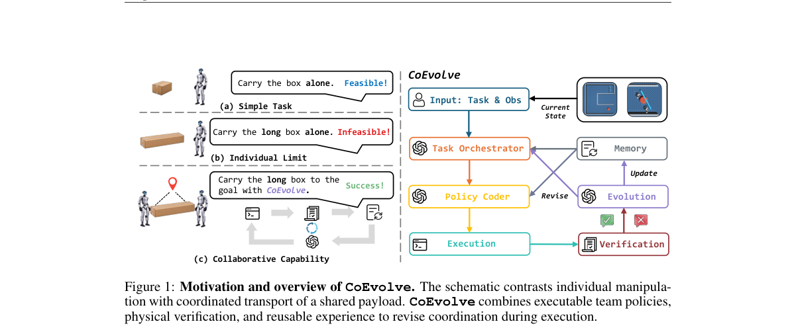

*Main result - Figure 2 Framework of CoEvolve. The Task Orchestrator commits a team subtask, which the Policy Coder grounds into executable robot policies. Physical verification accepts or rejects the resulting tra*

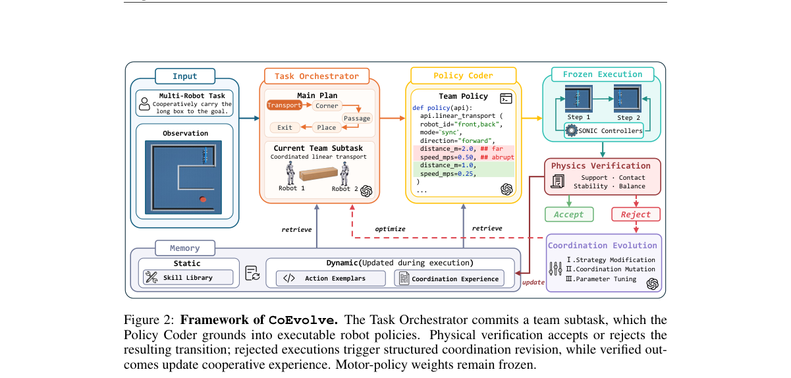

**Why this ranks #2**: 「把技能升级为策略再跨机器人组合」是一个自进化的具体机制，而非泛泛的自改进。

---

### 3. BeJEPA: A Goal-Conditioned Humanoid Behavior World Model via Unsupervised RL

**arXiv**: [2610.23127](https://arxiv.org/abs/2610.23127) | **Score**: 8.7 (relevance 9 x 0.7 + quality 8 x 0.3) | **Tags**: world-model, embodied-ai | **Categories**: cs.RO | **Pages**: 22

**Authors**: Liyun Yan, Haoyang Li, Yang Zhang, Jialing Zhu, Zhanxiang Cao, Zihao Zhou, Keqi Zhu, Yizhi Chen, Huang Chuxuan, Shengcheng Fu, Zhong Jiangwei, Qiao Sun

**Affiliation**: Yue Gao1,2,† | 1RL2 Lab, Shanghai Jiao Tong University | 2Shanghai Innovation Institute | 3Zhejiang University

**Abstract**

> Humanoid control requires coordinating whole-body posture with position and heading in the world frame. Mainstream controllers imitate trajectories in the root frame, but struggle to regain the target world pose after displacement. We introduce BeJEPA, a goal-conditioned Behavior World Model learned through unsupervised reinforcement learning from human motion priors and robot interaction. BeJEPA learns a shared representation of body configuration and world placement through a joint-embedding predictive architecture (JEPA). A Dynamic Predictor predicts the next state embedding under an action, while a Successor Predictor summarizes a goal-conditioned policy's expected discounted future state embeddings in a single vector. During joint training, Dynamic grounds the initial representation in observed physical transitions, while Successor increasingly organizes it around long-term behavior. Their composition guides policy improvement through one physical prediction and one behavioral summary, without long imagined rollouts. In 20-second motion-tracking experiments, BeJEPA with online action refinement using Dynamic outperforms all evaluated baselines in global body-position error, reducing it on AMASS by 61.7% relative to BFM-Zero with world-pose inputs and 58.7% relative to SONIC. Physical deployment on a Unitree G1 demonstrates joint attainment of posture, world position, and heading goals, recovery from the ground, and closed-loop return after disturbances and goal changes. Project page: https://ylyem9x.github.io/BeJEPA-project.

**Key findings**

- **Finding**: 主流控制器在**根坐标系**中模仿轨迹，因而在被位移后难以恢复目标世界位姿。

- **Finding**: BeJEPA 是通过无监督 RL 学习的目标条件行为世界模型（摘要在此处截断）。

- **Inference**: 在根坐标系下训练使策略把「我现在的姿态」当作原点，因此位置变化表现为分布外输入；目标条件的世界模型把世界位姿显式放进条件，从表示上消除了这个错配。

- **Recommendation**: 与本批 AWAM（主动视角想象）对照，两篇都在处理「坐标系/视角与策略不匹配」。

**Key figures**

*Framework / architecture - Figure 1 BeJEPA: a goal-conditioned Behavior World Model for humanoid control. Left: our goal is to jointly control world position, heading, and whole-body posture. Center: Dynamic and Successor lear*

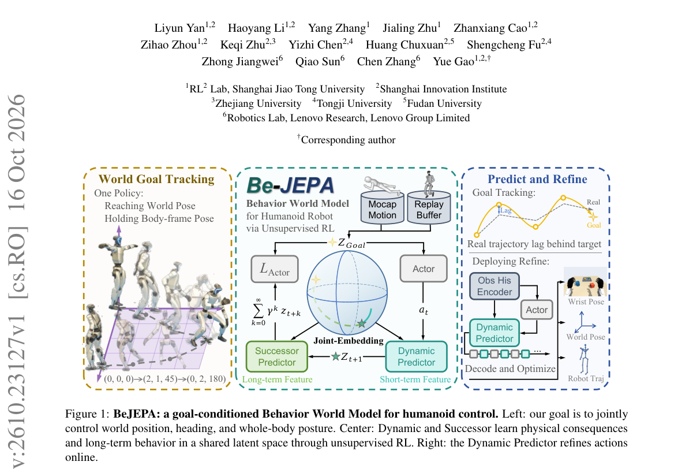

*Main result - Figure 2 Overview of the BeJEPA architecture. Dynamic predicts the observed next latent, while Successor learns discounted continuation under the collection goal. Both objectives update the shared en*

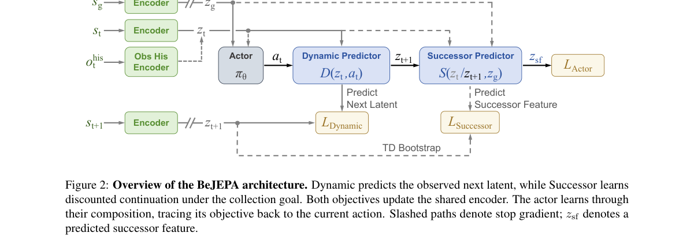

**Why this ranks #3**: 「被位移后恢复不了目标位姿」是一个具体的、可测的控制失效，且根坐标系模仿是其直接原因。

---

### 4. Unifying Embodied Foundation Models via a Model-to-Policy Formulation

**arXiv**: [2610.23053](https://arxiv.org/abs/2610.23053) | **Score**: 8.7 (relevance 9 x 0.7 + quality 8 x 0.3) | **Tags**: embodied-ai, world-model | **Categories**: cs.AI, cs.LG, cs.RO | **Pages**: 12

**Authors**: Xinyi Hong, Mingyang Ren

**Affiliation**: Department of Statistics, School of Mathematical Sciences | Shanghai Jiao Tong University

**Abstract**

> Vision-language-action (VLA) models and world-action models (WAMs) have emerged as promising approaches to robot learning and control. These models integrate multimodal perception and action generation, but differ in their architectures, output representations, and learning objectives. In this paper, we present a unified, architecture-agnostic probabilistic formulation for embodied foundation models based on stochastic kernels. Our formulation has two key components: (i) we characterize embodied foundation models through conditional output distributions and action-realization kernels, which together induce task-conditioned robot policies; and (ii) we connect pretraining and post-training to policy deployment, accommodating model-specific pretraining objectives and offline or online post-training strategies. We instantiate the formulation for OpenVLA and DreamZero, covering autoregressive action-token prediction and joint video-action generation.

**Key findings**

- **Finding**: VLA 与 WAM 在架构、输出表示与学习目标上各不相同（摘要在此处截断）。

- **Finding**: 该文用 model-to-policy 形式化统一（摘要在此处截断）。

- **Inference**: 统一表述的价值在于让「什么时候该加世界预测」变成一个可比较的选择，而非两个社区各自默认自己的路线。

- **Recommendation**: 与 10-15 日报的 Thinker-WM（共享多模态骨干的统一世界模型）对照，两篇从表示与表述两侧统一。

**Key figures**: 无可用图示（正文以表格与证明为主）。

**Why this ranks #4**: VLA 与 WAM 的碎片化问题第二次被点出（10-15 的 Thinker-WM 是第一次）。

---

### 5. AWAM: Active Trajectory-Conditioned View Imagination for Robust Robot Manipulation

**arXiv**: [2610.23396](https://arxiv.org/abs/2610.23396) | **Score**: 8.0 (relevance 8 x 0.7 + quality 8 x 0.3) | **Tags**: embodied-ai | **Categories**: cs.AI, cs.RO | **Pages**: 18

**Authors**: Jiawei Geng, Zhenyang Liu, Yuzheng Wu, Yanwei Fu

**Affiliation**: 1Fudan University | 2Shanghai Innovation Institute

**Abstract**

> Rapid progress in embodied intelligence has enabled increasingly capable robots to follow language instructions and manipulate diverse objects. However, strong results in structured environments do not automatically transfer to open-world conditions, where clutter, occlusion, and changing viewpoints can obscure the spatial relationships required for action. To address this perceptual gap, a virtual active-perception paradigm is introduced. AWAM, an Active World-Action Model actively plans where to observe and imagines what will be seen along the planned trajectory before acting. Task-related virtual camera motion is predicted and used as a structured query into a geometry-conditioned world model, producing a reusable spatial prior for manipulation, which is later compressed into a fixed memory and fused with live observations through cross-attention for diffusion-based action prediction. AWAM achieves competitive success rates with 75.9% on LIBERO-Occ, 62.4% on LIBERO-Plus, 76.5% on RLBench-OG Occlusion1, and 94.4% in real-robot trials. These results support improved robustness to the evaluated occlusions and distribution shifts, addressing part of the gap between structured manipulation and less controlled environments.

**Key findings**

- **Finding**: 结构化环境的强结果不自动迁移到开放世界（杂物、遮挡、变化视角）（摘要截断）。

- **Finding**: AWAM 做轨迹条件化的**主动视角想象**以提升鲁棒操作（摘要在此处截断）。

- **Inference**: 把失败归因于「没看清」而非「不会做」，因此解法是主动获取视角而非改进策略——这与本批 10-16 日报的 MAIA（预判交互异常）共享同一诊断结构。

- **Recommendation**: 与本批 AWAM / 10-16 的 MAIA 对读，两篇分别预判视角不足与交互异常。

**Key figures**

*Framework / architecture - Figure 1 Overview of AWAM. From partially observed initial RGB-D inputs, AWAM imagines task-conditioned virtual views and compresses them into a predictive memory once per episode. The policy then re*

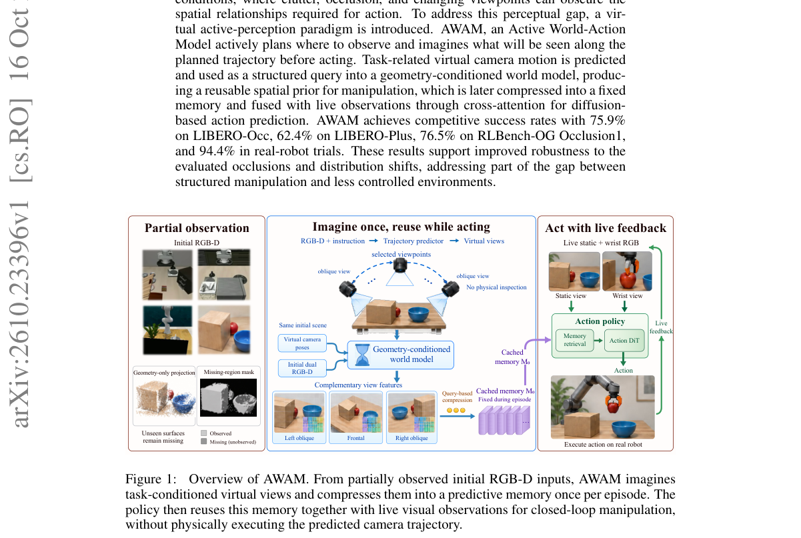

*Main result - Figure 2 Overview of AWAM. A task-guided virtual camera trajectory guides a geometry- conditioned world model to construct predictive memory once per episode. During closed-loop control, the cached w*

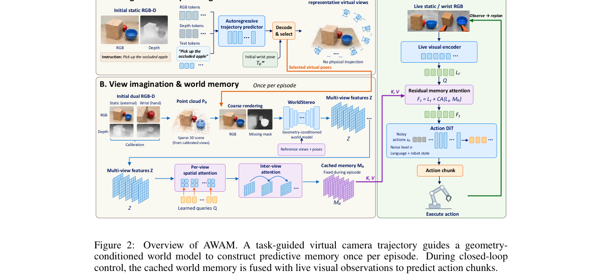

**Why this ranks #5**: 「主动想象视角」把开放世界失败归结为观察不充分，而非策略能力不足。

---

### 6. ORD-WM: Learning Object-Centric Rigid Dynamics for 3D World Modeling in Robotic Manipulation

**arXiv**: [2610.23156](https://arxiv.org/abs/2610.23156) | **Score**: 8.0 (relevance 8 x 0.7 + quality 8 x 0.3) | **Tags**: world-model | **Categories**: cs.RO | **Pages**: 30

**Authors**: Yueyang Weng, Xiaopeng Zhang, Yuxi Ou, Yongjin Mu, Chengzhi Zhao, Yanjie Li

**Affiliation**: Harbin Institute of Technology, Shenzhen | (VN) [9] variational autoencoder (VAE) [10], denoted SDF-VNVAE. Its encoder maps each ob-

**Abstract**

> World models provide robots with a predictive mechanism for reasoning about how actions change object states in manipulation tasks. However, existing image-based and dense 3D world models do not explicitly impose object-level rigid motion, leaving rigid-object geometry preservation to be learned implicitly and making multi-step rollouts susceptible to shape drift or object-level motion inconsistency. To address this, we propose ORD-WM, a 3D world model that learns object-centric rigid dynamics for robotic manipulation. ORD-WM learns a vector-neuron variational autoencoder supervised by signed distance fields, which encodes each object point cloud as a geometry-aware latent representation composed of 3D vector features, and uses an action-conditioned dynamics model to predict object-wise SE(3) motion increments. Rather than generating unconstrained next latent states, ORD-WM analytically applies predicted object-wise rigid transformations to the current latent states, separating persistent object geometry from pose changes. Experiments show that ORD-WM enables stable, geometry-preserving multi-step prediction and supports efficient real-time replanning for closed-loop model predictive control in simulated and real-world manipulation scenarios.

**Key findings**

- **Finding**: 既有世界模型未**显式施加物体级刚性运动**，刚体几何保持靠隐式学习（摘要截断）。

- **Finding**: ORD-WM 学习以物体为中心的刚性动力学用于 3D 世界建模（摘要在此处截断）。

- **Inference**: 隐式刚体保持的问题在接触密集操作中被放大——一旦几何漂移，后续的接触预测全部失效，因此显式约束的价值随任务接触度上升。

- **Recommendation**: 世界模型做操作预测的读者可参考；与 10-16 日报的 MAIA（物理交互不可由视觉完全揭示）同源。

**Key figures**

*Framework / architecture - Figure 1 In contrast to video-based rollout and point-based scene-flow prediction, which may suf- fer from visual artifacts, shape drift, or object-level inconsistency, ORD-WM performs multi-step pre*

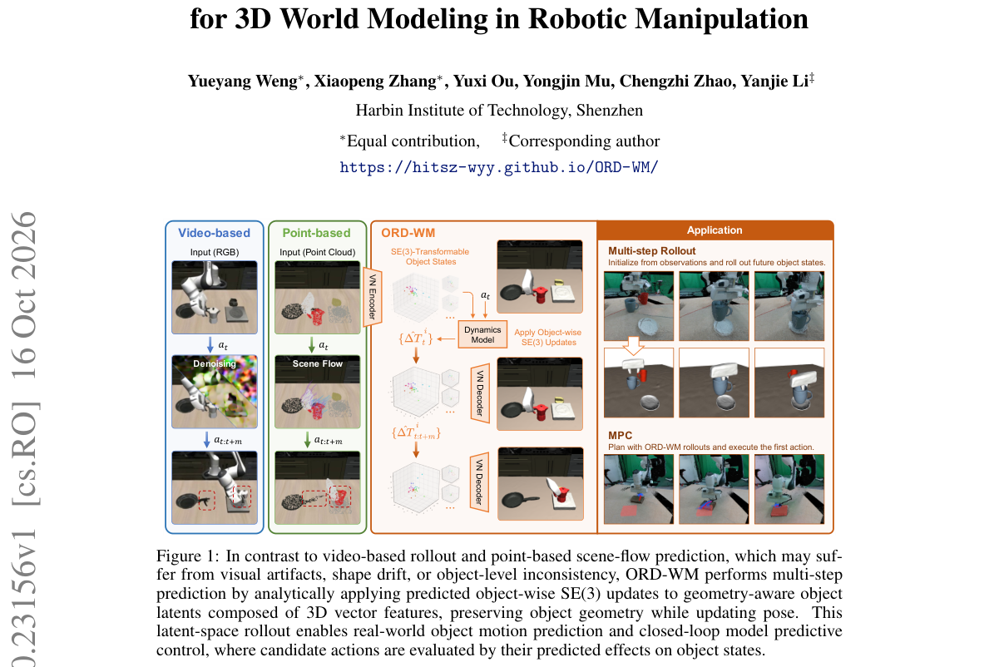

*Main result - Figure 2 Overview of SDF-VNVAE. The VN encoder maps an object-centered point cloud to a latent representation composed of 3D vector features that rotate equivariantly with the input. The decoder pred*

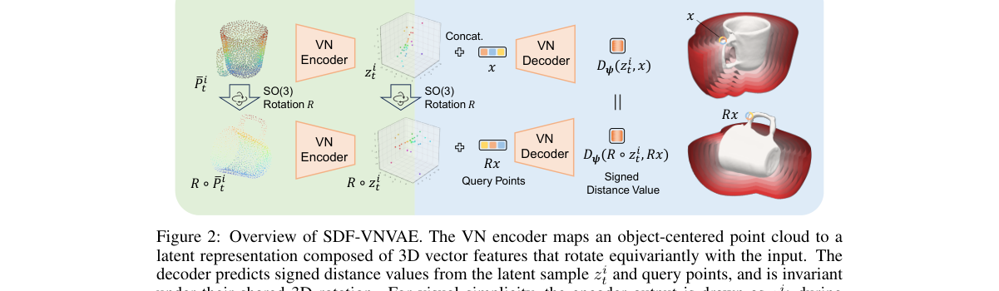

**Why this ranks #6**: 「刚体保持靠隐式学习」被明确指认为一个建模缺口。

---

### 7. Ego2Contact: Predicting Touch from Egocentric Human Video for Contact-Rich Robot Manipulation

**arXiv**: [2610.22932](https://arxiv.org/abs/2610.22932) | **Score**: 7.7 (relevance 8 x 0.7 + quality 7 x 0.3) | **Tags**: embodied-ai | **Categories**: cs.RO | **Pages**: 8

**Authors**: Qianqian Yang, Dayou Li, Bangya Liu, Zihao Zhu, Nuo Chen, Siyuan Xu, Hezhen Hu, Chen Yu, Rebecca Friesen, Minghui Zheng, Cynthia Hipwell, Xiaoning Qian

**Affiliation**: 1Carnegie Mellon University, Pittsburgh, PA, USA. | 2Texas A&M University, College Station, TX, USA.

**Abstract**

> Contact locations and interaction forces are critical for contact-rich robot manipulation but are often ambiguous from vision alone. Measuring them on robots requires specialized tactile hardware and platform-specific data collection, which keeps robot tactile data scarce. Human egocentric video is far easier to scale but lacks touch. Recent predictors trained on egocentric recordings paired with tactile-glove measurements can predict this missing signal from video alone. These predictors, however, remain confined to human hands, which differ from robot hands in appearance and tactile layout. We present Ego2Contact, which learns a visual-tactile prior from human interactions and transfers it to robot hands. Its predictor fuses temporal scene context with hand-local visual features to infer bimanual tactile fields from the RGB video. Anatomical region correspondences align varying robot tactile layouts with the predictor's canonical grid, turning robot measurements into fine-tuning targets and predictions into policy inputs. Ego2Contact outperforms prior tactile predictors on human data, including unseen objects, and on robot data after adaptation. The adapted predictor provides tactile inputs for both simulated reinforcement learning and real-robot policy post-training. In simulation, policies using predicted touch outperform non-tactile baselines and recover part of the benefit of ground-truth tactile sensing. These results show that human-learned tactile priors can supply touch when direct tactile sensing is limited.

**Key findings**

- **Finding**: 机器人触觉数据因需专门硬件与平台特定采集而**稀缺**；人类第一人称视频更易规模化。

- **Finding**: Ego2Contact 从人类第一人称视频预测接触以支撑接触丰富操作（摘要在此处截断）。

- **Inference**: 这条路径的价值在于它绕开了机器人数据采集的物理瓶颈，代价是预测精度受限于视觉对接触的可见性——因此它更可能作为数据扩增而非替代。

- **Recommendation**: 触觉数据受限的团队可参考；与本批 No Eyes, No Problem（触觉作为独立信息来源）同属触觉线。

**Key figures**

*Framework / architecture - Figure 1 From human touch to robot manipulation. We learn a visual-tactile predictor from paired human egocentric video and tactile measurements, fine-tune it to a dexterous robot hand through anatomic*

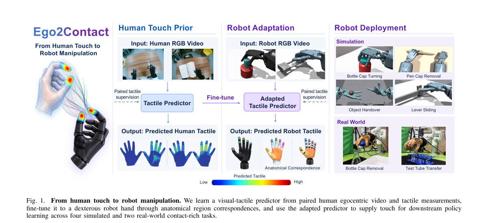

*Main result - Figure 2 Visual-tactile prediction model. Egocentric RGB frames and per-hand crops are encoded by a frozen DINOv2 (global scene context) and a frozen WiLoR backbone (hand-local features). A temporal tr*

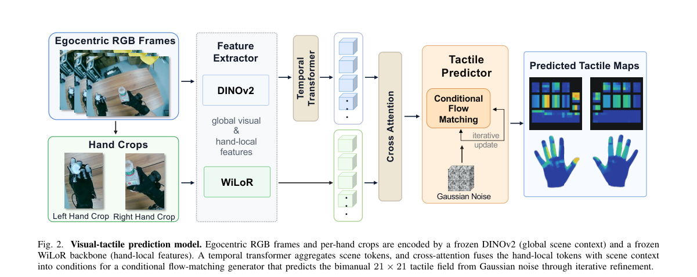

**Why this ranks #7**: 「用人类第一人称视频预测触觉」是从易获取数据补稀缺数据的直接路径。

---

### 8. MambaAct: Efficient Mamba Action Experts for Flow-Matching Vision-Language-Action Models

**arXiv**: [2610.22951](https://arxiv.org/abs/2610.22951) | **Score**: 7.7 (relevance 8 x 0.7 + quality 7 x 0.3) | **Tags**: embodied-ai | **Categories**: cs.CV, cs.RO | **Pages**: 9

**Authors**: Khuyen Pham, Tran Nguyen Le, Edoardo Fazzari, Cesare Stefanini

**Affiliation**: Technical University of Denmark.

**Abstract**

> Vision-language-action (VLA) models have shown strong promise for generalist robotic manipulation, but their inference cost remains a major bottleneck for real-time control. This limitation is especially pronounced in flow-matching VLAs such as $π_{0.5}$, where the action expert is evaluated repeatedly during iterative denoising. We introduce MambaAct, an efficient Mamba action expert for flow-matching VLA policies. MambaAct retains the pretrained visual-language prefix encoder of $π_{0.5}$, while replacing its transformer-based action expert with a compact Mamba-based action expert. Within this expert, Mamba serves as the action mixer that models dependencies across the noisy continuous-action sequence. To preserve visual-language conditioning without repeated token-level cross-attention, MambaAct uses a lightweight Context Compressor to map Vision-language model (VLM) prefix tokens into a compact conditioning signal that gates and modulates each Mamba action block. MambaAct uses a $10\times$ smaller action expert and reduces flow-matching denoising latency by $64.8\%$ on LIBERO and $58.8\%$ in real-world deployment, while improving mean LIBERO success by $1.08$ percentage points across three independent fine-tuning seeds and maintaining gains on LIBERO-Plus and real-world benchmarks. Our code and model weights are publicly available at https://github.com/giakhuyendihoc/MambaAct.

**Key findings**

- **Finding**: 流匹配 VLA（如 π0.5）的动作专家在迭代过程中被**反复评估**，构成推理成本瓶颈。

- **Finding**: MambaAct 用 Mamba 动作专家提升流匹配 VLA 的效率（摘要在此处截断）。

- **Inference**: Mamba 的选择性状态空间特性适合这里，是因为迭代去噪的动作演化在时间上近似线性——这正是 Mamba 的归纳偏置，与 DiT 的二次注意力形成对照。

- **Recommendation**: 流匹配 VLA 部署的读者可参考；与 10-16 日报的 Fast-VLA（省 VLM 调用）分属不同层的效率优化。

**Key figures**

*Framework / architecture - Figure 1 Latency decomposition of π0.5 and SmolVLA on LIBERO benchmark highlighting action generation as the dominant source of latency.*

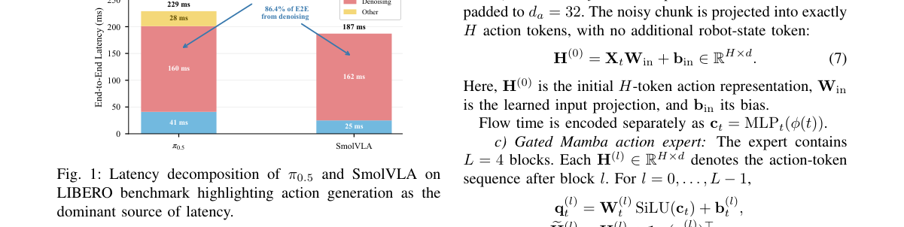

*Main result - Figure 2 MambaAct architecture. MambaAct retains and jointly fine-tunes the pretrained π0.5 visual-language backbone while replacing its Transformer action expert with a compact Mamba-3 expert. The VLM*

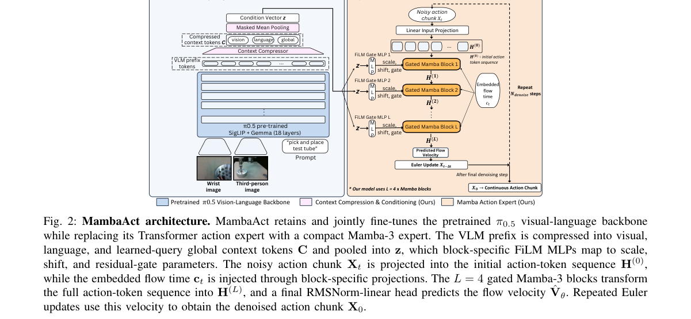

**Why this ranks #8**: 「动作专家被反复评估」直接指向流匹配 VLA 的推理成本来源。

---

### 9. VLA-Fabric: Learning Interaction for Composable Multi-Arm VLA Agents

**arXiv**: [2610.23018](https://arxiv.org/abs/2610.23018) | **Score**: 7.7 (relevance 8 x 0.7 + quality 7 x 0.3) | **Tags**: embodied-ai | **Categories**: cs.RO | **Pages**: 17

**Authors**: Chenglong Zhang, Shuaijun Liu, Feiyang You, Shuyang Hao, Chengyu Wu, Ningxin Su

**Affiliation**: 1The Hong Kong University of Science and Technology (Guangzhou)

**Abstract**

> Vision-language-action (VLA) models are rapidly expanding what individual robots can accomplish, yet many real-world manipulation settings require multiple arms to operate as a coordinated system. Existing approaches organize multi-arm coordination in different ways, including centralized joint policies, high-level task or role assignment, and locally executed policies that react to teammates. However, how complete action-producing VLAs should explicitly interact with one another during action generation remains largely unexplored. We introduce VLA-Fabric, which organizes one complete VLA per arm while preserving local perception and action ownership, and enables coordination through learned interaction across policy boundaries. We first systematically study where such interaction should occur, how peer information should be aggregated, and how the interaction should be learned, revealing complementary coordination functions spanning shared context, peer-specific latent information, and action-stage interaction. We then re-instantiate these functions in a structurally different VLA architecture, showing that the coordination principle is not tied to a particular tensor layout or backbone implementation. Finally, we compose teams of three and four arms and evaluate them in simulation and physical experiments. On all four physical tasks, Full interaction improves success over independently trained local policies by 16--40 percentage points. Together, these results suggest that explicit interaction among complete VLA policies offers a scalable path toward networked embodied intelligence.

**Key findings**

- **Finding**: 许多真实操作场景需要多臂作为协调系统；既有组织方式包括集中式联合策略、高层任务……（摘要截断）。

- **Finding**: VLA-Fabric 学习交互以支撑可组合的多臂 VLA 智能体（摘要在此处截断）。

- **Inference**: 「可组合」的含义是单臂策略可复用，这与 10-16 日报 Coordi-pi（双手动作拼接留下关系信息）指向同一问题：组合结构应编码在表示里而非拼接。

- **Recommendation**: 与 10-16 日报 Coordi-pi 对读，两篇分别从表示设计与组合机制处理多执行体。

**Key figures**

*Framework / architecture - Figure 1 From multi-arm coordination to VLA-Fabric. Complete arm-local VLAs collaborate through learned interaction; we study interaction discovery, cross-architecture transfer, and larger- team scal*

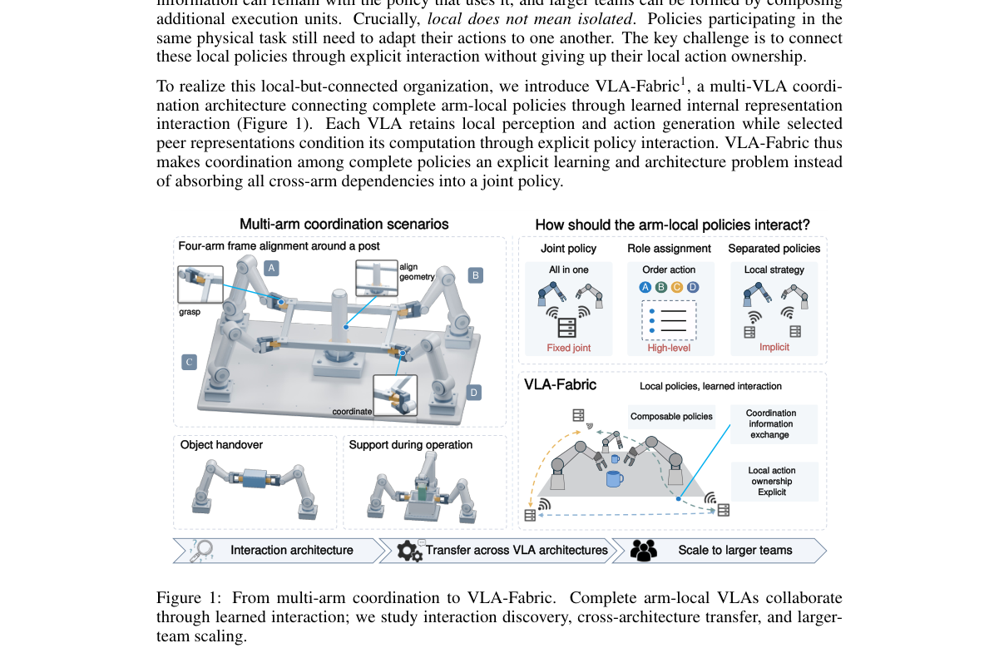

*Main result - Figure 2 Discovering the VLA-Fabric interaction architecture. (a) Search space over interaction entry, operator, and adaptation. (b) Controlled results on Handover Box and Shoes Table. Gold: 100k RAW*

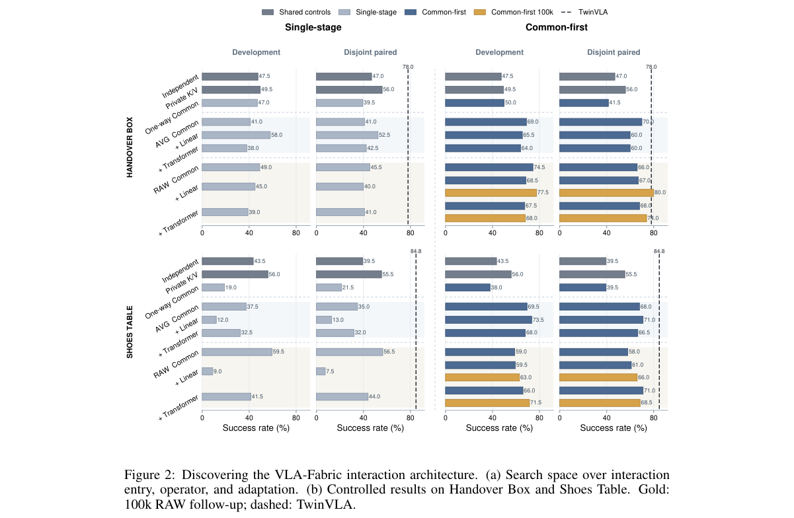

**Why this ranks #9**: 多臂协调的组织方式此前有多种互不兼容的方案。

---

### 10. Learning Robot Metareasoning: Adaptive Computation Budgets for Real-Time Control

**arXiv**: [2610.23662](https://arxiv.org/abs/2610.23662) | **Score**: 7.3 (relevance 7 x 0.7 + quality 8 x 0.3) | **Tags**: embodied-ai `[wild-card]` | **Categories**: cs.RO | **Pages**: 8

**Authors**: Lorenzo Magnino, Antonio Marino, Michael Amir, Daigo Shishika, Amanda Prorok

**Affiliation**: sity of Cambridge — Cambridge, United Kingdom. Emails: {lm2183, | lege of Engineering and Computing at George Mason University, Email:

**Abstract**

> Planning while moving faces an historical trade-off between deliberation and reactivity. A planner running concurrently with execution needs time to compute, so the robot must commit to an open-loop action chunk for that duration: a longer commitment buys a better plan at the cost of feedback frequency. Existing controllers fix this action commitment, and consequently the computation budget, before deployment. However, the optimal computation time is highly state-dependent (due to factors such as unmodeled dynamics, safety constraints, and marginal optimisation gains), i.e. dynamic, therefore offline static tuning risks leaving systems blind during critical maneuvers or unable to find global effective solutions. We cast the identification of the optimal computation budget as a semi-Markov decision process (SMDP) in which a single decision defines both the robot action commitments and the time allocated to the solver. To solve this, we train a reinforcement-learning policy conditioned on the current state, the executing plan, and inexpensive planner statistics. Across ground-robot navigation, agile quadrotor flight, and contact-rich manipulation, the learned policy changes its budget with the demands of the scenario, discovering efficient reasoning patterns that outperform fixed-budget baselines. https://lorenzomagnino.github.io/learning-robot-metareasoning-review/

**Key findings**

- **Finding**: 规划器与执行并发时，机器人必须为规划时长提交开环动作块；更长提交换更好计划但牺牲反馈频率。

- **Finding**: 该文学习机器人的元推理以获得实时控制的自适应计算预算（摘要在此处截断）。

- **Inference**: 这与 10-16 日报的 Fast-VLA（任务理解变化慢于机器人状态）是同一时间尺度论证的推广：不仅「少调用大模型」，还要「按状态变化速率分配预算」。

- **Recommendation**: wild-card 项；与 10-16 的 Fast-VLA 和 10-07 的 Commit While Futures Agree 构成同一组动作提交问题。

**Key figures**

*Framework / architecture - Figure 1 Robot Metareasoning: different states require different computation budgets. Robots must adapt their computation budget based on the situation that they are facing: (s) deliberate longer to se*

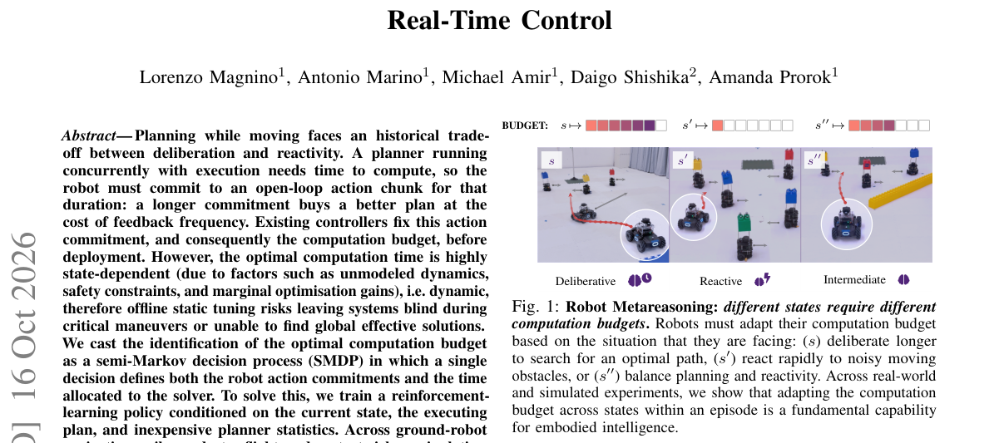

*Main result - Figure 2 Method Overview. At each decision epoch, the state, the previous plan and its statistics inform the budget policy Φθ, which selects the next execution horizon and thereby allocates the solver’*

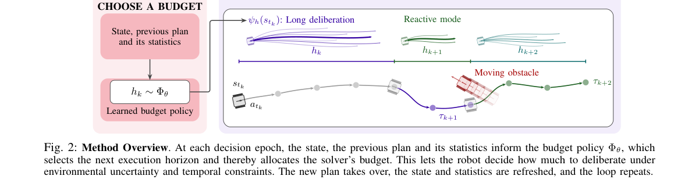

**Why this ranks #10**: wild-card：把「承诺长度」明确表述为计算预算与反馈频率的权衡，与本项目日报多次记录的动作提交问题同源。

---

## Footer

- Total papers reviewed across all 5 tracks: 50 (from 429 scanned)
- embodied track final top-10: 10
- Wild-cards in this track: 1
- Figure assets: `res/` (shared across tracks)

Generated by `mine-arxiv-daily-digest` skill. Sister file: `2026-10-19_embodied_entry.md`.
