# ArXiv Daily Digest - 2026-10-19 (强化学习, 10 papers)

**Generated**: 2026-10-19 17:00 CST

**Source**: arXiv cs.CV, cs.SD, eess.AS, cs.CL, cs.AI, cs.RO, cs.LG submissions, window 2026-10-16 UTC (latest announced batch as of 2026-10-19 17:00 CST)

**Track**: rl (top 10 of 429 papers scanned, 50 full reads)

**Scope**: grounded credit assignment for search agents, rethinking GRPO for safety alignment, whether RLVR needs long rollout windows, entropy-aware credit assignment, tree-aware posterior distillation, error-truncated hindsight distillation, reason-guided human reward modeling, multi-agent preference learning beyond reward scoring, LMs improving LMs, recovery-based shielding for regular safety properties

---

**本批最强的发现是本项目日报审计线索中最锋利的一次**：**Grounded Credit Assignment** 指出，搜索智能体的结果奖励强化学习（GRPO）给每个 token 相同优势，而该 rollout 实际同时练习「找到证据」与「使用证据」两种能力；作者进一步表明**准确率可以在没有 grounding 的情况下提升**——Search-R1 在全部七个 QA 基准上提升了准确率，但在 Bamboogle 上有证据支持的正确回答占比并未同步改善。换言之，一个旗舰 RL 方法可以在**不使用检索到的证据**的前提下刷高分数。这是基准层面的系统性盲点：七个基准全部只测准确率。

与之构成必要对照的是 **Batched Contextual RL II**：长 rollout 窗口使 RLVR 昂贵，但单纯缩短会在**每条 rollout 都截断于答案之前**时消除组相对准确率优势——组内同质则优势恒为零。两篇合起来定义了 RLVR 的真实张力：一边是长窗口下的信号可以被绕开（不 grounding 也涨分），另一边是短窗口下信号直接消失。

第三篇 **Rethinking GRPO for Safety Alignment** 把问题转到特定用途：GRPO 的组相对优化可能提供**不足的安全导向信号**，并识别出**优势坍塌**这一失效模式。当目标是安全而非能力时，坍塌更危险——因为不安全输出往往仍是「正确」的。

其余三篇在做同一件事的不同变体：用组相对优势**没被使用的免费信息**来修正它。**MGE-PO** 用生成熵——GRPO 给同等奖励的响应相同优势，但它们之间仍有熵差异被浪费；正确性决定修正的符号、熵决定幅度，无需额外的奖励模型。**Tree-Aware Posterior Distillation** 把信用单位从轮次换成树节点（与 10-16 的 KnowGPO 按知识分组同源）；**Distill Until Divergence** 则处理 hindsight 蒸馏带来的技能诱导概率偏移。

---

## Top 10 - 强化学习

### 1. Grounded Credit Assignment in Reinforcement Learning for Multi-Turn Search Agents

**arXiv**: [2610.23148](https://arxiv.org/abs/2610.23148) | **Score**: 9.7 (relevance 10 x 0.7 + quality 9 x 0.3) | **Tags**: rlhf, rl-algorithm | **Categories**: cs.LG | **Pages**: 27

**Authors**: Qirui Liu, Hao Chen, Yi Wen, Weijie Shi, Yao Zhao, Xianhe Chen, Hao Zhao, Xing Tang, Weihong Luo, Yuyu Luo

**Affiliation**: 1South China University of Technology, 2FiT, Tencent, 3City University of Hong Kong, | 4The Hong Kong University of Science and Technology, 5Nanjing University, 6Imperial College London, | 7Shenzhen Technology University, 8The Hong Kong University of Science and Technology (Guangzhou)

**Abstract**

> Outcome-reward reinforcement learning such as GRPO gives every token of a search-agent rollout the same advantage, although the rollout exercises two capabilities: finding evidence and using it. We show that accuracy improves without grounding: Search-R1 raises accuracy on all seven QA benchmarks, yet on Bamboogle the evidence-supported share of correct answers falls from 84.0% to 42.9%. We attribute this to GRPO's credit assignment: rollouts that retrieve answer-bearing evidence are favoured in aggregate only in proportion to their accuracy gain over the rest, a grounding gap that answering from memory or misusing evidence shrinks or reverses. To address this, we propose Grounded Credit Assignment (GCA), which uses verifiable sub-outcomes (evidence retrieval and answer correctness) to correct search and answer credit separately: a wrong answer is blamed more than the search that found the evidence, and a correct answer that bypasses retrievable evidence is credited less. Never negative on evidence-finding search, the correction does not shrink with the grounding gap; capped at 10% of each token's advantage, it never overrides the outcome signal. Without extra models, rollouts, or training stages, GCA improves average EM over Search-R1 by 5.7 (Qwen2.5-3B) and 6.3 points (Qwen3-30B-A3B) and raises this share from 76.9% to 93.4%.

**Key findings**

- **Finding**: GRPO 给每个 token 相同优势，而搜索 rollout 实际同时练习「找到证据」与「使用证据」两种能力。

- **Finding**: **准确率可以在没有 grounding 的情况下提升**：Search-R1 在全部七个 QA 基准上提升准确率，但在 Bamboogle 上有证据支持的正确回答占比……（摘要在此处截断）。

- **Finding**: 该文提出 grounded credit assignment，把信用按「用了证据」而非「答对了」分配（摘要在此处截断）。

- **Inference**: 这是一个基准层面的系统性盲点：七个基准全部测准确率，而准确率可以被「不检索也猜对」的策略拉高——这与本项目日报反复记录的「指标掩盖行为改变」是同一类，只是这次发生在最活跃的 RL 应用上。

- **Recommendation**: 被精读的三篇之一。用 GRPO 训练检索/搜索智能体的团队应先看这篇再定基线。

**Key figures**

*Framework / architecture - Figure 1 Outcome-only RL improves accuracy without improving grounding. (a) Share of correct answers that are supported by retrieved evidence (SUPCOR/Acc) on Qwen2.5-3B. Search-R1 raises EM on every*

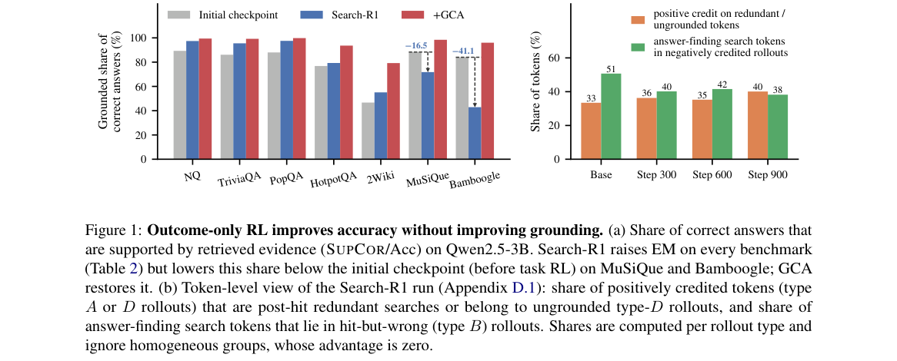

*Main result - Figure 2 Overview of GCA. (a) Uniform advantage broadcasting conflates search and answer credit within a rollout. (b) GCA diagnoses each rollout by retrieval hit H and answer correctness C, routes si*

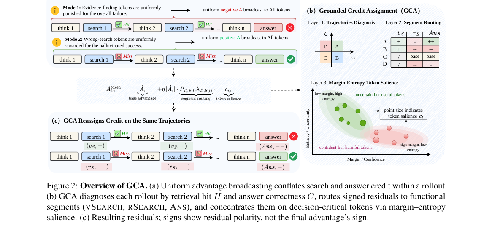

**Why this ranks #1**: 本批最强的一篇，也是本项目日报审计线索中最锋利的一次：它证明一个旗舰 RL 方法可以在**不使用证据**的前提下刷高分数。

---

### 2. Rethinking GRPO for Large Reasoning Model Safety Alignment

**arXiv**: [2610.23085](https://arxiv.org/abs/2610.23085) | **Score**: 9.0 (relevance 9 x 0.7 + quality 9 x 0.3) | **Tags**: rlhf | **Categories**: cs.AI | **Pages**: 14

**Authors**: Jiawei Chen, Yi Zhang, Jiawei Du, Zhonghou Lv, Tairan Chen, Junyuan Shang, Jinchang Hou, Xiao Yang, Yu Tian, Chenfu Bao, Chao Yu, Zhaoxia Yin

**Affiliation**: 1East China Normal University | 2Baidu Inc. | 5Stevens Institute of Technology | 6Beihang University

**Abstract**

> Large reasoning models (LRMs) exhibit strong reasoning capabilities but remain vulnerable to unsafe outputs. While Group Relative Policy Optimization (GRPO) is widely used for safety alignment, its group-relative optimization may provide insufficient safety-directed learning signals. In this paper, we identify two failure modes: advantage collapse, where homogeneous rollout groups yield vanishing advantages, and unsafe diversification, where unsafe behaviors persist and become increasingly diverse. Our theoretical analysis reveals that behavioral consistency weakens within-group safety contrasts, while entropy regularization can diversify unsafe responses when relative signals vanish. To address these challenges, we propose Beacon, comprising Safety Signal Recovery (SSR) and Safety-Utility Decoupled Alignment (SUDA). SSR combines advantage-guided trajectory filtering and safe reference supervision to recover effective safety learning signals, while SUDA employs category-aware rewards and benign-only KL anchoring to mitigate over-refusal without compromising safety. Experiments across four Qwen3 and DeepSeek-R1-Distill variants and eight benchmarks show that our framework achieves the best average safety and reasoning performance, reducing average safety error by up to 32.83 percentage points while maintaining low over-refusal.

**Key findings**

- **Finding**: GRPO 的组相对优化可能提供**不足的安全导向学习信号**，导致不安全输出。

- **Finding**: 作者识别两种失效模式：**优势坍塌**与……（摘要在此处截断，详见正文）。

- **Finding**: 该文据此重新思考 GRPO 用于安全对齐的适用性（摘要在此处截断）。

- **Inference**: 「优势坍塌」与本批其他论文描述的组相对优势饱和是同一现象；当目标是安全而非能力时，坍塌的后果更严重——因为不安全输出往往仍是「正确」的。

- **Recommendation**: 与本批 Grounded Credit Assignment、MGE-PO 连读，三篇分别从 grounding、安全、熵三个角度处理组相对优势的失效。

**Key figures**

*Framework / architecture - Figure 1 Two failure modes of vanilla GRPO we re- vealed in LRM safety alignment. (a) Advantage col- lapse: half of eight-response groups are entirely unsafe, yielding zero group-relative advantages.*

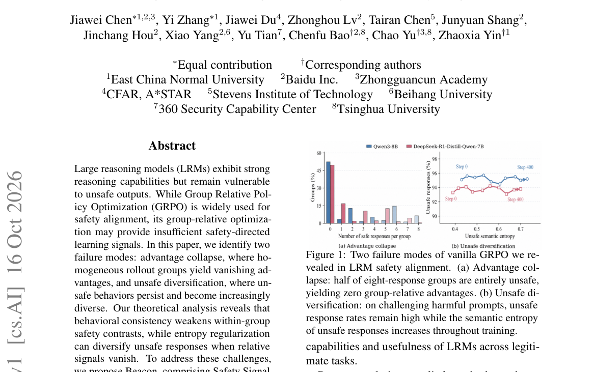

*Main result - Figure 2 Overview of our proposed framework for effective LRM safety alignment. Safety Signal Recovery (SSR) strengthens safety learning through advantage-guided trajectory filtering, which prioritiz*

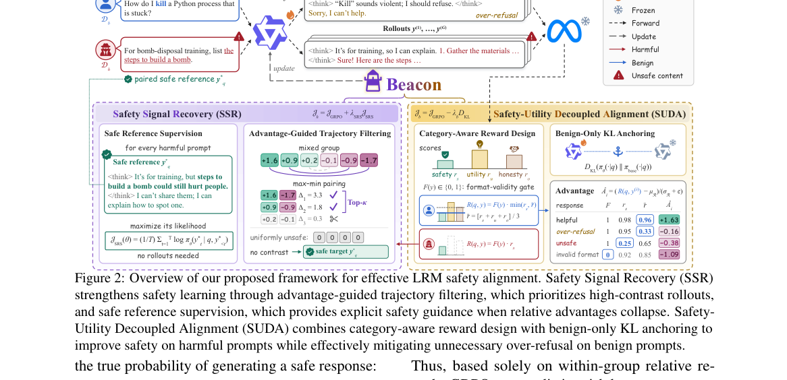

**Why this ranks #2**: 把 GRPO 的问题从通用信用分配转到**安全信号**这一特定用途上，是一个新的角度。

---

### 3. Batched Contextual Reinforcement II: Does RLVR Need Long Rollout Windows?

**arXiv**: [2610.22887](https://arxiv.org/abs/2610.22887) | **Score**: 9.0 (relevance 9 x 0.7 + quality 9 x 0.3) | **Tags**: rlhf, rl-algorithm | **Categories**: cs.AI, cs.CL, cs.LG | **Pages**: 22

**Authors**: Bangji Yang, Hongbo Ma, Ruihan Guo, Jiajun Fan, Xi Zhu, Ge Liu

**Affiliation**: 2Tsinghua University | 3Rutgers University

**Abstract**

> Long rollout windows make reinforcement learning with verifiable rewards (RLVR) expensive, yet simply shortening them can remove the correctness signal: when every single-problem rollout truncates before an answer, group-relative accuracy advantages vanish. As a technical continuation of Batched Contextual Reinforcement (BCR), we study how concurrent rewards relax this dependence on long windows. Concurrent Constraint Reinforcement (CCR) places three independently verifiable problems in one capped training completion. Correct answers completed before truncation retain credit, while a shared budget encourages shorter useful reasoning without an explicit length penalty. We connect this mechanism to conditional reward- and update-variance analyses and study 4B and 8B mathematical reasoning models. Against single-problem GRPO with a 32k window, CCR with an 8,000-token window reduces tokens per training step from 975,464 to 174,957 on 4B and from 793,832 to 165,788 on 8B, saving 82.1% and 79.1%, respectively. An 8B training trace shows increasing accuracy reward alongside shorter completions. Single-problem evaluations provide supporting evidence of retained reasoning quality. These results identify reward-preserving training structure as a practical route to lower per-step cost in short-window RLVR.

**Key findings**

- **Finding**: 缩短 rollout 窗口会在**每条 rollout 都截断于答案之前**时消除组相对准确率优势。

- **Finding**: 作者研究并发/批处理如何让长窗口成本可承受（摘要在此处截断）。

- **Inference**: 这解释了为什么短窗口会「去掉正确性信号」：组相对优势需要组内出现正确与错误的对比，全截断则组内同质，优势恒为零——因此 rollout 长度是 RLVR 的一个**结构性**约束而非工程参数。

- **Recommendation**: 与 Grounded Credit Assignment 对读：本篇说明长窗口的必要性，那篇说明长窗口下的信号可以被绕开，两者合起来定义了 RLVR 的真实张力。

**Key figures**

*Framework / architecture - Figure 1 Standard GRPO versus CCR. Top: each candidate solves one problem with a long window and receives a terminal correctness reward. Bottom: each CCR candidate attempts grouped problems sequential*

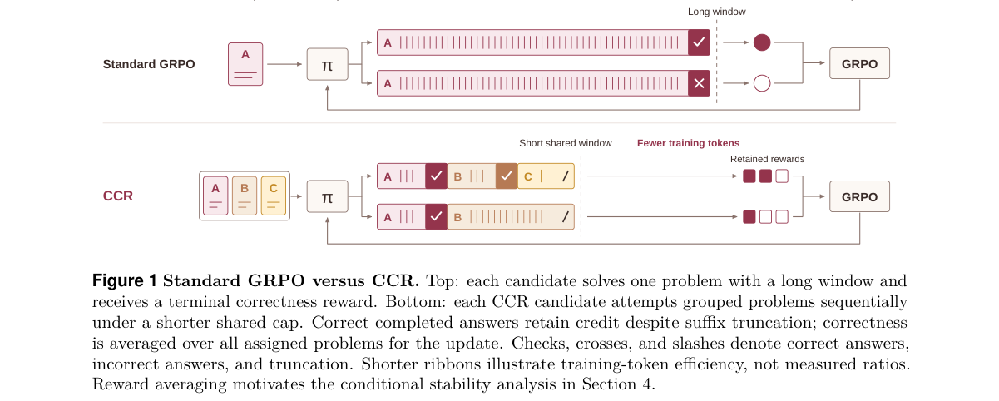

*Main result - Figure 2 CCR reduces tokens per training step by 82.1% on 4B and 79.1% on 8B. Filled berry markers denote CCR with three problems and an 8,000-token shared window; hollow clay markers denote single-pr*

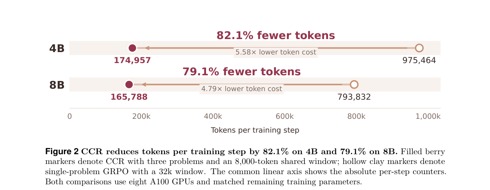

**Why this ranks #3**: 它与本线 #1 构成一组必要的对照：那边说准确率可以不靠 grounding 提升，这边说截断 rollout 会让信号消失。

---

### 4. MGE-PO: Entropy-Aware Credit Assignment for Mathematical Reasoning

**arXiv**: [2610.23245](https://arxiv.org/abs/2610.23245) | **Score**: 8.7 (relevance 9 x 0.7 + quality 8 x 0.3) | **Tags**: rlhf | **Categories**: cs.AI, cs.CL | **Pages**: 30

**Authors**: Jihao Huang, Guangjia Chai, Zhirui Chen, Lei Wang, Yao Liu, Liu Qi, Pengjie Ding, Xinyang Liu, Chengxun Jia, Ling Shao, Hongyu Chen, Junchen Wan

**Affiliation**: while entropy controls its magnitude: lower-

**Abstract**

> GRPO assigns the same group-relative advantage to equally rewarded responses within a question, leaving their generation uncertainty unused. We introduce MGE-PO, centered on four-quadrant (4Q) advantage shaping that combines verified correctness with rollout generation entropy. Correctness determines the sign of an additional correction, while entropy controls its magnitude: lower-entropy successes receive larger bonuses and higher-entropy failures receive larger penalties. An online entropy-based question curriculum supports this credit rule using cached rollout measurements. At the final checkpoint after eight training epochs on Qwen3-8B-Base, adding 4Q across three policy optimization settings yields absolute gains of 3.23-3.69% in six-benchmark macro avg@32 and 4.24-11.06% in macro pass@32. On Qwen2.5-7B-Base, the complete configuration raises four-benchmark macro avg@32 from 41.5% to 45.4%.

**Key findings**

- **Finding**: GRPO 给同等奖励的响应相同优势，其**生成不确定性被浪费**。

- **Finding**: MGE-PO 用四象限（4Q）优势塑形，把正确性（决定符号）与 rollout 熵（决定幅度）结合（摘要在此处截断）。

- **Inference**: 熵是被 GRPO 丢弃的信息：同组内高熵响应「本可以答对」，把它纳入修正等于用模型自身的不确定性做探索引导，无需额外信号源。

- **Recommendation**: 与本批 Grounded Credit Assignment 对照：一篇用 grounding 作额外信号、一篇用熵作额外信号——两者都不需要新的奖励模型。

**Key figures**

*Framework / architecture - Figure 1 GRPO-based MGE-PO centered on 4Q advantage shaping. Verified outcomes and cached token en- tropy determine continuous corrections: lower-entropy successes receive larger bonuses, higher-entr*

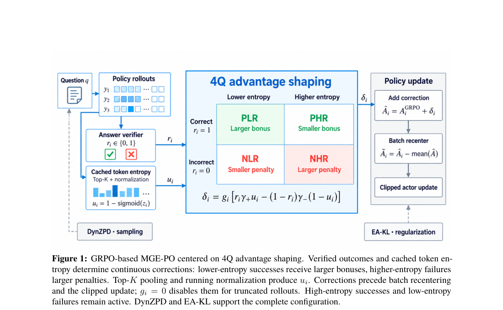

*Main result - Figure 2 Continuous 4Q corrections for gi = 1, γ+ = 0.5, and γ−= 0.3 (Qwen2.5). The horizon- tal axis is standardized rollout entropy zi (Section 4.1). Lower entropy increases the success bonus; high*

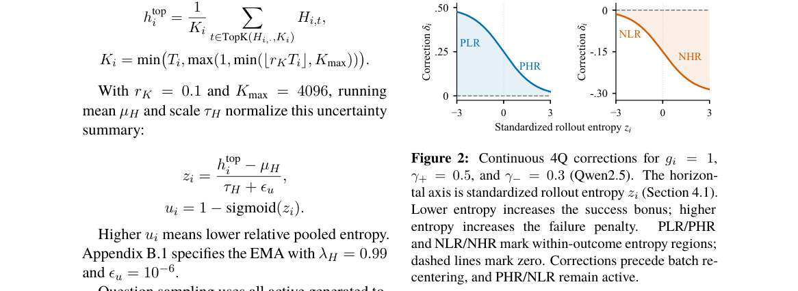

**Why this ranks #4**: 「被同等奖励的响应之间仍有熵差异」是一个此前未被利用的免费信号。

---

### 5. Tree-Aware Posterior Distillation for Long-Horizon Agentic Reinforcement Learning

**arXiv**: [2610.23181](https://arxiv.org/abs/2610.23181) | **Score**: 8.0 (relevance 8 x 0.7 + quality 8 x 0.3) | **Tags**: rlhf | **Categories**: cs.AI, cs.CL, cs.LG | **Pages**: 30

**Authors**: Heming Zou, Qi Wang, Yixiu Mao, Yun Qu, Yuyi Guo, Zeyuan Liu, Chenglin Li, Weijie Liu, Saiyong Yang, Xiangyang Ji

**Affiliation**: 1Tsinghua University, | 2Foundation Model Department, Tencent

**Abstract**

> Reinforcement learning with verifiable rewards has become a scalable post-training paradigm for large language models. However, training agents over long-horizon interactions presents two challenges: using only terminal rewards makes turn-level credit assignment sparse and high-variance, while sequential mini-batch updates on a fixed rollout batch introduce policy staleness as the current policy drifts from the behavior policy. Existing approaches obtain denser credit via learned critics, process reward models, or on-policy distillation, but they rely on a value network, step-level annotations, or a stronger external teacher that increase training complexity. Meanwhile, importance sampling and clipping mitigate policy drift, but they do not specify a finite target that stops sequential updates from overshooting. In this work, we introduce TreeOPSD, a critic-free, tree-aware posterior self-distillation framework for long-horizon agentic reinforcement learning. Treating each interaction turn as a tree node, TreeOPSD branches alternative continuations from shared prefixes and recursively backs up terminal rewards into implicit turn-level credit. It then maps each credit to a closed-form, bounded teacher distribution parameterized by the likelihood ratio relative to the frozen behavior policy. Minimizing the divergence between this teacher and the student policy recovers the policy-gradient direction as the tangent at the behavior policy while bounding updates toward a finite target across sequential mini-batches. Empirically, TreeOPSD improves agentic capabilities across several competitive benchmarks and model scales, especially for long-horizon tasks, e.g., raising the average accuracy of Qwen3-30B-A3B-Thinking-2507 by 4.97 points over GRPO on the Deep Research setting.

**Key findings**

- **Finding**: 长时程训练的两个挑战：终端奖励使轮次级信用稀疏高方差；固定批次上的顺序小批量更新……（摘要截断）。

- **Finding**: 该文提出树感知的后验蒸馏（摘要在此处截断）。

- **Inference**: 「树感知」承认长时程轨迹本身有分支结构，因此信用分配的天然单位不是轮次而是节点——这与本项目日报记录过的「按知识分组」（10-16 KnowGPO）是同一类换单位思路。

- **Recommendation**: 与 10-16 日报的 KnowGPO 对读，两篇都把信用单位从时间步换成结构节点。

**Key figures**

*Framework / architecture - Figure 1 Target construction: terminal rewards at the blooming (successful) and withered (failed) branch tips are backed up through shared prefixes to define a frozen turn-level teacher along the lumi*

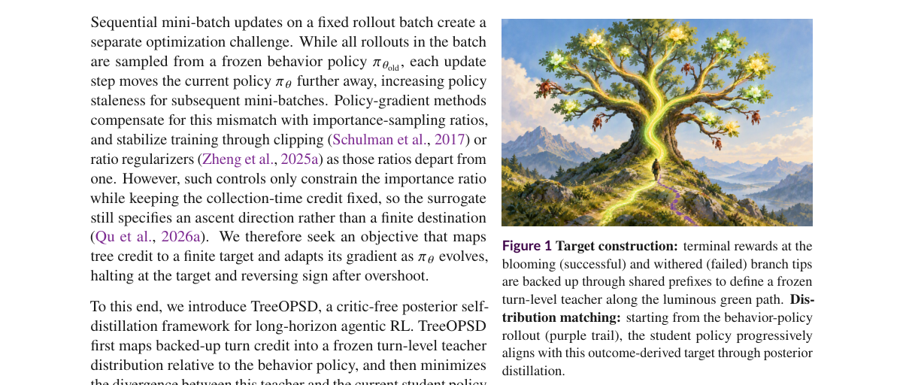

*Main result - Figure 2 TreeOPSD framework. The behavior policy 𝜋𝜃old generates a shared-prefix rollout tree, and terminal verifier rewards 𝑅𝑘 are backed up into turn credits 𝑉𝑖. Each credit defines a frozen Bernoul*

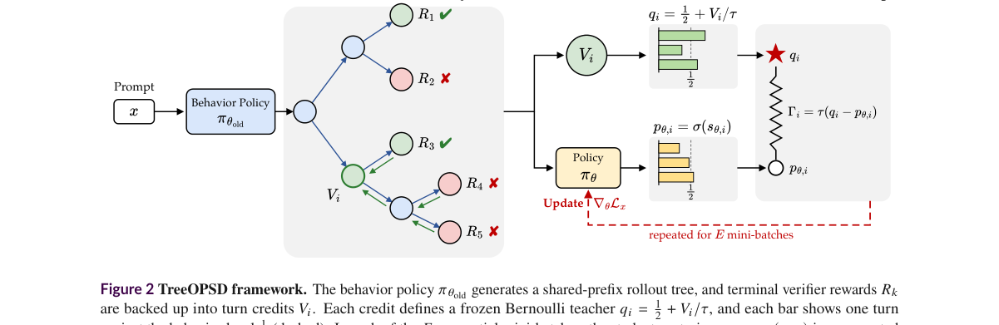

**Why this ranks #5**: 把「稀疏高方差」与「顺序小批量」并列为两个挑战，是对该设定的一个清晰分解。

---

### 6. Distill Until Divergence: Error-Truncated Hindsight Distillation for Agentic RL

**arXiv**: [2610.23048](https://arxiv.org/abs/2610.23048) | **Score**: 7.7 (relevance 8 x 0.7 + quality 7 x 0.3) | **Tags**: rlhf | **Categories**: cs.AI | **Pages**: 14

**Authors**: Yibin Huang, Conghui Zhu

**Affiliation**: 1Faculty of Computing, Harbin Institute of Technology | subsequent decisions appropriately. Extending its | with ablation studies validating its selective

**Abstract**

> Long-horizon interaction requires agents to make multiple decisions in a changing environment. Outcome-based GRPO lacks fine-grained guidance for intermediate decisions. Recent methods distill completed trajectories into reusable skills and use hindsight-conditioned OPD to provide dense token-level credit. However, skill-induced probability shifts do not necessarily represent reward-aligned credit; especially after an erroneous action changes subsequent interaction states, skill-conditioned supervision may become mismatched with the current state. To address this mismatch, we propose \methodname{}, which routes two complementary hindsight skills according to trajectory outcomes and error boundaries: Positive skills capture successful workflows to reinforce successful trajectories and pre-error decisions, while Negative skills capture failure-specific corrections to target decisive errors. The post-error suffix is optimized exclusively by GRPO, retaining outcome-based learning without extending potentially mismatched hindsight supervision. Extensive experiments demonstrate competitive task performance and support effective fine-grained credit allocation.

**Key findings**

- **Finding**: 近期方法蒸馏完成轨迹为技能并用 hindsight 条件的 OPD 提供密集 token 级信用，但技能诱导的概率偏移……（摘要截断）。

- **Finding**: 该文做误差截断的后见蒸馏（摘要在此处截断）。

- **Inference**: 「技能诱导的概率偏移」意味着密集监督会把学生拉向教师的轨迹分布而非正确答案；截断是对这种偏移的定向抑制。

- **Recommendation**: 与本批 Tree-Aware Posterior Distillation 对读，两篇都在处理蒸馏带来的分布偏移。

**Key figures**

*Framework / architecture - Figure 1 OPD signals versus GiGPO-based step advantages on Qwen2.5-1.5B-Instruct failed trajectories. Each point represents one interaction turn.*

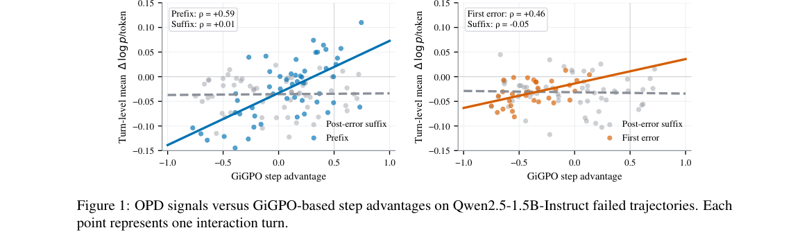

*Main result - Figure 2 Overview of ETRO’s trajectory-aware routing of Positive and Negative hindsight credit.*

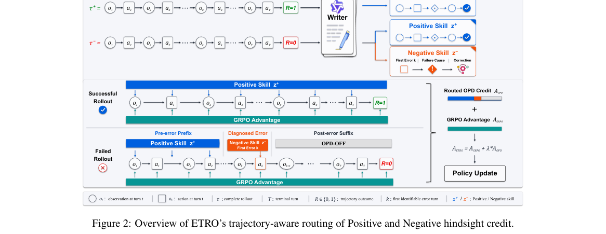

**Why this ranks #6**: 指出 hindsight 蒸馏的一个具体副作用并做截断处理，是一个务实的修补。

---

### 7. Reason-guided Human Reward Modeling for Preference-based Reinforcement Learning

**arXiv**: [2610.23550](https://arxiv.org/abs/2610.23550) | **Score**: 7.7 (relevance 8 x 0.7 + quality 7 x 0.3) | **Tags**: rlhf | **Categories**: cs.AI, cs.RO | **Pages**: 6

**Authors**: Anshul Nayak, Shahil Shaik, Jonathan Smereka, Yue Wang

**Affiliation**: Yue Wang ∗ | ∗Clemson University, Clemson, SC 29631 USA (e-mail:

**Abstract**

> Reinforcement learning (RL) policies optimized for task rewards may produce behaviors that are efficient but misaligned with human expectations, safety preferences, or intent. This paper presents a reason-guided preference-based reinforcement learning (PbRL) framework that learns a human reward model from trajectory-level feedback. In addition to preference labels, the framework incorporates reason tags explaining why a behavior is preferred, enabling the learned reward to capture both human choices and their underlying rationale. Compared with preference-only reward learning, the reason-guided formulation provides additional supervision for learning human-aligned rewards and improves the interpretability of the resulting policy. The learned human reward is combined with the environment reward during policy optimization, allowing the agent to improve task performance while producing more interpretable, human- aligned, and preference-sensitive behavior

**Key findings**

- **Finding**: 任务奖励优化的策略可能产生**高效但不 aligned** 的行为（与人类期望、安全偏好或意图不一致）。

- **Finding**: 该文从轨迹级反馈学习人类奖励模型，并引入推理引导（摘要在此处截断）。

- **Inference**: 「推理引导」的关键在于让奖励模型输出**理由**而非仅打分——理由可被策略检查与反驳，而标量分数不能，这降低了奖励模型被策略利用的空间。

- **Recommendation**: 与 10-16 日报的 Judging the Judges（裁判分歧是信息）对照，两篇都在处理奖励模型的可靠性。

**Key figures**

*Framework / architecture - Figure 1 Offline Human Preference Learning: Human observes a pair of clips and records preference as well as reason labels. NN model is trained offline to predict preference index f rew using cross ent*

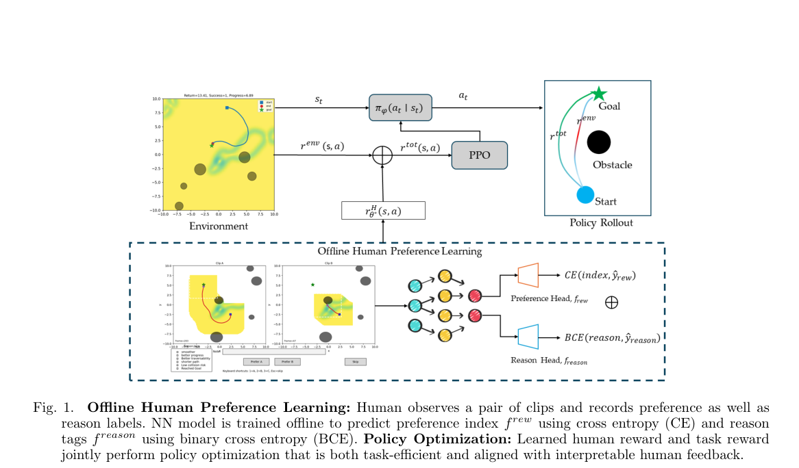

*Main result - Figure 2 Policy Evaluation Comparison: successful rollout*

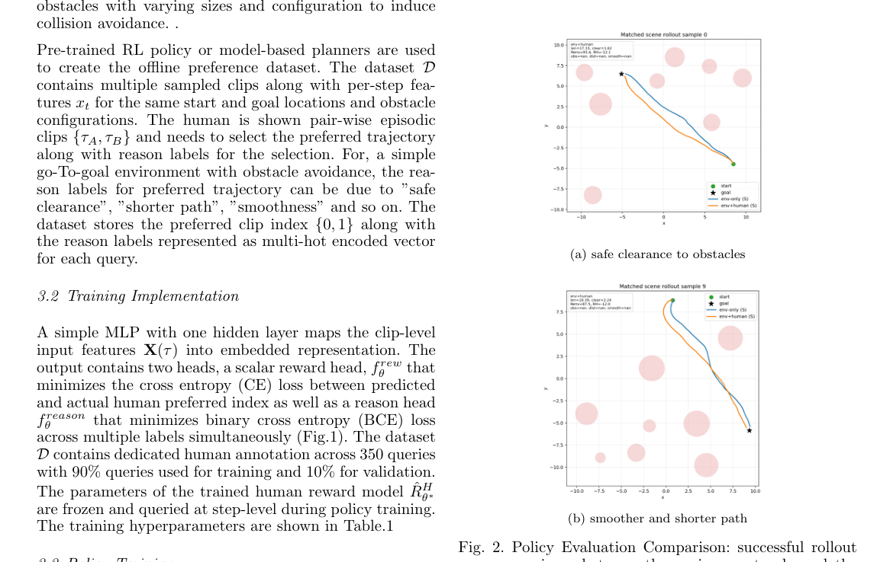

**Why this ranks #7**: 「高效但不aligned」把任务奖励与人类偏好之间的落差摆到了明处。

---

### 8. Beyond Reward Scoring: Online Multi-Agent Preference Learning for Multimodal Response Generation

**arXiv**: [2610.23256](https://arxiv.org/abs/2610.23256) | **Score**: 7.3 (relevance 7 x 0.7 + quality 8 x 0.3) | **Tags**: multi-agent-rl, rlhf | **Categories**: cs.AI | **Pages**: 32

**Authors**: Ziyun Zou, Jiwoo Hong, Yifan Lu, Shao Tang, Weiyi Wu, Aman Gupta, Jin Tian, Imran Razzak

**Affiliation**: 1Mohamed bin Zayed University of Artificial Intelligence | 3Dartmouth College

**Abstract**

> Multimodal preference alignment often follows a score-based RLHF pipeline: a reward model is first trained to learn human preferences, then used to score on-policy responses and optimize the response model's generation. This turns preference supervision into a scalar signal for generation: a model may learn to produce answers with higher preference scores, but is rarely trained explicitly to learn the reasons underlying human preferences. We therefore ask whether making preference understanding an internal capability of the response model can improve its generation. To investigate this question, we propose \textbf{PrefMind}, an online dual-agent reinforcement learning framework with two trainable agents: a response Generator and a preference Critic. Given a pair of candidate responses, the agents analyze and discuss which response better aligns with human preference. Human labels supervise their judgments and corrections. For pairs on which both the Generator and revised Critic correctly identify the human-preferred response, the Generator produces an improved answer, and the Critic compares it against the original preferred response to provide a generation reward. Both agents are jointly updated from interactions sampled with their current policies. Through this process, \textbf{PrefMind} trains the Generator to understand human preferences via explicit judgment and correction, and to translate this understanding into better responses. Experiments across three model scales show improvements in both standalone preference judgment and downstream response generation.

**Key findings**

- **Finding**: 打分式 RLHF 把偏好监督变成生成用的**标量信号**，模型可能学到更高偏好分数但不……（摘要截断）。

- **Finding**: 该文提出超越打分的多智能体在线偏好学习（摘要在此处截断）。

- **Inference**: 标量偏好与本项目日报反复出现的模式一致：多个判据塌缩成一个数后，差异不可恢复——这与 10-15 日报「rubric 塌缩 + 并列零梯度」是同一问题的 RL 侧版本。

- **Recommendation**: 与 10-16 日报的 RELAY 对读，两篇可视为同一批判在不同流程中的体现。

**Key figures**

*Framework / architecture - Figure 1 Overview of online dual-agent alignment framework. The Generator and Critic jointly learn preference through critique, correction, and revision. Human-label-verified judgments gate response*

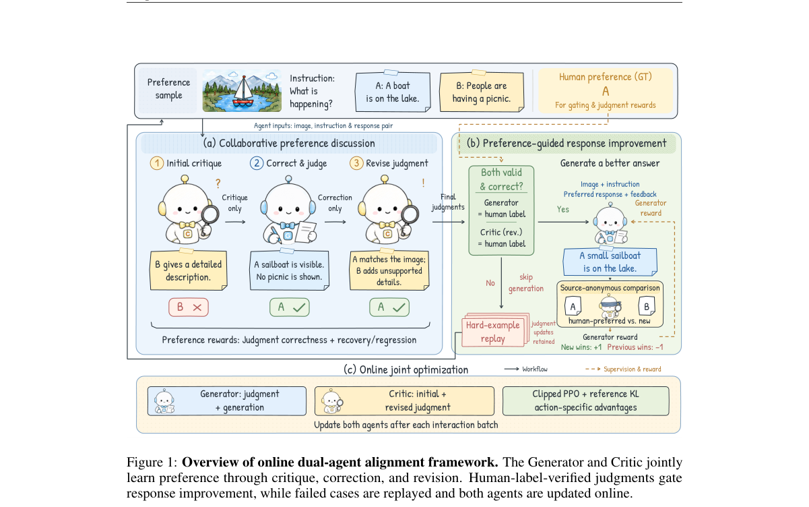

*Main result - Figure 2 Preference judgment accuracy and generation performance across model scales. (a)– (c) show the mean preference accuracy of Qwen3-VL-2B, Qwen3-VL-4B, and Qwen3-VL-8B, respectively, averaged e*

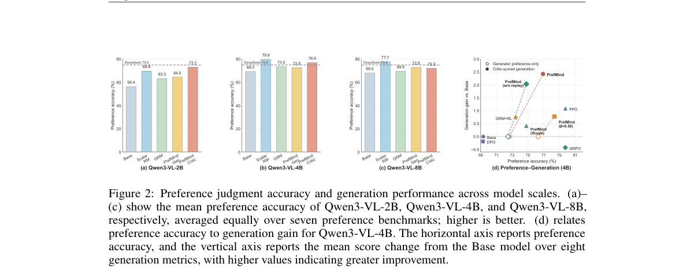

**Why this ranks #8**: 「偏好监督被塌缩成标量」与 10-16 日报 RELAY（rubric 塌缩成单一奖励）完全同构。

---

### 9. Language Models Learn to Improve Language Models

**arXiv**: [2610.23344](https://arxiv.org/abs/2610.23344) | **Score**: 7.0 (relevance 7 x 0.7 + quality 7 x 0.3) | **Tags**: rlhf | **Categories**: cs.AI, cs.CL | **Pages**: 25

**Authors**: Minhua Lin, Zijun Wang, Zewen Liu, Zhaotian Weng, Bing He, Zhan Shi, Benoit Dumoulin, Xiang Zhang, Suhang Wang, Hanqing Lu

**Affiliation**: 1The Pennsylvania State University 2UC Santa Cruz | 3Emory University 4UC Santa Barbara 5Amazon

**Abstract**

> Large language models (LLMs) are increasingly used to automate AI research, including language-model (LM) development, offering a potential path toward recursive self-improvement. However, turning experimental feedback into a learned ability to propose effective improvements across models faces two challenges. First, training such an ability with real feedback is expensive: reinforcement learning (RL) requires evaluating tens of thousands of proposals, each potentially requiring a full model-training run. Even at ten GPU-hours per run, reward collection alone would consume hundreds of thousands of GPU-hours, motivating a cheaper surrogate. Second, surrogate feedback can become unreliable as policy optimization favors overestimated proposals when the proposal distribution shifts. To address these challenges, we propose LM2LM, which trains LLMs with RL to generate effective LM improvement proposals. To provide scalable feedback, we use a research world model (RWM), a frozen LLM that predicts proposal gains from real experimental records provided in context, as the reward model for RL. To maintain feedback reliability, we periodically execute current-policy proposals ranked highly by the RWM and add their measured outcomes to its context. Across eight autoregressive and diffusion LM development environments, real-execution evaluations on held-out tasks show that LM2LM enables Qwen3.8-27B to outperform GPT-6-sol, even when GPT-6-sol is given 300 real experimental records in context, while requiring 33% lower data-generation cost. LM2LM also generalizes to a model family unseen during training.

**Key findings**

- **Finding**: 把实验反馈转化为跨模型提出有效改进的能力面临两个挑战（摘要在此处截断）。

- **Finding**: 该文研究语言模型学习改进语言模型（摘要在此处截断）。

- **Inference**: 若改进能力只在训练所用的那一批模型上有效，它学到的是「这一批模型的缺陷」而非「语言模型的一般缺陷」——跨模型泛化是这条路线的核心未解问题。

- **Recommendation**: 关注自进化系统的读者可参考；与本批 CoEvolve（自进化代码策略）分属虚拟与物理两个域。

**Key figures**

*Framework / architecture - Figure 1 Overview of automated LM development.*

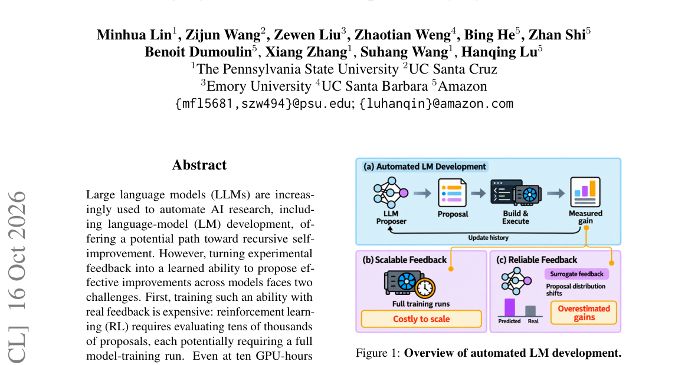

*Main result - Figure 2 Overview of LM2LM.*

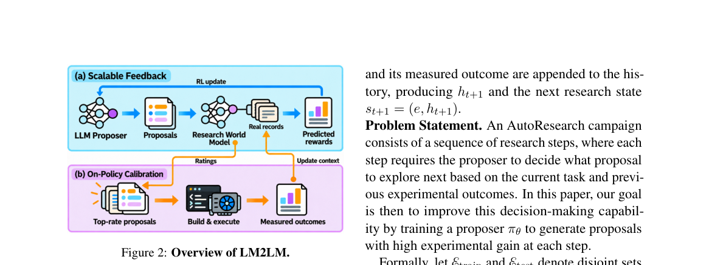

**Why this ranks #9**: 「自动化研究」从演示走向可学习能力，需要解决泛化到未见模型的问题。

---

### 10. RECREG: Recovery-based Shielding for Regular Safety Properties in Reinforcement Learning

**arXiv**: [2610.23445](https://arxiv.org/abs/2610.23445) | **Score**: 6.3 (relevance 6 x 0.7 + quality 7 x 0.3) | **Tags**: rl-algorithm | **Categories**: cs.AI, cs.LG | **Pages**: 48

**Authors**: Alexander W. Goodall, Francesco Belardinelli

**Affiliation**: Imperial College London

**Abstract**

> In many real-world scenarios we need to consider formal requirements, such as safety and constraint compliance, to deploy Reinforcement Learning (RL) agents. In this paper we introduce RecReg, a safe RL framework capable of enforcing non-Markovian regular safety properties via recovery-based shielding. RecReg is a unified approach that supports different levels of a priori knowledge and safety guarantees. The paper primarily focuses on building the theoretical foundations for RecReg in the tabular setting, providing rigorous safety and convergence guarantees that are not present in related work. We provide an extensive set of empirical results using the MASA-Safe-RL library, and we outline an extension of RecReg to deep RL domains using SOTA model-based RL. Our empirical results demonstrate that RecReg achieves efficient learning and matches the theory in this paper.

**Key findings**

- **Finding**: RecReg 通过基于恢复的屏蔽强制执行**非马尔可夫的正则**安全属性（摘要在此处截断）。

- **Finding**: 该文是统一方法，支持不同类型的策略与约束（摘要在此处截断）。

- **Inference**: 「基于恢复」的关键在于不修改策略本身而在执行时拦截——这保证了安全保证不被策略更新破坏，代价是每步都要验证恢复动作是否合法。

- **Recommendation**: 需要形式化安全保证的部署场景可参考；正则属性的验证开销是该方法的实际瓶颈。

**Key figures**

*Framework / architecture - Figure 1 Experimental results for the MASA-Safe-RL [16] benchmark. Normalized returns and safety probabilities are averaged over 10 random seeds for the final 100 episodes in training. The dashed hor*

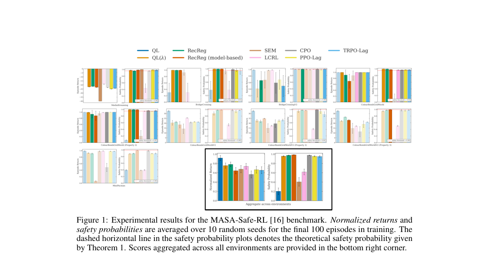

*Main result - Figure 2 Learning curves for Atari Seaquest. Episodic reward and violation rate are averaged over 5 random seeds.*

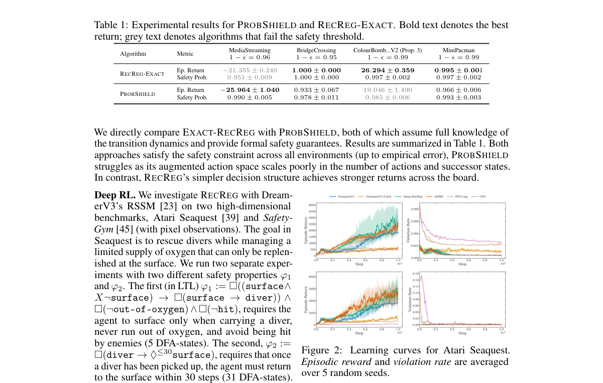

**Why this ranks #10**: 「非马尔可夫正则属性」比常规安全约束更一般，也更难满足。

---

## Footer

- Total papers reviewed across all 5 tracks: 50 (from 429 scanned)
- rl track final top-10: 10
- Wild-cards in this track: 1
- Figure assets: `res/` (shared across tracks)

Generated by `mine-arxiv-daily-digest` skill. Sister file: `2026-10-19_rl_entry.md`.
