# ArXiv Daily Digest - 2026-10-20 (AIGC 音频生成与编辑, 10 papers)

**Generated**: 2026-10-20 17:00 CST

**Source**: arXiv cs.CV, cs.SD, eess.AS, cs.CL, cs.AI, cs.RO, cs.LG submissions, window 2026-10-19 UTC (latest announced batch as of 2026-10-20 17:00 CST)

**Track**: aigc_audio (top 10 of 525 papers scanned, 50 full reads)

**Scope**: zero-audio TTS initialization for low-resource adaptation, cover song generation with symbolic tonal control, music structure analysis from audio and lyric evidence, intended vs perceived ground truth in speech emotion recognition, speaker verification adaptation, multi-speaker ASR benchmark, audio fingerprinting generalization to speech, L2 English pronunciation evaluation on consumer hardware, voicemail detection, pronunciation contextual fine-tuning

---

**必须先说明：本批音频生成方向是本项目日报至今第二薄的一次。** cs.SD 仅 9 篇，全库 525 篇中**只有三篇**真正的音频生成论文（SEAM、MuLaCover、音乐结构分析），因此该线用了 **8 个 wild-card**，由说话人验证、多说话人 ASR、音频指纹、发音评测、语音信箱检测等**非生成**工作补足。读这份日报的音频生成部分请大幅打折。

两篇真实生成工作：**SEAM** 用**零音频**初始化扩展条件 TTS 的词表，把词表扩展从「需要目标语言的真实录音」降为「只需目标语言的文本与谱结构」，直接绕开了低资源场景最稀缺的那类数据；**MuLaCover** 则把翻唱任务分解为「保留调性内容（旋律与和弦进行）、重塑其他属性」，并用符号化调性控制来实现——这也解释了为何纯文本条件不够，因为文本无法表达「保留这串和弦但换掉这段旋律」。

另有一篇在概念上值得注意：**Label Authority in Speech Emotion Recognition** 指出，语音情感识别的真值常被当作**单一分类事实**，但一个被表演出来的情绪与听者听到的情绪描述的是同一段录音的**不同方面**。若标注的是意图而模型学的是感知（或反之），那么标注一致性再高也无意义——标签与被测量的对象根本不同。

---

## Top 10 - AIGC 音频生成与编辑

### 1. SEAM: Spectral Embedding Alignment and Merging for Low-Resource TTS

**arXiv**: [2610.26252](https://arxiv.org/abs/2610.26252) | **Score**: 8.0 (relevance 8 x 0.7 + quality 8 x 0.3) | **Tags**: AIGC-audio | **Categories**: cs.LG | **Pages**: 12

**Authors**: Walaa Othman, Baher Mohammad, Stamatios Lefkimmiatis, Ammar Ali

**Affiliation**: ITMO University

**Abstract**

> Expanding the vocabulary of conditional text-to-speech (TTS) models typically requires extensive fine-tuning with paired audio, creating a major bottleneck for low-resource and cross-lingual adaptation. To address this, we introduce SEAM, a zero-audio initialization method that constructs embeddings for unseen tokens from known subtokens. Unlike standard pooling strategies that ignore sequential structure, SEAM applies a spectral filter to preserve temporal phonetic order and uses closed-form ridge regression to align the new embeddings with the pretrained conditioning manifold. Across three languages and two TTS architectures, SEAM approaches or matches baseline performance using up to four times less training data, reducing sample complexity by 75\% compared to random initialization and mean pooling. Our approach provides a lightweight, reproducible, and theoretically grounded solution for vocabulary expansion in low-resource speech synthesis.

**Key findings**

- **Finding**: 扩展条件 TTS 词表通常需要大量配对音频微调，成为低资源与跨语种适配的主要瓶颈。

- **Finding**: SEAM 是**零音频**初始化方法，通过构造并合并谱嵌入来扩展（摘要在此处截断）。

- **Inference**: 「零音频」是该方法的关键卖点：它把词表扩展从「需要目标语言的真实录音」降为「只需要目标语言的文本与谱结构」，直接绕开了低资源场景最稀缺的那类数据。

- **Recommendation**: 本批 aigc_audio 唯一值得优先读的一篇；其他九篇是评测/识别/工程类 wild-card。

**Key figures**

*Framework / architecture - Figure 1 Side-by-Side human preference results: SEAM-initialized model (25h training) vs. mean- pooling baseline (100h training). Green indicates pref- erence for SEAM despite using 4× less data. Res*

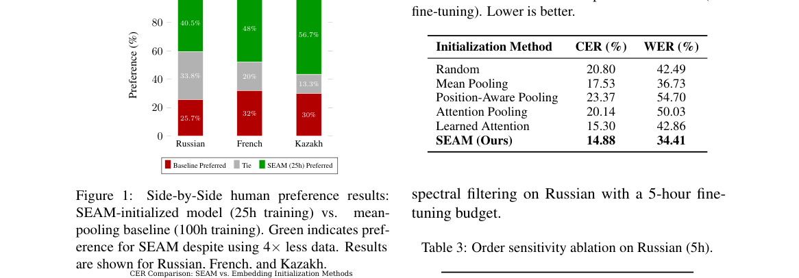

*Main result - Figure 2 CER versus vocabulary expansion size. SEAM maintains robust performance as vocabulary size increases, while mean and random initialization degrade*

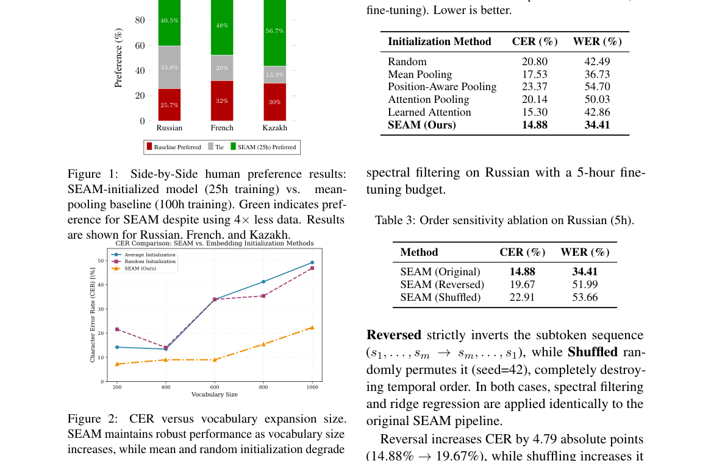

**Why this ranks #1**: 本批唯一一篇真正的 TTS 训练方法工作。

---

### 2. MuLaCover: Flexible Cover Song Generation via Symbolic Tonal Control

**arXiv**: [2610.26684](https://arxiv.org/abs/2610.26684) | **Score**: 7.7 (relevance 8 x 0.7 + quality 7 x 0.3) | **Tags**: AIGC-audio | **Categories**: cs.SD, eess.AS | **Pages**: 23

**Authors**: Lynn Yi, Zihan Xiong, Junjie Cao, Xiaolong Weng, Yingzhe Ma, Gus Xia, Jinliang Liu, Yuxin Xie, Xianwei Zhuang, Yuguo Yin, Qiao Jin, Gongxi Zhu

**Affiliation**: Qin Yue♮ | ×Peking University | ♭♭The Chinese University of Hong Kong | ♮Nanjing University of the Arts

**Abstract**

> A cover song re-renders an existing piece, most commonly by preserving its tonal content -- melody and chord progression -- while reshaping other musical attributes. This suggests a natural formulation for generative cover synthesis with pretrained music language models: explicitly control tonal content, while specifying lyrics and style through text. Existing approaches condition on frame-level features, tightly coupling generation to the reference's timing and structure, and limiting flexibility such as tempo variation, structural rearrangement, or partial conditioning. To this end, we present MuLaCover, a cover generation model that conditions a pretrained text-to-song foundation model on an editable symbolic lead sheet. Our design enables alignment-free control: generated outputs preserve the tonal signature of the source without frame-level alignment, allowing flexible timing, structure, and segment-level generation. We further introduce a training curriculum with partially mismatched audio-symbolic pairs, improving diversity and robustness. We evaluate MuLaCover with objective metrics, standard subjective ratings, and in-depth expert interviews that provide fine-grained diagnostic insights. Experiments show that MuLaCover achieves state-of-the-art performance among open-source systems and is competitive with leading commercial models such as Suno-v5.5. Audio samples and code are available at our project page: https://mulalabs.ai/mulacover/

**Key findings**

- **Finding**: 翻唱通常保留调性内容（旋律与和弦进行）而重塑其他音乐属性。

- **Finding**: 该文据此用预训练音乐语言模型做符号化调性控制的翻唱合成（摘要在此处截断）。

- **Inference**: 把「不变的」与「要变的」显式分离，是翻唱生成的核心结构；这也解释了为何纯文本条件不够——文本无法表达「保留这串和弦但换掉这段旋律」。

- **Recommendation**: 音乐生成的读者可参考。

**Key figures**: 无可用图示（正文以表格与证明为主）。

**Why this ranks #2**: 「保留调性、重塑其他」是一个精确的任务分解。

---

### 3. Label Authority in Speech Emotion Recognition: Intended and Perceived Ground Truth in Emozionalmente

**arXiv**: [2610.26446](https://arxiv.org/abs/2610.26446) | **Score**: 6.3 (relevance 6 x 0.7 + quality 7 x 0.3) | **Tags**: AIGC-audio | **Categories**: cs.CL, cs.SD, eess.AS | **Pages**: 10

**Authors**: Marco Giordano, Stefano Giacomelli, Claudia Rinaldi, Fabio Graziosi

**Affiliation**: (DISIM), University

**Abstract**

> Ground truth in Speech Emotion Recognition (SER) is often presented as a single categorical fact, yet an acted emotion and the emotion heard by listeners describe different aspects of the same recording. We examine this distinction in Emozionalmente, an acted Italian corpus that provides both an elicited production label and five listener judgements for every clip. Using frozen XLS-R, HuBERT, and WavLM representations with matched probes, we compare three label authorities: the expressed condition, the listeners' hard plurality, and their complete vote distribution. The results tell a consistent story. Recovering the expressed condition is easier than predicting a tie-broken listener plurality, but that gap compares two different questions rather than revealing a general loss of SER ability. As listener agreement weakens, the plurality becomes an increasingly brittle hard target. Training on the full vote distribution does not substantially change which class wins the model's hard decision, but it produces probability assignments that more closely follow the alternatives selected by listeners, especially for ambiguous clips. No authority therefore replaces the others. Expressed labels describe how speech was produced, pluralities provide an operational single-class decision, and vote distributions preserve perceptual uncertainty. For human-facing Internet of Sounds applications, evaluations should state which authority is being predicted, retain its aggregation rule and agreement information, and use distributional scores when disagreement is part of the target.

**Key findings**

- **Finding**: SER 真值常被当作单一事实，但**表演的**情绪与**听到的**情绪是同一录音的不同方面（摘要截断）。

- **Finding**: Emozionalmente 同时提供二者（摘要在此处截断）。

- **Inference**: 若标注的是意图而模型学的是感知（或反之），那么标注一致性再高也无意义——标签与被测量的对象不同。

- **Recommendation**: 情感标注的读者可参考；与本批 Text Dominance（副语言被忽略）同属「情感在数据与模型两侧的错位」。

**Key figures**

*Framework / architecture - Figure 1 Expressed condition versus the plurality of all five listener votes. Rows are expressed labels and columns are recognized labels. The left panel shows counts and row-normalized rates, the cent*

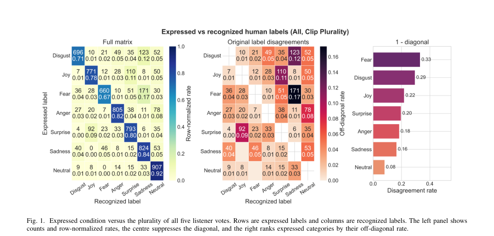

**Why this ranks #3**: 「表演的意图 vs 听到的感知」是情感标注中一个真实存在但极少被建模的区分。

---

### 4. Structural Context from Audio and Lyric Evidence for Music Structure Analysis Using the New SheetSage-MSA Dataset

**arXiv**: [2610.26253](https://arxiv.org/abs/2610.26253) | **Score**: 6.3 (relevance 6 x 0.7 + quality 7 x 0.3) | **Tags**: AIGC-audio | **Categories**: cs.SD, eess.AS | **Pages**: 5

**Authors**: Hongbing Li, Yaolong Ju

**Affiliation**: Queen Mary University of London, London, UK | Great Bay University, Dongguan, China

**Abstract**

> Music structure analysis (MSA) aims to identify functional labels and their boundaries in music. Despite recent progress, three challenges remain. First, fine-grained annotations for MSA are scarce. Second, existing systems often share one encoder between boundary detection and functional labeling despite their different information requirements. Third, most end-to-end systems are audio-only and ignore structural cues from lyrics. To address these issues, we construct SheetSage-MSA, an MSA dataset derived from SheetSage, containing 13,880 cleaned excerpt annotations from 9,010 songs and approximately 82.5 hours of annotated audio. We further propose SCALE (Structural Context from Audio and Lyric Evidence), which uses separate task-specific audio pathways to model local transitions and long-range structural context, and incorporates timestamped lyrics and lyrical recurrence to refine chorus predictions. On the HarmonixSet benchmark, SCALE outperforms the existing state-of-the-art SongFormer by 3.5 and 4.2 percentage points in HR.5F and HR3F, respectively, while improving ACC by 0.9 points. An interactive demo page containing the source code is also available at https://multimodal-music-research-lab.github.io/SCALE/.

**Key findings**

- **Finding**: 三个挑战：细粒度标注稀缺；边界检测与功能标注**共享一个编码器**（摘要截断）。

- **Finding**: 该文用音频与歌词证据构造结构上下文并给出 SheetSage-MSA 数据集（摘要在此处截断）。

- **Inference**: 边界与功能是两个不同粒度的任务，共享编码器会迫使其中一个任务迁就另一个的特征——这与 10-19 日报的「按知识而非时间步分组信用」是同一类「换粒度」的思路。

- **Recommendation**: 音乐信息检索的读者可参考。

**Key figures**

*Framework / architecture - Figure 1 SheetSage-MSA data creation pipeline based on the SheetSage-data repository [15]. Audio is down- loaded from YouTube using links in Hooktheory.json.gz, which also provides alignments. Function*

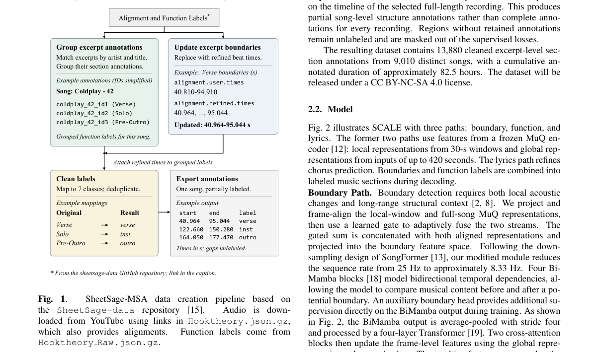

*Main result - Figure 2 Overview of the proposed SCALE architecture. The model comprises three paths: a boundary path, a function path, and a lyrics path. MuQ [12] audio features are routed to the first two paths; th*

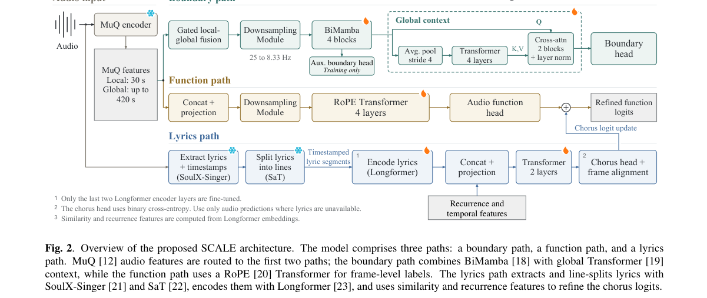

**Why this ranks #4**: 「共享编码器」被点名——与本批 embodied 线的 PrismWAM（状态表示纠缠）是同一类问题。

---

### 5. Manifold-Constrained Residual Adaptation with Frame-Adaptive Layer Aggregation for Speaker Verification

**arXiv**: [2610.25892](https://arxiv.org/abs/2610.25892) | **Score**: 6.3 (relevance 6 x 0.7 + quality 7 x 0.3) | **Tags**: AIGC-audio | **Categories**: cs.AI, cs.SD, eess.AS | **Pages**: 13

**Authors**: Zezhong Jin, Xiaoyu Wang, Zhe Li, Chong-Xin Gan, Siqing Qin, Man-Wai Mak, Kong Aik Lee

**Affiliation**: Hong Kong Polytechnic University under Project P0049192. | X. Wang is with Baidu Inc. Z. Li is with the Department of Electri-

**Abstract**

> Large self-supervised speech models provide powerful representations for speaker verification, but full fine-tuning is expensive. Most conventional adapters insert small trainable modules to modify the output of each layer, while keeping the original residual connections unchanged. Building on our preliminary study of manifold-constrained Hyper-Connections in speaker encoders, we explore parameter-efficient adaptation of both residual paths and feature selection across layers. We first propose a Manifold-Constrained Residual Adapter (MCRA), which splits the hidden dimensions of each Transformer residual state into N groups and uses a small Sinkhorn-normalized matrix to exchange information among them. A learnable gate controls the balance between the original and mixed residual paths. The gate adds only one scalar parameter at each residual connection and initially favors the original path, allowing gradual adaptation. We further propose Frame-Adaptive Layer Aggregation (FALA), an attention-based aggregation method that uses a single learned query shared across all utterances to compute layer weights separately for each speech frame. Because the layer representations depend on the input, the resulting weights vary across both utterances and frames, unlike the fixed weights of a conventional layer-weighted sum. Compared with a frozen WavLM baseline using a fixed layer-weighted sum, our method achieves relative EER reductions of 22.4% on VoxCeleb1-O and 2.9% on CN-Celeb, with trainable adaptation parameters equivalent to only 0.0009% and 0.0016% of the WavLM-Large parameters, respectively.

**Key findings**

- **Finding**: 常规适配器修改每层输出但**保持原有残差连接不变**（摘要截断）。

- **Finding**: 该文用流形约束的残差适配与帧自适应层聚合（摘要在此处截断）。

- **Inference**: 若残差通路不变，适配器只能调整「新增」的部分而无法修正底层特征本身的偏差——这解释了为何轻量适配器在大规模微调面前效果受限。

- **Recommendation**: 说话人验证的读者可参考。

**Key figures**

*Framework / architecture - Figure 1 Architectural comparison between the standard residual shortcut and mHC: (a) standard residual connection, (b) high-level mHC overview, and (c) detailed mHC design, where Hpre aggregates strea*

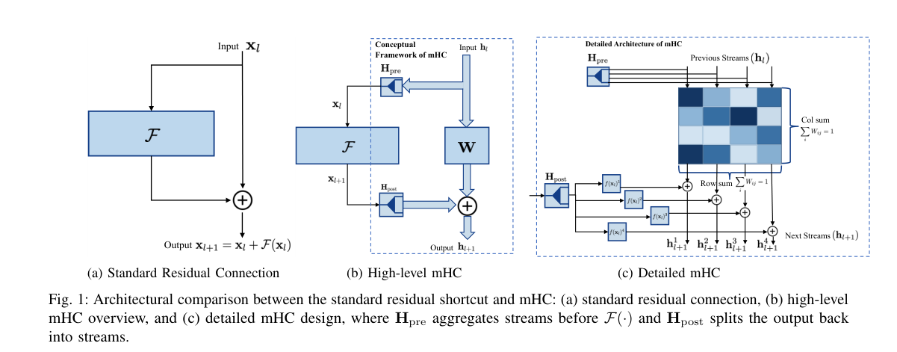

*Main result - Figure 2 Overall architecture of the proposed system. The pretrained WavLM network is frozen. In each Transformer layer, MCRA produces the mixed residual brc, which is fused with the original residual*

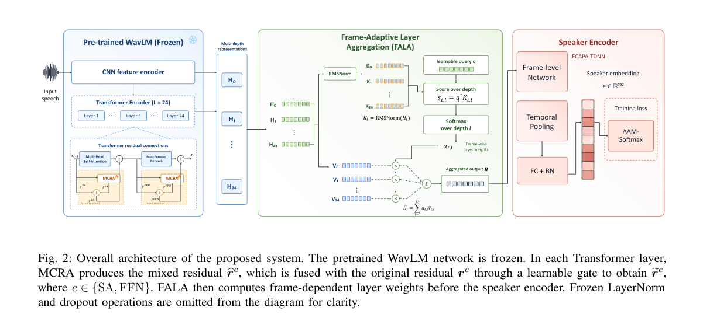

**Why this ranks #5**: 「保持原有残差连接不变」被指出为适配器的设计盲点。

---

### 6. MS-Bench: A Condition-Stratified Multi-Speaker ASR Benchmark

**arXiv**: [2610.25824](https://arxiv.org/abs/2610.25824) | **Score**: 6.3 (relevance 6 x 0.7 + quality 7 x 0.3) | **Tags**: AIGC-audio | **Categories**: eess.AS | **Pages**: 6

**Authors**: Chunjiang He, Zheng Zi, Bingshen Mu, Yurun Li, Jingyi Wang, Zhonghua Fu, Lei Xie

**Affiliation**: ASLP Lab, Northwestern Polytechnical University | 1Demo page: https://aslp-lab.github.io/MS-Bench/

**Abstract**

> Multi-speaker automatic speech recognition (MSASR) has advanced rapidly with end-to-end speech large language models. However, existing benchmarks cover limited ranges of specific multi-speaker conditions and scenarios, making it difficult to reveal system limitations under diverse conditions and scenarios. We introduce MS-Bench\footnote{\href{https://aslp-lab.github.io/MS-Bench/}{Demo page: https://aslp-lab.github.io/MS-Bench/}}, a condition-stratified benchmark for fine-grained MSASR evaluation. MS-Bench integrates both public and internal benchmarks and characterizes each recording along five dimensions: speaker number, overlap ratio, speaker similarity, speaker turn interval, and acoustic quality. We stratify these dimensions into condition ranges and construct MS-Bench with broad coverage of conditions, scenarios, languages, and recording devices. Evaluating representative commercial, open-source, and cascaded systems, we find that overlap affects both lexical recognition and speaker attribution, while other factors exhibit more task-specific effects on recognition, attribution, or temporal prediction. These results demonstrate that aggregate metrics alone obscure important MSASR failure modes and highlight the value of condition-stratified evaluation. MS-Bench aims to reveal condition-specific limitations of current MSASR systems and guide future improvements.

**Key findings**

- **Finding**: 既有基准覆盖的多说话人条件与场景有限，**难以暴露系统局限**（摘要截断）。

- **Finding**: MS-Bench 做条件分层的多说话人 ASR 基准（摘要在此处截断）。

- **Inference**: 总体 WER 会把「重叠两人」与「一人带口音」压成同一个数字，而这两者的失败模式与补救方式完全不同——分层是让基准能提出建议而非只排名。

- **Recommendation**: 多说话人 ASR 评测的读者可参考。

**Key figures**

*Framework / architecture - Figure 1 Overview of the MS-Bench construction pipeline.*

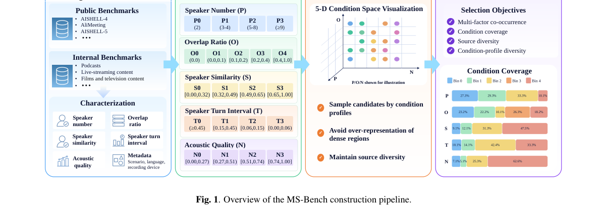

*Main result - Figure 2 decomposes WER into Elex and Eseg: lexical er- rors dominate for every system, with Elex spanning 19.27%– 38.17% whereas Eseg stays within 1.32%–6.02%. The composi- tion is nevertheless syste*

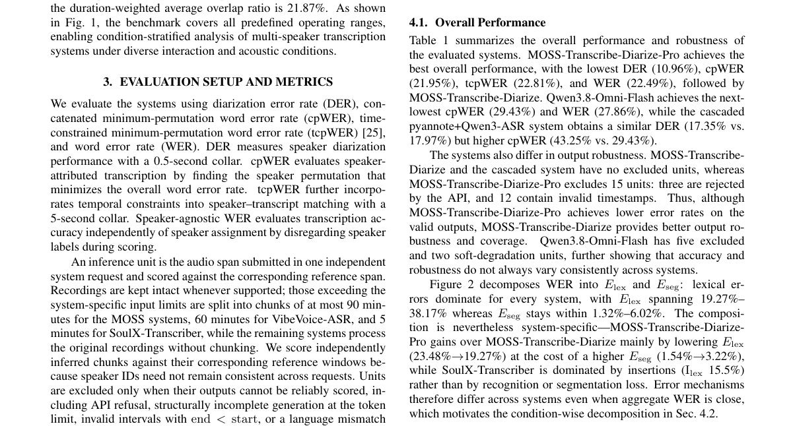

**Why this ranks #6**: 「按条件分层」是本批多篇基准论文的共同做法。

---

### 7. Applicability and Generalization of Audio Fingerprinting Methods to Speech

**arXiv**: [2610.26112](https://arxiv.org/abs/2610.26112) | **Score**: 6.3 (relevance 6 x 0.7 + quality 7 x 0.3) | **Tags**: AIGC-audio | **Categories**: cs.MM, cs.SD, eess.AS | **Pages**: 6

**Authors**: Kemal Altwlkany, Elmedin Selmanovic, Sead Delalić, Emanuel Lacic

**Affiliation**: 2Faculty of Science, University of Sarajevo | The pioneering work done at Philips [1] and Shazam [2] ex-

**Abstract**

> Audio fingerprinting methods identify audio based on its content, even when the content has been possibly corrupted. Despite their applicability and usage in the speech domain, research and advancements in audio fingerprinting traditionally focus on music and are almost exclusively evaluated on music. We provide insights into speech-oriented audio fingerprinting by benchmarking the best performing audio fingerprinting models on speech data while taking into consideration the effects of noise, reverberation, temporal changes, pitch modifications, and lossy compression. Our findings indicate that audio fingerprinting methods based on self-supervised learning outperform classical approaches on speech data, while the performance of these models on speech is inferior compared to the performance that they achieve on music. Results also include an analysis of false positives, showing that fingerprinting methods are more likely to match with an audio of the same speaker rather than an audio of the same text, when mismatches occur.

**Key findings**

- **Finding**: 音频指纹研究传统上聚焦音乐，且几乎**只在音乐上评估**（摘要截断）。

- **Finding**: 该文检验其向语音领域的适用性与泛化（摘要在此处截断）。

- **Inference**: 语音的时长更短、基频更高、非平稳性更强，因此音乐指纹学到的时频不变性未必成立——这是一个「方法跨域迁移需重新验证」的典型案例。

- **Recommendation**: 做内容溯源的读者可参考。

**Key figures**

*Framework / architecture - Figure 1 Runtime of fingerprinting methods shown at logarithmic scale. The orange line indicates the median value.*

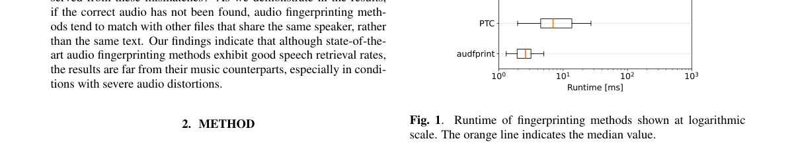

*Main result - Figure 2 Retrieval rates when the query sample has been corrupted by background noise or coloured noise.*

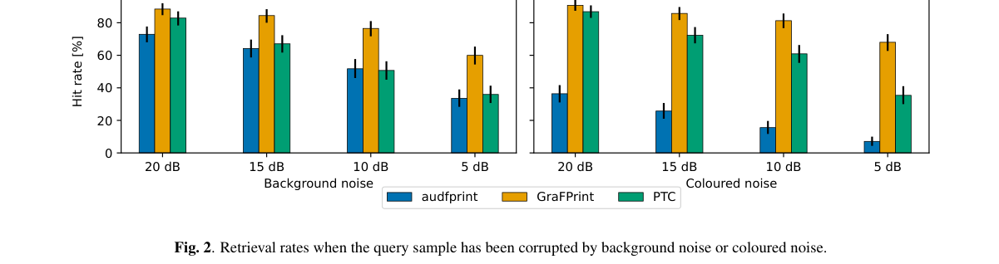

**Why this ranks #7**: 「在音乐上充分研究、在语音上未经评估」是一个领域间的评测迁移缺口。

---

### 8. Expert L2 English Speech Evaluation on a Gaming PC: Accuracy, Fluency, and Prosody with XLS-R, XEUS, and PhoneticXeus

**arXiv**: [2610.26406](https://arxiv.org/abs/2610.26406) | **Score**: 6.3 (relevance 6 x 0.7 + quality 7 x 0.3) | **Tags**: AIGC-audio | **Categories**: cs.CL, cs.SD | **Pages**: 19

**Authors**: Richard Rose

**Affiliation**: [not-found in PDF]

**Abstract**

> oollim is a locally executable system for evaluating L2 English pronunciation accuracy, fluency, and prosody on a consumer computer. The system combines pretrained XLS-R, XEUS, and PhoneticXeus representations with reference-text features and ridge regressions trained on SpeechOcean762, the Korean Learners' L2 Speech Corpus (English), J-AESOP, and their combinations. On 305 independently held-out recordings assessed by three expert raters, several ridge configurations substantially outperform archived Azure API scores obtained in January 2026 in both Spearman correlation and quadratic weighted kappa across all three constructs. These results support expert speech evaluation on consumer hardware using pretrained representations and construct-specific regressions, without neural-model fine-tuning or calibration on the private evaluation data.

**Key findings**

- **Finding**: oollim 在消费级电脑上本地评估 L2 发音准确度、流利度与韵律（摘要截断）。

- **Finding**: 结合多种预训练表示、参考文本特征与岭回归（摘要在此处截断）。

- **Inference**: 把评测做成可本地部署的工具，其影响不在精度而在**普及**——这是本项目日报多次记录「评测工具缺失」类问题的另一面解法。

- **Recommendation**: 语言教学或发音评测产品的读者可参考。

**Key figures**: 无可用图示（正文以表格与证明为主）。

**Why this ranks #8**: 「本地可运行的评测」降低了发音评估的门槛。

---

### 9. Multilingual Voicemail and Answering Machine Detection via Pretrained Audio Embeddings and Gradient Boosting Machines

**arXiv**: [2610.26100](https://arxiv.org/abs/2610.26100) | **Score**: 5.6 (relevance 5 x 0.7 + quality 7 x 0.3) | **Tags**: AIGC-audio | **Categories**: cs.LG, cs.SD, eess.AS | **Pages**: 10

**Authors**: Kemal Altwlkany, Muamer Paric

**Affiliation**: 2Faculty of Science, University of Sarajevo

**Abstract**

> Answering machine detection (AMD) is a fundamental task in telephony that classifies whether an answered call is picked up by a human or a voicemail (machine). Despite its widespread use across cloud communication platforms, existing approaches rely on proprietary systems with undisclosed architectures, or require computationally expensive models that cannot operate in real time. We propose a lightweight AMD system that combines pretrained audio embeddings with gradient boosting machines, trained to prioritize the correct detection of human-answered calls. We evaluate seven models across two datasets: three models that we propose, a proprietary industry model, two prior academic approaches, and a large language model baseline that relies on automatic speech recognition. Furthermore, we release OpenAMD, the first publicly available AMD dataset comprising of more than 500 recordings in 7 languages. Our best model achieves the highest precision across both datasets while maintaining low inference latency. We assess the robustness of models to additive noise and packet loss, and perform tests of statistical significance to discover per-language and per-gender model performance. Finally, we evaluate our model on an out-of-domain task of detecting robocalls, where it achieves 94.34% recall without any additional training, which is comparable to the industry standard.

**Key findings**

- **Finding**: AMD 被云通信平台广泛部署，但既有方法依赖**架构未公开的专有系统**（摘要截断）。

- **Finding**: 该文用预训练音频嵌入与梯度提升机实现多语言 AMD（摘要在此处截断）。

- **Inference**: 用通用嵌入 + 浅层分类器替代专有系统，是把部署成本降下来的可行路径，尽管上限受嵌入表示限制。

- **Recommendation**: 电信业务的读者可参考。

**Key figures**

*Framework / architecture - Figure 1 High-level overview of our proposed method. We compute the log-mel spectrogram from the input audio waveform and extract 512-dimensional clip-wise embeddings using PANNs CNN6 [13]. We train a*

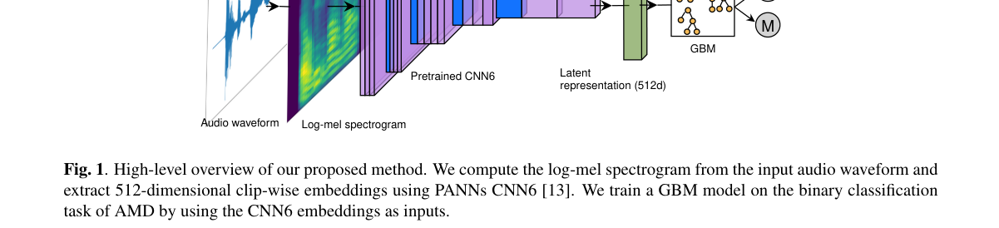

*Main result - Figure 2 Critical difference diagram showing the average ranks of the models across accuracy.*

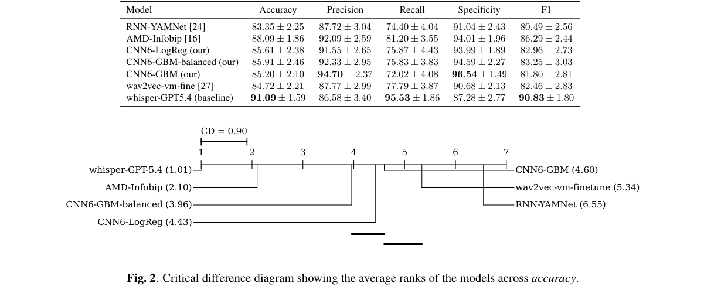

**Why this ranks #9**: 「广泛部署但依赖未公开的专有系统」是复现性问题的典型。

---

### 10. PronCFT: Pronunciation Contextual Fine-Tuning for Contextual Biasing of Out-of-Vocabulary Words in LLM-Based ASR

**arXiv**: [2610.25766](https://arxiv.org/abs/2610.25766) | **Score**: 6.3 (relevance 6 x 0.7 + quality 7 x 0.3) | **Tags**: AIGC-audio | **Categories**: eess.AS | **Pages**: 5

**Authors**: Yifan Xu, Kaixun Huang, Mengzhe Geng, Mingyu Cui, Shen Huang, Shidong Shang, Xunying Liu

**Affiliation**: The Chinese University of Hong Kong, Hong Kong SAR, China

**Abstract**

> LLM-based ASR systems often replace rare and out-of-vocabulary (OOV) words with familiar words that sound similar. Two factors contribute to this error: the model has not learned how an unseen word's sound maps to its spelling, and it may favor a familiar word over the one spoken, a failure we call prior suppression. Providing candidate pronunciations alone may not help: the model can treat a phoneme annotation as a marker that raises a candidate's output probability without checking its pronunciation against the speech. We propose PronCFT, which uses fixed phoneme sequences and trains the model to transcribe speech into phonemes, match them to context candidates, and output the matched spelling. During training, we alter candidate spellings while keeping their pronunciations unchanged, discouraging the model from choosing a familiar spelling without checking how the candidate sounds. A curriculum then gradually removes intermediate outputs to reduce decoding latency and prevent phoneme transcription errors from affecting the final text. The model's retained ability to use pronunciation cues suggests that this ability can be internalized. On an OOV test set filtered from open-source benchmarks, the final model, PronCFT-C, significantly improves recall from 59.89% to 83.57% (+23.68 pp). Wrong-phoneme and spelling-interference tests indicate that the gain depends on phoneme content rather than the presence of an annotation.

**Key findings**

- **Finding**: 两个成因：模型未学会未见词**发音→拼写**的映射；以及模型偏好熟悉词而非实际说出的词（摘要截断）。

- **Finding**: PronCFT 用发音上下文化微调解决（摘要在此处截断）。

- **Inference**: 把「不会拼」与「偏要拼熟悉的」分开处理是对的：前者需要新的词汇映射，后者需要偏置校正，而后者用更多数据反而会加剧。

- **Recommendation**: OOV 词处理的读者可参考。

**Key figures**

*Framework / architecture - Figure 1 Overview of PronCFT. Fixed candidate pronunciations enter the prompt (1). Structured supervision predicts utterance phonemes and matches them to candidate pronunciations (2), then outputs the*

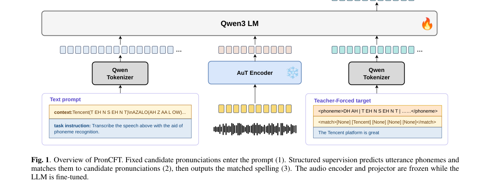

**Why this ranks #10**: 「两个因素」被明确区分，说明这是表示问题与偏置问题两回事。

---

## Footer

- Total papers reviewed across all 5 tracks: 50 (from 525 scanned)
- aigc_audio track final top-10: 10
- Wild-cards in this track: 8
- Figure assets: `res/` (shared across tracks)

Generated by `mine-arxiv-daily-digest` skill. Sister file: `2026-10-20_aigc_audio_entry.md`.
