# ArXiv Daily Digest - 2026-10-20 (AIGC 图像 / 视频 / 3D 生成与编辑, 10 papers)

**Generated**: 2026-10-20 17:00 CST

**Source**: arXiv cs.CV, cs.SD, eess.AS, cs.CL, cs.AI, cs.RO, cs.LG submissions, window 2026-10-19 UTC (latest announced batch as of 2026-10-20 17:00 CST)

**Track**: aigc_visual (top 10 of 525 papers scanned, 50 full reads)

**Scope**: dynamics-aware sparse attention for AR video diffusion, trajectory-distribution distillation for real-time AR video, drift-resistant AR video with frozen base, text-to-image without language pretraining, object-level physical plausibility benchmark, relightable Gaussian stylization, reciprocal sparse attention with hierarchical caching, optimal linear leaps for ODE sampling, sparse-view 3DGS as few-shot learning, postdictive smoothing for revisable caching

---

本批 AIGC 视觉线有两条并行的主线。

**Halcyon** 是最激进的一篇：现代 T2I 系统使用互联网规模的**语言预训练**，作者问这对强生成是否必要——Halcyon 是完全从零预训练于 1 亿图文数据集的早期融合多模态自回归模型。若结论成立，说明当前架构对语言模型的依赖更多是**继承的**而非必需的，这会改变大量后续工作的基线设定。**这是本批最值得做复现的一篇**，因为它检验的是领域默认而非某个新组件。

另一条是**自回归视频的算力账**，本批一次性来了四篇：**Dynamics-Aware Sparse Attention** 指出低效源于稠密计算在所有时空区域**均匀分配**处理资源；**TriTD** 把 AR rollout 的瓶颈分解为三个误差来源（基座模型误差、训练-推理分布差、……），使「质量 vs 效率」从单目标问题变成多目标问题；**Clean Forcing** 用**冻结基座**实现漂移抵抗（用固定性换稳定性，限制基座随 rollout 漂移）；**RECAP** 则指出稀疏注意力与时间缓存组合时会**耦合误差**——两个各自安全的加速手段叠加后互相污染，这在 10-17 的多奖励归一化、10-18 的主副轴耦合中同样出现。

**PVBench** 值得单独一提：它用**物体级物理测量**替代粗糙的 VLM 判断来量化视频的物理合理性——这与 10-07 日报 World Models' Last Exam（40 个受控任务实测）是同一主张，而两篇独立工作同时出现，说明「**测量优于判断**」正在成为该领域的共识。

---

## Top 10 - AIGC 图像 / 视频 / 3D 生成与编辑

### 1. Text-to-Image Generative Modeling Without Language Pretraining

**arXiv**: [2610.26863](https://arxiv.org/abs/2610.26863) | **Score**: 9.0 (relevance 9 x 0.7 + quality 9 x 0.3) | **Tags**: AIGC-image | **Categories**: cs.CV, cs.LG | **Pages**: 27

**Authors**: Keshigeyan Chandrasegaran, Yue Zhao, Armin W. Thomas, Ehsan Adeli, Jiajun Wu, Juan Carlos Niebles, Li Fei-Fei, Michael Poli

**Affiliation**: Keshigeyan Chandrasegaran1,2 Yue Zhao1 Armin W. Thomas2 | 1Stanford University | available at cs.stanford.edu/˜keshik/halcyon.

**Abstract**

> Modern text-to-image (T2I) systems use internet-scale language pretraining for text-conditioned image generation. We ask whether language pretraining is necessary for strong T2I generation. We introduce Halcyon, a family of early-fusion multimodal autoregressive models pretrained entirely from scratch on GPIC, a dataset of 100M image-text pairs. Halcyon-0.52B outperforms LlamaGen-XL/8 (48.0 vs. 63.3 gFD) with 18.2$\times$ less pretraining compute. Further, Halcyon-1.6B outperforms JiT-T2I-XXL/8++ (35.3 vs. 41.0 gFD) with 275$\times$ less pretraining compute. Controlled experiments show that text-only pretraining does not improve T2I generation. Halcyon also learns image captioning by replacing caption dropout with I2T supervision, maintaining competitive T2I generation quality under the same pretraining budget. We show that strong T2I systems can be trained from scratch without internet-scale language pretraining. Code and models are available at https://cs.stanford.edu/~keshik/halcyon

**Key findings**

- **Finding**: 现代 T2I 系统依赖互联网规模的语言预训练；作者问这对强生成**是否必要**。

- **Finding**: Halcyon 是早期融合的多模态自回归模型，完全从零预训练于 GPIC（1 亿图文数据集，摘要在此处截断）。

- **Inference**: 若去掉语言预训练仍能达到强 T2I 性能，那说明当前架构对语言模型的依赖更多是**继承的**而非必需的——这会改变大量后续工作的基线设定。

- **Recommendation**: 被精读的三篇之一。**这是本批最值得做复现的一篇**，因为它检验的是领域默认而非某个新组件。

**Key figures**

*Main result - Figure 2 Language vs. vision pretraining to- kens. Language tokens count text-only pretrain- ing. Emu3 and Tuna-2 values are estimated.*

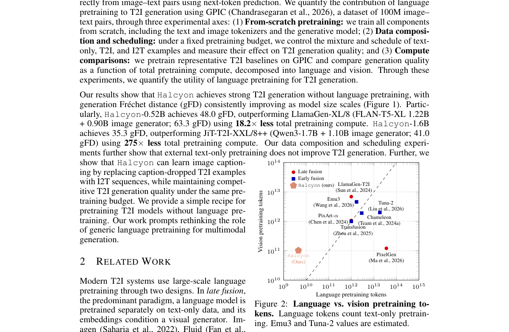

**Why this ranks #1**: 本批最激进的一篇：它质疑整个领域最昂贵的那项前置投入。

---

### 2. Dynamics-Aware Sparse Attention for Efficient Autoregressive Video Diffusion

**arXiv**: [2610.26262](https://arxiv.org/abs/2610.26262) | **Score**: 8.7 (relevance 9 x 0.7 + quality 8 x 0.3) | **Tags**: AIGC-video | **Categories**: cs.CV | **Pages**: 21

**Authors**: Yuanyu He, Zhuokun Chen, Yefei He, Zhiwei Tang, Jiasheng Tang, Yinghao Yu, Jianfei Cai, Bohan Zhuang

**Affiliation**: 1Zhejiang University | 2Alibaba Group | 3Monash University

**Abstract**

> Autoregressive Diffusion Transformers have emerged as a powerful paradigm for long video generation. However, they are often constrained by prohibitive computational overhead and substantial memory footprints. This inefficiency arises from dense computation mechanisms that allocate uniform processing resources across all spatiotemporal regions, failing to leverage the inherent temporal redundancy of video where motion is typically confined to sparse areas. In this paper, we propose Dynamics-Aware Sparse Attention (DASA), a unified framework that shifts from dense computation to sparse, motion-driven generation to eliminate both storage and computational redundancies. Inspired by video codec principles, our approach explicitly decouples video content into dynamic and static regions. To mitigate memory bottlenecks, we selectively compress the historical KV cache by retaining only dynamic features within the generated chunk. Furthermore, to reduce computational overhead, we employ a region-level computation allocation strategy based on localized dynamics. Additionally, a dynamics-guided distillation method is introduced to enhance performance via a lightweight distillation training process. Experiments on VBench demonstrate that our approach accelerates autoregressive video generation by 2.16x, while preserving high visual fidelity.

**Key findings**

- **Finding**: 低效源于稠密计算在所有时空区域**均匀分配**处理资源（摘要截断）。

- **Finding**: 该文做动力学感知的稀疏注意力（摘要在此处截断）。

- **Inference**: 「动态性」作为重要性判据比注意力分数更接近生成语义——运动剧烈处需要更多计算，而注意力高只说明该处被查询过，不说明它需要多少。

- **Recommendation**: 与本批 RECAP（稀疏+缓存的误差耦合）对照，两篇都在处理自回归视频的冗余。

**Key figures**

*Framework / architecture - Figure 1 Spatiotemporal dynamic analysis of video generation under different motion priors (left: camera panning; right: subject motion). (a) Real-world scenes. The videos are synthesized via Self Fo*

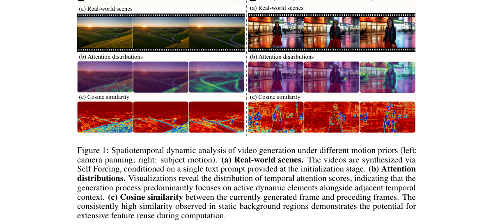

*Main result - Figure 2 Overall architecture of the proposed framework. We introduce a unified approach to optimize AR diffusion generation for both storage and computational efficiency. Storage Manage- ment (Left)*

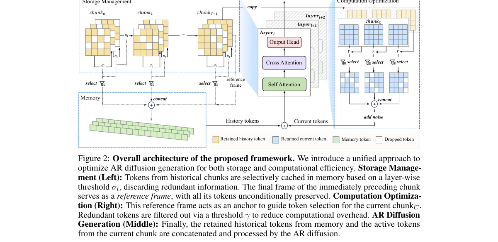

**Why this ranks #2**: 「均匀分配处理资源」被明确指认为自回归视频的浪费来源。

---

### 3. TriTD: Tri-Partite Trajectory-Distribution Distillation for Real-Time Autoregressive Video Generation

**arXiv**: [2610.26165](https://arxiv.org/abs/2610.26165) | **Score**: 8.7 (relevance 9 x 0.7 + quality 8 x 0.3) | **Tags**: AIGC-video | **Categories**: cs.CV | **Pages**: 21

**Authors**: Jia Li, Xurui Peng, Haowei Zhu, Tianyu Zhao, Jiexi Wang, Youwei Zheng, Yuxi Ren, Xinglong Wu, Xing Wang, Hayden Kwok-Hay So

**Affiliation**: 1The University of Hong Kong, 2ByteDance Seed, 3Tsinghua University

**Abstract**

> Autoregressive (AR) video diffusion has emerged as a leading paradigm for efficient video generation, yet its practical deployment remains bottlenecked by the trade-off between generation quality and inference efficiency. We attribute this bottleneck to three error sources in AR rollouts: the base model error, the train-inference distribution mismatch, and the upstream error propagation. Building on this decomposition, we derive closed-form upper bounds on the per-step and cumulative errors, providing a principled basis for jointly optimizing generation quality and inference efficiency. Guided by this analysis, we propose TriTD, a Tri-Partite Trajectory-Distribution co-optimized distillation framework with three complementary modules. First, for ODE initialization, we adopt a Next-Node Trajectory Distillation (NTD) objective, which shortens the supervision horizon and admits a lower regression-error floor. Second, we introduce Chunk-Graded Noising (CGN), a monotonically non-decreasing per-chunk noising schedule that helps narrow the expected train-inference noise mismatch and removes redundant KV-cache updates, yielding substantial speedups at no quality cost. Third, we propose Orthogonal-Parallel DMD (OP-DMD), a distribution-matching loss that retains the original DMD supervision while introducing an additional regression constraint in the orthogonal subspace to suppress off-axis drift, improving both training stability and final generation quality. Extensive experiments show that TriTD consistently surpasses existing baselines in visual quality while reaching a real-time throughput of 26.8 FPS on a single H100 GPU, delivering a balanced quality-efficiency solution for interactive streaming video generation.

**Key findings**

- **Finding**: 作者把 AR rollout 的瓶颈归因于三个误差来源：基座模型误差、训练-推理分布……（摘要截断）。

- **Finding**: TriTD 用三部分轨迹分布蒸馏应对（摘要在此处截断）。

- **Inference**: 「误差来源分解」的价值在于它把「质量 vs 效率」的权衡从单目标问题变成多目标问题——不同来源的误差可以用不同手段消除，而不必靠统一的采样步数妥协。

- **Recommendation**: 自回归视频部署的读者必读；与 10-19 的 Speculative Forcing、10-16 的 AR 视频簇连续。

**Key figures**

*Framework / architecture - Figure 1 Overview of the proposed TriTD Framework, including (1) NTD-based ODE initialization stage and (2) OP-DMD-based distribution distillation stage. Chunk-Graded noising training is consistently*

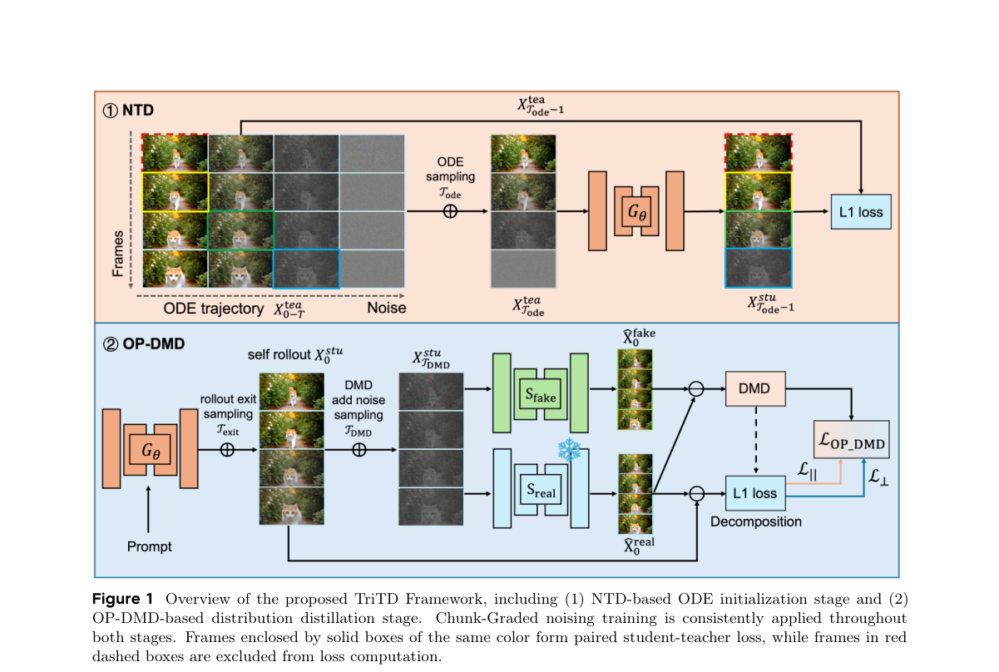

*Main result - Figure 2 Training-trajectory comparison in a 2D latent toy. Left: Standard DMD with training oscillation and unconstrained subspace shift between PDMD and Preal. Right: OP-DMD with orthogonal penalty*

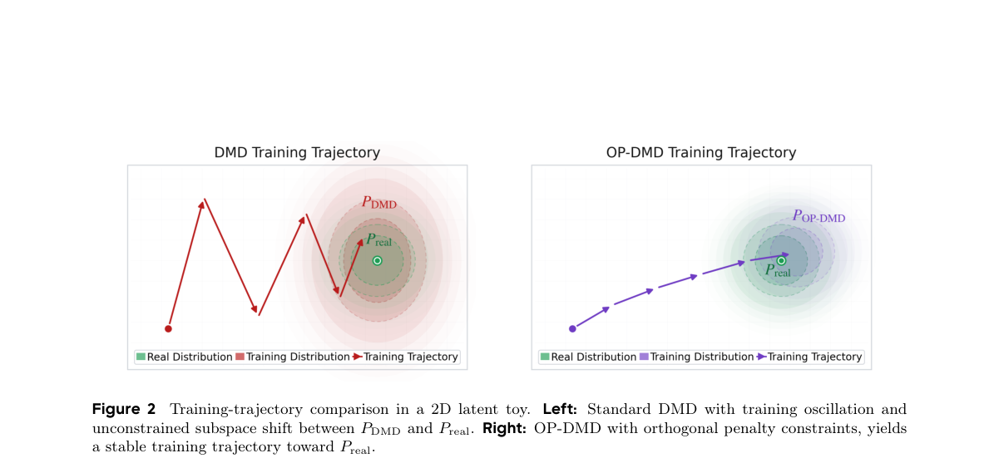

**Why this ranks #3**: 「把瓶颈分解为三个误差来源」是本批 AR 视频系列里最结构化的一篇。

---

### 4. Clean Forcing: Drift-Resistant Autoregressive Video Diffusion with a Frozen Base

**arXiv**: [2610.25634](https://arxiv.org/abs/2610.25634) | **Score**: 8.7 (relevance 9 x 0.7 + quality 8 x 0.3) | **Tags**: AIGC-video | **Categories**: cs.CV, cs.LG | **Pages**: 33

**Authors**: Wenqing Wang, Joonghyuk Shin, Jonathan Tremblay, Chan Hee Song, Yun Fu

**Affiliation**: 1Northeastern University | 2Seoul National University

**Abstract**

> Autoregressive (AR) video diffusion models generate streaming video of arbitrary length by conditioning each new chunk of frames on those already generated. However, they suffer from exposure bias, where a model trained on clean context must continue from its own imperfect outputs, and errors compound until quality collapses within seconds (drift). Existing methods either require cluster-scale base retraining, apply training-free inference corrections with inconsistent results, or train frozen-base correctors for sampling and cache errors. We instead find that drift is largely deterministic and therefore learnable, as holding the noisy state fixed while varying only the history reveals a counterfactual velocity gap that is ~95% systematic across noise seeds. Based on this observation, we introduce Clean Forcing, which trains a 5.9M-parameter LoRA corrector on the frozen base model to regress this gap, with a closed-loop stage that adds DAgger-style aggregation and a drift-contraction objective to expose the corrector to its own rollouts. Because the clean histories can be the base model's own single-shot generations, training needs no real videos, and the merged corrector adds no inference cost. In 50 s text-to-video generation, Clean Forcing reduces Δ-drift from +11.3 to +1.65 without real video and to -0.16 with 40 real clips, improving on the best published result of +3.57 with over 150x less data. Extensive experiments demonstrate that Clean Forcing outperforms prior methods in aesthetic quality and data efficiency with reduced drift for long-horizon video generation.

**Key findings**

- **Finding**: 暴露偏差：在干净上下文训练的模型须从自身不完美输出继续，误差累积至**数秒内**质量崩溃（摘要截断）。

- **Finding**: Clean Forcing 用**冻结基座**实现漂移抵抗（摘要在此处截断）。

- **Inference**: 冻结基座是这里的反直觉设计：它限制了基座随 rollout 漂移，从而让「已生成内容」始终落在基座熟悉的分布附近——用固定性换稳定性。

- **Recommendation**: 与本批 TriTD 对读，两篇分别从误差来源分解与基座固定处理同一失效。

**Key figures**

*Framework / architecture - Figure 1 Clean Forcing reduces drift during AR rollout. The first 20 s of two 50 s generations with the same prompt and seed are shown. The adapted AR base (top) becomes oversaturated and loses the g*

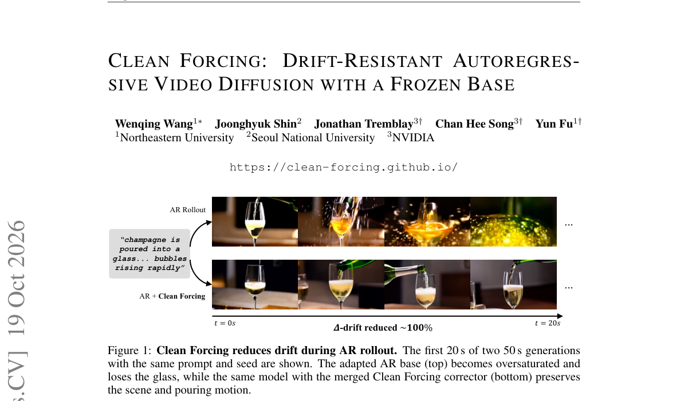

*Main result - Figure 2 Overview. (1) At the shared noisy state zt, ∆v := vθ(zt, hclean, t) −vθ(zt, hgen, t) is the history-induced velocity gap. The corresponding one-step clean-latent predictions differ by σt∥∆v∥*

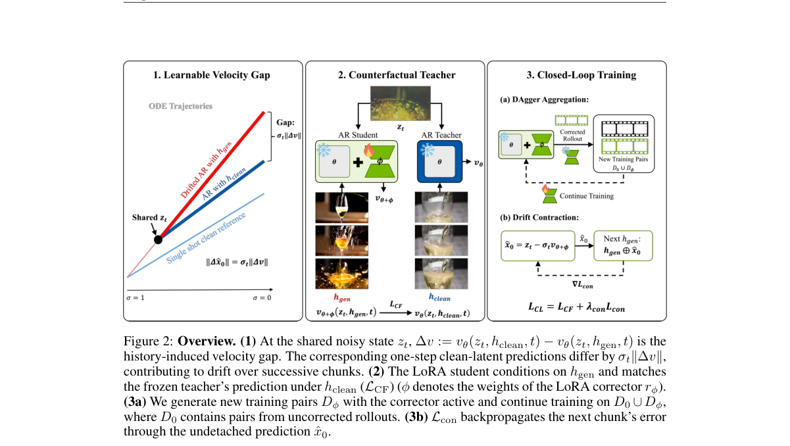

**Why this ranks #4**: 「误差累积到数秒内崩溃」给暴露偏差一个明确的失效时间尺度。

---

### 5. PVBench: Quantifying Physical Plausibility in Video Generation with Object-Level Physical Measurements

**arXiv**: [2610.26711](https://arxiv.org/abs/2610.26711) | **Score**: 8.0 (relevance 8 x 0.7 + quality 8 x 0.3) | **Tags**: AIGC-video, world-model | **Categories**: cs.CV | **Pages**: 27

**Authors**: Kaiwei Chen, Moran Li, Zhenye Gan, Yabiao Wang, Chengjie Wang, Kexin Zhang, Yong Liu, Jiangning Zhang

**Affiliation**: 1APRIL Lab, Zhejiang University, 2Huazhong University of Science and Technology, 3Tencent Youtu

**Abstract**

> Recent video generation models produce visually compelling outputs, yet their physical plausibility remains poorly measured. Physical plausibility asks whether generated objects obey geometry, kinematics, dynamics, and conservation laws. Existing benchmarks rely on coarse visual-language model judgments or target embodied world models rather than video generation itself. We introduce PVBench, a physical video benchmark that quantitatively measures the plausibility of generated videos across 46 dimensions organized into seven domains, spanning: i) instruction and semantic fidelity, ii) behavioral and causal consistency, iii) perceptual and temporal quality, iv) geometric and spatial consistency, v) material properties and field states, vi) kinematic and spatiotemporal persistence, vii) and mechanical plausibility with conservation laws. PVBench comprises 600 carefully crafted prompts, of which 30% involve physical embodied agents such as robot arms, humanoids, quadrupeds, and multi-agent systems. For challenging physically tractable dimensions, it pairs each with specialized vision models that derive verifiable, physically grounded measurements, such as object-level 6D pose, metric scale, surface normals, kinematics, and numerical conservation-law residuals. It thus avoids relying solely on subjective scoring, while supporting both text-to-video and image-to-video generation. Finally, we validate the agreement between automatic metrics and human judgments through human evaluation. Meanwhile, we evaluate mainstream open-source and closed-source models and present several insights. By releasing the benchmark, prompts, and calibration protocol, we aim to foster physically grounded video generation.

**Key findings**

- **Finding**: 既有基准依赖**粗糙的视觉语言模型判断**或面向具身世界模型的比率（摘要截断）。

- **Finding**: PVBench 做物体级物理测量以量化物理合理性（摘要在此处截断）。

- **Inference**: 用物体级物理测量替代 VLM 判断，是 10-07 日报 World Models' Last Exam（40 个受控任务实测）路线的延续——**测量优于判断**这个判断在两篇独立工作中同时出现，说明它是该领域正在收敛的共识。

- **Recommendation**: 与 10-07 日报 World Models' Last Exam 连读，两篇分属图像/视频与视频世界模型，但主张相同。

**Key figures**

*Framework / architecture - Figure 1 Overview of PVBench. (a) The benchmark comprises 46 evaluation dimensions organized into seven domains and three assessment layers: semantic, perceptual, and physical. (b) The physical layer*

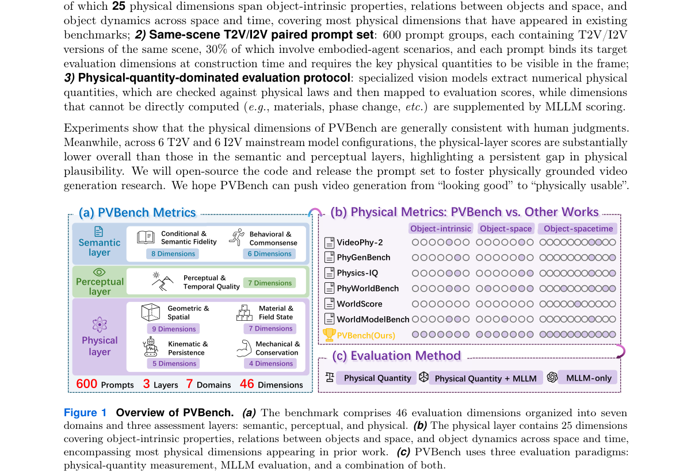

*Main result - Figure 2 PVBench data curation. (a) Design of the target dimensions and scene. (b) Construction of prompts through multiple rounds of MLLM assistance and human verification. (c) Generation of T2V and*

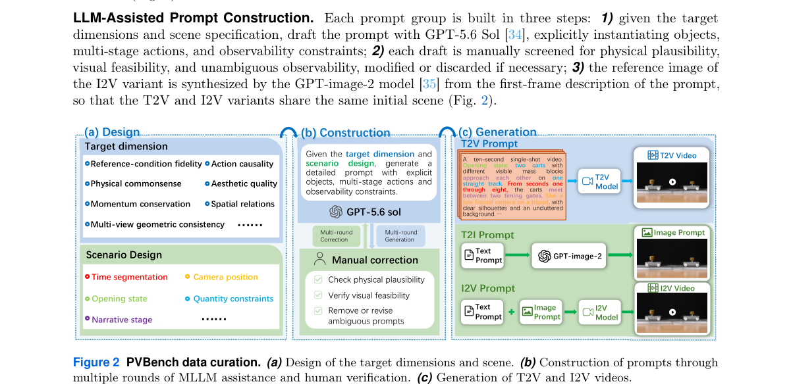

**Why this ranks #5**: 这是本项目日报物理评测线索的最新一环，且用了「物体级物理测量」而非 VLM 判断。

---

### 6. RxGS: Relightable Gaussian Stylization via BRDF Decomposition

**arXiv**: [2610.25681](https://arxiv.org/abs/2610.25681) | **Score**: 7.7 (relevance 8 x 0.7 + quality 7 x 0.3) | **Tags**: AIGC-3D | **Categories**: cs.CV | **Pages**: 20

**Authors**: Wanrong Hong, Liu Jiang, Mukesh Prasad, Jun Li

**Affiliation**: 1School of Computer Science, University of Technology Sydney, Sydney, | 2Department of Civil and Environmental Engineering, Stanford | University, Stanford, United State. | 3Australian Artificial Intelligence Institute, University of Technology

**Abstract**

> Reference-based 3D scene stylization transfers the appearance of a reference image onto a reconstructed 3D scene while preserving scene geometry. Recent methods perform this transfer by optimizing the appearance representation of neural scene models including Neural Radiance Fields (NeRF) and 3D Gaussian Splatting (3DGS). These methods optimize an RGB appearance representation, in which a single per-point colour combines the effects of material reflectance, environment illumination, together with the shading it produces, and the viewing direction. When stylization modifies this combined colour, the illumination effects present during stylization are baked into the stored appearance, so the stylized scene cannot be rendered under different illumination. To address this limitation, we present RxGS, a relightable 3D scene stylization framework built on a Bidirectional Reflectance Distribution Function (BRDF)-aware 3D Gaussian representation. Rather than modifying a per-point RGB colour, RxGS optimizes only the diffuse albedo field recovered by inverse rendering, while leaving roughness, metallicity, surface normals, and the estimated environment lighting unchanged. As a result, the stylized scene keeps all the components a physically-based renderer needs other than the edited albedo, and can therefore still be relit. RxGS optimizes the albedo field using a nearest-neighbour feature matching loss together with a spatial smoothness prior over Gaussian centres. We evaluate the method using a Geometry Consistency Cost (GCC) based on optical-flow warping error. RxGS achieves the lowest GCC on all evaluated NeRF-Synthetic scenes and remains competitive on real-captured scenes, while additionally supporting relightable stylization, which existing reference-based 3D scene stylization methods do not provide.

**Key findings**

- **Finding**: 既有方法通过优化神经场景模型的外观表示来做风格化（摘要截断）。

- **Finding**: RxGS 用 **BRDF 分解**实现可重光照的高斯风格化（摘要在此处截断）。

- **Inference**: 把外观分解为材质参数后，风格转移就不再是像素对齐问题而是材质赋值问题——这也是可重光照的前提。

- **Recommendation**: 3D 风格化的读者可参考。

**Key figures**

*Framework / architecture - Figure 1 Comparison between stylization on an RGB appearance representation and stylization on a BRDF-aware scene representation. Existing methods transfer appearance onto a per-point RGB colour, which*

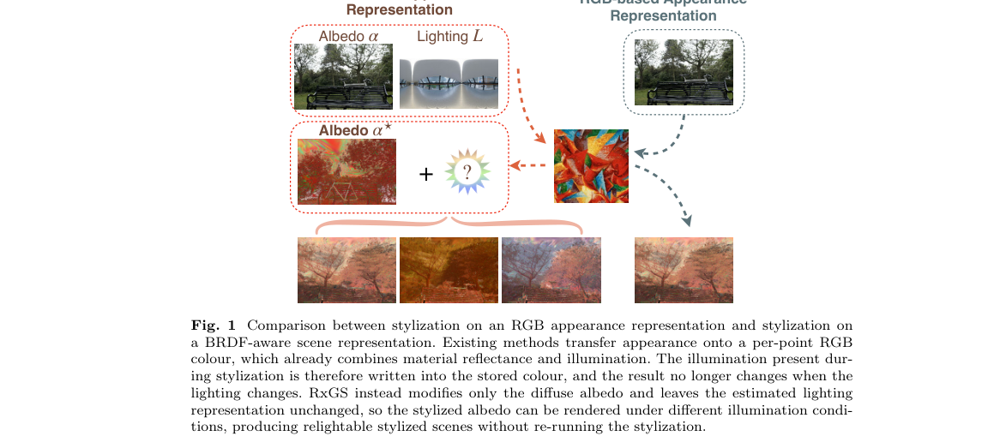

*Main result - Figure 2 Overview of RxGS. Given posed multi-view images and a reference style image, a BRDF- aware Gaussian scene representation is first reconstructed with GS-IR, which separates the scene into geomet*

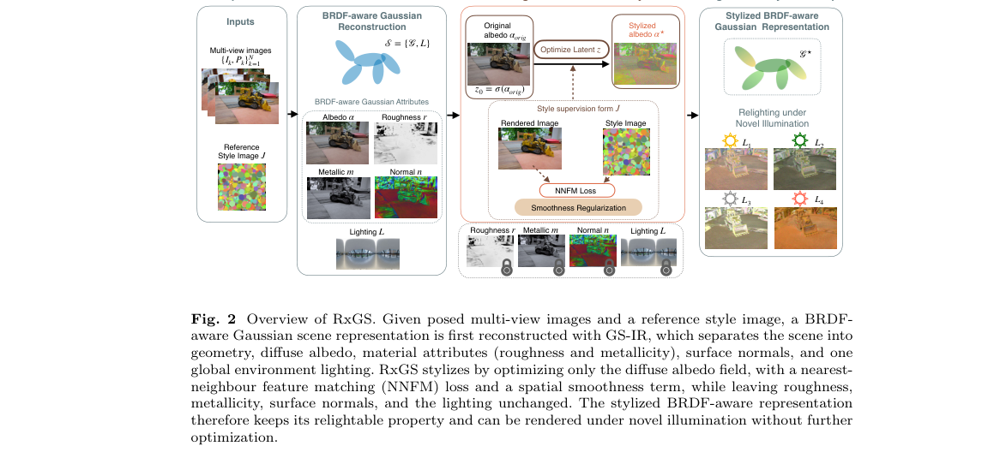

**Why this ranks #6**: 「可重光照」要求外观表示携带材质信息而非纯反射。

---

### 7. RECAP: Reciprocal Sparse Attention and Hierarchical Caching for Efficient Video Diffusion

**arXiv**: [2610.26244](https://arxiv.org/abs/2610.26244) | **Score**: 7.7 (relevance 8 x 0.7 + quality 7 x 0.3) | **Tags**: AIGC-video | **Categories**: cs.CV, cs.LG | **Pages**: 13

**Authors**: Tiange Xu, Kai Liu, Linghe Kong, Yulun Zhang

**Affiliation**: 1University of Cambridge, 2Shanghai Jiao Tong University

**Abstract**

> Diffusion transformers generate high-quality videos but remain computationally expensive. Sparse attention and temporal caching reduce computation within and across denoising steps, respectively, offering a natural composition. However, predictions produced with sparse attention become sources for temporal reuse, coupling their errors along the sampling trajectory. We observe that improving the accuracy of these sources recovers fidelity without changing the reuse schedule, and that sparsification errors remain directionally aligned across nearby steps, suggesting that correction information can be shared rather than recomputed. These observations motivate RECAP, a training-free method that couples sparse attention with hierarchical caching through reciprocal correction, adaptively coordinated by online error feedback. Cached dense refinement corrects omitted interactions in current sparse estimates, while fresh sparse statistics track input changes and regulate the aging correction. The resulting predictions then renew the sources for whole-step prediction reuse, allowing prediction history to advance between dense refreshes. We evaluate RECAP on multiple video diffusion models against sparse-attention methods, caching methods, and their direct compositions. On HunyuanVideo at 720p 5-second generation, RECAP achieves a 3.05x speedup and outperforms all tested direct compositions in both fidelity and inference speed.

**Key findings**

- **Finding**: 稀疏注意力与时间缓存天然可组合，但稀疏注意力产生的预测**成为时间复用的来源**，耦合了两者的误差（摘要截断）。

- **Finding**: RECAP 提出互惠稀疏注意力与层次缓存（摘要在此处截断）。

- **Inference**: 这是一个普适教训：两个各自安全的加速手段组合后可能互相污染，因此组合必须显式设计而不能简单叠加——这在 10-17 的「多奖励归一化」与 10-18 的「主副轴耦合」中反复出现。

- **Recommendation**: 视频生成部署的读者可参考；与本批 PoSTCache（事后平滑替代前瞻预测）同属缓存方向。

**Key figures**

*Framework / architecture - Figure 1 Sample video and results on HunyuanVideo (720p, 5s). RECAP achieves a 3.05× speedup while outperforming all tested direct sparse–cache compositions in both fidelity and speed.*

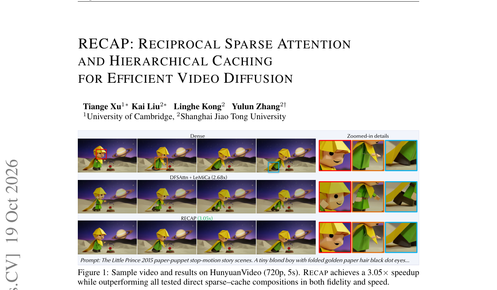

*Main result - Figure 2 Motivation of RECAP. Direct composition reuses sparse outputs, so sparse error persists. RECAP caches dense refinement to correct sparse steps, whose outputs renew the reuse history.*

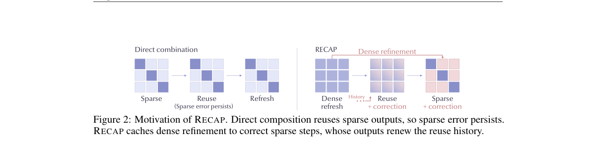

**Why this ranks #7**: 「稀疏与缓存组合会耦合误差」——一个组合两种优化时的隐藏代价。

---

### 8. LEAP: Accelerating ODE-based Diffusion Sampling with Optimal Linear Leaps

**arXiv**: [2610.25918](https://arxiv.org/abs/2610.25918) | **Score**: 7.3 (relevance 7 x 0.7 + quality 8 x 0.3) | **Tags**: AIGC-image, AIGC-video | **Categories**: cs.CV | **Pages**: 18

**Authors**: Haowei Zheng, Zhenyu Zhou, Jiawei Chen, Can Wang, Defang Chen

**Affiliation**: Zhejiang University

**Abstract**

> Diffusion models primarily rely on general-purpose ODE-based numerical methods for training-free accelerated sampling, but performance degrades with coarse time discretization. In this paper, we propose optimal linear leaps (LEAP), a specialized method grounded in theoretical and empirical investigations of sampling trajectory geometry. Built upon low-dimensionality and cross-trajectory consistency, LEAP formulates a supervised least-squares optimization problem within the local trajectory subspace, achieving a precise approximation of future states without model evaluations. Extensive experiments demonstrate that LEAP outperforms previous methods across diverse modalities, including text-to-image (Stable Diffusion 3.5, FLUX.1-dev) and image-to-3D (TRELLIS.2) generation. Furthermore, LEAP can be seamlessly integrated into existing solver-based methods, offering a plug-and-play enhancement for modern diffusion models. Code is available at https://github.com/zju-pi/LEAP.

**Key findings**

- **Finding**: 通用 ODE 数值方法在**粗时间离散**下性能退化；LEAP 是针对扩散专门设计的最优线性跳跃（摘要截断）。

- **Finding**: 该方法建立在采样轨迹几何的理论与实证研究之上（摘要在此处截断）。

- **Inference**: 若通用求解器的步长自适应基于平滑性假设，而扩散轨迹在后期高度非平滑，那么专用离散化就能省下大量步数——这是把「数值方法」当作可优化对象而非既定基础设施的思路。

- **Recommendation**: 与 10-16 日报的一步生成质疑同属「少步数」这条线。

**Key figures**

*Framework / architecture - Figure 1 Overview of the proposed LEAP. A linear predictor (blue boxes) extrapolates the subsequent score from a sliding history buffer of size 𝑟(dashed boxes), yielding an approximated state ˆx (gre*

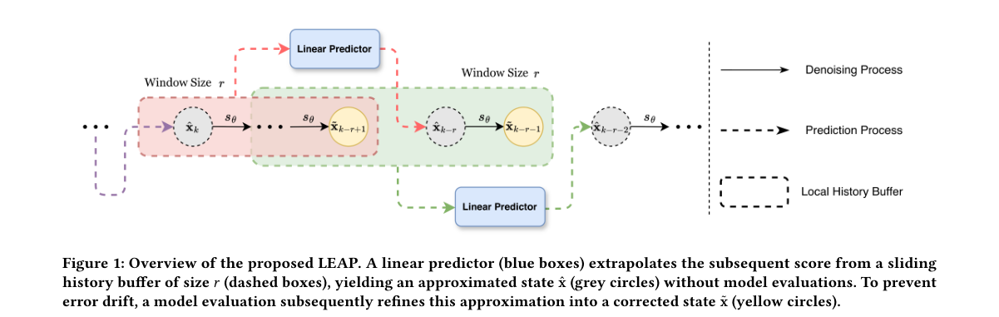

*Main result - Figure 2 Visualizing the trajectory regularity of diffusion models. Following the visualization protocol in [5], we project 100 sampling trajectories generated with distinct noise and prompt initiali*

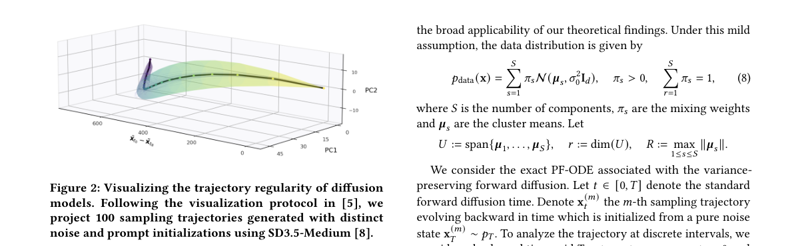

**Why this ranks #8**: 「通用 ODE 求解器不是扩散的最优选择」是一个具体的工程论断。

---

### 9. Rethinking Sparse-View 3D Gaussian Splatting: A Few-Shot Learning Perspective on Overfitting Prevention

**arXiv**: [2610.25887](https://arxiv.org/abs/2610.25887) | **Score**: 7.3 (relevance 7 x 0.7 + quality 8 x 0.3) | **Tags**: AIGC-3D | **Categories**: cs.CV | **Pages**: 5

**Authors**: Lejia Ye, Bin Wu, Jingjing Gao, Yiyang Wu, Xiaohu Zhang

**Affiliation**: LEJIA YE∗, School of Aeronautics and Astronautics, Sun Yat-sen University, China | BIN WU∗, School of Aeronautics and Astronautics, Sun Yat-sen University, China | JINGJING GAO, School of Aeronautics and Astronautics, Sun Yat-sen University, China | YIYANG WU, School of Aeronautics and Astronautics, Sun Yat-sen University, China

**Abstract**

> Sparse-view novel view synthesis (NVS) is essential for AR/VR and real-time communication applications, yet remains challenging when reconstructing 3D scenes from limited viewpoints. While 3D Gaussian Splatting (3DGS) excels in dense-view scenarios, it suffers from overfitting and geometry degradation under sparse inputs. Current approaches often tackle these problems from a local perspective, addressing either data quality or training regularization individually, lacking a unified and interpretable framework for systematic improvement. We introduce a new perspective that reframes sparse-view 3DGS from a few-shot learning viewpoint, treating each Gaussian primitive as a neuron and leveraging deep learning regularization techniques. Under this unified framework, our approach generates more effective supervision from scarce observations through two strategies: (1) data-related supervision enrichment via optical flow-guided pseudo-view synthesis and joint camera-scene optimization; and (2) training-time regularization via motion-aware dropout and early stopping, which suppress overfitting while preserving dynamic-scene stability. Extensive experiments on the SIGGRAPH Asia 2025 volumetric video challenge sparse-view dataset demonstrate significant improvements over state-of-the-art optimization-based and feed-forward baselines. Our system won first place in the sparse-view track of the SIGGRAPH Asia 2025 challenge.

**Key findings**

- **Finding**: 3DGS 在稀疏输入下**过拟合并几何退化**；该文从少样本学习视角重新思考（摘要截断）。

- **Inference**: 少样本学习的核心是「如何用少量样本避免记住而非泛化」——把这个框架移到 3DGS 上，方法空间从正则化扩展到元学习式的正则策略。

- **Recommendation**: 与本批 HandsOn（跨本体灵巧基准）同属 3D/操作的数据与方法侧。

**Key figures**

*Framework / architecture - Figure 1 We reinterpret sparse-view 3D Gaussian Splatting through the lens of deep-learning overfitting prevention, design corresponding strategies, and outperform both state-of-the-art optimization-ba*

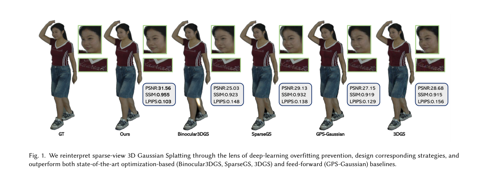

*Main result - Figure 2 Overview of our methodology. Data Expansion: Depth plus horizontal/vertical optical flow produce virtual camera shifts whose rendered views are warped back and constrained by a consistency los*

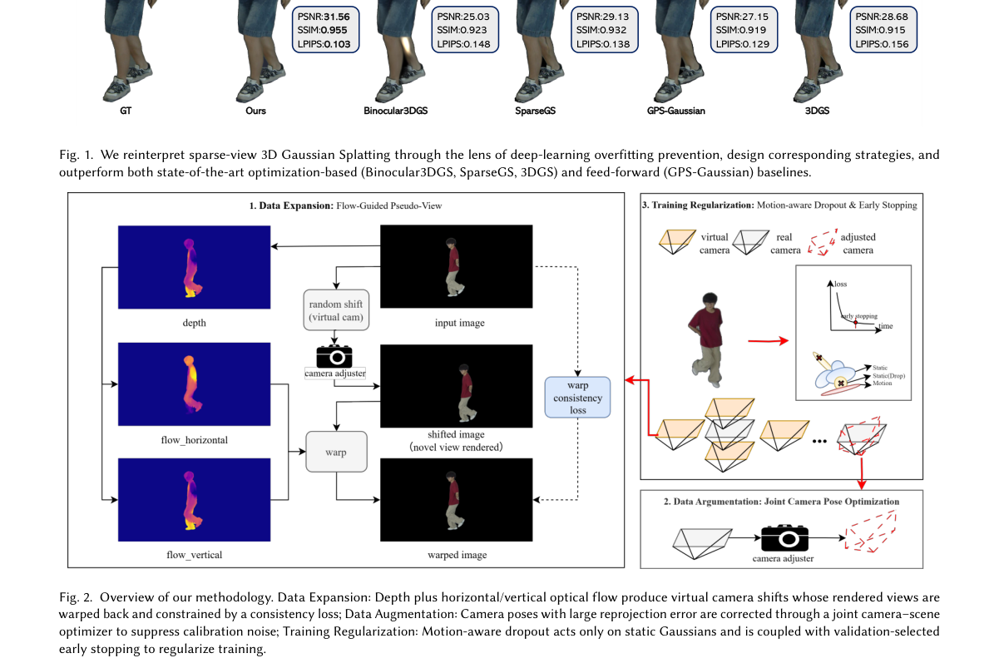

**Why this ranks #9**: 「把过拟合当作少样本学习问题」是一个诊断角度的转换。

---

### 10. PoSTCache: From Forecasting to Postdictive Smoothing for Revisable Diffusion Caching

**arXiv**: [2610.25664](https://arxiv.org/abs/2610.25664) | **Score**: 7.0 (relevance 7 x 0.7 + quality 7 x 0.3) | **Tags**: AIGC-image, AIGC-video | **Categories**: cs.CV | **Pages**: 37

**Authors**: Liwei Lan, Hui Chen, Jungong Han, Guiguang Ding

**Affiliation**: 1School of Software, Tsinghua University | 2BNRist, Tsinghua University | 3Department of Automation, Tsinghua University

**Abstract**

> Diffusion and flow matching models achieve impressive visual generation quality but remain computationally expensive due to iterative sampling. Caching-based acceleration provides a practical training-free solution by reusing or predicting intermediate features. However, existing methods largely enforce a forward-only information flow: approximations produced for skipped model evaluations are immediately committed to the sampling trajectory and cannot benefit from feedback generated by later full-computation steps. We propose \textbf{PoSTCache} (\emph{Postdictive Smoothing Trajectory Cache}), a training-free and plug-and-play framework that reformulates diffusion caching as revisable trajectory inference. PoSTCache first uses an existing caching strategy to construct forward proposals for skipped steps. At a later full-computation step, the discrepancy between the refreshed prediction and its forward proposal yields a correction signal, which PoSTCache propagates backward to refine and reintegrate the preceding predictions. Viewing full-computation steps as sources of corrective feedback also changes how they should be selected. We therefore introduce the Posterior Variance Reduction (PVR) strategy, which estimates cross-timestep dependencies from offline denoising trajectories and selects anchors according to their expected reduction in surrogate trajectory uncertainty rather than local approximation error alone. Experiments on representative image and video generation models show that PoSTCache consistently improves the quality--efficiency trade-off over representative caching methods.

**Key findings**

- **Finding**: 既有缓存方法大多强制**只向前**的信息流（摘要截断）。

- **Finding**: PoSTCache 从「预测」转向「事后平滑」以实现可修订的扩散缓存（摘要在此处截断）。

- **Inference**: 「只向前」意味着缓存错误无法被后续信息纠正——事后平滑允许用后见信息修正先前的预测，代价是延迟。

- **Recommendation**: 与本批 RECAP 对照，两篇分别处理缓存的误差耦合与信息流方向。

**Key figures**

*Framework / architecture - Figure 1 From forecasting to postdictive smoothing. (a) Forward-only caching commits skipped predictions using historical information and leaves the resulting trajectory drift unrevised. (b) PoST- Ca*

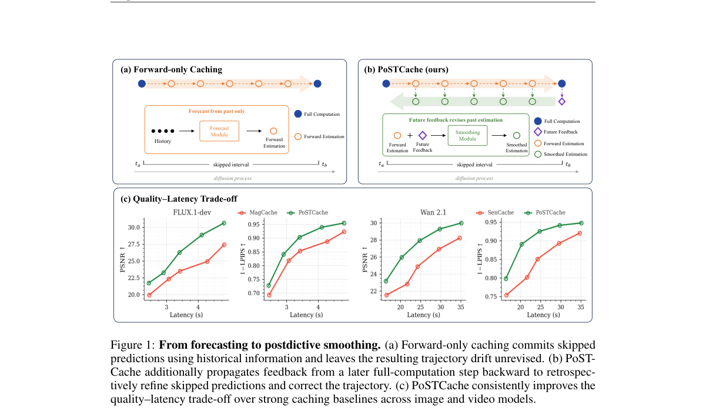

*Main result - Figure 2 Empirical motivation for postdictive smoothing. (a) Future-anchor residuals increas- ingly align with preceding proposal errors. (b) The relative-position gain retains over 96% of the explai*

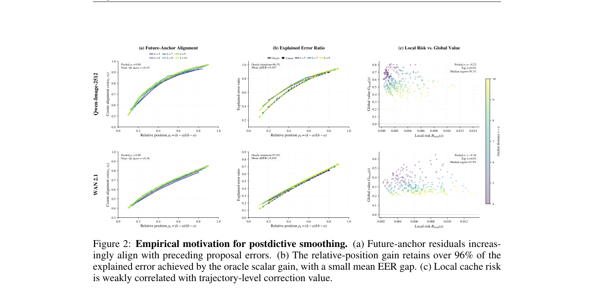

**Why this ranks #10**: 「只向前」被指出为缓存方法的一个结构性约束。

---

## Footer

- Total papers reviewed across all 5 tracks: 50 (from 525 scanned)
- aigc_visual track final top-10: 10
- Wild-cards in this track: 1
- Figure assets: `res/` (shared across tracks)

Generated by `mine-arxiv-daily-digest` skill. Sister file: `2026-10-20_aigc_visual_entry.md`.
