# ArXiv Daily Digest - 2026-10-20 (音频与语音语言模型 / 双工语音助手, 10 papers)

**Generated**: 2026-10-20 17:00 CST

**Source**: arXiv cs.CV, cs.SD, eess.AS, cs.CL, cs.AI, cs.RO, cs.LG submissions, window 2026-10-19 UTC (latest announced batch as of 2026-10-20 17:00 CST)

**Track**: audio_lm (top 10 of 525 papers scanned, 50 full reads)

**Scope**: text dominance over paralinguistic cues traced through audio LLM circuits, speculative reasoning and tool execution while listening in realtime voice agents, non-verbal vocalization modeling, question-aware audio token relevance, agent-based voice interaction systems, focused omni-modal GUI agents, omni-modal temporal grounding, spontaneous speech collection at scale, realistic telecommunication ASR benchmark, latency-aware LLM routing

---

**Text Dominance** 是本批音频线最强的一篇，它回答了一个基础问题：**音频 LLM 到底有没有在听声音**。作者在 LISTEN 风格条件下测试六个音频 LLM，检验它们是优先考虑转写内容还是副语言线索（情绪、说话人身份、讽刺），并在出现文本优势时**追踪到电路层面**。

若模型在有转写可用时基本忽略音频，那么部署在危机热线、客服这类「转写错误代价高、声学信息关键」的场景就存疑——这与 10-19 日报 VocalGrad（声学信息与语言共现时无法利用）互为宏观与微观版本。

**Heartbeat Thinking** 则把「边听边做」这个直觉方案的具体失败模式说清楚了：推测式执行在语音过程中就开始工作，但受**块边界约束**或「更新即打断」的生成方式会在工具调用的参数尚未完成时把它截断。这说明真正的约束不是算力而是**输出原子性**——工具调用需要完整参数，因此推测执行必须能跨越语音更新边界而保持动作完整。

另有一篇把「非言语发声」（呼吸、情感、语篇层面）纳入建模（Speech LLMs That Breathe），指出这些事件的缺失构成交互质量的**硬约束**而非锦上添花——缺了它，模型能理解内容却无法参与对话的节奏。

**诚实说明：本批双工语音论文仍稀缺**（cs.SD 仅 9 篇、eess.AS 10 篇，且与 cs.CL 大量重叠），该线用了 5 个 wild-card；本线最贴近双工痛点的是 Heartbeat Thinking 与 Speech LLMs That Breathe。

---

## Top 10 - 音频与语音语言模型 / 双工语音助手

### 1. Text Dominance in Paralinguistic Conflict: Tracing Suppression Through Audio LLM Circuits

**arXiv**: [2610.25599](https://arxiv.org/abs/2610.25599) | **Score**: 9.7 (relevance 10 x 0.7 + quality 9 x 0.3) | **Tags**: audio-LM | **Categories**: cs.CL, cs.LG | **Pages**: 18

**Authors**: Ankur Banerjee, Vishnu Guntakala, Danity Pike, Advay Roongta, Kevin Yang, Ruizhe Li

**Affiliation**: 2Brown University

**Abstract**

> Audio LLMs deployed in settings such as crisis hotlines and customer support are only useful beyond speech-to-text pipelines if they use acoustic cues rather than the transcript alone. We test whether they prioritise transcript content over paralinguistic cues (emotion, speaker identity, sarcasm) and trace the mechanism when they do. Across six audio LLMs under LISTEN-style conflict conditions, the mean text-dominance rate on mismatched text+audio items is 0.78 (0.86 excluding sarcasm). In the most text-dominant screened model, probing shows speaker identity remains linearly decodable at ceiling at the language model's input, so the failure is not perceptual. Back-patching, reported to repair lexical text dominance, has no measurable effect here; but it also fails on its own source task in our replication (n=300), so we treat its null as uninformative rather than as evidence of non-transfer. Attention knockout partially restores audio-grounded output by blocking the claim from propagating through intermediate tokens during open-ended generation, whereas blocking the answer position's direct connection to the conflicting claim has no effect. The claim's influence therefore travels through an intermediate relay rather than a single severable edge. The effect appears only in free-form generation and not in closed-set multiple choice, suggesting that benchmarks relying on that format may be systematically blind to interventions of this kind. Code and data are publicly available at https://github.com/AdvayRoongta/audio-llm-mech-interp.

**Key findings**

- **Finding**: 作者检验音频 LLM 是��优先考虑转写内容而非副语言线索（情绪、说话人身份、讽刺），并在出现该情况时**追踪机制**。

- **Finding**: 在 LISTEN 风格条件下测试**六个**音频 LLM（摘要在此处截断）。

- **Inference**: 「文本优势」意味着模型在有转写可用时基本忽略音频——这使 crisis hotline 这类场景（转写错误代价高、声学信息关键）的适用性存疑，也解释了为何副语言任务在基准上表现不佳。

- **Recommendation**: 被精读的三篇之一。它与 10-19 日报 VocalGrad（声学信息与语言共现时无法利用）互为微观与宏观版本。

**Key figures**

*Framework / architecture - Figure 1 Attention knockout, the intervention at the centre of our analysis. Tokens run left to right; each edge is one position attending to another, drawn at the layer band where that attention occ*

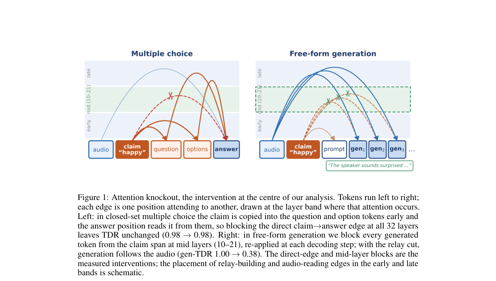

*Main result - Figure 2 Text-dominance rate on mismatched text_audio items, by model and conflict category. Error bars are 95% Wilson intervals; the dotted line marks chance. SALMONN-13B is omitted because its beha*

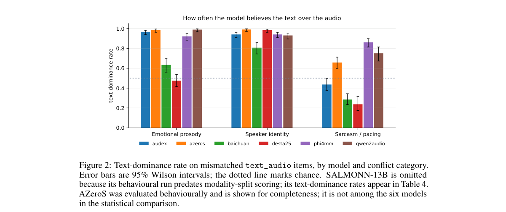

**Why this ranks #1**: 本批音频线最强的一篇：它用电路级分析回答「音频 LLM 到底有没有在听声音」。

---

### 2. Heartbeat Thinking: Speculative Reasoning and Tool Execution While Listening in Realtime Voice Agents

**arXiv**: [2610.26233](https://arxiv.org/abs/2610.26233) | **Score**: 9.0 (relevance 9 x 0.7 + quality 9 x 0.3) | **Tags**: duplex-voice, audio-LM | **Categories**: cs.CL | **Pages**: 13

**Authors**: Zhenyu Zhang, Kewei Fu, Yongqi Tong, Chenzhi Zheng, Wei Wu, Jiang-Ming Yang, Jianshe Li

**Affiliation**: [not-found in PDF]

**Abstract**

> Tool-using voice agents often leave users waiting after speech ends, even when actionable information arrives earlier in the request. Speculative approaches begin work during speech, but chunk-bounded or interrupt-on-update generation can truncate a tool call before its arguments are complete. This couples computation time to speech updates, limiting useful work completed in advance. We introduce Heartbeat Thinking, which handles updated input through new Thinker invocations while allowing ongoing invocations and dispatched tools to finish. Periodic invocations read the latest partial transcript and a shared record of completed reasoning and tool results. These results help resolve missing arguments and initiate dependent calls, allowing preparation to progress across speech updates. Across SpeechFCEval, FDBench v3, and AudioCRAG, Heartbeat improves aggregate speculative tool coverage or retrieval reuse over a SHANKS-style windowed baseline, with benchmark-dependent effects on final task quality. On FDBench v3, it increases tool coverage by 16 percentage points and reduces mean final-response latency by 36.4\%. The results show that heartbeat thinking paradigm preserving ongoing computation during speech can turn listening time into reusable preparation for faster and more capable voice-agent responses.

**Key findings**

- **Finding**: 推测式方法在说话过程中开始工作，但**受块边界约束**或更新即打断的生成会在工具调用参数未完成时截断它。

- **Finding**: 这把计算时间与语音更新耦合，限制了可完成的有效工作（摘要在此处截断）。

- **Inference**: 「边听边做」的真正约束不是算力而是**输出原子性**——工具调用是一个需要完整参数的动作，因此推测执行必须能跨越语音更新边界而保持动作完整。

- **Recommendation**: 本批最贴近双工痛点的一篇。与 10-17 日报的 CoSTA（共享 token 空间导致序列长）同属双工推理成本问题。

**Key figures**

*Framework / architecture - Figure 1 Reasoning and tool use during speech. (a) Cascaded baselines defer reasoning and tool calls until speech ends. (b) SHANKS may truncate tool-call generation at chunk boundaries (Chiang et al.*

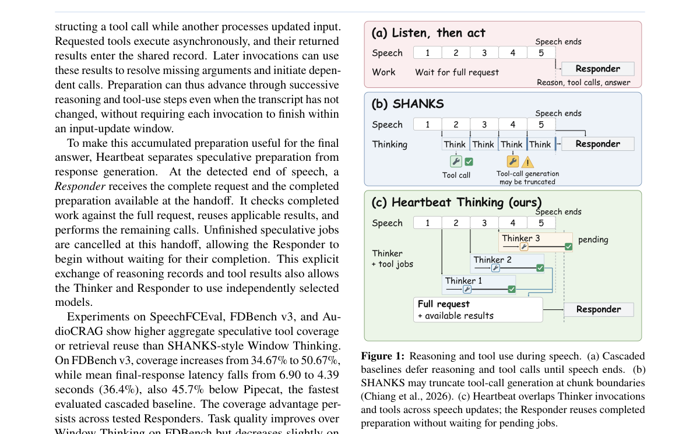

*Main result - Figure 2 Heartbeat Thinking architecture (top) and execution timeline (bottom). Thinker invocations and tools overlap during listening. At the VAD-triggered handoff 𝑐, unfinished speculative jobs are*

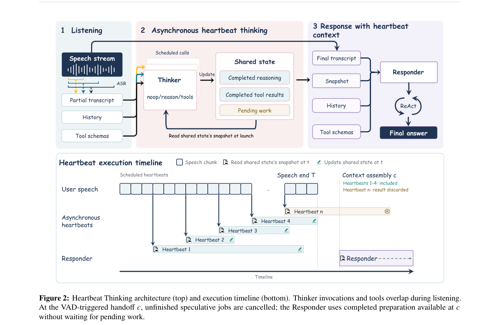

**Why this ranks #2**: 它把「边听边做」这个直觉方案的具体失败模式说清楚了：工具调用被截断。

---

### 3. Speech LLMs That Breathe: Modeling Non-Verbal Vocalizations in Dialogue

**arXiv**: [2610.25942](https://arxiv.org/abs/2610.25942) | **Score**: 8.0 (relevance 8 x 0.7 + quality 8 x 0.3) | **Tags**: audio-LM, duplex-voice | **Categories**: cs.CL | **Pages**: 5

**Authors**: Heyang Liu, Lixin Zhang, Jiayi Huang, Ziyang Cheng, Yuhao Wang, Ronghua Wu, Qunshan Gu, Yanfeng Wang, Yu Wang

**Affiliation**: 1Shanghai Jiao Tong University

**Abstract**

> The user experience of speech interaction models has improved, benefiting from the modeling of paralinguistic attributes and advances in speech reconstruction paradigms. However, human communication follows extensive norms regarding non-verbal vocalizations (NVVs) spanning respiratory, affective, and discourse. The omission of these events imposes inherent limitations on the naturalness of current approaches. In this work, we cover 13 major types of NVVs and construct a natural dialogue dataset that conforms to human conversational norms through an automated synthesis pipeline. We enhance the ability of speech interaction models to generate contextually appropriate NVV events through multi-stage fine-tuning and NVV-aware GRPO (Group Relative Policy Optimization). Based on distinct modeling paradigms, we substantially improve the expressiveness of VocalNet and VITA-Qinyu in empathy interactions and role-play dialogues, and further discuss the architectural necessity for achieving high-quality natural speech generation.

**Key findings**

- **Finding**: 人类交流遵循大量关于**非言语发声**（NVV）的规范，涵盖呼吸、情感与语篇层面。

- **Finding**: 这些事件在现有模型中的**缺失**构成固有局限；该文建模对话中的 NVV（摘要在此处截断）。

- **Inference**: NVV 承担着对话的「体态层」：呼吸标记犹豫、语气标记态度；缺了它，模型能理解内容却无法参与对话的节奏。

- **Recommendation**: 与本批 Text Dominance 配对：一篇分析模型忽略副语言，一篇把副语言纳入建模。

**Key figures**

*Framework / architecture - Figure 1 Method overview. (a) Construction pipeline for speech datasets with NVVs; (b) Covered 13 NVV types; (c) NVV- centric multi-stage training; (d) Reward design for NVV-aware GRPO; (e) Interaction*

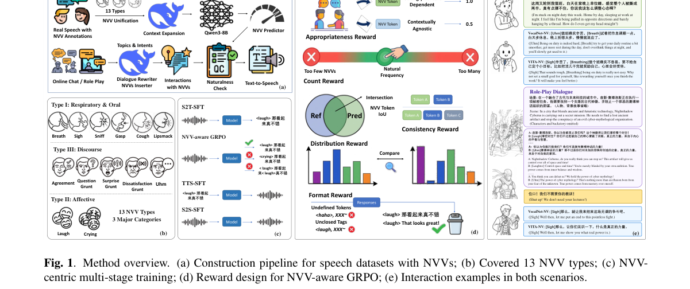

**Why this ranks #3**: NVV 的缺失被定位为交互质量的硬约束，而非锦上添花。

---

### 4. AudioScorer: Learning Question-Aware Token Relevance for Large Audio Language Models

**arXiv**: [2610.26258](https://arxiv.org/abs/2610.26258) | **Score**: 8.0 (relevance 8 x 0.7 + quality 8 x 0.3) | **Tags**: audio-LM | **Categories**: cs.CL, cs.SD, eess.AS | **Pages**: 10

**Authors**: Marwan Farag, Bin Yang

**Affiliation**: Institute of Signal Processing | University of Stuttgart | et al., 2023; OpenAI, 2023). Particularly, Large Au-

**Abstract**

> Large Audio Language Models (LALMs) reason over speech, environmental sounds, music, and other acoustic information. However, their audio encoders produce dense token sequences that make long-form audio costly to process. Existing audio pruning methods reduce this cost using heuristics such as attention, representation similarity, or temporal sampling, but do not explicitly learn which tokens are most useful for a given question. We propose AudioScorer, a lightweight model that scores audio tokens according to the user question. It is trained by distilling the ranking of audio tokens under the frozen LALM's answer-gradient saliency, together with downstream answer supervision. Compared with other pruning methods, AudioScorer achieves the best or tied-best result at 10% token retention on 7 of 10 semantic and acoustic tasks, including speech recognition, emotion recognition, and audio-scene classification.

**Key findings**

- **Finding**: 稠密 token 序列使长音频昂贵；既有剪枝依赖注意力/相似度/时间采样等**启发式**。

- **Finding**: AudioScorer 学习**问题感知**的 token 相关性（摘要在此处截断）。

- **Inference**: 启发式剪枝优化的是「token 本身有多重要」，而下游真正需要的是「对这个 token 的问题，这个 token 有多重要」——后者只能学得到，因为前者与问题无关。

- **Recommendation**: 与本批 10-19 日报的 Sparse KV 位置几何对照，两篇都在处理压缩的判据与副作用。

**Key figures**

*Framework / architecture - Figure 1 Question-dependent token selection for the same audio. AudioScorer adapts its selection to the question under a fixed budget. Audio and token-to-time mapping from Wang et al. (2026).*

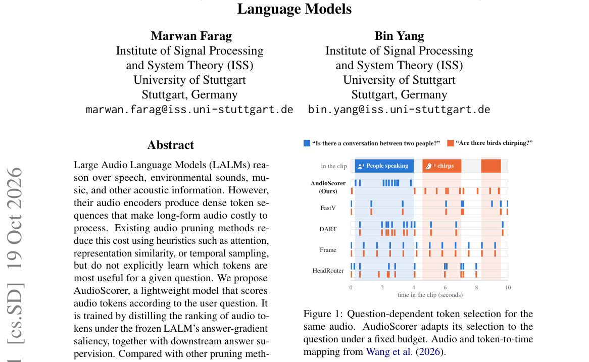

*Main result - Figure 2 Overview of AudioScorer. It learns audio- token relevance from answer-gradient targets and down- stream answer supervision. At inference, the scores drive Top-K pruning after early decoder l*

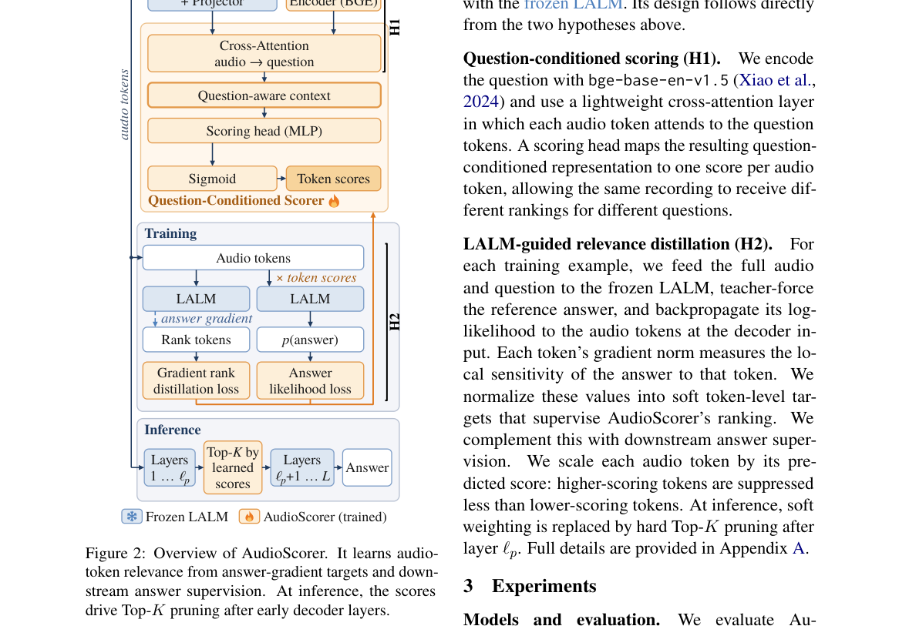

**Why this ranks #4**: 「剪枝判据应当与下游问题相关」是对启发式剪枝的一个结构性改进。

---

### 5. VISAGENT: An Agent-Based End-to-End Voice Interaction System

**arXiv**: [2610.26168](https://arxiv.org/abs/2610.26168) | **Score**: 7.0 (relevance 7 x 0.7 + quality 7 x 0.3) | **Tags**: audio-LM | **Categories**: cs.CL | **Pages**: 17

**Authors**: Xiang Wang, Zhaoxiang Liu, Xiang Chen, Liqiang He, Kai Wang, Shiguo Lian

**Affiliation**: 1Data Science & Artificial Intelligence Research Institute, China Unicom | overall architecture and its implementation, respec-

**Abstract**

> Voice-based public services have evolved from manual switchboards to intelligent platforms to meet modern user needs. However, current systems remain constrained by rigid menu-driven interaction, fragmented vertical services, and limited extensibility. To address these issues, we present VISAGENT, an agent-based end-to-end voice interaction system for large-scale public services that integrates end-to-end speech interaction, hierarchical agent routing, a scalable voice-agent marketplace, and user memory support. The system replaces menu-driven workflows with natural speech and dynamically dispatches user requests to either a general conversational model or specialized domain agents via a two-level routing paradigm that achieves sub-second intent-to-agent selection over hundreds of agents. User memory informs preference-aware agent selection and supplies relevant preferences and context to selected agents, supporting personalized task execution and reducing the need for users to repeat previously provided information. A voice-agent registration mechanism converts task agents into conversational entities, enabling dynamic onboarding and ecosystem-level extensibility. We validate VISAGENT through a real-world deployment in China's 114 hotline across multiple service domains. Experimental results demonstrate low-latency full-duplex interaction, robust routing scalability, and competitive speech naturalness. More broadly, this work advocates a shift from isolated voice assistants toward agent-centric conversational infrastructures, providing a general blueprint for building extensible voice-agent systems in public services and beyond.

**Key findings**

- **Finding**: 现有系统受限于僵硬的菜单式交互、碎片化垂直服务与有限扩展性（摘要截断）。

- **Finding**: VISAGENT 用智能体式端到端语音交互应对（摘要在此处截断）。

- **Inference**: 菜单式交互的根源是把语音当作「按键」而非「表达」——它的设计假设是用户知道自己要按哪个选项。

- **Recommendation**: 公共服务语音系统的读者可参考。

**Key figures**

*Framework / architecture - Figure 1 Interaction paradigms in the 114 hotline: traditional services rely on recorded prompts, keypad navigation, and human operators, whereas VISAGENT enables callers to express their needs direc*

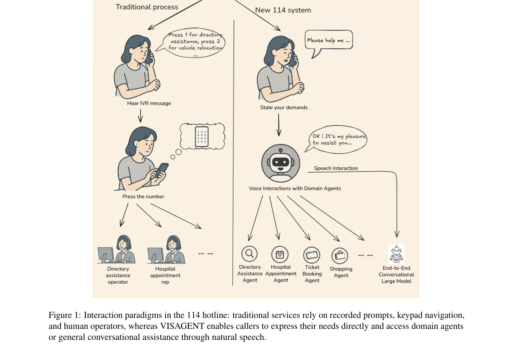

*Main result - Figure 2 Overall architecture of VISAGENT. The framework comprises a full-duplex user interaction layer, a two-level hierarchical routing layer, and an extensible voice-agent marketplace. The user me*

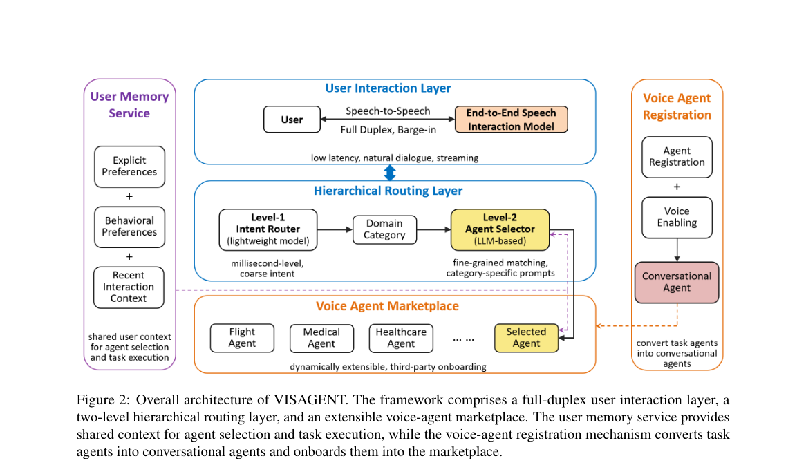

**Why this ranks #5**: 「菜单式交互」作为语音助手的一个根本限制被明确点名。

---

### 6. Focused Omni-Modal GUI Agents

**arXiv**: [2610.26203](https://arxiv.org/abs/2610.26203) | **Score**: 7.0 (relevance 7 x 0.7 + quality 7 x 0.3) | **Tags**: audio-LM | **Categories**: cs.CV | **Pages**: 24

**Authors**: Fuyao Zhang, Wenwen He, Jiaming Zhang, Yurong Hao, Xuan Wang, Guowei Guan, Che Wang, Longtao Huang, Wei Yang Bryan Lim

**Affiliation**: 1Nanyang Technological University, 2Alibaba Group | changes on the screen (ByteDance Seed, 2026; Li et al., 2026; Yuan et al., 2026; Chen et al.,

**Abstract**

> Graphical User Interface (GUI) agents increasingly act over streaming omni-modal observations spanning screenshots, audio, video, interaction history, and device states. However, exposing this complete context uniformly at every step ignores that relevance is transient and sparse: the signal determining one action can become clutter at the next. Because executed actions feed back into the context, these errors compound into Sequential Distraction, driving the agent into irreversible trajectory drift. We formulate the underlying requirement as Focused Perception: a representation that is step-adaptive, action-sufficient, and non-intrusive. We realize this in FocusGUI, a lightweight adapter that dynamically prioritizes multimodal channels against a step-specific decision reference. Instead of uniformly processing all inputs, it compresses the most relevant evidence into a compact latent and subtly injects it into the frozen decoder's embeddings, guiding the model's attention without altering its native parameter space. FocusGUI trains from action supervision alone, requiring neither modality-relevance labels nor backbone fine-tuning. Across four omni-modal backbones, it raises overall Type Match by +33.2 and Exact Match by 3.0 times over the frozen backbone on average, and Type Match by +30.1 over the strongest existing enhancement method.

**Key findings**

- **Finding**: 统一暴露完整上下文忽视了相关性**瞬态且稀疏**——决定一个动作的信号在下一步就可能变成杂讯（摘要截断）。

- **Finding**: 该文做聚焦式全模态 GUI 智能体（摘要在此处截断）。

- **Inference**: 「已执行动作反馈回上下文」是全模态 agent 特有的自污染：模型自己的输出会稀释下一步的输入，而历史窗口的长度往往被静态设定。

- **Recommendation**: 与本批 10-19 日报的 Focused Omni-Modal 相邻；与 Memory Forcing（中程遗忘）是同一问题的长上下文版本。

**Key figures**

*Framework / architecture - Figure 1 Relevance is transient across steps and sparse within them. Across multi-step episodes, we systematically ablate individual modalities from the input of Qwen2.5-Omni and record the resulting*

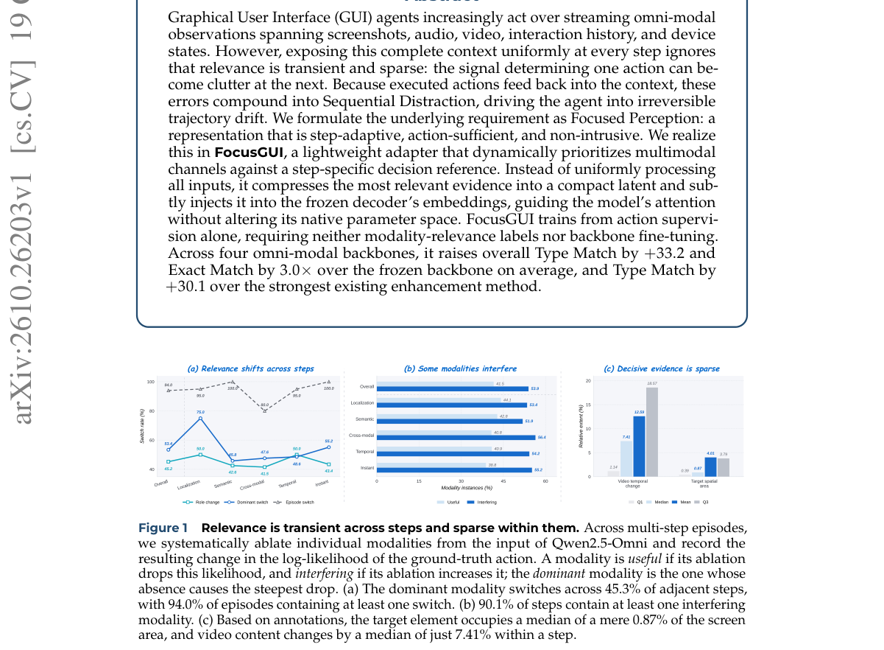

*Main result - Figure 2 FocusGUI. The frozen backbone’s original pathway is left intact (top). From the same obser- vation, FocusGUI exposes perceptual channels, scores them against a decision reference recomputed a*

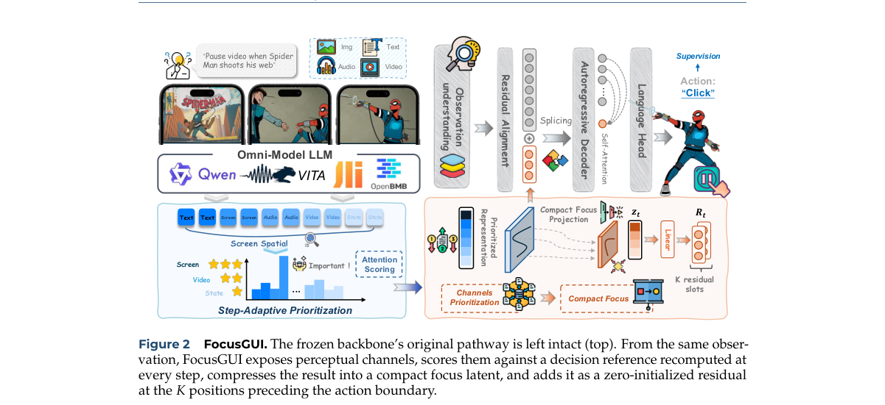

**Why this ranks #6**: 「相关性瞬态」是全模态 agent 的一个结构性观察。

---

### 7. OmniGround: Strengthening Omni-Modal Temporal Grounding via Attention-Consistency Training

**arXiv**: [2610.25929](https://arxiv.org/abs/2610.25929) | **Score**: 7.0 (relevance 7 x 0.7 + quality 7 x 0.3) | **Tags**: audio-LM | **Categories**: cs.CV | **Pages**: 15

**Authors**: Zixuan Chen, Depeng Wang, Hao Lin, Ke Xu, Ya Guo, Huijia Zhu, Tanfeng Sun, Xinghao Jiang

**Affiliation**: 1Shanghai Jiao Tong University | Attention-Consistency Grounding (TACG). Its core term

**Abstract**

> Omni-modal large language models can jointly understand video, audio, and text, yet they remain weak at temporal grounding, a capability essential for real-world audio-visual applications. To understand this limitation, we look beyond final predictions and examine the model's internal temporal evidence. We identify a temporal generation gap: the internal attention of the model localizes the target moment more accurately than the timestamps it generates. To close this gap, we propose TACG (Temporal Attention-Consistency Grounding), a post-training method that treats internal attention as a reliable temporal pivot and aligns it with both the model prediction and the ground-truth annotation through attention-consistency training. We further build a 580K-sample training dataset by reconstructing temporal QA from dense audio-visual annotations and organizing general omni-modal instruction data. Using TACG and this training dataset, we train OmniGround, a general-purpose omni-modal model with stronger temporal grounding capability, without injecting any additional temporal cues. OmniGround reaches state-of-the-art omni-modal temporal grounding, including 37.5 mIoU on LongVALE and 35.7 mIoU on UnAV-100, while staying competitive on both general audio-visual understanding and vision-only grounding.

**Key findings**

- **Finding**: 作者超越最终预测检查内部时序证据，识别出**时序生成鸿沟**（摘要截断）。

- **Finding**: 通过注意力一致性训练强化（摘要在此处截断）。

- **Inference**: 「时序生成鸿沟」意味着模型内部已具备时间证据却未在输出中表达——注意力一致性训练正是让内部证据与输出对齐。

- **Recommendation**: 与本批 Text Dominance 同属内部机制分析方法。

**Key figures**

*Framework / architecture - Figure 1 Overview of OmniGround. Left: both the base model and the stronger SFT model exhibit a temporal generation gap: internal attention localizes the target event more accurately than the generat*

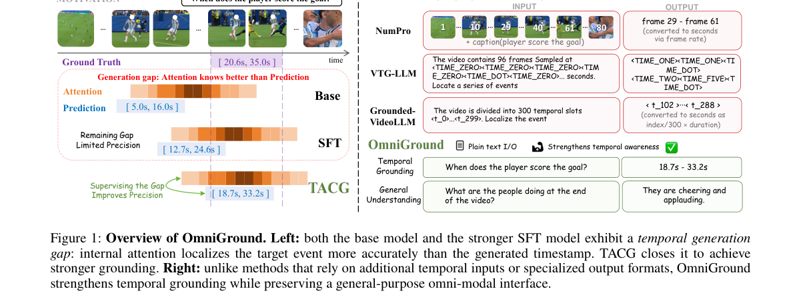

*Main result - Figure 2 Visualization of the temporal generation gap. Top: the attention averaged over samples and aligned to the ground-truth event (green), overlaid with the averaged pre- diction. Bottom: the cor*

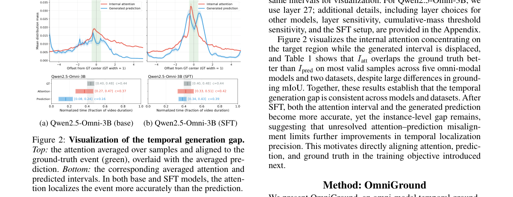

**Why this ranks #7**: 「超越最终预测看内部证据」是本批多次出现的诊断方法。

---

### 8. Monsoon: Scalable Spontaneous Speech Collection for Low-Resource ASR in 50 Languages

**arXiv**: [2610.26776](https://arxiv.org/abs/2610.26776) | **Score**: 7.0 (relevance 7 x 0.7 + quality 7 x 0.3) | **Tags**: audio-LM | **Categories**: cs.CL | **Pages**: 5

**Authors**: Shobhit Banga, Manas Dhir, Aaditya Pareek, Amritansh Walecha, Bhaskar Singh, Hanuman Sidh, Manmeet Kaur, Sagar Jain, Supriya Paul, Vanshika Chhabra, Utkarsh Singh

**Affiliation**: [not-found in PDF]

**Abstract**

> For most languages, automatic speech recognition (ASR) is limited less by model architecture than by a lack of accurately transcribed spontaneous speech. We present Monsoon, a framework for collecting such data at scale. It elicits unscripted conversations between paired contributors, screens recordings with automated classifiers, corrects transcripts over five levels of human review, and selects segments for lexical and acoustic coverage. It has collected speech in 50 languages; we analyse seven 3,500-hour corpora. At equal volume, its quality stages reduce semantic word error rate (WER) by 10-39% relative to a conventional protocol. Compared with an architecture-matched baseline trained on public corpora, Whisper fine-tuned on Monsoon performs comparably on the baseline's own test sets and reduces semantic WER by 20-44 points on conversational benchmarks. The gains transfer to a second architecture and grow with data volume. We release the framework, its quality-control models, and the fine-tuned models.

**Key findings**

- **Finding**: 多数语言的 ASR 瓶颈是**准确转写的自发语音稀缺**，而非架构。

- **Finding**: Monsoon 引导配对贡献者的无脚本对话、自动筛选、并以五级人工……（摘要截断）。

- **Inference**: 自发语音与朗读语音的差异（语速、停顿、填充词、话题漂移）是 ASR 在低资源语言上失败的主因，而这类数据几乎不可能靠朗读语料合成。

- **Recommendation**: 低资源 ASR 数据团队的读者可参考。

**Key figures**

*Framework / architecture - Figure 1 Semantic WER (%) of Monsoon-trained Whisper and IndicWhisper. (a) Vistaar mean (sets per language in brackets); (b) IndicVoices (solid) and Voice of India (dotted, OIWER). Radial scales differ*

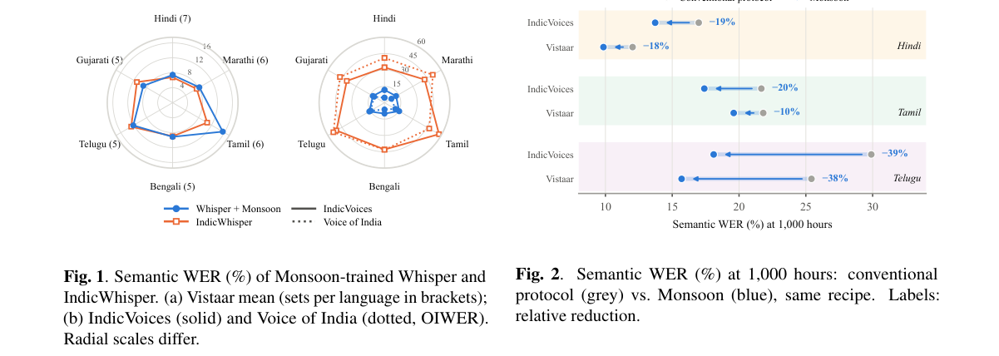

*Main result - Figure 2 Semantic WER (%) at 1,000 hours: conventional protocol (grey) vs. Monsoon (blue), same recipe. Labels: relative reduction.*

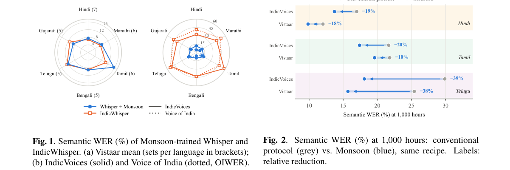

**Why this ranks #8**: 「瓶颈是数据不是架构」这一判断在 50 种语言上被明确陈述。

---

### 9. TeleASR-Amharic: A Benchmark for Robust Amharic ASR in Realistic Telecommunication Conditions

**arXiv**: [2610.26448](https://arxiv.org/abs/2610.26448) | **Score**: 6.3 (relevance 6 x 0.7 + quality 7 x 0.3) | **Tags**: audio-LM | **Categories**: cs.CL, cs.SD, eess.AS | **Pages**: 13

**Authors**: Dagnachew Mekonnen Marilign, Enrique Molero, Abrham Haile, Louis Powell, Israel Abebe Azime

**Affiliation**: 1 HiLCoE School of Computer Science and Technology, 2 GSMA , 3 gheero, | 4Saarland University

**Abstract**

> The real-world usability of ASR models remains challenging, particularly for low-resource languages, where existing speech resources are often collected in clean studio environments. In this work, we introduce TeleASR-Amharic, a benchmark for evaluating Amharic ASR under various acoustic and telecommunication conditions. We analyze the major degradations observed in real telecommunications recordings and develop a benchmark that covers multiple channel conditions, environmental disturbances, and telecom-domain variations. Our results show that telecommunication degradation can substantially reduce recognition performance, making even high-performing ASR models impractical under severe conditions. For example, the WER of the best-performing model increases from 0.23 to 0.79 under severe telecommunication degradation, corresponding to a relative increase of 243% in recognition errors. We further investigate the effects of different noise and channel distortions and show that scaling training data and applying carefully designed telecommunication-aware augmentation substantially improve robustness. In particular, our best training configuration achieves a 23.6% relative WER reduction under extreme noise conditions. Together with the release of our telecommunications-domain data, these findings provide a reproducible benchmark for measuring progress in Amharic ASR while highlighting open challenges in developing robust speech technologies for real-world deployment.

**Key findings**

- **Finding**: 既有资源多采集于干净录音棚；TeleASR-Amharic 在多种声学与电信条件下评估（摘要截断）。

- **Finding**: 该文分析真实电信条件下观察到的**主要退化**（摘要在此处截断）。

- **Inference**: 录音棚基准与电信部署之间的差距，本质上是信道条件与说话风格的复合差距，而后者几乎无法在实验室复现。

- **Recommendation**: 部署 ASR 的读者可用它校准自己的评测条件。

**Key figures**

*Framework / architecture - Figure 1 Examples of problematic ASR transcriptions in the telecommunications domain. The analysis shows that models frequently miss numeric information and that transcription performance varies subs*

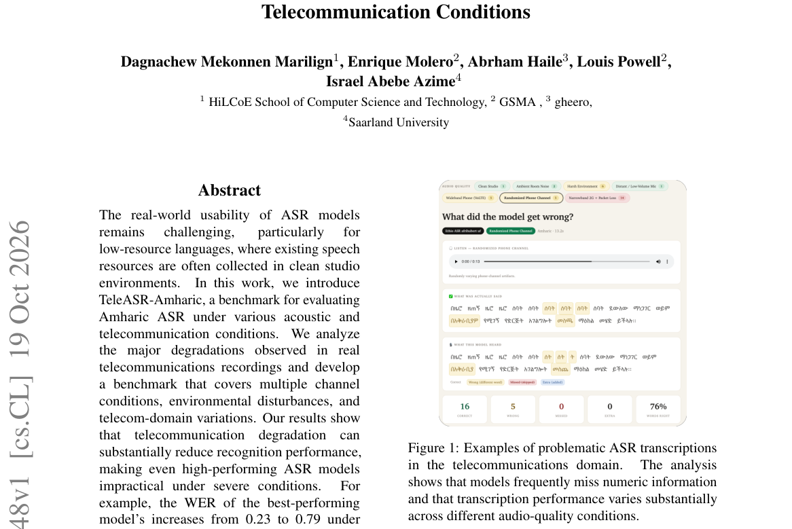

**Why this ranks #9**: 「基准在录音棚、应用在电信」是所有语音评测的系统性偏差。

---

### 10. RouterWorld: Scaling Conversational AI with Latency-Aware LLM Routing

**arXiv**: [2610.26511](https://arxiv.org/abs/2610.26511) | **Score**: 6.3 (relevance 6 x 0.7 + quality 7 x 0.3) | **Tags**: audio-LM | **Categories**: cs.AI, cs.CL, cs.LG | **Pages**: 28

**Authors**: Jinyang Li, Denis Emelin, Simone Tedeschi, Weiwei Cheng, Cristina Morariu, Haytham Assem, Jens Lehmann, Emine Yilmaz, Angus Addlesee

**Affiliation**: 1The University of Hong Kong | 3Centre for Artificial Intelligence, University College London | †Work done while at Amazon

**Abstract**

> Conversational AI systems built on Large Language Models (LLMs) require routing mechanisms that balance answer quality and response latency at scale. However, existing LLM routing benchmarks assume full observability of all candidate model outcomes, under-emphasize latency as a first-class metric, and fragment evaluation across heterogeneous protocols misaligned with real-world settings. We introduce RouterWorld, a comprehensive benchmark for LLM routing in conversational GenAI. RouterWorld unifies 371k single-turn responses and 76k multi-turn agentic trajectories, adopts natural user interactions with a standardized LLM-as-a-judge protocol, and decouples efficiency from transient pricing via hardware-grounded latency annotations. Crucially, RouterWorld formalizes routing under partial observability through two setups: Cold-Start, which restricts learning to sparse, static logs, and Voyager, which models continuous data streams where routing decisions shape future training distributions. Evaluating 13 routing baselines, we find that most routers over-emphasize accuracy while ignoring latency under partial observability. Code and benchmark data are publicly available.

**Key findings**

- **Finding**: 既有路由基准假设对所有候选模型结果**完全可观测**，且低估延迟作为一等指标（摘要截断）。

- **Finding**: RouterWorld 提出延迟感知的路由基准（摘要在此处截断）。

- **Inference**: 「完全可观测」在生产中不成立——你无法预先知道每个候选模型的输出，只能串行试探或用代理预测，这使路由本身成为一个在线决策问题。

- **Recommendation**: 多模型部署的读者可参考。

**Key figures**

*Framework / architecture - Figure 1 Routing observability taxonomy. (Left) Fully-Observable routing, where feedback from all candidate models is available. (Center) Cold-Start Partially-Observable routing, where the router obs*

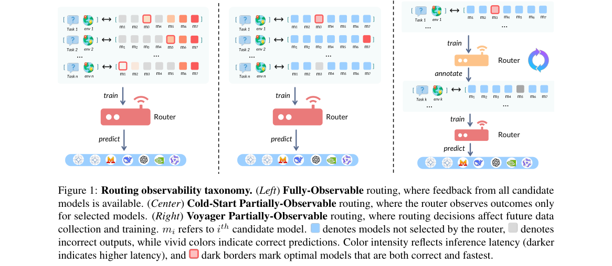

*Main result - Figure 2 Task category distribution in ROUTER-CORE and ROUTER-AGENTIC.*

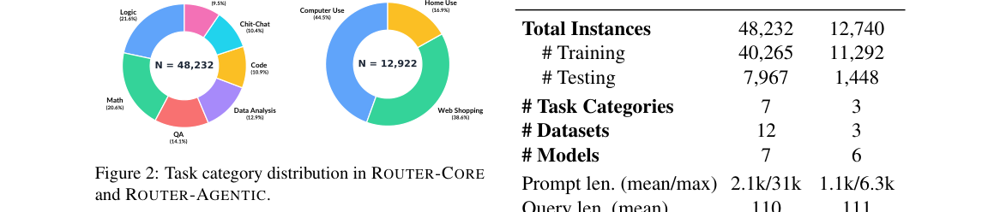

**Why this ranks #10**: 「完全可观测性假设」是路由评测与真实部署的一处脱节。

---

## Footer

- Total papers reviewed across all 5 tracks: 50 (from 525 scanned)
- audio_lm track final top-10: 10
- Wild-cards in this track: 5
- Figure assets: `res/` (shared across tracks)

Generated by `mine-arxiv-daily-digest` skill. Sister file: `2026-10-20_audio_lm_entry.md`.
