# ArXiv Daily Digest - 2026-10-20 (具身智能与世界模型, 10 papers)

**Generated**: 2026-10-20 17:00 CST

**Source**: arXiv cs.CV, cs.SD, eess.AS, cs.CL, cs.AI, cs.RO, cs.LG submissions, window 2026-10-19 UTC (latest announced batch as of 2026-10-20 17:00 CST)

**Track**: embodied (top 10 of 525 papers scanned, 50 full reads)

**Scope**: loco-manipulation world foundation model across embodiments, large-scale simulation benchmark for dexterous manipulation, compositional humanoid skills via semantic routing, hierarchical action flow for humanoid VLA, embodied world agent dataset, humanoid supernumerary limbs, implicit force reasoning VLA, vector-quantized world model with latent feedback planning, adaptive temporal action quantization, decoupling state representations in world action models

---

**Ropedia W0** 是本批相关性最高的一篇：据称是**首个跨本体的第一人称 loco-操作世界基础模型**。它把「移动+操作」明确为独立问题而非两个任务的叠加——移动与操作在物理上耦合（操作改变重心从而改变移动），分开建模必然丢掉这一耦合项。

**HandsOn** 则直面灵巧操作领域的一个老问题：**缺少可比性**。它提供可组合仿真平台与基准，覆盖五种机械臂、六种灵巧手与约 200 种刚性/关节化/可变形资产。不同论文用不同手型、不同物体、不同指标，横向比较因此失效——可组合平台是从**基础设施层面**解决这一点。

另有两篇值得注意的诊断。**FR-VLA** 指出既有使用力的 VLA 通过**固定通路**注入力信息，而问题其实是「**何时**以及**多强地**让物理交互影响动作生成」——这与 10-16 日报 DEFT-VLA 的「阶段依赖感知冲突」完全同构，一周之内两篇独立工作指向同一结论。**PrismWAM** 则指出 WAM 用预训练视频模型的潜嵌入表示世界，会**纠缠**「外观」（纹理、颜色）与「物理配置」（占据、位姿），并追问「应该表示什么」——这与 10-19 日报 ΔWAM（可预测未来被外观主导）是同一诊断的更深版本。

其余：HS-MoDP 用**独立语义路由**在共享专家池上组合分别演示的手臂技能（把组合爆炸从数据约束变为结构约束）；HAF-VLA 把**注视**列为必须协调的维度之一（双臂操作时头部朝向决定操作者能看到什么，因此注视是感知输入而非渲染细节）；超数目肢体（Humanoid SRL）从硬件侧解决「双臂被占用」的限制；VQ-WM 指出潜计划**低层控制器到不了**是规划方法论中常被跳过的约束——潜表示必须编码可达性而非仅视觉相似。

---

## Top 10 - 具身智能与世界模型

### 1. Ropedia W0: Scaling Loco-Manipulation World Models across Embodiments with Human Experience

**arXiv**: [2610.26855](https://arxiv.org/abs/2610.26855) | **Score**: 9.0 (relevance 9 x 0.7 + quality 9 x 0.3) | **Tags**: world-model, embodied-ai | **Categories**: cs.CV, cs.RO | **Pages**: 54

**Authors**: Tianqi Liu, Hanfei Zhao, Qifeng Liang, Hui En Pang, Jiarui Xu, Sayang Mu, Penghao Qiu, YingSheng Zhang, Jun Wang, Ziang Cao, Mingze Sun, Yukang Cao

**Affiliation**: 1Nanyang Technological University | 3Duke University | 5Tsinghua University

**Abstract**

> World models enable embodied agents to anticipate action consequences, yet jointly modeling locomotion and manipulation across diverse embodiments remains challenging due to heterogeneous action spaces and limited multimodal supervision. We present Ropedia W0, the first egocentric loco-manipulation world foundation model spanning humans and robots with diverse embodiments. We curate Xp-Data, comprising 10k hours of egocentric human data and 3k hours of robot data with unified multimodal annotations and systematic quality control. A unified kinematic representation encodes locomotion through camera poses and manipulation through projected skeletons, with robot skeletons combining embodiment-specific forward kinematics with extensive manual keypoint annotation and correction. We also introduce Xp-Teleop, a long-horizon loco-manipulation benchmark based on high-quality dexterous humanoid teleoperation data. Evaluations demonstrate state-of-the-art performance across five cross-embodiment benchmarks (DreamDojo, $Ψ_0$, $ω$-HOME, Xp-Teleop, and AgiBot) and on held-out human egocentric video, from zero-shot inference to few-shot and full-data post-training. Scaling human pre-training data improves performance on both human and robot evaluations. After distillation, our model supports real-time, minute-long rollouts, enabling live VR interaction. Applications in policy evaluation, model-based planning, and world-action modeling further demonstrate the model's utility for embodied decision-making.

**Key findings**

- **Finding**: 跨本体联合建模移动与操作面临动作空间异质与多模态监督有限两大障碍。

- **Finding**: Ropedia W0 据称是**首个**第一人称 loco-操作世界基础模型，跨（摘要在此处截断）。

- **Inference**: 「联合建模」而非「分别建模再拼接」是这一题目的核心——移动与操作在物理上耦合（操作改变重心从而改变移动），分开建模必然丢掉这一耦合项。

- **Recommendation**: 被精读的三篇之一。与 10-19 日报的 Model-to-Policy 统一、10-18 的 Thinker-WM 构成世界模型统一化这条线。

**Key figures**

*Framework / architecture - Figure 1 Ropedia W0: a unified egocentric world model for cross-embodiment loco-manipulation. Trained on Xp-Data (14 human and 13 robot public datasets plus in-house recordings; ∼10k h human and ∼3k*

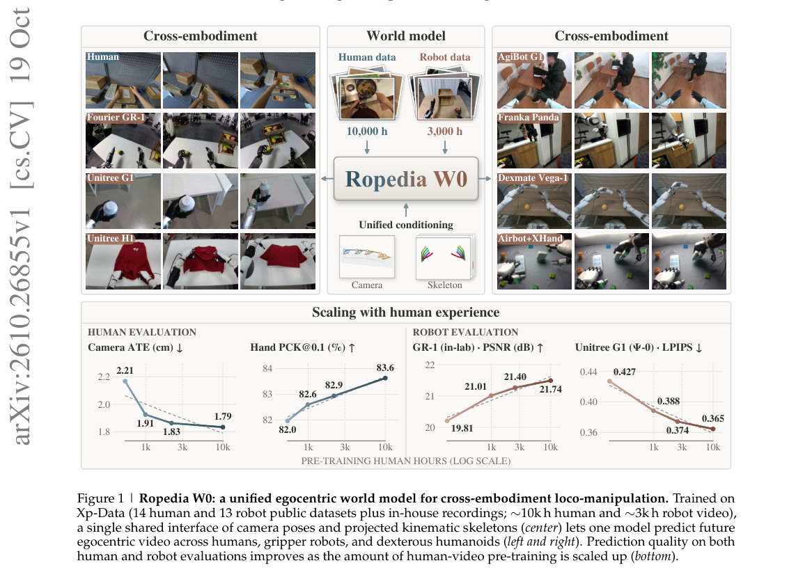

**Why this ranks #1**: 本批相关性最高的一篇：它把「移动+操作」这一组合明确为独立问题，而非两个任务的叠加。

---

### 2. HandsOn: A Large-Scale Simulation Benchmark for Generalizable Dexterous Manipulation

**arXiv**: [2610.26765](https://arxiv.org/abs/2610.26765) | **Score**: 9.0 (relevance 9 x 0.7 + quality 9 x 0.3) | **Tags**: embodied-ai | **Categories**: cs.RO | **Pages**: 56

**Authors**: Tianwei Luo, Yiming He, Hongjin Wu, Ting Pan, Debin Ren, Haorui Guo, Junlin Yang, Yuxin Zuo, Zhehao Kou, Kaisen Yang, Zhuoqun Lai, Yi Ding

**Affiliation**: 1Tsinghua University | 2Beijing University of Posts and Telecommunications | 4Peking University

**Abstract**

> General-purpose manipulation requires reliable behavior across embodiments, objects, and task demands. We introduce HandsOn, a composable simulation platform and benchmark for cross-embodiment dexterous manipulation. It supports five robotic arms, six dexterous hands, and approximately 200 rigid, articulated, and deformable assets in randomized scenes. The benchmark pairs 18,000 curated human demonstrations with 66 human-verified tasks: Core-50 supports demonstration-based learning and execution tests, while Transfer-16 evaluates asset and relation transfer, skill composition, and deformable manipulation without target-task training demonstrations. Qualitative real-robot rollouts illustrate sim-to-real transfer. Across diffusion, vision-language-action, world-action, and prompted VLM-based methods, the best trained multi-task policy achieves 29.1% Core-50 success. Without benchmark finetuning, GPT-6 using move_eef for palm-and-finger control achieves 5.2% on Core-50 and 1.9% on Transfer-16 over 660 trials. Trained-policy stage diagnostics expose failures in contact establishment, action coordination, and maintaining achieved goals, with additional sequencing errors in composed tasks. HandsOn provides a shared basis for investigating manipulation generalization and the limits of reliable physical interaction.

**Key findings**

- **Finding**: HandsOn 是可组合仿真平台与基准，支持**五种机械臂、六种灵巧手、约 200 种**刚性/关节化/可变形资产。

- **Finding**: 跨本体的资产与手型组合（摘要在此处截断）。

- **Inference**: 灵巧操作领域长期缺的不是方法而是**可比性**——不同论文用不同手型、不同物体、不同指标，横向比较因此失效。可组合平台从基础设施层面解决这一点。

- **Recommendation**: 被精读的三篇之一。做灵巧操作选型前先看它提供的统一评测口径。

**Key figures**

*Framework / architecture - Figure 1 Overview of HandsOn. Representative assets, environments and interactions accompany 66 tasks and 18,000 curated demonstrations (56 hours; three synchronized views). Right: Core-50 success o*

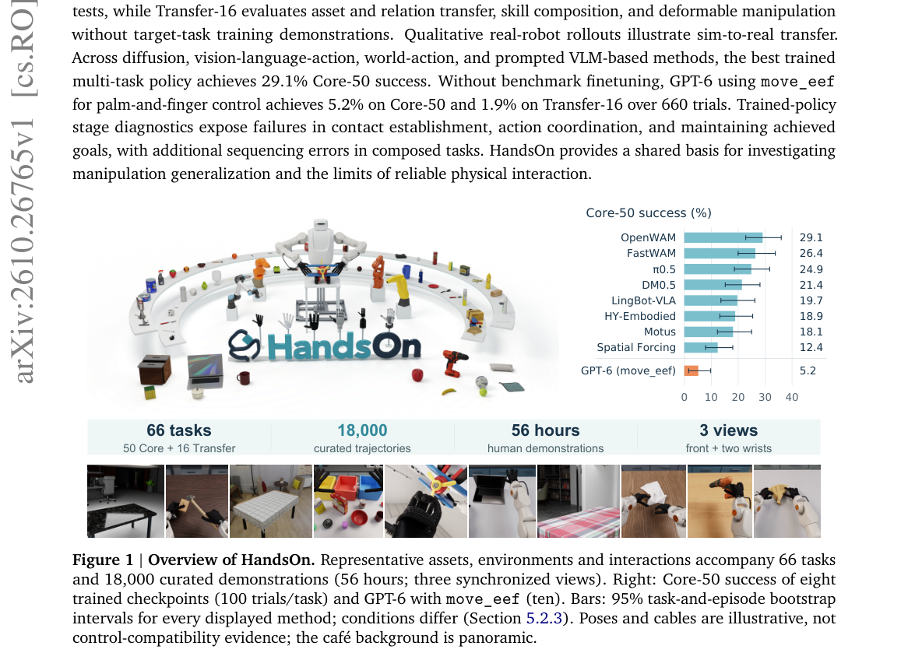

*Main result - Figure 2 Platform and evaluation protocol. (a) Toy-aircraft views: setup (not a policy input), wrist (W), and main (M). Real images show appearance; real rollouts are qualitative videos. (b) Nine*

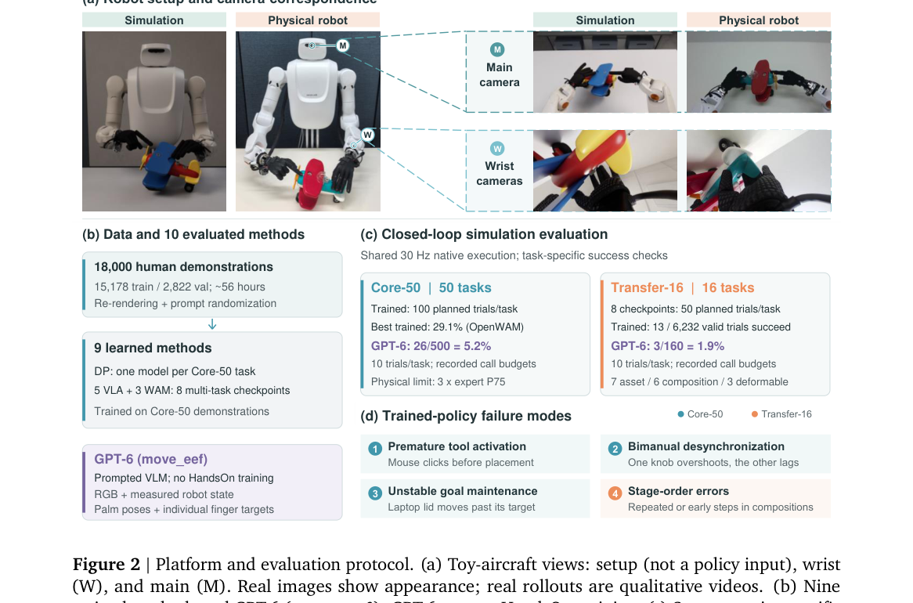

**Why this ranks #2**: 「可组合平台 + 跨本体资产」直接针对灵巧操作基准无法横向比较的老问题。

---

### 3. Compositional Humanoid Manipulation through Isomorphic Teleoperation and Independent Skill Routing

**arXiv**: [2610.26169](https://arxiv.org/abs/2610.26169) | **Score**: 8.7 (relevance 9 x 0.7 + quality 8 x 0.3) | **Tags**: embodied-ai | **Categories**: cs.RO | **Pages**: 9

**Authors**: Yiming Wang, Peixian Yang, Lifeng Zhuo, Lai Wei, Xinling Du, Kun Song, Weiming Wang, Daolin Ma

**Affiliation**: 1Shanghai Jiao Tong University. | 2The University of Hong Kong. | 4Fudan University.

**Abstract**

> Humanoid manipulation requires reusable arm skills, yet demonstrating every possible skill combination is impractical. We present Humanoid Semantic Mixture-of-Experts Diffusion Policy (HS-MoDP), which composes separately demonstrated arm skills through independent semantic routing over a shared expert pool. This design preserves arm-specific skill control while sharing action-generation parameters across arms. A semantic scheduler integrates the learned policy with an existing locomotion controller through alternating manipulation and repositioning stages, extending the effective workspace and enabling skill reuse across location changes. To acquire demonstrations of whole-body contact manipulation, we develop G1Exo, an isomorphic exoskeleton that provides direct joint-level control of arm configurations. Experiments on a Unitree G1 show stronger skill composition than the baselines. G1Exo enables more reliable contact teleoperation than end-effector VR-IK, and its demonstrations improve contact-skill learning across four policy architectures. For HS-MoDP, switching from VR-IK to G1Exo demonstrations raises full cabinet workflow success from 35% to 65%. All project hardware designs and source code will be released as open source after the review process.

**Key findings**

- **Finding**: 演示所有可能的技能组合不现实；HS-MoDP 用共享专家池上的**独立语义路由**组合分别演示的手臂技能（摘要截断）。

- **Inference**: 若技能解耦良好，组合空间就由「演示数 × 组合数」降为「演示数 + 路由学习」，这是从数据约束到结构约束的转变。

- **Recommendation**: 与 10-19 日报的 VLA-Fabric（多臂协调）同属多执行体组合路线。

**Key figures**

*Framework / architecture - Figure 1 G1Exo hardware and joint mapping: (a) wearable exoskeleton; (b) corresponding joints on the Unitree G1; (c) exploded view of a modular rotary joint. Labels 1–7 denote shoulder pitch/roll/yaw,*

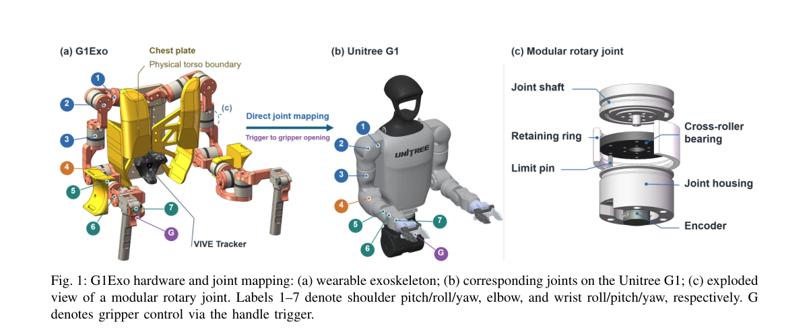

*Main result - Figure 2 Photographs of whole-body contact manipulation teleoperated with G1Exo. The upper row shows the operator wearing G1Exo, and the lower row shows the corresponding G1 robot configurations: (a) h*

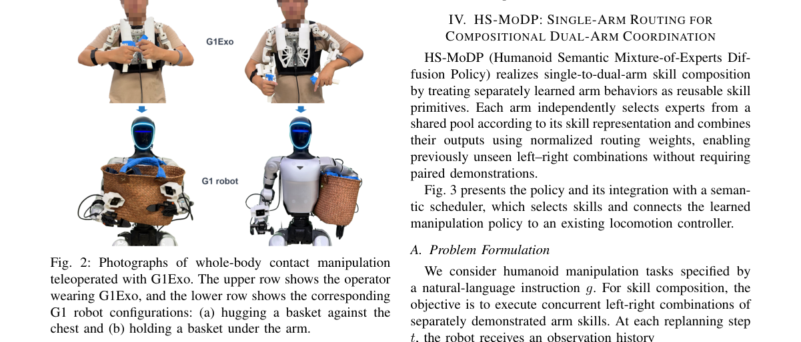

**Why this ranks #3**: 「组合爆炸」被语义路由而非更多数据解决，是一个干净的分工。

---

### 4. HAF-VLA: Hierarchical Action Flow Framework for Humanoid Vision-Language-Action Control

**arXiv**: [2610.26584](https://arxiv.org/abs/2610.26584) | **Score**: 8.0 (relevance 8 x 0.7 + quality 8 x 0.3) | **Tags**: embodied-ai | **Categories**: cs.RO | **Pages**: 22

**Authors**: Langzhe Gu, Chengkai Hou, Meng Li, Xinhua Wang, Xinyuan Lv, Shuanghao Bai, Guangrun Li, Jingyang He, Ziluo Ding, Zhiyuan Xu, Ning Ding, Kuan Cheng

**Affiliation**: 1State Key Laboratory of Multimedia Information Processing, School of Computer Science, | Peking University | 3Nankai University | 4Xi’an Jiaotong University

**Abstract**

> Humanoid robots hold great promise as general-purpose agents in human-centered environments, yet adapting generalist vision-language-action (VLA) policies to real-world humanoid loco-manipulation remains challenging. Unlike fixed-base or wheeled manipulators, humanoids must coordinate locomotion, posture, gaze, and dual-arm manipulation over a high-dimensional whole-body action space, where inaccurate base or waist motions can easily induce unstable and aggressive upper-body compensation. We propose HAF-VLA, a hierarchical action-flow framework for humanoid VLA control. Built upon a pretrained flow-matching VLA, HAF-VLA inherits the vision-language prefix encoder and action expert weights, and adapts them to humanoid whole-body loco-manipulation with learnable stage embeddings and cross-stage KV-cache conditioning. Instead of generating the full action chunk in a single pass, HAF-VLA progressively denoises a shared whole-body action space: first locomotion and head commands, then waist refinement, and finally full-body manipulation. To preserve structural dependencies across stages, we introduce a cross-stage KV cache conditioning mechanism, enabling subsequent action generation stages to refine and augment their outputs based on the action representations from preceding stages. Experimental results across six real-world tasks demonstrate that our framework significantly enhances the performance of existing models in humanoid loco-manipulation tasks, demonstrating an effective pathway for adapting strong mobile-manipulation VLAs to humanoid whole-body loco-manipulation.

**Key findings**

- **Finding**: 人形必须协调移动、姿态、**注视**与双臂操作；HAF-VLA 用层次化动作流框架（摘要截断）。

- **Inference**: 把注视纳入协调变量是有依据的：双臂操作时头部朝向决定了操作者能看到什么，因此注视不是渲染细节而是感知输入。

- **Recommendation**: 人形 VLA 的读者可参考。

**Key figures**

*Framework / architecture - Figure 1 Overview of HAF-VLA. (a) We demonstrate seven loco-manipulation tasks tested on the humanoid robot in real-world scenarios. (b) The pipeline illustrating our hierarchical approach to generat*

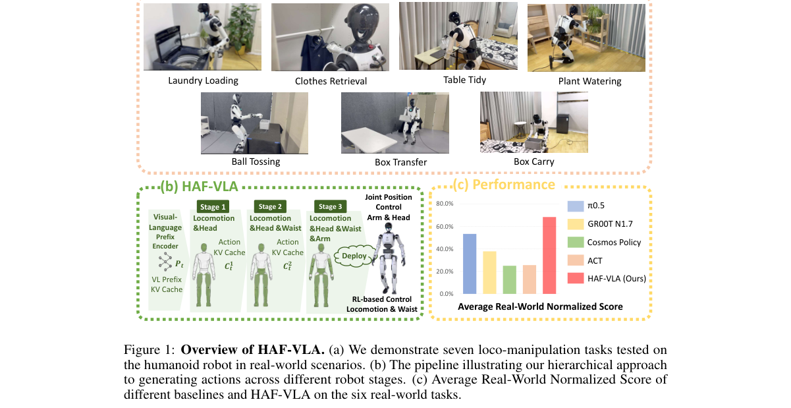

*Main result - Figure 2 Overall framework of HAF-VLA. Given visual observations, robot states, and language instructions, the model progressively generates whole-body action trajectories through hierarchical action*

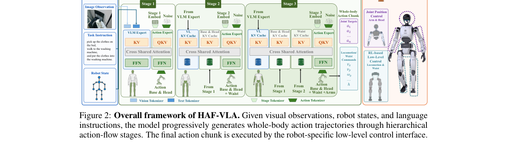

**Why this ranks #4**: 「注视」被列为必须协调的维度之一，这在其他 VLA 工作里通常不出现。

---

### 5. EmbodiedWorld-200K: Toward Embodied World Agents via Embodied-Planning Dataset and Interactive World Models

**arXiv**: [2610.25959](https://arxiv.org/abs/2610.25959) | **Score**: 8.0 (relevance 8 x 0.7 + quality 8 x 0.3) | **Tags**: world-model, embodied-ai | **Categories**: cs.AI | **Pages**: 30

**Authors**: X. Feng, J. Tang, Z. Lin, L. Chen, S. Shao, Q. Lu, K. Huang

**Affiliation**: Tencent Hunyuan

**Abstract**

> Building embodied agents that can perceive, reason, and act across diverse 3D worlds is a central research direction toward artificial general intelligence. Yet most existing work remains confined to specific tasks in a single scene and transfers poorly to new environments, leaving general embodied agents for open-world settings under-explored. We refer to such agents as Embodied World Agents (EWAs), whose defining property is the ability to understand diverse visual environments and execute general actions in open-world conditions. To advance EWA research, we study open-world embodied navigation-planning and release EmbodiedWorld-200K, a large-scale dataset of over 200K samples spanning diverse scenes. Each example is equipped with multi-level annotations, ranging from low-level camera-motion trajectories to high-level semantic instructions. The dataset also provides unified evaluation splits and task-specific metrics, supporting offline pretraining and fair evaluation of EWAs. Beyond offline supervision, a defining characteristic of an EWA is its interaction with the environment; training solely on offline data is therefore insufficient, especially for generalizing to scenes not covered in the training distribution. Building dedicated real interactive environments, however, is often prohibitively expensive. To address this, we propose a novel training scheme that employs a video world model as a low-cost environment proxy and performs interactive reinforcement-learning (RL) post-training of the EWA within it. Empirically, pretraining on EmbodiedWorld-200K substantially improves the open-world embodied planning ability of the EWA, and further RL post-training inside a world model yields clear gains on out-of-distribution scenes. The dataset, baseline checkpoints, and training and evaluation code are available at https://xiaokunfeng.github.io/EmbodiedWorld-200K/.

**Key findings**

- **Finding**: 既有工作局限于特定任务与单一场景，迁移到新环境表现差（摘要截断）。

- **Finding**: EmbodiedWorld-200K 用具身规划数据集与交互式世界模型构建通用具身世界智能体（摘要在此处截断）。

- **Inference**: 20 万规模的规划数据集本身是贡献，但真正的检验是它是否覆盖了「开放世界」而非「更多场景」——前者要求场景外的泛化。

- **Recommendation**: 与本批 Ropedia W0 对照，一篇做基座模型、一篇做数据规模。

**Key figures**

*Framework / architecture - Figure 1 Overview of EmbodiedWorld-200K. A large-scale embodied-planning dataset designed to support the study of Embodied World Agents (EWAs)—general-purpose embodied agents operating across diverse*

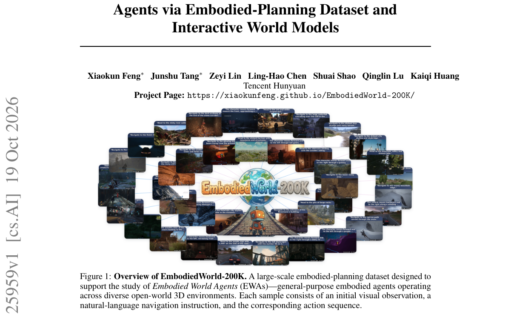

*Main result - Figure 2 Data annotation pipeline. Given (a) the raw video and its camera-motion trajectory, we first (b) leverage the trajectory to perform navigation-coherent segmentation; then on each resulting s*

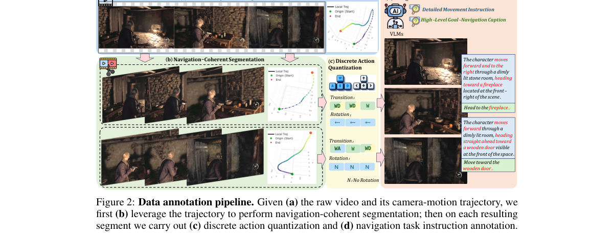

**Why this ranks #5**: 「任务与场景双重局限」被明确指出，是该数据集的立论。

---

### 6. Humanoid SRL: Augmenting Humanoids with Supernumerary Limbs for Coordinated Loco-Manipulation

**arXiv**: [2610.25628](https://arxiv.org/abs/2610.25628) | **Score**: 8.0 (relevance 8 x 0.7 + quality 8 x 0.3) | **Tags**: embodied-ai | **Categories**: cs.RO | **Pages**: 43

**Authors**: Fukang Liu, Feiyang Wu, Paul Barsa, Jaehwi Jang, Akshat Jain, Zhigen Zhao, Yipu Chen, Zhaoyuan Gu, Nikhil Vemuri, Anshul Chandaliya, Kaijie Zhu, Sean Lublinsky

**Affiliation**: 1Georgia Institute of Technology, Atlanta, GA, USA.

**Abstract**

> Humanoid robots are envisioned to perform diverse human-level tasks through their anthropomorphic morphology. Their dual-arm configuration enables a broad range of everyday actions. Yet, as in humans, this morphology can constrain loco-manipulation when both arms are occupied or additional contacts are required beyond their reach. Supernumerary robotic limbs (SRLs) offer a way to extend these capabilities, but their integration requires the added limb to be coordinated with whole-body motion and balance. In this study, we develop and integrate a supernumerary arm into a humanoid platform to investigate how morphological augmentation reshapes its feasible action space. Through quantitative analysis and hardware experiments across two configurations, we show how the additional limb expands whole-body interaction capabilities by enabling manipulation and support to be coordinated beyond the constraints of the native dual-arm configuration. To control this augmented morphology, we leverage model-based trajectory optimization (TO) to generate dynamically feasible motions for goal-conditioned reinforcement learning (RL) controllers. The controllers are trained in simulation and transferred to hardware in a zero-shot manner, enabling coordinated whole-body skills for contact-rich tri-arm loco-manipulation. We further show vision-guided autonomous execution on selected tasks using diffusion policies trained from hardware demonstrations. Our findings suggest that humanoid morphology need not be restricted to human-like forms, but can be reimagined as an extensible design space for robotic augmentation.

**Key findings**

- **Finding**: 当双臂被占用或需要额外接触时，双臂形态**限制** loco-操作（摘要截断）。

- **Finding**: 该文为机器人增加**超数目肢体**以支持协调 loco-操作（摘要在此处截断）。

- **Inference**: 加肢体是硬件层面的解法，它把「双臂不够用」从任务设计问题变成系统设计问题——代价是控制维度上升与安全边界的扩大。

- **Recommendation**: 与本批 HandsOn（多手型资产）对照，一篇改评测平台、一篇改硬件形态。

**Key figures**

*Framework / architecture - Figure 1 Configurations and real world tasks. The humanoid platform is equipped with a su- pernumerary 4-DoF arm in neck-mounted and back-mounted embodiments. (A–G) Photographs of both configurations*

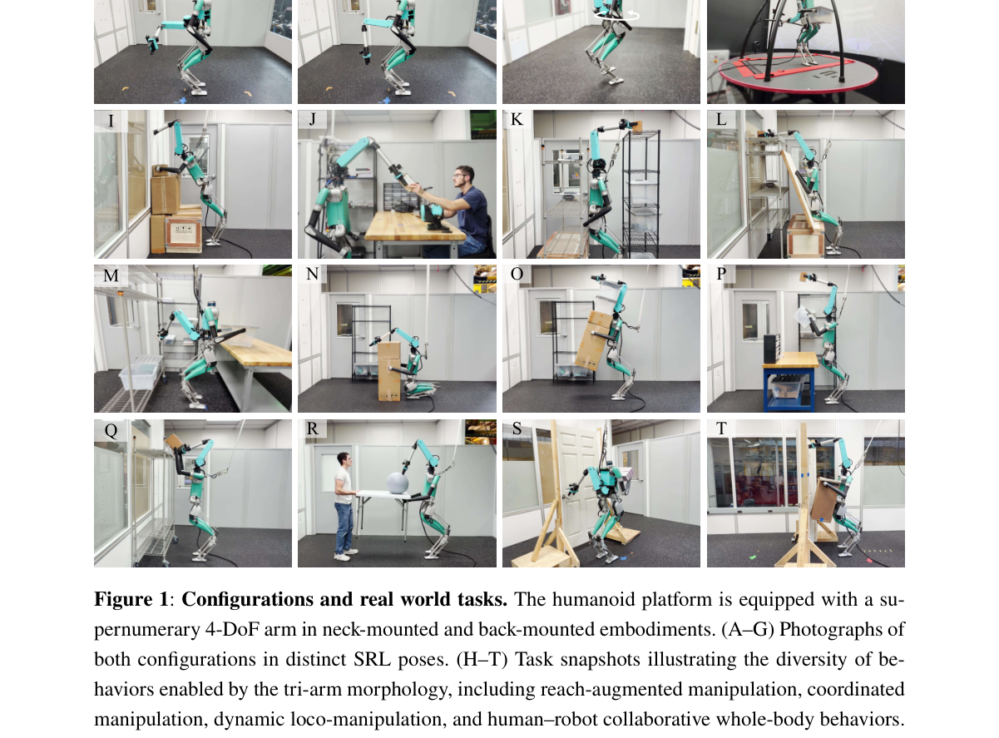

*Main result - Figure 2 B summarizes the reachable-space augmentation introduced by the added limb. The 3D workspace overlays in Fig. 2B(i) show that the neck-mounted configuration preferentially expands frontal and ov*

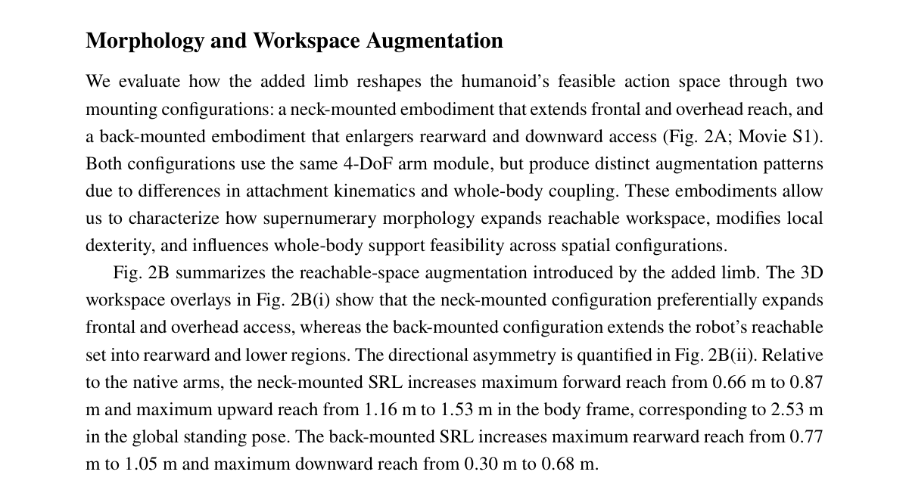

**Why this ranks #6**: 「形态本身是瓶颈」的思路很直接：硬件限制了任务集。

---

### 7. FR-VLA: Implicit Force Reasoning VLA for Contact-Rich Manipulation

**arXiv**: [2610.25981](https://arxiv.org/abs/2610.25981) | **Score**: 8.0 (relevance 8 x 0.7 + quality 8 x 0.3) | **Tags**: embodied-ai | **Categories**: cs.RO | **Pages**: 20

**Authors**: Jiaju He, Zhiyuan Yang, Ruyang Han, Jiahong Tang, Zhiping Lin, Haiyue Zhu

**Affiliation**: 1School of Electrical and Electronic Engineering, Nanyang Technological University (NTU), Singapore | 2Singapore Institute of Manufacturing Technology (SIMTech), Agency for Science, Technology and Research

**Abstract**

> Integrating force awareness into Vision-Language-Action (VLA) models involves not merely encoding wrench measurements as an additional modality, but determining when and how strongly physical interaction should influence robot action generation. Existing VLAs that use force typically inject it through a fixed pathway, without explicitly determining when it is relevant to the current action. This calls for an intermediate force relevance mechanism inside the VLA, in which visual-language context estimates the relevance of physical feedback to the current task before force enters the action pathway. FR-VLA addresses this gap with a Vision-Language Force-Reasoning Model that uses learnable force query tokens to derive a force admission signal grounded in visual-language context, and uses this signal to modulate an external tokenized force pathway for action generation. In real-world experiments on five contact-rich tasks across two robotic platforms, FR-VLA achieves the highest mean success rate over six evaluated stages, and trajectory visualizations show that its force admission varies with the interaction phase.

**Key findings**

- **Finding**: 既有使用力的 VLA 通过**固定通路**注入，不显式处理（摘要截断）。

- **Finding**: FR-VLA 做**隐式**力推理（摘要在此处截断）。

- **Inference**: 固定通路意味着力在所有时刻等权影响策略——而在接近阶段力是有害的（这正是 10-16 日报 DEFT-VLA 的阶段依赖感知冲突），因此「何时让力说话」是必要的设计。

- **Recommendation**: 与 10-16 日报的 DEFT-VLA（阶段定位的力特化）连读，两篇是同一问题的一周之隔。

**Key figures**

*Main result - Figure 2 Overview of FR-VLA. (a) Overall architecture: four token groups are processed by the VLM-based Implicit Force Reasoning Module, which infers contact-relevant motion phases and produces a for*

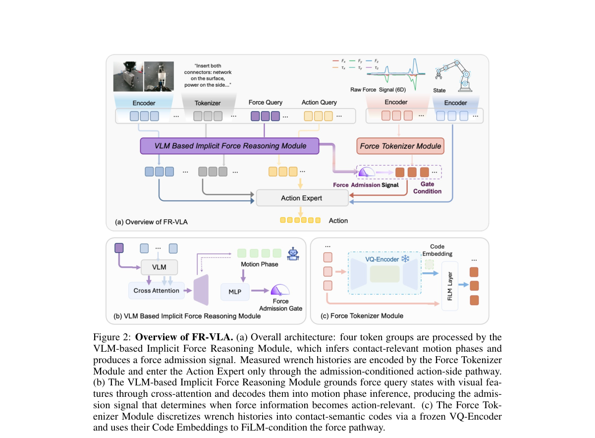

**Why this ranks #7**: 「何时让力影响动作」比「如何编码力」更接近问题本质。

---

### 8. Vector-Quantized World Model: Latent Feedback Motion Planning for Robot Manipulation

**arXiv**: [2610.25600](https://arxiv.org/abs/2610.25600) | **Score**: 7.7 (relevance 8 x 0.7 + quality 7 x 0.3) | **Tags**: world-model | **Categories**: cs.RO | **Pages**: 9

**Authors**: Xuezhou Xu, Chung-Pang Wang, Zhenzhen Li, Benjamin Riviere

**Affiliation**: 1New York University, New York, NY, USA.

**Abstract**

> Visual world models have shown strong potential for robot planning, yet long-horizon manipulation remains challenging due to compounding prediction errors, large search complexity, and latent plans that the low-level controller cannot reliably reach. In this work, we introduce Vector-Quantized World Model (VQ-WM), a latent feedback motion planning framework that integrates discrete long-horizon search with continuous visual feedback control: a discrete latent predictor models transitions between vector-quantized latent states, allowing the planner to look far ahead and find a shortest path to the goal through discrete search and a continuous learned controller sequentially reaches the planned states through visual feedback, correcting deviations to mitigate compounding errors. Whereas most vector quantization uses Euclidean distance, we use a novel estimator of the first-passage-time as a quasi-metric, which aligns the planning abstraction with the controller's capabilities. We evaluate on the physical robot manipulation of the Tower of Hanoi puzzle: whereas existing state-of-the-art foundation models (VLAs, WAMs) only succeed when the solution trace in their training dataset, our method achieves 100\% success rate with only short-play data, demonstrate its ability to compose long-horizon solutions beyond the short demonstrated trajectories and execute them reliably. Our solution also outperforms strongest world-models by 13.3--85.3 percentage points on simulation benchmarks spanning manipulation and locomotion, demonstrating consistent progress and new capabilities.

**Key findings**

- **Finding**: 长时程操作的三个限制：预测误差累积、搜索复杂度大、**低层控制器无法可靠到达**的潜计划。

- **Finding**: VQ-WM 用向量量化的潜在反馈做运动规划（摘要在此处截断）。

- **Inference**: 第三个限制最根本：若潜空间里的最优路径在物理上不可执行，搜索得越充分越会撞上不可达区域——因此潜表示必须编码可达性，而非仅视觉相似。

- **Recommendation**: 与本批 PrismWAM（解耦 WAM 状态表示）对照，两篇都在问「潜空间里该放什么」。

**Key figures**

*Framework / architecture - Figure 1 Overview of VQ-WM. The initial (green) and goal (red) images are encoded into latent states and vector-quantized ac- cording to controller reachability, so that each vector-quantized state ser*

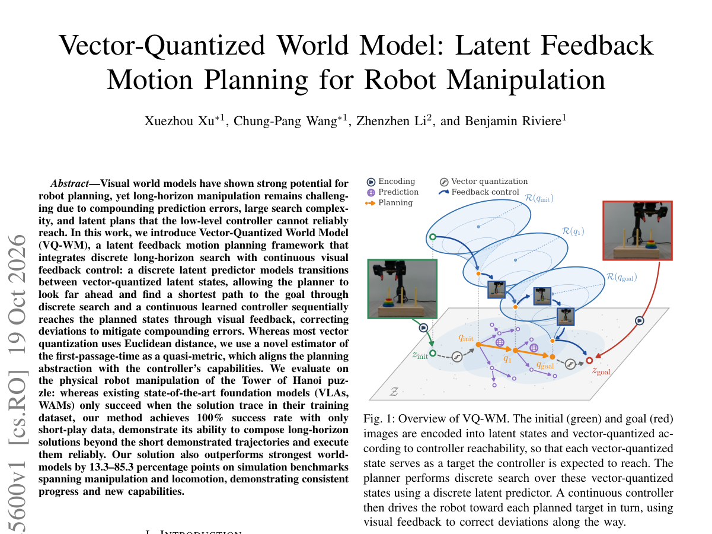

*Main result - Figure 2 VQ-WM components and pipeline. (a) Inference encodes the initial and goal images, searches over state codes, and executes the planned targets with visual feedback. (b) Offline training learns*

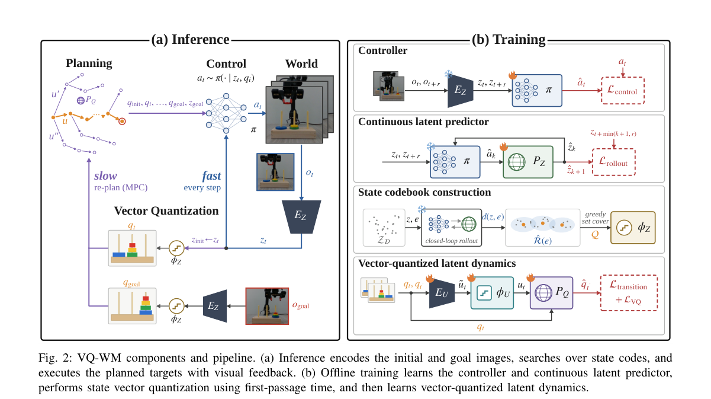

**Why this ranks #8**: 「潜计划低层到不了」是规划方法论中一个常被跳过的约束。

---

### 9. PaceVLA: Adaptive Temporal Action Quantization in Vision-Language-Action Models

**arXiv**: [2610.25961](https://arxiv.org/abs/2610.25961) | **Score**: 7.3 (relevance 7 x 0.7 + quality 8 x 0.3) | **Tags**: embodied-ai | **Categories**: cs.AI, cs.RO | **Pages**: 25

**Authors**: Hojin Jeon, Jimin Lee, Taekwan Kim, Nayoung Oh, Taeyoung Kim, Myungkyu Koo, Jinmo Koo, Joonwoo Ahn, Jinwoo Shin

**Affiliation**: 1KAIST, 2RLWRLD, 3Korea University, 4Seoul National University

**Abstract**

> Fast and reliable manipulation is crucial for practical robot deployment. Although Vision-Language-Action (VLA) models have recently shown remarkable progress as generalist robot policies, their execution often remains temporally inefficient. A key source of this inefficiency is that policies learn fine-grained temporal patterns from teleoperated demonstrations, requiring many low-level action steps. Temporal action quantization offers a simple way to accelerate execution by aggregating consecutive low-level actions into temporally coarser actions. However, applying action quantization without considering when fine-grained control is required introduces a speed-accuracy trade-off: accelerated actions may efficiently reduce redundant steps in some phases, while discarding critical motion details in precision-sensitive interactions. To address this, we propose PaceVLA, a unified framework for adaptive temporal execution in VLAs that integrates two coupled components: (1) mode-specific action decoders built on a shared action expert, supporting multiple temporal granularities and prediction horizons, and (2) a quantizability-guided mode selection scheme which decides whether coarse execution is appropriate, and a context-conditioned router that selects an execution mode at each inference step. Experiments across three multi-task simulation benchmarks and six real-world tasks show that PaceVLA improves execution efficiency while maintaining task success rate across multiple embodiments, including long-horizon and dexterous manipulation.

**Key findings**

- **Finding**: VLA 执行时间上低效，关键来源之一是策略学到细粒度时间模式（摘要截断）。

- **Finding**: PaceVLA 做自适应时间动作量化（摘要在此处截断）。

- **Inference**: 若时间分辨率是学出来的而非架构设定的，那么它可以被压回而不损质量——但前提是压缩的粒度按任务自适应，这正是该方法的方向。

- **Recommendation**: 与 10-19 日报的 MambaAct（流匹配 VLA 推理成本）对照，一篇压计算、一篇压时间步。

**Key figures**

*Framework / architecture - Figure 1 Adaptive temporal execution with PaceVLA. (a) Conveyor package handling task on the humanoid ALLEX: PaceVLA selects a temporal granularity per phase. (b) Success rate vs. speedup over the ba*

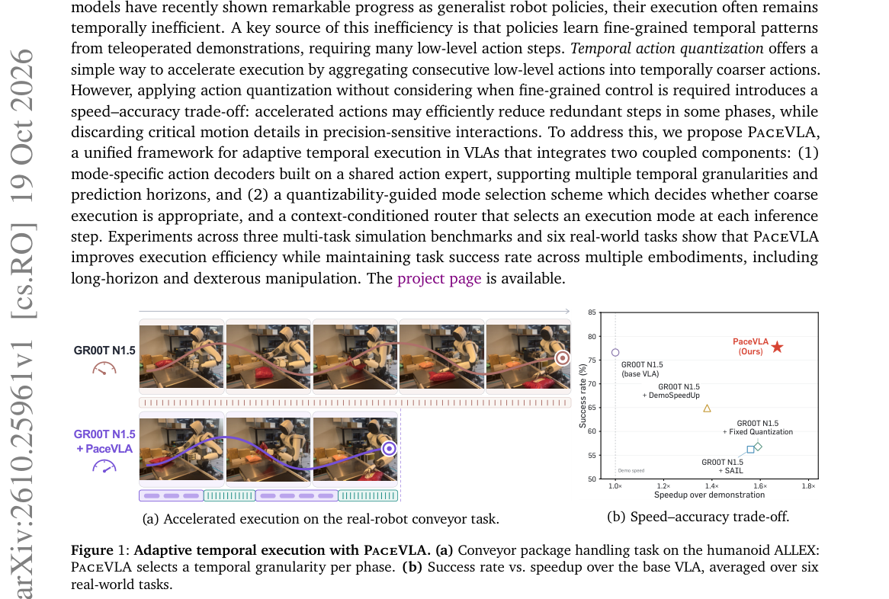

*Main result - Figure 2 Overview of PaceVLA. PaceVLA is a unified framework for adaptive temporal action execution in pretrained VLAs. It equips a shared action expert with mode-specific action decoders that suppor*

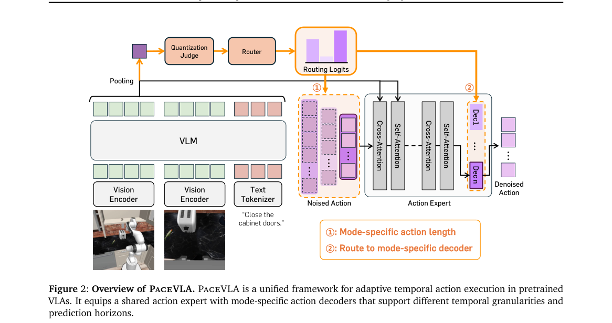

**Why this ranks #9**: 「动作时间分辨率」被归因为学习到的细粒度模式，而非骨干成本。

---

### 10. PrismWAM: Decoupling State Representations in World Action Models

**arXiv**: [2610.26564](https://arxiv.org/abs/2610.26564) | **Score**: 7.3 (relevance 7 x 0.7 + quality 8 x 0.3) | **Tags**: world-model, embodied-ai `[wild-card]` | **Categories**: cs.CV | **Pages**: 22

**Authors**: Tianyu Xin, Wanqi Zhong, Bowen Hu, Zhangchi Guo, Lijie Wang, Yiming Wang, Haoran Liao, Heyang Yu, Xiaoyu Tian, Zhiding Yu, Yiming Li

**Affiliation**: 1Tsinghua University

**Abstract**

> World Action Models (WAMs) typically represent the world through latent embeddings from pretrained video models, which entangle heterogeneous aspects of the world, from how it looks (e.g., texture and color) to how it is physically configured (e.g., occupancy and pose). This raises an underexplored question: $\textbf{what should constitute the state of a WAM?}$ We argue that the world state should separate how the world appears from how the world evolves under action: the former captures semantic context, while the latter is governed by physical state. To this end, we propose $\textbf{PrismWAM}$, which decouples physics from semantics while jointly modeling state and action. PrismWAM factorizes an embodied task into a $\mathrm{Semantic\ Planning}\rightarrow\mathrm{Physical\ Rollout}\rightarrow\mathrm{Executable\ Action}$ pipeline: given only the initial RGB observation, semantic planning learns to predict the final goal image, while physical rollout predicts the fine-grained evolution toward this goal in depth space; executable actions are then generated from the depth rollout. Without any embodied action pretraining or additional data augmentation, PrismWAM achieves strong manipulation performance in both simulation and the real world. Notably, PrismWAM even surpasses a broad range of models with large-scale embodied action pretraining (e.g., OpenWAM-$α$). More broadly, we reframe World Action Models from modeling how the world looks to how it responds to action, paving the way for action-centric world models grounded in occupancy, flow, tactile sensing, proprioception, and beyond.

**Key findings**

- **Finding**: WAM 用预训练视频模型的潜在嵌入表示世界，纠缠了「外观」与「物理配置」两方面。

- **Finding**: 该文追问并**解耦**状态表示（摘要在此处截断）。

- **Inference**: 这与 10-19 日报的 ΔWAM（可预测未来被外观主导）是同一诊断的更深版本——ΔWAM 说监督里混进了外观，这里说表征里也混进了外观。

- **Recommendation**: wild-card 项；建议与 10-19 日报 ΔWAM、10-16 日报 ForceWAM 连读，三篇构成「世界模型该学什么」的连续线索。

**Key figures**

*Framework / architecture - Figure 1 Overview of PrismWAM. (a) Our key insight is to decouple physical state from semantic context, yielding state representations that are better aligned with action-induced dynamics. (b) We fol*

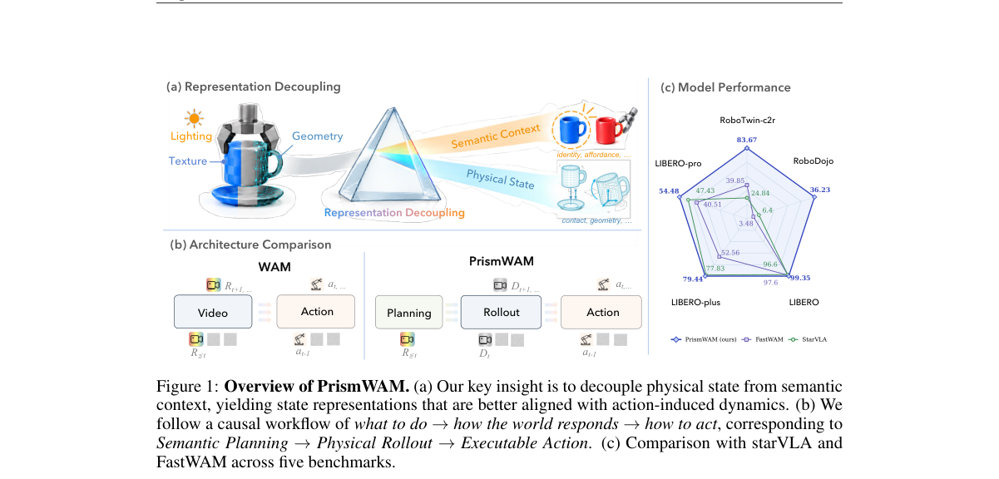

*Main result - Figure 2 PrismWAM decouples semantic planning from physical rollout. Left: the RGB stream learns task semantics through sparse supervision from a single intended-future frame, while the depth stream*

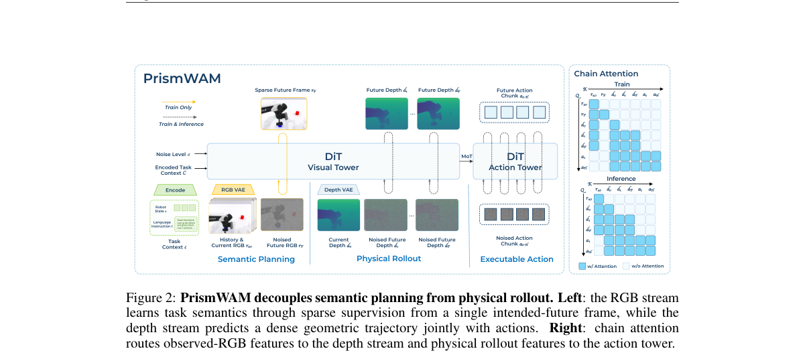

**Why this ranks #10**: wild-card：把「外观 vs 物理配置」的纠缠明确为 WAM 的表征问题。

---

## Footer

- Total papers reviewed across all 5 tracks: 50 (from 525 scanned)
- embodied track final top-10: 10
- Wild-cards in this track: 1
- Figure assets: `res/` (shared across tracks)

Generated by `mine-arxiv-daily-digest` skill. Sister file: `2026-10-20_embodied_entry.md`.
