# ArXiv Daily Digest - 2026-10-20 (强化学习, 10 papers)

**Generated**: 2026-10-20 17:00 CST

**Source**: arXiv cs.CV, cs.SD, eess.AS, cs.CL, cs.AI, cs.RO, cs.LG submissions, window 2026-10-19 UTC (latest announced batch as of 2026-10-20 17:00 CST)

**Track**: rl (top 10 of 525 papers scanned, 50 full reads)

**Scope**: controlled comparison of GRPO against rejection-sampling fine-tuning, anatomy of off-policy policy gradient, empirical study of attack-success-rate benchmarking, cost-aware jailbreak metric, multi-frame rollouts for video reasoning, policy-adaptive credit assignment for spatial reasoning, visually attributable on-policy self-distillation, reasoning compression for multimodal grounding, co-evolving policy and reward for code generation, evolving penalties against reward hacking

---

**本批最重要的论文把 GRPO 本身放上了实验台。**

**Is it RL or Data?** 复现并检验了 Bauer 等（2026）的关键结论：低数据 RLVR 中，用混合难度提示训练 GRPO 相比只用易提示可获得最高 **5 倍**的样本效率。但原工作**没有检验**这一收益是否 GRPO 特有——换一种用同样数据的后训练方法是否也能得到？作者在完全相同的提示与数据条件下做 GRPO 与拒绝采样微调的受控对比。

这是整个 RLVR 叙事的地基检验：若收益主要来自「混合难度的数据」而非 RL 算法本身，那么大量围绕 GRPO 变体的工作其实在优化一个**数据效应**——而数据效应通常更便宜、更容易推广。

**评测指标被审计的两篇**同批出现，且落差惊人。**Concerns in Benchmarking Jailbreaks** 用三种评测程序检验八种攻击对三个开放权重模型：面向低资源语言的攻击在关键词匹配下平均 ASR 达 **96.0%**，而在另一种判定程序下仅 **2.7%**——**35 倍**的落差说明「提到敏感内容」与「被真正劫持」被混为一谈，这与 10-19 日报「被忽略而非被拒绝」是同一类误判。**Beyond Attack Success Rate** 则指出 ASR 完全未考虑**对受害模型的重复调用**，而每次额外调用都给了部署系统一次检测与干预的机会；ASR_STEP 把攻击成本纳入指标。

理论侧 **Anatomy of Off-Policy Policy Gradient** 处理一个被领域默认忽略的前提：策略梯度方法被**常规地以离策略方式部署**，而原始策略梯度假设在策略采样。它拆解了各成分（重要性采样、KL 正则化、基线）的作用——尤其基线，因为**组相对优势正是基线的一个特例**，基线的选取直接决定优势估计的偏差。

---

## Top 10 - 强化学习

### 1. Is it RL or Data? A Controlled Comparison of GRPO and Rejection-Sampling Fine-Tuning

**arXiv**: [2610.25812](https://arxiv.org/abs/2610.25812) | **Score**: 9.7 (relevance 10 x 0.7 + quality 9 x 0.3) | **Tags**: rlhf, rl-algorithm | **Categories**: cs.LG | **Pages**: 20

**Authors**: Lakshya Chaudhry

**Affiliation**: Purdue University

**Abstract**

> Bauer et al. (2026) showed that in low-data reinforcement learning with verifiable rewards, training GRPO on mixed-difficulty prompts gives up to 5x the sample efficiency of easy-only prompts. They did not test whether this benefit is specific to GRPO, or whether another post-training method given the same data would obtain it too. We test this on their procedural counting task with Qwen3-4B-Base and LoRA, comparing GRPO to rejection-sampling fine-tuning (RFT) on the same prompts, verifier and token cap. Six primary arms cross the two methods with three prompt sets (Easy, Mixed, and a Curated subset of prompts the base model sometimes solves, which makes GRPO's implicit filter explicit). We use three seeds per arm. Hypotheses and falsifiers were registered before training. To rule out a poorly tuned baseline, RFT receives a 27-run hyperparameter sweep, while GRPO uses Bauer et al.'s recipe unchanged. GRPO outperforms RFT at every prompt set: by 10.9 points on held-out test problems with curated prompts, and, in post hoc comparisons with matched rollout budgets, by 8.4 and 9.2 points on the easy and mixed prompts. On test the advantage survives the least favorable treatment of truncated completions; out of distribution, truncation prevents a conclusion. Curating prompts does not help RFT (-2.7 points). Mixed-difficulty data helps RFT (+3.7 points), while for GRPO the evidence is inconclusive. A secondary iterated-RFT arm, which resamples from the current policy, recovers 3.2 of the 10.9-point gap (about 30%). These are controlled measurements on one synthetic task family and one base model with three seeds per arm.

**Key findings**

- **Finding**: Bauer 等（2026）报告：低数据 RLVR 中，混合难度提示训练 GRPO 相比只用易提示，样本效率最高提升 **5 倍**。

- **Finding**: 但该工作**未检验**这一收益是否 GRPO 特有——换一种用同样数据的后训练方法是否也能得到？

- **Finding**: 作者在完全相同的提示与数据条件下做 GRPO 与拒绝采样微调的受控对比（摘要在此处截断）。

- **Inference**: 这是整个 RLVR 叙事的地基检验：若收益主要来自「混合难度数据」而非 RL 算法本身，那么大量围绕 GRPO 变体的工作在优化一个数据效应——而数据效应通常更便宜、更容易推广。

- **Recommendation**: 被精读的三篇之一。**任何基于 GRPO 改进的工作都应先引用它的结论**，因为它决定了改进的对象究竟是算法还是数据。

**Key figures**

*Framework / architecture - Figure 1 Greedy accuracy on test 300 by difficulty tier (100 problems per tier). Dots are seeds with 95% bootstrap CIs; black bars are the mean ± sd over seeds. Controls and Base are single runs. Eac*

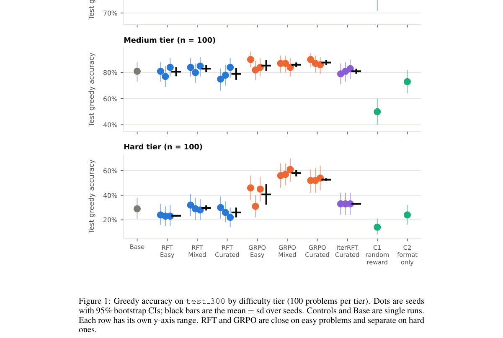

*Main result - Figure 2 Share of GRPO groups whose eight completions all received the same reward, and so contribute no gradient, over training. One line per seed, 25-step trailing mean. Columns split the prompts b*

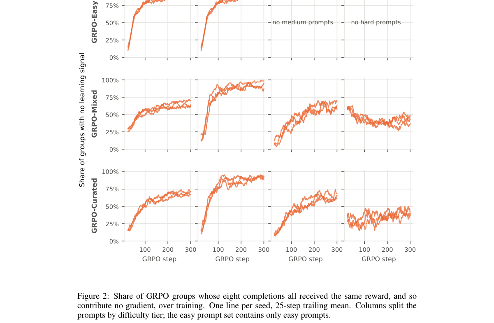

**Why this ranks #1**: 本批最重要的一篇：它把「GRPO 有效」这个前提本身变成了一个可检验的命题。

---

### 2. Anatomy of Off-Policy Policy Gradient: Importance Sampling, KL Regularization, and Baselines

**arXiv**: [2610.25725](https://arxiv.org/abs/2610.25725) | **Score**: 9.0 (relevance 9 x 0.7 + quality 9 x 0.3) | **Tags**: rlhf, rl-algorithm | **Categories**: cs.AI, cs.LG | **Pages**: 34

**Authors**: Haoqun Cao, Yurun Yuan, Tengyang Xie

**Affiliation**: University of Wisconsin–Madison

**Abstract**

> Reinforcement learning has become a central tool for large language model (LLM) post-training, where policy gradient methods are routinely deployed off-policy, even though vanilla policy gradient assumes on-policy sampling. We study when such off-policy deployment is justified, and what roles its core ingredients, including importance sampling, KL regularization, and baselines, play in handling the resulting distribution shift. We show that for a general class of off-policy policy gradient updates, consistency, in the sense that the optimal policy remains a stationary point, requires one of two structures at the optimal policy: trajectory-level importance weighting, which suffers from the well-known curse of horizon, or KL regularization with a baseline equal to the optimal soft value, instantiated by the grouped mean. Focusing on the KL route, we identify it with the group-relative policy gradient (GRPG) update, establish an equivalence to a trajectory-level Bellman residual minimization objective, and obtain a finite-sample regret bound under all-policy coverage. This also gives a theoretical account of a variant of the empirically successful GRPO objective. We further uncover a hidden role of baselines in the off-policy setting: a constant shift in the baseline implements pessimism, the standard remedy in offline RL for partial data coverage. We instantiate this via the asymmetric REINFORCE objective, and connect it to the game-theoretic offline RL framework, showing a regret bound with single-policy coverage. Together, these results offer a unified theoretical view of off-policy policy gradient in LLM post-training and connect it to classical ideas in offline RL.

**Key findings**

- **Finding**: 策略梯度方法被**常规地以离策略方式部署**，而原始策略梯度假设在策略采样。

- **Finding**: 作者分析这种离策略部署何时正当，并拆解各核心成分（重要性采样、KL 正则化、基线）的作用（摘要截断）。

- **Inference**: 「基线」这一成分尤其关键：组相对优势正是基线的一个特例，而基线的选取决定了优势估计的偏差——这解释了为什么不同 GRPO 变体在同样数据上表现不同。

- **Recommendation**: 与本批 Is it RL or Data? 对读：一篇给出理论条件，一篇做受控实证。

**Key figures**

*Framework / architecture - Figure 1 Roadmap of the paper: the off-policy policy-gradient update template, the two consistent routes it admits, the chain of equivalent objectives and games along the KL route, and the two finite*

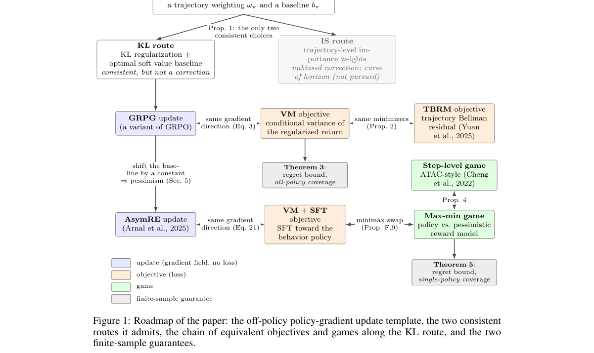

**Why this ranks #2**: 「常规离策略部署与理论假设不符」是一个被整个领域默认忽略的前提。

---

### 3. Concerns in Benchmarking Jailbreaks: An Empirical Study of Attack Success Rates

**arXiv**: [2610.26595](https://arxiv.org/abs/2610.26595) | **Score**: 9.0 (relevance 9 x 0.7 + quality 9 x 0.3) | **Tags**: rlhf | **Categories**: cs.AI, cs.LG | **Pages**: 17

**Authors**: Leon Tu Nguyen, Rohan Menon, Rafael Tappe Maestro, Eric Aubinais, Chih-Hong Cheng

**Affiliation**: 1Carl von Ossietzky University of Oldenburg, Oldenburg, Germany | 2Chalmers University of Technology, Gothenburg, Sweden

**Abstract**

> Jailbreak methods are commonly compared using Attack Success Rate (ASR), but these comparisons depend on how responses are generated and judged. In this paper, we examine eight attacks against three open-weight language models using three evaluation procedures. Low-resource language attacks achieve a mean ASR of 96.0% under keyword matching but 2.7% under a Qwen3 evaluator following StrongREJECT scoring instructions. Changing the number and arrangement of attempts reverses the ranking of DeepInception and rewriting. In a separate experiment, sampling 100 responses for each unchanged request at Ollama's default temperature of 0.8 yields 100% ASR under keyword matching but 50% under the Qwen3 evaluator. Beyond evaluator sensitivity, these findings raise a safety concern: repeated sampling can expose residual unsafe behavior despite an initial refusal, suggesting probabilistic suppression rather than robust exclusion. We recommend explicit success definitions, matched response budgets, validated evaluators, and reporting cumulative failure under repeated interaction rather than relying on single-generation tests.

**Key findings**

- **Finding**: 越狱比较取决于响应如何生成与判定；作者用三种评测程序、三个开放权重模型、八种攻击做检验。

- **Finding**: 面向**低资源语言**的攻击在关键词匹配下平均 ASR 达 **96.0%**，而在另一种判定程序下仅 **2.7%**。

- **Finding**: 该文对评测程序本身的敏感性做了系统量化（摘要在此处截断）。

- **Inference**: 96.0% 与 2.7% 之间 35 倍的落差说明：关键词匹配把「提到敏感内容」等同于「被攻破」，而严格的判定程序揭示绝大多数攻击其实并未真正劫持行为——这与 10-19 日报「被忽略而非被拒绝」是同一类误判。

- **Recommendation**: 被精读的三篇之一。**任何引用越狱 ASR 数字的工作都应先检查其判定程序**，否则跨论文的 ASR 比较毫无意义。

**Key figures**

*Framework / architecture - Figure 1 Overview of the evaluation findings.*

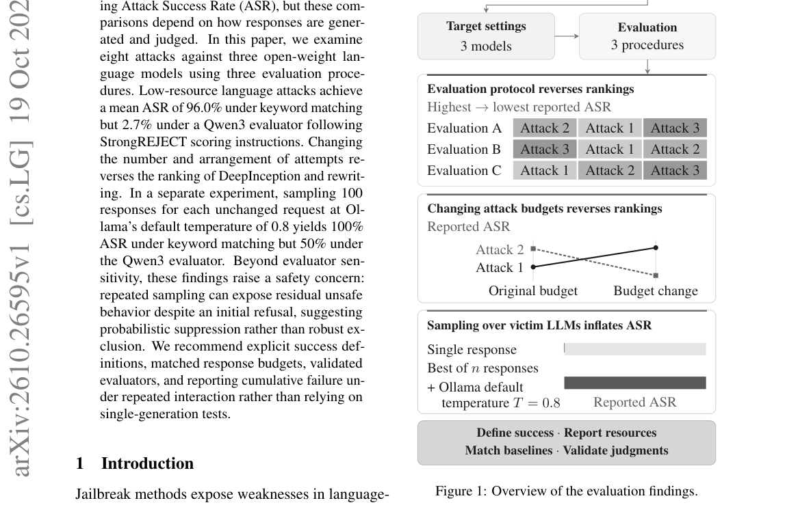

*Main result - Figure 2 a summarizes the Vicuna follow-up. Un- der the original protocols, DeepInception scores 32% with one response per goal, while rewriting scores 64% with five streams of up to five iterations. U*

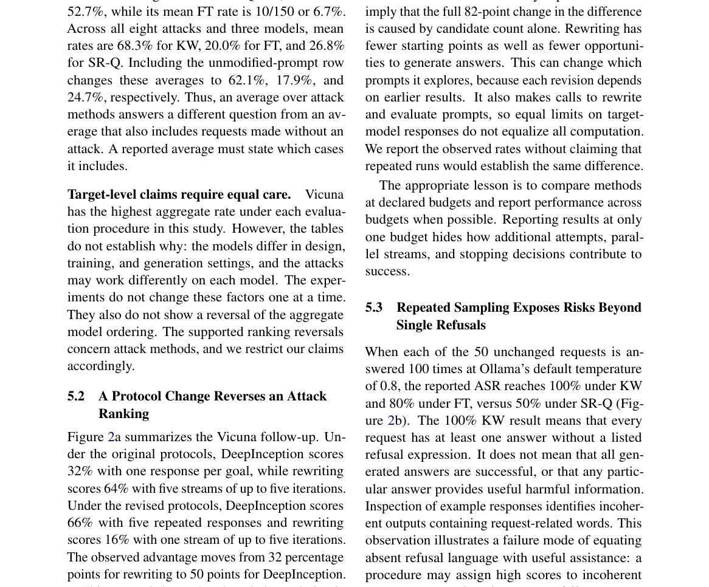

**Why this ranks #3**: 本项目日报审计线索中数值落差最大的一例：同一个攻击，两个数字相差 35 倍。

---

### 4. Beyond Attack Success Rate: Cost-Aware Metric for Evaluating Iterative LLM Jailbreaks

**arXiv**: [2610.26589](https://arxiv.org/abs/2610.26589) | **Score**: 8.7 (relevance 9 x 0.7 + quality 8 x 0.3) | **Tags**: rlhf | **Categories**: cs.CL, cs.CR | **Pages**: 7

**Authors**: Rohan Menon, Chih-Hong Cheng

**Affiliation**: 1Carl von Ossietzky University of Oldenburg, Oldenburg, Germany | 2Chalmers University of Technology, Gothenburg, Sweden

**Abstract**

> Attack success rate (ASR) evaluates jailbreaks against large language models without accounting for repeated calls to the victim model. Yet each additional call gives the deployed system another opportunity to detect the attack and intervene. We introduce $\mathrm{ASR}_{\mathrm{STEP}}$, which penalizes additional victim-model calls while retaining binary success judgments. Our evaluation considers GCG~\cite{zou2023universal}, PAIR~\cite{chao2025jailbreaking} with a step budget, and a single-step PAP~\cite{zeng2024johnny} baseline on JailBreakBench across three model families. GCG's scores decrease by 7.0--8.7 percentage points after discounting, while PAP's remain unchanged. While for PAIR~\cite{chao2025jailbreaking}, we see a wider discounting range between 3.4-12 percentage points, showing that the "step" quantity differs per iterative strategy. Reporting both metrics makes the discount due to repeated victim-model interaction explicit. Code is available \hyperlink{https://github.com/SuELS-Group/beyond_asr}{here}.

**Key findings**

- **Finding**: ASR 未考虑对受害模型的**重复调用**，而每次额外调用都给部署系统一次检测与干预的机会。

- **Finding**: ASR_STEP 在保留二元成功判定的同时惩罚额外受害模型调用（摘要在此处截断）。

- **Inference**: 这实际上把「攻击成本」纳入了指标——迭代式攻击若需要 20 次调用才成功，其真实威胁远低于 1 次调用成功者。离线 ASR 把两者算作同等。

- **Recommendation**: 与 Concerns in Benchmarking Jailbreaks 同读：两篇分别修「判定程序」与「调用成本」两个维度的偏差。

**Key figures**

*Framework / architecture - Figure 1 General flow of iterative prompt optimization.*

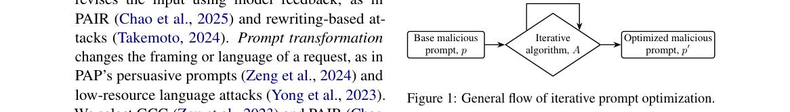

**Why this ranks #4**: 「每一次重试都是防守方的一次机会」是现实部署与离线评测之间的一个结构性差异。

---

### 5. FrameGRPO: Incentivizing Video Reasoning via Multi-Frame Rollouts and Temporal Credit

**arXiv**: [2610.26022](https://arxiv.org/abs/2610.26022) | **Score**: 8.0 (relevance 8 x 0.7 + quality 8 x 0.3) | **Tags**: rlhf | **Categories**: cs.AI, cs.CV | **Pages**: 18

**Authors**: Jiaxuan Sun, Biao Wang, Shuai Li

**Affiliation**: 1Shanghai Jiao Tong University | 2Shanghai Innovation Institute | 3Tencent Hy

**Abstract**

> Reinforcement learning with verifiable rewards, particularly Group Relative Policy Optimization (GRPO), has improved video reasoning in multimodal large language models. However, standard video GRPO varies only linguistic trajectories while conditioning every rollout in a group on the same sampled frames, which can produce homogeneous rewards and weaken group-relative learning when the shared visual evidence is insufficient or distracting. We propose \textbf{FrameGRPO}, a simple and effective reinforcement-learning framework that requires neither auxiliary networks nor changes to the model architecture. Specifically, FrameGRPO combines two lightweight components: (1) \textbf{Multi-Frame Rollouts}, which use only uniform temporal subsampling of a single maximal-frame decode to construct aligned views that diversify visual evidence and reasoning trajectories; and (2) \textbf{Gated Temporal Efficiency Credit}, which selectively reinforces a correct lower-ratio trajectory when all rollouts in a fixed full-ratio reference subset fail, without imposing an unconditional preference for fewer frames. Extensive experiments across diverse video understanding and reasoning benchmarks demonstrate robust overall improvements over standard GRPO, highlighting temporal-view diversification as an effective mechanism for exploration and credit assignment in video MLLMs.

**Key findings**

- **Finding**: 标准视频 GRPO 只变化**语言轨迹**，组内所有 rollout 条件于同一批采样帧。

- **Finding**: 这会产生同质奖励并削弱组相对信号；FrameGRPO 用多帧 rollout 与时间信用（摘要在此处截断）。

- **Inference**: 组相对优势要求组内有差异，而固定帧使差异只能来自语言路径——当视觉证据本应影响推理时，这个限制恰好屏蔽了最重要的信号源。

- **Recommendation**: 与 10-19 日报的 Grounded Credit Assignment 对照，那篇同样指出组内信号不反映真实能力差异。

**Key figures**

*Framework / architecture - Figure 1 Training dynamics of FrameGRPO and GRPO. The four panels track VSI-Bench accu- racy, within-group reward standard deviation, and the prevalence of uniformly correct and uniformly incorrect r*

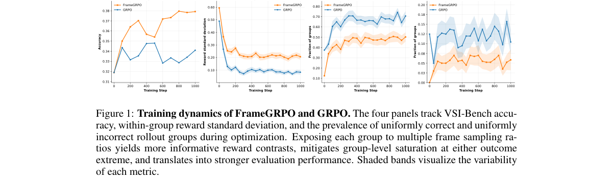

*Main result - Figure 2 Overview of FrameGRPO. Given a video–question pair, we assign the full-ratio input to a fixed subset of rollout slots and independently sample ρi ∼U[0, 1] for the remaining slots to construc*

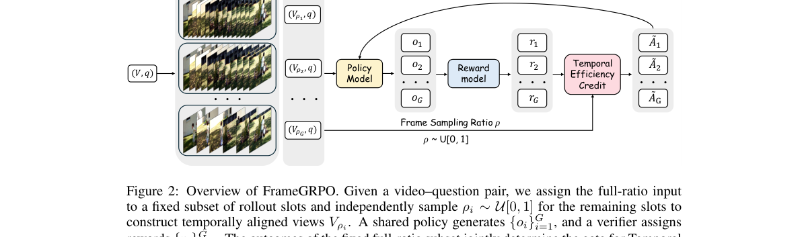

**Why this ranks #5**: 「组内同质 → 优势退化」这个机制又被独立指出一次。

---

### 6. Policy-Adaptive Credit Assignment for Spatial Reasoning with Verifiable Rewards

**arXiv**: [2610.26410](https://arxiv.org/abs/2610.26410) | **Score**: 8.0 (relevance 8 x 0.7 + quality 8 x 0.3) | **Tags**: rlhf | **Categories**: cs.CV | **Pages**: 27

**Authors**: Hailiang Yang, Shengchao Chen

**Affiliation**: School of Computer Science and Engineering | University of New South Wales | Australian AI Institute

**Abstract**

> Image-based spatial reasoning requires perception, decomposition, and inference, but the stage that limits accuracy can change during training. Answer-level rewards neither localize failures to individual stages nor provide discriminative group-relative feedback when all rollouts receive the same reward. Process supervision provides intermediate feedback, but fixed weights cannot adapt reward allocation to these changing bottlenecks. To address this gap, we propose CALIPER, an adaptive process-reward framework supported by SpatialTrace, a corpus of stage-decomposed spatial reasoning traces. CALIPER jointly estimates the associations between stage-wise reference coverage and answer correctness through within-group ridge regression, using these associations as utility proxies to gradually update reward weights. The resulting process reward supervises all rollout groups, including uniformly failing ones. Because utility estimates can become unreliable when answer-discriminative groups are scarce, a closed-loop harness monitors estimator reliability and validation performance to guide checkpoint rollback, rollout diversification, and early stopping. Extensive experiments across eight benchmarks and three backbones show that CALIPER achieves the highest mean under both one-shot and harness training, with consistent gains over fixed allocation across RL optimizers. Further analyses confirm the benefits of adaptive reward allocation and harness control, with favorable scaling in model/data size.

**Key findings**

- **Finding**: 答案级奖励不能定位失败阶段，也在组内奖励相同时缺乏区分度；过程监督提供中间反馈但……（摘要截断）。

- **Finding**: 该文提出**策略自适应**的信用分配（摘要在此处截断）。

- **Inference**: 若瓶颈从感知转移到推断，那么针对固定阶段的过程监督会在训练中途失效——自适应分配因此不是锦上添花，而是维持信号有效性的必要条件。

- **Recommendation**: 与本批 Is it RL or Data? 同属「信号该加在哪」这条线。

**Key figures**

*Main result - Figure 2 SpatialTrace examples (left) and source composition (right).*

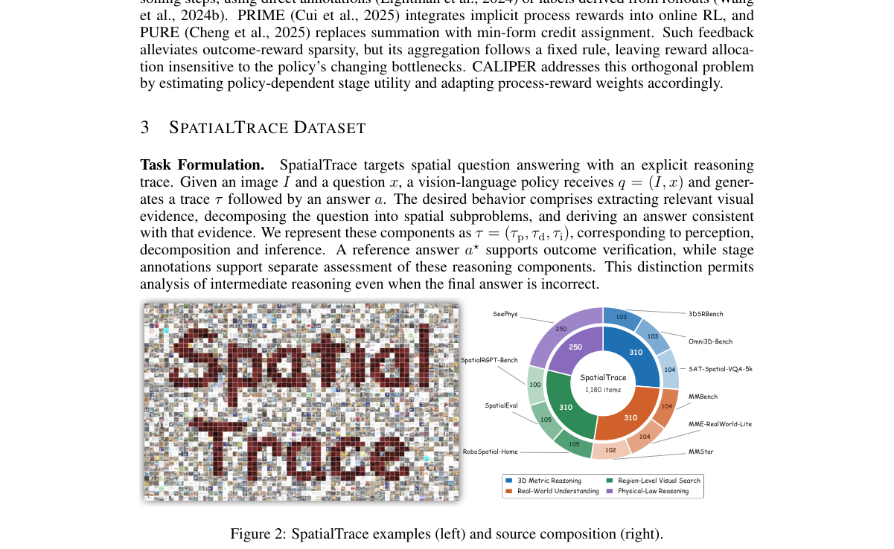

**Why this ranks #6**: 「瓶颈阶段会变」意味着固定的过程监督设计可能对症不对时。

---

### 7. Reinforcement Learning with Visually Attributable On-Policy Self-Distillation

**arXiv**: [2610.26856](https://arxiv.org/abs/2610.26856) | **Score**: 8.0 (relevance 8 x 0.7 + quality 8 x 0.3) | **Tags**: rlhf, rl-algorithm | **Categories**: cs.AI, cs.CV | **Pages**: 18

**Authors**: Shiao Xie, Siyu Chen, Jianwei Lv, Xiandong Li, Yujin Wang

**Affiliation**: Baidu Inc., China

**Abstract**

> Multimodal reinforcement learning with verifiable rewards (RLVR) provides reliable task-level supervision, yet offers limited guidance for localizing errors in visual reasoning. On-policy self-distillation (OPSD) complements this supervision with dense token-level corrections from a privileged teacher equipped with an evidence-centered visual view. However, the resulting corrections may conflate visual evidence with non-visual shifts induced by linguistic priors, response style, or the privileged view itself. We formalize this phenomenon as privileged-correction contamination: a token-level correction is contaminated when its update direction cannot be consistently attributed to the privileged visual evidence. Directly distilling contaminated corrections may therefore reinforce erroneous token-level updates. To address this issue, we propose reinforcement learning with visually attributable on-policy self-distillation, an evidence-consistent paradigm that augments task-level RLVR supervision with privileged token-level corrections grounded in visual evidence. We instantiate this paradigm with Visual-Attribution Gating (VAG), which uses the verifier-derived advantage as the optimization anchor and validates each privileged correction against the contrast between evidence-present and evidence-degraded teacher views. By admitting only corrections directionally supported by this visual contrast, VAG preserves visually grounded guidance while suppressing inconsistent residuals. Experiments across six visual reasoning benchmarks show that VAG consistently outperforms GRPO and OPSD methods, establishing new state-of-the-art average performance.

**Key findings**

- **Finding**: 多模态 RLVR 有任务级监督但缺少错误定位；OPSD 用特权教师提供密集 token 级修正（摘要截断）。

- **Finding**: 该文让修正**在视觉上可归因**（摘要在此处截断）。

- **Inference**: 若 token 级修正无法归因到具体视觉证据，学生可能学到与证据无关的捷径——这正是 10-19 日报「准确率可以在不 grounding 的情况下提升」的微观版本。

- **Recommendation**: 与 10-19 的 Grounded Credit Assignment 连续阅读。

**Key figures**

*Framework / architecture - Figure 1 Illustrative contamination diagnostic. (a) A token-level conflict case and (b) the correction-evidence alignment used to motivate attribution.*

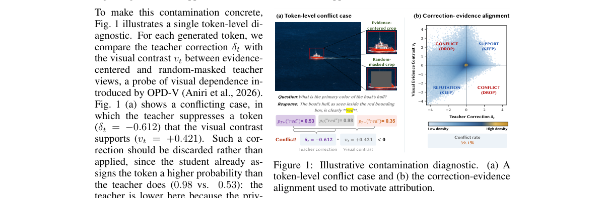

*Main result - Figure 2 Comparison of on-policy learning paradigms. (a) RLVR, (b) RLVR with distillation, (c) Visual contrastive distillation, and (d) RLVR with visual attributable distillation.*

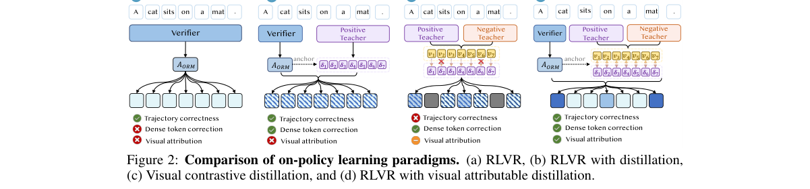

**Why this ranks #7**: 「密集 token 修正但不归因到视觉证据」是这个方法的缺口。

---

### 8. Think, Compress, Answer: Reinforcement Learning for Multimodal Grounding via Reasoning Compression

**arXiv**: [2610.25640](https://arxiv.org/abs/2610.25640) | **Score**: 8.0 (relevance 8 x 0.7 + quality 8 x 0.3) | **Tags**: rlhf | **Categories**: cs.AI | **Pages**: 25

**Authors**: Jinbae Seo, Hyeongjun Kwon, Jiyoung Lee, Hyunsung Jang, Namkoo Ha, Jungin Park, Kwanghoon Sohn

**Affiliation**: 1Yonsei University | 2School of AI and Software, Ewha Womans University | 4Korea Institute of Science and Technology (KIST) | cation Zheng et al. (2023a); Shao et al. (2024a), and test-time scaling DeepSeek-AI (2025); OpenAI

**Abstract**

> Extended reasoning has substantially improved multimodal large language models (MLLMs) on tasks requiring compositional and relational inference. However, multimodal grounding imposes a distinct requirement: reasoning must ultimately converge on a target-specific compact representation that supports precise localization. As reasoning trajectories grow longer, they often expand into broad scene narratives and peripheral relational details, which can dilute grounded perceptual evidence and lead to ambiguous or incorrect predictions. Motivated by the information bottleneck principle, we propose Think-Compress-Answer (TCA), a reinforcement learning framework that decomposes multimodal grounding into three phases: free-form reasoning, target-aware context compression, and answer generation conditioned on the compressed context. TCA is optimized through a multi-stage Group Relative Policy Optimization (GRPO) with progressive rewards that establish the structured output protocol, minimize reasoning-specific information while preserving target-relevant content, and directly improve localization accuracy. This staged design enables MLLMs to retain the benefits of extended reasoning while distilling it into the minimal context required for grounding. Experiments across six multimodal grounding benchmarks show that TCA attains substantial zero-shot performance gains, demonstrating the effectiveness of reasoning compression.

**Key findings**

- **Finding**: 多模态定位要求推理最终收敛到目标特定的**紧凑表示**以支持精确定位。

- **Finding**: 随着推理轨迹变长，该要求更难满足；该文用推理压缩做 RL（摘要在此处截断）。

- **Inference**: 长推理对开放问答有益但对定位有害，因为定位需要的是可执行的坐标而非推理链——因此压缩不是效率优化，而是任务适配。

- **Recommendation**: 多模态定位的读者可参考。

**Key figures**

*Framework / architecture - Figure 1 Motivation of Think-Compress-Answer. Given multimodal inputs, (b) standard CoT and (c) answer-reward-only RL methods identify the correct entity but drift during localization. (d) Our Think-*

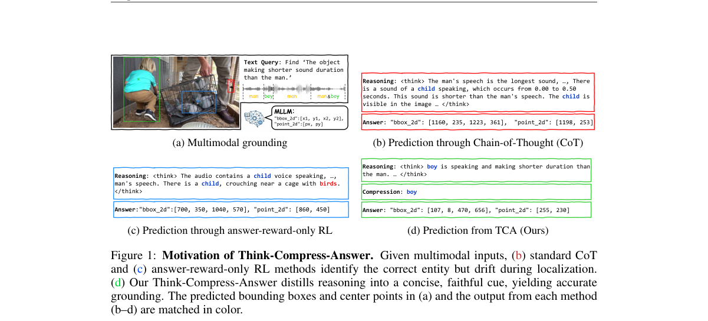

*Main result - Figure 2 Overview of Think-Compress-Answer. The model generates N grouped responses [T, c, a] per input. Stage 1 establishes the required output protocol, Stage 2 encourages reasoning compression, St*

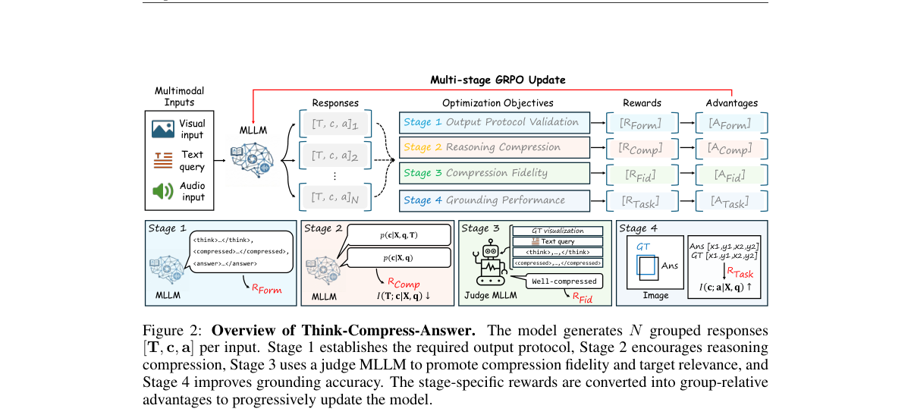

**Why this ranks #8**: 「推理越长反而越难定位」是一个反直觉的耦合。

---

### 9. Co-Evolving Policy and Reward for Code Generation: A Mechanistic Study of Single-Adapter Drift

**arXiv**: [2610.26416](https://arxiv.org/abs/2610.26416) | **Score**: 7.7 (relevance 8 x 0.7 + quality 7 x 0.3) | **Tags**: rlhf | **Categories**: cs.CL, cs.LG, cs.SE | **Pages**: 7

**Authors**: Amarsaikhan Batjargal, Noriko Tomuro

**Affiliation**: Jarvis College of Computing and Digital Media | DePaul University

**Abstract**

> Reinforcement learning with verifiable rewards (RLVR) is particularly well suited to code generation because generated programs can be objectively evaluated through execution. Execution also provides behavioral information that can be reused as additional supervision. The Synergistic Policy and Reward Co-Evolving Framework (SPARK), originally proposed for reasoning tasks, exploits this idea by recycling training rollouts and their evaluation results to train a model not only to generate solutions but also to evaluate and improve them. We investigate whether this policy-reward co-evolution approach transfers effectively to code generation and whether execution-grounded reflection provides an additional source of self-improvement. We compare SPARK-style rollout recycling with execution-only Group Relative Policy Optimization (GRPO) using Qwen2.5-Coder-3B-Instruct. Our results do not support either hypothesis under the configuration tested. Although co-evolution improves training performance, these gains do not generalize to held-out problems. Compared at the same stage of training, rollout recycling produces roughly 34x greater KL divergence from the reference policy than execution-only GRPO. Over training, trained tokens per GRPO sequence fall from 185 to 86 as training pass rate increases, while held-out performance declines or fails to sustain early gains. We characterize these patterns as single-adapter policy drift: the shared trainable parameters increasingly depart from pretrained code-generation behavior without corresponding gains in generalization. The results show that higher training reward alone is not evidence of generalizable code self-improvement and highlight the importance of held-out evaluation and drift diagnostics.

**Key findings**

- **Finding**: 代码生成的程序可被客观执行评估，执行还提供可复用的行为信息（摘要截断）。

- **Finding**: 该文对**单适配器漂移**做机制性研究（摘要在此处截断）。

- **Inference**: 「单适配器漂移」意味着策略与奖励共用一个适配器时二者会互相拉扯——这解释了为何代码 RL 常见「奖励模型一改策略就崩」的现象。

- **Recommendation**: 与本批 Co-Evolving Policy and Reward 配套的机制分析，值得读。

**Key figures**

*Framework / architecture - Figure 1 Execution-only GRPO vs. single-adapter rollout recycling. The blue path shows the shared execution-grounded GRPO loop used by both conditions: MBPP problems are sampled, the policy generates c*

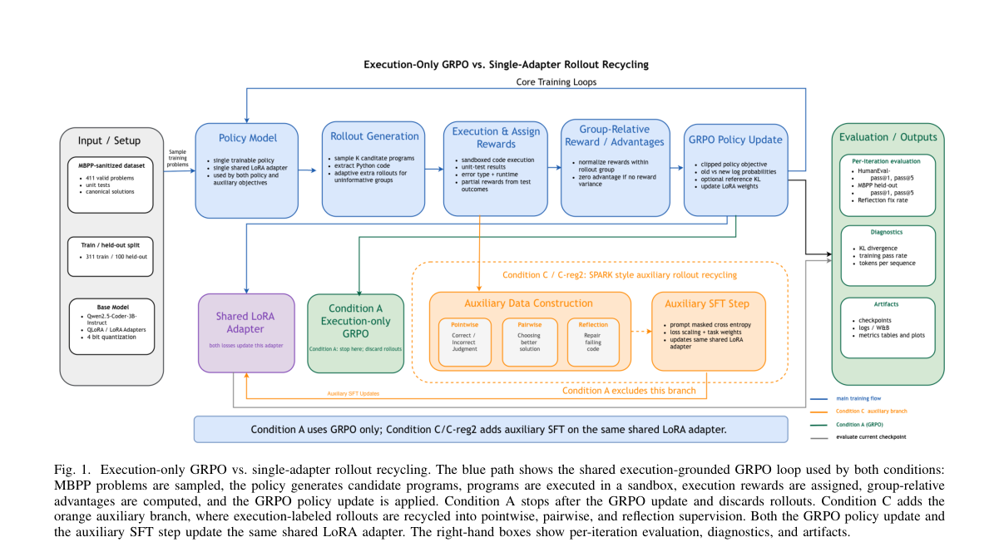

*Main result - Figure 2 Held-out benchmark trajectories. Condition A achieves the strongest HumanEval pass@1, while C-reg2 does not improve cross-benchmark gener- alization. Dashed lines mark the pretrained iteration*

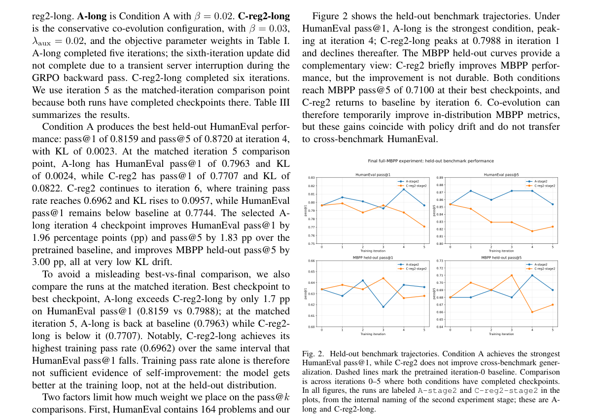

**Why this ranks #9**: 「执行即免费监督」是代码 RL 相对其他领域的独特优势。

---

### 10. Mitigating Reward Hacking in Preference Reward Models with Evolving Penalties

**arXiv**: [2610.26496](https://arxiv.org/abs/2610.26496) | **Score**: 7.3 (relevance 7 x 0.7 + quality 8 x 0.3) | **Tags**: rlhf | **Categories**: cs.AI, cs.CL | **Pages**: 24

**Authors**: Afonso Baldo, António Farinhas, Marcos Treviso, Ricardo Rei, Nuno M. Guerreiro

**Affiliation**: [not-found in PDF]

**Abstract**

> Reinforcement learning for language models has moved from preference reward models to verifiable rewards, which sustain much longer optimization. Preference models are prone to reward hacking: the policy raises their score without improving response quality, or even while degrading it. Yet for open-ended tasks, where quality can neither be verified nor fully written down as rubrics, they remain valuable. We introduce Dynalize, which mitigates reward hacking online, during policy training. Periodically and asynchronously, a language model analyzes training rollouts and writes penalties for undesirable behaviors that the reward model appears to reward; a judge applies them to every rollout. In clinical counseling and creative writing, training on the reward model alone raises its score continuously but ultimately leads to a decline in external benchmarks. Dynalize sustains longer training and results in improved downstream performance. For example, we find that our method suppresses patterns incentivized by preference models that, without penalties, spread to most responses, and even to the model's reasoning, which the reward model does not explicitly score. Furthermore, we show that its gains hold in multi-turn training, and even after we retrain the reward model on the discovered behaviors.

**Key findings**

- **Finding**: 偏好模型易被奖励攻击：策略抬高分数却不改善质量，甚至损害质量（摘要截断）。

- **Finding**: 该文用演化的惩罚项缓解（摘要在此处截断）。

- **Inference**: 奖励 hacking 的窗口随优化长度增长，因此可验证奖励虽然更抗 hack，也不是免疫——只是把攻击面从「分数」移到了「判据」。

- **Recommendation**: 与本批 Is it RL or Data? 的基线问题相关：若数据混难度贡献了大部分收益，奖励模型的影响面需要重新估计。

**Key figures**

*Framework / architecture - Figure 1 Overview of Dynalize. Full details in Section 3.*

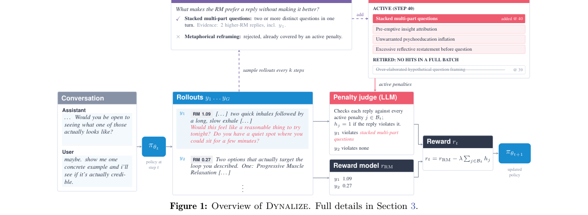

*Main result - Figure 2 RM score and benchmark score over training, for RM-only training and our method.*

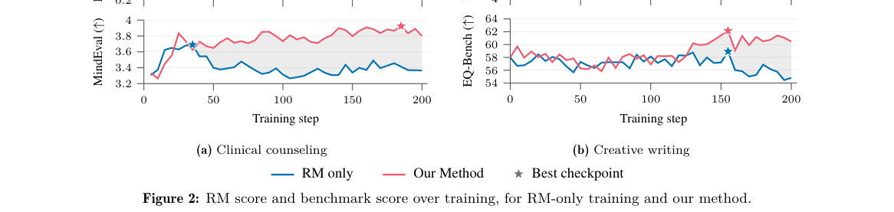

**Why this ranks #10**: 「更长的优化」与「更易被 hack」是同一枚硬币。

---

## Footer

- Total papers reviewed across all 5 tracks: 50 (from 525 scanned)
- rl track final top-10: 10
- Wild-cards in this track: 0
- Figure assets: `res/` (shared across tracks)

Generated by `mine-arxiv-daily-digest` skill. Sister file: `2026-10-20_rl_entry.md`.
