# ArXiv Daily Digest - 2026-10-21 (AIGC 音频生成与编辑, 10 papers)

**Generated**: 2026-10-21 17:00 CST

**Source**: arXiv cs.CV, cs.SD, eess.AS, cs.CL, cs.AI, cs.RO, cs.LG submissions, window 2026-10-20 UTC (latest announced batch as of 2026-10-21 17:00 CST)

**Track**: aigc_audio (top 10 of 501 papers scanned, 55 full reads)

**Scope**: local credit assignment for flow-matching TTS, generative speech separation with speech language models, unified end-to-end audio-visual editing without masks, differentiable Karplus-Strong physical modelling, audio deepfake detection over real call channels, polyphonic mixture-to-constituent alignment, efficient sound-design evaluation, Mamba audio classification, active noise control for AR glasses, respiratory sound domain-incremental learning

⚠️ **Wild-card**: 本批该线仅 4 篇严格命中，其余 6 篇为 wild-card 补足，已在正文逐条标注。

---

**这是本批最薄的一条线——501 篇里真正做音频生成/编辑的只有个位数，因此本篇 10 篇里有 6 篇是 wild-card，必须先说清楚。** 最实的一篇是 **LoCA**：它指出了 TTS 用 RL 时的真正痛点——句子级奖励定位不了局部错误，而有符号回归更新会导致对采样输出过度拟合或排斥；解法是用 ASR 对齐把内容错误定位到声学帧上再重分配优势，在 VoxCPM2 上把样本加权内容误差相对预训练骨干降 20.5%、相对 GROW 降 14.3%。

**SLM-SS** 把语音分离的目标从波形指标换到语义可懂度（用语音语言模型 + 量化神经编解码器）；**AVE (Edit in Sync)** 则是本批唯一真正做生成式编辑的音频相关工作——首个统一端到端的音视频编辑框架，**不需要空间掩码**，并附带 10 万对（外观 + 声音参考）数据集。去掉掩码这一点的意义比数据集本身更大，因为掩码正是把编辑降级成局部修补的根源。

**理论侧 Differentiable Karplus-Strong 给出了一个具体但关键的发现：标准频谱损失对起音时间不提供有意义的方向性梯度**，直接损害联合训练——这解释了为什么物理建模合成里的参数长期不可辨识。其余三篇 wild-card 分别站在溯源（RealComm：真实通话链路会显著破坏音频深伪检测）、表征（MiCLA：混合—成分关系被自监督忽略）与评测成本（游戏音效评测：只微调多模态编码器而非整个智能体）三个角度。

---

## Top 10 - AIGC 音频生成与编辑

### 1. LoCA: Local Credit Assignment for Reinforcement Learning of Autoregressive Flow-Matching TTS

**arXiv**: [2610.28035](https://arxiv.org/abs/2610.28035) | **Score**: 8.7 (relevance 9 x 0.7 + quality 8 x 0.3) | **Tags**: AIGC-audio, TTS, rl-algorithm | **Categories**: cs.SD | **Pages**: 10

**Authors**: Jie Liu, Junyu Zhou, Junhao Zhong, WeiSen Tang, Rukai Cai, Haoyue Zhan, Ruiqi Xing, Ling Long

**Affiliation**: Lingguang Zhaxian Technology, Shanghai, China

**Abstract**

> Reinforcement learning can improve text-to-speech synthesis through feedback on generated speech. However, sentence-level rewards do not identify local errors, while signed regression updates can lead to excessive fitting or repulsion of sampled outputs. We propose LoCA (Local Credit Assignment) for autoregressive flow-matching text-to-speech. LoCA uses ASR-based text alignment to locate content errors in generated speech and redistribute sentence-level advantages across acoustic frames. To improve training stability, we introduce reference-relative positive and negative thresholds that limit continued fitting and repulsion. Experiments on VoxCPM2 show that LoCA reduces sample-weighted content error on a multilingual CV3 evaluation subset by 20.5% and 14.3% relative to the pretrained backbone and GROW, respectively, while improving speaker similarity. LoCA also improves content accuracy on the Seed-TTS-Eval hard subset. Ablation results support the contributions of local credit and threshold-based regression control.

**Key findings**

- **Finding**: RL 可以通过生成语音的反馈改进 TTS，但**句子级奖励无法定位局部错误**，而有符号回归更新会导致对采样输出的过度拟合或排斥。

- **Finding**: LoCA 用 ASR 文本对齐在生成语音中定位内容错误，并把句子级优势重新分配到声学帧上。

- **Finding**: 为提升训练稳定性，引入参考相对的**正/负阈值**，限制持续的拟合与排斥。

- **Finding**: 在 VoxCPM2 上，LoCA 在多语言 CV3 评测子集上把样本加权内容误差相对预训练骨干降低 **20.5%**、相对 GROW 降低 **14.3%**，同时提升说话人相似度。

- **Finding**: 论文报告在 2000 步后仍保留困难集训练轨迹。

- **Inference**: 用 ASR 把「内容对不对」这个符号信号投影回帧级，等于给声学生成装了一个可定位的验收器——这比句级 MOS 奖励的信息密度高一个量级。

- **Recommendation**: 强烈推荐。本批音频线最实的一篇，且 RL × 生成 × 语音三者交叉。

**Key figures**

*Framework / architecture - Figure 1 Local-credit construction in an illustrative 12-frame example. Six unflagged and four error frames give mean label 0.6; two unknown tail frames are excluded. With local weight 0.2 and senten*

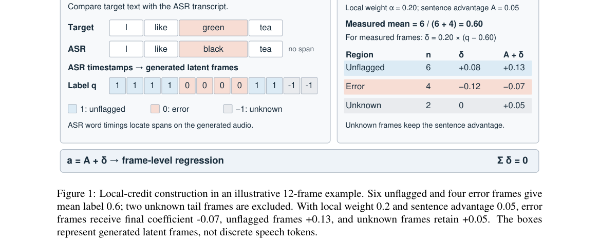

*Main result - Figure 2 retains the hard-set training trajectories through step 2000. CV3 hard combines the 60 Chi-*

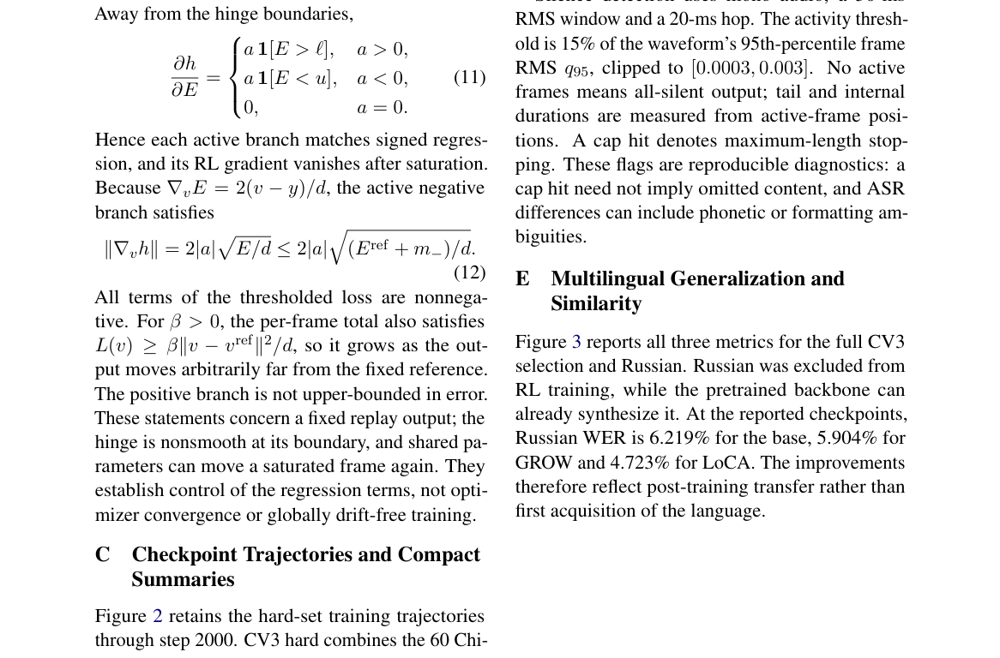

**Why this ranks #1**: 它解决的是音频生成 RL 里最实际的痛点——奖励太粗导致无法定位，且给出了量化的改进幅度。

---

### 2. SLM-SS: Token-Based Speech Separation with Speech Language Models

**arXiv**: [2610.27785](https://arxiv.org/abs/2610.27785) | **Score**: 8.5 (relevance 8.5 x 0.7 + quality 8.5 x 0.3) | **Tags**: AIGC-audio, speech-separation | **Categories**: cs.AI, cs.SD | **Pages**: 15

**Authors**: Chenda Li, Tianhua Li, Yiming Chen, Wei Wang, Jiahe Wang, Xin Zhou, Yanmin Qian

**Affiliation**: Acoustics Lab, Shanghai Jiao Tong University, Shanghai, 200240, P. R. China

**Abstract**

> Speech separation (SS) has witnessed substantial progress in recent years with the advent of neural network-based methods, achieving notable improvements on signal-level evaluation metrics. Existing speech separation systems are mostly optimized with signal-level objectives, and often yield outputs that are acceptable in waveform metrics but suboptimal for intelligibility-sensitive downstream tasks. To address this gap, we propose SLM-SS, a token-based generative speech separation framework that models multi-talker mixtures with speech language models. We first discretize clean speech into multi-codebook token sequences with neural codecs and serialize multi-speaker targets via Serialized Output Training (SOT). An encoder-decoder autoregressive speech language model predicts the zero-order sequence to establish speaker ordering and coarse linguistic content, and a non-autoregressive module then refines higher-order residual codebooks for efficient reconstruction. We further introduce a per-talker non-autoregressive strategy that simplifies high-order modeling and improves the stability. On Libri2Mix, SLM-SS with per-talker NAR achieves $6.92\%$ WER, approaching codec-only reconstruction. The WavTokenizer variant eliminates NAR refinement and achieves the highest mean subjective quality score among evaluated separation systems. Its UTMOS and DNSMOS advantages over discriminative baselines persist on unseen noisy and Chinese mixtures without fine-tuning.

**Key findings**

- **Finding**: 现有语音分离系统多以信号级目标优化，波形指标可接受但对**可懂度敏感的下游任务**往往次优。

- **Finding**: SLM-SS 提出基于 token 的生成式语音分离框架，用语音语言模型建模多说话人混合。

- **Finding**: 结合量化神经编解码器（EnCodec 多码本序列）提升分离语音的可懂度。

- **Finding**: 本文是其 ICASSP 2026 工作的扩展版。

- **Inference**: 把分离问题从「信号重建」迁移到「生成可懂语音」，本质上是把评价标准从波形指标换成了语义可懂度——这一步决定了它能不能进下游 ASR 管线。

- **Recommendation**: 推荐。

**Key figures**

*Framework / architecture - Figure 1 Structure of discriminative model and SLM model for speech separation.*

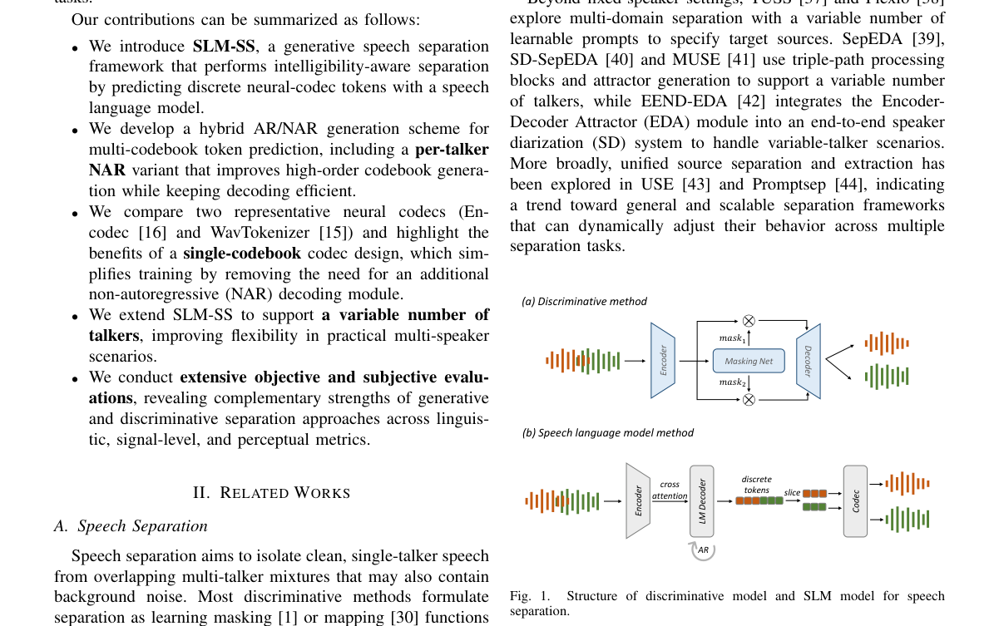

*Main result - Figure 2 Overview of SLM-SS. (a) Encodec quantizes single-talker audio into multi-codebook sequences, then merges them using SOT for the training label preparation. (b) The AR model predicts the zero-o*

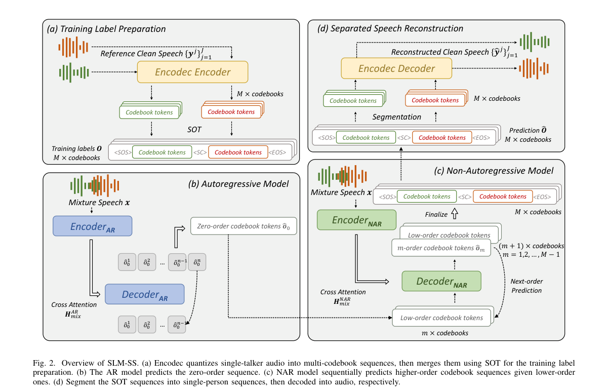

**Why this ranks #2**: 分离任务的目标函数终于对齐到了下游可懂度，而不是停留在波形指标。

---

### 3. Edit in Sync: Unified End-to-End Audio-Visual Editing for Human-Centric Videos

**arXiv**: [2610.27947](https://arxiv.org/abs/2610.27947) | **Score**: 8.25 (relevance 8 x 0.7 + quality 8.5 x 0.3) | **Tags**: AIGC-edit, audio-visual, dataset | **Categories**: cs.CV | **Pages**: 13

**Authors**: Ziye Yuan, Minghong Cai, Xu He, Ruchang Yao, Xiao Fu, Kaixin Ding, Ming Zhang, Xiangyu Du, Tianpeng Lan, Da Xie et al.

**Affiliation**: Peking University; The Chinese University of Hong Kong; Tsinghua University; National University of Defense Technology

**Abstract**

> Human-centric audio-visual editing requires precise alignment of lip movements, gestures, and expressions with speech. Existing methods process inputs through independent video and audio pipelines, preventing cross-modal interaction between visual editing and audio dubbing. Many of these pipelines further rely on mask-based inpainting. As a result, they suffer from poor lip-audio synchronization, cumulative pipeline errors, and an inherent mask-size dilemma. We present AVE, the first unified end-to-end framework that jointly performs reference-guided person swapping, insertion, and deletion across both audio and video modalities without requiring spatial masks. To overcome data scarcity, we design a synthesis pipeline and introduce AVE-Dataset, the first audio-visual editing dataset to provide 100K pairs with appearance and voice references. By combining Synthetic-to-Real reconstruction with preliminary audio warm-up, our framework transcends synthetic pipeline limits and mitigates audio-video token imbalance. AVE outperforms modality-separate audio-visual editing pipelines in editing realism, temporal consistency, and audio-visual alignment.

**Key findings**

- **Finding**: 面向人的音视频编辑要求唇动、手势、表情与语音精确对齐。

- **Finding**: 现有方法用**独立的视频与音频管线**处理输入，阻止了视觉编辑与音频配音之间的跨模态交互；且多依赖基于掩码的修补，导致唇音不同步、误差累积与掩码尺寸两难。

- **Finding**: AVE 是**首个统一的端到端框架**，同时做参考引导的人物替换、插入与删除，跨越音视频两个模态，且**不需要空间掩码**。

- **Finding**: 作者设计了合成管线并发布 AVE-Dataset——首个提供 10 万对（外观 + 声音参考）的音视频编辑数据集。

- **Finding**: 结合 Synthetic-to-Real 重建与初步音频预热，超越合成管线限制并缓解音视频 token 不平衡。

- **Inference**: 「去掉掩码」这一点的意义比数据集大：掩码是把编辑任务降级成局部修补的根源，一旦去掉，音频与视频就能在统一框架里联合生成。

- **Recommendation**: 推荐。

**Key figures**

*Framework / architecture - Figure 1 Overview of AVE across person swapping, insertion, and deletion. Appearance and voice references are provided for swapping and insertion, while deletion requires no reference.*

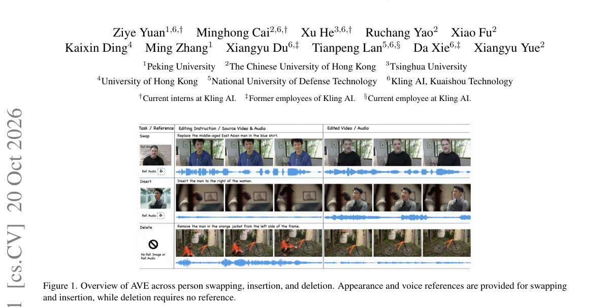

*Main result - Figure 2 Separate editing pipelines versus AVE*

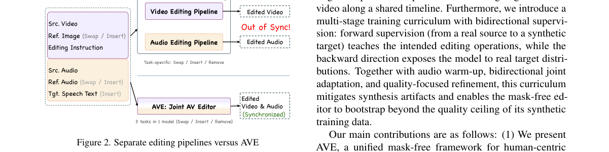

**Why this ranks #3**: 它是本批唯一真正做「生成式编辑」（而非检索式/局部修补）的音频相关工作，并附带一个 10 万对的数据集。

---

### 4. Sound Matching with a Differentiable Karplus-Strong Algorithm

**arXiv**: [2610.28043](https://arxiv.org/abs/2610.28043) | **Score**: 7.85 (relevance 7.5 x 0.7 + quality 8.5 x 0.3) | **Tags**: AIGC-audio, physical-modeling, sound-synthesis | **Categories**: eess.AS | **Pages**: 8

**Authors**: Pablo Tablas de Paula, David Marttila, Rodrigo Díaz, Irán Román, Emmanouil Benetos, Joshua D. Reiss

**Affiliation**: Queen Mary University Of London

**Abstract**

> We present a self-supervised, event-based sound matching model using a differentiable extended Karplus-Strong algorithm. To avoid relying on external onset and fundamental frequency detectors, we explore training methodologies combining parameter losses on synthetic data with audio losses. We demonstrate that time-domain fractional delay interpolation provides gradient accuracy comparable to frequency-sampling while avoiding time-aliasing in highly resonant time-varying scenarios. Through systematic gradient analysis, we reveal that standard spectral losses provide no meaningful directional gradients for onset times, heavily degrading joint training. Training exclusively with parameter losses on synthetic data effectively learns fundamental frequency, timbral parameters, and onset times, but struggles to generalise to monophonic studio recordings of plucked guitar. External detectors combined with audio losses generalise best, isolating the model to timbre optimisation. While our Karplus-Strong decoder recovers interpretable parameters and naturally captures the transient characteristics of plucked guitar, Harmonics plus Noise baselines yield higher reconstruction fidelity by most metrics.

**Key findings**

- **Finding**: 提出自监督、事件驱动的**可微分扩展 Karplus-Strong** 声音匹配模型。

- **Finding**: 为避免依赖外部起音与基频检测器，作者探索把合成数据上的参数损失与音频损失结合的训练方法。

- **Finding**: 证明时域分数延迟插值可提供与频域采样相当的梯度精度，同时避免高共振时变场景下的时间混叠。

- **Finding**: 通过系统的梯度分析揭示：**标准频谱损失对起音时间不提供有意义的方向性梯度**，严重损害联合训练。

- **Inference**: 「频谱损失对起音时间没有方向性梯度」是一个具体但关键的发现——它意味着经典频谱损失在物理建模合成里的参数不可辨识是系统性的，而不是调参问题。

- **Recommendation**: 推荐。做音频合成/物理建模的读者会直接受益。

**Key figures**

*Framework / architecture - Figure 1 An extended Karplus-Strong Algorithm.*

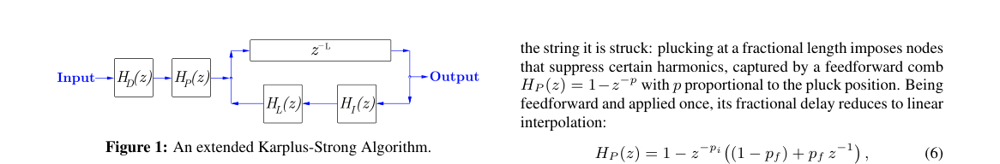

*Main result - Figure 2 Proposed sound matching pipeline. Dashed lines indicate optional paths defining our three training regimes: P-Only (end-to-end prediction trained with Ploss uniquely on Synth Data), P+Audio*

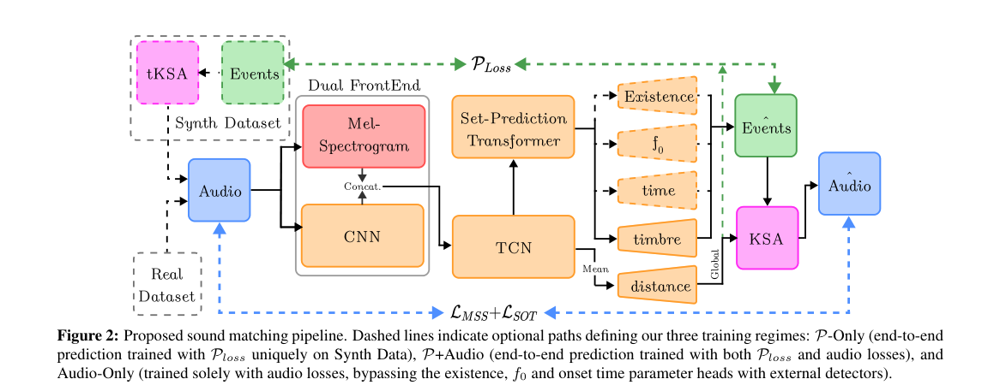

**Why this ranks #4**: 它指出了一个常被忽视的梯度层面的失效：频谱损失对起音时间「无梯度」，这直接决定了联合训练能不能成。

---

### 5. RealComm: Benchmarking and Adapting Audio Deepfake Detection over Real Communication Channels

**arXiv**: [2610.27459](https://arxiv.org/abs/2610.27459) | **Score**: 7.45 (relevance 7 x 0.7 + quality 8.5 x 0.3) | **Tags**: AIGC-audio, provenance, deepfake-detection | **Categories**: eess.AS | **Pages**: 12

**Authors**: Li Wang, Jindong Wang, Wan Lin, Kunyu Feng, Yufan Lin, Lei Wang, Rizhao Cai, Ce Fang, Jinzhe Xue, Jie Shi et al.

**Affiliation**: The Chinese University of Hong Kong, Shenzhen; Amphion Technology Co., Ltd; Huawei

**Abstract**

> Acoustic capture, device processing, and transmission coding in real calls jointly alter speech signals and may affect the reliability of audio deepfake detection. To systematically evaluate these effects, we introduce RealComm, a dataset pairing digital speech with recordings of the same utterances transmitted through real mobile calls. The acquisition design covers acoustic and wired injection, handset and speakerphone operation, and caller-side denoising, with bona fide and synthetic speech recorded under matched conditions. The dataset includes RealCommBench for evaluation and RealCommTrain for adaptation. We further develop RealComm-Aug, a staged waveform augmentation pipeline for simulating acquisition and transmission effects, and investigate its combination with real-call training. Experiments with existing detectors reveal substantial degradation after call transmission, even for models with strong digital-domain performance; acoustic injection is particularly challenging. Paired quality and spectral analyses show that quality degradation is associated with poorer detection across recording conditions for the evaluated detectors, while high-frequency attenuation alone does not explain detection difficulty. Simulated augmentation and real-call training provide complementary benefits, with their combination achieving the lowest call-domain error for each of three evaluated detectors. For Teffic-Audio, the equal error rate decreases from 37.94% to 22.37%. The demo and benchmark access information are provided through the project repository.

**Key findings**

- **Finding**: 真实通话中的声学采集、设备处理与传输编码会共同改变语音信号，可能影响音频深伪检测的可靠性。

- **Finding**: RealComm 提供配对数据集：同一语句的数字语音 + 经真实手机通话传输后的录音。

- **Finding**: 采集设计覆盖声学与有线注入、手机与免提操作、呼叫方降噪，并在匹配条件下录制真实与合成语音。

- **Finding**: 评测把检测器退化与**采集条件、语音质量**关联起来。

- **Inference**: 深伪检测器在实验室数字音频上的高分，常常只是没有经历真实信道。这篇把「信道条件」变成可控变量，方法论上比结论更重要。

- **Recommendation**: 推荐（作为溯源/检测方向的背景文献）。

**Key figures**

*Framework / architecture - Figure 1 RealComm acquisition and device partitions. The upper panel shows acoustic and wired injection into the caller, followed by a real mobile-call link and receiver-side recording. The lower panel*

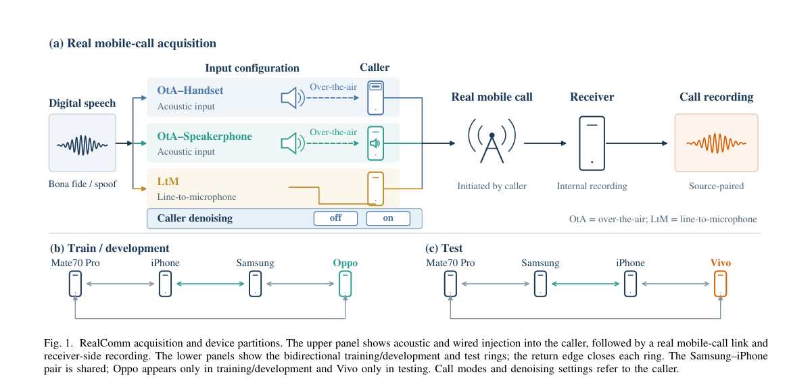

*Main result - Figure 2 Zero-shot EER (%, lower is better): (a) paired digital and call domains; (b) input configuration; (c) matched denoising off/on; (d) English (EN) and Mandarin (ZH) in both domains; (e,f) genera*

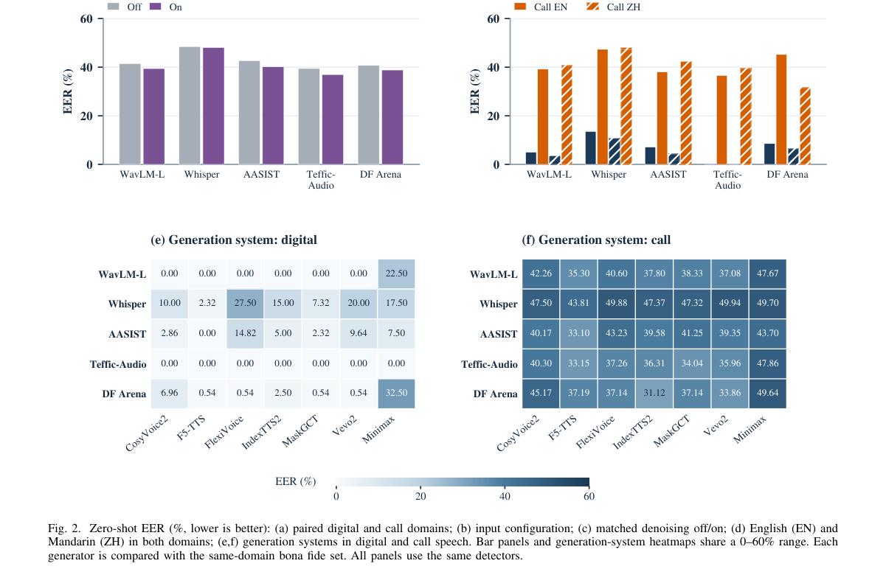

**Why this ranks #5**: Wild-card：生成侧工作，但它量化了「真实通话链路」对音频伪造检测的破坏程度，是本批音频线少见的、有明确失效边界的一篇。

---

### 6. MiCLA: Mixture-to-Constituent Latent Alignment for Polyphonic Audio Representation Learning

**arXiv**: [2610.27491](https://arxiv.org/abs/2610.27491) | **Score**: 7.3 (relevance 7 x 0.7 + quality 8 x 0.3) | **Tags**: AIGC-audio, representation-learning | **Categories**: cs.LG, cs.SD, stat.ML | **Pages**: 13

**Authors**: Kohei Yamamoto, Kosuke Okusa

**Affiliation**: Nippon Electric Industry Co., Ltd. (Saitama, Japan); Chuo University, Tokyo, Japan

**Abstract**

> Real-world audio typically contains concurrent sound events, yet standard self-supervised methods treat each clip as an isolated training unit without explicitly modeling mixture--constituent relationships. We propose Mixture-to-Constituent Latent Alignment (MiCLA), a two-stage self-supervised pre-training framework that uses synthetic log-mel mixing to align mixture representations with their constituent clips. Stage 1 structures single-clip representations via masked self-distillation and contrastive regularization. Stage 2 introduces bidirectional alignment: for a synthetic mixture, MiCLA suppresses the component aligned with one constituent and aligns the residual with the other, using projective residualization on patch tokens and sample-adaptive soft residualization on the global class token. In downstream evaluations, MiCLA achieves 43.2% mean average precision (mAP) on AS-20K and 50.3% mAP on AS-2M under fine-tuning, and achieves the highest mAP among evaluated models on both AudioSet settings under frozen Convex Gated Probing (CGP). Furthermore, a Joint Semantic Retrieval diagnostic shows that MiCLA improves simultaneous retrieval of both constituent classes over target-averaging baselines. These results indicate that directional mixture-to-constituent alignment provides an effective pre-training signal for polyphonic audio representation learning.

**Key findings**

- **Finding**: 真实音频通常包含并发声事件，而标准自监督方法把每个片段当作孤立训练单元，**不显式建模混合—成分关系**。

- **Finding**: MiCLA 是两阶段自监督预训练框架，用合成 log-mel 混合把混合片段的表示与其成分片段对齐。

- **Finding**: 阶段一用掩码自蒸馏与对比正则化构建单片段表示。

- **Finding**: 阶段二引入混合—成分隐空间对齐（双向）。

- **Inference**: 混合音频与成分音频在表示空间里被拉近，意味着模型把「混在一起的声音」和「各自的声音」视为同一件事的可分解版本——这对音频生成模型的 latent 空间设计有直接启发。

- **Recommendation**: 可选读（wild-card：偏表征学习而非生成）。

**Key figures**

*Framework / architecture - Figure 1 Constituent-side pre-training in Stage 1. Masked self-distillation optimizes ℓbase. Instance-level contrastive regularization ℓctr structures rep- resentations across masked views. Both object*

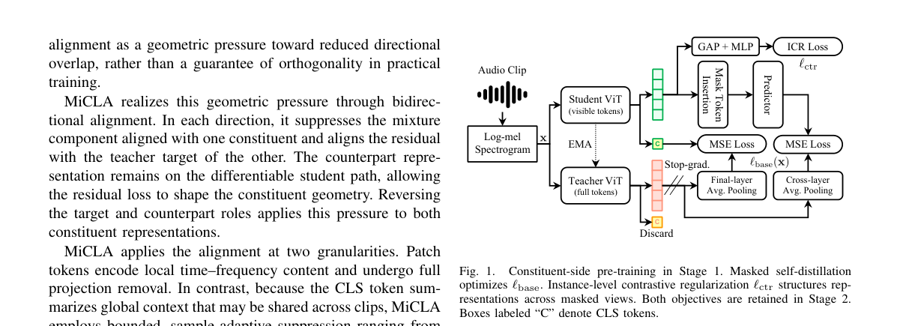

*Main result - Figure 2 Mixture-to-constituent latent alignment introduced in Stage 2. In each target–counterpart direction, MiCLA suppresses the mixture component aligned with the counterpart. The resulting residual*

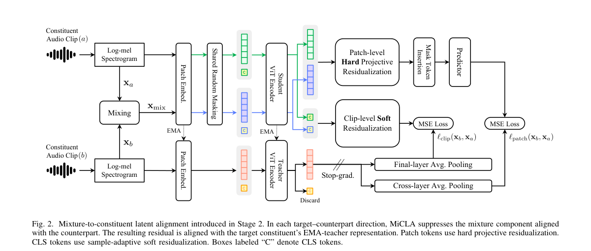

**Why this ranks #6**: Wild-card：不是生成工作，但它指出了真实音频「混合—成分」关系在自监督里被系统性忽略。

---

### 7. Reusing Multimodal Agents: Efficient Evaluation of Sound Designs in Games

**arXiv**: [2610.27670](https://arxiv.org/abs/2610.27670) | **Score**: 6.65 (relevance 6.5 x 0.7 + quality 7 x 0.3) | **Tags**: AIGC-audio, evaluation | **Categories**: cs.AI | **Pages**: 11

**Authors**: Thai Nguyen Van, Ibrahim Khan, Mury Fajar Dewantoro, Pratch Suntichaikul, Hai Van Pham, Ruck Thawonmas

**Affiliation**: Graduate School of Information Science and Engineering, Ritsumeikan University, Japan; College of Information Science and Engineering, Ritsumeikan University, Japan; School of Information and Communications Technology, Hanoi University of Science and Technology, Vietnam

**Abstract**

> This paper introduces a novel framework for efficiently evaluating in-game sound designs using multimodal learning and reinforcement learning. Sound design significantly influences gameplay and accessibility; however, objective evaluation methods, defined here as automated assessments based on agent performance rather than human ratings, often require retraining agents from scratch for each sound design. Our approach first pre-trains a multimodal encoder that encodes visual and auditory information into a shared latent space. A reinforcement learning agent is then trained using this latent representation. We fine-tune the multimodal encoder for each sound design while keeping the trained policy fixed, allowing us to isolate the effects of sound changes on agent behavior. To evaluate the proposed method, we conducted experiments on games from multiple genres, comparing the performance of blind agents (agents using only sound input) under various sound designs. Experimental results suggest that this approach can detect differences in agent performance caused by degraded or altered sound design. Moreover, we significantly reduce the computational cost compared to retraining the agent from scratch. Experimental results suggest that this approach provides a practical and scalable solution for evaluating in-game sound designs. The source code, data and supplementary document are available: https://github.com/thainv0212/tog-reusing-agents.

**Key findings**

- **Finding**: 游戏内音效显著影响玩法与可访问性；客观评测方法（基于智能体表现的自动评估）往往需要为每种音效设计**从零重训智能体**。

- **Finding**: 作者先预训练一个把视觉与听觉信息编码到共享隐空间的多模态编码器。

- **Finding**: 提出两阶段评估框架，把**音效特征抽取与策略训练解耦**。

- **Finding**: 通过把音效设计敏感性与策略网络解耦，免去每次设计迭代的昂贵重训；并证明只微调多模态编码器（而非整个智能体）即可捕捉音效质量差异。

- **Inference**: 「评测成本」和「被评测对象」被解耦，是一条通用思路——把评测器里与待测项无关的部分冻结，是多模态评测里少被采用但很有效的设计。

- **Recommendation**: 可选读（wild-card）。

**Key figures**

*Framework / architecture - Figure 1 Our method pipeline and agent evaluation setting. Only audio is used in the blind setting, while both images and audio are used for the standard setting.*

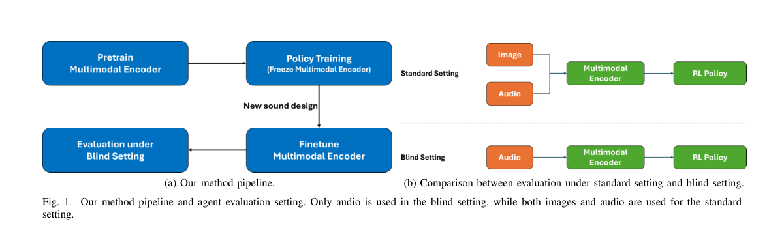

*Main result - Figure 2 Blind Agent Architecture. Audio input is processed by a multimodal encoder to extract latent features, which the RL policy uses to output an action.*

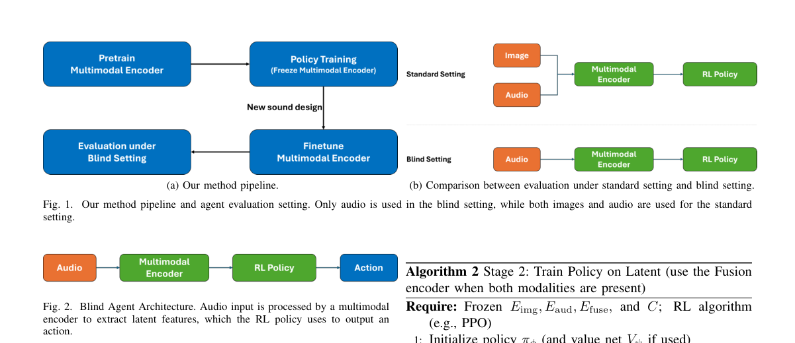

**Why this ranks #7**: Wild-card：与生成关系较远，但「只微调编码器而非整个智能体」这个结论本身对多模态评测设计有普遍价值。

---

### 8. AD-Mamba: Architecture-Complementary Knowledge Distillation for Efficient and Robust Audio Classification

**arXiv**: [2610.27713](https://arxiv.org/abs/2610.27713) | **Score**: 6.45 (relevance 6 x 0.7 + quality 7.5 x 0.3) | **Tags**: AIGC-audio, architecture, efficiency | **Categories**: eess.AS | **Pages**: 13

**Authors**: Junyu Wang, Tianrui Wang, Meng Ge, Longbiao Wang, Xiaobao Wang, Jianwu Dang

**Affiliation**: Tianjin University, College of Intelligence and Computing; Saw Swee Hock School of Public Health, National University of Singapore

**Abstract**

> Recent advancements in large-scale audio classification have been primarily driven by Transformer-based architectures due to their strong capacity in modeling long-range dependencies. However, their inherent quadratic complexity limits scalability and efficiency, especially when processing long or sparsely informative audio streams. Mamba, a recently proposed state space model (SSM), offers a promising alternative by enabling efficient long-range modeling with linear sequence scaling. Nevertheless, existing Mamba-based audio classification methods still lag behind mainstream Transformer-based models, suggesting that effective training strategies for fully exploiting the audio modeling potential of SSMs remain underexplored. To address this issue, we propose AD-Mamba, an architecture-complementary multi-stage knowledge distillation framework that transfers the local modeling strength of CNNs and the global contextual modeling capability of Transformers into a Mamba-based student model. Specifically, the CNN-guided stages encourage the student to adapt to local spectro-temporal structures, while the Transformer-guided stage further refines global semantic discrimination and contextual modeling. Experimental results on AudioSet show that AD-Mamba achieves 50.3% mean average precision (mAP) with only 30M parameters, outperforming representative Transformer-based and Mamba-based audio classification baselines with lower computational cost. Further evaluations under long-form audio, sparse-information, and noise-interference conditions show that AD-Mamba consistently outperforms representative CNN and Transformer baselines. When transferred to FSD50K, ESC-50, and DCASE16, the proposed model also achieves superior performance, demonstrating strong generalization across audio classification tasks.

**Key findings**

- **Finding**: 大规模音频分类主要由 Transformer 架构驱动，但其二次复杂度限制了长/稀疏音频流的可扩展性。

- **Finding**: Mamba（SSM）以线性序列扩展提供长程建模。

- **Finding**: AD-Mamba 提出**架构互补的多阶段知识蒸馏**框架，把 CNN 的局部建模强度与 Transformer 的全局上下文建模能力迁移到 Mamba 学生模型。

- **Finding**: 在 AudioSet 上以仅 30M 参数达到 50.3% mAP，超过 CED（86M）与 ASDA（93M）等 Transformer SOTA。

- **Inference**: 「把两种架构的优势蒸进第三种」这套打法在音频分类上被验证有效；30M 打到 50.3% mAP 说明当前音频骨干的效率空间还很大。

- **Recommendation**: 可选读（wild-card：分类而非生成）。

**Key figures**

*Framework / architecture - Figure 1 Illustration of the complementary teacher architectures used in our distillation framework. (a) The CNN-based teacher model adopts a dynamic CNN backbone composed of 15 inverted residual (IR)*

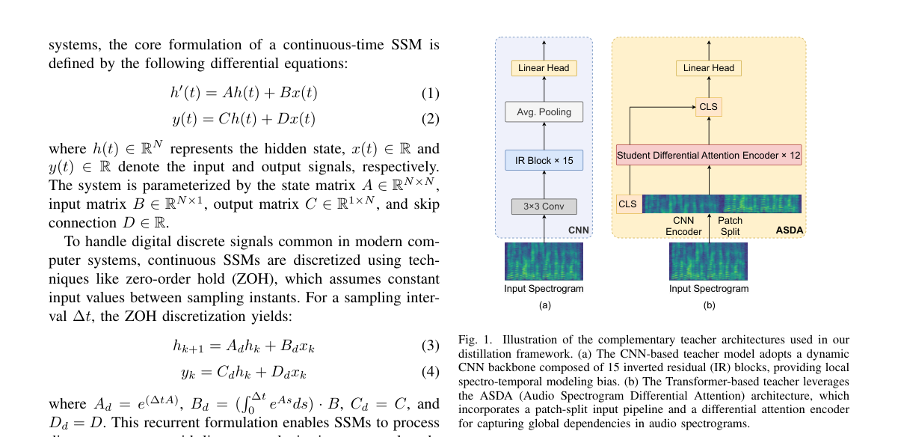

*Main result - Figure 2 Overview of the proposed AD-Mamba architecture for audio spectrogram classification. The model progressively extracts multi-scale spectro-temporal representations through patch embedding, stac*

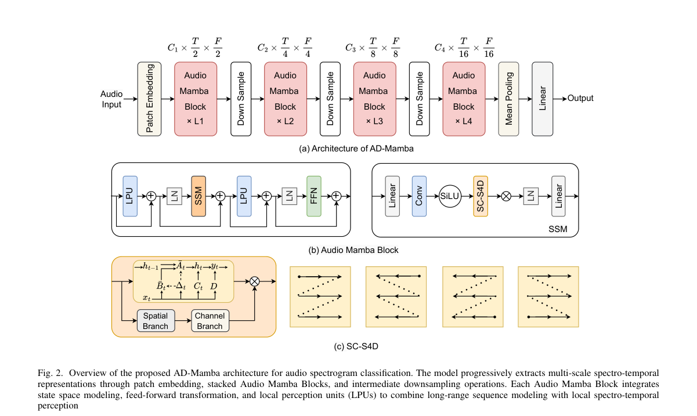

**Why this ranks #8**: Wild-card：与生成无关，但给出了音频骨干「效率—精度」权衡的一个具体参照点。

---

### 9. Active Noise Control for Augmented Reality Glasses using Virtual Sensing with Directional Robustness

**arXiv**: [2610.28263](https://arxiv.org/abs/2610.28263) | **Score**: 6.0 (relevance 5.5 x 0.7 + quality 7.5 x 0.3) | **Tags**: AIGC-audio, signal-processing, hardware | **Categories**: eess.AS | **Pages**: 5

**Authors**: Nitay Peled, Boaz Rafaely

**Affiliation**: School of Electrical and Computer Engineering; Ben-Gurion University of the Negev

**Abstract**

> Active noise control (ANC) is an established technique for mitigating acoustic noise, successfully implemented in various commercial applications. However, the application of ANC to augmented reality (AR) glasses remains an emerging area, where a key challenge is the lack of a microphone at the user's ear. This paper first validates the necessity of virtual sensing techniques for this specific geometry and investigates the Auxiliary Filter (AF) method as a potential solution. We present a theoretical analysis of the method's directional sensitivity, enabling the prediction of the system's robustness when the noise direction deviates from the calibration angle. Simulation results confirm that while a fixed AF is effective under matched conditions, it suffers significant degradation under mismatch, consistent with the theoretical predictions. To address this limitation, we propose and evaluate a solution using a finite bank of auxiliary filters that are selected based on the noise source direction of arrival. The results demonstrate that this filter bank approach significantly recovers performance compared to a fixed filter, offering a practical alternative to continuous recalibration in dynamic acoustic environments.

**Key findings**

- **Finding**: ANC 已商用，但用于 AR 眼镜仍是新兴领域，关键挑战是**用户耳边没有麦克风**。

- **Finding**: 论文首先验证了针对该几何结构使用虚拟感知技术的必要性，并考察辅助滤波器（AF）方法作为解决方案。

- **Finding**: 给出方法的**方向敏感性**理论分析，可预测噪声方向偏离标定角时系统的鲁棒性。

- **Finding**: 提出用有限数量的辅助滤波器组，按噪声源到达方向进行选择。

- **Inference**: 这是本批唯一一篇把「音频」当作物理信号处理的论文，离生成很远；保留它是因为 AR 眼镜是当下语音交互终端的现实形态，其麦克风布局会反过来约束前端算法。

- **Recommendation**: 可选读（wild-card：信号处理）。

**Key figures**

*Framework / architecture - Figure 1 Block diagram of the ANC system including the AF.*

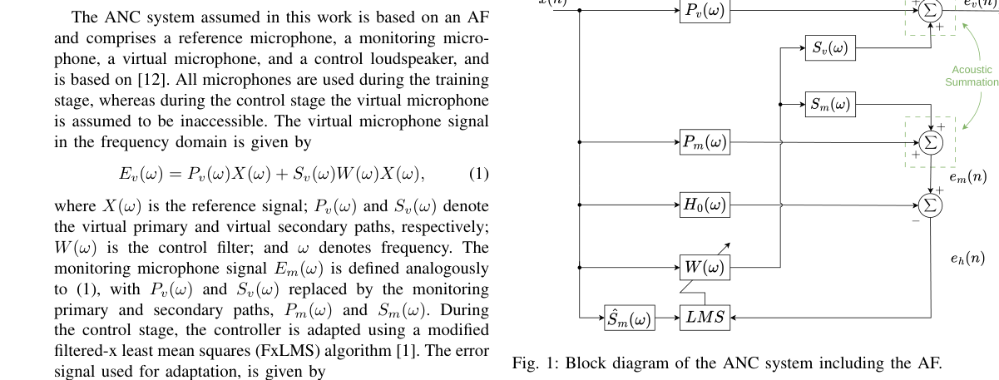

*Main result - Figure 2 AR glasses setup illustrating the positions of the micro- phones, along with the primary and secondary sources. This arrangement is used throughout the analysis and simulations.*

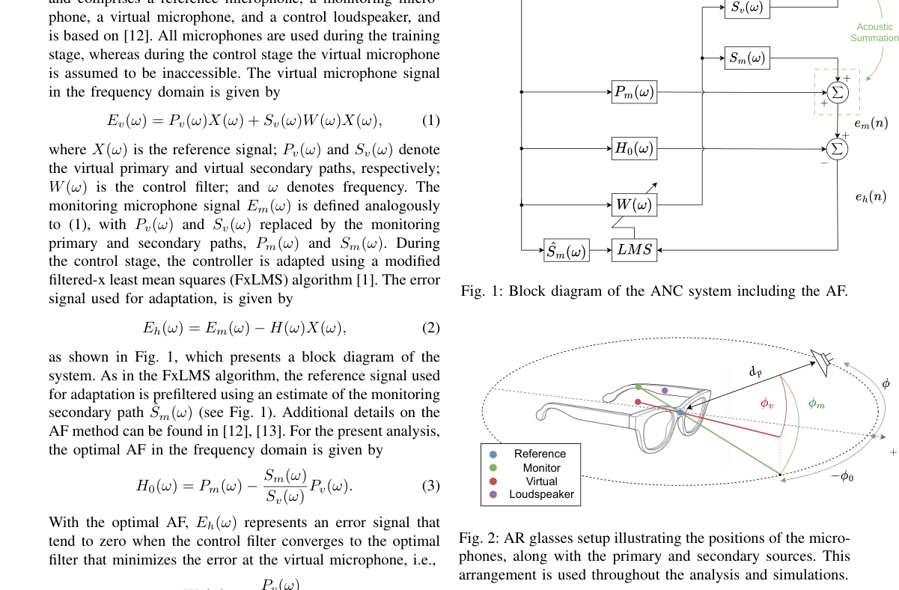

**Why this ranks #9**: Wild-card：明确不在生成/理解/RL 范围内，仅作硬件侧约束的注脚保留。

---

### 10. APRIL: Ambiguity-Aware Expert Routing for Respiratory Sound Domain-Incremental Learning

**arXiv**: [2610.27942](https://arxiv.org/abs/2610.27942) | **Score**: 5.8 (relevance 5.5 x 0.7 + quality 7 x 0.3) | **Tags**: AIGC-audio, continual-learning, vertical | **Categories**: cs.AI, cs.SD | **Pages**: 15

**Authors**: Xinhong Li, Weiping Tu

**Affiliation**: School of Computer Science, Wuhan University, Wuhan, Hubei, China

**Abstract**

> Automated respiratory sound classification enables continuous, non-invasive respiratory assessment, yet long-term deployment remains challenging due to domain shifts from evolving recording devices and acquisition periods. When privacy and governance regulations prohibit replaying historical data, sequential learning easily overwrites previously acquired knowledge. Preserving dedicated domain experts prevents parameter interference, but selecting the correct expert at inference is difficult under overlapping acoustic distributions and absent domain labels. To resolve this dilemma, we propose APRIL, an exemplar-free domain-incremental framework for RSC. Built on a shared frozen BEATs backbone, APRIL sequentially inherits and isolates low-rank experts to enable new-domain adaptation without altering earlier models. A multi-level prototype router retrieves the top-two candidate experts and dynamically selects the final model by integrating domain-routing posteriors with classification confidence, adaptively weighted by matching ambiguity. We establish standardized device- and temporal-incremental benchmarks on the ICBHI and SPRSound datasets across forward and reversed domain orders. Evaluated over five random seeds, APRIL consistently achieves the highest final-session average Score among compared continual learning approaches, reaching 64.4% and 65.4% on ICBHI, and 83.1% and 82.2% on SPRSound under forward and reversed sequences, respectively. Crucially, average forgetting remains under 1.0% across all protocols, demonstrating robust domain adaptation and long-term knowledge retention without data replay. Overall, APRIL offers a reliable and privacy-preserving paradigm for deploying continuous respiratory sound classification across real-world healthcare settings.

**Key findings**

- **Finding**: 呼吸音分类用于持续无创评估，但长期部署受设备与采集时期变化带来的域漂移挑战。

- **Finding**: 当隐私与治理法规禁止重放历史数据时，顺序学习容易覆盖已获得的知识。

- **Finding**: 保留各领域专属专家可避免参数干扰，但在声学条件重叠时难以在推理时选对专家。

- **Finding**: APRIL 是**无样本（exemplar-free）**的域增量框架：继承式初始化重用先前的呼吸音知识，隔离的 LoRA–分类器专家允许新域适配而不改动旧专家；并提出结合多层域匹配与分类置信度的**歧义感知专家选择**策略。

- **Inference**: 「歧义感知的选择」是这个框架真正的难点所在——当两个域 acoustically 重叠时选错专家，比遗忘本身更致命；把它显式建模是务实的。

- **Recommendation**: 可选读（wild-card：垂直应用）。

**Key figures**

*Framework / architecture - Figure 1 Catastrophic forgetting under sequential fine-tuning. Each curve reports the Score on a previously learned domain after successive domain updates. Lines and shaded regions denote the mean an*

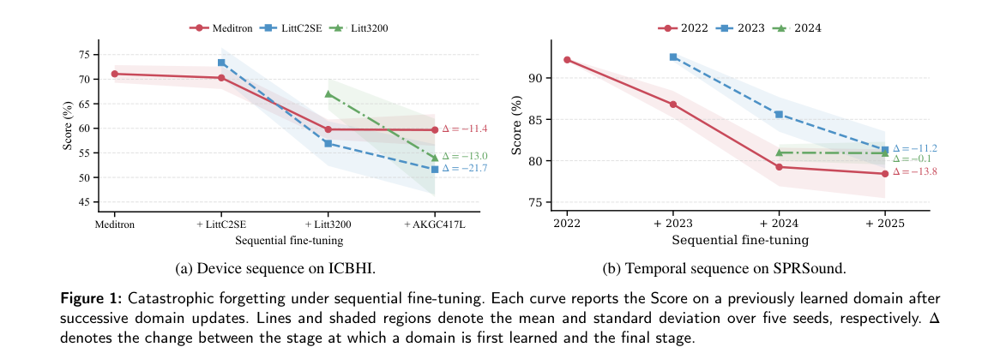

*Main result - Figure 2 Overview of APRIL. Each new domain expert inherits the preceding expert’s LoRA adapter and classification head, while the shared backbone and earlier experts remain frozen. During inference,*

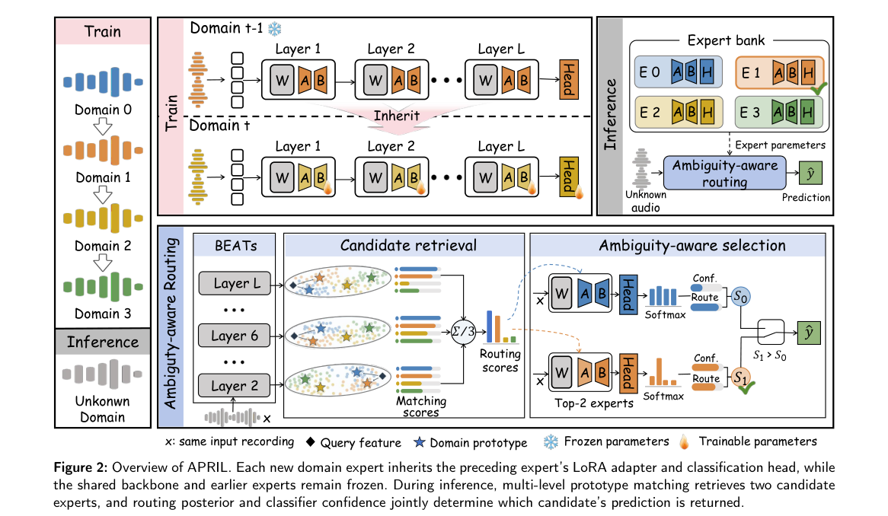

**Why this ranks #10**: Wild-card：垂直医疗应用，不在生成/理解线内；保留是因为「专家选择比参数保护更难」这个观察有普遍性。

---

## Footer

- Total papers reviewed across all 5 tracks: 50 (from 501 scanned)
- aigc_audio track final top-10: 10
- Wild-cards in this track: 6
- Figure assets: `res/` (shared across tracks)

Generated by `mine-arxiv-daily-digest` skill. Sister file: `2026-10-21_aigc_audio_entry.md`.
