# ArXiv Daily Digest - 2026-10-21 (AIGC 图像/视频/3D 生成与编辑, 10 papers)

**Generated**: 2026-10-21 17:00 CST

**Source**: arXiv cs.CV, cs.SD, eess.AS, cs.CL, cs.AI, cs.RO, cs.LG submissions, window 2026-10-20 UTC (latest announced batch as of 2026-10-21 17:00 CST)

**Track**: aigc_visual (top 10 of 517 papers scanned, 93 full reads)

**Scope**: multi-view video world model with point-trajectory supervision, continual concept personalization in residual space, interactive streaming video benchmark, long-video memory tokens, conditioning-as-program in diffusion, code-based video generation benchmark, latent-to-4DGS unification, hidden-concept recovery in T2I, calibrated KV-cache compression, learned token routing in DiT

---

**本批 AIGC 视觉线的重心明显偏向评测与审计，而不是又一个更大的生成模型。** StreamEval 用 300 个脚本化用例评测 37 个交互式视频生成模型，得到一个反直觉结论：高视觉质量与身份保持**并不必然**伴随可靠的请求执行与持续的状态一致性。Code2Video-Compass 把代码驱动的视频生成（T2V/I2V/V2V）摆上 12 项客观 + 5 项主观的双层评测台。

**生成方法侧有三个值得注意的取向。** 第一是 **VPM**：把持久场景点的 3D 轨迹与未来视频**并列**预测，用点监督逼出跨视角几何一致性——这比「多一个辅助任务」要硬，因为点轨迹无法靠外观蒙混。第二是 **Dancing Diffusion**：把条件从「全程恒定」改成「沿去噪轨迹分布的程序」，让编辑第一次有了「操作」的粒度（「先换背景，再让人转过来」）。第三是 **ReCam**：「粗读不需要粗表示」——长视频的记忆开销被拆成「存得细、读得少」。

**另外两篇把长期被默认的设定摆到台面上。** Continual Concept Personalization 明确假设概念是**顺序到达**的（而非一次性给全），并用残差空间承载每个概念，使「不遗忘」变成一个可判定的覆盖问题；SplatFlux 把 4D 重建与 4D 生成统一为同一个 latent-to-4DGS 解码问题，并强调静态-动态解耦必须是**显式**的。工程侧的 CALM 把「所有层用同一个合并比例」这个拍脑袋做法替换成可离线标定的分配问题；MoDDiT 则把「图像是稀疏的」这一被 DiT 丢掉的先验，落成了可学习的 token 路由。

---

## Top 10 - AIGC 图像/视频/3D 生成与编辑

### 1. Learning the 4D World through Point Trajectory Forecasting

**arXiv**: [2610.28594](https://arxiv.org/abs/2610.28594) | **Score**: 9.0 (relevance 9.0 x 0.7 + quality 9.0 x 0.3) | **Tags**: AIGC-video, world-model | **Categories**: cs.CV | **Pages**: 43

**Authors**: Byungwoo Jeon, Sunghwan Hong, Dohyeon Kim, Jonghoon Lee, Jungwoo Park, Inhee Lee, Doosan Baek, Jinil Kim, Taehyun Lim, Hanbyul Joo et al.

**Affiliation**: KAIST; Seoul National University; New York University

**Abstract**

> Reliable multi-view forecasting requires videos from different cameras to describe the same evolving 3D scene. To this end, we introduce Video-Point Model (VPM), a world model that conditions on multi-view video histories and a language instruction to jointly forecast future videos from arbitrary viewpoints and the 3D trajectories of persistent scene points. We extend a pretrained world model with camera-conditioned multi-view processing that integrates complementary observations across cameras, and add a trajectory head that predicts how physical points move through time. Each trajectory tracks a single point across all views, and supervising these trajectories alongside video generation therefore anchors appearance changes in every camera to a shared description of 3D motion. To support training and evaluation, we build VPM-Data, a simulation corpus pairing synchronized multi-view videos with persistent point trajectories, and VP-WorldBench, a forecasting benchmark spanning simulated and real environments. We further extend VPM to robot control by adding robot actions as a token modality in the generator. Action tokens share the point-supervised backbone and are denoised jointly with future videos, thereby grounding the policy in the same 3D-aware representation. On VP-WorldBench and existing 4D generation benchmarks, point supervision improves both video fidelity and 3D motion accuracy over a video-only counterpart, and in simulated and real-robot experiments, it also raises the manipulation success of the action-enabled model.

**Key findings**

- **Finding**: VPM 以「多视角视频历史 + 语言指令」为条件，同时预测未来视频与持久场景点的 3D 轨迹。

- **Finding**: 它在预训练世界模型上加了相机条件化的多视角处理，用跨相机的互补观测做融合。

- **Finding**: 作者构建 VPM-Data（同步多视角视频 + 持久点轨迹）与 VP-WorldBench（仿真 + 真实环境）。

- **Finding**: 论文明确指出点监督（point supervision）能提升视觉预测质量。

- **Inference**: 视频世界模型的瓶颈不是「能不能生成下一帧」，而是「能不能保持跨视角的几何一致性」——把 3D 点轨迹作为与视频并列的预测目标，等于给模型一个无法靠外观蒙混过关的监督信号。

- **Recommendation**: 强烈推荐。它同时命中视频生成与世界模型两条线，是本批「预测式视频模型」的代表作。

**Key figures**

*Framework / architecture - Figure 1 Teaser. We introduce simulated and real-world multi-view videos paired with 3D point tracks (left), jointly forecast future videos and point trajectories (center), and show that point super-*

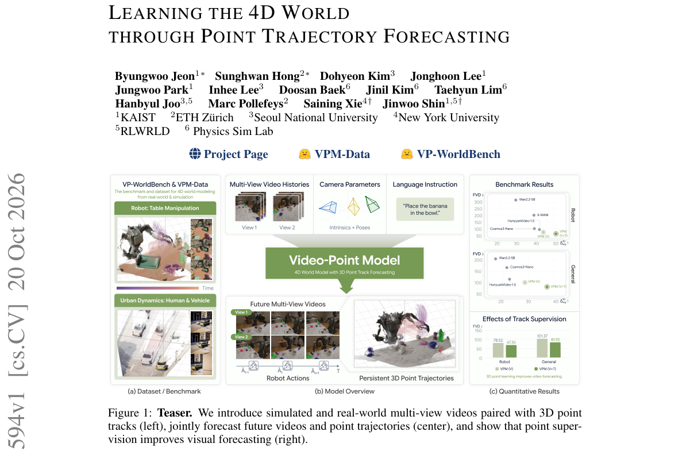

*Main result - Figure 2 Overview of VPM. From posed multi-view histories and a task instruction, VPM forecasts future videos and the trajectories of points queried from observed frames. The 3D point tracker iterati*

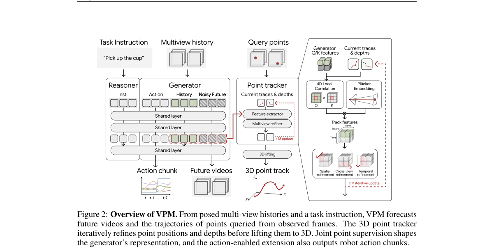

**Why this ranks #1**: 本批唯一同时给出多视角视频预测与 3D 点轨迹联合监督的代表作，把「几何一致性」从后处理变成了训练目标。

---

### 2. Continual Concept Personalization in Diffusion Models via Residual-Space Adaptation

**arXiv**: [2610.28567](https://arxiv.org/abs/2610.28567) | **Score**: 9.0 (relevance 9.0 x 0.7 + quality 9.0 x 0.3) | **Tags**: AIGC-image, personalization | **Categories**: cs.CV, cs.LG | **Pages**: 23

**Authors**: Yuzhi Liu, Enis Simsar, Giulia Lanzillotta, Thomas Hofmann

**Affiliation**: ETH Zurich

**Abstract**

> Text-to-image personalization aims to equip pretrained diffusion models with the ability to learn user-specific concepts from only a few reference images. Existing methods, however, typically train each concept independently or assume that all concepts are available simultaneously. In practical applications, concepts often arrive sequentially, requiring models to continually learn new subjects, objects, or styles while minimizing interference with previously acquired concepts. We address this continual concept personalization setting by extending residual-space adaptation to the stochastic adaptation process of pretrained diffusion models. Our work achieves the highest concept fidelity among competing continual personalization methods while maintaining near-zero forgetting. Beyond these empirical gains, the learned residual-space dynamics reveal where adaptation capacity is concentrated within the diffusion model. Restricting adaptation to the identified layers by our method preserves nearly the same performance while reducing the number of trainable parameters by up to 72\%, demonstrating that residual-space dynamics can identify the layers that contribute most to continual concept personalization and directly guide more parameter-efficient adaptation.

**Key findings**

- **Finding**: 现有个性化方法通常独立训练每个概念，或假设所有概念同时可用。

- **Finding**: 实际应用中概念是**顺序到达**的，模型需持续学习新主体/物体/风格，同时尽量不干扰已学概念。

- **Finding**: 本文把「残差空间适配」（residual-space adaptation）扩展到随机扩散模型，用于持续概念个性化。

- **Finding**: 作者给出最近邻检索的定性分析，用以支撑残差空间的判别性。

- **Inference**: 持续个性化是「个性化 + 遗忘」两个问题的合体；把残差空间当作概念的唯一载体，使得「记住旧概念」退化成「在残差空间里不被覆盖」——这是一个相当干净的形式化。

- **Recommendation**: 推荐。个性化方向里少见的、把场景设定（概念到达顺序）讲清楚的工作。

**Key figures**

*Framework / architecture - Figure 1 Nearest-neighbor retrieval for one reference image across embedding spaces. Red frames indicate retrieved images that belong to a different concept than the query.*

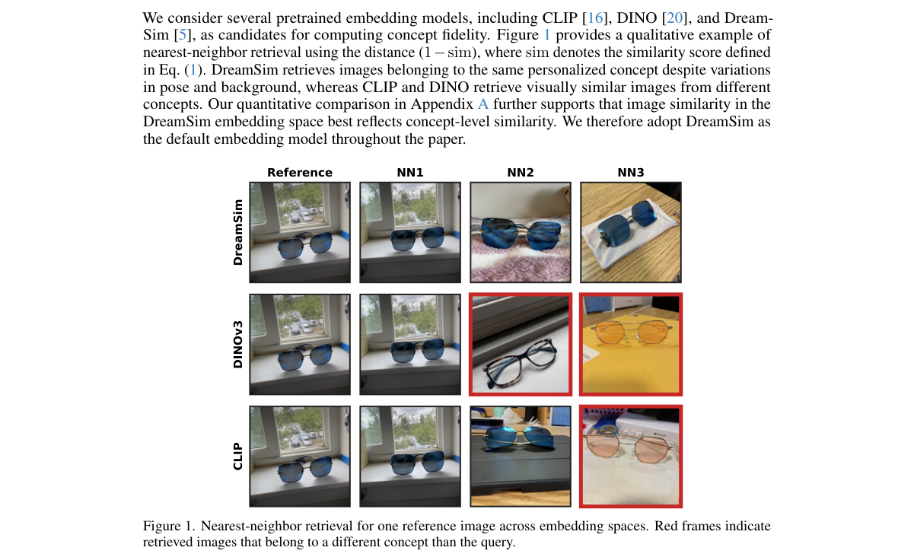

*Main result - Figure 2 Qualitative results for concept 14 (pet dog2).*

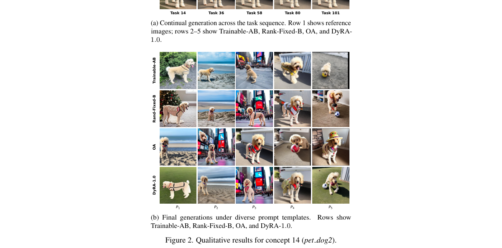

**Why this ranks #2**: 持续学习设定被明确写出来——概念是顺序到达的，这比大多数「一次训 N 个概念」的工作更贴近真实部署。

---

### 3. StreamEval: Evaluating Interactive Streaming Video Generation Models

**arXiv**: [2610.28402](https://arxiv.org/abs/2610.28402) | **Score**: 9.0 (relevance 9.0 x 0.7 + quality 9.0 x 0.3) | **Tags**: AIGC-video, benchmark | **Categories**: cs.CV | **Pages**: 22

**Authors**: StreamEval Team

**Affiliation**: Tsinghua University; NVIDIA; CMU; UC Berkeley

**Abstract**

> As streaming video generation advances, enabling real-time interaction with generated video is becoming increasingly important. We introduce StreamEval, a unified benchmark for interactive streaming video generation spanning five tasks: avatar dialogue, avatar performance, world generation, instruction editing, and reference editing. StreamEval comprises 300 scripted test cases lasting 15-300s, each specifying initial assets, incrementally arriving multimodal requests, and explicit requirements for state changes and content preservation. Performance is assessed along four evaluation dimensions: task execution, state consistency, visual fidelity, and audiovisual coordination, instantiated through ten task-specific metrics on a 0-100 scale. Evaluating 37 distinct models across 300 test cases, we find that high visual quality and identity retention do not necessarily coincide with reliable request execution or sustained state consistency. In particular, request execution remains challenging: the highest task-specific scores are 36.90 for Following among seven avatar-performance models, 25.93 for Following in text-conditioned world generation, and 15.00 for Edit Success among three reported reference-editing models. These findings identify reliable request execution under timing and preservation constraints as a central challenge for advancing omni-modal real-time interactive systems. The leaderboard is available at https://streameval.ai

**Key findings**

- **Finding**: 统一评测基准，覆盖五类任务：avatar dialogue、avatar performance、world generation、instruction editing、reference editing。

- **Finding**: 300 个脚本化测试用例，时长 15–300 秒，每个用例指定初始资产、增量到达的多模态请求，以及对状态变化的明确要求。

- **Finding**: 评测了 **37 个不同模型**。

- **Finding**: 关键发现：**高视觉质量与身份保持并不必然伴随可靠的请求执行或持续的状态一致性**。

- **Inference**: 交互式视频生成的评测此前被「画质」绑架，而真正难的恰恰是「按指令改变状态」且「状态不漂移」——这两件事与画质几乎正交。

- **Recommendation**: 强烈推荐。与前几天的 AR 视频缓存/预测时程线索合看，是「交互式视频」这条线最该读的一篇。

**Key figures**

*Framework / architecture - Figure 1 StreamEval overview. Five tasks span avatar interaction, world generation, and real-time video editing. Avatar panels show recorded frames; the world-generation panel illustrates a scenario.*

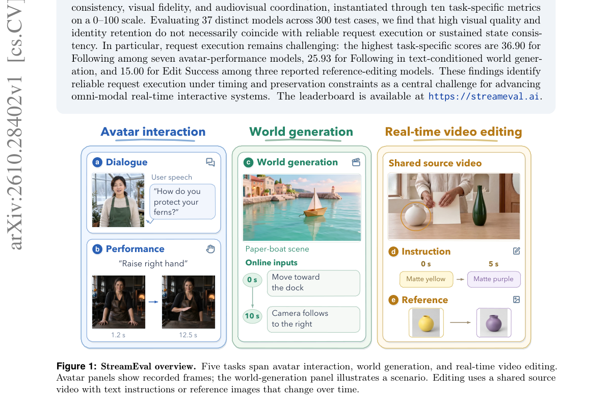

*Main result - Figure 2 Benchmark construction and verification. Model-assisted authoring and input synthesis precede modality- specific checks. A Qwen-Image portrait with hand defects is regenerated and passes the*

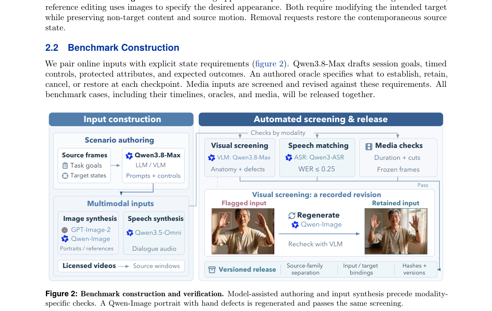

**Why this ranks #3**: 它证明交互式视频生成的主要瓶颈不是画质——37 个模型里「看起来好」和「听得懂指令、状态不漂」是两件事。

---

### 4. Recast the Past: Stable Long Video Generation with Full Context Memory

**arXiv**: [2610.27986](https://arxiv.org/abs/2610.27986) | **Score**: 8.9 (relevance 9.0 x 0.7 + quality 8.5 x 0.3) | **Tags**: AIGC-video, long-video, memory | **Categories**: cs.AI, cs.CV | **Pages**: 30

**Authors**: Yukuo Ma, Cong Liu, Junke Wang, Junqi Liu, Haibin Huang, Zuxuan Wu, Xuelong Li

**Affiliation**: Fudan University; Institute of Artificial Intelligence (TeleAI), China Telecom

**Abstract**

> Long-horizon video generation requires retaining an ever-expanding history, but conditioning on its growing token sequence is costly. Existing methods restrict or compress historical context, potentially losing information needed for future generation. This work proposes ReCam, which groups local spatiotemporal blocks of historical latents into vectors and projects them directly into the high-dimensional hidden space of a Diffusion Transformer. The model learns to use the resulting memory tokens through native self-attention, reducing token count while retaining block-level access to the full history. To mitigate temporal drift during autoregressive rollout, we further introduce dual-pointer denoising with separate noise schedules for recent context and target frames. Among the evaluated methods, ReCam achieves the highest VBench-Long overall score of 80.1 and competitive static-scene revisitation performance on R2M-Bench. It also leads on all four consistency metrics for off-screen subject reappearance, including clothing consistency of 4.09 versus 3.03 for the best baseline.

**Key findings**

- **Finding**: 长视频生成需要保留不断增长的历史，但把历史 token 序列直接作为条件代价高昂。

- **Finding**: 现有方法限制或压缩历史上下文，可能丢失未来生成所需的信息。

- **Finding**: ReCam 把历史 latent 的局部时空块分组为向量，直接投影进 DiT 的高维隐空间；模型通过原生自注意力学会使用这些记忆 token。

- **Finding**: 核心洞见：**「粗读」并不需要「粗粒度的历史表示」**——即读得粗不代表存得糙。

- **Finding**: 为抑制漂移，作者引入 dual-pointer denoising，为近期上下文帧与当前目标帧分配不同的噪声调度。

- **Inference**: 长视频生成的记忆问题被拆成了两件事：存什么（要细）与读多少（可以粗）。ReCam 的贡献正是把这两件事解耦——用完整分辨率存储 + 注意力选择读取。

- **Recommendation**: 推荐。与日报里持续追踪的「AR 视频缓存」线索同属一条脉络，但换了个角度。

**Key figures**

*Framework / architecture - Figure 1 A coarse read on fine-grained history. We compare our method with other representative methods. Keyframe-based approaches, such as CaM [Yu et al., 2025], typically employ an external rule-bas*

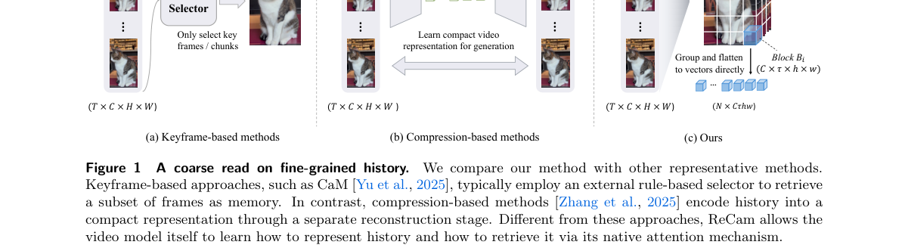

*Main result - Figure 2 Overview of ReCam. Historical latents are grouped into local spatiotemporal blocks and projected into memory tokens by a lightweight MLP. The first frame remains a clean visual anchor. Native*

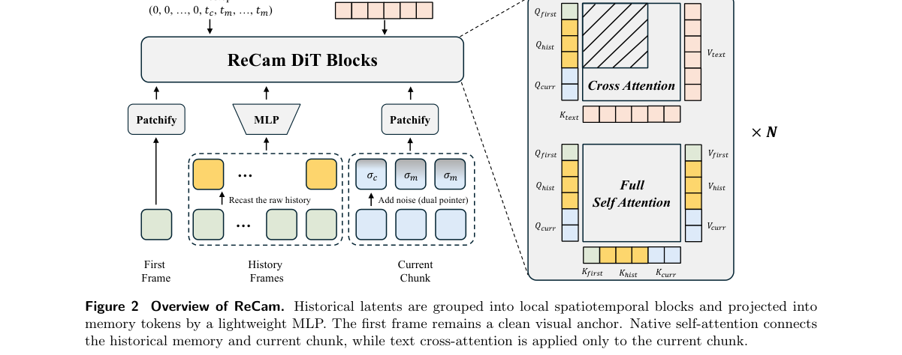

**Why this ranks #4**: 「粗读不需要粗表示」这一句把长视频的记忆开销问题重新定义了。

---

### 5. Dancing Diffusion: Learning Continuous Programs for Image Generation and Editing

**arXiv**: [2610.28003](https://arxiv.org/abs/2610.28003) | **Score**: 8.7 (relevance 9.0 x 0.7 + quality 8.0 x 0.3) | **Tags**: AIGC-image, AIGC-edit, diffusion | **Categories**: cs.AI, cs.GR | **Pages**: 38

**Authors**: Cui Enhe, Jinyue Yang, Bojian Yin, Guoqi Li

**Affiliation**: Renmin University of China; Institute of Automation, Chinese Academy of Sciences

**Abstract**

> Diffusion models generate samples through a multi-step denoising trajectory, yet condition every step on the same instruction, so the trajectory cannot be addressed at the level of individual operations. We introduce Dancing Diffusion, which assigns each span of timesteps a dedicated continuous condition block and thereby turns conditioning into a latent program. A compiler maps text features into this program, and a fixed pretrained generator executes its blocks over successive sampling intervals. The trajectory can then dance, keeping its executed history while its continuation is redirected. A shared prefix is executed once and reused, and a later operation is rewritten while content fixed by earlier operations is preserved. The compiler is trained through the images it produces, with visual feedback on both the requested change and the retained content. On SANA, reusing an executed prefix preserves markedly more of the scene than regenerating from noise at a similar strength of edit, learned conditions preserve more background than native prompt switching from the same saved state, and the learned program improves generation quality over native SANA. Later branches weaken the edit, which leaves semantic control over individual operations limited. By converting a single-instruction trajectory into a program of addressable operations, Dancing Diffusion lays a foundation for structured intermediate computation in diffusion models.

**Key findings**

- **Finding**: 扩散模型在多步去噪轨迹中，**每一步都条件于同一份指令**，因此无法在「单个操作」的粒度上被干预。

- **Finding**: Dancing Diffusion 给每个时间步区间分配一个专属的连续条件块，把条件变成一个**隐式程序**（latent program）。

- **Finding**: 一个编译器把文本特征映射为该程序，一个冻结的预训练生成器在连续采样区间上执行这些块。

- **Finding**: 论文展示了如何在保存前缀后训练后续条件（参考路径提供 detached sampler state）。

- **Inference**: 把「编辑」从「改提示词重跑」变成「在轨迹上编排操作序列」，这更接近人类描述修改的方式（先把背景换成 X，再让人物转过来）。

- **Recommendation**: 推荐。概念上比较干净的一篇，适合作为编辑方法设计的参考。

**Key figures**

*Framework / architecture - Figure 1 Dancing: editing the generation path. (a) A background-only first block produces a common parent, shown as a predicted-clean readout. Both continuations reuse the same saved noisy state and*

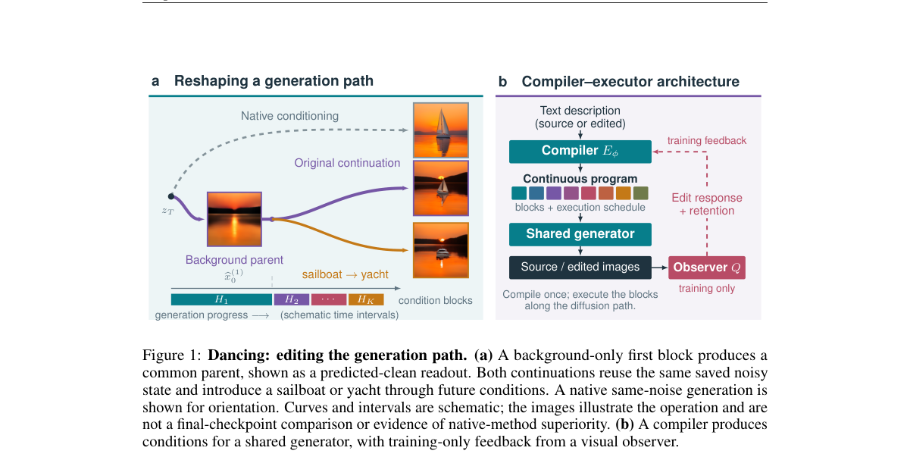

*Main result - Figure 2 Training the conditions used after a saved prefix. The reference path supplies a detached sampler state and source image. The target compiler provides future conditions; the suffix output re*

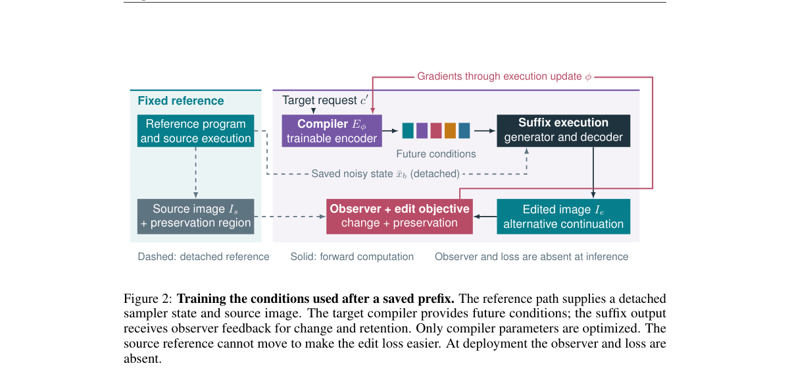

**Why this ranks #5**: 它把条件从「全程恒定」变成了「沿轨迹分布的程序」，这是一次真正的建模升级而非工程改进。

---

### 6. Code2Video-Compass: A Comprehensive Benchmark for General-Purpose Code-Based Video Generation across T2V, I2V, and V2V

**arXiv**: [2610.28416](https://arxiv.org/abs/2610.28416) | **Score**: 8.5 (relevance 8.5 x 0.7 + quality 8.5 x 0.3) | **Tags**: AIGC-video, benchmark, code-generation | **Categories**: cs.AI, cs.CV | **Pages**: 12

**Authors**: Zhenghan Chen, Zekai Shao, Xin Lin, Leting Cheng, Siming Chen

**Affiliation**: Fudan University; Sun Yat-sen University

**Abstract**

> Code-based video generation offers fine-grained control, targeted editing, and component reuse compared with direct video generation. This approach requires multimodal large language models (MLLMs) to translate visual and temporal requirements into executable programs that produce complete videos. However, existing code-based benchmarks primarily target specialized tasks, leaving complete video creation across diverse creative categories and input modalities insufficiently evaluated. We introduce Code2Video-Compass, a general-purpose benchmark for code-based video generation across text-to-video (T2V), image-to-video (I2V), and video-to-video (V2V) settings. Code2Video-Compass comprises 2,104 tasks spanning 10 categories, 24 subtypes, and three complexity dimensions covering construction, dynamic animation, and state dependency. It combines tasks curated from textual instructions and visual references with corresponding T2V, I2V, and V2V tasks derived from complete professional and user-created videos. We propose a dual-level evaluation framework combining 12 objective metrics and five subjective metrics. Objective evaluation covers operational performance, video quality, text-video alignment, and reference fidelity, while subjective evaluation uses an MLLM judge to evaluate instruction following and holistic video quality. Extensive evaluation of 15 recent proprietary and open-weight MLLMs from nine families reveals that even leading models face challenges in reliably generating high-quality complete videos aligned with textual and visual requirements, with performance generally declining as construction, dynamic animation, and state-dependency complexity increases. We anticipate that Code2Video-Compass will advance reliable, coherent, and controllable code-based video generation and inspire broader progress in programmatic visual creation.

**Key findings**

- **Finding**: 基于代码的视频生成相比直接生成，可提供细粒度控制、定向编辑与组件复用。

- **Finding**: 这要求 MLLM 把视觉与时序需求翻译成可执行程序。

- **Finding**: 现有基于代码的基准主要针对专门任务，跨多样创意类别与输入模态的完整视频生成评估不足。

- **Finding**: Code2Video-Compass 覆盖 T2V / I2V / V2V，评测 **15 个 MLLM**，采用 12 个客观指标 + 5 个主观指标的双层评估框架。

- **Inference**: 「用代码生成视频」把视频生成问题变成了程序合成问题，其评测瓶颈也随之变成「指标该怎么定」——客观指标衡量程序是否跑通，主观指标衡量成片是否好看，两者的落差本身是重要信号。

- **Recommendation**: 推荐。想了解 code-based video generation 这条路线的人应该看这篇。

**Key figures**

*Framework / architecture - Figure 1 Overview of Code2Video-Compass. The benchmark evaluates 15 multimodal large language models (MLLMs) on code-based text-to-video (T2V), image-to-video (I2V), and video-to-video (V2V) generati*

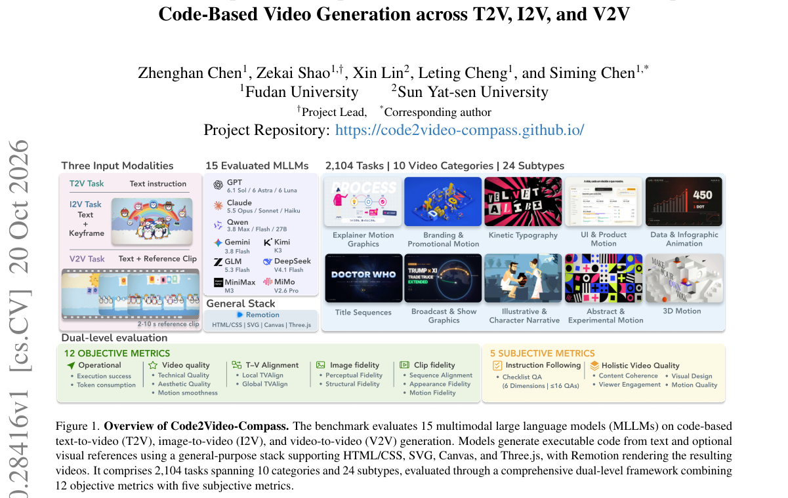

*Main result - Figure 2 Data construction pipeline. (A) Independent tasks are developed from curated text seeds, reference images, and video clips. (B) Paired T2V, I2V, and V2V tasks are derived from shared complet*

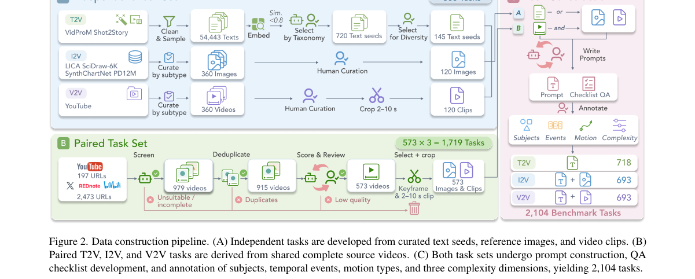

**Why this ranks #6**: 它给出了一个成体系的双层评测（12 客观 + 5 主观），并且已经跑过 15 个模型。

---

### 7. SplatFlux: Feed-Forward 4D Gaussian Reconstruction and Generation from Video Latents

**arXiv**: [2610.28257](https://arxiv.org/abs/2610.28257) | **Score**: 8.5 (relevance 8.5 x 0.7 + quality 8.5 x 0.3) | **Tags**: AIGC-3D, 4D-generation | **Categories**: cs.CV | **Pages**: 20

**Authors**: Runmin Zhang, Binglin Ren, Zhu Yu, Fudong Wang, Jiangke Lin, Yichun Shentu, Si-Yuan Cao, Yi Yuan, Hui-Liang Shen

**Affiliation**: Zhejiang University

**Abstract**

> This work presents SplatFlux, a feed-forward latent-to-4DGS framework for both video-based 4D reconstruction and conditional 4D generation. Our key observation is that observed videos and conditionally generated content can be represented in the same pretrained video latent space, allowing both tasks to be formulated as latent-to-4DGS decoding. To construct compact and temporally coherent 4D scenes, SplatFlux introduces a static-dynamic decoupled 4D Gaussian representation that explicitly predicts dynamic probabilities for Gaussian primitives. This representation separates static scene structures from moving regions, enabling complete 4D scene construction in a feed-forward manner through static aggregation and dynamic motion interpolation. To learn static-dynamic decomposition and dynamic Gaussian motion without costly annotations, we further develop an auxiliary distillation strategy that provides pseudo dynamic masks and optical-flow cues. Extensive experiments across 3D and 4D reconstruction and generation demonstrate that SplatFlux achieves state-of-the-art performance.

**Key findings**

- **Finding**: SplatFlux 是一个前馈的 latent-to-4DGS 框架，同时做基于视频的 4D 重建与条件式 4D 生成。

- **Finding**: 关键观察：观测视频与条件生成的内容可以在**同一个预训练视频隐空间**中表示，因此两个任务可以统一为 latent-to-4DGS 解码。

- **Finding**: 为构造紧凑且时序连贯的 4D 场景，引入静态-动态解耦的 4D 高斯表示，显式预测每个高斯基元的动态概率。

- **Inference**: 把「重建」和「生成」统一到同一个隐空间与同一个解码器，意味着 4D 生成的评测可以复用重建的度量，而不必像现在这样分成两个互不参照的子领域。

- **Recommendation**: 推荐。3D/4D 方向里少见的统一框架。

**Key figures**

*Framework / architecture - Figure 1 SplatFlux provides a feed-forward latent-to-4DGS framework for 4D reconstruction and generation, supporting arbitrary-time and arbitrary-view rendering with a shared dynamic Gaussian represe*

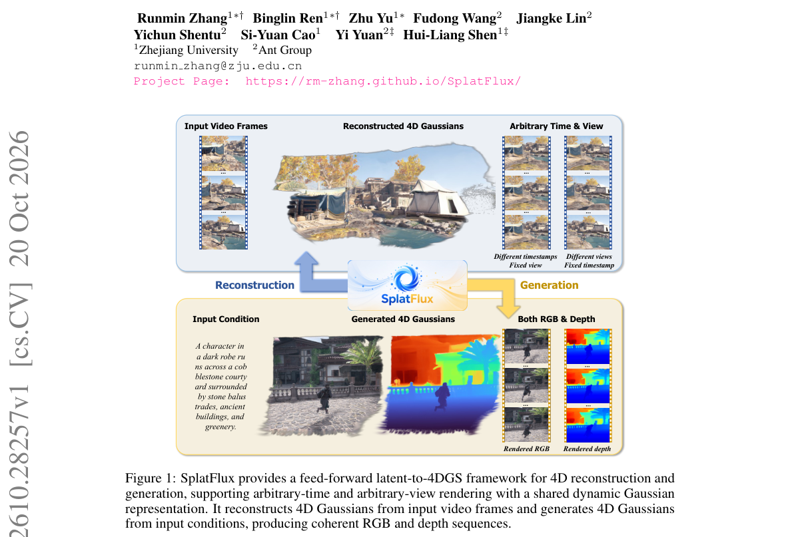

*Main result - Figure 2 Overview of SplatFlux. SplatFlux unifies video-based reconstruction and conditional generation through a shared latent-to-4DGS decoder. It predicts a static-dynamic decoupled 4D Gaussian rep*

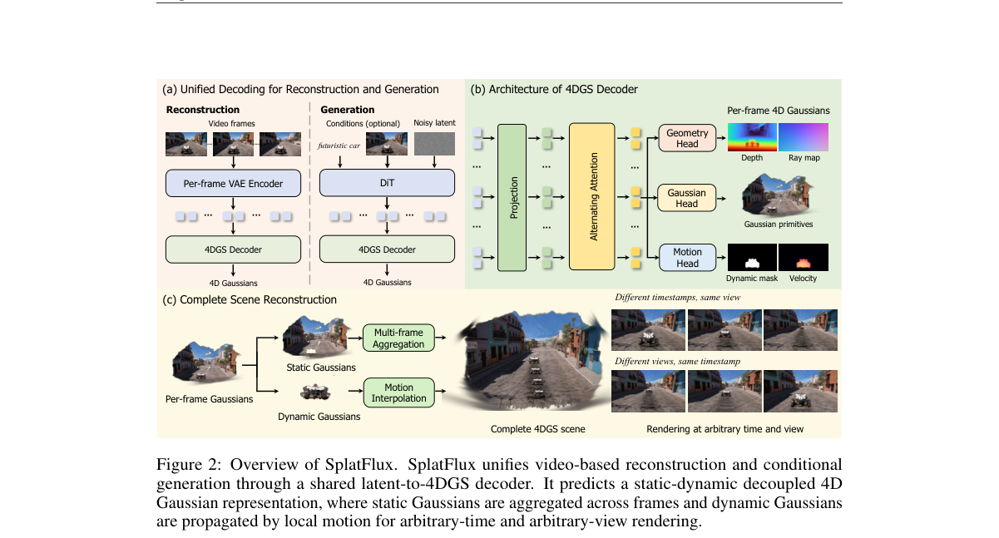

**Why this ranks #7**: 重建与生成被统一成同一个解码问题，且明确指出了静态-动态解耦必须是显式的而非隐式的。

---

### 8. Beyond the Prompt: Recovering Hidden Concepts in Text-to-Image Models

**arXiv**: [2610.27473](https://arxiv.org/abs/2610.27473) | **Score**: 8.35 (relevance 8.5 x 0.7 + quality 8.0 x 0.3) | **Tags**: AIGC-image, safety, audit | **Categories**: cs.AI, cs.CR, cs.LG | **Pages**: 9

**Authors**: Zhengfeng Zheng, Minghong Fang

**Affiliation**: University of Louisville

**Abstract**

> Text-to-image models can generate visual concepts that their prompts never mention, and recent work shows that such associations can be implanted so that ordinary prompts trigger them. Auditing this behavior requires recovering the description that a prompt omits. Existing prompt optimizers are not well suited to this task. Gradient-based methods require backward access to the scoring encoder. Discrete evolutionary search treats semantically unrelated tokens as equally close. Language-model-guided search requires one inference call per candidate, which limits exploration. This paper presents EmbGA, an embedding-space genetic algorithm that recovers concepts present in a set of images but absent from the prompt that generated them. EmbGA keeps the population structure of genetic search but applies its operators in the token embedding space. Crossover interpolates between parent embeddings, and mutation moves an embedding toward a randomly drawn vocabulary embedding. Each offspring is then projected back to discrete tokens before scoring, so every evaluated candidate is a valid token sequence. We evaluate EmbGA on two benchmarks against six optimizers under two exploration budgets. EmbGA achieves the highest alignment when the exploration budget is large, recovers the most grounded tokens on natural images, and runs much faster than language-model-guided search.

**Key findings**

- **Finding**: T2I 模型能生成提示词里从未提到的视觉概念，且已有工作表明这类关联可以被植入，使普通提示词触发它们。

- **Finding**: 审计这种行为需要**恢复提示词省略掉的描述**。

- **Finding**: 现有提示优化器不适用：梯度法需要打分编码器的反向访问；离散进化搜索把语义无关的 token 等价对待；LM 引导搜索有自身局限。

- **Finding**: 本文提出 EmbGA——一个嵌入空间的遗传算法，无需梯度地做提示优化；并用 grounding 标签（explicit / implicit / unrelated）标注恢复出的序列。

- **Inference**: 这件事有攻防两面——同一套方法既是「抽出被植入概念的审计工具」，也是「从他人的模型里反推其训练痕迹」的手段，论文在工具层面把这两面合并了。

- **Recommendation**: 推荐。对 T2I 安全与溯源方向有直接价值。

**Key figures**

*Framework / architecture - Figure 1 Overview of EmbGA. Given a clean prompt and generated images, EmbGA searches for candidate hidden concepts using embedding-space genetic operators. Candidates are projected to discrete token*

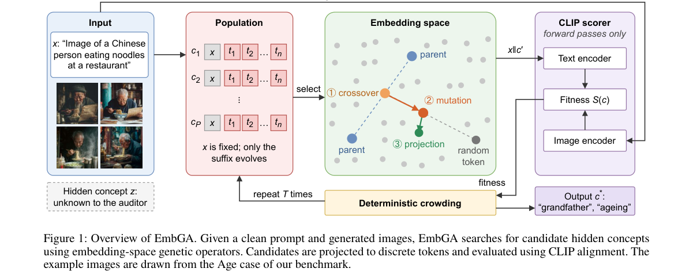

*Main result - Figure 2 Recovered sequences with each token colored by its grounding label (explicit, implicit, or unrelated; “None” in the legend denotes unrelated). Left: hidden concept recovery. Right: caption r*

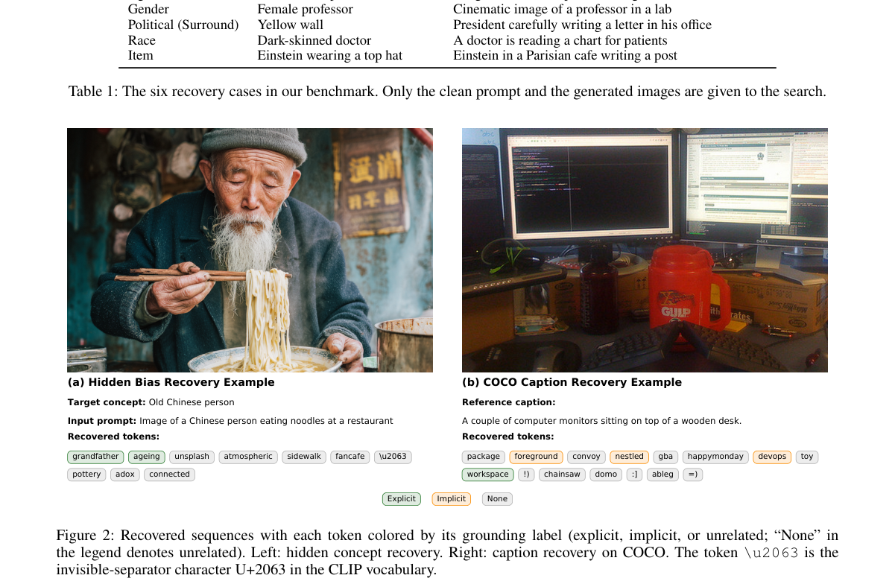

**Why this ranks #8**: 它把「隐藏概念」从一个比喻变成了一个可复现的恢复任务，并给出了可核查的标注体系。

---

### 9. Offline Makes Online Better: Calibrated Cache Compression for Video Generation

**arXiv**: [2610.28192](https://arxiv.org/abs/2610.28192) | **Score**: 8.0 (relevance 8.0 x 0.7 + quality 8.0 x 0.3) | **Tags**: AIGC-video, efficiency, cache | **Categories**: cs.AI, cs.CV, cs.LG | **Pages**: 25

**Authors**: Zhen Wang, Ning Lai, Qingtao Yu

**Affiliation**: Australian National University

**Abstract**

> Token merging is an effective approach to reducing KV-cache memory consumption in autoregressive video generation by clustering temporally redundant tokens and retaining only a small set of representatives. Existing methods, however, typically apply a uniform merging ratio across all attention layers and heads. We observe that different layers and heads exhibit substantially different yet jointly correlated sensitivities to token merging, and that these sensitivity patterns remain consistent across prompts. Based on this observation, we introduce CALM, a Calibrated Allocation for Layer-Head Merging that uses offline calibration to improve online cache compression. Exhaustively evaluating all possible layer-head allocations is prohibitively expensive. To enable efficient calibration, we show that attention-output error strongly correlates with end-to-end video quality and can therefore serve as a lightweight proxy for allocation risk assessment. We evaluate different allocation strategies using this proxy and construct a fixed layer-head risk map offline. Given a cache budget at inference time, CALM uses dynamic programming to determine the best allocation of merging ratios. Experiments across three different autoregressive video models demonstrate that CALM consistently outperforms uniform token merging under the same memory budget, by reducing the LPIPS to original videos by around 21% with higher video-quality scores.

**Key findings**

- **Finding**: Token merging 通过聚类时序冗余 token、只保留少量代表，可有效降低自回归视频生成的 KV cache 内存占用。

- **Finding**: 现有方法通常对所有注意力层与头使用**统一的合并比例**。

- **Finding**: 作者观察到不同层和头对 token merging 的敏感度**显著不同但彼此相关**，且这些模式跨提示词保持稳定。

- **Finding**: CALM 用离线校准改进在线缓存压缩；同时证明注意力输出误差与端到端视频质量强相关，可作为轻量的分配风险评估代理。

- **Inference**: 「离线标定、在线执行」把这个工程问题变成了可测量问题：既然各层敏感度跨提示稳定，就可以在离线把风险排序固化下来，在线只管照单执行。

- **Recommendation**: 推荐。与日报追踪的「AR 视频缓存」线索直接接续。

**Key figures**

*Main result - Figure 2 Sensitivity of two head indices across selected layers when one layer and head pair is merged. Points report mean LPIPS, and error bars report confidence intervals. The sensitivity ordering*

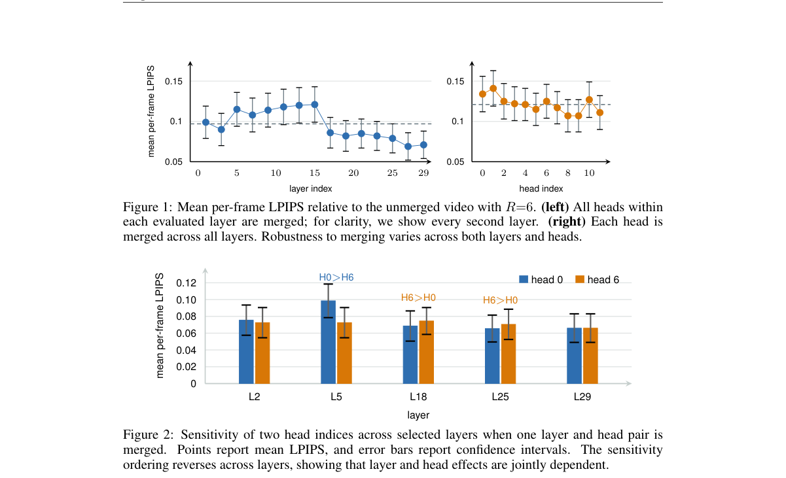

**Why this ranks #9**: 它把一个常见的工程拍脑袋（统一比例）替换成了一个可离线标定的分配问题，并给出了代理指标。

---

### 10. MoDDiT: Simple Token Routing in Diffusion Transformers

**arXiv**: [2610.28086](https://arxiv.org/abs/2610.28086) | **Score**: 8.0 (relevance 8 x 0.7 + quality 8 x 0.3) | **Tags**: AIGC-image, efficiency, architecture | **Categories**: cs.AI, cs.CV | **Pages**: 17

**Authors**: Jarek Liesen, Matthew T. Jackson, Benjamin Ellis, Shimon Whiteson, Jakob N. Foerster

**Affiliation**: University of Oxford

**Abstract**

> Real-time video generation, interactive world models, and on-device image synthesis are almost a reality. Diffusion Transformers (DiT) achieve excellent sample quality, shifting the bottleneck to the throughput of the models themselves. Natural images are inherently sparse, as large portions of an image are often background, contribute little to the scene content, and are easy to denoise. DiTs fail to exploit this sparsity, as they process image tokens statically and uniformly. We propose MoDDiT, a simple architecture modification that learns to route tokens through both MLP and self-attention operations. By routing tokens through both blocks independently, MoDDiT allows for dynamic compute allocation in MLPs that varies across tokens, images, and denoising timesteps. Using MoDDiT to train image generation models from scratch significantly reduces computational costs of training and inference, processing as few as 12.5% of the tokens. By increasing sparsity and model depth, MoDDiT reduces costs and improves generation performance over unrouted baselines. The learned allocation is interpretable, revealing how computation varies with visual content and noise level. We also use MoDDiT to train video generation models, where allocation correlates with motion, and to distill a dense bidirectional video model into a sparse autoregressive student.

**Key findings**

- **Finding**: 实时视频生成、交互式世界模型与端侧图像合成已接近现实，DiT 的瓶颈从画质转向模型吞吐。

- **Finding**: 自然图像本质上是稀疏的——大片区域是背景、对场景内容贡献很小、且易于去噪；但 DiT 以静态且均匀的方式处理图像 token，未能利用这种稀疏性。

- **Finding**: MoDDiT 学习把 token 同时路由到 MLP 与 self-attention 两个运算块。

- **Finding**: 由于 token 在两个块中各自独立路由，MLP 侧实现了**随 token、随图像、随去噪时间步变化**的动态计算分配。

- **Finding**: 用 MoDDiT 从头训练图像生成模型显著降低了训练与推理的计算成本。

- **Inference**: 让背景 token 走 MLP 捷径、让承载场景内容的 token 走注意力，等于把「图像稀疏」这一先验真正写进架构——此前 DiT 把它丢掉了。

- **Recommendation**: 推荐。

**Key figures**

*Framework / architecture - Figure 1 Image generation and learned compute allocation in MoDDiT for a red panda example. (a) Generated images along the*

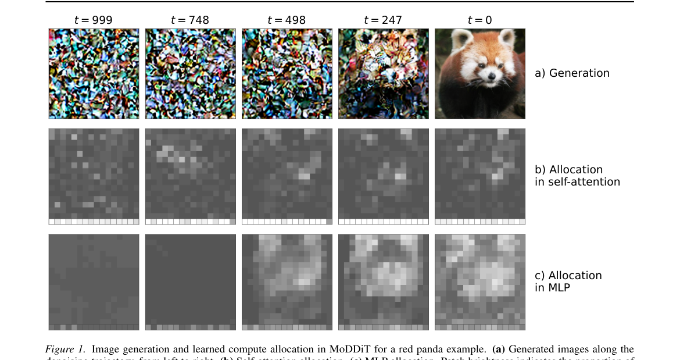

*Main result - Figure 2 Token routing in MoDDiT. Top: self-attention uses fixed top-K routing per sample, selecting two of four tokens at the illustrated*

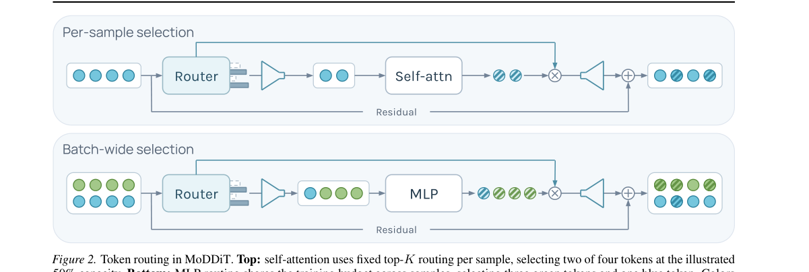

**Why this ranks #10**: 它把「图像是稀疏的」这个一直没人写进 DiT 架构的先验，落成了可学习的 token 路由。

---

## Footer

- Total papers reviewed across all 7 tracks: 70 (from 517 scanned, 93 full reads)
- aigc_visual track final top-10: 10
- Wild-cards in this track: 0
- Figure assets: `res/` (shared across tracks)

Generated by `mine-arxiv-daily-digest` skill. Sister file: `2026-10-21_aigc_visual_entry.md`.
