# ArXiv Daily Digest - 2026-10-21 (音频与语音语言模型 / 双工语音助手, 10 papers)

**Generated**: 2026-10-21 17:00 CST

**Source**: arXiv cs.CV, cs.SD, eess.AS, cs.CL, cs.AI, cs.RO, cs.LG submissions, window 2026-10-20 UTC (latest announced batch as of 2026-10-21 17:00 CST)

**Track**: audio_lm (top 10 of 517 papers scanned, 93 full reads)

**Scope**: cross-modal concept neurons in large audio-language models, full-duplex interaction benchmark with visual engagement, transactional memory in full-duplex speech agents, Viterbi-guided hotword selection for speech-LLM ASR, sketch-guided audio-contrastive decoding, training-free speaker linking for frozen streaming diarizers, evidence-grounded audio-visual reasoning benchmark, phoneme-mediated EMG-to-text reconstruction, evidence-grounded depression assessment over spoken counseling, segment-level ASR semantic evaluation

⚠️ **Wild-card**: 本批该线仅 8 篇严格命中，其余 2 篇为 wild-card 补足，已在正文逐条标注。

---

**本批音频 LM 线最值得注意的，是一批工作开始往机制层面走，而不只是刷指标。** Cross-Modal Concept Neurons 提出假设：LALM 内部存在一个音频与文本表示**对齐的共享子空间**，并用跨模态神经元做因果测试。这与 10-19 日报 VocalGrad、10-20 日报 Text Dominance 构成一条连续线索：如果共享子空间存在，那么「有转写可用时模型就忽略声音」就不是全有全无的现象，而是可以定位、也可以干预的局部行为。

**双工侧的两篇把评估维度往前推。** DIVE 指出，现有多模态在线基准只测因果感知（带时间戳的问答），而真实交互要求模型持续判断**该不该开口、什么时候让出话轮**——于是它把 Proactive Intervention 与 Continuous Engagement 做成了可测任务。DuplexLedger 则把「该不该记」定义成**事务语义**（WRITE / UPDATE / IGNORE / RETAIN），并配了 1,094 个双语持久会话、6,564 个同会话问题，以及一个仅 8.92M 参数的旁路模块 ACT-Mem——说明这类问题未必需要改主干。

**另有一篇值得单独点出。** Slots Are Not Speakers 指出流式 diarizer 的 N 个槽位限制的是「能同时表达几个人」而非「会遇到几个人」，用**只重标注**的因果 linker（不引入任何额外漏检）把 4 槽主干在超限部分的 DER 从 36.8% 降到 22.6%，在 23 人庭审场景把 cpWER 从 82.7% 降到 24.4%。这是本批罕见的「零代价增益」。

---

## Top 10 - 音频与语音语言模型 / 双工语音助手

### 1. Uncovering Audio-Text Alignment in Large Audio-Language Models through Cross-Modal Concept Neurons

**arXiv**: [2610.28189](https://arxiv.org/abs/2610.28189) | **Score**: 9.0 (relevance 9.0 x 0.7 + quality 9.0 x 0.3) | **Tags**: audio-LM, interpretability | **Categories**: cs.CL, cs.SD, eess.AS | **Pages**: 22

**Authors**: Tzu-Quan Lin, Chih-Kai Yang, Yi-Cheng Lin, Hao Tang, Hung-yi Lee

**Affiliation**: Centre for Speech Technology Research, University of Edinburgh, United Kingdom; Graduate Institute of Communication Engineering, National Taiwan University, Taiwan; NTU Artificial Intelligence Center of Research Excellence (NTU AI-CoRE), Taiwan; versity of Edinburgh

**Abstract**

> While the language model backbone is pretrained on text alone, large audio-language models (LALMs) can, to a great extent, recognize acoustic attributes, such as emotion, speaker gender, and spoken language. However, it is unclear how the audio representation is integrated, if at all, with the other text representation before the model produces text. We hypothesize that there is a shared subspace where the audio and text representations are aligned. To test this hypothesis, we identify cross-modal neurons that are responsible for representing both audio and text. We find alignment between audio and text neurons to various degrees across three LALMs and four acoustic attribute types. Causal interventions, steering and deactivating the neurons, confirm that the cross-modal neurons are not just necessary for prediction but can also be manipulated.

**Key findings**

- **Finding**: LALM 的语言主干只在文本上预训练，却能在相当程度上识别情绪、说话人性别、口语语言等声学属性；但**音频表示究竟如何、在多大程度上与文本表示整合**并不清楚。

- **Finding**: 作者提出假设：存在一个**共享子空间**，音频与文本表示在其中对齐。

- **Finding**: 为检验该假设，识别跨模态神经元并对其做因果测试（steering 等）。

- **Finding**: 论文图示解释了为何比较**神经元**而非环境空间中的整个向量。

- **Inference**: 这与 10-19 日报 VocalGrad 的发现构成宏观/微观两版：如果存在一个共享子空间，那么「模型在转写可用时忽略声学信息」就不是全有全无，而是可以定位到具体神经元集合的局部现象——也就意味着可以被干预。

- **Recommendation**: 强烈推荐。本批音频线最值得读的一篇。

**Key figures**

*Framework / architecture - Figure 1 Why we compare neurons rather than entire vectors in the ambient space (schematic). Audio and text are fed to the LALM in separate forward passes. Cosine values follow Qwen2.5-Omni on emotio*

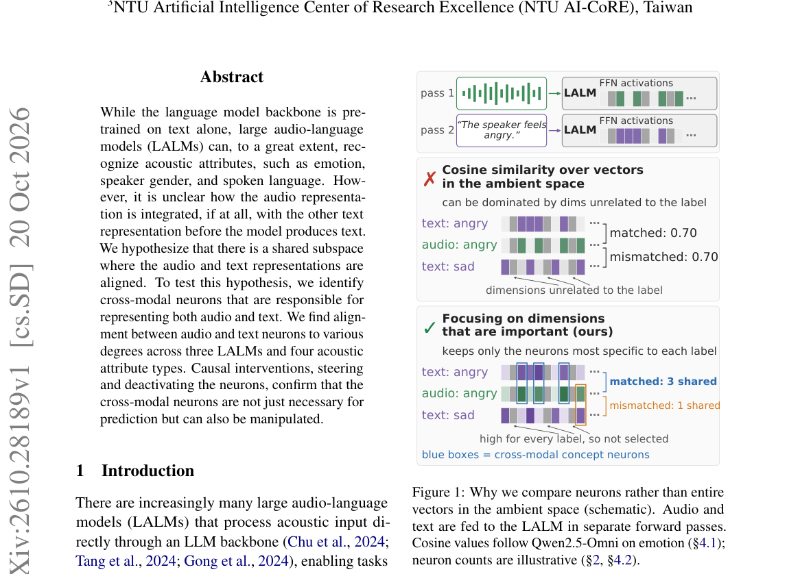

*Main result - Figure 2 Overview of the causal tests (schematic; activation values are illustrative). Steering (§4.3): the direction is computed once from text-only forward passes as the difference between the targ*

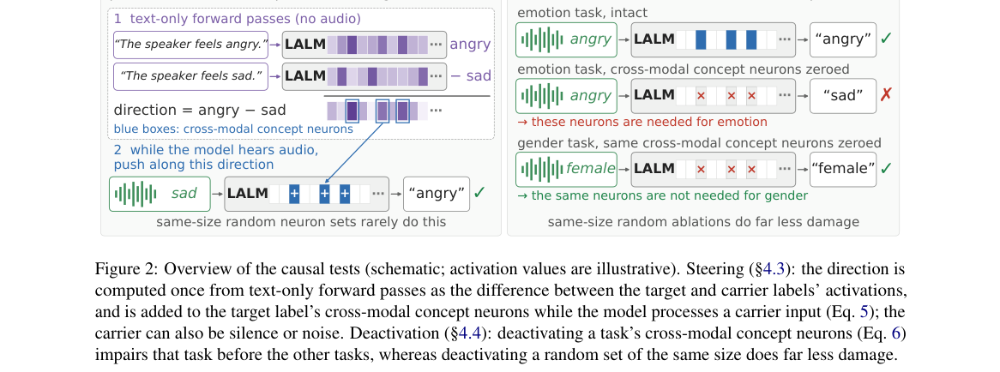

**Why this ranks #1**: 它把「音频 LLM 到底有没有在听」从行为层问题推进到了机制层问题，并且给出了可干预的抓手。

---

### 2. DIVE: Benchmarking Full-Duplex Interaction with Visual Engagement in Continuous Streams

**arXiv**: [2610.28405](https://arxiv.org/abs/2610.28405) | **Score**: 8.9 (relevance 9.0 x 0.7 + quality 8.5 x 0.3) | **Tags**: duplex-voice, benchmark, multimodal | **Categories**: cs.AI | **Pages**: 19

**Authors**: Yuhang Chen, Guangyue Liu, Shilong Liu

**Affiliation**: Huazhong University of Science and Technology; Princeton University

**Abstract**

> Recent advances in multimodal large language models (MLLMs) have substantially improved spoken interaction and video understanding. Existing online and streaming benchmarks primarily assess causal multimodal perception through timestamped question answering, whereas real-world interaction requires models to continuously identify task-relevant multimodal cues and decide whether, when, and how to respond. This leaves open how well current models can sustain real-time interaction throughout an evolving multimodal stream. To address this gap, we introduce DIVE, a benchmark for evaluating full-duplex interaction with visual engagement under continuous and realistic multimodal streams. It organizes six tasks into three complementary interaction scenarios. (1) Proactive Intervention evaluates whether models can identify emerging visual or semantic cues and intervene at the appropriate moment. (2) Continuous Engagement evaluates sustained participation through continuous visual tracking and visually grounded query interaction. (3) Interaction Coordination evaluates how models coordinate listening and speaking under overlapping and multi-party interactions. DIVE contains 525 audio/video samples with fine-grained human annotations and precise temporal metadata. Its evaluation protocol separates response quality, participation decisions, and response timing. We evaluate representative real-time models using response quality, window response rates, and reaction latency. Experiments show that leading real-time models achieve sub-second average response latency, yet their average window response rates remain at or below 53.77%. Response quality varies substantially across models and tasks, with adapting ongoing responses to newly arriving information remaining particularly challenging. We hope DIVE facilitates progress toward more natural and capable real-time multimodal interactive systems.

**Key findings**

- **Finding**: 现有多模态大模型的在线与流式基准主要评估**因果多模态感知**（带时间戳的问答），而真实交互要求模型持续识别任务相关线索并决定**是否、何时、如何**响应。

- **Finding**: DIVE 面向连续、真实的多模态流，评测**全双工交互**与视觉参与。

- **Finding**: 任务分为两类：Proactive Intervention（用 `<Interrupted>` 标出被打断的位置）与 Continuous Engagement（`<Visual>` 标出视觉锚定问题，`<Independent>` 标出独立问题）。

- **Inference**: 双工的关键不是「答得快」，而是「该不该开口」与「什么时候让出话轮」——DIVE 把这两个判断做成了可测量的任务类别，正好补上双工助手最缺的评测维度。

- **Recommendation**: 强烈推荐。

**Key figures**

*Framework / architecture - Figure 1 Examples of the tasks in Proactive Intervention. <Interrupted.> marks where the ongoing utterance is interrupted, whereas <Intervention.> marks where the model proactively intervenes.*

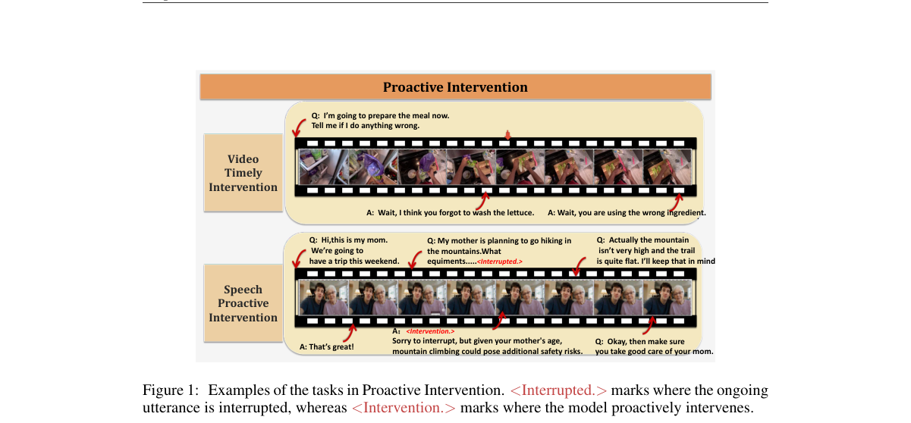

*Main result - Figure 2 Examples of the tasks in Continuous Engagement. <Visual.> indicates visually grounded queries, while <Independent.> indicates general queries independent of the visual content.*

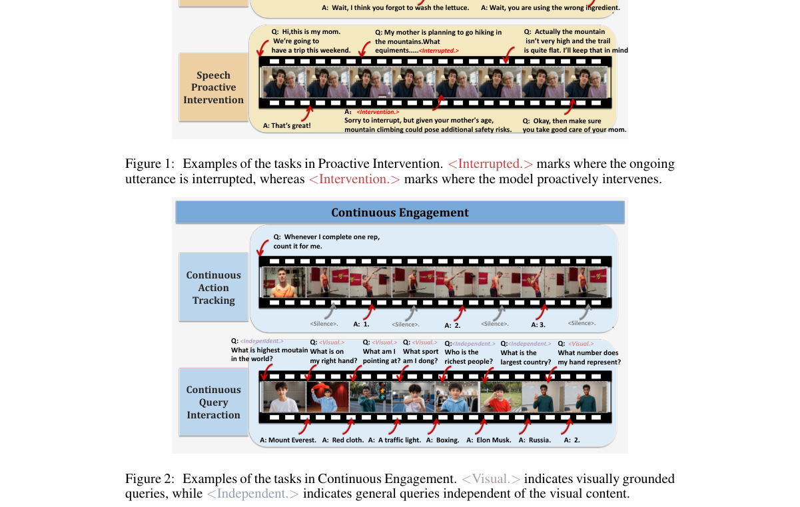

**Why this ranks #2**: 它把双工评测从「能不能听懂」推进到「该不该说、什么时候让」，这是双工助手真正缺的维度。

---

### 3. DuplexLedger: Benchmarking Transactional Memory in Full-Duplex Speech Agents

**arXiv**: [2610.27581](https://arxiv.org/abs/2610.27581) | **Score**: 8.9 (relevance 9.0 x 0.7 + quality 8.5 x 0.3) | **Tags**: duplex-voice, memory, benchmark | **Categories**: cs.AI | **Pages**: 38

**Authors**: Yuxuan Li, Xiangchen Guan, Kunrong Li, Jin Wang, Kaiwen Luo, Yang Xiao, Yufei Guo, Zhisheng Chen, Liang Lin, Kun Wang

**Affiliation**: Nanyang Technological University; Peking University; Beijing University of Technology; Xidian

**Abstract**

> Full-duplex speech agents must update persistent memory while listening and speaking, yet it remains unclear which events should be stored, revised, or excluded. Existing benchmarks isolate interaction timing from memory outcomes, obscuring the state transitions behind a correct answer. We introduce DuplexLedger, a bilingual benchmark of 1,094 persistent sessions aligning four full-duplex scenarios with event-level Write/Update/Ignore/Retain supervision, explicit pre/post memory states, and 6,564 same-session questions and checks. Evaluating five full-duplex models reveals an interaction-memory gap: no system combines strong boundary control with coherent final-state memory, and the best final-state fact coverage is 2.01%. We propose ACT-Mem, an 8.92M-parameter sidecar comprising an event controller, a versioned transactional ledger, and a typed retriever coupled with a frozen MiniCPM-o 4.5 backbone. On 219 held-out sessions, ACT-Mem increases latest-value accuracy from 4.11% to 8.68% while reducing stale assertions and distractor adoption. It improves interaction boundaries but slows interruption stopping. These results motivate selective, auditable full-duplex memory rather than indiscriminate transcript retention. Code is available at https://github.com/lyx-researcher/DuplexLedger.

**Key findings**

- **Finding**: 全双工语音智能体必须**边听边说**地更新持久记忆，但哪些事件该存、该改、该忽略并不清楚。

- **Finding**: 现有基准把交互时序与记忆结果割裂，掩盖了正确答案背后的状态转移。

- **Finding**: DuplexLedger 是**双语**基准，含 **1,094 个持久会话**，对齐四类全双工场景与**事件级 WRITE / UPDATE / IGNORE / RETAIN** 监督、显式的前后记忆状态，以及 **6,564 个同会话**问题与检查。

- **Finding**: 四类全双工挑战：pause handling（暂停处理）、speech to others（对他人说话）、backchannels（附和）、interruptions（打断）。

- **Finding**: 作者提出 ACT-Mem：一个 **8.92M 参数**的旁路模块，含事件控制器、版本化事务账本与类型化检索器，耦合一个冻结的 MiniCPM-o 4.5 主干。

- **Inference**: 把「该不该记」定义成**事务语义**是一个聪明的抽象——它让「记忆错误」有了明确的失败分类，而不是笼统的「忘了/记错了」。8.92M 的旁路规模也说明这类问题未必需要改主干。

- **Recommendation**: 强烈推荐。

**Key figures**

*Framework / architecture - Figure 1 From isolated interaction and memory to transactional full-duplex memory.*

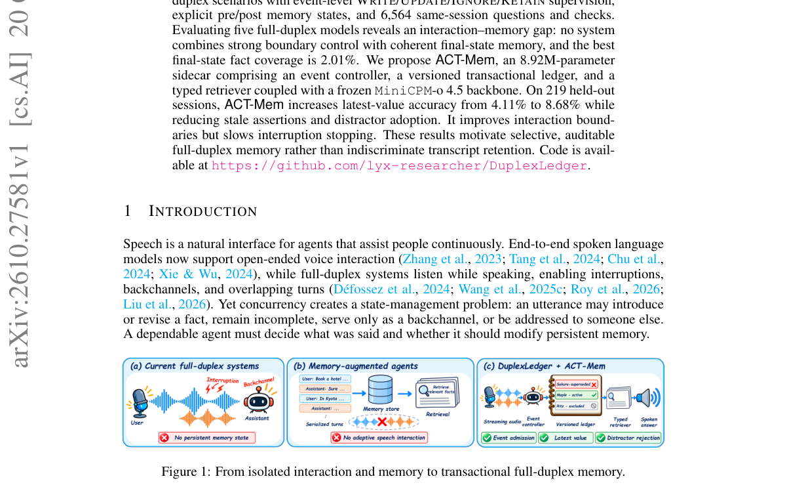

*Main result - Figure 2 Overview of DuplexLedger. A persistent session aligns adaptively triggered full-duplex challenges, event-level memory transitions, and spoken memory questions.*

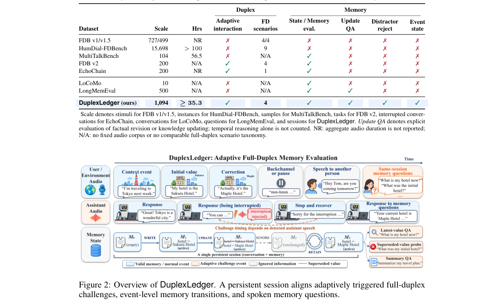

**Why this ranks #3**: 它是本批唯一把「全双工 + 记忆」这两个难点合并处理的工作，而且把记忆错误变成了有类型的事务语义。

---

### 4. VISH-ASR: Viterbi-Guided Selection of Hotwords for Speech-LLM Contextual ASR

**arXiv**: [2610.27867](https://arxiv.org/abs/2610.27867) | **Score**: 8.0 (relevance 8.0 x 0.7 + quality 8.0 x 0.3) | **Tags**: audio-LM, ASR, contextual | **Categories**: cs.AI, cs.HC, eess.AS | **Pages**: 5

**Authors**: Xiaoyu Gu, Yu Xi, Chencheng Wang, Zonghan Zhou, Haoyu Li, Jing Peng, Kai Yu

**Affiliation**: MoE Key Lab of Artificial Intelligence, AI Institute, X-LANCE Lab, Shanghai Jiao Tong University; School of Intelligence Science and Technology, Nanjing University, Suzhou, China; (y1, . . . , yL) denote its CTC-token sequence. VISH searches for its

**Abstract**

> Prompt-based contextual ASR requires selecting a compact hotword subset from large dynamic inventories, yet existing pre-selection methods rely either on discrete ASR hypotheses that may discard acoustic evidence or on separately trained retrieval models. We propose Viterbi-guided Selection of Hotwords (VISH), a training-free, plug-and-play framework that directly verifies candidate-specific acoustic support over frame-level CTC posteriors. VISH formulates pre-selection as constrained posterior search; M-VISH makes large-list verification scalable through frame-synchronous shared-prefix Viterbi search with bounded top-K pruning, while Bi-MVISH exploits complementary backward evidence for robust verification. Across five benchmarks, M-VISH achieves up to 11.7% absolute improvement in Best-F1 over a strong learned-retrieval baseline and reduces candidate-search latency by 75.2% at 2,000 candidates relative to hypothesis-based filtering. These results demonstrate the effectiveness of posterior-level verification for accurate and scalable hotword pre-selection without additional model training.

**Key findings**

- **Finding**: 基于提示的上下文 ASR 需要从庞大的动态词表中选出紧凑的热词子集。

- **Finding**: 现有预选方法要么依赖**离散 ASR 假设**（可能丢掉声学证据），要么依赖单独训练的检索模型。

- **Finding**: VISH 是免训练、即插即用的框架，直接在帧级 CTC 后验上验证候选词的声学支持；把预选形式化为**约束后验搜索**。

- **Finding**: M-VISH 是帧同步的共享前缀多候选搜索，带有界 top-K 剪枝，使声学验证可扩展到大动态词表。

- **Finding**: 跨多个数据集与 ASR 系统的实验显示，改进的预选可降低下游**偏置错误**同时保持整体识别准确率；原生与外部 CTC 后验都可接入。

- **Inference**: 用 CTC 后验做候选验证，等于把「这个热词在音频里到底有没有支撑」变成了一个可直接计算的量——比让 LLM 判断更接近事实。

- **Recommendation**: 推荐。

**Key figures**

*Framework / architecture - Figure 1 Overview of VISH and the M-VISH search procedure. (a) VISH verifies candidate hotwords using internal or external CTC posteriors and selects a compact subset for contextual prompting without m*

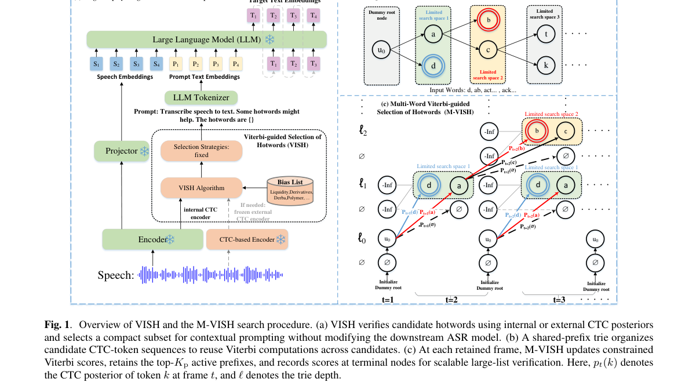

*Main result - Figure 2 Forward and backward Bi-MVISH alignments for “liddy” (left) and “smolny” (right). Both directions detect “liddy”, whereas backward search recovers stronger evidence for “smolny” with its weak*

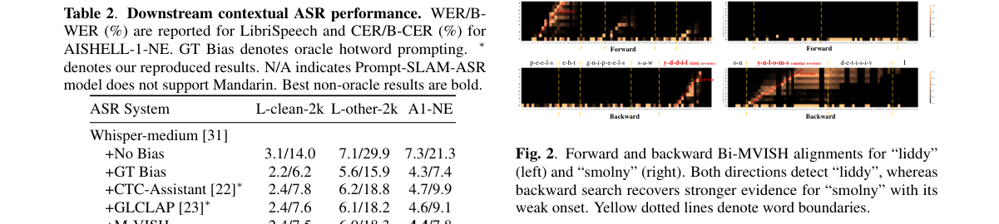

**Why this ranks #4**: 它把热词预选从「检索相似度」换成了「声学后验验证」，这是一个更硬的标准。

---

### 5. SKAD: Sketch-Guided Audio-Contrastive Decoding for Reasoning in Large Audio-Language Models

**arXiv**: [2610.28146](https://arxiv.org/abs/2610.28146) | **Score**: 7.85 (relevance 8.0 x 0.7 + quality 7.5 x 0.3) | **Tags**: audio-LM, decoding, reasoning | **Categories**: eess.AS | **Pages**: 14

**Authors**: Junyu Wang, Peiyuan Jiang, Siyuan Zhang, Jian Zong, Tianrui Wang, Zikang Huang, Meng Ge, Longbiao Wang, Jianwu Dang

**Affiliation**: Tianjin University, College of Intelligence and Computing; Huiyan Technology Co., Ltd; Shenzhen Institute of Advanced Technology, Chinese Academy of Sciences

**Abstract**

> Large Audio-Language Models (LALMs) have shown increasing potential in audio understanding and reasoning by generating intermediate reasoning steps before answering. However, directly eliciting long-form reasoning from audio does not always lead to more reliable predictions. Even reasoning-oriented LALMs may gradually shift from acoustic evidence to language-continuation patterns during generation. A natural solution is to use contrastive decoding with an audio-masked branch, but directly applying this strategy to plain chain-of-thought reasoning is often ineffective, since the masked branch lacks sufficient audio-related context and provides an unstable reference. To address this issue, we propose \textbf{SKAD} (\textbf{Sk}etch-Guided \textbf{A}udio-Contrastive \textbf{D}ecoding), a training-free inference-time method for audio reasoning. SKAD first constructs an acoustic evidence sketch that summarizes question-relevant auditory information. It then performs contrastive decoding between an audio-conditioned reasoning branch and a sketch-only branch. By using the sketch as a shared semantic scaffold, SKAD makes the masked branch more informative and encourages decoding decisions that are more dependent on the original audio. We evaluate SKAD on Qwen2.5-Omni-7B and Step-Audio-R1 across three audio understanding and reasoning benchmarks: MMAR, MMAU, and MMSU. Experimental results show that SKAD consistently improves the average accuracy of both models across all benchmarks. Further ablations show that direct contrastive decoding without the acoustic evidence sketch provides limited or negative gains, confirming the importance of constructing a reliable contrastive reference before audio-contrastive decoding.

**Key findings**

- **Finding**: LALM 通过先生成中间推理步骤再作答，在音频理解与推理上潜力可观；但**直接从音频诱导长推理并不总能带来更可靠的预测**。

- **Finding**: 即使是面向推理的 LALM，也可能在生成过程中**逐渐从声学证据滑向语言续写模式**。

- **Finding**: 自然解法是用音频遮蔽分支做对比解码，但作者发现**直接套用这一策略无效**。

- **Finding**: SKAD 是免训练的、推理期的方法：sketch 引导的音频对比解码。

- **Inference**: 「从声学证据滑向语言续写」与 10-20 日报那篇 Text Dominance 是同一现象的生成侧版本；SKAD 给出了一个不改权重、只在解码时纠正的办法。

- **Recommendation**: 推荐。

**Key figures**

*Framework / architecture - Figure 1 Overview of SKAD, the proposed sketch-guided audio-contrastive decoding method. Given an audio input and a question, the model first generates an acoustic evidence sketch that summarizes task-*

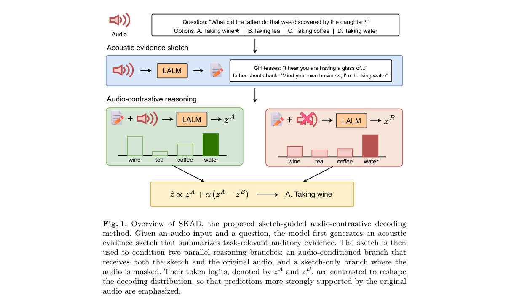

**Why this ranks #5**: 它把「推理时越说越像在续写文本」这一失效模式，和一个免训练的解码期修正方案配成一对。

---

### 6. Slots Are Not Speakers: Training-Free Speaker Linking for Frozen Streaming Diarizers

**arXiv**: [2610.28053](https://arxiv.org/abs/2610.28053) | **Score**: 7.45 (relevance 7.5 x 0.7 + quality 7.0 x 0.3) | **Tags**: audio-LM, diarization, streaming | **Categories**: cs.AI, cs.SD | **Pages**: 5

**Authors**: Aditya Srinivas Menon, Kumarmanas Nethil, Kavya Manohar

**Affiliation**: Adalat AI, India

**Abstract**

> This paper presents a causal, training-free linker that allows a frozen streaming diarizer to track more speakers than it has output slots. Streaming end-to-end diarizers such as Streaming Sortformer emit a fixed number N of concurrent speaker slots. Above N speakers, they keep detecting speech but reuse slots across people, because N bounds how many speakers the model can express at once, not how many it will meet. The linker uses only the host's slot posteriors and the audio. It keeps the frames where one slot is active, splits each slot where the speaker changes, embeds each piece with an off-the-shelf speaker encoder, and matches it against a bank of speakers seen so far. It only relabels, so missed speech and false alarm are identical to the host's and every gain is a reduction in speaker confusion. On 1418 sessions from eight corpora, it reduces the 4-slot host's DER above its cap from 36.8% to 22.6%, and barely moves it below the cap. The same constants transfer to the host's 8-slot successor and to two streaming EEND hosts from a different model family. On courtroom hearings with up to 23 speakers it reduces cpWER from 82.7% to 24.4%.

**Key findings**

- **Finding**: 流式端到端 diarizer（如 Streaming Sortformer）输出固定数量 N 的并发说话人槽位。

- **Finding**: 超过 N 人时，它**继续检测语音但跨人复用槽位**——N 限制的是模型能同时表达多少人，而不是会遇到多少人。

- **Finding**: 该 linker 是因果的、免训练的，只用主干的槽位后验与音频：保留某槽位活跃的帧，按说话人变化切分各槽，用现成说话人编码器嵌入每一片段，与已见说话人库匹配；**只做重标注**，因此漏检与虚警与主干完全一致。

- **Finding**: 在 8 个语料的 1,418 个会话上，把 4 槽主干在超限部分的 DER 从 **36.8% 降到 22.6%**，而在未超限部分几乎不动。

- **Finding**: 同样的常数可迁移到主干的 8 槽后继版本与另一模型族的两个流式 EEND 主干；在最多 23 人的庭审听证上，把 cpWER 从 **82.7% 降到 24.4%**。

- **Inference**: 「只重标注」是一个极干净的接口设计——它把模型的能力上限（槽位数）与实际需求（人数）解耦，且不引入任何额外漏检。这与 10-19 日报「记忆聚集」式的问题结构相似：真正的限制往往是一个固定的容量槽位。

- **Recommendation**: 推荐。

**Key figures**

*Framework / architecture - Figure 1 Earnings-21 session 018, 13 speakers. Top: the frozen 4-slot host, regions coloured by dominant reference speaker; Slot 2 alone carries five people. Middle: the linker, 13 of 13 identities. Bo*

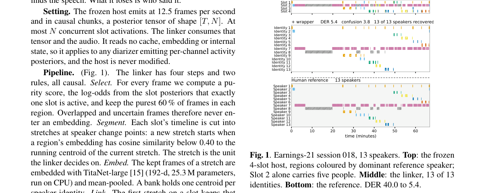

**Why this ranks #6**: 23 人庭审场景 cpWER 从 82.7% 降到 24.4%，且不引入任何额外漏检——这是本批少见的「零代价增益」。

---

### 7. EvaOmni: An Evidence-Grounded Benchmark for Audio-Visual Reasoning

**arXiv**: [2610.28444](https://arxiv.org/abs/2610.28444) | **Score**: 7.3 (relevance 7.0 x 0.7 + quality 8.0 x 0.3) | **Tags**: audio-LM, benchmark, multimodal | **Categories**: cs.CV | **Pages**: 34

**Authors**: Xiaoxing Hu, Wenxi Yao, Chaoyuan Shi, Ziqi Ye, Xiaorong Guo, Peixuan Li, Zhuoran Sun, Ziyang Gong, Peiyuan Zhang, Mingxin Liu et al.

**Affiliation**: Shanghai Jiao Tong University; Shanghai Innnovation Institute; Inner Mongolia University of Technology; Fudan University

**Abstract**

> Omni LLMs can naturally locate key audio and visual evidence and integrate information across modalities for audiovisual reasoning. Existing audio-visual reasoning benchmarks that mainly rely on multiple-choice questions usually score models solely based on answer correctness, making it difficult to assess whether a model truly forms a reasoning chain from evidence to the correct answer. In addition, textual or unimodal shortcuts may allow models to answer correctly without analyzing the necessary audio-visual evidence, further weakening the reliability of evaluation benchmarks. To address these issues, we introduce EvaOmni, an evidence-grounded benchmark containing 392 videos and 1,027 purely human-annotated question-answer pairs, covering 15 capabilities and three levels: retrieval and localization, basic understanding, and complex reasoning. We design a series of rigorous annotation procedures in which experts annotate audio and visual evidence and construct video-based distractors; humans review whether questions meet strict inspection criteria, and finally models filter textual and unimodal shortcuts. Beyond high-quality question-answer pairs, we require models to simultaneously return the answer and supporting evidence intervals in order to evaluate the complete reasoning chain. We propose the Coverage Grounded Score (C.G.) to measure how much annotated evidence a model identifies, and the Bottleneck Grounded Score (B.G.) to penalize poor temporal localization in either modality; both are incorporated into answer correctness. Across 7 open-weight and 17 proprietary Omni LLMs, Gemini3.7-Flash achieved the highest overall accuracy (79.4%), C.G. (70.8%), and B.G. (35.1%). At Level 3, it reached 79.1% accuracy, but its B.G. was only 12.3%. These results show that even the most advanced models still have room for development in grounded audio-visual reasoning.

**Key findings**

- **Finding**: 现有的音视频推理基准主要依赖多选题，**仅按答案正确性打分**，无法评估模型是否真正从证据走到答案。

- **Finding**: 文本或单模态捷径可能让模型答对而完全没有分析必要的音视频证据。

- **Finding**: EvaOmni 含 **392 个视频与 1,027 个纯人工标注的问答对**，覆盖 15 项能力与三个层级：检索与定位、基础理解、复杂推理。

- **Finding**: 标注流程严谨：专家标注音视频证据、构造基于视频的干扰项、人类复核严格检查标准、最后用模型过滤文本与单模态捷径。

- **Finding**: 提出 **Coverage Grounded Score (C.G.)** 衡量模型识别了多少被标注的证据，**Bottleneck Grounded Score (B.G.)** 惩罚任一模态中的糟糕时间定位；两者都被计入答案正确性。

- **Inference**: 把「证据覆盖」与「时间定位瓶颈」分离出来计分，意味着一个模型可以「答对但没看证据」，这类情况现在能被定量识别。

- **Recommendation**: 推荐。

**Key figures**

*Framework / architecture - Figure 1 Existing audio-visual reasoning benchmarks suffer from shortcut issues, which weaken the reliability of benchmark evaluation. EvaOmni greatly reduces this phenomenon through a series of rigor*

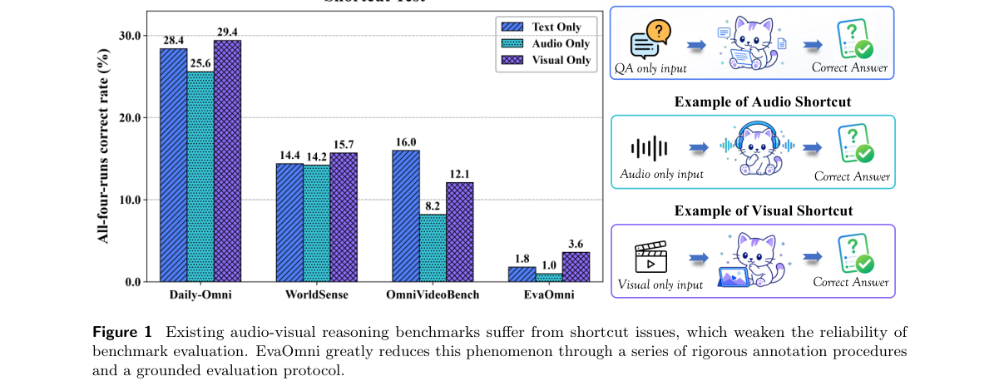

*Main result - Figure 2 Top: We designed a series of rigorous annotation procedures to ensure the quality and reliability of EvaOmni questions. Bottom: An example of Grounded Annotation, where, building on MCQ, we r*

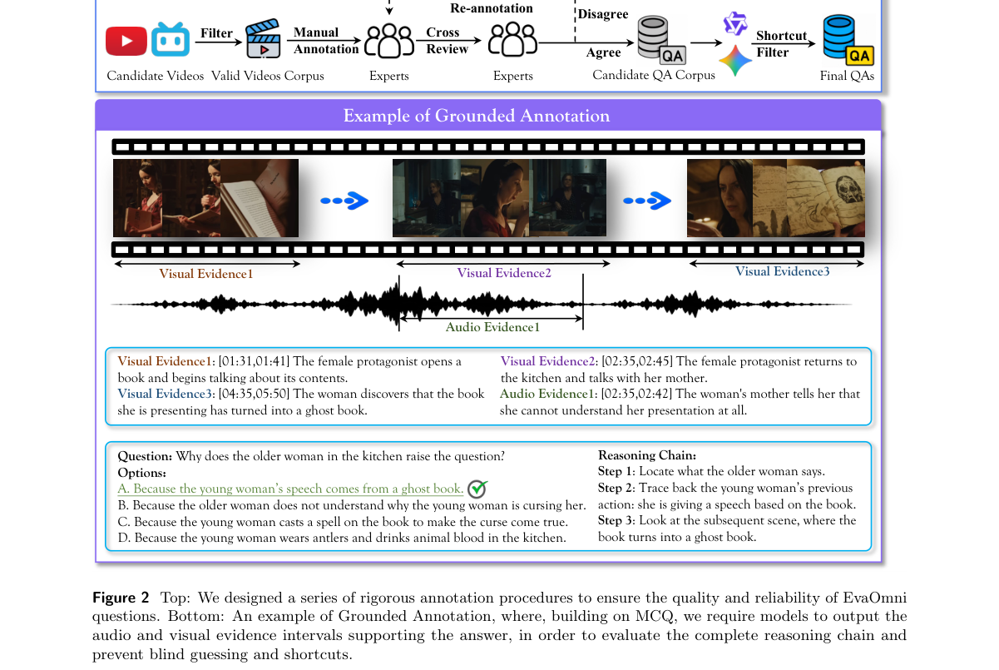

**Why this ranks #7**: 它把音视频推理评测从「答对没有」推进到「有没有沿着证据推理」，并给出两个可分解的 grounded 分数。

---

### 8. PhonoBridge: Error-Aware Phoneme-Mediated EMG-to-Text Reconstruction

**arXiv**: [2610.27678](https://arxiv.org/abs/2610.27678) | **Score**: 7.25 (relevance 7.0 x 0.7 + quality 7.5 x 0.3) | **Tags**: speech-LM, EMG, interface | **Categories**: cs.CL, cs.HC, cs.SD | **Pages**: 5

**Authors**: Wen Qiu, Jiacheng Zhang, Xuanda Chen, Siqi Cai, Haizhou Li

**Affiliation**: School of Artificial Intelligence, The Chinese University of Hong Kong, Shenzhen, China; Shenzhen Loop Area Institute, Shenzhen, China; Harbin Institute of Technology, Shenzhen, China

**Abstract**

> Electromyography (EMG) provides a non-invasive means of decoding silently articulated speech into text, but accurate decoding remains challenging due to limited availability of paired EMG-text data. We introduce PhonoBridge, a two-stage framework comprising a channel-aware EMG-to-phoneme frontend and a large language model (LLM) backend for text reconstruction. The frontend is trained on paired EMG-text data that consists of channel-wise feature extraction, cross-channel fusion, and electrode embeddings. With phonemes as the intermediate representation, we expand the backend's training data by converting LibriSpeech transcripts into phoneme-text pairs without additional EMG recordings. To adapt the LLM to frontend noise, we introduce Error-Profile-Guided Augmentation (EPGA), which perturbs transcript-derived phoneme sequences according to error patterns estimated from frontend predictions, generating additional training pairs for the LLM. On the Open Vocabulary silent-speech dataset, PhonoBridge achieves 24.77% WER, outperforming the previously reported best of 28.27% on the same test split.

**Key findings**

- **Finding**: EMG 提供了把静默发音解码为文本的非侵入手段，但准确解码受限于成对 EMG-文本数据稀缺。

- **Finding**: 核心问题：**如何用转写得到的音素-文本对来训练 LLM 去纠正 EMG 特有的识别错误**？

- **Finding**: PhonoBridge 是两阶段框架：通道感知的 EMG→音素前端 + LLM 文本重建后端。

- **Finding**: 前端在成对 EMG-文本数据上训练，包含逐通道特征提取、跨通道融合与电极嵌入。

- **Inference**: 「用转写监督训练纠错」是把语音系统的先验迁移到非语音接口上的标准套路；音素作为中间层是一个务实的选择，因为它比对齐整句文本容易得多。

- **Recommendation**: 可选读。

**Key figures**

*Framework / architecture - Figure 1 Electrode placement and qualitative comparison of de- coding errors. Left: Electrode placement for EMG acquisi- tion. Right: A comparison of EMG-decoded text and human transcription of the cor*

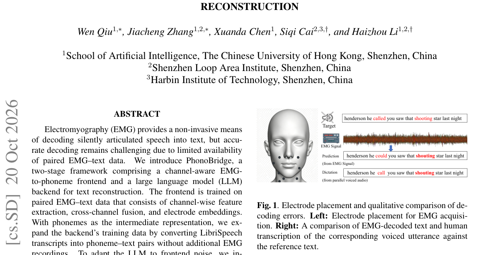

*Main result - Figure 2 Overall architecture of PhonoBridge. The framework comprises two stages: (a) a channel-aware frontend that maps multichannel EMG to phoneme sequences and is trained with CTC loss; and (b) an L*

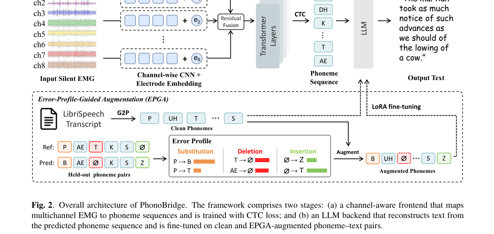

**Why this ranks #8**: Wild-card：非语音语言模型，而是语音接口通道；音素作为中间层 + LLM 纠错后端，是把语音能力搬到 EMG 接口的一个干净范式。

---

### 9. AudiPsy: Evidence-Grounded Multimodal Reasoning over Spoken Counseling Conversations for Depression Assessment

**arXiv**: [2610.27567](https://arxiv.org/abs/2610.27567) | **Score**: 7.25 (relevance 7.0 x 0.7 + quality 7.5 x 0.3) | **Tags**: audio-LM, spoken-dialogue, clinical | **Categories**: cs.AI, cs.CL | **Pages**: 25

**Authors**: Chuanbo Zhu, Run Luo, Weibo Zhao, Yue Li, Kun Qian, Qiang Qu, Yike Guo, Minghuan Tan, Wei Xue

**Affiliation**: Chuanbo Zhu1, Run Luo3, Weibo Zhao4, Yue Li2; The Hong Kong University of Science and Technology; Shenzhen Institutes of Advanced Technology, Chinese Academy of Sciences; National University of Singapore

**Abstract**

> Depression assessment from counseling speech requires integrating textual and acoustic psychological evidence across turns, yet existing end-to-end classification approaches lack explicit multimodal evidence interpretation and context-aware reasoning. We propose AudiPsy, an evidence-grounded omni-LLM for depression assessment over spoken counseling conversations. AudiPsy employs an Observation-Assessment-Summary (OAS) paradigm to integrate dialogue transcripts, textual and acoustic emotions, and textual-acoustic emotion incongruence into structured reasoning. OAS incrementally organizes multimodal observations, performs contextualized assessment, and maintains an evolving dialogue summary for subsequent turns. To support this framework, we construct AudiPsy-Counsel, a synthetic spoken counseling conversation corpus with multimodal context augmentation, and develop a unified three-stage curriculum for depression-oriented reasoning. Experiments on DAIC-WOZ demonstrate superior depression assessment performance over specialized depression detection methods and general-purpose speech/omni-LLMs, along with improved reasoning quality, while supplementary evaluation on EATD-Corpus supports AudiPsy's applicability to naturalistic conversations.

**Key findings**

- **Finding**: 从咨询语音做抑郁评估，需要跨轮次整合文本与声学心理证据，而端到端分类方法缺乏**显式的多模态证据解读**与上下文感知推理。

- **Finding**: AudiPsy 是面向抑郁评估的**证据锚定 omni-LLM**，采用 Observation-Assessment-Summary (OAS) 范式整合对话转写、文本与声学情绪、以及文本-声学情绪交互。

- **Finding**: OAS 范式把多模态抑郁推理分解为三个结构化字段。

- **Finding**: 作者构建了 AudiPsy-Counsel 数据集并给出其话题分布。

- **Inference**: 把「证据 → 评估 → 总结」写成三个显式字段，让链路的可审计性从方法论上被保证——这在高风险场景里比分数更重要。

- **Recommendation**: 可选读（医疗域，通用性有限）。

**Key figures**

*Framework / architecture - Figure 1 Overview of the AudiPsy, from structured multimodal reasoning to data augmentation and model training.*

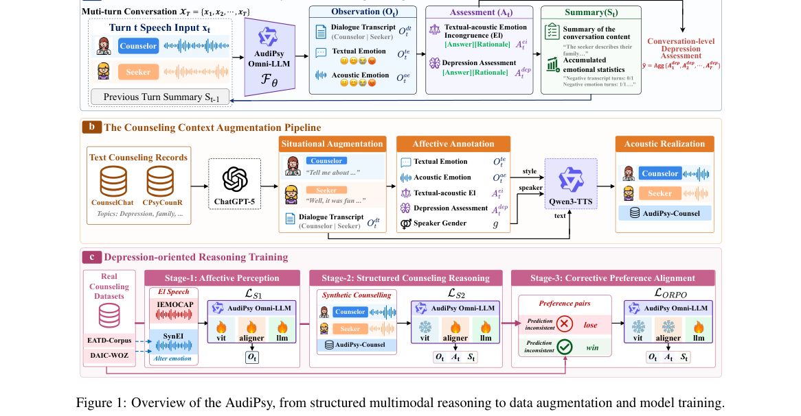

*Main result - Figure 2 Topic distribution of AudiPsy-Counsel.*

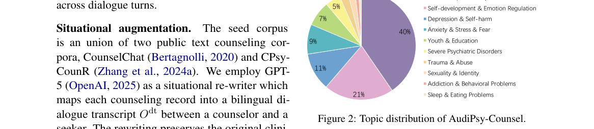

**Why this ranks #9**: OAS 三段式结构把「证据解读」写进了输出格式，提供了可审计性。

---

### 10. SMART: Semantic Segment Mapping and Assessment of Recognition Transcripts with Contextual Rubrics

**arXiv**: [2610.27820](https://arxiv.org/abs/2610.27820) | **Score**: 7.0 (relevance 7.0 x 0.7 + quality 7.0 x 0.3) | **Tags**: speech-LM, ASR, evaluation | **Categories**: cs.AI, cs.CL, eess.AS | **Pages**: 5

**Authors**: Xiaoyu Gu, Chencheng Wang, Fuyang Li, Yu Xi, Tao Liu, Jiaoqi Guo, Kai Yu

**Affiliation**: MoE Key Lab of Artificial Intelligence, AI Institute, X-LANCE Lab, Shanghai Jiao Tong University; School of Intelligence Science and Technology, Nanjing University, Suzhou, China; AISpeech Ltd, Suzhou, China

**Abstract**

> Word error rate (WER) assigns equal cost to lexical edits despite their different semantic consequences, while overall semantic scores cannot identify which individual errors alter the intended meaning. We formulate ASR semantic evaluation as context-aware, segment-level consequence assessment and propose Semantic Segment Mapping and Assessment of Recognition Transcripts with Contextual Rubrics (SMART), a framework for traceable semantic evaluation and targeted ASR correction. SMART maps reference-hypothesis discrepancies into coherent segments and applies a structured contextual rubric to assign explicit consequence labels. These labels support Semantic Impact Error Rate (SIER), which quantifies consequential errors at utterance, chunk, and lexical levels. Against majority-vote human labels, SMART achieves 0.843 F1 versus 0.745 for direct LLM judgment. Evaluation across multiple LLMs further demonstrates that SMART is relatively insensitive to the choice of evaluation model, while MER and SIER reveal different aspects of ASR quality. A separate target-reference-free rubric guides correction using the target hypothesis and surrounding ASR hypotheses, outperforming a matched w/o Rubric baseline on both datasets, with further absolute reductions of 0.85-0.98 percentage points in MER and 1.18-1.65 percentage points in SIER_lex.

**Key findings**

- **Finding**: WER 对词法编辑一律赋相同代价，而整体语义分数又无法指出**哪些具体错误改变了意图**。

- **Finding**: 论文把 ASR 语义评测形式化为**上下文感知的片段级后果评估**。

- **Finding**: SMART 提供可追溯的语义评估与定向 ASR 纠错：先做片段映射，再按上下文规则评估片段语义后果，最后做目标-参考无关的纠错。

- **Finding**: 在 Canvas Speech 与 TED-LIUM 3 上对 SenseVoice 做纠错，报告 MER 与 SIER_lex 等指标。

- **Inference**: 把「语义错误」下沉到片段级并配上上下文规则，比整体语义分数更可操作——错误可以定位、可以被定向修。

- **Recommendation**: 可选读（wild-card：评测工具）。

**Key figures**

*Framework / architecture - Figure 1 SMART: Context-aware segment-level semantic consequence assessment and correction. (1) Segment Mapping: Organizes aligned lexical discrepancies into semantically coherent segments. (2) Referen*

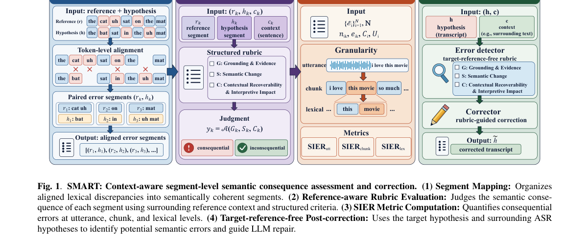

*Main result - Figure 2 Target-reference-free correction of SenseVoice on Canvas Speech and TED-LIUM 3. Bars report MER and SIERlex for the original hypothesis, the matched w/o Rubric baseline, and rubric- guided cor*

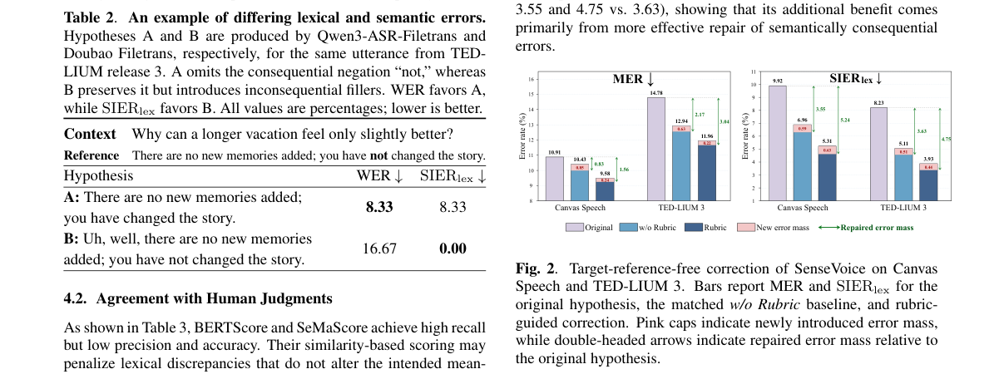

**Why this ranks #10**: Wild-card：偏评测工具而非模型能力，但它指出了 WER 的一个结构性缺陷。

---

## Footer

- Total papers reviewed across all 7 tracks: 70 (from 517 scanned, 93 full reads)
- audio_lm track final top-10: 10
- Wild-cards in this track: 2
- Figure assets: `res/` (shared across tracks)

Generated by `mine-arxiv-daily-digest` skill. Sister file: `2026-10-21_audio_lm_entry.md`.
