# ArXiv Daily Digest - 2026-10-21 (具身智能与世界模型, 10 papers)

**Generated**: 2026-10-21 17:00 CST

**Source**: arXiv cs.CV, cs.SD, eess.AS, cs.CL, cs.AI, cs.RO, cs.LG submissions, window 2026-10-20 UTC (latest announced batch as of 2026-10-21 17:00 CST)

**Track**: embodied (top 10 of 501 papers scanned, 55 full reads)

**Scope**: single differentiable world model for humanoid whole-body control, state-consistent visuo-tactile world model, sim-to-real evaluation of an industrial navigation stack, tactile in-context learning for manipulation, complementary predictive representations, fast motion retargeting, paired clean-perturbed robustness diagnostics, MLLM judges for embodied video, active visual verification for object-goal navigation, tactile hand representations from human data

---

**本批具身线的最强主线是「该预测什么、该用什么模拟器」。** SuperMimic（CoRL 2026 Oral）用一个可微世界模型替代了「一堆逐动作专家 + 有损蒸馏」的流水线，GPU 小时数下降一个数量级以上；Physical Canvas 则把世界模型用作策略评估器时最致命的缺陷点破——**视觉上合理的预测可能误述接触动力学**，因此它做了状态一致性的视觉-触觉世界模型。

**From Predictive Geometry to Action 正面回答了「机器人策略该预测什么」**：不是预测未来本身，而是从多视角视频里学出**两个互补表示**——一个描述场景几何及其演化的「预测性几何表示」，一个强调几何转移中动作相关信息的「运动表示」——WidowX 上绝对提升 10.4 个百分点。它与 Physical Canvas 共同指向同一件事：单一模态、单一时刻的观测撑不起接触密集操作。

**触觉三篇同时出现**（Tactile-ETA 用上下文注入把触觉经验给进智能体而不做任务特定训练；HuTact 改用人类手-物交互数据预训练触觉手部表示；Physical Canvas 把触觉放进世界模型），与前几日「触觉子方向升温」的判断一致。数据侧 FRDV 指出很多「数据不够」的抱怨其实卡在准备流水线上，用接触隐式的可微 SQP 把重定向做成高吞吐。评测侧两篇值得看：RoboCasa-Shift 用**配对的 clean-perturbed rollout**（同场景只差一个偏移因素）把偏移效应变成受控实验；RoboJudge 则评估「裁判本身」——在 MLLM-as-judge 成为基础设施之前，先量化它与人类判断的一致性。

---

## Top 10 - 具身智能与世界模型

### 1. SuperMimic: Scaling Humanoid Whole-Body Control with One Differentiable World Model

**arXiv**: [2610.28480](https://arxiv.org/abs/2610.28480) | **Score**: 9.0 (relevance 9 x 0.7 + quality 9 x 0.3) | **Tags**: embodied-ai, world-model, humanoid | **Categories**: cs.RO | **Pages**: 19

**Authors**: Qiayuan Liao, Yiyang Shao, Junfeng Long, Kevin Zakka, Roberto Horowitz, Pieter Abbeel, Koushil Sreenath

**Affiliation**: UC Berkeley

**Abstract**

> Tracking large human-motion datasets has become the dominant route to general, expressive humanoid whole-body control, but scaling across many motions is expensive. Current pipelines use model-free reinforcement learning, either merging per-motion specialists through lossy distillation, or brute-forcing a single policy with cluster-scale compute. SuperMimic amortizes learning across all motions with one differentiable world model of their shared dynamics, fit from logged transitions of a standard rigid-body simulator. The world model and the tracking policy train together in one loop, and backpropagation-through-time over short imagined rollouts gives the policy analytic gradients. Fast imagined rollouts and analytic gradients make policy learning efficient. In 3 hours on a single GPU, SuperMimic surpasses the return of a state-of-the-art motion tracker baseline trained for 7 days on 128 GPUs. It reduces GPU-hours by more than $1000\times$ and fails on only 25 of 129,514 benchmark motions, versus 179 failures for the baseline. After 9.8 hours on two GPUs, SuperMimic achieves zero failures. From 1 to 264 hours of motion, the world model's prediction error stays stable, and GPU-hours to a target return grow slowly. Our policy transfers to a physical Unitree G1 across diverse and acrobatic motions. SuperMimic removes compute as the bottleneck to scaling humanoid whole-body control, making it practical to measure motion-tracking scaling laws.

**Key findings**

- **Finding**: 跟踪大规模人体动作数据集已成为通用、富有表现力的人形全身控制的**主流路线**，但跨大量动作扩展代价高昂。

- **Finding**: 当前流水线使用无模型 RL：要么通过有损蒸馏合并逐动作专家，要么用集群级算力暴力训练单一策略。

- **Finding**: SuperMimic 用**一个可微世界模型**在其共享动力学上摊销学习，该模型由标准刚体仿真器的记录转移拟合而成。

- **Finding**: 论文标题指出 GPU 小时数减少**超过一个数量级**。

- **Inference**: 这与 10-20 日报 Ropedia 的路线形成对照：Ropedia 是跨本体摊销，SuperMimic 是跨动作摊销——两者都在回答「如何把一次性的大规模训练变成一次性的可微模型复用」。

- **Recommendation**: 强烈推荐。

**Key figures**

*Framework / architecture - Figure 1 A learned differentiable world model trains a humanoid whole-body controller and reduces GPU-hours by more than 1000× versus cluster-scale model-free reinforcement learn- ing (§4.1). Left: t*

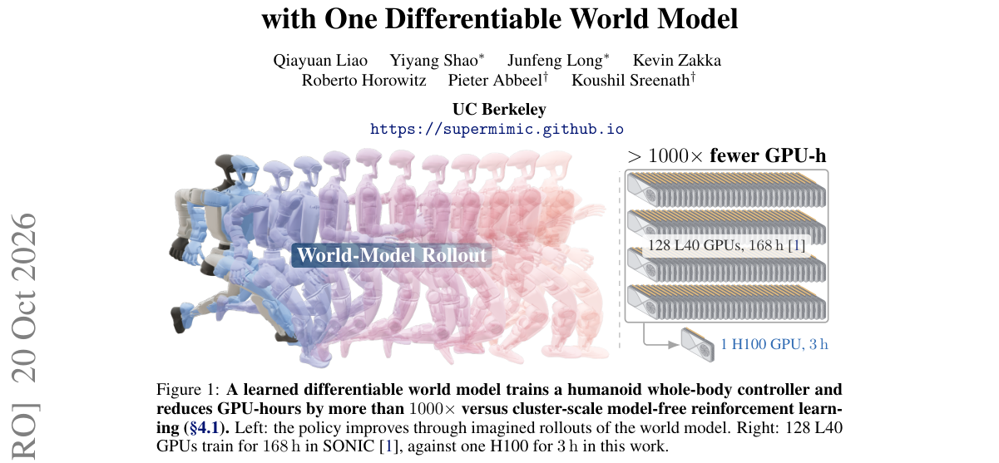

*Main result - Figure 2 SuperMimic training loop. (1) The current policy πθ collects transitions in simula- tion into a fixed-size replay buffer B, where new transitions replace the oldest. (2) The differen- tiable*

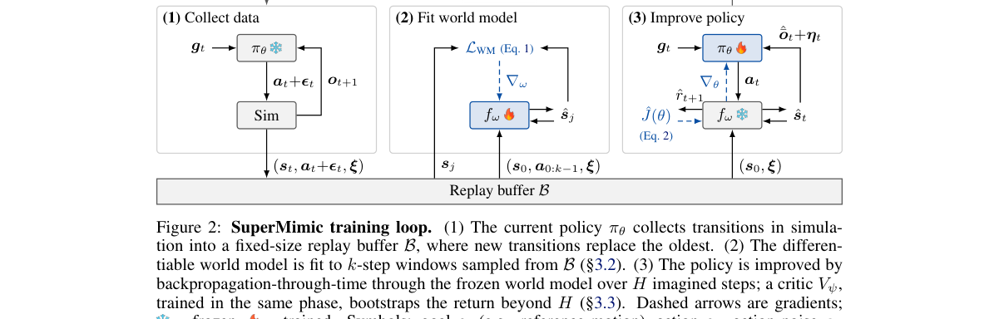

**Why this ranks #1**: 它用「一个可微世界模型」替换了「一堆逐动作专家 + 蒸馏」，并给出了数量级的算力下降——这是本批具身线里工程与科学兼备的一篇。

---

### 2. Physical Canvas: A Vision Tactile World Model For Robot Policy Evaluation And Learning

**arXiv**: [2610.28613](https://arxiv.org/abs/2610.28613) | **Score**: 8.85 (relevance 9 x 0.7 + quality 8.5 x 0.3) | **Tags**: embodied-ai, world-model, tactile | **Categories**: cs.RO | **Pages**: 34

**Authors**: Zebin Xing, Yuhang Zheng, Yupeng Zheng, Yichen Zhang, Zichen Li, Shangqing Zhou, Yujie Zang, Yuchen Liu, Zhongpu Xia, Haoran Li et al.

**Affiliation**: Institute of Automation, Chinese Academy of Sciences; National University of Singapore; Xi’an Jiaotong University; Beijing Institute of Technology

**Abstract**

> Evaluating and post-training robot policies through physical interaction is costly and difficult to scale, motivating action-conditioned world models as interactive simulators. However, visually plausible predictions can misrepresent contact dynamics, providing unreliable feedback for policy evaluation and learning. We introduce PhysCanvas, a state-consistent visuo-tactile world model for contact-rich robot manipulation. PhysCanvas unifies multi-view RGB, tactile images, marker displacement, task state, and actions within a unified vision space. All modalities share a video VAE and pretrained generative backbone, allowing optical touch to reuse visual and temporal priors. Motion images derived through forward kinematics and camera projection provide spatially aligned action conditioning, while an initial RGB anchor and updated reference observations guide sequential generation. Our consistency-aware post-training uses the frozen Scene Reward Model, Modality Reward Model, and State Reward Model to supervise scene preservation, visual-tactile compatibility, and agreement with real task outcomes. The resulting world model supports closed-loop policy rollouts for evaluation and provides imagined interactions and rewards for GRPO policy updates. Across four real-world manipulation tasks, when policies are rolled out in the world model, State Reward Model supervision increases the arithmetic mean of task-wise Pearson correlations between world-model and real-world success rates from 0.602 to 0.885. Policy post-training in the reward-guided world model further increases $π_{0.5}$'s mean real-world success rate from a 59.1% SFT baseline to 70.8%. These results demonstrate the value of unified multimodal modeling and consistency-aware post-training for robot policy evaluation and learning. Project page: https://zebinx.github.io/PhysCanvas_HomePage/.

**Key findings**

- **Finding**: 通过物理交互评估与后训练机器人策略代价高昂且难扩展，这促使人们把**动作条件世界模型**当作交互式仿真器。

- **Finding**: 但**视觉上合理的预测可能误述接触动力学**，从而为策略评估与学习提供不可靠的反馈。

- **Finding**: PhysCanvas 是面向接触密集机器人操作的状态一致性**视觉-触觉世界模型**。

- **Finding**: 它统一多视角 RGB、触觉图像、标记位移、任务状态与动作。

- **Finding**: 作者给出真实执行与对应触觉观测的任务总览。

- **Inference**: 「看起来对」不等于「接触对」，这一区分正是把世界模型用作策略评估器时的生死线——只有接触动力学对，模拟器里的策略排名才可信。

- **Recommendation**: 强烈推荐。

**Key figures**

*Framework / architecture - Figure 1 PhysCanvas as a multimodal simulator. Action-conditioned visual–tactile rollouts sup- port policy evaluation and learning.*

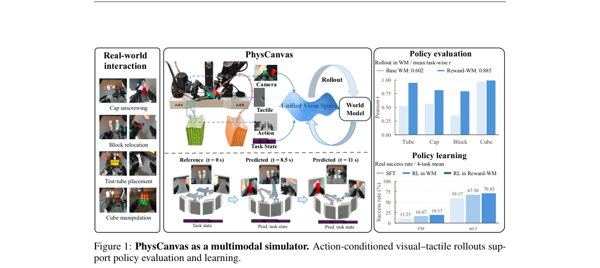

*Main result - Figure 2 Task overview. Real-world executions and corresponding tactile observations.*

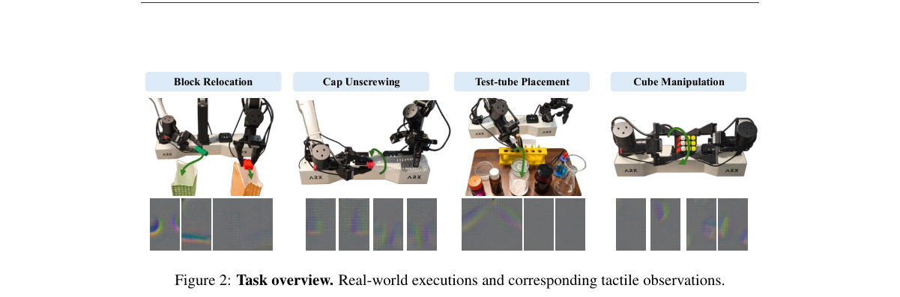

**Why this ranks #2**: 它把「视觉合理但接触错误」这个致命缺陷摆到了世界模型作为评估器的场景下，与日报追踪的「触觉子方向升温」直接接续。

---

### 3. From Predictive Geometry to Action: Learning Complementary Predictive Representations for Embodied Manipulation

**arXiv**: [2610.28164](https://arxiv.org/abs/2610.28164) | **Score**: 8.85 (relevance 9 x 0.7 + quality 8.5 x 0.3) | **Tags**: embodied-ai, world-model, manipulation | **Categories**: cs.RO | **Pages**: 36

**Authors**: Xiaoxu Xu, Hao Li, Hongtao Zhang, Yili Tang, Jiafei Cao, Junhao Cai, Haoxiang Ma, Weixin Li, Weinan Zhang

**Affiliation**: Beihang University; Shanghai Artificial Intelligence Laboratory

**Abstract**

> Effective manipulation requires a policy to capture not only about the current scene geometry, but also about how that geometry will evolve under interaction. Existing approaches either augment policies with geometric information from current observations or introduce future prediction as auxiliary supervision, leaving open how predictive geometry should be represented for action generation. Therefore, we propose a two-stage framework, which learns complementary predictive representations from multi-view video clips. During pretraining, a frozen 3D foundation model provides dense geometric features that are compressed into predictive geometric representations and optimized to preserve scene structure and its temporal evolution. Action supervision is then applied to geometric transitions to extract a complementary motor representation that emphasizes action-relevant transitions. During downstream post-training, predictive geometry is transferred through geometry queries, while the motor representation guides intermediate features along the action-generation pathway. Future observations are used only as privileged supervision during training and are not required at inference time. Across LIBERO, LIBERO-Plus, SimplerEnv, and real-world bimanual and single-arm tasks, our approach consistently improves downstream policies, including an absolute gain of 10.4 percentage points on the WidowX evaluation. We further demonstrate transfer across multiple VLA architectures and WAMs, with improvements in both future-world and action prediction. The code will be available at https://github.com/xuxiaoxxxx/CPR.

**Key findings**

- **Finding**: 有效操作要求策略不仅捕获当前场景几何，还要捕获**该几何在交互下将如何演化**。

- **Finding**: 现有做法要么用当前观测的几何信息增强策略，要么把未来预测作为辅助监督，**留下了「预测几何该以什么形式表示才能用于动作生成」这一空白**。

- **Finding**: 本文提出两阶段框架，从多视角视频片段学习**互补的预测表示**：一个预测性几何表示（紧凑、结构化地描述场景几何及其演化）与一个运动表示（强调几何转移中的动作相关信息）。

- **Finding**: 两者不强行用同一表示承担同样角色。

- **Finding**: 在 LIBERO、LIBERO-Plus、SimplerEnv 与真实双臂/单臂任务上一致提升下游策略，WidowX 评测上**绝对提升 10.4 个百分点**。

- **Inference**: 「几何」与「运动」分开表示，等于承认当前几何与几何变化对动作的贡献机制不同——这与 10-16 日报「机器人策略该预测什么」的线索一脉相承。

- **Recommendation**: 强烈推荐。

**Key figures**

*Framework / architecture - Figure 1 Comparison of geometry-guidance paradigms for policy learning. (a) Input-centric methods aug- ment policies with spatial information derived from current observations. (b) Prediction-centric*

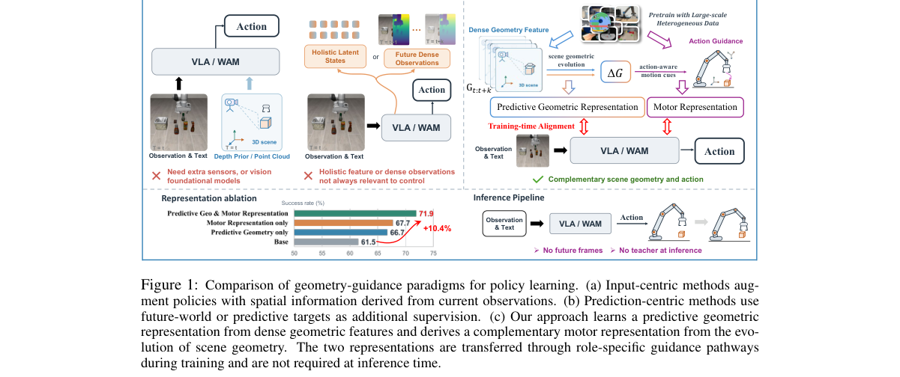

*Main result - Figure 2 Overview of complementary predictive representation pretraining. A frozen 3D foundation model extracts dense geometric features from multi-view video observations, which are compressed by th*

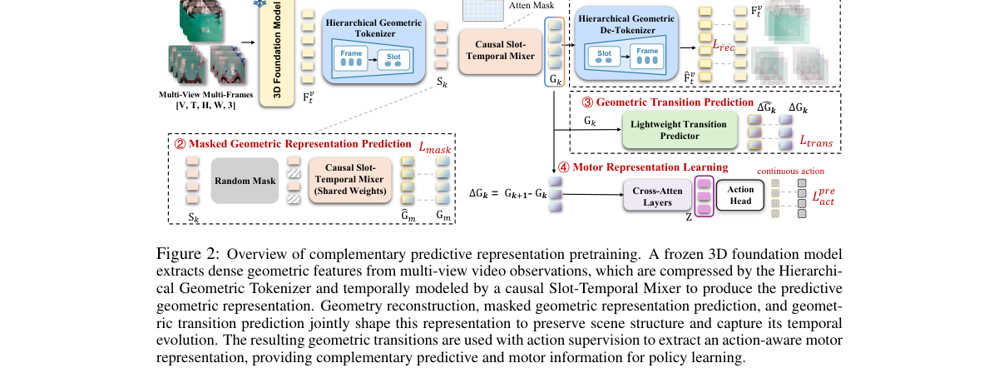

**Why this ranks #3**: 它正面回答了「策略到底该预测什么」：不是预测未来本身，而是把「几何的演化」拆成两个互补表示分别喂给动作。

---

### 4. Embodied Task Agents Can Perform Fine Manipulation through Tactile In-Context Learning

**arXiv**: [2610.27613](https://arxiv.org/abs/2610.27613) | **Score**: 8.7 (relevance 9 x 0.7 + quality 8 x 0.3) | **Tags**: embodied-ai, tactile, in-context-learning | **Categories**: cs.RO | **Pages**: 24

**Authors**: Yubang Wang, Zezheng Huai, Yifei Zhang, Jinhao Wu, Yitong Chen, Haozhe Zhang, Sixian Li, Jingjing Gong, Zhenyang Lin, Ziyang Chen et al.

**Affiliation**: Fudan University; Shanghai Innovation Institute; Tencent; Zhejiang University

**Abstract**

> Can embodied task agents use tactile experience to perform fine manipulation without task-specific model training? We investigate this capability through Tactile-ETA, a system that incorporates tactile experience into an embodied task agent through in-context learning. Successful expert demonstrations show how contact changes during manipulation. We pair each recorded robot movement with its camera views and bilateral tactile observations. We keep tactile observations at the start and end of each movement and add two neighboring time points when the tactile images change markedly in between. The agent combines these demonstrations with current vision, tactile observations, and proprioception to select actions through general-purpose robot tools, without updating model parameters. Across four simulated manipulation tasks, adding tactile observations to the same two expert demonstrations increases average success from 15.75% to 24.00%, with current sensing and execution interfaces held fixed. Further experiments show that performance depends on the sensory content and representation of demonstrations, while comparing agent models on Lift Bottle reveals substantial differences under the same system configuration. On the real-robot tasks, demonstrations with aligned visual and tactile observations increase the task success rate from 0% to 60%. These findings demonstrate the feasibility of using tactile experience in context for fine manipulation and suggest a path toward extending embodied task agents to additional sensory inputs.

**Key findings**

- **Finding**: 研究的问题是：**具身任务智能体能否不做任务特定模型训练，就用触觉经验完成精细操作**？

- **Finding**: Tactile-ETA 通过**上下文学习**把触觉经验注入具身任务智能体。

- **Finding**: 成功的专家演示展示了操作过程中接触如何变化；每个录制的机器人动作与相机画面、**双侧触觉观测**配对。

- **Finding**: 作者保留每次动作首尾的触觉观测，并在阈值达成时加入触觉峰值变化片段。

- **Finding**: 该系统建立在 OpenETA 的工具式执行之上——智能体选择运动与夹爪指令，执行后获得观测与反馈。

- **Inference**: 触觉作为上下文而非作为训练信号，意味着「换一种精细操作任务」可以复用同一套推理框架——这是与「每个任务重新采集数据」完全不同的工程范式。

- **Recommendation**: 强烈推荐。

**Key figures**

*Framework / architecture - Figure 1 Tactile-ETA performs fine manipulation by conditioning a frozen embodied task agent on (a) action-aligned expert demonstrations that preserve vision, motion, and tactile observations, togethe*

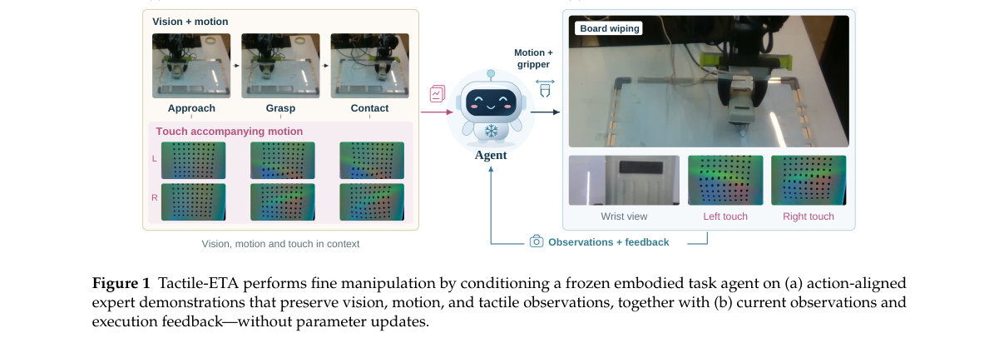

*Main result - Figure 2 Tactile context construction. (Left) Keep tactile endpoints and, when the threshold is met, the peak-change pair. (Right) Combine tactile observations, vision, and recorded robot movements in*

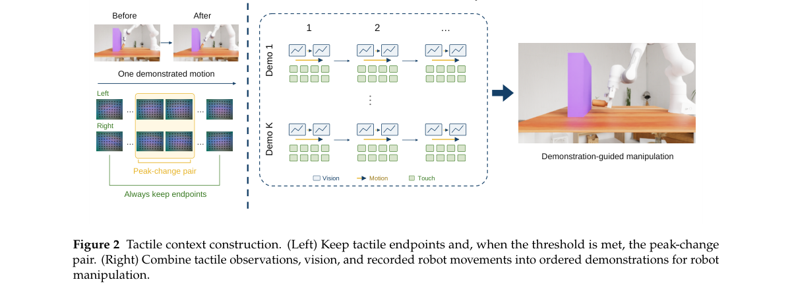

**Why this ranks #4**: 它回答了一个很实际的部署问题：精细操作的任务很多，但每个任务都采触觉数据不现实——用上下文注入是更经济的路线。

---

### 5. Fast Motion Retargeting Pipeline for Scalable Humanoid Robot Learning

**arXiv**: [2610.28470](https://arxiv.org/abs/2610.28470) | **Score**: 8.35 (relevance 8.5 x 0.7 + quality 8 x 0.3) | **Tags**: embodied-ai, humanoid, data-pipeline | **Categories**: cs.RO | **Pages**: 8

**Authors**: Daniel Marew, Sangjun Park, Nisal Perera, Donghyun Kim

**Affiliation**: Massachusetts Institute of Technology, College of Information and Computer Sciences

**Abstract**

> While large-scale human motion capture datasets provide a rich source of demonstrations for humanoid robot learning, retargeting the diverse motions to different humanoid robots remains a nontrivial challenge. Existing kinodynamic trajectory optimization pipelines are computationally expensive and often require manual adjustments per motion. We present FRDV (Fast Retargeting with Dynamics Validation), a scalable framework consisting of rapid constrained kinematic retargeting and an additional dynamics validation pipeline. Its kinematic stage integrates a custom Sequential Quadratic Programming solver, Real-Time Iteration, and parallel chunk-based processing, achieving up to 9,156 frames per second, approximately up to 136 times faster than GMR and ProtoMotions, while robot-specific constraints are incorporated into the optimization to reduce common retargeting artifacts, such as ground penetration and self-collision. For motions requiring additional verification, a contact implicit iLQR controller is utilized to test the retargeted reference under full rigid body dynamics. This dynamics-based validation identifies dynamically infeasible motions and refines contact-related artifacts such as foot floating and foot skating. We evaluate retargeting quality by training motion tracking reinforcement learning policies using several state-of-the-art pipelines and comparing their tracking fidelity and success rates. Furthermore, sim-to-real transfer is demonstrated on a Unitree G1 humanoid. Videos and code are available at: https://daroslab.github.io/frdv/.

**Key findings**

- **Finding**: 大规模人体动捕数据集为人形机器人学习提供了丰富演示，但把多样动作重定向到不同人形机器人仍是非平凡挑战。

- **Finding**: 现有**运动动力学轨迹优化**流水线计算昂贵，且常需对每个动作手工调整。

- **Finding**: FRDV 结合快速约束运动学重定向与可选的动力学验证流水线；采用专用于显式约束处理的 **SQP 求解器**，实现高吞吐重定向。

- **Finding**: 采用基于梯度、**接触隐式**的最优控制方法：接触直接嵌入动力学模型并可微，因而接触转换能在优化中自发涌现。

- **Finding**: 在 LAFAN1 的 77 个序列上做重定向速度基准，并给出三个机器人平台上的逐帧 SQP 计时分解。

- **Inference**: 很多「数据规模不够」的抱怨，实际瓶颈是数据准备流水线；把重定向做成高吞吐且无需逐动作手调，等于直接扩大了可用演示的规模。

- **Recommendation**: 推荐。

**Key figures**

*Framework / architecture - Figure 1 LAFAN1 retargeting speed benchmark across 77 sequences. Mean FPS (log scale) with interquartile range for each method; error bars show the 25th–75th percentile range. FRDV timing results cover*

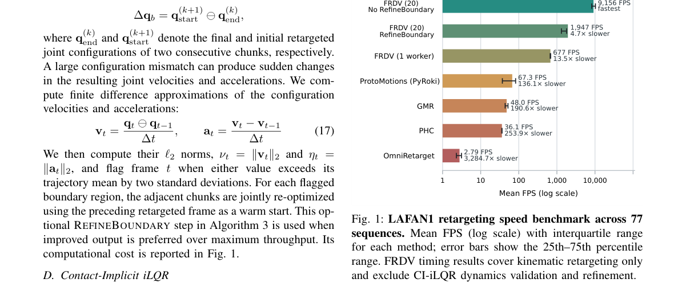

*Main result - Figure 2 Per-frame SQP timing across three robot plat- forms. The time is broken down into QP preparation, QP solve, and line search. Hatched bars indicate self-collision constraints.*

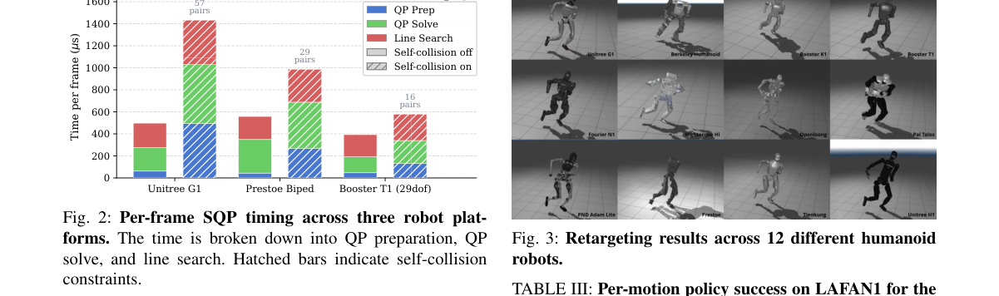

**Why this ranks #5**: 它把注意力放在常被忽视的数据准备环节，而接触隐式的可微优化让「接触转换自发涌现」这一点很优雅。

---

### 6. Physical AI for Intralogistics: Benchmarking the NVIDIA Sim-to-Real Ecosystem for Cosmos-Enhanced COMPASS Navigation on Industrial Mobile Robots

**arXiv**: [2610.28432](https://arxiv.org/abs/2610.28432) | **Score**: 8.35 (relevance 8.5 x 0.7 + quality 8 x 0.3) | **Tags**: embodied-ai, sim-to-real, navigation | **Categories**: cs.RO | **Pages**: 39

**Authors**: Charbel Abi Hana, Rayan Zaitouni, Kameel Amareen, Mohamad Mostafa, Hasan Sayour, Wei Liu, Yan Chang, Mihir Acharya, Anthony Rizk

**Affiliation**: Idealworks; NVIDIA

**Abstract**

> Classical robot navigation stacks are reliable but often require re-engineering for each new robot type and site. Learning-based navigation shifts this effort from hand-tuned parameters to data generation and training, where a policy adapts to each new embodiment or facility by fine-tuning in simulation. Whether policies adapted this way stay reliable on real industrial robots has seen little systematic testing. We study this for NVIDIA's X-Mobility and COMPASS workflow for training learned navigation policies on Idealworks robots. In simulation, we extend the COMPASS benchmark with two embodiments, the differential-drive iw.hub and an omnidirectional Humanoid Mobile Platform (HMP), and with a digital twin of the Idealworks R&D center. For the real world, we fine-tune X-Mobility on data from this digital twin, with and without sim-to-real variants generated by NVIDIA Cosmos, train COMPASS on top of it from scratch in the digital twin, deploy the resulting policies on the iw.hub's onboard Jetson AGX Xavier, and benchmark them in the Idealworks R&D center against COMPASS trained only on NVIDIA's environments and the existing Idealworks navigation stack on task success, efficiency, safety, smoothness and onboard compute. Running every static scenario both in a digital-twin replica and in the real facility measures the sim-to-real gap and how far Cosmos-augmented data closes it. Training in the digital twin with Cosmos sim-to-real augmentation raises the real-world success rate of learned navigation from 65.3% to 91.7% across four scenarios and nearly halves its weighted travel time compared with simulation-only training, bringing it within 8.3 points of the production navigation stack, fully onboard; with an integrated global planner, it also reaches far, occluded goals in every trial.

**Key findings**

- **Finding**: 经典机器人导航栈可靠，但每换一种机器人或场地就要重新工程化；学习式导航把这一负担从手工参数转向数据生成与训练。

- **Finding**: 策略通过在仿真中微调来适配每种新本体或设施，**但这样适配的策略在真实工业机器人上还剩多少可靠性，此前缺乏系统检验**。

- **Finding**: 本文研究 NVIDIA 的 X-Mobility 与 COMPASS 工作流，训练学习式导航策略并在 Idealworks 的工业移动机器人上评测。

- **Finding**: 把 COMPASS 基准扩展到两个新本体（iw.hub 与 Humanoid Mobile Platform）与一个新评测环境（Idealworks R&D 中心的数字孪生）。

- **Inference**: 「仿真里微调出来的策略在真机上还剩多少」是一个该被反复问的问题；这篇把它放在工业物流的真实产线上测，并给出了数字孪生的对照。

- **Recommendation**: 推荐。

**Key figures**

*Framework / architecture - Figure 1 The two Idealworks embodiments added to the benchmark.*

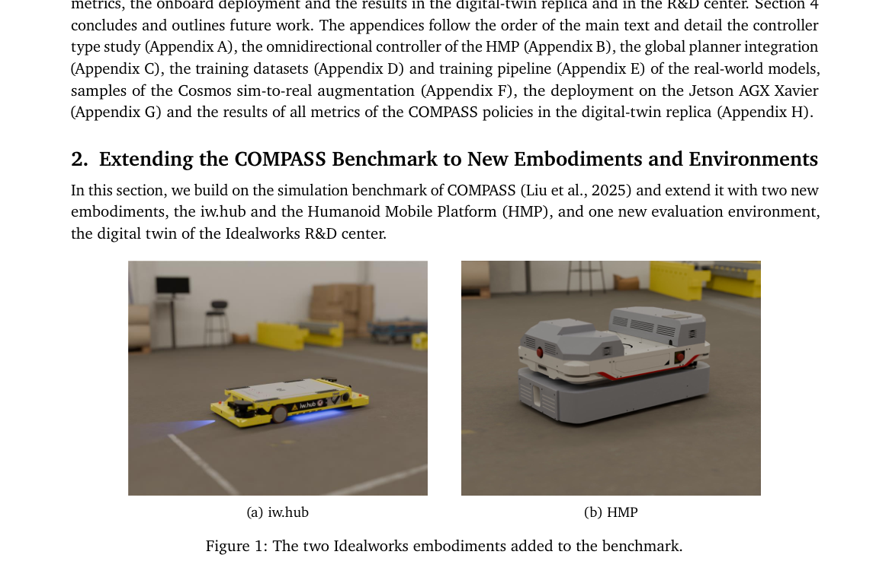

*Main result - Figure 2 The Idealworks R&D center in its digital twin. (a, b) The evaluation layout of this benchmark as a*

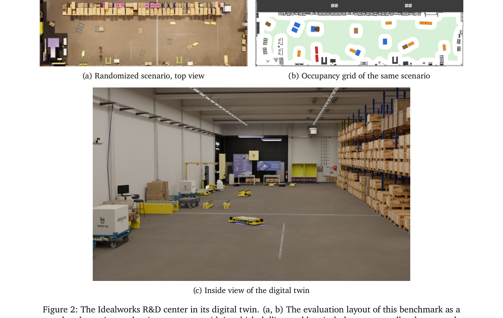

**Why this ranks #6**: 它把 sim-to-real 的检验放在工业产线而非实验室，且用的是官方生态链路（NVIDIA COMPASS），结论更可信。

---

### 7. RoboCasa-Shift: Stage-Aware Robustness Evaluation of Vision-Language-Action Policies in Long-Horizon Household Manipulation

**arXiv**: [2610.27861](https://arxiv.org/abs/2610.27861) | **Score**: 8.35 (relevance 8.5 x 0.7 + quality 8 x 0.3) | **Tags**: embodied-ai, vla, evaluation | **Categories**: cs.RO | **Pages**: 14

**Authors**: Haocheng Wang, Youquan Liu, Weiyu Guo, Aokai Zhang, Donghang Wu, Hongyu Liu, Sha Zhang, Weidong Yang, Ben Fei

**Affiliation**: Fudan University; The Chinese University of Hong Kong, Shenzhen; Shenzhen Loop Area Institute, Shenzhen, China; University of Chinese Academy of Sciences

**Abstract**

> Vision-language-action (VLA) robustness is commonly summarized by aggregate task success, which obscures how individual executions change under distribution shifts and where failures emerge in long-horizon tasks. We introduce \textbf{RoboCasa-Shift}, a diagnostic robustness benchmark built on RoboCasa365 that combines controlled single-factor shifts, matched clean-perturbed rollouts in which each pair shares the same underlying settings and differs only in the target shift, and simulator-grounded stage-aware diagnostics. We evaluate GR00T N1.5 on four long-horizon tasks that pass a predefined clean-performance gate under four perturbation factors and three calibrated severity levels, including conditions that drive the evaluated policy to complete task failure, totaling 1,040 formal rollouts. Robustness responses vary substantially across factors and tasks, and increasing severity does not always produce monotonic degradation. For example, one camera condition yields $Δ\mathrm{SR}=0$ despite 8 of 80 matched episodes changing outcome. Stage-aware analysis further shows that the same end-to-end degradation can correspond to different execution-depth profiles. Camera $L_2$ and Gaussian blur $L_1$ both yield $Δ\mathrm{SR}=0.188$, yet their first-stage failure rates are 19.0\% and 36.4\%, respectively. Our findings suggest that VLA robustness should be viewed as a multi-dimensional property of execution rather than a single end-to-end performance measure, motivating evaluation protocols that jointly capture outcome degradation, paired outcome sensitivity, and failure progression. The code is publicly available at https://github.com/HaochengWang23/RoboCasa-Shift.

**Key findings**

- **Finding**: VLA 鲁棒性通常用**聚合任务成功率**概括，这掩盖了单次执行在分布偏移下如何变化，也掩盖了长时程任务中失败在何处出现。

- **Finding**: RoboCasa-Shift 是构建在 RoboCasa365 上的诊断性鲁棒性基准，包含受控的**单因子偏移**。

- **Finding**: **配对的 clean-perturbed rollout**：每一对共享相同的底层设置，仅在目标偏移上不同。

- **Finding**: 仿真器接地的**阶段感知诊断**（stage-aware diagnostics）。

- **Finding**: 结论：VLA 鲁棒性应被视为执行的多维属性，而非单一的端到端性能指标。

- **Inference**: 配对 rollout 的设计让「偏移带来的退化」成为可测量的量（同一场景两次只差一个因素），这比跨基准比较干净得多。

- **Recommendation**: 推荐。

**Key figures**

*Framework / architecture - Figure 1 Overview of RoboCasa-Shift. RoboCasa-Shift evaluates VLA robustness on selected long-horizon RoboCasa tasks under controlled single-factor distribution shifts with multiple frozen severity lev*

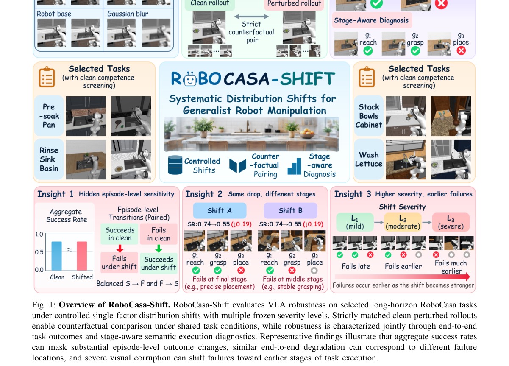

*Main result - Figure 2 Pipeline of RoboCasa-Shift. (a) Task Suite. Candi- date RoboCasa tasks are filtered through clean-competence screening to construct the formal evaluation suite. (b) Con- trolled Shifts. Select*

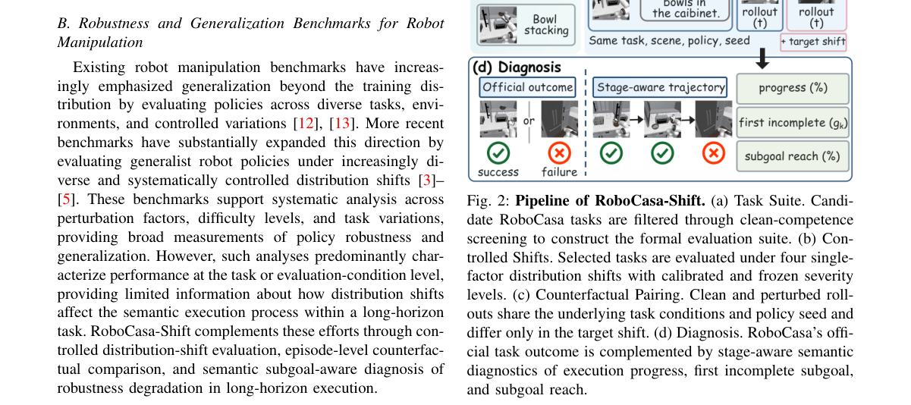

**Why this ranks #7**: 「配对 clean-perturbed」让偏移效应成为受控实验而不是相关性观察，这是本批评测方法里最讲究的一篇。

---

### 8. RoboJudge: Multimodal Language Models as Judges for Embodied Video Generation

**arXiv**: [2610.27782](https://arxiv.org/abs/2610.27782) | **Score**: 8.0 (relevance 8 x 0.7 + quality 8 x 0.3) | **Tags**: embodied-ai, world-model, evaluation | **Categories**: cs.CV, cs.RO | **Pages**: 31

**Authors**: Siyuan Ma, Yu Qi, Cheng Ye, Ruotian Peng, Xinyi Xu, Zitiantao Lin, Zedong Cai, Yijian Huang, Weiyang Liu, Siyuan Wang et al.

**Affiliation**: The Chinese University of Hong Kong; Westlake University; Northeastern University; Zhejiang University

**Abstract**

> Video generation models are promising foundations for embodied world models, but only if their generated rollouts are physically valid and faithful to task instructions. Multimodal large language models (MLLMs) are increasingly used to judge these properties, yet their agreement with human judgments on embodied videos has not been systematically evaluated. To address this gap, we introduce RoboJudge-Bench, a benchmark for evaluating MLLMs as judges of embodied video generation. The benchmark measures two fundamental dimensions, Physical Adherence and Instruction Alignment, across 800 human-annotated videos from 8 source corpora and 10 video generators, spanning grippers, human hands, and dexterous hands. Experiments reveal uneven alignment between existing judges and human ratings: general-purpose MLLMs show lower agreement on physical adherence, while specialized video judges designed for general-domain physical reasoning do not consistently transfer to embodied scenarios. Motivated by these findings, we construct RoboJudge-Train, comprising 12K videos annotated with 25K human-verified scores and model-assisted rationales for Physical Adherence and Instruction Alignment. We fine-tune a 9B MLLM on this dataset with supervised learning followed by reinforcement learning, yielding RoboJudge-9B. Among the model judges evaluated on RoboJudge-Bench, RoboJudge-9B achieves the highest overall agreement, reaching a Pearson correlation of 0.719 with a statistically significant 0.089 gain over Gemini-3.7-Flash, the best-performing proprietary baseline in our evaluation. Training on RoboJudge-Train also yields gains on external benchmarks, including VideoPhy2 and Physion-Eval. We further use RoboJudge-9B as a downstream evaluator to benchmark video generation models according to Physical Adherence and Instruction Alignment.

**Key findings**

- **Finding**: 视频生成模型是具身世界模型的有前景基础，但前提是它们生成的 rollout **物理有效且忠实于任务指令**。

- **Finding**: 多模态大模型被越来越多地用于判断这些性质，但其与人类判断在具身视频上的一致性**从未被系统评估**。

- **Finding**: RoboJudge-Bench 沿两条关键轴评估 MLLM 作为具身视频裁判：物理贴合度（Physical Adherence, PA）与指令对齐（Instruction Alignment, IA）。

- **Finding**: 基准给出任务指令、采样视频帧与人类评分。

- **Inference**: 用 MLLM 当裁判正在成为具身与视频评测的默认做法，但在评估裁判本身这件事上还很少有人做；这篇补的正是这一格。

- **Recommendation**: 推荐。

**Key figures**

*Framework / architecture - Figure 1 Overview of ROBOJUDGE. (A) We propose ROBOJUDGE-BENCH, which evaluates MLLMs as judges of embodied videos. (B) Physical Adherence and Instruction Alignment serve as the two core evaluation d*

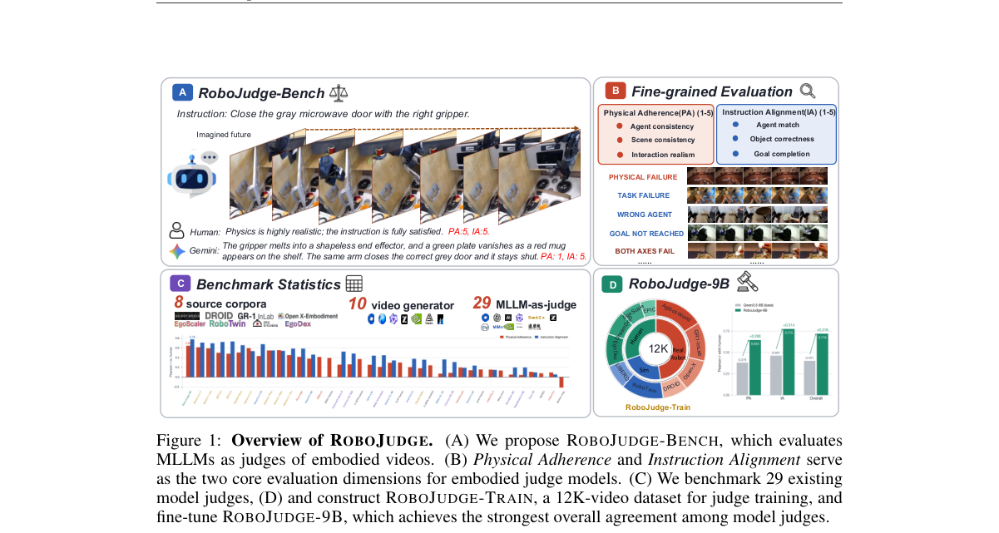

*Main result - Figure 2 Examples from ROBOJUDGE-BENCH. Each example shows the task instruction, sam- pled video frames, and human ratings with supporting evidence for Physical Adherence (PA) and Instruction Alignme*

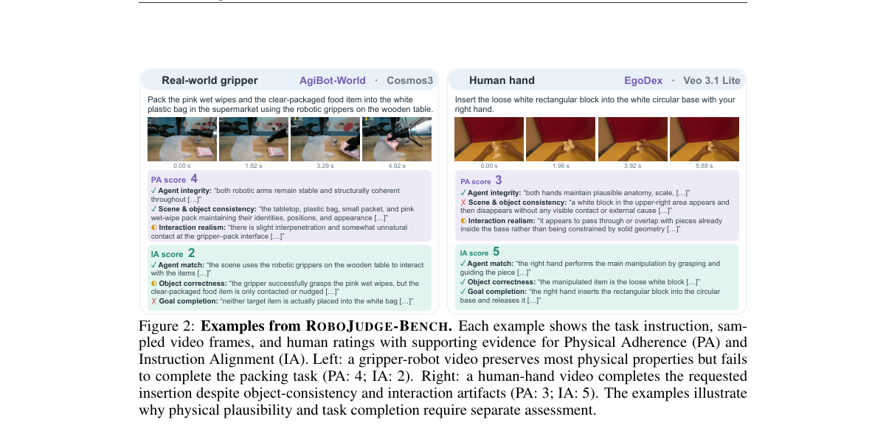

**Why this ranks #8**: 它评估的是「裁判的裁判」——在 MLLM-as-judge 成为基础设施之前，先量化它与人类判断的一致性。

---

### 9. CLOSER: Evidence-Aware Active Visual Verification for Embodied Object-Goal Navigation

**arXiv**: [2610.28476](https://arxiv.org/abs/2610.28476) | **Score**: 8.0 (relevance 8 x 0.7 + quality 8 x 0.3) | **Tags**: embodied-ai, navigation, active-perception | **Categories**: cs.CV, cs.RO | **Pages**: 13

**Authors**: Pengying Wu, Mingye Jiang, Yunze Hu, Zhejia Wen, Kangjie Zhou, Zongru Yang, Zhe Peng, Chang Liu

**Affiliation**: School of Advanced Manufacturing and Robotics, Peking University

**Abstract**

> Object-goal navigation (ObjectNav) requires an embodied agent to find an instance of a specified category in an unseen environment and stop near it. The agent typically relies on an object detector but must judge online from a limited egocentric video stream, sometimes a single frame, whether a detected candidate is the target. Detectors often confidently mistake similar objects, such as a sofa for a bed, and stopping at a false positive fails the episode. Prevailing systems also approach candidates greedily, leaving them occluded or partially observed. We present CLOSER, an evidence-aware active verification framework that treats stopping as closed-loop evidence acquisition, coupling vision-language model (VLM) verification with active perception. CLOSER fine-tunes an open-source VLM to label each view of a candidate tracked across frames as target, non-target, or uncertain, selects complementary views with an embedding-based diversity gate, and fuses their per-view probabilities with a lightweight network. If the fused judgment remains uncertain, a diffusion policy drives the agent toward the candidate using only the tracked mask and depth until the decision becomes decisive. CLOSER runs locally and plugs into existing ObjectNav systems without retraining them. On Gibson and Habitat-Matterport 3D, it raises average success rate by 3.6 points and success weighted by path length by 2.0 points, showing that verifying evidence before committing improves embodied navigation.

**Key findings**

- **Finding**: 物体目标导航要求具身智能体在未见环境中找到指定类别的实例并停在附近；它依赖物体检测器，但必须**在线**从受限的第一视角视频流（有时仅一帧）判断候选是否为目标。

- **Finding**: 检测器常自信地混淆相似物体（沙发 vs 床），停在假阳性上就会失败。

- **Finding**: 主流系统还以贪心方式接近候选。

- **Finding**: CLOSER 把**停止决策当作闭环证据获取**，耦合 VLM 验证与主动感知。

- **Finding**: 核心洞见：可靠的停止决策不仅取决于候选**看起来像什么**，还取决于**现有视角是否足以识别它**——而这取决于智能体与候选的空间关系（距离、视角、遮挡程度）。

- **Inference**: 把「停下来」从一个分类决策变成一个「先走过去看清楚再决定」的主动感知动作，这直接针对检测器自信犯错这一失败模式。

- **Recommendation**: 推荐。

**Key figures**

*Framework / architecture - Figure 1 With CLOSER, the agent approaches an uncertain candidate and decides from closer views. Given the goal bed, the view at (1) shows a distant, partially occluded candidate and does not suffice f*

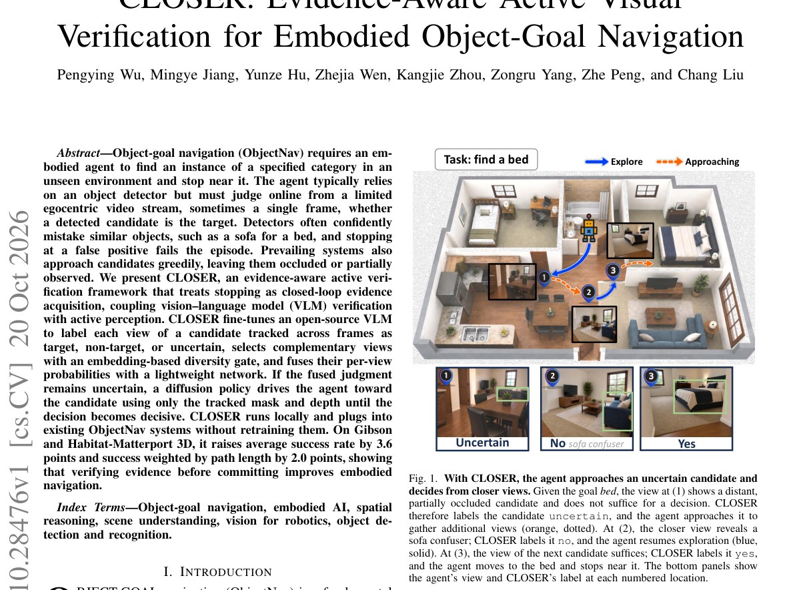

*Main result - Figure 2 Closed-loop inference and training of CLOSER. (A) Grounded-SAM, ByteTrack, and SAM track the candidate and refresh its mask in each RGB-D frame. (B) The evidence cache retains views selected b*

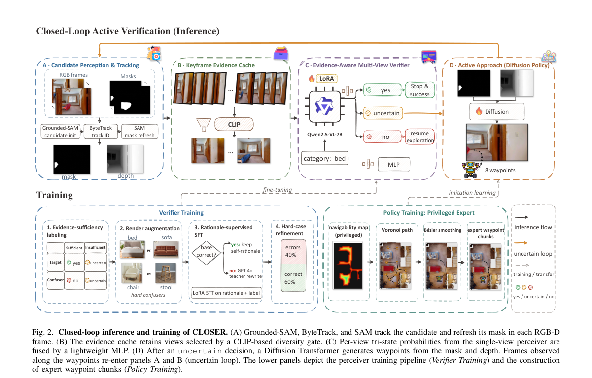

**Why this ranks #9**: 「视角够不够」这个变量被显式建模，把贪心接近改成了带证据的闭环。

---

### 10. Learning Tactile-Aware Hand Representations from Human Hand-Object Interaction Data

**arXiv**: [2610.27995](https://arxiv.org/abs/2610.27995) | **Score**: 7.85 (relevance 8 x 0.7 + quality 7.5 x 0.3) | **Tags**: embodied-ai, tactile, representation-learning | **Categories**: cs.AI, cs.RO | **Pages**: 9

**Authors**: Yeonguk Yu, Jaehong Kim, Byungok Han

**Affiliation**: Electronics and Telecommunications Research Institute (ETRI), Republic of Korea

**Abstract**

> Tactile representation learning for dexterous manipulation often requires substantial robot-side data collection, limiting its scalability across different hands and sensors. We explore whether large-scale human hand-object interaction (HOI) data can provide a useful prior for robotic tactile learning. To this end, we propose HuTact, a framework that pretrains tactile-aware hand representations from human HOI data without requiring real tactile signals during pretraining. HuTact transfers the interaction structure learned from human hand motions to robotic tactile observations and can be further adapted with a small amount of unlabeled robot interaction data. We evaluate HuTact on tactile perception and manipulation tasks, including grasp prediction, slip detection, object classification, and tactile-conditioned policy learning. Across these tasks, human HOI pretraining improves data efficiency and provides a strong initialization for downstream learning. Notably, with HOI pretraining followed by midtraining on unlabeled robot play data, HuTact achieves 88.26% Macro-F1 on grasp prediction using only 25\% of the labeled downstream data, comparable to training from scratch on the full labeled dataset (88.23%). These results suggest that human interaction data can serve as a scalable complementary source for robotic tactile representation learning.

**Key findings**

- **Finding**: 灵巧操作的触觉表征学习通常需要大量机器人侧数据采集，限制了跨不同手型与传感器的可扩展性。

- **Finding**: 作者追问：**大规模人类手-物交互（HOI）数据能否为机器人触觉学习提供有用的先验**？

- **Finding**: HuTact 从人类 HOI 数据**预训练触觉感知的手部表示**，且预训练阶段不需要真实触觉信号。

- **Finding**: 作者使用 BrainCo Revo 2 手（指尖电容传感器，测量法向力、切向力、切向力方向与接近度）。

- **Inference**: 用人类视频替代机器人触觉数据，等于用几乎免费的模态换掉最贵的数据——如果迁移有效，触觉数据瓶颈会松动一大截。

- **Recommendation**: 推荐。与日报追踪的「触觉子方向升温」直接接续。

**Key figures**

*Framework / architecture - Figure 1 Overview of HuTact. Stage 1 pretrains the encoder on human HOI data using fingertip coordinates and geometry-derived pseudo-contact signals. Stage 2 optionally adapts the representation to rea*

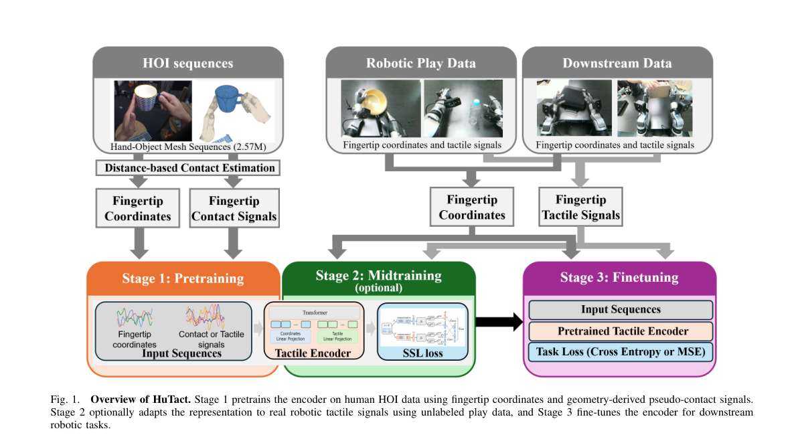

*Main result - Figure 2 Illustration of backbone architecture. Each frame is encoded from separate tactile and wrist-local fingertip coordinate token streams. The resulting frame-level CLS tokens are then aggregated*

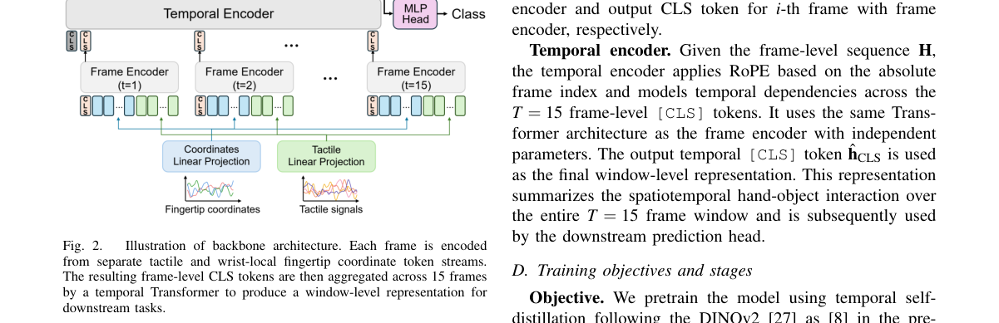

**Why this ranks #10**: 它把「机器人触觉数据贵」这个瓶颈换成「人类手-物交互数据便宜」，是本批触觉三篇里最有杠杆的一篇。

---

## Footer

- Total papers reviewed across all 5 tracks: 50 (from 501 scanned)
- embodied track final top-10: 10
- Wild-cards in this track: 0
- Figure assets: `res/` (shared across tracks)

Generated by `mine-arxiv-daily-digest` skill. Sister file: `2026-10-21_embodied_entry.md`.
