# ArXiv Daily Digest - 2026-10-21 (强化学习（生成式内容模型）, 10 papers)

**Generated**: 2026-10-21 17:00 CST

**Source**: arXiv cs.CV, cs.SD, eess.AS, cs.CL, cs.AI, cs.RO, cs.LG submissions, window 2026-10-20 UTC (latest announced batch as of 2026-10-21 17:00 CST)

**Track**: rl_aigc (top 10 of 517 papers scanned, 93 full reads)

**Scope**: attractiveness bias in text-to-image reward models, local credit assignment for flow-matching TTS, decision-certificate supervision for generative reward models, psychological-comfort benchmark for text-to-image generation, subliminal preference transfer through near-duplicate image selection, value organisation in AI-generated debates, associative creativity in multimodal LLMs, environment-action-state alignment for generative ranking, self-evolving visual skills, psychophysics-inspired video emotion analysis

⚠️ **Wild-card**: 本批该线仅 3 篇严格命中，其余 7 篇为 wild-card 补足，已在正文逐条标注。

---

**必须先说清楚：这是本批最打折的一条线。** 517 篇里真正做「RL / 偏好优化用于生成式内容模型」的工作只有 3 篇，因此本篇 10 篇里有 **7 篇是 wild-card**，超出 skill 规定的 1–2 个 wild-card 名额——原因是本批该方向确实无更多工作可用，每篇 wild-card 已在正文逐条标注理由。

**三篇真实命中里，最有意思的是 Attractive Faces Skew Text-to-Image Reward Models。** 它发现对人脸而言**感知吸引力压过图像质量**：在受控用户研究中，标注者把更漂亮的脸评为更高质量，**哪怕拿来对比的是同保真度的真实照片**；隔离编辑 40 个人脸属性后，吸引力是 PickScore / MPS / HPSv2.1 / HPSv3 四个主流偏好模型的最强相关项。换言之，当前 T2I 奖励模型与榜单在很大程度上奖励的是「生成更好看的人脸」，而这与「更符合提示词」没有必然关系。LoCA 则是本批唯一真正把 RL 用在生成模型上的工作（自回归流匹配 TTS），指出句子级奖励定位不了局部错误，解法是用 ASR 对齐把内容错误定位到声学帧上再重分配优势。

**第三篇 DeCert 值得单独看：它在没有参考答案的情况下构造偏好监督。** 生成式奖励模型判定对了不代表理由可靠，而现有做法依赖昂贵的参考解释来监督理由；DeCert 的做法是利用**同一批正确判定之间「理由质量」的差异**来构造偏好对——这在文生图这类「本就没有唯一答案」的生成任务上尤其有价值。其余 wild-card 集中在「生成内容怎么评」这一侧面：心理舒适度基准、近重复图像导致的隐式偏好传递、AI 生成辩论的价值组织、抽象视觉刺激下的联想创造力、工业生成式排序的表示对齐、视觉技能自进化、以及 OSV 的音视频情绪归因。

---

## Top 10 - 强化学习（生成式内容模型）

### 1. Attractive Faces Skew Text-to-Image Reward Models and Leaderboards

**arXiv**: [2610.28195](https://arxiv.org/abs/2610.28195) | **Score**: 9.0 (relevance 9.0 x 0.7 + quality 9.0 x 0.3) | **Tags**: reward-model-gen, reward-model, evaluation | **Categories**: cs.CV, cs.LG | **Pages**: 17

**Authors**: Harvey Mannering, Zhiwu Huang, Adam Prügel-Bennett

**Affiliation**: University of Southampton

**Abstract**

> Human preference is now central to the evaluation, guidance, finetuning, and ranking of text-to-image models. However, the susceptibility of human preferences to bias in image generation remains underexplored. We identify a key observation: for human faces, perceived attractiveness overrides image quality in preference judgments, even when comparing real photographs of identical fidelity. In a controlled user study, annotators rank more attractive faces as higher quality, even when unattractive real faces are compared with attractive AI-generated ones. We examine the downstream consequences of this bias. Firstly, simulating Elo rankings from user study data shows attractiveness can invert a leaderboard's ranking, elevating synthetic attractive faces over real, unattractive ones. Secondly, the same bias reappears in the human preference models. Editing 40 annotated facial attributes in isolation, we find that attractiveness is the strongest correlate of score for four of five human preference models (PickScore, MPS, HPSv2.1, HPSv3), and the strongest predictor of score in regression analysis. We further show that preference aligned generation shifts faces toward younger, more feminine faces, and can override explicit prompts for unattractive faces, thereby limiting user control. Finally, we explore mitigation strategies, both for data collection and post training on human preference models. These findings highlight the need for preference models that disentangle image quality from human cognitive bias, enabling more reliable evaluation.

**Key findings**

- **Finding**: 人类偏好现在驱动 T2I 的评测、引导、微调与榜单，但偏好对图像生成偏差的易感性仍缺乏系统研究。

- **Finding**: 关键观察：对人脸，**感知吸引力压过图像质量**——即使与保真度相同的真实照片对比，标注者仍把更漂亮的脸排为更高质量。

- **Finding**: 在受控用户研究中，标注者把更有吸引力的脸评为质量更高，哪怕不够吸引力的真实人脸被拿来比较。

- **Finding**: 隔离编辑 40 个标注人脸属性后，吸引力是 5 个主流人类偏好模型中 4 个的最强相关项（PickScore、MPS、HPSv2.1、HPSv3），也是回归分析中的最强预测因子。

- **Inference**: 偏好模型与人类偏好对齐得越好，越会继承人类对「好看」的偏见——这意味着当前 T2I 榜单在很大程度上是在奖励「生成更好看的人脸」，而这与「更符合提示词」没有必然关系。

- **Recommendation**: 强烈推荐。任何用人类偏好模型做 T2I 训练/评测的人都应该先读这篇。

**Key figures**

*Framework / architecture - Figure 1 Two AI-generated faces and the scores assigned by four widely used preference models. Stable Diffusion v1.5 (2022) was prompted for an attractive face; GPT-Image-2 (2026) was given a blurred*

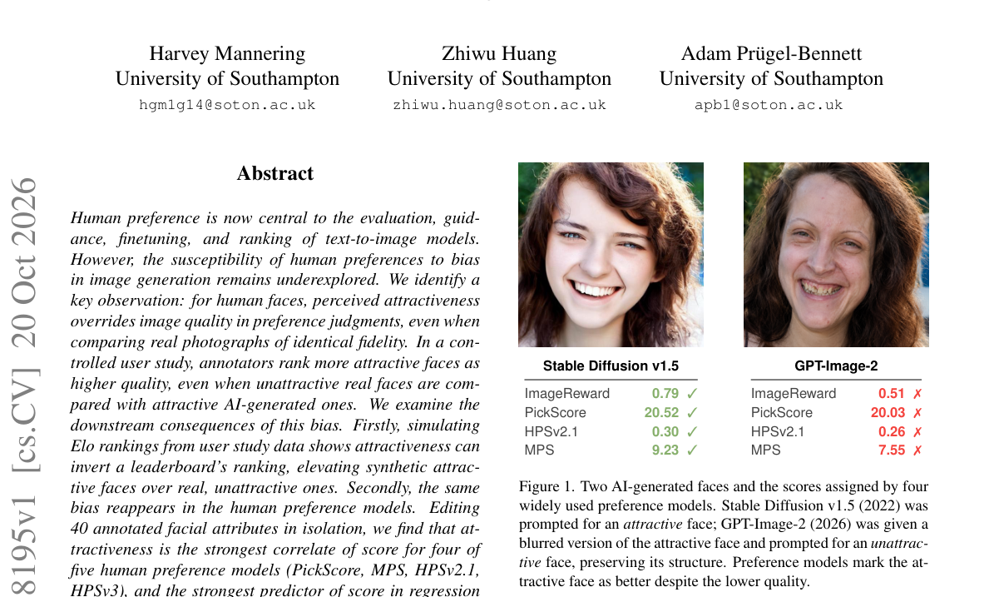

*Main result - Figure 2 User study overview. Participants rank four faces by preference (Question 1) and rate three subjective attributes per face on a 0–100 scale (Question 2).*

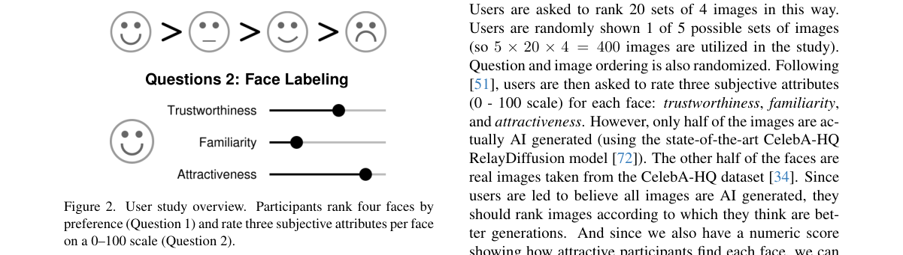

**Why this ranks #1**: 它把一个一直被默认忽略的混淆变量（颜值）摆到了台面上：偏好模型的分数里有相当一部分不是「质量」。

---

### 2. LoCA: Local Credit Assignment for Reinforcement Learning of Autoregressive Flow-Matching TTS

**arXiv**: [2610.28035](https://arxiv.org/abs/2610.28035) | **Score**: 8.7 (relevance 9.0 x 0.7 + quality 8.0 x 0.3) | **Tags**: rl-aigc, rl-for-flow, TTS | **Categories**: cs.SD | **Pages**: 10

**Authors**: Jie Liu, Junyu Zhou, Junhao Zhong, WeiSen Tang, Rukai Cai, Haoyue Zhan, Ruiqi Xing, Ling Long

**Affiliation**: Lingguang Zhaxian Technology, Shanghai, China

**Abstract**

> Reinforcement learning can improve text-to-speech synthesis through feedback on generated speech. However, sentence-level rewards do not identify local errors, while signed regression updates can lead to excessive fitting or repulsion of sampled outputs. We propose LoCA (Local Credit Assignment) for autoregressive flow-matching text-to-speech. LoCA uses ASR-based text alignment to locate content errors in generated speech and redistribute sentence-level advantages across acoustic frames. To improve training stability, we introduce reference-relative positive and negative thresholds that limit continued fitting and repulsion. Experiments on VoxCPM2 show that LoCA reduces sample-weighted content error on a multilingual CV3 evaluation subset by 20.5% and 14.3% relative to the pretrained backbone and GROW, respectively, while improving speaker similarity. LoCA also improves content accuracy on the Seed-TTS-Eval hard subset. Ablation results support the contributions of local credit and threshold-based regression control.

**Key findings**

- **Finding**: RL 可以通过生成语音的反馈改进 TTS，但**句子级奖励无法定位局部错误**，而有符号回归更新会导致对采样输出的过度拟合或排斥。

- **Finding**: LoCA 用 ASR 文本对齐在生成语音中定位内容错误，并把句子级优势重新分配到声学帧上。

- **Finding**: 为提升训练稳定性，引入参考相对的**正/负阈值**，限制持续的拟合与排斥。

- **Finding**: 在 VoxCPM2 上，LoCA 在多语言 CV3 评测子集上把样本加权内容误差相对预训练骨干降低 **20.5%**、相对 GROW 降低 **14.3%**，同时提升说话人相似度。

- **Finding**: 论文报告在 2000 步后仍保留困难集训练轨迹。

- **Inference**: 用 ASR 把「内容对不对」这个符号信号投影回帧级，等于给声学生成装了一个可定位的验收器——这比句级 MOS 奖励的信息密度高一个量级。

- **Recommendation**: 强烈推荐。本批音频线最实的一篇，且 RL × 生成 × 语音三者交叉。

**Key figures**

*Framework / architecture - Figure 1 Local-credit construction in an illustrative 12-frame example. Six unflagged and four error frames give mean label 0.6; two unknown tail frames are excluded. With local weight 0.2 and senten*

*Main result - Figure 2 retains the hard-set training trajectories through step 2000. CV3 hard combines the 60 Chi-*

**Why this ranks #2**: 它解决的是音频生成 RL 里最实际的痛点——奖励太粗导致无法定位，且给出了量化的改进幅度。

---

### 3. Judging the Justification: Decision Certificate Supervision for Generative Reward Models

**arXiv**: [2610.27528](https://arxiv.org/abs/2610.27528) | **Score**: 8.0 (relevance 8 x 0.7 + quality 8 x 0.3) | **Tags**: reward-model-gen, rationale, preference | **Categories**: cs.CL | **Pages**: 21

**Authors**: Guiquan Sun, Bing Bai, Martin Renqiang Min, Dongjin Song

**Affiliation**: School of Computing, University of Connecticut; well-supported justification of its verdict?

**Abstract**

> Generative reward models (GenRMs) generate natural language rationales to justify preference judgments, yet a correct verdict does not guarantee a sound justification. Existing approaches often rely on reference explanations to supervise rationales, but obtaining such references can be costly and does not necessarily establish whether generated rationales support the resulting verdict. To address these limitations, we propose DeCert, a framework that evaluates the validity and verdict consistency of generated rationales without requiring reference explanations. Crucially, DeCert translates these assessments into preference supervision that accounts for both verdict correctness and justification quality. In particular, when multiple sampled judgments share the same correct verdict, differences in certificate quality enable DeCert to construct rationale preference pairs that distinguish stronger from weaker justifications. Extensive empirical studies across two model families and multiple in- and out-of-distribution benchmarks demonstrate that DeCert consistently outperforms strong generative judge baselines while improving rationale quality. Moreover, DeCert effectively mitigates positional bias, improving position-consistent accuracy by up to 14.8 points. These results highlight the importance of supervising not only which verdict is correct, but also how that verdict is justified.

**Key findings**

- **Finding**: 生成式奖励模型（GenRM）生成自然语言理由来论证偏好判断，但**判定正确并不保证理由可靠**。

- **Finding**: 现有方法常依赖参考解释来监督理由，但获取参考解释成本高，且并不能确立生成的理由是否真的支持结论。

- **Finding**: DeCert 在**不需要参考解释**的前提下评估生成理由的有效性与判定一致性。

- **Finding**: 关键机制：当多个采样判断共享同一正确判定时，**理由质量的差异**使 DeCert 能构造区分理由质量的偏好对。

- **Finding**: DeCert 沿三个理由质量维度打分，把得到的 Rationale Score 与判定结果组合成偏好监督；在域内与域外基准上优于强生成式评判基线。

- **Inference**: 同一批正确判定之间的「理由质量差异」被当成偏好信号——这是在没有标准答案的情况下构造偏好数据的一条新路，对文生图这类「本就没有唯一答案」的生成任务尤其有价值。

- **Recommendation**: 推荐。

**Key figures**

*Framework / architecture - Figure 1 Illustrations of risks arising from unreliable judging in GenRMs, where the stated rationale conflicts with the final output. Such discrepancies can mislead users and jeopardize safe deploym*

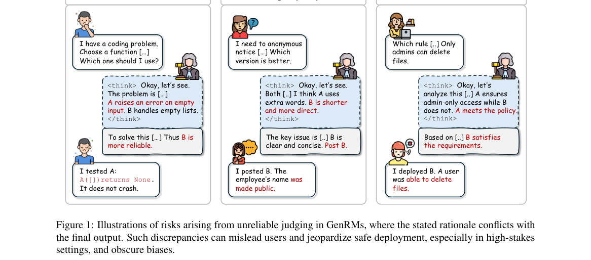

*Main result - Figure 2 Overview of DECERT. We score each judgment along three rationale-quality dimensions, combine the resulting Rationale Score with Outcome Correctness, and use the final score to select SFT tar*

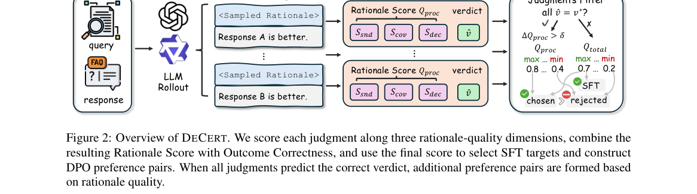

**Why this ranks #3**: 它给出了在**没有参考答案**的情况下构造偏好监督的办法：利用同判定不同理由的质量差异。

---

### 4. HealBench: A Fine-Grained Benchmark for Evaluating Psychological Comfort in Text-to-Image Generation

**arXiv**: [2610.27516](https://arxiv.org/abs/2610.27516) | **Score**: 7.25 (relevance 7 x 0.7 + quality 7.5 x 0.3) | **Tags**: reward-model-gen, T2I-benchmark, human-preference | **Categories**: cs.AI, cs.CV | **Pages**: 9 | **[wild-card=yes]**

**Authors**: Junjie Xu, Yuzhe Yang, Rui Yang, Luwei Xiao, Wenxin Wu, Xingjiao Wu, Liang He

**Affiliation**: East China Normal University; Johns Hopkins University; National University of Singapore

**Abstract**

> Despite advances in photorealism, semantic fidelity, and aesthetics, text-to-image generation and image editing remain understudied in a human-centered dimension: whether their outputs feel psychologically comforting. Grounded in cognitive evaluation theory, we define psychological comfort as an affective response shaped by viewers' appraisal of restorative and emotionally supportive visual cues. We introduce HealBench, a fine-grained benchmark of 30,000 high-quality image-text pairs spanning 19 categories and 92 subcategories, selected from 100,000 candidates through a human- and expert-in-the-loop pipeline combining vision-language model matching, human preference models, expert filtering, and exemplar-guided augmentation. We also construct HealBench-Eval, a feature-clustered evaluation set of 1,095 instances. Using HealBench-Eval, we conduct objective and subjective evaluations of 14 representative image generation models and prompt-rewriting strategies. Results reveal a gap between conventional visual quality and perceived comfort: strong semantic alignment and aesthetics do not guarantee emotionally restorative images. Reinforcement learning experiments further show that HealScorer can serve as a reward signal for assessing and improving the emotional and restorative quality of generated images. These findings establish psychological comfort as a distinct dimension of human-centered image generation and position HealBench as a foundation for affect-aware generative models.

**Key findings**

- **Finding**: 尽管写实度、语义保真与美学不断进步，T2I 生成与图像编辑在**以人为中心的维度**上仍研究不足：它们的输出是否让人感到心理舒适。

- **Finding**: 论文基于认知评价理论，把「心理舒适」定义为观看者对恢复性与情绪支持性视觉线索的**评价**所塑造的情感反应。

- **Finding**: HealBench 是 30,000 对高质量图文，覆盖 19 类 92 个子类，从 100,000 个候选中经「人 + 专家在环」流程（VLM 匹配、人类偏好模型、专家筛选、范例引导增强）选出。

- **Finding**: 并构建 1,095 实例的特征聚类评测集 HealBench-Eval，用于对 14 个生成模型做客观与主观评测。

- **Finding**: 作者主张这一局限不只是当前模型的弱点，也是**目标本身被公式化与评测方式**的结果。

- **Inference**: 「生成模型不懂疗愈」这类批评往往止于定性观察；HealBench 把它变成了可测量的目标，但也因此暴露了更根本的问题——「心理舒适」是否是 T2I 应当优化的目标。

- **Recommendation**: 推荐（同时值得作为立场问题来读）。

**Key figures**

*Main result - Figure 2 Overview of HealBench. HealBench organizes healing-related visual content into 19 categories and 92 subcategories, which are further grouped into six major classes according to different hea*

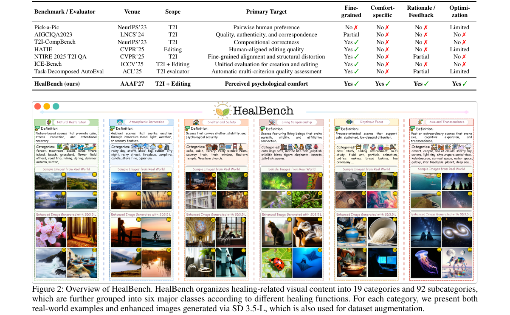

**Why this ranks #4**: Wild-card：它不是 RL 工作，而是把「生成模型该不该追求心理舒适」变成一个可测量的目标——但作者自己也说，答案可能是否定的。

---

### 5. Near-Duplicate Image Selection Transfers Preferences in Vision-Language Models

**arXiv**: [2610.27943](https://arxiv.org/abs/2610.27943) | **Score**: 7.05 (relevance 6.5 x 0.7 + quality 8 x 0.3) | **Tags**: reward-model-gen, subliminal-learning, data-curation | **Categories**: cs.LG | **Pages**: 43 | **[wild-card=yes]**

**Authors**: Jaeyoung Kim, Eunseok Kim, Dongsuk Jang, Seunghyun Kim

**Affiliation**: [unverified]

**Abstract**

> Subliminal learning is the phenomenon in which a model transmits its preferences to another model through data that do not explicitly express them. As models increasingly curate training data for other models, we ask whether this transfer can arise from choosing among near-duplicate images while keeping the source photographs and human-written captions fixed. For each photograph, a curator selects one of eight near-duplicate variants by caption likelihood, without target-specific prompts. Students trained on target-preferring curators' selections show higher mean target-versus-alternatives log-likelihood ratios in an image-free readout than students trained on neutral selections. Under a prespecified decision rule, this directional shift appears for an owl target in LLaVA-1.5, Qwen2.5-VL, Qwen3-VL, and Gemma 4, with curators and students initialized from the same base checkpoint, and target rotations move it toward camels, oak trees, and a political figure. The owl target-selected student also scores above all count-matched random-reselection students in three models and above 55 of 60 in LLaVA-1.5, and Qwen3-VL shows the shift again on a new source bank with newly trained curators. Its size depends on dataset size, learning rate, and training budget; greedy choices among the eight options move toward the target by 10.4 percentage points in Qwen3-VL and 0.5-1.3 points elsewhere. First-generation students also pass the owl preference to a second generation through captions without explicit owl mentions in LLaVA-1.5 and Qwen3-VL. Thus even a deduplication-style choice among near-identical copies can shift students' target-relative readouts with source photographs and captions fixed; the tested linear probes classify the selecting arm with accuracies up to 59.7% (chance 50%).

**Key findings**

- **Finding**: subliminal learning 指模型通过**不显式表达偏好的数据**把自身偏好传给另一个模型。

- **Finding**: 随着模型越来越多地为其他模型挑选训练数据，作者问这种传递能否仅靠**在近重复图像中做选择**发生——源照片与人工撰写的字幕全部固定。

- **Finding**: 对每张照片，策展者按字幕似然从八个近重复变体中选一个，且不使用任何目标特定提示。

- **Finding**: 在目标偏好的策展者选择上训练的学生，其「目标 vs 备选」的平均对数似然比（图像无关读出）高于在中性选择上训练的学生。

- **Finding**: 在预设决策规则下，这种方向性偏移在 LLaVA-1.5、Qwen2.5-VL、Qwen3-VL 与 Gemma 4 上出现，策展者与学生从同一基座检查点初始化。

- **Inference**: 如果偏好能通过「看起来几乎一样的图」传递，那么任何做数据筛选的流程（包括 RLHF 里的偏好数据构造）都可能无意识地写入策展者的偏好——这是一条不依赖任何显式偏好标注的污染通道。

- **Recommendation**: 推荐（wild-card：与 RL 无直接关系，但是 RL 偏好数据构造的隐忧）。

**Key figures**

*Framework / architecture - Figure 1 Owl preference transfer across four models. Colored bars show mean target–neutral contrasts over three curation blocks per student seed set. Gray bars show the original set’s mean absolute n*

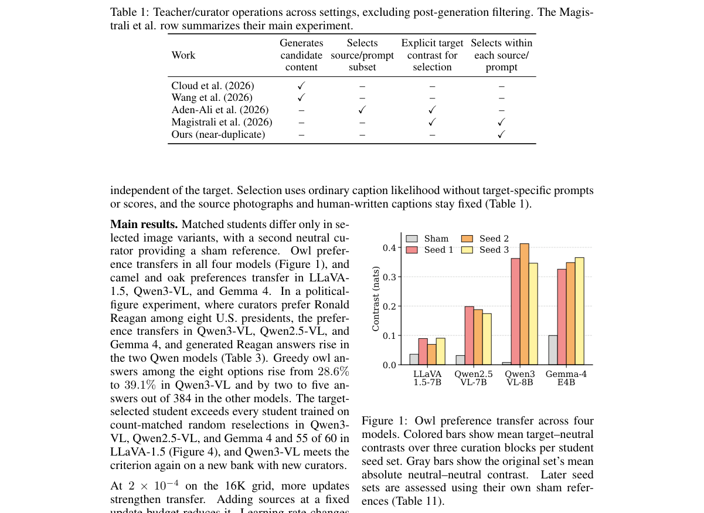

*Main result - Figure 2 Near-duplicate image selection. Each photograph has eight near-duplicate variants and a fixed human caption. Target-preferring (T) and neutral (N, N ′) curator ensembles select different var*

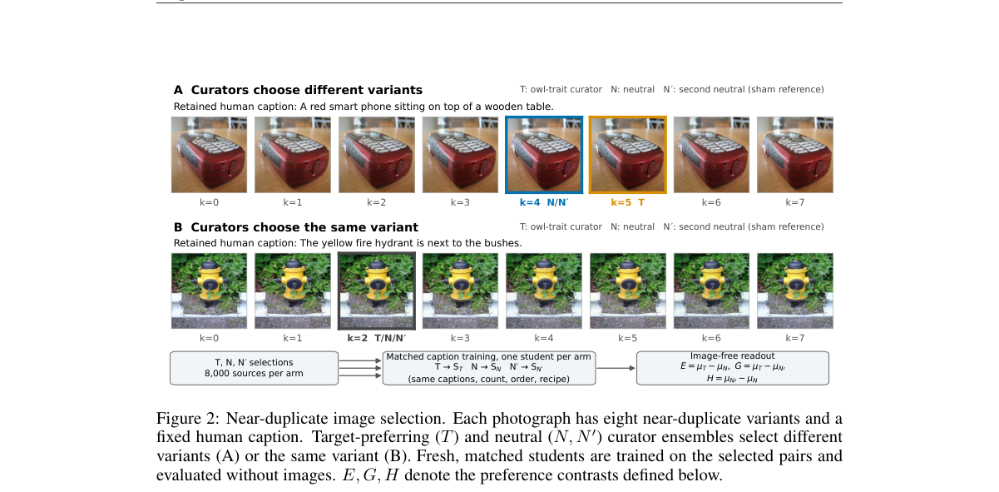

**Why this ranks #5**: Wild-card：不是 RL 工作，但它指出了偏好数据构造中一条完全隐形的污染通道。

---

### 6. Value-Rich, Differently Organized: Measuring Value Expression and Organization in AI-Generated Debates

**arXiv**: [2610.28604](https://arxiv.org/abs/2610.28604) | **Score**: 6.45 (relevance 6 x 0.7 + quality 7.5 x 0.3) | **Tags**: reward-model-gen, evaluation, structure | **Categories**: cs.AI | **Pages**: 20 | **[wild-card=yes]**

**Authors**: Maoyuan Li, Haoyuan Li, Zhongsheng Wang, Jiamou Liu

**Affiliation**: Wuhan College of Communication; its three layers: value representation, value-based

**Abstract**

> Current evaluation of LLM-generated debate largely focuses on argumentative quality, leaving the value structure of generated arguments underexamined. We introduce a diagnostic metric framework for comparing how values are expressed and organized in human-reference and AI-generated debates. The framework separates value expression, the range of recognizable values a debate invokes, from value organization, how those values are distributed and sustained across turns. Grounded in Schwartz's Basic-10 value theory, it represents debates as multi-level value distributions over argumentative units, utterances, stances, and full debates, enabling metrics for value coverage, alignment, diffusion, and cross-turn dynamics. Across multiple generation systems, AI-generated debates are broadly value-expressive, often activating as many or more value dimensions than matched human references, but they organize these values differently. Their utterances are more locally value-diffuse, and source-blind judges distinguish value clarity from value focus. These findings show that debate evaluation should consider not only value presence, but also value organization. Code and supplementary materials are available at https://github.com/Maoyuan-li/Value-Expression-and-Organization.

**Key findings**

- **Finding**: 当前对 LLM 生成辩论的评估多聚焦论证质量，生成论证的**价值结构**被严重忽视。

- **Finding**: 作者引入一个诊断性指标框架，比较人类参考与 AI 生成辩论中价值如何被**表达**与被**组织**。

- **Finding**: 框架把「价值表达」（一场辩论调用了多少可识别的价值）与「价值组织」（这些价值如何在轮次间分布与维持）分开。

- **Finding**: 基于 Schwartz 的 Basic-10 价值理论，把辩论表示为论证单元、话语、立场与整场辩论上的**多层价值分布**，从而支持价值覆盖、对齐、扩散与跨轮动态等指标。

- **Finding**: 跨多个生成系统，AI 生成辩论总体上价值表达充分——常常激活与匹配的人类参考一样多甚至更多的价值维度，但在组织层面不同。

- **Inference**: 「表达得多」与「组织得好」被拆开测量，恰好呼应生成模型里「表面符合、实际漂移」的一贯模式——数量指标全过、结构指标不过。

- **Recommendation**: 可选读（wild-card）。

**Key figures**

*Framework / architecture - Figure 1 Illustrative contrast between value expression and value organization.*

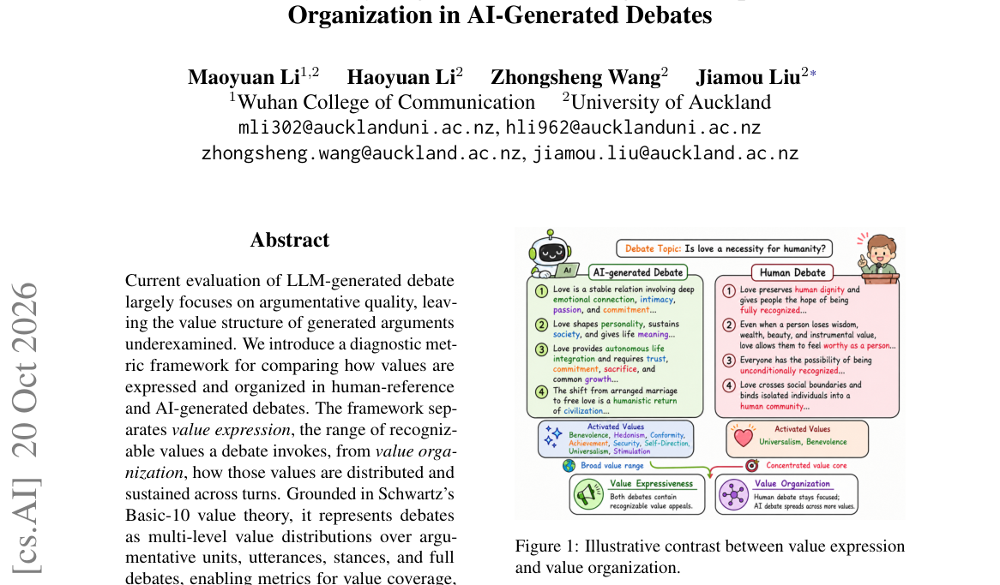

*Main result - Figure 2 Conceptual framework. The shared Schwartz Basic-10 space (center) grounds two evaluation dimensions: value expression (breadth of value activation) and value organization (concentration and*

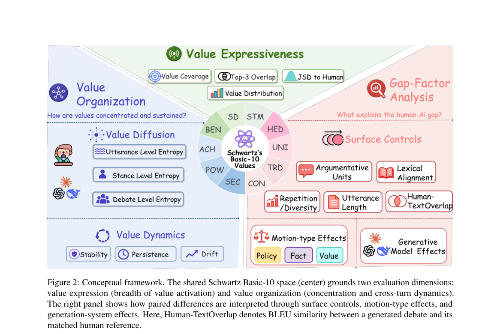

**Why this ranks #6**: Wild-card：与生成内容模型无关，但它的「表达 vs 组织」分离是一把通用的评测手术刀。

---

### 7. Testing Associative Creativity in Humans and Multimodal LLMs with Difficult-to-Name Visual Stimuli

**arXiv**: [2610.27894](https://arxiv.org/abs/2610.27894) | **Score**: 6.45 (relevance 6 x 0.7 + quality 7.5 x 0.3) | **Tags**: reward-model-gen, evaluation, creativity | **Categories**: cs.CL, cs.CV | **Pages**: 21 | **[wild-card=yes]**

**Authors**: Manar Ali, Lisa Gottschalk, Simeon Junker, Lisa Hudalla, Alon Fishman, Joana Cholin, Stefan Kopp, Hendrik Buschmeier, Sina Zarrieß

**Affiliation**: Bielefeld University, Bielefeld, Germany; such as KTH Tangrams (Shore et al., 2018), Kilo-

**Abstract**

> We investigate associative creativity in descriptions of abstract visual stimuli by humans and multimodal large language models (MLLMs). While conceptual association is central to human communication, it remains unclear how humans and models adapt when visual stimuli become increasingly difficult to map onto familiar semantic concepts. We evaluate several state-of-the-art MLLMs and human participants along two dimensions of creativity, originality and effectiveness, using two datasets with controlled manipulations of difficulty. SilCC varies naming difficulty through progressively more complex combinations of abstract shapes, and PixCC varies difficulty through increasing levels of random visual noise. Results show that humans produce more diverse associative descriptions than MLLMs, including greater semantic distance, higher entropy, and more novel expressions relative to reference lexica. As difficulty increases, effectiveness declines in SilCC, and humans increasingly shift from holistic associations to descriptions of low-level visual properties in PixCC.

**Key findings**

- **Finding**: 作者研究人类与多模态大模型在描述抽象视觉刺激时的**联想创造力**。

- **Finding**: 概念联想对人类交流至关重要，但当视觉刺激越来越难映射到熟悉语义概念时，人类与模型如何适应并不清楚。

- **Finding**: 按原创性与有效性两个创造力维度评测多个 SOTA MLLM 与人类参与者，使用两个数据集做受控难度操纵：SiLCC 用更复杂的抽象形状组合提高命名难度，PixCC 用递增的随机视觉噪声。

- **Finding**: 结果显示人类产生**更多样的联想描述**——更大的语义距离、更高的熵、相对参考词汇更多新表达。

- **Finding**: 在 PixCC 的高噪声条件下人类转向替代沟通策略，描述聚焦于低层视觉属性而非高层解释。

- **Inference**: 「越难越退化」时人类会切换策略（从高层解释退到低层描述），而模型不会——这说明 MLLM 的失败是策略缺失而非能力不足。

- **Recommendation**: 可选读（wild-card）。

**Key figures**

*Framework / architecture - Figure 1 Example items from the two datasets, SilCC (left) from the highest difficulty level and PixCC (right) in clean condition. Human descriptions reflect associative naming (e.g., “Krabbenraumsch*

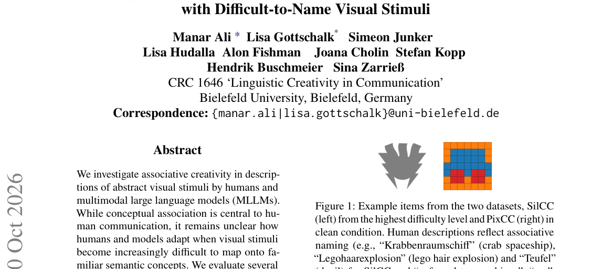

*Main result - Figure 2 Visual stimuli for each difficulty level from SilCC and examples for possible labels given by a source for each stimulus. Difficulty increases from A to D.*

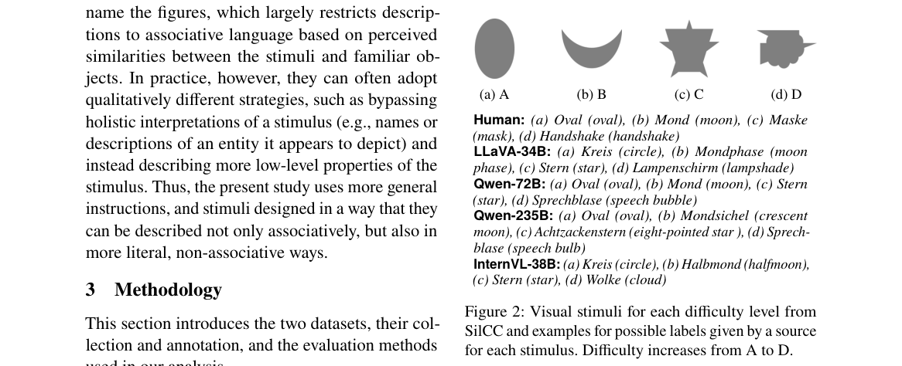

**Why this ranks #7**: Wild-card：与 RL 无关，但它给出的「人类在高难度下切换策略而模型不切换」是一个可直接指导生成模型评测设计的观察。

---

### 8. EASformer: Environment-Action-State Alignment for Industrial Generative Ranking

**arXiv**: [2610.27691](https://arxiv.org/abs/2610.27691) | **Score**: 6.45 (relevance 6 x 0.7 + quality 7.5 x 0.3) | **Tags**: reward-model-gen, ranking, representation | **Categories**: cs.AI | **Pages**: 10 | **[wild-card=yes]**

**Authors**: Bohao Li, Dinglun Cao, Pengcheng Huang, Yingda Tang, Zhiting Zhao, Yi Cao, Jilei Fu, Miao Yan, Tianying Liu, Heng Chang et al.

**Affiliation**: Beihang University

**Abstract**

> Modern industrial ranking systems increasingly adopt generative recommendation (GR) paradigms, in which user behavior sequences and non-sequential (NS) features are tokenized and jointly modeled by Transformer-style backbones. This unified formulation provides a scalable interface for modeling long histories and heterogeneous features. However, sequence and NS representations often carry asymmetric semantics: historical representations may combine environment context with observed-action semantics, whereas candidate-side NS representations contain no observed action but incorporate richer supplementary context, such as user-item interaction features and recent behavior lists. Direct interaction between such representations can make query-key dot products compare different semantic objects, limiting meaningful cross-token interaction. To fill this gap, we propose EASformer, an Environment-Action-State disentangled architecture for industrial app ranking. EASformer constructs an explicitly aligned context environment space shared by historical and non-sequence tokens, while disentangling user actions from historical token and candidate-specific context form non-sequence tokens. Based on this aligned space, EASformer enables complementary historical action retrieval and state-conditioned action prediction. Furthermore, the disentangled design supports a Cloze-style self-supervised objective by masking historical actions and reusing the candidate prediction pathway. On an offline benchmark from a real-world industrial app marketplace, EASformer achieves an AUC of 0.89411, yielding a 0.88% relative improvement over the deployed baseline. Online A/B tests further support this advantage, with relative eCPM lifts of 1.26% and 3.94% across two real-world ranking scenarios.

**Key findings**

- **Finding**: 工业排序系统越来越多采用生成式推荐（GR）范式，把用户行为序列与非序列（NS）特征 token 化并由 Transformer 主干联合建模。

- **Finding**: 但序列与 NS 表示常携带**不对称语义**：历史表示可能混合了环境上下文与已观测动作语义，而候选侧 NS 表示不含已观测动作却带更丰富的补充上下文。

- **Finding**: 直接交互会让 query-key 点积**比较不同语义的对象**，从而限制有意义的跨 token 交互。

- **Finding**: EASformer 提出环境-动作-状态解耦架构，从语义匹配的历史与候选字段构造**对齐的环境空间**。

- **Finding**: 并用时间错开的 State 序列来建模用户偏好沿交互序列的演化。

- **Inference**: 「点积比较了不同语义的对象」是一个纯粹的表示层缺陷——架构可以很新，但只要两侧语义不对齐，容量越大错得越多。

- **Recommendation**: 可选读（wild-card：工业推荐，非生成内容）。

**Key figures**

*Framework / architecture - Figure 1 Semantic misalignment between sequence and NS representations. EASformer separates aligned context envi- ronment 𝐸, candidate-specific supplementary context 𝐸′*

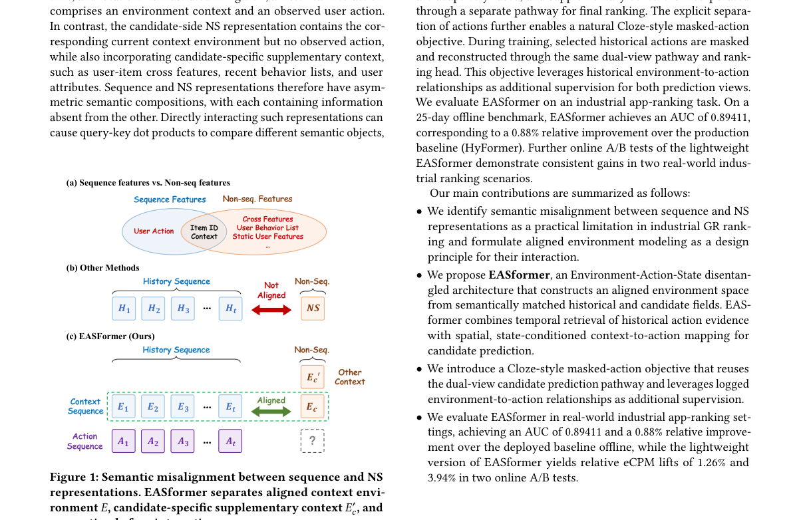

*Main result - Figure 2 Overview of the proposed framework.*

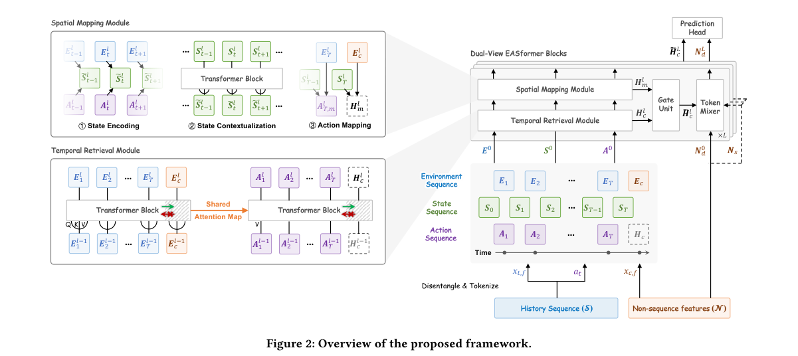

**Why this ranks #8**: Wild-card：与生成/RL 无关，但它给出的「语义不对齐导致点积无意义」是一个可迁移到多模态生成的表示层教训。

---

### 9. VisualEvolve: A Skill Self-Evolution Framework for Visual Reasoning

**arXiv**: [2610.28386](https://arxiv.org/abs/2610.28386) | **Score**: 6.8 (relevance 6.5 x 0.7 + quality 7.5 x 0.3) | **Tags**: reward-model-gen, self-evolution, visual-tools | **Categories**: cs.AI, cs.CV | **Pages**: 29 | **[wild-card=yes]**

**Authors**: Jiawei Wang, Yucun Li, Xueqi Li, Shenghao Wang, Xinquan Gong, Dan Zhang, Zheqi Lv, Yuquan Le, Shaozu Yuan, An Zhang et al.

**Affiliation**: National University of Singapore; Hunan University; Shenzhen University; Cornell University

**Abstract**

> Visual tool use enables vision-language models (VLMs) to acquire task-relevant evidence, but its effectiveness can be limited by predefined visual operations and the tool-use strategies learned during training. Representing these operations and strategies as reusable external skills allows them to be refined through self-evolution without updating model parameters. However, skill refinement can introduce performance regressions. Meanwhile, inspecting accumulated task execution trajectories together with skill evolution history may lead to evolution evidence overload. To address these challenges, we propose VisualEvolve, a self-evolving framework that evolves executable visual operations and tool-use strategies for VLMs through a Select--Execute--Evolve--Evaluate cycle. Skill-Library Snapshot Selection uses performance on a fixed validation set disjoint from execution tasks to select an effective historical snapshot for subsequent evolution, limiting the propagation of performance regressions. Progressive Evidence Access (PEA) guides capability-gap diagnosis through a coarse-to-fine hierarchy comprising the Skill-Performance Report, Evolution Log, Trajectory Summaries, and relevant raw trajectory segments. Across four VLM backbones and six evaluation sets from three benchmarks, VisualEvolve improves over the Initial Skill Library in 23 of 24 settings, with a maximum gain of 15.1 percentage points on VisualProbe Hard using Qwen3.5-Plus. Ablation studies support the contributions of Snapshot Selection and PEA, while further experiments show that skills can be improved using experience from different data settings and directly reused across backbones. Moreover, VisualEvolve enables effective skill self-evolution with over an order of magnitude fewer task-solving trajectories than estimated for representative RL-based methods.

**Key findings**

- **Finding**: 视觉工具使用让视觉语言模型（VLM）获得任务相关证据，但其效果受限于**预定义的视觉操作**与训练中学到的工具使用策略。

- **Finding**: 把这些操作与策略表示为可复用的**外部技能**，即可在不更新模型参数的情况下精炼它们。

- **Finding**: 但技能精炼可能引入性能回退；同时检视累积的任务执行轨迹与技能演化历史会造成**演化证据过载**。

- **Finding**: VisualEvolve 通过 Select–Execute–Evolve–Evaluate 循环演化可执行视觉操作与工具使用策略。

- **Finding**: 技能库快照选择用与执行任务不相交的固定验证集性能来挑选快照；为解决证据过载，提出 Progressive Evidence Access，以由粗到细的方式访问技能演化历史与当前执行证据来诊断能力缺口。

- **Finding**: 跨四个骨干与六个评测集，并与 SFT / RL 训练的 agent 对比。

- **Inference**: 「不更新参数、只演化技能库」把自改进的成本从训练移到了搜索——这与 RLHF 那条线「更新参数」的假设正交，但同样是自改进的一种形态。

- **Recommendation**: 可选读（wild-card）。

**Key figures**

*Framework / architecture - Figure 1 VisualEvolve versus training-based agents on six evaluation sets. VisualEvolve uses our framework with four backbones; References are agents trained with SFT and/or RL. The dashed circle mark*

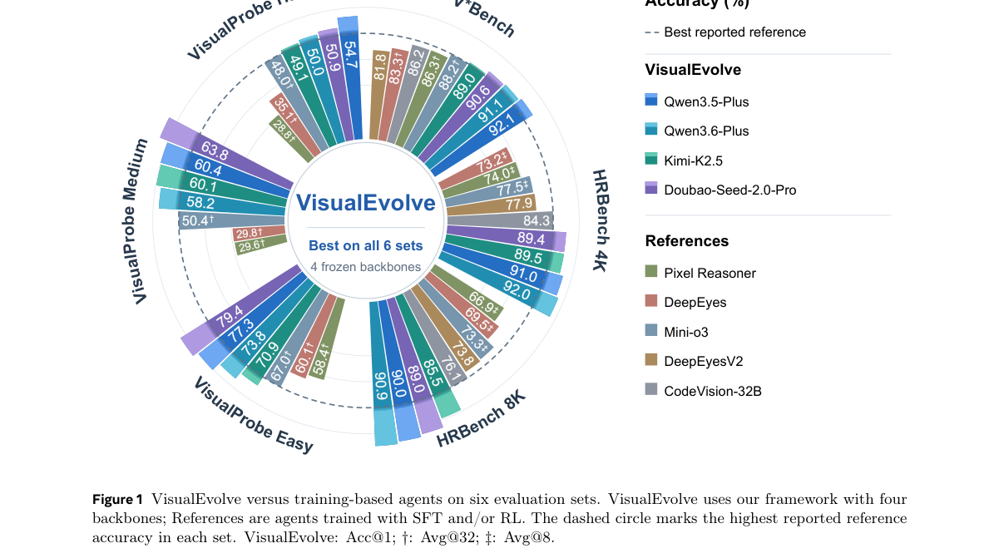

*Main result - Figure 2 The VisualEvolve framework. VisualEvolve evolves a skill library through multi-round Select–Execute–Evolve– Evaluate cycles.*

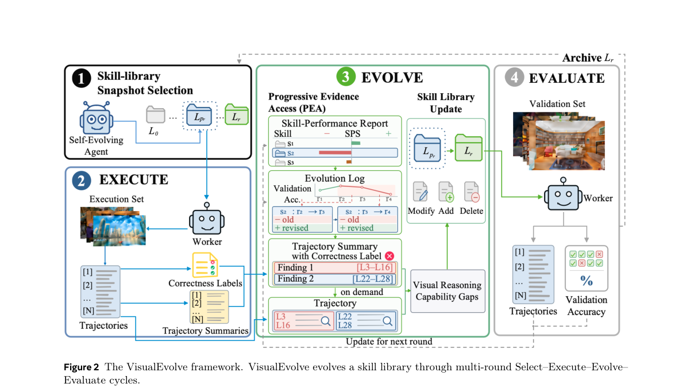

**Why this ranks #9**: Wild-card：不是生成内容模型的 RL，但它是「自改进」这条线在视觉侧的对应物，与 rl_llm 里的 self-improvement 审计工作可对照读。

---

### 10. PI-MLLM: Psychophysics-Inspired Multimodal Large Language Model for Oddly Satisfying Video Emotion Analysis

**arXiv**: [2610.28264](https://arxiv.org/abs/2610.28264) | **Score**: 6.45 (relevance 6 x 0.7 + quality 7.5 x 0.3) | **Tags**: reward-model-gen, audio-visual, dataset | **Categories**: cs.AI, cs.CV | **Pages**: 12 | **[wild-card=yes]**

**Authors**: Yuheng Zhang, Jie Zhang, Yuecong Min, Yunwei Zhao, Meichen Liu, Qiankun Li, Shiguang Shan

**Affiliation**: Institute of Computing Technology, Chinese Academy of Sciences; Nanyang Technological University; Imperial College London; the-art methods validating its superior performance

**Abstract**

> Oddly Satisfying Videos (OSVs) can evoke strong viewer responses through repetitive motion, visual tactility, and ASMR-like sounds despite containing few explicit semantic emotion cues. This makes OSVs a challenging setting for Video Emotion Analysis (VEA), since most existing methods focus on semantic video content and under-model the physical sensory dynamics that shape viewer responses. To support Oddly Satisfying Video Emotion Analysis (OSVEA), we construct the Oddly Satisfying Video Dataset (OSVD), comprising 12,000 annotated 5-second clips. Each clip provides viewer-emotion labels under video-only, audio-only, and audio-visual conditions, together with explanations grounded in visual and acoustic sensory evidence. Building on OSVD, we propose PI-MLLM, a psychophysics-inspired multimodal large language model that integrates Modality-Specific Dynamics Alignment (MSDA) and Coalition-Based Audio-Visual Attribution (CAVA). MSDA uses auxiliary prediction objectives to align modality representations with visual motion and acoustic energy-onset dynamics. CAVA evaluates emotion scores across modality coalitions and applies Shapley attribution to identify the dominant modality and determine whether visual and auditory evidence is synergistic or conflicting. Experiments show that PI-MLLM improves both viewer-side emotion prediction and sensory-grounded explanation quality, suggesting the value of physical sensory cues to video emotion analysis.

**Key findings**

- **Finding**: 「Oddly Satisfying Videos (OSVs)」靠重复运动、视觉触感与 **ASMR 式声音**唤起强烈观众反应，却几乎不含显式语义情绪线索。

- **Finding**: 这使 OSV 成为视频情绪分析（VEA）的困难场景，因为多数方法聚焦语义视频内容，低估了塑造观众反应的**物理感官动态**。

- **Finding**: 作者构建 OSVD：12,000 个标注的 5 秒片段，每个片段在纯视频、纯音频与视听三种条件下提供观众情绪标签，并附有基于视觉与声学感官证据的解释。

- **Finding**: PI-MLLM 是受心理物理启发的 MLLM，整合 Modality-Specific Dynamics Alignment（MSDA）与 Coalition-Based Audio-Visual Attribution（CAVA）。

- **Inference**: 「ASMR 式声音」是一个几乎不含语义却能强烈驱动情绪的通道——这正好是 audio-LM 最可能失灵、而视频模型又完全看不见的那部分内容。

- **Recommendation**: 可选读（wild-card）。

**Key figures**

*Framework / architecture - Figure 1 Existing VEA methods rely on sensory-ungrounded semantic annotations and implicit multimodal fusion. Our approach addresses these limitations with psychophysics-aware sensory annotations and*

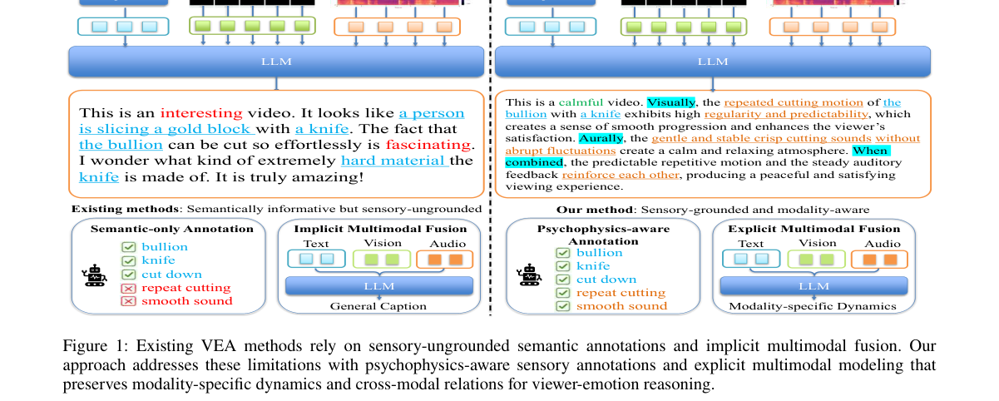

*Main result - Figure 2 OSVD construction and annotation pipeline. Word-cloud-derived keywords guide data collection. Then segmented clips are semantically deduplicated, filtered for resolution, and checked for aud*

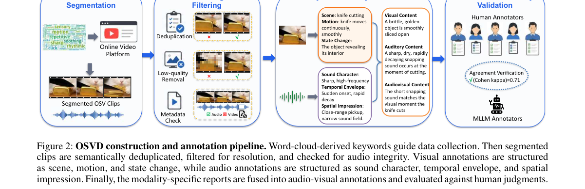

**Why this ranks #10**: Wild-card：不是生成工作，但它是本批唯一同时标注「纯音频」与「纯视频」情绪条件的资源，恰好补上 AIGC 音频最缺的那块证据。

---

## Footer

- Total papers reviewed across all 7 tracks: 70 (from 517 scanned, 93 full reads)
- rl_aigc track final top-10: 10
- Wild-cards in this track: 7
- Figure assets: `res/` (shared across tracks)

Generated by `mine-arxiv-daily-digest` skill. Sister file: `2026-10-21_rl_aigc_entry.md`.
