# ArXiv Daily Digest - 2026-10-21 (强化学习（核心算法 / 理论 / 多智能体 / sim-to-real）, 10 papers)

**Generated**: 2026-10-21 17:00 CST

**Source**: arXiv cs.CV, cs.SD, eess.AS, cs.CL, cs.AI, cs.RO, cs.LG submissions, window 2026-10-20 UTC (latest announced batch as of 2026-10-21 17:00 CST)

**Track**: rl_core (top 10 of 517 papers scanned, 93 full reads)

**Scope**: continuous-time policy gradient from discrete data, anchor-relative object-centric RL, offline RL for generative manipulation policies, query-based collaborative RL, Dirichlet-process Bayesian value functions, RL for FPGA and IC deployment, interruption-aware recurrent RL for UAS navigation, POMDP theory bridged to deep RL with particle filters, offline apprenticeship learning, masked-MDP exploration

⚠️ **Wild-card**: 本批该线仅 7 篇严格命中，其余 3 篇为 wild-card 补足，已在正文逐条标注。

---

**本批 rl_core 线的理论密度最高。** Continuous-Time Policy Gradient from Discrete Data（48 页）把性能差分引理、熵正则策略流的**指数收敛**与免模型 actor-critic 放在同一框架，且**不要求已知漂移与扩散系数**；From POMDP Theory to Deep RL with Particle Filters（NeurIPS，64 页）则做了一件更少有人做的事——没有回避 QMDP 近似的粗糙，而是**精确算出它在哪一部分是准的**（对价值中的信念线性分量精确，误差只来自不确定性敏感残差），并给出可分解为模型估计、滤波与规划三项误差的端到端遗憾界。

**两篇把「约束」本身当成问题来做。** Confessions of a Masked MDP 研究了一个主流 RL 完全忽略的设定：**动作空间是未知的，且判定哪些动作合法本身就是计算瓶颈**——作者证明基于确定性乐观优化的算法 minimax 最优，但在非退化实例上仍次优。Interruption-Aware Recurrent RL for UAS 则盯住另一个被忽略的瞬间：策略被远程飞行员或机载避碰**临时覆盖**后再拿回权力时的表现，并提出三种把打断上下文条件化进循环处理的架构。

**其余几篇各自钉住一个常被整体化处理的结构。** ORBiT 把智能体在场景平移下的崩塌追溯到**坐标系选错**（全局绝对坐标 vs 锚点相对坐标）；AWLS 给出在生成式操作策略上做离线 RL 的低风险接法——**冻结解码器**，只在隐空间里做优势加权；Ask to Learn 引入了「向协作者提问」这一介于离线与在线之间的中间设定，并给出接近局部基准的查询复杂度刻画；另有 FPGA/IC 上的 RL 综述（100+ 项研究）与一篇关于离线学徒制的博士论文作为参照点。

---

## Top 10 - 强化学习（核心算法 / 理论 / 多智能体 / sim-to-real）

### 1. From POMDP Theory to Deep RL with Particle Filters

**arXiv**: [2610.27575](https://arxiv.org/abs/2610.27575) | **Score**: 8.3 (relevance 8 x 0.7 + quality 9 x 0.3) | **Tags**: rl-algorithm, theory, model-based | **Categories**: cs.LG, stat.ML | **Pages**: 64

**Authors**: Kevin Tan, Ziping Xu

**Affiliation**: University of Pennsylvania; School of Data and Information Sciences; University of North Carolina at Chapel Hill

**Abstract**

> Model-based reinforcement learning in partially observable environments requires inferring hidden states, learning latent dynamics, and planning under the resulting belief. Practical algorithms often solve one aspect of the above pipeline while relying on approximations for the others that are often poorly understood, while existing POMDP theory typically analyzes computationally inefficient theoretical algorithms far from modern deep RL practice. To fill this gap, we propose a practical end-to-end algorithm that approximately solves the hidden state filtering problem via sequential Monte Carlo (SMC), updates a latent dynamics model online, and performs approximate online planning for $d$ steps before bootstrapping leaves with a state-value critic (a QMDP approximation). We analyze each approximation and prove an end-to-end regret bound decomposing the error into model estimation error, particle filter error, Monte Carlo rollout error, and a structural bias term induced by the QMDP approximation controllable by the planning depth that we further analyze in various special cases. The resulting guarantee makes explicit how statistical sample size, particle budget, rollout budget, and planning depth affect performance. We instantiate our algorithm in an MPC-based deep RL framework, demonstrating its practicality on a variety of environments. On a POMDP that satisfies our assumptions, each term of the bound decays at its predicted rate. Our results provide a practical and theoretically grounded route for bridging theory and practice within online decision-making in POMDPs.

**Key findings**

- **Finding**: 部分可观测环境下的 model-based RL 需要推断隐状态、学习潜在动力学并在所得信念上规划。

- **Finding**: 实用算法通常只解决上述流水线中的一环，对其余环节依赖**理解不足的近似**；而现有 POMDP 理论分析的是与当代深度 RL 实践相距甚远的低效理论算法。

- **Finding**: 作者提出一个实用的端到端算法：用序列蒙特卡洛（SMC）近似隐状态滤波、在线更新潜在动力学模型、并做 d 步近似在线规划后以状态价值 critic 自举叶子（QMDP 近似）。

- **Finding**: 作者逐一分析每个近似，并证明端到端遗憾界可分解为模型估计误差、滤波误差与规划误差。

- **Finding**: 对更便宜的状态级规划器，作者证明 **QMDP 对价值中的信念线性分量是精确的**，误差只来自一个不确定性敏感的残差，从而厘清了该近似何时足够小。

- **Inference**: 「QMDP 对信念线性部分精确」把 QMDP 近似从「经验上还行」提升为「在可算准的范围内是精确的」——这是把经典理论重新接回深度实践的关键接口。

- **Recommendation**: 强烈推荐。NeurIPS，64 页。

**Key figures**

*Framework / architecture - Figure 1 Particle beliefs for the unobserved velocity of a double integrator LQR over the last 1000 steps. Mean, 10th and 90th quantiles visualized. Beliefs track the state when the system is stable.*

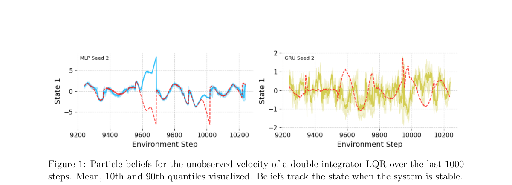

**Why this ranks #1**: 本批 RL 理论最扎实的一篇：它没有回避 QMDP 近似的粗糙，而是精确算出它在哪一部分是准的。

---

### 2. Continuous-Time Policy Gradient from Discrete Data: Convergence Analysis and Model-Free Algorithms

**arXiv**: [2610.28580](https://arxiv.org/abs/2610.28580) | **Score**: 8.65 (relevance 8.5 x 0.7 + quality 9.0 x 0.3) | **Tags**: rl-algorithm, policy-gradient, theory | **Categories**: cs.LG, math.OC | **Pages**: 48

**Authors**: Martin Hernandez, Xinyan Qing, Mo Zhou, Yuhua Zhu

**Affiliation**: Department of Statistics and Data Science, University of California, Los Angeles; Department of Statistics, University of Michigan; School of Mathematical Sciences, Peking University

**Abstract**

> Continuous-time reinforcement learning seeks an optimal policy under unknown dynamics driven by stochastic differential equations using observations collected at discrete times. We develop a policy gradient framework that combines rigorous convergence analysis with learning from discrete data. We first establish a performance difference lemma and derive policy gradient formulas for randomized and parametrized policies. We then prove exponential convergence of an entropy-regularized policy flow to the regularized optimum. For discrete parametrized updates, we derive a convergence bound that explicitly separates the contributions of critic error, policy-regression error, and the learning step size. To enable learning under unknown dynamics, we integrate this framework with PhiBE, which constructs a continuous-time surrogate generator from discrete transition data. The resulting on-policy and off-policy model-free actor-critic algorithms preserve the continuous-time structure of the control problem. Numerical experiments on an entropy-regularized linear-quadratic regulator and a nonlinear wheeled robot demonstrate the performance and stability of the proposed methods with both known and data-driven dynamics.

**Key findings**

- **Finding**: 连续时间 RL 关注在未知动力学下、由随机微分方程驱动、但**只在离散时刻收集观测**时的最优策略。

- **Finding**: 作者建立**性能差分引理**，并为随机化与参数化策略推导策略梯度公式。

- **Finding**: 证明**熵正则化的策略流**对正则化最优策略**指数收敛**。

- **Finding**: 基于 PhiBE 框架，直接从离散转移数据开发**免模型的**在策略/离策略 actor-critic 算法，无需辨识动力学，也无需把问题化为离散时间 MDP。

- **Finding**: 算法不需要已知漂移或已知扩散系数。共 48 页。

- **Inference**: 免模型 + 连续时间 + 离散观测这三者同时成立的方案很少；「无需辨识动力学」是它相对绝大多数连续时间 RL 工作的关键卖点。

- **Recommendation**: 推荐（理论向读者优先）。

**Key figures**

*（该论文的图注结构未被识别到，未附图。原始 PDF 请见 arXiv 链接。）*

**Why this ranks #2**: 本批理论最扎实的一篇：把连续时间策略梯度的收敛性与免模型算法放在同一框架下，且不要求已知漂移与扩散系数。

---

### 3. Reframing Object-Centric Reinforcement Learning: From Absolute to Relative Representations

**arXiv**: [2610.28197](https://arxiv.org/abs/2610.28197) | **Score**: 8.0 (relevance 8.0 x 0.7 + quality 8.0 x 0.3) | **Tags**: rl-algorithm, representation, inductive-bias | **Categories**: cs.AI, cs.LG | **Pages**: 27

**Authors**: Cedric Derstroff, Jannis Blüml, Janosch Moos, Michael Girstl, Zihan Ye, Debora Clever, Kristian Kersting

**Affiliation**: Technische Universität Darmstadt

**Abstract**

> Object-centric reinforcement learning agents typically receive each object's position in a fixed global frame, even though their decisions usually depend on where objects are relative to one another. These absolute views often fail to capture the local context that is most relevant to the agent's behavior. As a result, an agent must relearn the same response at every location where a configuration can occur, and its performance collapses when the scene is merely shifted. In this work, we propose a shift toward Object-Relative Coordinates fixed to Anchor (ORCA), where entities are described in a relative frame of reference. To operationalize this idea, we introduce Object-Relative inductive-Bias Transformers (ORBiT), a transformer-based architecture for processing anchor-relative inputs in reinforcement learning. Our results suggest these relative representations improve performance for both MLP and transformer agents. Furthermore, we demonstrate that ORBiT outperforms the pixel-based PPO baseline, achieving an aggregate HNS IQM greater than 1.0 over 13 Atari games. ORBiT learns the game of Foosball from scratch, dominating all baselines. In our controlled Tag environment, we further show that ORCA extends to rotations, that ORBiT generalizes to unseen numbers of distractors, and that these gains require a decision-relevant anchor.

**Key findings**

- **Finding**: 以对象为中心的 RL 智能体通常在固定全局坐标系里接收每个物体的位置，尽管其决策实际依赖物体**相互之间**的相对关系。

- **Finding**: 绝对视图往往无法捕获与行为最相关的局部上下文，导致智能体必须在每种配置出现的每个位置重新学习同一响应，且场景仅仅平移时性能就崩塌。

- **Finding**: 本文提出转向**锚点相对的物体坐标**（ORCA），实体在相对参考系中描述。

- **Finding**: ORBiT 是处理锚点相对输入的 Transformer 架构。

- **Inference**: 这是一个「表示即归纳偏置」的工作——它指出智能体的失败不是策略不够强，而是输入表示让它必须重复学习同一件事。

- **Recommendation**: 推荐。

**Key figures**

*Framework / architecture - Figure 1 With ORCA inputs, the agent only needs to learn strategies for similar situations once, enabling direct generalization. When the player (Asterix ) is in the same row as the target collectibl*

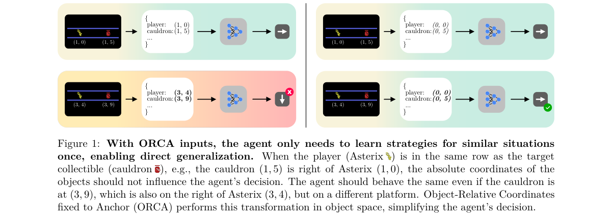

*Main result - Figure 2 Comparison of absolute and relative rep- resentations in Asterix. Left: Absolute represen- tations encode object positions with respect to a fixed origin in the environment (e.g., top-left c*

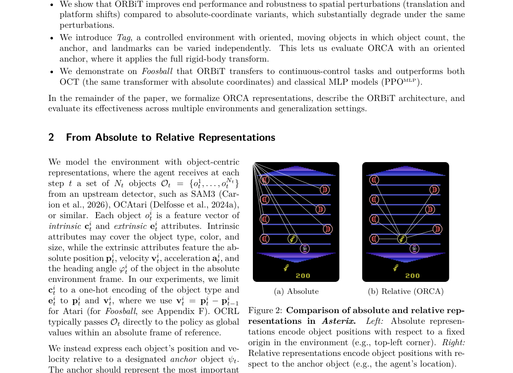

**Why this ranks #3**: 它把一个常见的「鲁棒性问题」追溯到了一个具体的表示层缺陷：坐标系选错了。

---

### 4. AWLS: Advantage-Weighted Latent Steering for One-Step Generative Robotic Manipulation Policies

**arXiv**: [2610.27736](https://arxiv.org/abs/2610.27736) | **Score**: 7.8 (relevance 7.5 x 0.7 + quality 8.5 x 0.3) | **Tags**: rl-algorithm, offline-rl, manipulation | **Categories**: cs.RO | **Pages**: 28

**Authors**: Jiahong Tang, Jiaju He, Zhiyuan Yang, Ruyang Han, Haiyue Zhu

**Affiliation**: Nanyang Technological University, Singapore; Singapore Institute of Manufacturing Technology (SIMTech)

**Abstract**

> Human-collected real-world robotic manipulation demonstrations often contain mixed-quality trajectories, including hesitant, indirect, or inefficient action segments. While diffusion- and flow-based policies can model such multimodal data, standard behavior cloning (BC) assigns equal likelihood to all demonstrated actions and may therefore reproduce suboptimal modes. Offline RL value estimates offer a natural signal for biasing policies toward higher-value behavioral modes, but directly fine-tuning the generative policy or using critic gradients for policy steering can amplify critic errors and induce prior drift. We propose Advantage-Weighted Latent Steering (AWLS), an offline post-training method for improving frozen one-step generative manipulation policies without updating their decoders. AWLS learns a residual noise shaper, an observation-conditioned residual correction to the policy's latent noise, and trains it with an advantage-weighted action reconstruction objective. The advantages are detached, scale-normalized, and used only as supervised weights on demonstrated actions, avoiding critic-gradient policy updates while preserving fast single-step inference. We further introduce a rollout-free decoder-sensitivity criterion for selecting pretrained checkpoints that remain responsive to latent-noise perturbations. Experiments on simulated and real-world robotic manipulation tasks with clean and mixed-quality demonstrations show that AWLS improves over the frozen base policy while limiting drift from the pretrained behavior prior. Project page: https://awls-corl2026.github.io/

**Key findings**

- **Finding**: 人类采集的真实机器人操作演示常混杂质量：犹豫、绕路或低效的动作片段。

- **Finding**: 扩散/流式策略可以建模这类多模态数据，但**标准行为克隆给所有演示动作同等似然**，因而会复现次优模式。

- **Finding**: 离线 RL 的价值估计天然提供偏向高价值行为模式的信号，但直接微调生成式策略会有已知失效。

- **Finding**: AWLS 是一种离线后训练方法，在**冻结**一步生成式操作策略的前提下改进它，且**不更新其解码器**。

- **Inference**: 「冻结解码器、只改隐空间」把策略改进的风险限制在了一个可比较的子空间里；配合优势加权的隐空间引导，等于在不破坏已有生成能力的前提下做离线 RL。

- **Recommendation**: 推荐。

**Key figures**

*Framework / architecture - Figure 1 Trajectory segments from human-collected robomimic can demonstrations [5], with pol- icy rollouts. Thin dashed lines are demonstration segments from a shared start to the goal, and thick cur*

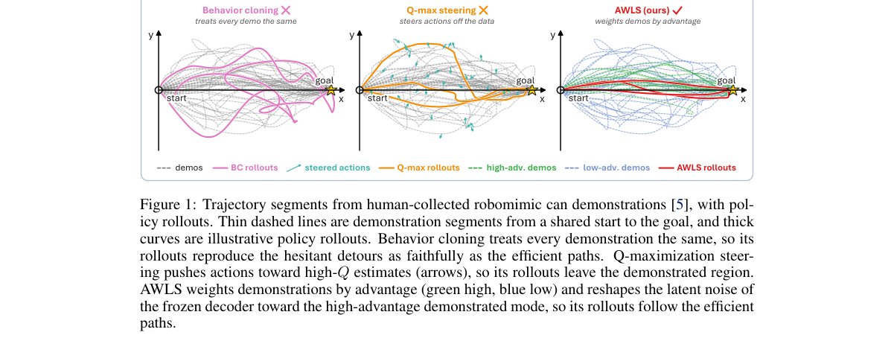

*Main result - Figure 2 Overview of AWLS. Top: the one-step decoder Gθ is pretrained by behavior cloning. Bot- tom: with Gθ frozen, Tϕ reshapes the latent noise via advantage-weighted reconstruction using detached,*

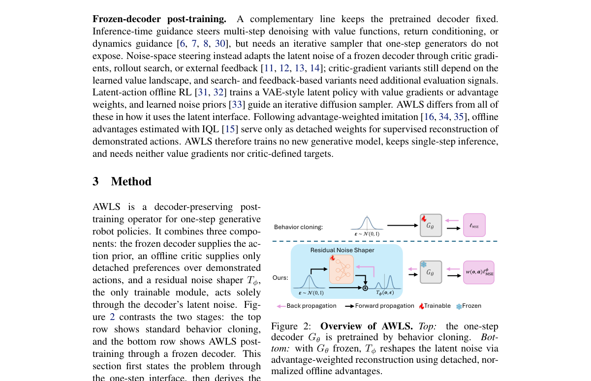

**Why this ranks #4**: 它给出了在生成式策略上做离线 RL 的一种「低风险」接法：冻结解码器，只在隐空间里加权。

---

### 5. Interruption-Aware Recurrent Reinforcement Learning for UAS Navigation Under Temporary Overrides

**arXiv**: [2610.28121](https://arxiv.org/abs/2610.28121) | **Score**: 7.25 (relevance 7 x 0.7 + quality 7.5 x 0.3) | **Tags**: rl-algorithm, safety, recurrent-policy | **Categories**: cs.AI, cs.RO | **Pages**: 16

**Authors**: Christopher Conrad, Deepak Panda, Weisi Guo, Antonios Tsourdos

**Affiliation**: [unverified]

**Abstract**

> Safe autonomous navigation of UASs requires tactical deconfliction to address conflicts that strategic coordination cannot prevent. This task is challenging under partial observability, when sensor or traffic data are missing, delayed, or degraded. Geometry-based methods can offer separation assurances but face limitations in dense encounters. Recurrent reinforcement learning has therefore been proposed to learn navigation policies that integrate observation-action histories to optimise long-term safety-efficiency trade-offs. However, operational safeguards may require a remote pilot, onboard detect-and-avoid system, or runtime assurance mechanism to temporarily override the learned policy. A research gap remains in understanding how these interruptions affect recurrent policies when the agent regains authority. Benchmark evidence shows that interruptions make task variables less decodable from the recurrent hidden state and increase post-interruption collision risk. The findings suggest that altered recurrent context prolongs post-handback degradation through an action-observation feedback loop, in which changed actions alter the flight path and subsequent recurrent updates. To address this vulnerability, we propose three interruption-aware architectures that condition recurrent processing on interruption context through separate feature streams, dedicated interruption memory, or gated environmental features. Across simulations, all three architectures preserve more decodable task information than a standard recurrent policy. Moreover, the strongest architecture reduces post-interruption collisions by 74% and interruption-induced mission failures by 69% relative to the recurrent baseline, without degrading interruption-free performance. These results show that safe interruption does not guarantee safe handback, and support interruption-aware recurrent design for resilient UAS autonomy.

**Key findings**

- **Finding**: UAS 的安全自主导航需要战术解冲突，以处理战略协调无法避免的冲突；在部分可观测下（传感或交通数据缺失、延迟、退化）这一任务格外困难。

- **Finding**: 几何方法能提供间隔保证，但在密集遭遇中存在局限；循环 RL 因此被提出以学习整合观测-动作历史、优化长期安全-效率权衡的导航策略。

- **Finding**: 但运行安全机制（远程飞行员、机载避碰系统、运行时保证机制）**会临时覆盖**已学策略。

- **Finding**: 基准证据显示打断使任务变量更难解码。

- **Finding**: 作者提出三种打断感知架构：通过独立特征流、专用打断记忆或门控环境特征，把打断上下文条件化进循环处理。

- **Inference**: 打断后「智能体重新拿回控制权」这个瞬间被主流工作忽略——恢复期的行为才是真实安全瓶颈，而不是打断本身。

- **Recommendation**: 可选读。

**Key figures**

*Framework / architecture - Figure 1 Operational context and problem overview for interrupting a recurrent UAS navigation policy.*

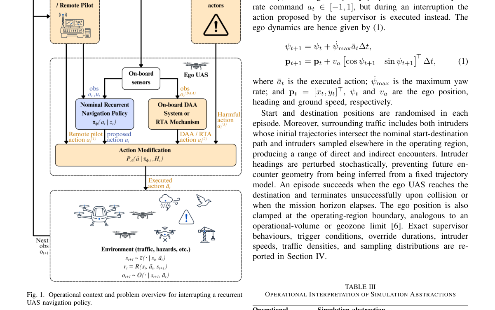

*Main result - Figure 2 Overview of proposed interruption-aware recurrent architectures: (a) Dual-feature architecture. (b) Dual-memory architecture. (c) Gated architecture.*

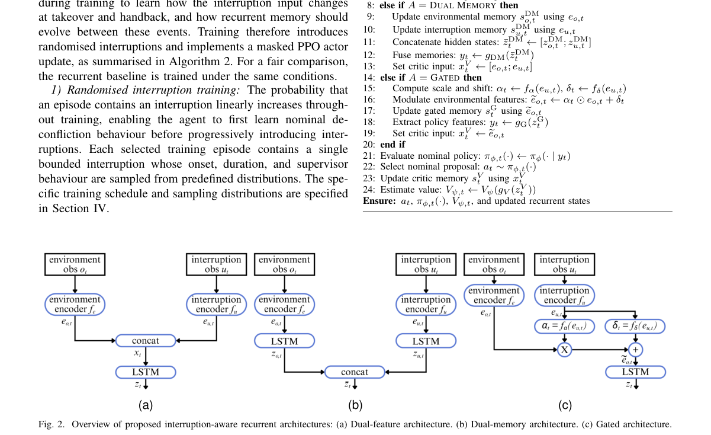

**Why this ranks #5**: 它盯住的是「恢复期」这个被忽略的瞬间：策略被安全机制打断后再拿回权力时表现如何。

---

### 6. Confessions of a Masked MDP

**arXiv**: [2610.28360](https://arxiv.org/abs/2610.28360) | **Score**: 7.25 (relevance 7 x 0.7 + quality 7.5 x 0.3) | **Tags**: rl-algorithm, theory, exploration | **Categories**: cs.LG, math.ST, stat.ML | **Pages**: 18

**Authors**: Sebastian Reboul, Lorenzo Croissant, Hélène Halconruy

**Affiliation**: Institut Polytechnique de Paris; Universitat Pompeu Fabra; Modal’X, Universit´e Paris-Nanterre; determining its validity. In this framework

**Abstract**

> In reinforcement learning, one presumes the action set to be known ahead of time, and, thus, one must know if any state-action pairs are not permissible ahead of computations. In some applications, determining this action mask is the main computational bottleneck. Isolating this problem to highlight its core properties, we study how to combine the search for an optimal policy with the learning of the mask itself, under a linear MDP model in which each attempted action reveals the exact value of a linear score determining its validity. In this framework, we first construct an algorithm based on deterministic optimistic optimization and show that it is minimax optimal, which we show is also computationally efficient. However, it is sub-optimal on non-degenerate instances, as we show. We propose an alternative, which is also computationally efficient, which plans its exploration strategy. This algorithm admits a formal interpretation as an analogue of information-directed-sampling for deterministic feedback, which may be of independent interest. Finally, we study an application of this framework to transfer learning, where the invalid action set changes over time.

**Key findings**

- **Finding**: RL 通常预设动作集已知，因此必须提前知道哪些状态-动作对不可行；但在某些应用中，**判定这个动作掩码本身就是主要计算瓶颈**。

- **Finding**: 作者把该问题单独隔离以研究其核心性质：在一种线性 MDP 模型下，把「搜索最优策略」与「学习掩码本身」结合起来，其中每次尝试一个动作会揭示一个决定其有效性的线性分数的精确值。

- **Finding**: 基于确定性乐观优化的算法被证明是 minimax 最优且计算高效，但作者证明它在**非退化实例上仍是次优的**。

- **Finding**: 作者提出另一种同样计算高效、但会主动规划其探索策略的算法。

- **Finding**: 并证明任何此类算法都是学习转移与奖励的充分构件。

- **Inference**: 「掩码未知」把探索问题倒了过来——这里不是探索环境，而是探索**哪些动作是合法的**；而 minimax 最优解在非退化实例上次优，说明简单的乐观主义不够。

- **Recommendation**: 推荐。

**Key figures**

*Framework / architecture - Figure 1 Visualisation of V and (D+, D−, U ).*

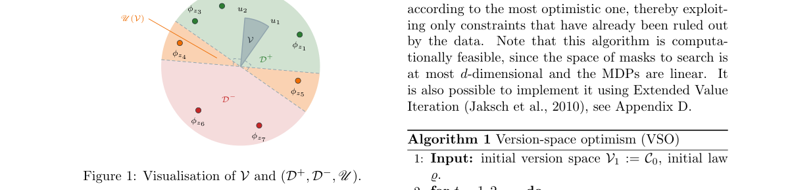

*Main result - Figure 2 The MDP in the proof of Theorem 2.1.*

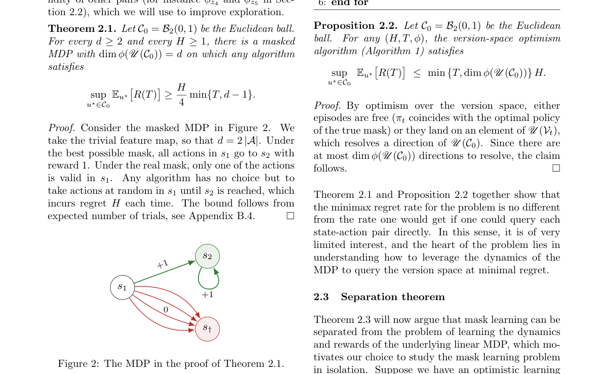

**Why this ranks #6**: 一个被主流 RL 完全忽略的问题设定：动作空间本身是未知的、且判定合法性就是瓶颈。

---

### 7. Reinforcement learning for hardware acceleration and system-level optimization on FPGA and integrated-circuit platforms: A survey

**arXiv**: [2610.28699](https://arxiv.org/abs/2610.28699) | **Score**: 7.0 (relevance 7 x 0.7 + quality 7 x 0.3) | **Tags**: rl-algorithm, hardware, survey | **Categories**: cs.AI, cs.AR, cs.LG, cs.PF | **Pages**: 38

**Authors**: Hamza Kheddar

**Affiliation**: LSEA Laboratory, Department of Electrical Engineering, University of Medea, 26000, Algeria

**Abstract**

> Reinforcement learning (RL) enables adaptive and autonomous decision-making in embedded, edge, and heterogeneous computing systems. Field-programmable gate arrays (FPGAs) and integrated circuits (ICs) offer low latency, energy efficiency, and architectural flexibility for RL deployment, while introducing challenges in resource constraints, implementation complexity, and hardware-algorithm co-design. This review surveys more than 100 studies on RL implementations across FPGA and IC platforms, emphasizing architectures, implementation strategies, performance evaluation, and applications. The literature is organized by RL family, including model-based Markov decision processes, classical value-based methods, deep RL, actor-critic, policy-gradient, and multi-agent approaches. We further classify studies by abstraction level, hardware realization strategy, and application domain, examining how RL algorithms map onto reconfigurable and fixed hardware. Unlike surveys restricted to particular algorithms or platforms, this work provides a unified analysis of FPGA and IC implementations, covering acceleration, reconfigurable architectures, energy-aware control, and system-level optimization. Comparative assessments consider resource utilization, latency, throughput, power consumption, and reported performance gains. Finally, we identify recurring architectural patterns, practical limitations, open challenges, and research directions for efficient RL-driven hardware systems. The survey offers a consolidated reference for researchers developing and evaluating RL solutions on specialized hardware.

**Key findings**

- **Finding**: RL 使嵌入式、边缘与异构计算系统具备自适应与自主的决策能力。

- **Finding**: FPGA 与 IC 为 RL 部署提供低延迟、能效与架构灵活性，同时带来资源约束、实现复杂度与硬件-算法协同设计的挑战。

- **Finding**: 本文综述 100 余项 RL 在 FPGA 与 IC 平台上的实现研究，重点覆盖架构、实现策略、性能评估与应用。

- **Finding**: 文献按 RL 家族组织：model-based MDP、经典 value-based 方法、deep RL、actor-critic、policy-gradient 与多智能体方法。

- **Finding**: 并进一步按抽象层级、硬件实现策略与应用领域二次分类，考察硬件抽象方法。

- **Inference**: 把 RL 落到 FPGA 的核心矛盾是「探索要多样性、部署要确定性」——这与 RLHF 里「采样要多样、部署要稳」是同一类张力，只是换到了硬件层。

- **Recommendation**: 可选读（综述）。

**Key figures**

*Framework / architecture - Figure 1 Survey roadmap outlining the organization of RL-based FPGA and IC platforms.*

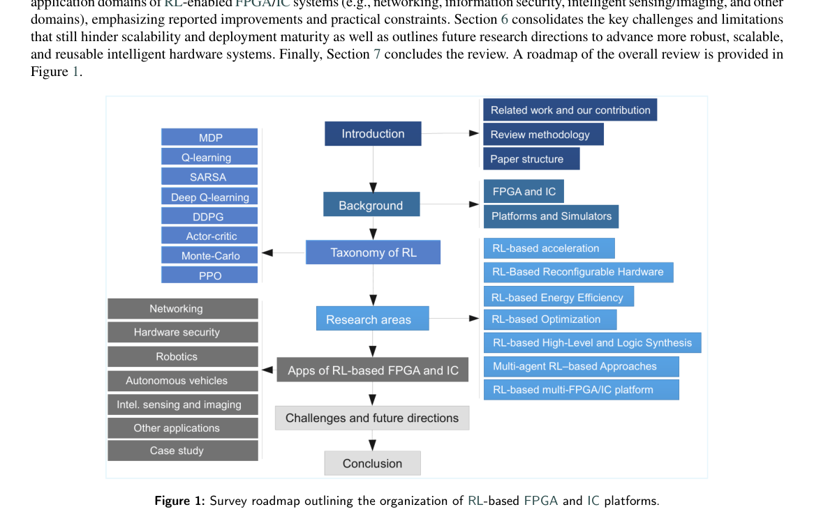

*Main result - Figure 2 Overview of two hardware architecture representations that could be employed for RL workloads. (a) A simplified FPGA floorplan showing the distribution of on-chip resources—CLB logic tiles,*

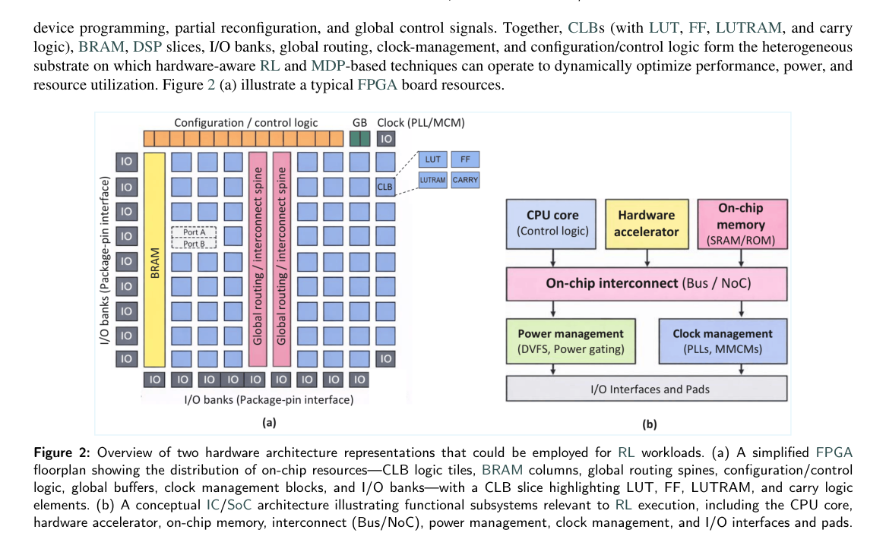

**Why this ranks #7**: 它把「RL 能不能落到硬件」从个案问题整理成了一张分类图谱，但本身是综述而非新方法。

---

### 8. Ask to Learn: Query-Based Collaborative Reinforcement Learning

**arXiv**: [2610.27606](https://arxiv.org/abs/2610.27606) | **Score**: 7.3 (relevance 7.0 x 0.7 + quality 8.0 x 0.3) | **Tags**: rl-algorithm, offline-rl, theory | **Categories**: cs.LG, stat.ML | **Pages**: 113

**Authors**: Kaicheng Zhang, Hongqian Niu, Laixi Shi, Didong Li, Guannan Qu, Zhun Deng

**Affiliation**: Johns Hopkins University; Carnegie Mellon University

**Abstract**

> Offline reinforcement learning is fundamentally limited by the coverage of the available data, while collecting additional trajectories through online exploration may be costly, unsafe, or infeasible. We study whether this limitation can be overcome without directly interacting with the underlying environment. Motivated by practical settings such as collaborator-mediated simulation, where a collaborator can provide information complementary to the offline data, we introduce query-based collaborative reinforcement learning to study how to acquire this information efficiently. The learner starts with a fixed offline dataset and adaptively queries state-time pairs; the collaborator samples an action according to a fixed, possibly suboptimal policy, and the simulator returns the corresponding reward and next state. For finite-horizon tabular problems, we derive an instance-dependent information-theoretic lower bound on the additional queries required to identify an $ε$-optimal policy and develop a local quadratic approximation. Guided by this characterization, we develop an adaptive query-allocation algorithm whose query complexity nearly matches the local benchmark under suitable conditions. Experiments on multiple synthetic and semi-synthetic environments demonstrate the empirical efficiency of the proposed method.

**Key findings**

- **Finding**: 离线 RL 受限于可用数据的覆盖，而通过在线探索收集更多轨迹可能昂贵、不安全或不可行。

- **Finding**: 作者研究**能否不直接与环境交互**就克服这一限制：受「协作者介导的仿真」等实际设定启发，协作者可提供与离线数据互补的信息。

- **Finding**: 提出查询式协同 RL：学习者用协作者介导的模拟器观测来增广固定的离线数据集。

- **Finding**: 基于该刻画，作者开发一个**自适应查询分配算法**，其查询复杂度在合适条件下接近局部基准。

- **Finding**: 共 113 页，18 张图。

- **Inference**: 「向协作者提问」是离线 RL 与在线 RL 之间的第三种设定——它把数据获取的成本从环境风险转移到信息带宽上，理论上可达到接近局部基准的查询复杂度。

- **Recommendation**: 推荐（理论与应用兼顾）。

**Key figures**

*Framework / architecture - Figure 1 Query-based collaborative RL. The learner augments offline data with simulated experience, choosing state-time queries but not the actions sampled by the fixed-policy collaborator.*

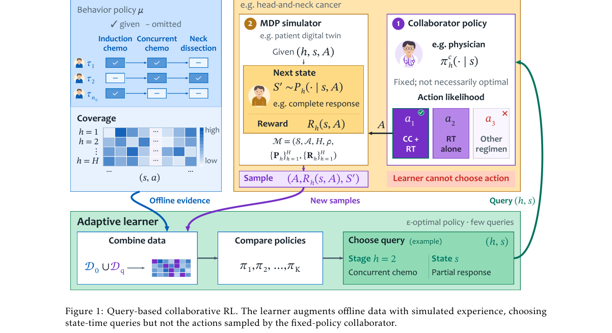

**Why this ranks #8**: 它引入了「向协作者提问」这一中间设定，并给出了匹配局部基准的查询复杂度刻画。

---

### 9. Bayesian Neural Networks via Dirichlet Process Priors on the Data-Generating Distribution for Randomized Value Functions in Deep Reinforcement Learning

**arXiv**: [2610.27570](https://arxiv.org/abs/2610.27570) | **Score**: 7.0 (relevance 7 x 0.7 + quality 8 x 0.3) | **Tags**: rl-algorithm, theory, exploration | **Categories**: cs.LG, stat.CO, stat.ML | **Pages**: 31

**Authors**: Sumit Vashishtha

**Affiliation**: [unverified]（论文首页仅见个人邮箱，未标注机构）

**Abstract**

> Bayesian neural networks (BNNs) offer a principled framework for quantifying epistemic uncertainty. However, standard weight-space priors yield complex, high-dimensional neural network posteriors that are computationally prohibitive to sample from, and popular approximate inference schemes often fail to capture epistemic uncertainty effectively---a failure mode particularly acute in reinforcement learning (RL) \citep{osband2018randomized}. To resolve this challenge, we introduce a new class of BNNs that quantify uncertainty by placing Bayesian nonparametric Dirichlet Process (DP) priors directly on the underlying data-generating distribution rather than on network parameters. Building on this foundation, we develop DP-DQN, a reinforcement learning algorithm that leverages DP-BNNs to maintain posterior distributions over value functions and perform efficient Thompson sampling. By grounding randomized value functions in Bayesian nonparametrics, DP-DQN unifies data-driven posterior reweighting (via the Bayesian Bootstrap) with generative prior hypotheses injected directly through the DP base measure, enabling decisive ``deep exploration'' with a single neural network without the overhead of multi-network ensembles.

**Key findings**

- **Finding**: 贝叶斯神经网络（BNN）为量化认知不确定性提供了原则化框架，但标准的权重空间先验会产生复杂的高维后验，从中进行采样在计算上不可行。

- **Finding**: 常用的近似推断方案往往无法有效捕捉认知不确定性——这一失效模式在强化学习中尤为突出。

- **Finding**: 作者引入一类新的 BNN：把贝叶斯非参数 **Dirichlet Process（DP）先验直接放在底层的数据生成分布上**，而不是网络参数上。

- **Finding**: 在此基础上发展出 DP-DQN，利用 DP-BNN 维护价值函数的后验分布并执行高效的 Thompson 采样。

- **Finding**: 关键优势：既有的随机化价值函数方法需要训练多个神经网络的集成来表示函数不确定性，而该方法用**单个**神经网络实现时间协调的深度探索——在每个 episode 内冻结所采样的价值函数、贯穿整个 rollout。

- **Inference**: 把不确定性从「权重在哪」转移到「数据从哪来」，绕开了高维后验不可采样这一根本障碍；用单网络替代集成的代价是探索的时间协调性必须靠「每 episode 冻结」来换。

- **Recommendation**: 推荐。

**Key figures**

*Framework / architecture - Figure 1 Epistemic uncertainty on 2D annular regression. (A) Annular training data (r ∈[1.3, 2.45]) with unobserved central cavity (r ≤1.0). (B–D) BALD epistemic uncertainty heatmaps (nats) (Houlsby*

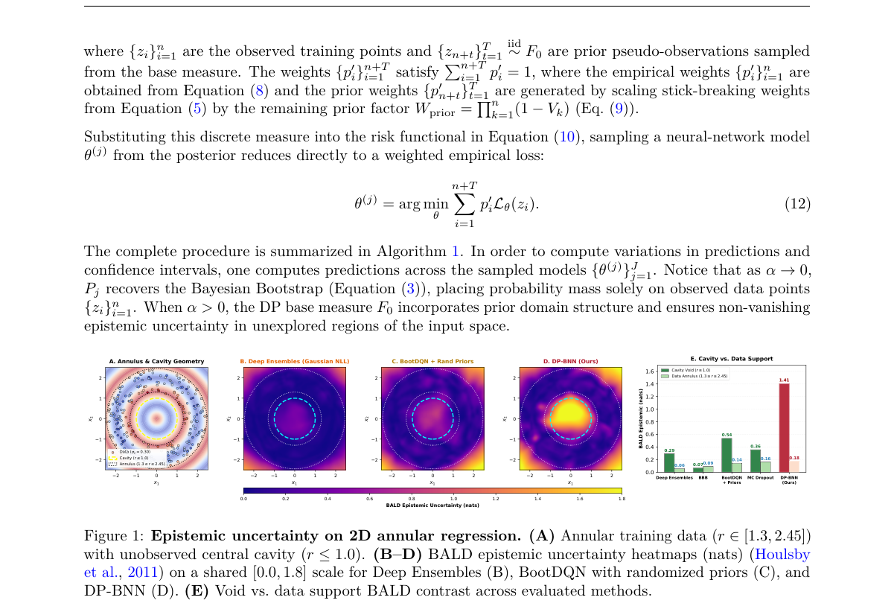

*Main result - Figure 2 Empirical exploration and scaling on DeepSea (Osband et al., 2019a). (a) Cumulative regret on DeepSea-20 (10 random seeds, shaded bands denote ±1 standard deviation) comparing DP-DQN against*

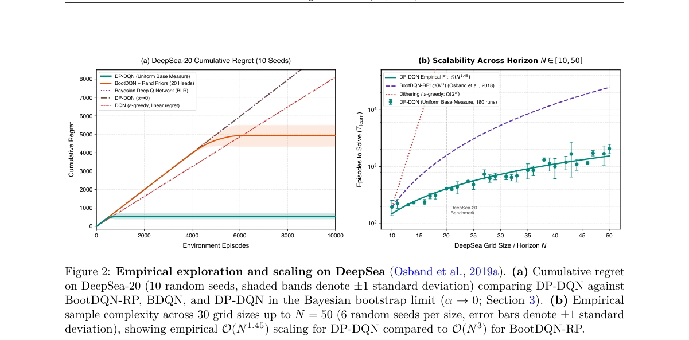

**Why this ranks #9**: 它把「如何表示函数不确定性」这个老问题换了个位置——不放在权重上，而放在数据生成分布上。

---

### 10. Offline Apprenticeship Learning for Human-Centric Environments

**arXiv**: [2610.28716](https://arxiv.org/abs/2610.28716) | **Score**: 6.5 (relevance 6.5 x 0.7 + quality 6.5 x 0.3) | **Tags**: rl-algorithm, imitation-learning, offline | **Categories**: cs.AI, cs.LG | **Pages**: 148 | **[wild-card=yes]**

**Authors**: Md Mirajul Islam

**Affiliation**: North Carolina State University, Raleigh, North Carolina

**Abstract**

> Effective decision-making in human-centric environments such as Intelligent Tutoring Systems (ITSs) and clinical healthcare requires policies that are adaptive, data-efficient, and ethically deployable. Apprenticeship Learning (AL) infers policies directly from expert demonstrations by recovering the underlying reward structure, enabling strictly offline learning without environment interaction. This dissertation develops a progression of offline AL frameworks organized around two challenges: reward modeling and demonstration quality. For reward modeling, EM-EDM clusters demonstrations by latent reward functions and induces cluster-specific policies, and THEMES partitions trajectories into temporally coherent sub-trajectories guided by a hierarchically learned reward regulator; across one educational and three clinical datasets, THEMES outperforms flat and hierarchical AL baselines. For demonstration quality, HALIDE integrates continuous quality signals into hierarchical policy induction, enabling principled reuse of mixed-quality data under distribution shift. CCHAL further attributes quality to individual decisions via Bayesian credit assignment, dual-arm criticality scoring that contrasts expert and non-expert behavior, and a Bradley-Terry contrastive IRL objective over failure trajectories, outperforming baselines including HALIDE on three clinical EHR datasets and an ITS dataset. Finally, a real-world classroom evaluation of StuEDM, an EDM-induced policy that preserves student agency and intervenes only on disagreement, shows significant learning gains over an Expert baseline and a higher pretest-adjusted posttest score than a CQL policy trained on a far larger corpus, while overriding students less than half as often. Together, this work establishes offline AL as a practical, data-efficient, and ethically viable paradigm for human-centric environments.

**Key findings**

- **Finding**: 智能辅导系统（ITS）与临床医疗中的有效决策，需要适应性、数据高效且合乎伦理可部署的策略。

- **Finding**: Apprenticeship Learning（AL）不需工程化奖励函数，而是从专家示范中恢复底层奖励结构、从而直接推断策略，实现**严格离线**学习。

- **Finding**: 本论文围绕两大挑战——**奖励建模**与**示范质量**——组织了一组逐步递进的离线 AL 框架。

- **Finding**: EM-EDM 按潜在奖励函数对示范聚类并诱导聚类特定策略；THEMES 把轨迹划分为时序连贯的子轨迹并由分层学习的奖励调节器引导，在一个教育与三个临床数据集上优于扁平与分层 AL 基线。

- **Finding**: HALIDE 把持续的示范质量信号直接整合进分层策略归纳过程。

- **Inference**: 离线 AL 的两个瓶颈被拆得很干净：奖励是否单一、示范是否一致——前者是结构问题，后者是数据问题。

- **Recommendation**: 可选读（博士论文，148 页）。

**Key figures**

*（该论文的图注结构未被识别到，未附图。原始 PDF 请见 arXiv 链接。）*

**Why this ranks #10**: Wild-card：它是博士论文式的框架编年，但把「离线 AL 的两个失败模式」分得很干净。

---

## Footer

- Total papers reviewed across all 7 tracks: 70 (from 517 scanned, 93 full reads)
- rl_core track final top-10: 10
- Wild-cards in this track: 3
- Figure assets: `res/` (shared across tracks)

Generated by `mine-arxiv-daily-digest` skill. Sister file: `2026-10-21_rl_core_entry.md`.
