# ArXiv Daily Digest - 2026-10-21 (强化学习（LLM 后训练 / 对齐）, 10 papers)

**Generated**: 2026-10-21 17:00 CST

**Source**: arXiv cs.CV, cs.SD, eess.AS, cs.CL, cs.AI, cs.RO, cs.LG submissions, window 2026-10-20 UTC (latest announced batch as of 2026-10-21 17:00 CST)

**Track**: rl_llm (top 10 of 517 papers scanned, 93 full reads)

**Scope**: self-generated credit assignment with intra-group rescaling, projected distillation from minimal online corrections, trajectory evolution with hindsight credit assignment, falsification-aware deep search agents, success-aware critic learning, tri-level distributionally robust DPO, reward-free teacher repair for on-policy distillation, adaptive pullback at penalty jumps, on-policy transition distillation, question synthesis for on-policy distillation

---

**本批 rl_llm 线的最大变化是：on-policy 蒸馏（OPD）成了主角，而且出现了一篇把社区主流解释直接推翻的诊断。** Capable Teacher, Myopic Scorer 指出，社区普遍认为 OPD 失效是因为**复合误差**（学生的错误把轨迹带出教师可靠区域），于是用 episode-length 课程、前缀重放、教师介入等手段把训练限制在该区域。作者证明**这个解释不完整**：从学生偏离教师最多的状态出发，教师自己的接管仍然完成任务，但按 token 打分训练的学生仍会耗尽回合。真因是 **next-token 打分的短视**——教师看不到 episode 结局，于是放行了「安全的、拖延的」动作。R2S 因此把修复点从**训练数据**移到了**打分器**：先从未训练学生的高分歧状态跑教师接管，用接管结果反过来微调教师的打分，再做普通 OPD。

**另外三篇 OPD 工作从三个不同角度改进同一件事。** Adaptive Pullback 指出师生对数比惩罚的**当前取值不区分「持续的高惩罚」与「突然上升」**，并发现惩罚跳变处同时出现**教师置信度下降**（惩罚—置信度张力）；On-Policy Transition Distillation 发现**中间层的师生转移一致性可以直接预测答案正确率**，据此加了一项几乎零成本的层间监督；Ask to Distill 则把「好问题」重新定义为「能在学生轨迹上逼出多少教师监督」，并证明这可以在**全程不需要答案**的前提下学出来。

**长时程信用分配与偏好鲁棒性则由另外四篇承担。** Self-Credit 用策略**自生成**的带引用摘要做回合级信用，再做组内重标定（同时利用成功与失败 rollout）；TrajEvolve 承认精确信用在长时程任务里「极其困难」，转而去**演化轨迹本身**；FALCA 把深度搜索形式化为**提出–证伪**，给证伪配一个独立角色；SCALE 先量化「聚合回报预测准确」与「信用可分配」之间的落差，再据此把「最终成功」显式建成一个独立预测量；TPO 则把偏好分布漂移拆成组级/提示级/偏好级三层，用层次化矩形模糊集联合建模。

---

## Top 10 - 强化学习（LLM 后训练 / 对齐）

### 1. Capable Teacher, Myopic Scorer: Reward-Free Teacher Repair for Agentic On-Policy Distillation

**arXiv**: [2610.28586](https://arxiv.org/abs/2610.28586) | **Score**: 9.0 (relevance 9 x 0.7 + quality 9 x 0.3) | **Tags**: rl-llm-posttrain, distillation, agentic | **Categories**: cs.AI, cs.CL | **Pages**: 17

**Authors**: Shu Zhao, Tan Yu

**Affiliation**: NVIDIA

**Abstract**

> Agentic on-policy distillation (OPD) trains a student agent on its own trajectories while a teacher scores every token. A natural explanation of where it goes wrong is compounding error: the student's mistakes carry its trajectories beyond the region where the teacher is reliable, so recent methods keep training inside that region, through episode-length curricula, teacher-guided turns, prefix replay, or teacher intervention where the two disagree. We show this explanation is incomplete. From the states where the student departs most from the teacher, the teacher's own takeovers still finish the task, yet the student trained on its token scores keeps running out of turns. We attribute this to the myopia of next-token scoring. The teacher rates each token without seeing where the episode ends, so its scores let through the safe, delaying moves that outcome-based RL would punish with zero reward, a penalty agentic OPD lacks. We call this difference between what the teacher does and what it scores the rollout-scorer gap. We propose Rollout-to-Scorer Distillation (R2S), which repairs the scorer before distillation by mining high-disagreement states from the untrained student, running teacher takeovers from them, keeping the states where enough takeovers pass a reward-free check such as consensus or an LLM judge, and fine-tuning the teacher to give its takeover-informed scores on every assistant token from the divergence turn onward, without the takeover in context. The repaired teacher is frozen as the sole scorer for standard OPD, requiring no task reward during repair or training. Across three environments, two teachers and four students, R2S outperforms three state-of-the-art agentic-OPD methods in all twelve teacher-student-environment cells, by 12.8 success points on average over the best of them in each cell. Project page: https://tree-shu-zhao.github.io/r2s/.

**Key findings**

- **Finding**: 智能体 on-policy 蒸馏（OPD）在学生自己的轨迹上训练，同时由教师为每个 token 打分。

- **Finding**: 对这一过程何处出错的自然解释是**复合误差**：学生的错误把轨迹带出教师可靠的区域，于是近期方法用 episode-length 课程、教师引导回合、前缀重放或分歧时教师介入，把训练限制在该区域内。

- **Finding**: 作者证明**这个解释不完整**：从学生偏离教师最多的那些状态出发，教师自己的接管仍然能完成任务，但按 token 打分训练的学生仍会耗尽回合。

- **Finding**: 作者把原因归于 **next-token 打分的短视**——教师给每个 token 评分时看不到 episode 的结局，于是它的分数放行了「安全的、拖延的」动作，而这些动作在结果导向的 RL 下会被零奖励惩罚。

- **Finding**: R2S（Rollout-to-Scorer Distillation）先修教师再蒸馏：从未训练学生的状态挖掘高分歧状态、从这些状态跑教师接管、保留足够接管通过无奖励检验（共识或 LLM 评判）的状态，再微调教师，使其在分歧回合起的**全部 assistant token** 上给出接管式评分，且不把接管放进上下文。

- **Inference**: 「教师够强但打分短视」与「学生走出教师可靠区域」是两种不同的失败，而社区一直在用后者的处方治前者的病；R2S 把修复点从「训练数据」移到了「打分器」，这在方向上是反直觉的。

- **Recommendation**: 强烈推荐。

**Key figures**

*Framework / architecture - Figure 1 OPD can reinforce the delays its teacher lets pass. (a) The teacher’s scores let delaying thoughts pass and the episode runs out of turns; its own takeover from that state finishes. (b) With*

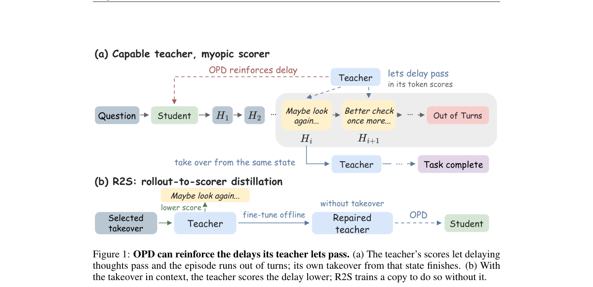

*Main result - Figure 2 R2S repairs the teacher’s scores on the full assistant suffix before ordinary OPD. With a selected takeover from the untrained student’s state in context, the frozen teacher T0 scores the st*

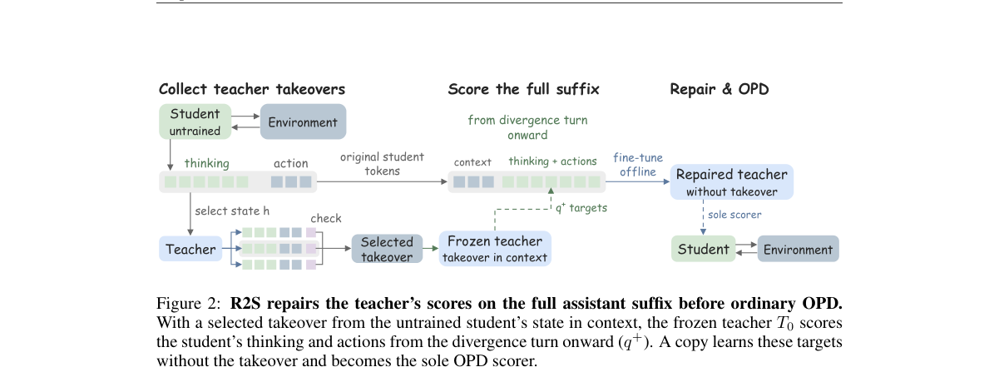

**Why this ranks #1**: 它指出社区对 OPD 失效的主流解释是错的，并把修复点从数据端移到了打分端——一个反直觉但直指根因的诊断。

---

### 2. Self-Credit: Credit Assignment for Long-Horizon Agentic RL via Intra-group Rescaling

**arXiv**: [2610.28388](https://arxiv.org/abs/2610.28388) | **Score**: 9.0 (relevance 9.0 x 0.7 + quality 9.0 x 0.3) | **Tags**: rl-algorithm, agentic-rl, credit-assignment | **Categories**: cs.LG | **Pages**: 23

**Authors**: Fangcong Yin, Ming Yin, Tanvi Bhandarkar, Aashu Singh, Eryk Helenowski, Shlok Kumar Mishra, Saghar Hosseini, Karthik Abinav Sankararaman, Greg Durrett, Dinkar Juyal

**Affiliation**: Meta; New York University; Duke University

**Abstract**

> LLM agents are commonly trained with RLVR, but the sparse nature of typical RLVR rewards makes credit assignment challenging, especially for long-horizon tasks. We propose Self-Credit, an end-to-end agentic RL method that creates dense supervision signals from sparse outcome rewards using self-generated credit assignment via intra-group rescaling. Self-Credit builds on group-based RL with three components. First, during its rollouts, the policy model generates summaries with citations to earlier turns containing critical evidence, which serve as self-generated credit. Second, we refine this model-generated credit with intra-group rescaling, which compares cited actions across successful and failed rollouts for the same prompt. This approach uses group-level agreement and disagreement to remove undeserved credit and further emphasize credit assigned to critical actions. Third, advantage reweighting uses the rescaled credit weights to update the advantages of the cited turns. On BrowseComp-Plus, Self-Credit improves over the base models by 37.0 and 36.2 points on Qwen3 8B and 32B respectively, and outperforms the strongest agentic RL baselines by 8.5 and 5.6 points, respectively. Self-Credit also improves over the strongest baselines by 4.9 points on GAIA and 4.7 points on xBench-DeepSearch. Analyses show that self-generated credit provides useful signals for selecting critical actions, and that intra-group rescaling, especially on failed rollouts, is important across model scales.

**Key findings**

- **Finding**: LLM 智能体常用 RLVR 训练，但典型 RLVR 奖励的稀疏性使信用分配困难，长时程任务尤甚。

- **Finding**: Self-Credit 是端到端的智能体 RL 方法，用**自生成的信用分配**（带组内重标定）从稀疏结果奖励中构造稠密监督。

- **Finding**: 在 rollout 过程中，策略模型生成带**引用**的摘要，指向此前包含关键信息的回合。

- **Finding**: 提出组内信用重标定方法，同时利用成功与失败的 rollout 精炼自生成信用。

- **Finding**: 在多个不同规模的模型、长时程智能体任务上优于强基线。

- **Inference**: 用「自压缩 + 回合引用」把长轨迹变成可归因的结构，其巧妙之处在于监督信号来自策略自身，因此不需要额外标注——但风险也同样来自策略自身。

- **Recommendation**: 强烈推荐。

**Key figures**

*Framework / architecture - Figure 1 Self-Credit leverages self-generated summaries with Intra- group rescaling to provide credit assignment for long-horizon agentic RL. Self-Credit outperforms strong baselines on challenging lo*

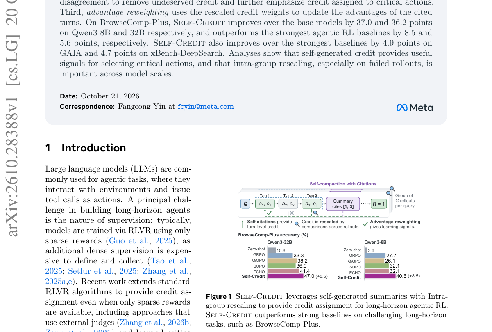

*Main result - Figure 2 Illustration of Self-Credit. (1) Self-Credit leverages self-compaction with turn citations for credit assignment. (2) Across rollouts for the same prompt, intra-group rescaling removes extra*

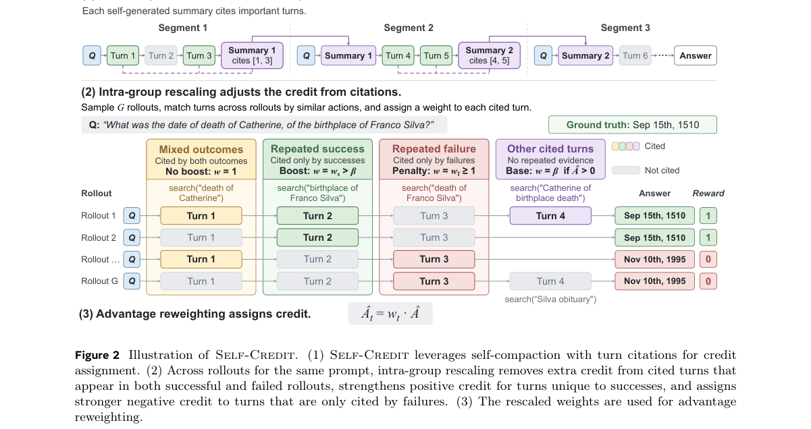

**Why this ranks #2**: 它给出了稀疏奖励下造稠密监督的一条自举路线，而且明确用成功与失败两类 rollout 做重标定——比只用成功轨迹的做法更稳。

---

### 3. Projected Distillation: On Learning to Solve Hard Problems from Close, Correct Targets

**arXiv**: [2610.27467](https://arxiv.org/abs/2610.27467) | **Score**: 8.85 (relevance 9.0 x 0.7 + quality 8.5 x 0.3) | **Tags**: rl-llm-posttrain, post-training, distillation | **Categories**: cs.AI, cs.LG | **Pages**: 42

**Authors**: Shripad V. Deshmukh, Christian Bock, Kangrui Ruan, Abhijeet Awasthi, Vijay Lingam, Rein Houthooft, Manish Prajapat

**Affiliation**: Amazon

**Abstract**

> On-policy learning is central to post-training: training on a model's own generations limits distribution shift and helps preserve existing capabilities. On hard problems, however, on-policy RL provides no reward-based learning signal when all attempts fail. On-policy distillation provides next-token supervision from a teacher, but on hard problems, if a rollout goes wrong early, subsequent supervision is conditioned on prefixes that already contain the mistake. Correct behavior can instead come from a gold or teacher solution, but such off-policy targets can differ substantially from the model's generations and, as we show, may erode existing capabilities. We therefore treat on-policyness as a continuum and propose projected distillation, which minimally edits the student's failed attempts into correct targets. The method uses contrastive updates to favor corrections over failed attempts and refreshes these corrections as the student evolves, enabling near-on-policy learning even when all student attempts fail. Theoretically, we prove that the student's learning regret grows with the edit size: it scales linearly with the horizon under minimal correction, as in DAgger, and quadratically under full-answer replacement, as in behavior cloning. Empirically, across two students (Qwen3-8B and OLMo-2-7B) and five domains spanning math, code, science, and tool use, projected distillation gives the highest area under the specialization-retention frontier (best on 8 of 9 cells against GRPO and OPD, and 7 of 9 against SPOT and SODA). Our ablations highlight the importance of online corrections, the contrastive loss, and on-policyness: moving targets farther off-policy steadily worsens the specialization-retention trade-off, with retention falling from 0.916 to 0.744 when minimal corrections are replaced by student-agnostic gold solutions.

**Key findings**

- **Finding**: 在策略学习（on-policy learning）中，训练模型自己的生成可限制分布漂移并保留已有能力。

- **Finding**: 但在困难问题上，**所有尝试都失败时，在策略 RL 不提供基于奖励的学习信号**。

- **Finding**: 在策略蒸馏里，若 rollout 早期就走错，后续监督就条件在**已经包含错误的上下文**上。

- **Finding**: 本文提出投影蒸馏：从学生错误的**最小化、在线的修正**中学习。

- **Finding**: 作者证明：**在保持正确性不变的前提下，修正必须既最小又在线**。

- **Inference**: 「投影到最近的正确答案」这个操作，把「教师」从「另一个更大的模型」降级为「正确性集合」——于是困难问题不再是必须有强教师才能解。

- **Recommendation**: 强烈推荐。与 10-20 日报「是 RL 的功劳还是数据的功劳」同批可比：它问的是在难题上，RL 之外还有什么可用的信号。

**Key figures**

*Framework / architecture - Figure 1 Learning from the nearest correct answer. Correct answers form a set C(x), but the student assigns them very different likelihoods. On a hard problem, its k on-policy attempts ( ) are all wr*

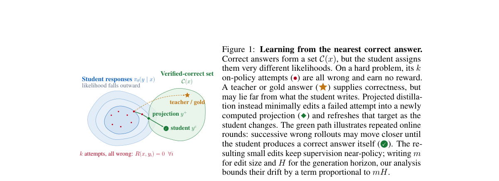

*Main result - Figure 2 One round of projected distillation. The student answers each problem k times, and its responses split into the wrong ones y−and the correct ones yc. A projector rewrites a wrong response in*

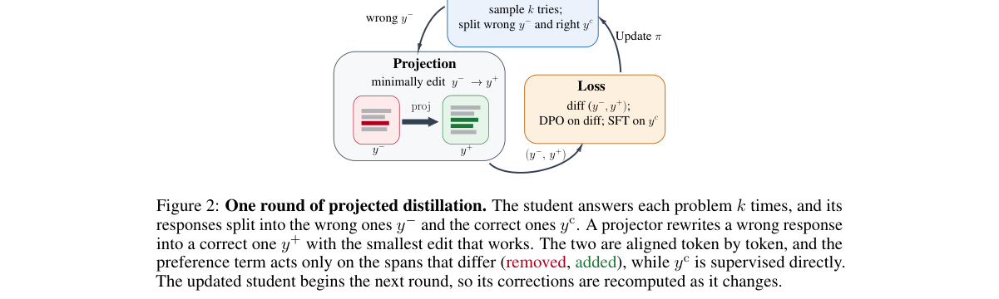

**Why this ranks #3**: 它给出了「修正必须既最小又在线」这样一个可证伪的必要条件，并把困难问题的教师需求降级为正确性集合。

---

### 4. TrajEvolve: Trajectory Evolution for Reinforcement Learning with Hindsight Credit Assignment

**arXiv**: [2610.28060](https://arxiv.org/abs/2610.28060) | **Score**: 8.85 (relevance 9.0 x 0.7 + quality 8.5 x 0.3) | **Tags**: rl-llm-posttrain, credit-assignment, long-horizon | **Categories**: cs.AI | **Pages**: 34

**Authors**: Yi Wen, Hao Chen, Wanyu Wang, Maolin Wang, Pengyue Jia, Derong Xu, Huize Tan, Yingyi Zhang, Wenlin Zhang, Weihong Luo et al.

**Affiliation**: City University of Hong Kong; Tencent; Nanjing University

**Abstract**

> The Reinforcement Learning (RL) paradigm has achieved remarkable success in enhancing the reasoning capabilities of Large Language Models (LLMs). However, when applied to long-horizon tasks, it faces severe challenges: i) Due to the high task complexity, the model struggles to sample enough successful trajectories, resulting in slow convergence. ii) Relying solely on sparse final rewards causes all steps to be updated indiscriminately, encouraging redundant step generation. When both the quantity and quality of successful trajectories become difficult to guarantee, the performance is severely constrained. This dilemma stems from the limitations: existing RL paradigms rely entirely on the reasoning capability of base models, lacking the ability to actively optimize trajectories. To address the above issues, we propose a novel trajectory evolution paradigm with hindsight credit assignment, termed TrajEvolve. TrajEvolve not only relies on the trajectory inferred by the model but also generates ``evolutionary trajectories'' by refining low-quality steps in historical trajectories, thereby exposing the policy to high-quality compositions that lie within the base model's support but are rarely sampled within practical training budgets. Furthermore, TrajEvolve reformulates step-level continuous credit assignment as a binary classification task, whether each step is necessary for task completion. This simplification not only reduces the learning difficulty but also enables step labels to be obtained through counterfactual verification, achieving precise identification of redundant steps. Extensive experiments on two datasets demonstrate the superiority of the proposed method.

**Key findings**

- **Finding**: RL 已成为增强 LLM 推理能力的重要手段，但在**长时程任务**上面临两大挑战：任务复杂度高导致难以采样到足够多成功轨迹（收敛慢）；仅依赖稀疏最终奖励会使所有步骤被无差别更新，鼓励冗余步骤生成。

- **Finding**: TrajEvolve 提出带**事后信用分配**的轨迹演化范式。

- **Finding**: 现有方法试图为每一步估计精确信用分，但长时程任务巨大的解空间使精确信用量化极其困难——TrajEvolve 换了个角度：演化轨迹本身。

- **Finding**: 训练框架包含事后验证与轨迹演化两个环节。

- **Finding**: 在两个数据集上的大量实验证明其优越性。

- **Inference**: 「精确信用不可得」是长时程 RL 的根本困难之一；TrajEvolve 的赌注是——不去逼近那个不可得的分数，而是改造轨迹本身。

- **Recommendation**: 强烈推荐。

**Key figures**

*Framework / architecture - Figure 1 Overview of the TrajEvolve training framework. Left: Training pipeline with hindsight verification and trajectory evolution module. Right: Three trajectory evolution strategies.*

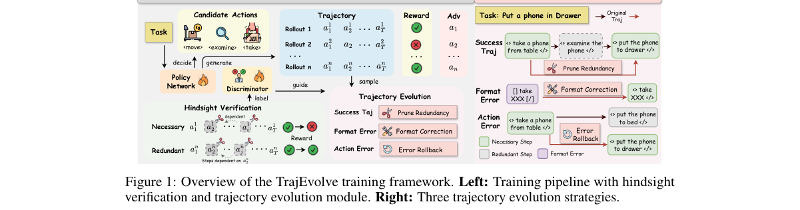

**Why this ranks #4**: 它正面承认了长时程信用分配的不可解性，并给出「演化轨迹」这一绕开它的方案，而不是又一个更精细的信用估计器。

---

### 5. FALCA: Falsification-Aware Reinforcement Learning with Hierarchical Credit Assignment for Long-Horizon Deep Search Agents

**arXiv**: [2610.28361](https://arxiv.org/abs/2610.28361) | **Score**: 8.7 (relevance 9.0 x 0.7 + quality 8.0 x 0.3) | **Tags**: rl-llm-posttrain, agentic-rl, deep-search | **Categories**: cs.AI | **Pages**: 19

**Authors**: Zijun Dou, Kun Luo, Chaofan Li, Shuqi Lu, Zheng Liu

**Affiliation**: BAAI (Beijing Academy of Artificial Intelligence); THU (Tsinghua University); CASIA (Institute of Automation, Chinese Academy of Sciences)

**Abstract**

> Long-horizon deep search requires LLM agents to iteratively decompose complex information needs, gather evidence from external sources, and maintain a reliable research state under multiple constraints. A central challenge is that early mistakes can be amplified over the search trajectory: agents may anchor on an incorrect candidate, collect partially supporting evidence, overlook contradictions, and accumulate errors that misguide subsequent reasoning. We propose FALCA, a falsification-aware framework that formulates deep search as a propose-falsify process. FALCA adopts a collaborative Searcher-Falsifier architecture, where the Searcher proposes candidate answers or sub-answers, while independent Falsifiers actively seek counterevidence, check unmet constraints, identify conflicts, and produce concise falsification reports for research-state revision. To strengthen this loop, we introduce falsification-aware training, combining SFT warmup on falsification trajectories with agentic RL based on parallel rollouts and hierarchical credit assignment over research stages, state transitions, and actions. Experiments on five search benchmarks show that FALCA improves long-horizon deep search performance over backbone and harness ablations, while reducing confirmation bias and error accumulation through more effective falsification and research-state revision.

**Key findings**

- **Finding**: 长时程深度搜索要求 LLM 智能体迭代拆解复杂信息需求、从外部来源收集证据并在多重约束下维持可靠研究状态。

- **Finding**: 核心挑战：**早期错误会沿搜索轨迹被放大**——智能体可能锚定在错误候选上、收集部分支持性证据、忽视矛盾、累积错误而误导后续推理。

- **Finding**: FALCA 把深度搜索形式化为**提出–证伪**过程：一个专职 Falsifier 负责搜寻反证、检验未解约束、暴露矛盾并触发研究状态修订。

- **Finding**: 证伪感知训练：在证伪轨迹上做 SFT 预热 + 基于并行 rollout 的智能体 RL，并对研究阶段、状态转移与动作做分层信用分配。

- **Finding**: 与只验证已成形答案的方法不同，它针对的是整条轨迹上的确认偏误。

- **Inference**: 把「证伪」从一个事后检查提升为一个有独立角色的并行智能体，等于在搜索过程里装了一道结构性刹车——这比「再提示一下」要硬。

- **Recommendation**: 强烈推荐。

**Key figures**

*Framework / architecture - Figure 1 Motivation for FALCA. Conventional agents may fall into a self-reinforcing error loop, where confirmation bias leads to error accumulation and corrupts the research state. FALCA breaks this*

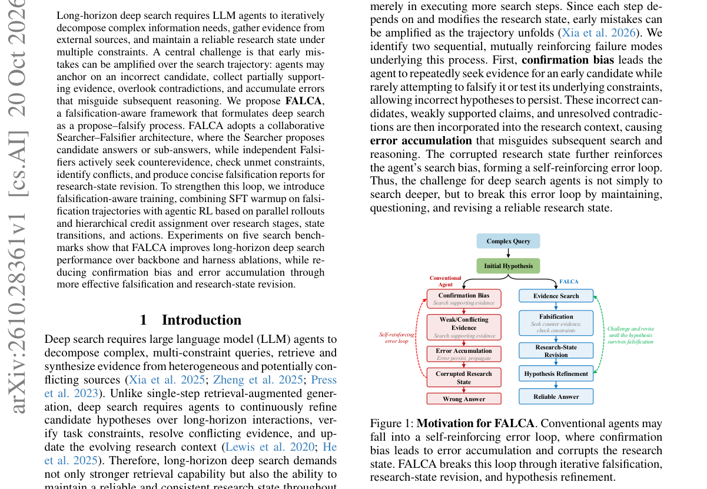

*Main result - Figure 2 Overview of FALCA. The upper panel illustrates the Searcher-Falsifier dual-agent research loop for falsification- aware inference. The lower panel presents the training pipeline, consisting*

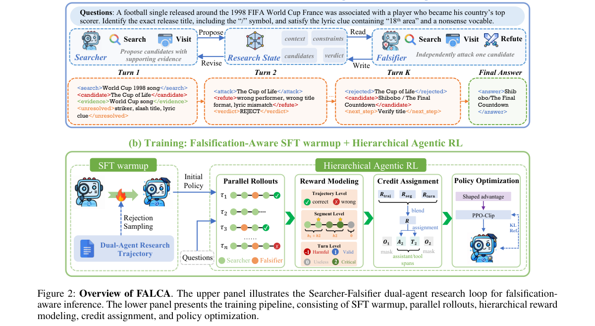

**Why this ranks #5**: 它把确认偏误从提示工程问题改成了架构问题：给证伪配一个独立角色。

---

### 6. Ask to Distill: Learning to Synthesize Data for On-Policy Distillation

**arXiv**: [2610.27450](https://arxiv.org/abs/2610.27450) | **Score**: 8.15 (relevance 8 x 0.7 + quality 8.5 x 0.3) | **Tags**: rl-llm-posttrain, distillation, data | **Categories**: cs.AI, cs.CL | **Pages**: 28

**Authors**: Jiashuo Sun, Hao Zhang, Xueqiang Xu, Heng Wang, Yixuan Xie, Pengcheng Jiang, Zhenrui Yue, Jiajun Fan, Peiran Li, Ge Liu et al.

**Affiliation**: Jiashuo Sun; Hao Zhang; Xueqiang Xu; Heng Wang

**Abstract**

> On-policy distillation (OPD) can succeed with surprisingly few training questions, motivating a view of questions as carriers of distributional knowledge transfer. How can we assess whether a newly generated question is valuable for distillation, and learn to generate better questions---without access to its correct answer? We introduce Ask-to-Distill (\method), a framework that treats synthetic questions as distribution elicitors and optimizes the teacher supervision they expose along student-generated trajectories. A student-initialized synthesizer is optimized using a distributional surrogate for question value, computed from a frozen student--teacher pair without reference answers, correctness rewards, or per-candidate student updates. The reward combines teacher--student disagreement with teacher probability mass on the student's candidate support, together with length and diversity controls. The generated questions are filtered and deduplicated into a prompt-only bank for standard OPD. Across mathematical reasoning, code generation, and agentic tasks, our method improves average performance and teacher-gap recovery over unoptimized student-generated prompts and KL-filtered real questions, while matching or exceeding real-bank OPD in the evaluated settings. Signal analyses further show that optimized questions can elicit denser supervision and more total signal from shorter student responses, supporting elicited distributional supervision as an objective for synthetic distillation data. Our code, data and models are publicly available at https://github.com/GasolSun36/Ask_to_Distill.

**Key findings**

- **Finding**: On-policy 蒸馏（OPD）能用少得惊人的训练问题取得成功，提示**问题可以被看作分布式知识转移的载体**。

- **Finding**: 核心问题是：如何在**无法访问其正确答案**的前提下，判断一个新生成的问题是否有价值，并学会生成更好的问题？

- **Finding**: A2D 把合成问题当作**分布探针**，沿学生生成的轨迹优化它们所暴露的教师监督。

- **Finding**: 学生初始化的合成器用一个分布代理目标来优化，该目标由冻结的师生对计算，**不需要参考答案、正确性奖励或逐候选的学生更新**；奖励结合师生分歧与教师在学生候选支撑集上的概率质量，外加长度与多样性。

- **Finding**: 在数学推理、代码生成与 agentic 任务上，平均性能与「教师差距回收率」都优于未优化的学生生成提示与 KL 过滤后的真实问题，并在评测设定下达到或超过真实题库的 OPD。

- **Inference**: 这把 OPD 的数据问题变成一个可学习的探针设计问题——问题的价值不由答案定义，而由它在学生轨迹上能逼出多少教师监督来定义。

- **Recommendation**: 推荐。

**Key figures**

*Framework / architecture - Figure 1 A2D learns to ask questions where the teacher can*

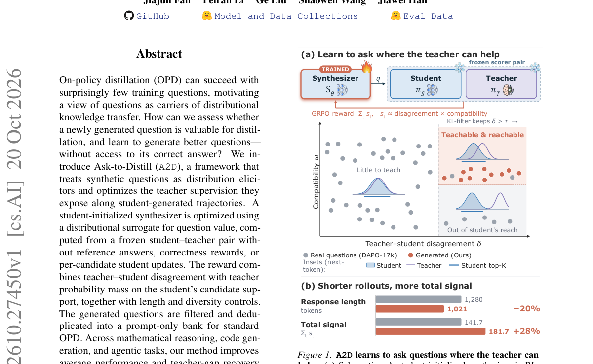

*Main result - Figure 2 Overview of A2D. A student-initialized synthesizer is optimized using learning-value signals from a frozen student–teacher pair. The generated questions are filtered and deduplicated into a*

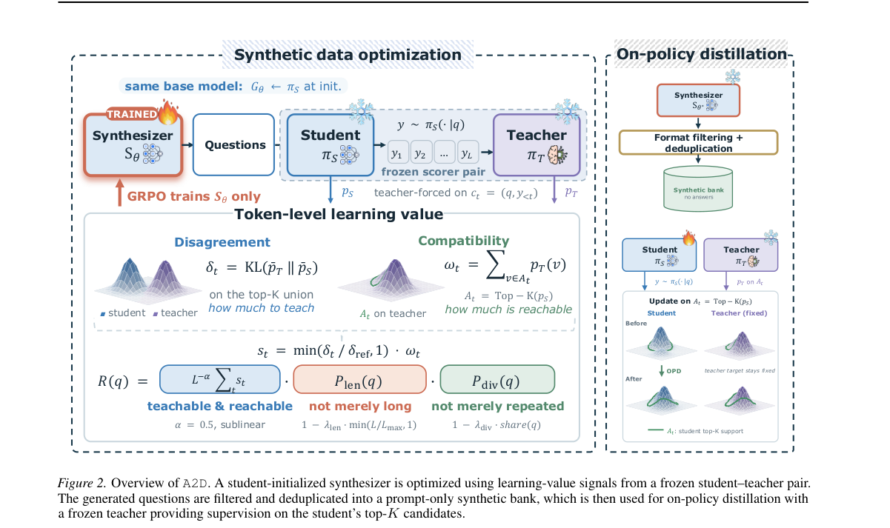

**Why this ranks #6**: 它重新定义了「好问题」：不是难或清晰，而是能在学生轨迹上逼出多少教师监督——而且全程不需要答案。

---

### 7. From Outcomes to Steps: Reliable Success-Aware Critic Learning for Long-Horizon Language Agents

**arXiv**: [2610.27623](https://arxiv.org/abs/2610.27623) | **Score**: 8.35 (relevance 8.5 x 0.7 + quality 8.0 x 0.3) | **Tags**: rl-llm-posttrain, agentic-rl, critic | **Categories**: cs.LG | **Pages**: 29

**Authors**: Jiaxi Liu, Shixiong Kai, Zhentao Tang, Yang Li, Yuqi Cui, Mingxuan Yuan, Junchi Yan

**Affiliation**: Shanghai Jiao Tong University; Huawei Noah’s Ark Lab

**Abstract**

> Reinforcement learning for long-horizon language agents requires identifying whether intermediate actions make eventual task success more or less likely when supervision is available only at trajectory level. The main difficulty is that a critic with aggregate return-prediction accuracy may still fail to resolve the local value differences needed to assign credit to actions, especially under sparse feedback and function approximation. Conventional critics estimate future return, but policy improvement also depends on knowing whether each intermediate decision makes task success more or less likely. We introduce SCALE, an actor-critic framework that augments conventional return estimation with explicit prediction of eventual task success. At each interaction prefix, the critic predicts a return value and a Success Value, defined as the probability that the task will eventually be completed from that prefix. SCALE converts changes in Success Value into multi-step action credit through Success-GAE and modulates its contribution according to the estimated reliability of the predictor, while retaining the token-level PPO objective. Across five agent benchmarks and three model backbones, SCALE improves task performance over the compared RL baselines in most settings, with gains of up to 4.1 percentage points in success rate. Separate critic-learning analyses show that SCALE also improves critic estimation and training stability.

**Key findings**

- **Finding**: 长时程语言智能体的 RL 需要识别中间动作是让最终任务成功更可能还是更不可能，而监督只有轨迹级。

- **Finding**: 主要困难：**聚合回报预测准确率高的 critic 仍可能无法解析分配信用所需的局部价值差异**，在稀疏反馈与函数逼近下尤其如此。

- **Finding**: 常规 critic 估计未来回报，但策略改进还依赖别的量。

- **Finding**: SCALE 是成功感知的 actor-critic 框架，在常规回报估计之外**显式预测最终任务是否成功**。

- **Finding**: 论文给出 vanilla PPO critic 在 ALFWorld 与 WebShop 上的可靠性分析。

- **Inference**: 把「最终成功」显式建模成一个单独的预测量，等于承认回报预测与成功预测是两种不同的泛化任务——这与 10-12 日报「PPO 的裁剪代理是几何退化的」属于同一类解剖思路。

- **Recommendation**: 推荐。

**Key figures**

*Framework / architecture - Figure 1 Comparison between PPO and SCALE. PPO derives step credit from changes in predicted return, which can be unreliable when feedback is sparse. An action may receive positive credit even when i*

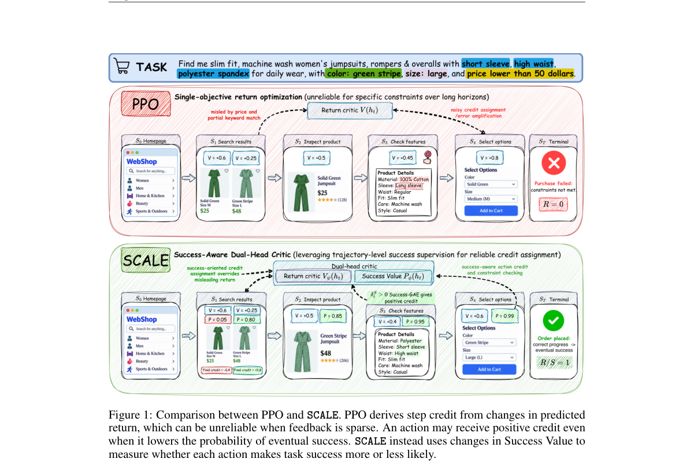

*Main result - Figure 2 Vanilla PPO critic reliability analysis on ALF- World and WebShop.*

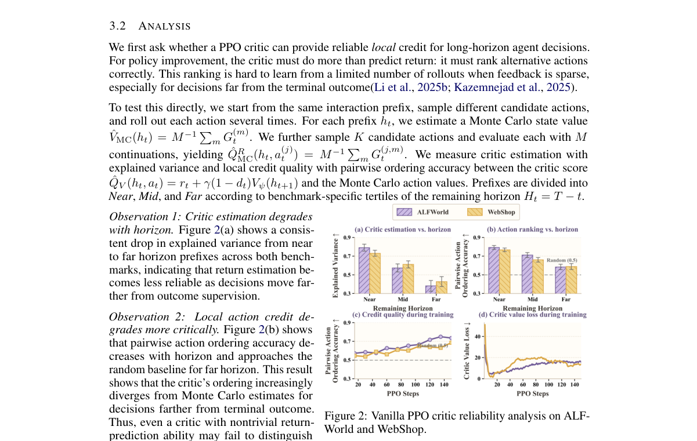

**Why this ranks #7**: 它先量化了「聚合回报准确」与「信用可分配」之间的落差，再据此改模型——顺序和大多数方法论文相反。

---

### 8. Adaptive Pullback: Reweighting Supervision at Penalty Jumps in On-Policy Distillation

**arXiv**: [2610.28194](https://arxiv.org/abs/2610.28194) | **Score**: 8.0 (relevance 8 x 0.7 + quality 8 x 0.3) | **Tags**: rl-llm-posttrain, distillation | **Categories**: cs.AI, cs.LG | **Pages**: 16

**Authors**: Guangyu Liu, Siyuan Gan, Shilong Zhou, Linjian Meng, Boyan Wang, Jing Huo

**Affiliation**: State Key Laboratory of Novel Software Technology, Nanjing University, Nanjing, China; Shanghai Artificial Intelligence Laboratory, Shanghai, China

**Abstract**

> On-policy distillation (OPD) supervises student-generated responses using sampled-token student-teacher log-ratios. A positive log-ratio penalizes a token that the student assigns higher probability to than the teacher, but its current value does not distinguish sustained high penalties from abrupt increases along a response. We examine these local changes by comparing consecutive blocks of tokens within the same response. Our diagnostic identifies penalty jumps, abrupt increases in average penalty that persist on held-out tokens. Across these jumps, penalties rise while teacher confidence decreases. We call this pattern penalty-confidence tension. Boundaries into high-penalty blocks do not exhibit comparable confidence changes, showing that local changes provide information beyond the current penalty value. Motivated by this observation, we propose Adaptive Pullback OPD (AP-OPD). At each detected jump, AP-OPD uses the preceding block as a local reference and uniformly scales all supervision coefficients in the following block so that its weighted average penalty matches the preceding block's original mean. This reference determines the scaling factor without an additional strength constant. AP-OPD improves performance on both mathematical reasoning and code generation.

**Key findings**

- **Finding**: On-policy 蒸馏（OPD）用采样 token 的师生对数比来监督学生生成的响应。

- **Finding**: 正的对数比惩罚那些学生赋予比教师更高概率的 token，但**其当前取值不区分「持续的高惩罚」与「沿响应过程中的突然上升」**。

- **Finding**: 作者通过比较同一响应内连续 token 块来考察这些局部变化，诊断出**惩罚跳变**——在留出 token 上持续存在的块平均惩罚的突然上升。

- **Finding**: 跨这些跳变，惩罚上升而**教师置信度下降**，作者称之为**惩罚—置信度张力**。

- **Finding**: 高惩罚块的边界不呈现可比的置信度变化，说明局部变化提供了超出当前惩罚值的信息。

- **Finding**: AP-OPD 在每次跳变后用前一块作为局部参照，统一缩放该块之后的监督。

- **Inference**: 把监督信号的「取值」换成「变化率」，相当于给 OPD 加了一个局部二阶信息——这比调学习率更贴近「教师在哪些地方失去了把握」这个真实问题。

- **Recommendation**: 推荐。

**Key figures**

*Framework / architecture - Figure 1 Penalty–confidence tension at penalty jumps: penalties rise while teacher confidence decreases. Adaptive Pullback uniformly scales post-jump supervision to match the preceding block’s origin*

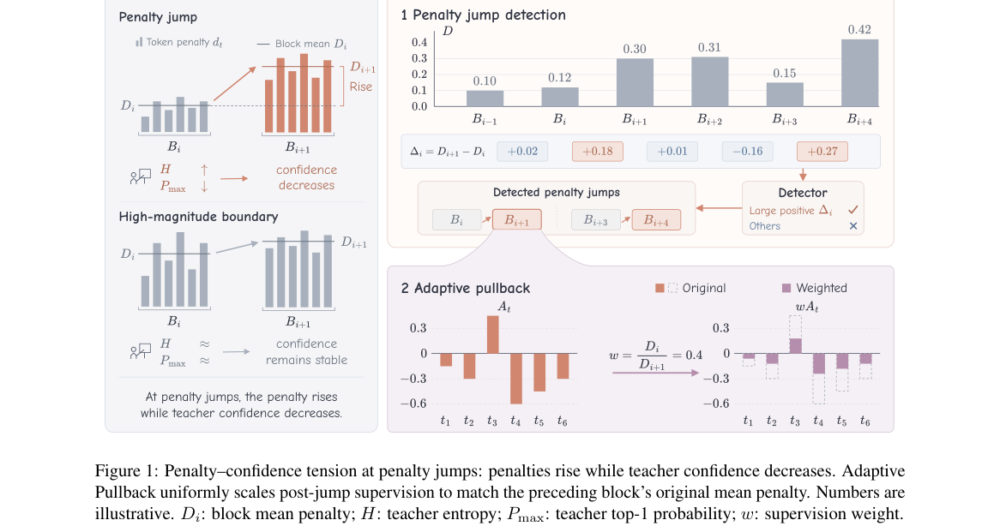

*Main result - Figure 2 Held-out rise in token penalty dt around penalty jumps, abrupt increases in block-averaged penalty detected with the z = 2 gate, and three con- trol boundaries. The rise is relative to the m*

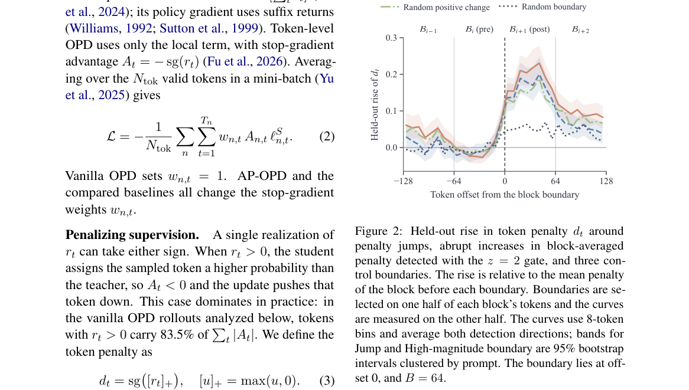

**Why this ranks #8**: 它把 OPD 的监督从「惩罚多大」改成「惩罚是否在突然变大」，并发现惩罚上升时教师置信度反而下降。

---

### 9. On-Policy Transition Distillation

**arXiv**: [2610.28048](https://arxiv.org/abs/2610.28048) | **Score**: 8.0 (relevance 8 x 0.7 + quality 8 x 0.3) | **Tags**: rl-llm-posttrain, distillation | **Categories**: cs.AI, cs.CL, cs.LG | **Pages**: 17

**Authors**: Runyang You, Yongqi Li, Tiezheng Yu, Wenjie Li

**Affiliation**: The Hong Kong Polytechnic University; Huawei Technologies Ltd; side its final output distribution

**Abstract**

> On-policy distillation (OPD) consolidates expert capabilities into a single student by matching teacher and student final-layer distributions on student-generated rollouts. We investigate whether depthwise prediction transitions, the changes in predictions between layers, can provide additional task-relevant supervision. Our diagnostic study finds that stronger teacher--student agreement in intermediate transitions is associated with higher answer correctness within questions, with correct responses exhibiting lower mean transition KL across all measured intermediate layer pairs. These observations motivate On-Policy Transition Distillation (OPTD), which augments final-layer distribution matching by aligning teacher and student layer-to-layer log-probability increments on student-generated rollouts. Evaluations across three backbones and eight benchmarks spanning mathematics, coding, and instruction following show that OPTD achieves the best or tied-best overall performance in both dual- and three-domain distillation. In the three-domain setting, OPTD recovers $\approx 90\%$ of the overall teacher--student capability gap, compared with $\approx 75\%$ for OPD.

**Key findings**

- **Finding**: OPD 通过在学生生成的 rollout 上匹配师生最终层分布，把专家能力压进单个学生。

- **Finding**: 作者追问：**逐层预测转移**（层与层之间预测的变化）能否提供额外的任务相关监督。

- **Finding**: 诊断研究发现：在同一问题内，师生中间层转移的一致性越强，答案正确率越高——正确回答在所有被测中间层对上都有更低的平均转移 KL。

- **Finding**: OPTD 在最终层分布匹配之外，额外对齐师生的**层间对数概率增量**。

- **Finding**: 跨三个骨干、八个基准（覆盖数学、编码与 agentic 任务）评测。

- **Inference**: 这条发现与「CoT 监测」那条线索（reward misspecification degrades monitorability）呼应：层间转移的一致性似乎是一个可观测的「内部质量」信号，可能比最终 token 更有信息量。

- **Recommendation**: 推荐。

**Key figures**

*Framework / architecture - Figure 1 On-policy transition distillation. (a) Standard OPD aligns only the final-layer predictions of the student and teacher. (b) OPTD additionally aligns their prediction transitions across selec*

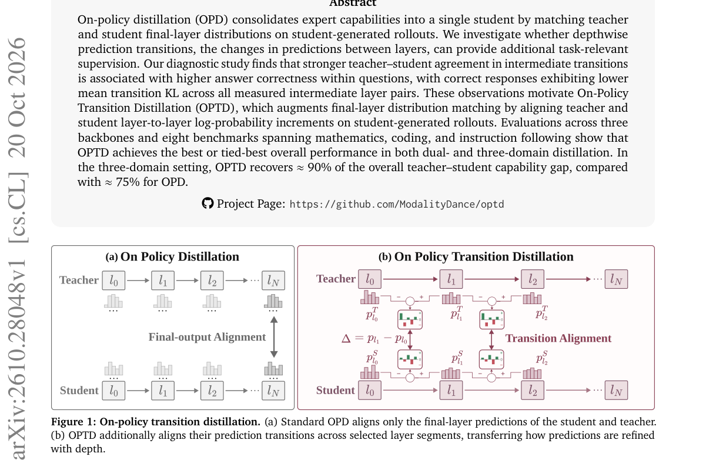

*Main result - Figure 2 Teacher agreement and answer correctness. (a) Correctness by within-question agreement quartile; shad-*

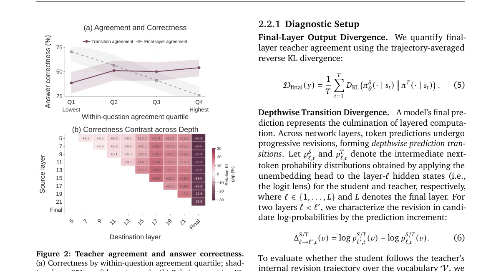

**Why this ranks #9**: 它发现中间层的师生一致性可以直接预测答案正确率，并据此加了一项几乎零成本的监督。

---

### 10. TPO: Tri-level Distributionally Robust Learning for OOD Direct Preference Optimization

**arXiv**: [2610.28229](https://arxiv.org/abs/2610.28229) | **Score**: 8.15 (relevance 8.0 x 0.7 + quality 8.5 x 0.3) | **Tags**: rlhf, dpo, robustness | **Categories**: cs.AI, cs.LG | **Pages**: 34

**Authors**: Chengtao Jian, Kai Yang

**Affiliation**: School of Computer Science and Technology, Tongji University, Shanghai, China; Shenzhen Loop Area Institute, Shenzhen, China; Shanghai Research Institute for Intelligent Autonomous Systems, Shanghai, China

**Abstract**

> Direct Preference Optimization (DPO) minimizes empirical risk over observed preference comparisons, implicitly assuming that the training preference distribution matches the deployment preference distribution. In practice, this i.i.d. assumption often fails, as preference distribution shift exhibits a natural hierarchical structure across three levels: group-level shift, prompt-level shift, and preference-level shift. Such multi-level distributional mismatch poses a critical challenge for safe LLM deployment, yet existing robust DPO methods typically either model uncertainty over the joint preference distribution or focus on individual sources of shift, leaving the hierarchical structure of OOD preference shifts underexplored. We propose TPO, a tri-level distributionally robust framework for OOD preference alignment, which jointly models all three levels of distributional uncertainty through a hierarchically structured rectangular ambiguity set. By instantiating it with Wasserstein distance, we derive a tractable and interpretable objective that combines a closed-form preference-level margin penalty, prompt-level adversarial embedding perturbation, and worst-case group reweighting, each governed by an independent radius. We establish finite-sample convergence guarantees and empirically validate the effectiveness of TPO over existing robust DPO methods.

**Key findings**

- **Finding**: DPO 最小化观测偏好比较上的经验风险，隐含假设训练偏好分布与部署偏好分布一致。

- **Finding**: 实践中这一 i.i.d. 假设常常失效，因为**偏好分布漂移呈现自然的三级结构**：组级漂移、提示级漂移与偏好级漂移。

- **Finding**: TPO 提出三级分布鲁棒框架，通过**层次化结构化的矩形模糊集**（以 Wasserstein 距离实例化）联合建模三个层次的不确定性，并为每一层提供可解释的鲁棒性控制。

- **Finding**: 论文报告了在偏好投毒下的偏好准确率。

- **Inference**: 把偏好漂移分成三级是个有价值的结构化观察——组级漂移与提示级漂移需要的正则强度本就应该不同，而现有鲁棒 DPO 方法没有联合处理。

- **Recommendation**: 推荐。

**Key figures**

*Framework / architecture - Figure 1 Preference accuracy under prefer- ence poisoning.*

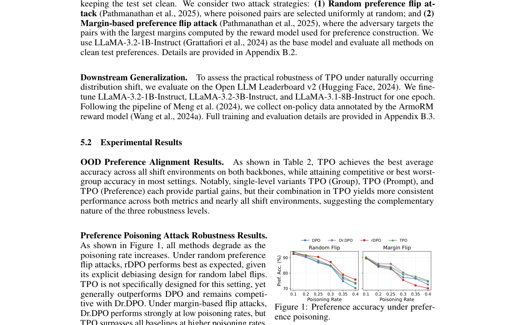

**Why this ranks #10**: 它指出了偏好对齐里一个被整体化处理的结构：漂移有三个层次，需要不同强度的正则。

---

## Footer

- Total papers reviewed across all 7 tracks: 70 (from 517 scanned, 93 full reads)
- rl_llm track final top-10: 10
- Wild-cards in this track: 0
- Figure assets: `res/` (shared across tracks)

Generated by `mine-arxiv-daily-digest` skill. Sister file: `2026-10-21_rl_llm_entry.md`.
