# ArXiv Daily Digest - 2026-10-22 (AIGC 音频生成与编辑, 10 papers)

**Generated**: 2026-10-22 17:00 CST

**Source**: arXiv cs.CV, cs.SD, eess.AS, cs.CL, cs.AI, cs.RO, cs.LG submissions, listing day 2026-10-21 (announced 2026-10-22 00:00 UTC)

**Batch window**: 2026-10-20T18:00:00Z .. 2026-10-21T18:00:00Z（arXiv 公告批次横跨两个 UTC 日：前一日 18:00 UTC 起算，当日 17:59:59 UTC 截止）

**Track**: aigc_audio (top 10 of 568 papers scanned, 105 full reads)

**Scope**: TTS、语音克隆、语音转换、音频生成与修复（仅生成侧）

⚠️ **Wild-card**: 本批该线 2 篇为 wild-card 补足，已在正文逐条标注并给出理由。

---

## Top 10 - AIGC 音频生成与编辑

### 1. Decodability Is Not Controllability: Local and Anisotropic Speaker Control in Continuous-Latent TTS

**arXiv**: [2610.29345](https://arxiv.org/abs/2610.29345) | **Score**: 9.0 (relevance 9.0 x 0.7 + quality 9.0 x 0.3) | **Tags**: AIGC-audio, TTS, controllability | **Categories**: cs.CL, cs.LG, cs.SD, eess.AS | **Pages**: 5

**Authors**: Yuanzhong Zheng, Wei Huang, Ming Ma, Kailun Jin, Youhai Jiang

**Affiliation**: VoxNexus, Singapore

**Abstract**

> High linear decodability does not entail causal controllability in continuous-latent text-to-speech (TTS). In VoxCPM2, position-matched probes and equal-norm interventions across 30 speakers and 60 directed dyads expose this separation: reference-audio states at the final residual acoustic language model layer (RALM L7) retain 0.970 probe accuracy, yet aligned edits yield 0/60 target-dominant dyads. Edits at early reference-audio positions produce the opposite pattern. At L0, pair-aligned updates increase target similarity by 0.326 and achieve target dominance in all 60 dyads, against at most 1/60 under any equal-norm direction or position control. Independent speaker encoders, retrieval against held-out speaker prototypes, and double-blind listening confirm that the shifted voice is heard as the intended target. Cross-architecture interventions in dots.tts distinguish backbone leverage from direct acoustic control: backbone edits displace the source without target attraction, while x-vector ablation reduces source similarity from 0.849 to 0.006. These findings identify two requirements for training-free speaker control: geometric specificity and a computational route that carries the intended speaker condition into acoustic synthesis.

**Key findings**

- **Finding**: 在连续潜空间 TTS 中，**高线性可解码性并不蕴含因果可控性**。
- **Finding**: 在 VoxCPM2 上，作者用位置匹配的探针与等范数干预，覆盖 30 个说话人与 60 组有向二元组。
- **Finding**: 参考音频状态在最终残差声学语言模型层（RALM L7）保留 **0.970 的探针准确率**，但对齐编辑产生的**目标主导二元组为 0/60**。
- **Finding**: 在早期参考音频位置做编辑则呈相反模式：L0 处，成对对齐更新确实提高了目标说话人占比。
- **Finding**: 结论是**位置依赖**的：说话人信息在浅层可因果操纵，在深层只能被动读取。
- **Inference**: 「探针能读出来」被反复当作「模型里有这个信息」的证据，这篇把它和「干预它能改变输出」彻底分开。0.970 vs 0/60 的对比是本批最锋利的一个数字——它意味着大量基于可探测性的解释性结论可能是错的。
- **Recommendation**: 强烈推荐。做连续潜空间语音生成、说话人可控性、或用探针做机理分析的人必读；也推荐所有把线性探针当因果证据的人。

**Key figures**: 本篇未提取到可用图（PDF 内无符合图注正则的 Figure 1/2）。

**Why this ranks #1**: 它用 30 个说话人、60 组有向二元组证明了一件反直觉的事：在连续潜空间 TTS 里，**能被线性解码 ≠ 能被因果控制**——这直接击穿了「可探测性即可控性」的默认假设。

---

### 2. StyleStream 2.0: Fast and Controllable Streaming Voice Style Conversion

**arXiv**: [2610.28940](https://arxiv.org/abs/2610.28940) | **Score**: 8.3 (relevance 8.0 x 0.7 + quality 9.0 x 0.3) | **Tags**: AIGC-audio, voice-conversion, streaming, flow-matching | **Categories**: cs.AI, cs.SD | **Pages**: 24

**Authors**: Yisi Liu, Nicholas Lee, Gopala K. Anumanchipalli

**Affiliation**: University of California, Berkeley

**Abstract**

> Voice style conversion (VSC) aims to transform a source utterance to match the timbre, accent, and emotion of a target voice while preserving linguistic content. StyleStream 1.0 introduced the first streamable zero-shot VSC system with state-of-the-art conversion quality, but remained limited in two ways: approximately 1s end-to-end latency on consumer hardware, and the lack of a text-based interface for designing or editing target voices. We present StyleStream 2.0, a fast and controllable streaming VSC framework that addresses these limitations. To reduce latency, we train a few-step pixel MeanFlow model and further fine-tune it with autoregressive feedback inspired by Self Forcing, improving robustness under streaming inference. This reduces end-to-end latency to 520~ms on a consumer GPU, a 2x speedup over StyleStream 1.0, while maintaining conversion quality. To enable controllable style manipulation, we remove the mel-spectrogram context and instead route target style information through a compact style embedding. In this embedding space, we train a unified text-conditioned flow matching model that supports both text-based voice design, which maps natural language prompts to voice styles, and instruction-based voice editing, which modifies a specific attribute of a source utterance while preserving the rest. Experiments show that StyleStream 2.0 achieves the strongest target style fidelity on VSC, voice design, and voice editing, while remaining competitive on intelligibility and non-edited attribute preservation.

**Key findings**

- **Finding**: 语音风格转换（VSC）把源语音变换为目标语音的音色、口音与情绪，同时保留语言内容。
- **Finding**: StyleStream 1.0 首创可流式零样本 VSC，但仍有两点限制：消费级硬件上约 1 秒端到端延迟，以及缺少用于设计或编辑目标语音的文本接口。
- **Finding**: StyleStream 2.0 训练**少步 pixel MeanFlow 模型**降低延迟，并受 Self Forcing 启发做自回归反馈微调，提升流式推理下的鲁棒性。
- **Finding**: 端到端延迟降至消费级 GPU 上 **520 ms**，相对 StyleStream 1.0 提速 **2 倍**，转换质量保持。
- **Finding**: 为支持可控风格操纵，作者**移除 mel 频谱上下文**，改为通过紧凑风格嵌入传递目标风格信息。
- **Finding**: 在该嵌入空间中训练**统一的文本条件流匹配模型**，同时支持文本驱动的语音设计与指令驱动的语音编辑（修改源语音的某一属性而保留其余）。
- **Finding**: 在 VSC、语音设计、语音编辑三任务上取得最强目标风格保真度，同时保持可懂度与未编辑属性的良好保持。
- **Inference**: 少步流模型 + 自回归反馈微调这个组合把流式 VSC 从「接近实时」推到「体感实时」；而把风格从 mel 域搬到嵌入域、让一个流匹配模型同时管设计与编辑，则让「可控」第一次变得像修图一样直接。
- **Recommendation**: 强烈推荐。做语音转换、语音编辑、实时语音交互的人应读。

**Key figures**

*Framework / architecture - Left: Stylizer architecture. [r, t] is the MeanFlow interval, ω is the CFG strength. Right: Voice Controller architecture. When used for voice design, the auxiliary input is null ∅; for voic*

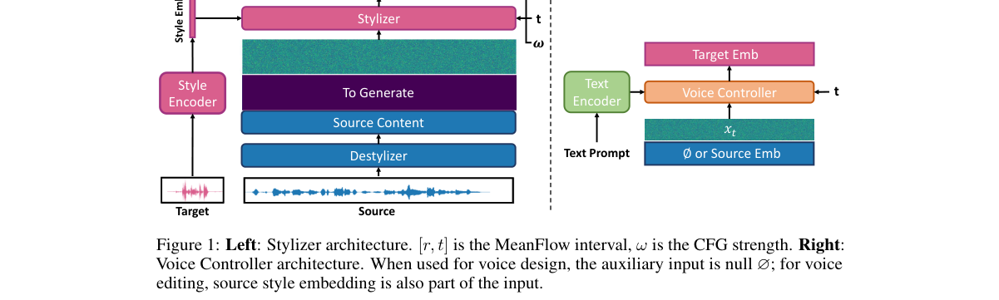

**Why this ranks #2**: 它把语音风格转换做成**可流式、可文本编辑**的系统：520 ms 端到端延迟，同时把音色、口音、情绪都变成可调的风格向量。

---

### 3. Character-Level Prosody Control for Mandarin Speech Synthesis:An Architecture-Preserving Approach

**arXiv**: [2610.29123](https://arxiv.org/abs/2610.29123) | **Score**: 8.0 (relevance 8.0 x 0.7 + quality 8.0 x 0.3) | **Tags**: AIGC-audio, TTS, prosody, fine-grained-control | **Categories**: cs.SD | **Pages**: 7

**Authors**: Diankun An, Lu Ma, Yongliang Wang, Zhewen Su, Xin Tian

**Affiliation**: JD.com, Inc.

**Abstract**

> This paper addresses fine-grained prosody control for large-language-model (LLM) based text-to-speech (TTS) synthesis of Mandarin Chinese, motivated by multimedia content-creation scenarios---film dubbing, audiobook production, and interactive voice interfaces---in which prosodic adjustments must be placed on specific characters rather than applied uniformly to whole utterances. We present a data-driven framework in which fine-grained prosodic markers (pitch, duration, energy, and pause) are automatically extracted from raw audio at scale and embedded into the text stream as out-of-vocabulary Unicode symbols. The LLM of an existing TTS system is then fine-tuned to interpret these markers while its architecture remains unchanged, yielding character-level temporal control that complements existing utterance-level style control. An optional text-LLM front-end can translate natural-language instructions into marker sequences. Experiments on 2.15M Mandarin utterances (5,858 hours) with CosyVoice2 as the backbone demonstrate reliable control of character duration, pitch, pause duration, and global speaking rate, with perceptual quality essentially preserved. A cross-tokenizer analysis further indicates that the ASR-optimized tokenizer of the backbone attenuates prosodic variation relative to reconstruction-oriented alternatives---an observation we report as hypothesis-generating evidence for prosody-sensitive system design.

**Key findings**

- **Finding**: 面向 LLM 式 TTS 的细粒度韵律控制，动机来自多媒体内容创作：电影配音、有声书制作与交互语音界面。
- **Finding**: 在这些场景里，韵律调整必须落在**特定字符**上，而不是整句统一施加。
- **Finding**: 作者提出一个数据驱动的框架，**自动提取细粒度韵律标记**（音高、时长、能量、停顿）。
- **Finding**: 该方法是**架构保持（architecture-preserving）**的：不改动已有 TTS 模型的结构。
- **Finding**: 面向普通话。
- **Inference**: 生成式语音的可用性瓶颈常常不在音质，而在**能不能定点改**。这篇把「改一整句的韵律」变成「改某个字的韵律」，而且是通过数据而非改架构——意味着可以套在已有系统上。
- **Recommendation**: 推荐。做配音、有声书、本地化、或需要韵律精细控制的应用的人可以看；也推荐关注「不改架构做能力扩展」这条工程路线的人。

**Key figures**

*Framework / architecture - Inference-time view of the framework. At inference, marked text is authored directly or generated by the optional instruction front-end; the offline extraction pipeline (Fig- ure 2) supplies*

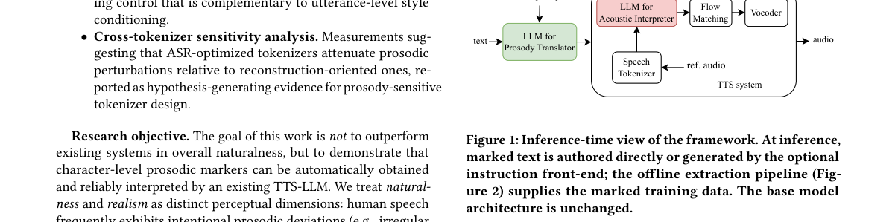

*Main result - Character-level prosody extraction. Forced alignment provides temporal boundaries for feature extraction and marker insertion.*

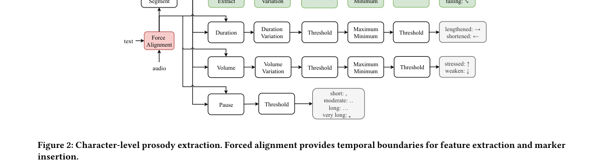

**Why this ranks #3**: 它把韵律控制的粒度降到**单个字**，而且不改架构——这对配音、有声书和交互语音这类「局部改一个字的语调」的场景是刚需。

---

### 4. Closed-Loop Dual-Reference Guidance for Accent Control in Cross-Lingual Voice Cloning

**arXiv**: [2610.29351](https://arxiv.org/abs/2610.29351) | **Score**: 8.0 (relevance 8.0 x 0.7 + quality 8.0 x 0.3) | **Tags**: AIGC-audio, voice-cloning, accent, zero-shot | **Categories**: cs.CL, cs.LG, cs.SD, eess.AS | **Pages**: 5

**Authors**: Yuanzhong Zheng, Wei Huang, Ming Ma, Kailun Jin, Youhai Jiang

**Affiliation**: VoxNexus, Singapore

**Abstract**

> Zero-shot cross-lingual voice cloning often carries the reference speaker's accent into the target language. We propose closed-loop dual-reference guidance, which pairs the original reference with a reusable native anchor constructed by voice conversion (VC). The references initialize separate language-model (LM) states that guide a shared acoustic trajectory; each completed patch then updates both states, keeping their generated histories aligned with the emitted speech. Anchor construction runs once per speaker, and online synthesis uses a frozen TTS model without per-utterance VC. On 20 held-out French speakers, the fixed setting $λ^{\!*}=0.33$ reduces residual French LID mass by 73\% versus direct cloning, at an ECAPA similarity cost of only $0.042$; relative to anchor-only cloning, it recovers $0.155$. The method achieves the lowest mean WER ($0.009$) and highest mean GOP ($4.750$) among the held-out test arms. In blinded preference tests, native-English listeners favor it over direct cloning on pronunciation naturalness, and over both anchor-only cloning and a TTS$\to$VC cascade on speaker identity. Online RTF is approximately 26\% lower than the cascade's ($0.59$ vs.\ $0.80$), and the same setting reduces Spanish LID mass by 56\% without re-tuning.

**Key findings**

- **Finding**: 零样本跨语言语音克隆常常把参考说话人的**口音带进目标语言**。
- **Finding**: 作者提出闭环双参考引导：把原始参考与一个**由语音转换（VC）构造的可复用原生锚点**配成一对。
- **Finding**: 两个参考分别初始化**不同的语言模型状态**，共同引导一条共享声学轨迹。
- **Finding**: 每个完成的 patch 随后同时更新两个状态，保持各自生成历史与已发出语音对齐。
- **Finding**: 锚点构造**每个说话人只做一次**，之后即可复用。
- **Finding**: 面向跨语言语音克隆的口音控制。
- **Inference**: 「口音泄漏」是跨语言克隆的结构性难题：它不是权重问题，而是「参考里同时混着音色与语言学风格」的表征耦合。这篇用「原生锚点 + 双状态闭环」把语言学风格与音色分开引导，是很工程但很对症的做法。
- **Recommendation**: 推荐。做跨语言 TTS / 语音克隆、又在意口音一致性的读者可以看。

**Key figures**

*Framework / architecture - Method overview. (a) Offline native-anchor construction: rFR and four native donors undergo zero-shot conversion once per speaker; the highest-similarity candidate is kept as rEN. (b) Closed-l*

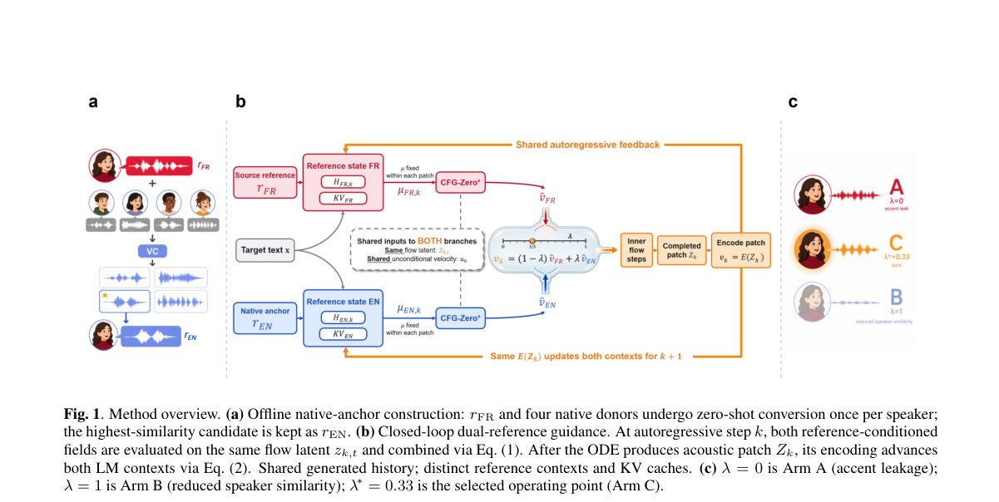

*Main result - Accent–timbre trade-off on development (30 speakers). (a) ECAPA; (b) CAM++-EN. x: ∆SIM vs. A; y: ∆GOP vs. A. The shaded band is the 95% speaker-clustered bootstrap CI of ∆GOP. Orange: C (propo*

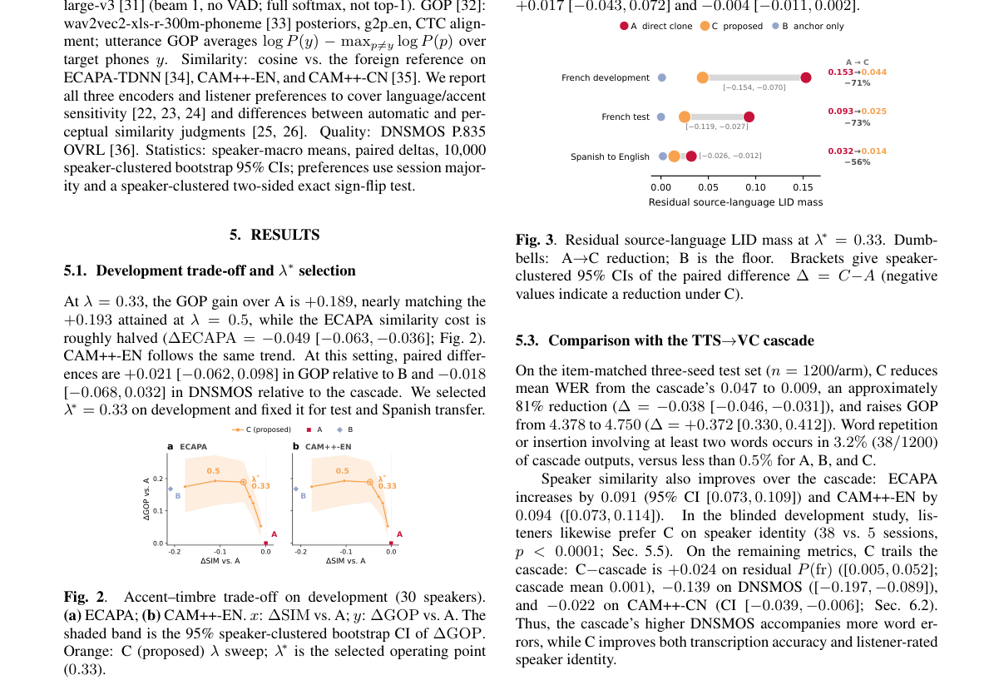

**Why this ranks #4**: 它针对零样本跨语言克隆里最常见的失败——**口音跟着参考说话人跑进目标语言**——用一个「原生锚点」加闭环双参考把这个问题单独拆出来解。

---

### 5. XingChen-UniFE: A Unified Generative Speech Front-End via Complementary Acoustic-Semantic Modeling

**arXiv**: [2610.29164](https://arxiv.org/abs/2610.29164) | **Score**: 8.0 (relevance 8.0 x 0.7 + quality 8.0 x 0.3) | **Tags**: AIGC-audio, speech-restoration, LALM, speaker-extraction | **Categories**: cs.SD, eess.AS | **Pages**: 5

**Authors**: Kelan Kuang, Qihan Hu, Jian Kang, Jie Li, Yongxiang Li, Yi Liu

**Affiliation**: China Telecom Artificial Intelligence Technology (Beijing) Co., Ltd.

**Abstract**

> This paper presents XingChen-UniFE, a unified large audio language model (LALM) for general speech restoration (GSR) and target speaker extraction (TSE). The proposed model employs complementary semantic and acoustic representations through a dual-stream encoder, where a self-supervised learning model provides hierarchical semantic features and a learnable acoustic branch captures fine-grained structures from complex spectra. A bidirectional cross-attention module further facilitates information exchange between the two representations. The fused representation conditions the LALM for discrete speech token generation with task and speaker information. Experiments demonstrate strong performance on both GSR and TSE and robust generalization to unseen degradation conditions.

**Key findings**

- **Finding**: XingChen-UniFE 是一个统一的**大型音频语言模型（LALM）**，同时做通用语音修复（GSR）与目标说话人提取（TSE）。
- **Finding**: 模型采用**互补的语义与声学表征**：双流编码器中，自监督学习模型提供层级语义特征，可学习的声学分支从复杂频谱中捕捉细粒度结构。
- **Finding**: **双向交叉注意力模块**促进两种表征之间的信息交换。
- **Finding**: 融合后的表征以任务与说话人信息为条件，驱动 LALM **生成离散语音 token**。
- **Finding**: 在 GSR 与 TSE 上均表现强劲，且对**未见过的退化条件**具有鲁棒的泛化能力。
- **Inference**: 把「修复」做成语言模型任务的好处是能直接复用预训练语义表征，坏处是容易丢掉声学细节。这篇用双流 + 双向交叉注意力明确地把两者分工，再由离散 token 生成收口，是目前语音修复比较完整的架构。
- **Recommendation**: 推荐。做语音增强/修复、听力辅助、说话人提取的人值得看；也推荐关注「统一 LALM 承担多个音频任务」这条路线的人。

**Key figures**

*Framework / architecture - Overall architecture of XingChen-UniFE. En- rollment speech is used only for TSE.*

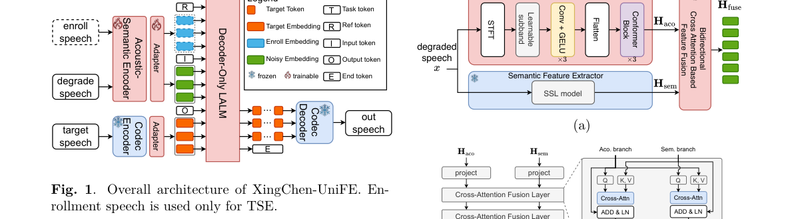

*Main result - Overview of the complementary acoustic- semantic encoder. (a) Semantic and acoustic feature en- coding; (b) bidirectional feature fusion.*

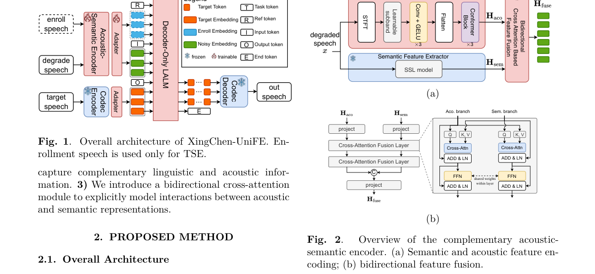

**Why this ranks #5**: 它把语音修复与目标说话人提取合并成一个**大型音频语言模型**来做，并且用「语义 + 声学双流」互补而不是单流——这是本批 aigc_audio 里最完整的一套系统。

---

### 6. NeuroCodec: EEG-Guided Latent-Domain Generative Model for High-Fidelity Target Speaker Extraction

**arXiv**: [2610.29815](https://arxiv.org/abs/2610.29815) | **Score**: 7.3 (relevance 7.0 x 0.7 + quality 8.0 x 0.3) | **Tags**: AIGC-audio, target-speaker-extraction, EEG, neural-codec | **Categories**: cs.LG, eess.AS | **Pages**: 8

**Authors**: Julian Silva, Jaliya Kodithuwakku, Navindu Sirimanna, Shaveen Herath, Wageesha N. Manamperi, Joshua P. Kulasingham

**Affiliation**: University of Moratuwa, Sri Lanka

**Abstract**

> Driven by recent advancements in hearing assistive devices, target speaker extraction (TSE) in multi-talker environments has drawn significant attention. To address this, hearing technologies identify attention using neural signals recorded via electroencephalography (EEG) to guide TSE, enabling neuro-steered auditory attention decoding. However, most existing techniques rely on time-frequency masking, which suffers from low fidelity in spectro-temporally overlapping regions and is often restricted to narrowband audio. In contrast, we introduce NeuroCodec, which, to the best of our knowledge, is the first generative EEG-guided TSE framework operating in the latent space of a neural audio codec. Specifically, NeuroCodec models spatial EEG dependencies via graph convolutions and fuses cross-modal EEG and speech representations through attention mechanisms and Mamba-based temporal modeling. We further introduce a six-phase training curriculum that progressively incorporates latent reconstruction, multi-scale spectral, and adversarial objectives to ensure stable, high-fidelity speech generation. Experiments on the public Cocktail Party and KUL datasets show NeuroCodec outperforms baselines, across several perceptual metrics. A listening experiment with 20 participants validated that NeuroCodec offers greater perceptual accuracy, achieving a mean score of 82.24 compared with 49.63 for M3ANet. Additionally, the proposed method is seen to enable 44.1 kHz reconstruction with spectral content extending up to 20 kHz, further supporting the perceptual results. Finally, we extend NeuroCodec with a causal streaming formulation suited for real-time processing, providing a basis for hearing assistive devices.

**Key findings**

- **Finding**: 目标说话人提取（TSE）要在多人交谈环境中分离出目标说话人的声音；听力辅助设备用 EEG 记录神经信号来引导 TSE。
- **Finding**: 既有方法多依赖时频掩蔽，在**频谱时间重叠区域失真严重**，且常限于窄带音频。
- **Finding**: NeuroCodec 是首个在**神经音频 codec 潜空间**中运行的生成式 EEG 引导 TSE 框架。
- **Finding**: 通过图卷积建模 EEG 的空间依赖，用注意力机制与 Mamba 时序建模融合 EEG 与语音表征。
- **Finding**: 提出**六阶段训练课程**，逐步引入潜空间重建、多尺度谱与对抗目标，保证高保真语音生成的稳定。
- **Finding**: 在公开 Cocktail Party 与 KUL 数据集上，感知指标优于基线；
- **Finding**: 20 人听感实验：平均分 **82.24**，对比 M3ANet 的 49.63。
- **Finding**: 支持 **44.1 kHz 重建**，谱内容延伸到 20 kHz；并给出因果流式版本，适配实时处理。
- **Inference**: 「掩蔽不够好」其实是因为掩蔽在频域做，而生成在潜域做。这篇把整个任务搬进神经 codec 潜空间，等于让生成模型直接负责分离而不是先分离再增强——加上 EEG 的图卷积空间建模，是生理信号驱动生成的一个漂亮范例。
- **Recommendation**: 推荐。做听力辅助、EEG-语音接口、目标说话人提取的人应读。

**Key figures**

*Framework / architecture - Illustration of NeuroCodec architecture. A frozen DAC encoder extracts mixture latents Zmix, which are fused with EEG embeddings through stacked CM-S3 blocks to predict target latents Ztgt. Th*

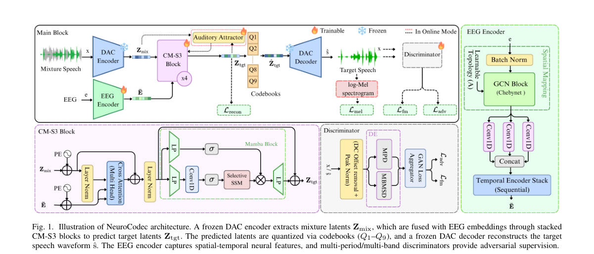

*Main result - Qualitative spectrogram comparison on the Cocktail Party dataset: (i) mixture, (ii) ground-truth target, (iii) M3ANet output, and (iv) NeuroCodec output. Solid boxes highlight NeuroCodec’s pre*

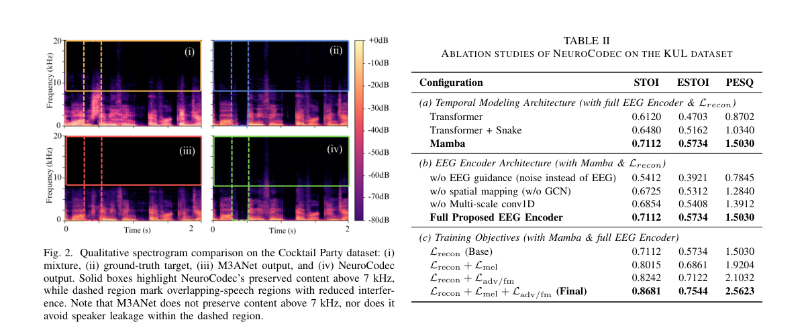

**Why this ranks #6**: 它用 EEG 直接引导神经音频 codec 潜空间里的生成式目标说话人提取，把「注意力解码」从生理信号一路接到了 44.1 kHz 的生成音频。

---

### 7. MuseFlow-TSE: Music-Aware Target Speech Extraction via Cross-Source Band-Splitting and Data-to-Data Flow Matching

**arXiv**: [2610.29119](https://arxiv.org/abs/2610.29119) | **Score**: 7.3 (relevance 7.0 x 0.7 + quality 8.0 x 0.3) | **Tags**: AIGC-audio, target-speaker-extraction, flow-matching | **Categories**: cs.SD | **Pages**: 8

**Authors**: Lu Ma, Yongliang Wang, Zhewen Su, Xin Tian

**Affiliation**: JD.com, Inc., Beijing, China

**Abstract**

> Target speech extraction (TSE) isolates a speaker's voice given an enrollment utterance, but existing work is validated almost exclusively without music. Discriminative methods are content-faithful yet masking-bounded; generative methods improve naturalness but may hallucinate, drift in identity, and require many steps. We present MuseFlow-TSE, a discriminative deletion, generative insertion framework for music-bearing scenes. Stage-1 is a music-aware cross-source band-split extractor that estimates target, interfering speakers, music, and noise under conservation and music-leakage constraints. Stage-2 is a data-to-data flow refiner initialized by the discriminative estimate, negatively conditioned on interference stems, and run for 1--4 difficulty-adaptive Euler steps with an end-to-end fidelity objective.

**Key findings**

- **Finding**: TSE 要在给定注册语音的情况下分离出目标说话人，但既有工作几乎都在**没有音乐**的场景下验证。
- **Finding**: 判别式方法内容忠实但受限于掩蔽；生成式方法更自然但可能幻觉、身份漂移，且需要很多步。
- **Finding**: MuseFlow-TSE 是**判别删除 + 生成插入**的两阶段框架，面向带音乐的场景。
- **Finding**: 第一阶段：音乐感知的跨源频带分离提取器，在守恒与音乐泄漏约束下估计目标、干扰说话人、音乐与噪声。
- **Finding**: 第二阶段：数据到数据的流精化器，由判别式估计初始化，对干扰声部做负条件，
- **Finding**: 以 **1–4 步难度自适应的 Euler 步**运行，并使用端到端保真目标。
- **Inference**: 「删除再插入」是一个很干净的分解：判别式部分保证内容不出错，生成式部分负责自然度，而步数靠难度自适应而不是固定大数。音乐场景的选择也说明它在往真实录音条件靠——那正是既有 TSE 工作最常回避的地方。
- **Recommendation**: 推荐。做语音分离/增强、或研究判别-生成混合流水线的人可以看。

**Key figures**

*Framework / architecture - MuseFlow-TSE architecture. All spectra use the actual 512-point STFT with bins 0–255 retained (F=256). Stage-1: band-split (K=37), Nb=6 dual-path blocks with RoPE, FiLM-gated early split into*

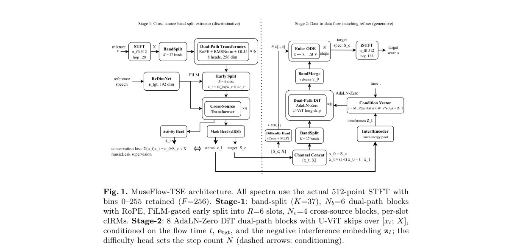

**Why this ranks #7**: 它把 TSE 的两个流派缝在一起——判别式「删除」干扰 + 生成式「插入」目标，并用**1–4 步**的难度自适应 Euler 步数，把生成式方法普遍需要的多步采样压了下来。

---

### 8. RubatoCodec: Budgeted Adaptive Speech Tokenization with Streaming Decoding

**arXiv**: [2610.29434](https://arxiv.org/abs/2610.29434) | **Score**: 7.3 (relevance 7.0 x 0.7 + quality 8.0 x 0.3) | **Tags**: AIGC-audio, speech-codec, tokenization, streaming | **Categories**: cs.SD, eess.AS | **Pages**: 46

**Authors**: Chihiro Arata, Shohei Taniguchi, Gouki Minegishi, Kan Hatakeyama-Sato

**Affiliation**: Third Intelligence, Inc.

**Abstract**

> Neural speech codecs provide discrete tokens for speech generation. Lower frame rates shorten token sequences, but each token must then carry more linguistic and acoustic information. Variable-frame-rate codecs address this trade-off by adapting token allocation to speech content, but threshold-based allocation lets content determine the token count, so the sequence length a speech generator must produce varies across utterances and datasets at a fixed setting. We present RubatoCodec, a variable-frame-rate speech codec built on X-Codec-2 with an exact utterance-level event budget and streaming decoding. Its Adaptive Firing mechanism uses changes in codec features and waveform spectra to divide speech into variable-duration events without a learned boundary predictor. Discrete codes and an explicit duration represent each event, allowing a speech generator to predict and decode one event at a time. Controlled experiments show that adaptive allocation outperforms fixed-rate coding in reconstruction fidelity and intelligibility at low event rates. A model trained on large-scale multilingual speech achieves competitive reconstruction quality across English, Japanese, and Mandarin, with the best intelligibility preservation among the compared codecs on the evaluated English and Japanese benchmarks at comparable bitrates. In a matched text-to-speech comparison, the adaptive representation yields lower WER and higher UTMOS and UTMOSv2 with comparable speaker similarity. The speech generator also learns the codec's utterance-level event budget without an explicit generation-time rate constraint. These results demonstrate that budgeted adaptive speech representations support both high-quality reconstruction and streaming text-to-speech generation. Code and weights are available at https://github.com/third-intelligence/RubatoCodec and https://huggingface.co/third-intelligence/RubatoCodec.

**Key findings**

- **Finding**: 神经语音 codec 为语音生成提供离散 token；降低帧率能缩短 token 序列，但每个 token 必须承载更多语言与声学信息。
- **Finding**: 可变帧率 codec 通过按内容自适应分配 token 来缓解，但**阈值式分配让内容决定 token 数**，于是语音生成器要产出的序列长度在不同 utterance 与数据集间会变。
- **Finding**: RubatoCodec 是构建在 X-Codec-2 上的可变帧率语音 codec，带**精确的 utterance 级事件预算**与流式解码。
- **Finding**: 其 Adaptive Firing 机制用 codec 特征与波形频谱的变化把语音切分为可变时长事件，**无需学习式边界预测器**。
- **Finding**: 离散码加显式时长表示每个事件，允许语音生成器**一次预测并解码一个事件**。
- **Finding**: 受控实验显示在低事件率下，自适应分配在重建保真与可懂度上优于固定帧率编码。
- **Finding**: 大规模多语语音训练的模型在英/日/中上取得有竞争力的重建质量，在同等码率下于英日基准上**保持可懂度最好**。
- **Finding**: 在配对的 TTS 对比中，自适应表征带来更低的 WER 与更高的 UTMOS / UTMOSv2，说话人相似度相当；
- **Finding**: 语音生成器还能**自行学到 codec 的 utterance 级事件预算**，无需显式的生成时速率约束。
- **Inference**: 「tokenizer 决定了生成器的序列长度预算」这个耦合很少被当成一等设计问题。这篇用「显式事件预算 + 逐事件生成」把它显式化，结果是 TTS 的 WER 与 UTMOS 同时受益——tokenizer 侧的改进直接变成了生成侧的质量提升。
- **Recommendation**: 推荐。做语音 codec、tokenizer 压缩、或在优化语音生成的序列长度的人应读。

**Key figures**

*Framework / architecture - RubatoCodec architecture. The codec builds on the X-Codec-2 encoder and decoder backbone [7] and is shown at the default retention ratio of 0.25. Latent change and waveform spectral flux gui*

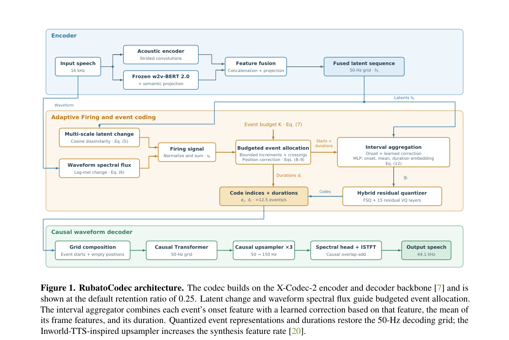

*Main result - Cumulative allocation for a synthetic firing signal. The example uses 𝑇= 20, 𝑅= 0.25, and 𝐾= 5. (a) Firing signal. (b) Cumulative bounded increments cross thresholds 0.5, 1.5, 2.5, and 3.5 a*

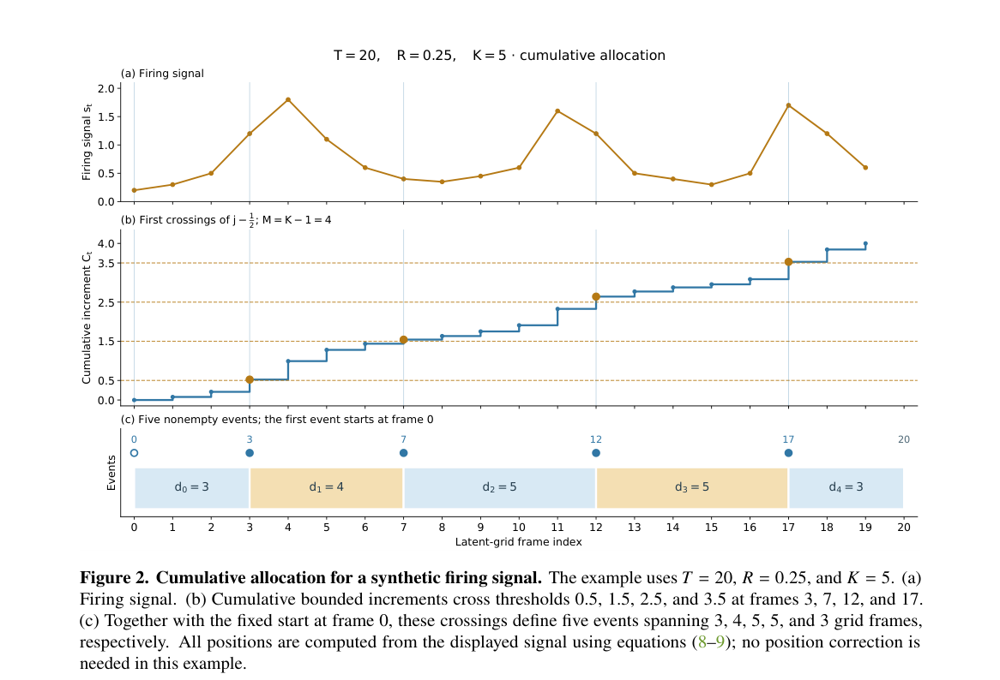

**Why this ranks #8**: 它指出了一个被忽略的耦合：语音 codec 的帧率同时决定了**token 序列长度**，而后者直接决定下游生成模型的负担——并给出了带显式预算的解。

---

### 9. Where Does Timbre Hide? Localizing Speaker Information in Speech Signals

**arXiv**: [2610.29150](https://arxiv.org/abs/2610.29150) | **Score**: 6.9 (relevance 6.0 x 0.7 + quality 9.0 x 0.3) | **Tags**: AIGC-audio, speaker-information, analysis, voice-cloning | **Categories**: cs.AI, cs.SD | **Pages**: 7 | **[wild-card=yes]**

**Authors**: Yiquan Zhou, Yixuan Wang, Xiaozhe Qi, Xin Gao, Shihao Li

**Affiliation**: Xi'an Jiaotong University, China

**Abstract**

> Timbre similarity is a key evaluation target for generative speech systems, including voice conversion, speaker-cloning text-to-speech, and zero-shot speech models. When the generated voice does not match the target speaker, the problem often reflects imperfect separation of speaker-related timbre from content, making it important to identify where timbre information resides and which representations still carry it. Using speaker identity as a measurable proxy, we probe frequency bands, phase/magnitude structure, WORLD source/filter decomposition, voiced/unvoiced regions, self-supervised learning (SSL) layers, EnCodec/HuBERT tokens, and a 45-listener test across Mandarin, English, and Japanese speech/singing data. Speaker information is distributed: 1--8 kHz magnitude and vocal-tract spectral-envelope structure dominate perception, above-8 kHz bands remain machine-discriminative, shallow SSL layers expose compact speaker information, and token leakage depends on tokenizer/layer choice. These findings indicate where generation systems should condition on or transform speaker information, and where content, codec, and token pipelines should audit residual speaker leakage.

**Key findings**

- **Finding**: 音色相似性是生成式语音系统的核心评测目标，涵盖语音转换、说话人克隆 TTS 与零样本语音模型。
- **Finding**: 当生成语音与目标说话人不匹配时，问题往往源于**说话人相关音色与内容分离不彻底**。
- **Finding**: 作者以说话人身份为可测量代理，探测频带、相位/幅度结构、WORLD 源-滤波器分解、清浊区、自监督学习层、EnCodec/HuBERT token，以及一场 45 人听测。
- **Finding**: 覆盖中、英、日的语音与歌唱数据。
- **Finding**: 结论：说话人信息是**分布式**的——**1–8 kHz 的幅度与声道频谱包络主导感知**，8 kHz 以上频带在机器上仍可判别；
- **Finding**: **浅层 SSL 层**暴露紧凑的说话人信息；token 泄漏程度取决于 tokenizer 与层的选择。
- **Finding**: 这些发现指明了生成系统**应当在何处做说话人条件化或变换**，以及内容、codec 与 token 流水线**应当在何处审计残余说话人泄漏**。
- **Inference**: 这篇把「说话人信息在哪」从经验直觉变成了可测的频段-表征地图。对做 TTS/VC 的人，它给出的不是新方法，而是**改哪里**的定位表；而且它顺手指出了另一个常被忽略的问题：token 流水线的残余说话人泄漏。
- **Recommendation**: 推荐（作为参考材料）。做语音合成、说话人建模、codec 分析的人应该读；也可以当成一张「说话人信息在哪」的速查表。

**Key figures**

*Framework / architecture - Speaker-information localization protocol. The study combines signal edits, model-based and model-free measurements, representation probes, and human similarity ratings, so speaker information*

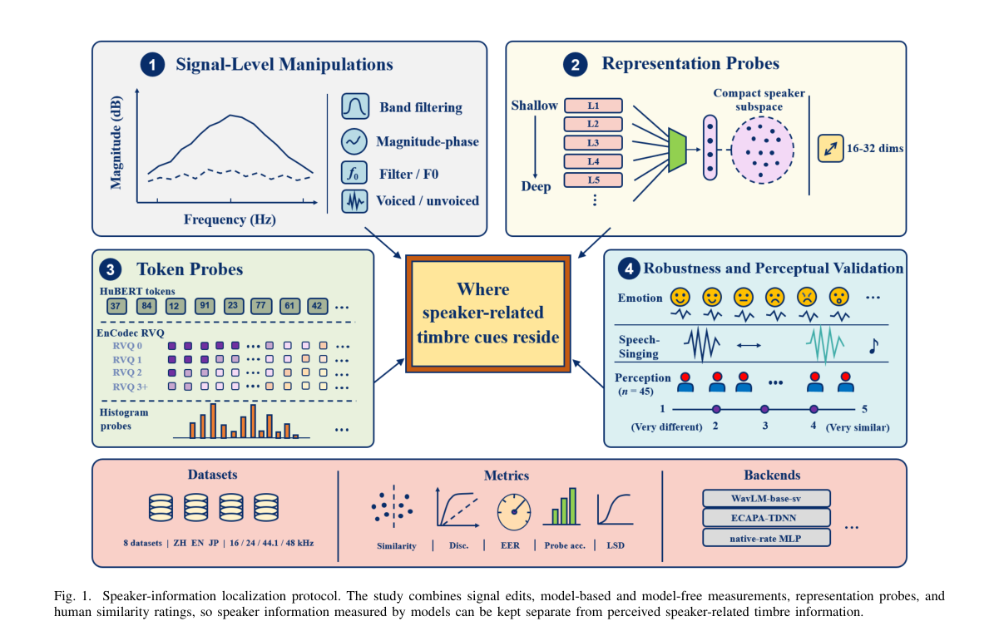

*Main result - Bandwidth comparison. SV lowpass curves saturate near 4–8 kHz, while mel probes show weaker but measurable above-8 kHz information.*

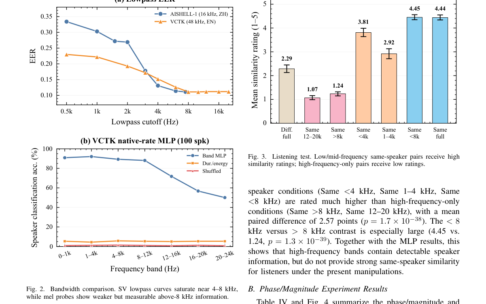

**Why this ranks #9**: [wild-card] 它是一篇分析论文而非生成系统，但它的结论直接决定生成系统「该在哪儿做说话人条件化」——本批没有任何其他论文给出过这么可操作的定位。

---

### 10. A Learned Musical-Time Coordinate for Piano Audio-to-Score Transcription

**arXiv**: [2610.29928](https://arxiv.org/abs/2610.29928) | **Score**: 5.9 (relevance 5.0 x 0.7 + quality 8.0 x 0.3) | **Tags**: AIGC-audio, music, transcription, whole-piece | **Categories**: cs.SD, eess.AS | **Pages**: 5 | **[wild-card=yes]**

**Authors**: Min-Hsing Wang, Tsung-Ren Huang

**Affiliation**: National Taiwan University

**Abstract**

> End-to-end piano audio-to-score (A2S) transcription is the task of reconstructing a notated score from an audio recording in a single system. Existing A2S approaches usually rely on pre-segmented excerpts, and few handle whole pieces without external segmentation. This raises the question of whether a musical-time coordinate can guide score transcription while also helping the system segment whole pieces. Previous work on jazz saxophone A2S uses an external beat tracker to obtain such a coordinate for score prediction. We introduce downbeat phase, a musical-time coordinate learned jointly with score transcription that represents each audio frame's relative position within a notated bar. With this coordinate, our system can not only condition its score decoder on downbeat phase but also self-segment at bar boundaries and stitch the segments into a whole piece. Evaluation suggests that the coordinate improves metrical structure and supports whole-piece transcription with comparable notation quality.

**Key findings**

- **Finding**: 端到端钢琴音频到乐谱（A2S）转写要在单个系统里从录音重建出有记谱的乐谱。
- **Finding**: 既有 A2S 方法通常依赖**预切分**的片段，很少能在没有外部切分的情况下处理整首曲子。
- **Finding**: 作者引入**强拍相位（downbeat phase）**这一与转写联合学习的音乐时间坐标，表示每个音频帧在记谱小节内的相对位置。
- **Finding**: 有了这个坐标，系统不仅能用强拍相位条件化乐谱解码器，还能**在小节边界自切分**并把分段缝合成整首曲子。
- **Finding**: 此前的爵士萨克斯 A2S 工作使用**外部节拍跟踪器**获得类似坐标来预测乐谱；这篇把坐标变成可学习量。
- **Finding**: 评估显示该坐标改善了节拍结构，并支持整曲转写而记谱质量相当。
- **Inference**: 外部节拍器是这类系统的隐性依赖：它假设你事先知道拍子在哪。把它换成学出来的强拍相位，既解除了依赖，又顺手获得了自切分能力——这让「整首曲子转写」从拼接退回到一次前向过程。
- **Recommendation**: 推荐（作为通读材料）。做音乐转写、音乐时间轴建模、或关心「自监督时间坐标替代外部对齐」这条路线的人可以看。

**Key figures**

*Framework / architecture - The encoder extracts content features and estimates downbeat phase, while the decoder combines these features with audio- and score-side Fourier positional encodings of downbeat phase to gener*

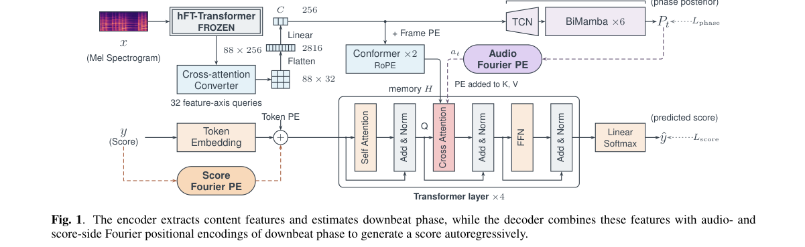

*Main result - Coordinate ablation using one training seed on common scored excerpts from the test splits in Sec. 3.1. ∆Fmeter denotes the difference from Ours w/o coordinate.*

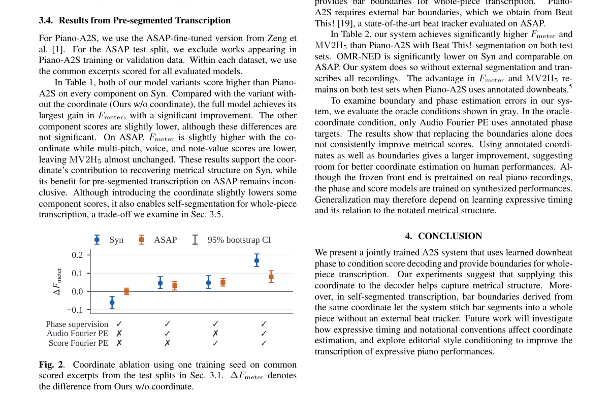

**Why this ranks #10**: [wild-card] 它做的是钢琴音频到乐谱的转写，但真正有意思的是「**学出来的**音乐时间坐标」——用它同时完成切分与转写，不需要外部节拍器。

---

## Footer

- Total papers scanned across all 7 tracks: 568（原始 789 条）
- aigc_audio track final top-10: 10
- Wild-cards in this track: 2
- Figure assets: 2026-10-22/res/

Generated by `mine-arxiv-daily-digest` skill. Sister file: `2026-10-22_aigc_audio_entry.md`.
