# ArXiv Daily Digest - 2026-10-22 (AIGC 图像 / 视频 / 3D 生成与编辑, 10 papers)

**Generated**: 2026-10-22 17:00 CST

**Source**: arXiv cs.CV, cs.SD, eess.AS, cs.CL, cs.AI, cs.RO, cs.LG submissions, listing day 2026-10-21 (announced 2026-10-22 00:00 UTC)

**Batch window**: 2026-10-20T18:00:00Z .. 2026-10-21T18:00:00Z（arXiv 公告批次横跨两个 UTC 日：前一日 18:00 UTC 起算，当日 17:59:59 UTC 截止）

**Track**: aigc_visual (top 10 of 568 papers scanned, 105 full reads)

**Scope**: 文本到图像/视频/3D 的生成与编辑、效率与可控性

⚠️ **Wild-card**: 本批该线 1 篇为 wild-card 补足，已在正文逐条标注并给出理由。

---

## Top 10 - AIGC 图像 / 视频 / 3D 生成与编辑

### 1. Looking Ahead: Modeling Future Evolution in Autoregressive Video Generation

**arXiv**: [2610.29989](https://arxiv.org/abs/2610.29989) | **Score**: 8.7 (relevance 9.0 x 0.7 + quality 8.0 x 0.3) | **Tags**: AIGC-image, AIGC-video, AIGC-3D, AIGC-edit, autoregressive, world-model | **Categories**: cs.CV | **Pages**: 22

**Authors**: Ruopeng Gao, Yukun Huang, Jiarui Hu, Shuai Wang, Wenbo Hu, Ying Shan, Limin Wang

**Affiliation**: Nanjing University, ARC Lab Tencent IEG, Zhejiang University

**Abstract**

> Autoregressive video diffusion models generate videos chunk by chunk, yet producing plausible continuations does not guarantee that they capture how scenes evolve. Under teacher forcing, strong temporal redundancy may allow local visual continuity to serve as a shortcut for current-chunk denoising, reducing the pressure to model visual evolution. We introduce Future Chunk Prediction (FCP), an auxiliary objective jointly optimized with teacher-forced denoising that predicts temporally separated chunks without access to the intervening visual context. Drawing supervision directly from training videos, FCP requires no additional pretrained visual encoder and leaves autoregressive inference unchanged. Our method achieves superior physical plausibility over standard teacher-forced autoregressive training with a lower overall training compute budget, highlighting the effectiveness and efficiency of future-chunk supervision for modeling visual evolution. Intriguingly, our visualizations suggest that FCP fosters a more structured representation space, which may be valuable for building autoregressive world models.

**Key findings**

- **Finding**: 自回归视频扩散逐 chunk 生成，但「续得上」不等于「懂场景怎么演化」。
- **Finding**: 在教师强制下，强时间冗余让局部视觉连续性足以完成当前 chunk 去噪，于是**建模场景演化**这件事的压力被消掉了。
- **Finding**: FCP 预测时间上分离的 chunk（在不给中间视觉上下文的情况下），监督直接取自训练视频。
- **Finding**: 不需要额外的预训练视觉编码器，且**不改动自回归推理流程**。
- **Finding**: 物理合理性优于标准教师强制训练，且总体训练算力更低。
- **Inference**: 自回归视频模型如果只学「下一块长什么样」，学到的其实是插值而不是动力学——这正好是它们当世界模型用时最缺的那部分。FCP 的性价比很高：训练期加一个辅助头，推理期零成本。
- **Recommendation**: 强烈推荐。做自回归视频或想把视频模型当世界模型用的人应先读这篇，它可能改变你的训练目标设计。

**Key figures**

*Framework / architecture - Overview of Future Chunk Prediction (FCP). Intermediate representations from the autoregressive backbone condition auxiliary transformer blocks for future-chunk prediction.*

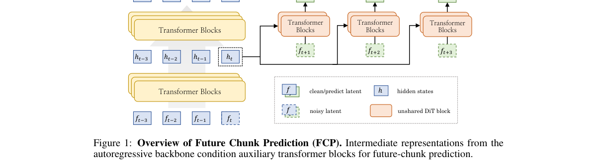

*Main result - Two variants of future-prediction supervision, illustrated through the green paths from ht to ft+3. The chained design passes hidden states between predictors, whereas the parallel design co*

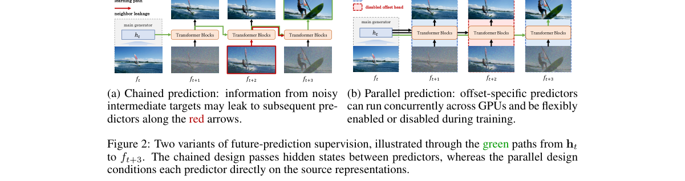

**Why this ranks #1**: 它指出教师强制下自回归视频生成会走「局部视觉连续性」捷径，进而把训练算力花在物理上不成立的片段上；FCP 用一个几乎零成本的辅助目标直接压住这个问题。

---

### 2. Pair-Free Coarse-to-Real Video Generation via Real-to-Coarse Image Supervision

**arXiv**: [2610.28954](https://arxiv.org/abs/2610.28954) | **Score**: 8.7 (relevance 9.0 x 0.7 + quality 8.0 x 0.3) | **Tags**: AIGC-image, AIGC-video, AIGC-3D, AIGC-edit, sim-to-real, synthetic-data | **Categories**: cs.CV | **Pages**: 22

**Authors**: Gonzalo Gómez-Nogales, Daohan Lu, Peiye Zhuang, Tinghui Zhou, Yi Zhou

**Affiliation**: Universidad Rey Juan Carlos

**Abstract**

> Coarse-to-real (C2R) video generation converts coarse animation, simulation, or game-rendered videos into photorealistic videos while preserving scene layout, camera motion, and dynamics. Training such models requires aligned (coarse, realistic) video pairs, which are expensive to create and confine prior systems to narrow synthetic domains. We exploit a simple asymmetry: paired videos are hard to obtain, but paired real-to-coarse images are easy to construct with existing editing and 3D reconstruction tools. Using these image pairs, we train the DINO-R2C model to transfer realistic images to coarse images in DINO feature space, and apply it frame-wise to ordinary real videos to synthesize pseudo-coarse videos. The C2R# model then learns to generate each real video from its pseudo-coarse counterpart, free from needing (coarse, realistic) video pairs. At inference, the DINO-R2C model is discarded and actual coarse videos drive the C2R# model directly. Thus, our pair-free training scales with any real-video corpora rather than with paired synthetic videos. We will release the model and project webpage at https://gonzalognogales.github.io/coarse2real-sharp/.

**Key findings**

- **Finding**: C2R（coarse-to-real）视频生成把粗动画 / 仿真 / 游戏渲染视频转成照片级真实视频，同时保持场景布局、相机运动和动态。
- **Finding**: 训练这类模型需要对齐的（粗模, 真实）视频配对，昂贵且把既有系统限制在窄的合成域里。
- **Finding**: 作者利用一个不对称性：**配对视频难获得，但配对的真实图→粗模图用现有编辑和 3D 重建工具很容易构造**。
- **Finding**: 用这些图像对，在 DINO 特征空间里训练 DINO-R2C，把真实图像迁移到粗模图；再逐帧作用于普通真实视频，合成伪粗模视频。
- **Finding**: 推理时 DINO-R2C 直接丢弃，真正的粗模视频直接驱动 C2R# 模型。
- **Finding**: 因此**无配对训练可随任意真实视频语料扩展**，而不受限于配对合成视频。
- **Inference**: 这一类工作通常卡在数据上：仿真视频便宜但不真实，真实视频真实但没有对应的「粗模」标注。这篇的转法是——不用视频配对，改用**图像对 + 逐帧迁移**，把数据量级从「需要对齐的仿真工程」拉回「任意真实视频」。
- **Recommendation**: 推荐。做 sim-to-real 视频翻译、自动驾驶数据增强或任何「缺配对数据」场景的人都值得看这个思路。

**Key figures**

*Framework / architecture - The C2R# model transforms game renders (top), geometry blockouts (middle), and stylized animations (bottom) into photorealistic videos.*

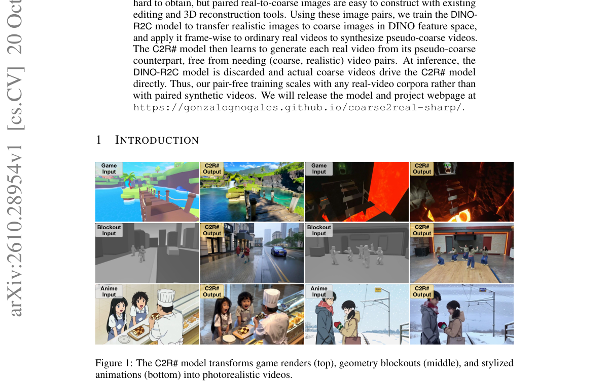

*Main result - Overview of the DINO-R2C and C2R# models. Top: The DINO-R2C model is trained from paired realistic and coarse images using feature reconstruction and pixel-space reconstruction losses. Once*

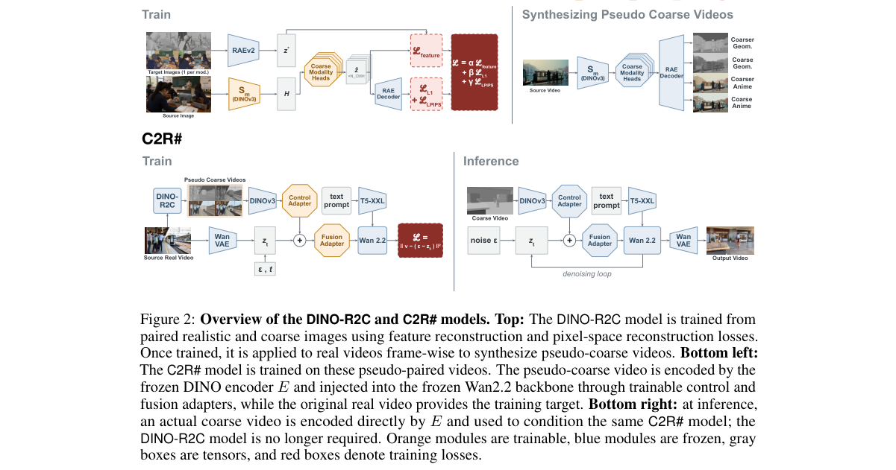

**Why this ranks #2**: 它利用一个很朴素的不对称性：配对的视频难造，但配对的「真实图→粗模图」用现成的编辑和 3D 重建工具就能造，从而绕开了 C2R 视频生成最大的数据瓶颈。

---

### 3. Spatially Gated Demographic Steering for Debiasing Multi-Person Text-to-Image Generation

**arXiv**: [2610.29651](https://arxiv.org/abs/2610.29651) | **Score**: 8.3 (relevance 8.0 x 0.7 + quality 9.0 x 0.3) | **Tags**: AIGC-image, AIGC-video, AIGC-3D, AIGC-edit, debiasing, steering | **Categories**: cs.CV | **Pages**: 21

**Authors**: Venkatesh Thirugnana Sambandham, Torsten Schon

**Affiliation**: Technische Hochschule Ingolstadt, Germany

**Abstract**

> Text-to-Image models reproduce societal stereotypes, and existing mitigation applies one demographic correction to the whole scene. In multi-person scene generation this creates a trade-off: global steering improves aggregate balance only by homogenizing the people within an image. Steering-based methods like Embedding Arithmetic drive the intra-image diversity below the unsteered baseline. Text- and latent-projection approaches shift the aggregate skew with only marginal gains in intra-image diversity. We present Spatially Gated Steering (SGS), which steers the demographics of each person independently by extracting per-person masks from the Diffusion Transformer's (DiT) internal attention maps at a critical denoising timestep and applying a distinct demographic vector within each mask for the remaining steps. SGS needs no fine-tuning, inversion or layout specifications, and uses a lightweight segmentor over frozen DiT attention features to localize subjects at early timesteps. On skewed occupational prompts, SGS reaches high intra-image racial and gender diversity while keeping aggregate balance competitive and image quality near baseline, a result we validate on two architecturally distinct diffusion transformers, FLUX.1-Dev and SD3.5-Large. Codebase and model weights are available at https://github.com/cvims/spatially-gated-steering

**Key findings**

- **Finding**: T2I 模型会复现社会刻板印象，既有缓解手段对整个场景施加一次人口统计修正。
- **Finding**: 在多人场景里这造成权衡：全局 steering 只有通过**把图内的人同质化**才能提升聚合平衡。
- **Finding**: Embedding Arithmetic 这类 steering 方法把图内多样性压到未 steering 基线以下；文本和隐空间投影方法则以边际收益换取聚合偏斜。
- **Finding**: SGS 从 DiT 内部注意力图里抽出**逐人掩码**（在某个关键去噪时间步），并在各自掩码内施加不同的人口统计向量。
- **Finding**: 无需微调、无需反演、无需布局指定；用一个轻量分割器在早期时间步从冻结的 DiT 注意力特征里定位主体。
- **Finding**: 在有偏的职业类 prompt 上，SGS 在保持高图内种族与性别多样性的同时，聚合平衡仍有竞争力，图像质量接近基线；
- **Finding**: 并在**两个架构不同的扩散 Transformer**（FLUX.1-Dev 与 SD3.5-Large）上验证。
- **Inference**: 「全局纠偏 vs 个体多样性」之所以长期无解，是因为纠偏一直做在整张图上。SGS 把它下放到人——这在概念上是对的粒度，实测也证明了粒度选择本身就是这个问题的关键变量。
- **Recommendation**: 强烈推荐。做 T2I 公平性、去偏见或多主体生成控制的人都应该看这篇的逐人掩码思路。

**Key figures**

*Framework / architecture - SGS intuition. The base trajectory (black) reaches xbase*

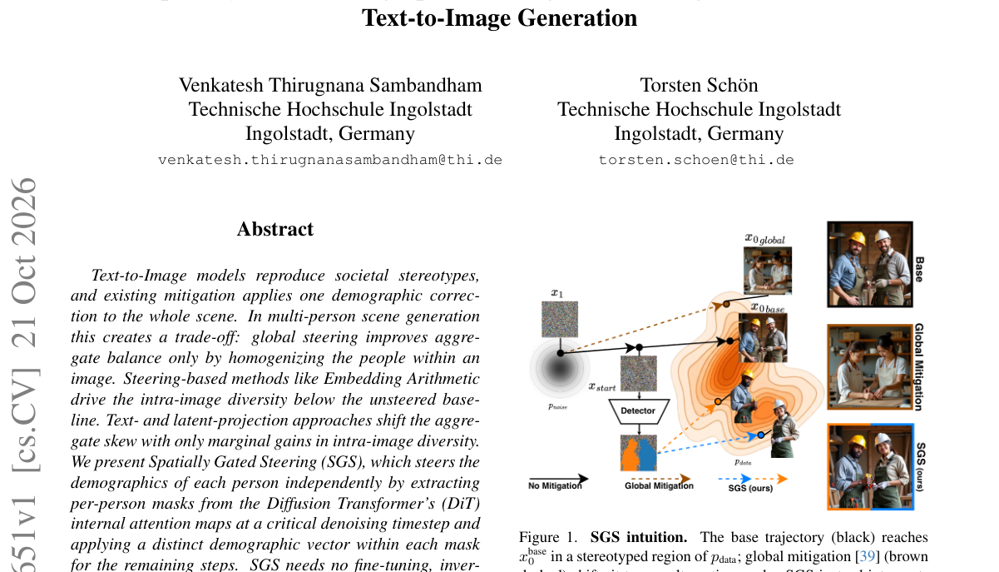

*Main result - Qualitative comparison across three profession types spanning different stereotype directions. Prompts contain no demo- graphic descriptors. Base is demographically homogeneous; EA shifts ev*

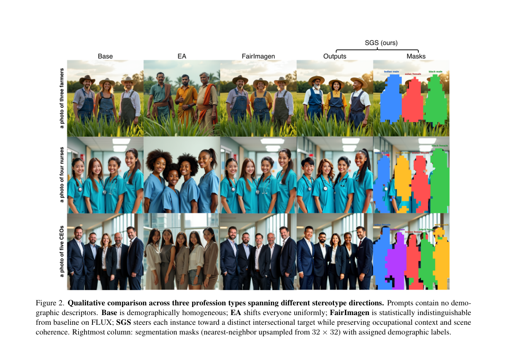

**Why this ranks #3**: 它把「去偏见」从全图一次修正改成**逐人独立修正**，从而解决了「聚合平衡 vs 图内多样性」的二选一——这是此前所有 steering 方法都没绕开的矛盾。

---

### 4. Sparsity Should Be ALLOTted by Output: Training-Free Allocation of Block-Sparse Attention for Video Diffusion Transformers

**arXiv**: [2610.29441](https://arxiv.org/abs/2610.29441) | **Score**: 8.3 (relevance 8.0 x 0.7 + quality 9.0 x 0.3) | **Tags**: AIGC-image, AIGC-video, AIGC-3D, AIGC-edit, efficiency, attention-sparsity | **Categories**: cs.CV | **Pages**: 26

**Authors**: Tianze Xia, Xiaoling Zhou, Ruya Lan, Yiqiao Liao, Chengru Song, Shiming Xiang

**Affiliation**: UCAS, CASIA, PKU, KlingAI Research

**Abstract**

> Full 3D attention is costly in video Diffusion Transformers. Block-sparse attention reduces this cost by computing only selected attention blocks. However, existing methods either overlook the potential to optimize sparsity allocation or rely on heuristic rules or local metrics to guide it. In this work, we observe that sparsifying attention in different layers and at different denoising steps affects final-video fidelity to substantially different degrees. Yet the identities of the most sensitive layer-step pairs remain nearly unchanged across inputs. Building on these findings, we propose Allocating Layer-step Latency by Output Tests (ALLOT), a training-free sparsity allocation method. Treating each layer-step pair as a cell, ALLOT estimates each cell's contribution to final-video error through (i) cell probing and (ii) trajectory calibration, then jointly optimizes cell densities under a measured-latency budget. It preserves existing selection strategies and kernels, replacing only the allocation component. At equal or shorter wall-clock time, ALLOT outperforms every compared allocation strategy with XAttention, with an 11.8 dB PSNR gain on HunyuanVideo. Extensive experiments across four additional published pipelines on Wan2.1, Wan2.2, and HunyuanVideo show that ALLOT outperforms or ties the default in all nine settings.

**Key findings**

- **Finding**: 视频 Diffusion Transformer 的全 3D 注意力代价高昂，block-sparse 注意力只算选中的注意力块。
- **Finding**: 既有方法要么忽略稀疏度分配本身，要么依赖启发式规则或局部指标来引导。
- **Finding**: 作者的观察：不同层、不同去噪步上做稀疏，对最终视频保真度的影响**差别很大**；
- **Finding**: 而且**最敏感的「层-步」配对在不同输入之间几乎不变**。
- **Finding**: ALLOT 把每个层-步配对当作一个 cell，用 cell 探测 + 轨迹校准估计各 cell 对最终误差的贡献，再在实测延迟预算下联合优化 cell 密度。
- **Finding**: 保留既有选择策略与 kernel，只替换分配组件。
- **Finding**: 在等长或更短的 wall-clock 时间下，配合 XAttention 时**在 HunyuanVideo 上有 11.8 dB PSNR 增益**；
- **Finding**: 在 Wan2.1 / Wan2.2 / HunyuanVideo 四条额外流水线的九种设置中全面领先或持平。
- **Inference**: 「哪几层哪几步该稀疏」这个问题被普遍用启发式回答，而这篇的答案是：敏感度在输入之间是稳定的，所以它可以被**测量、预算化、离线优化**。这是把工程问题转成优化问题的标准动作。
- **Recommendation**: 推荐。做视频生成推理加速、DiT 部署的人可以直接用它的分配方法。

**Key figures**

*Framework / architecture - Changing only the allocation at equal wall-clock time. Left: dense, baseline and + ALLOT (top to bottom), with blue-box insets; prompts are near the median gain. Right: paired PSNR gains (AL*

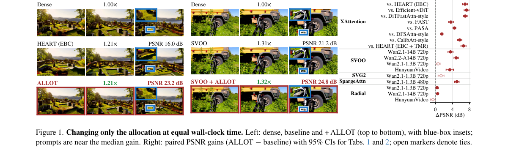

*Main result - Layer and step sensitivity. (a) Single-layer one-step error (b=0.30, t=0.85; bars), attention-map metrics [14, 36] (lines), and final-video MSE with that layer sparse throughout (diamonds).*

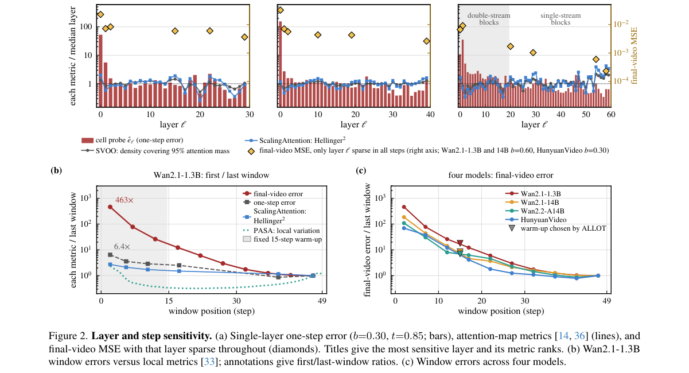

**Why this ranks #4**: 它把「稀疏注意力怎么分配」从启发式规则变成了**可优化的分配问题**，并且给出了可测量的 11.8 dB PSNR 增益——效率论文里少见地同时报了质量和速度。

---

### 5. ER-Chord: Spatially Consistent One-Step Image Editing via Equal-Energy Reliability Redistribution

**arXiv**: [2610.29248](https://arxiv.org/abs/2610.29248) | **Score**: 8.0 (relevance 8.0 x 0.7 + quality 8.0 x 0.3) | **Tags**: AIGC-image, AIGC-video, AIGC-3D, AIGC-edit, one-step, training-free | **Categories**: cs.CV | **Pages**: 19

**Authors**: Peize Li, Hanzhen Zhao, Xingguo Xu, Yilong Fan, Zhen Tao, Bo Yin, Zhifei Liu, Qingdong He et al.

**Affiliation**: National University of Singapore / Kuaishou Technology / Dalian University of Technology / Tianjin University

**Abstract**

> One-step generative models enable fast text-guided image editing, yet they often introduce unintended changes to regions that should remain unchanged. Temporal aggregation stabilizes editing fields across noise levels, but leaves their spatial allocation insensitive to local variations in reliability. Consequently, temporal stability alone does not ensure spatially consistent editing. To address this lim- itation, we propose ER-Chord, a training-free and inversion-free framework for reliability-guided spatial redistribution. Our key insight is that agreement between editing fields at neighboring noise levels provides a local reliability signal for allocating editing strength. We formulate this allocation as an equal-energy op- timization that redistributes control energy according to local reliability while preserving the original editing directions and total control energy. This formu- lation admits a unique global solution that can be efficiently computed using existing field evaluations, requiring no additional denoiser calls. Experiments on two benchmarks, PIE-Bench and TEdBench, demonstrate improvements over state-of-the-art one-step editing baselines, achieving superior source preservation alongside consistent gains across multiple generative backbones.The project page is at https://github.com/Peizeli1/ER-Chord.

**Key findings**

- **Finding**: 一步生成模型能做快速文本引导图像编辑，但常会**意外改动本应保持不变的区域**。
- **Finding**: 时序聚合能让编辑场跨噪声级保持稳定，但让其**空间分配对局部可靠性变化不敏感**。
- **Finding**: 因此仅靠时序稳定并不能保证空间一致的编辑。
- **Finding**: ER-Chord 的关键洞察：相邻噪声级上编辑场之间的**一致性本身提供局部可靠性信号**，可以用来分配编辑强度。
- **Finding**: 它把分配写成**等能量优化**——按局部可靠性重分配控制能量，同时保持原编辑方向与总控制能量。
- **Finding**: 该形式有唯一全局解，可直接用已有场计算求得，**不需要额外的去噪器调用**。
- **Finding**: 在 PIE-Bench 和 TEdBench 上优于 SOTA 一步编辑基线，源保持更好，且在多个生成骨干上一致有效。
- **Inference**: 「不改不该改的地方」在一步编辑里其实是两个独立问题：噪声级上的不稳定和空间上的不均匀。这篇的诊断很干净——只要把可靠性看成可以从邻域一致性推出来的量，就能直接在能量域上做最优分配。
- **Recommendation**: 推荐。做一步编辑、蒸馏模型编辑、或关心源保持（source preservation）的人必读。

**Key figures**

*Framework / architecture - Method overview. Starting from a temporally aggregated control field, ER-Chord measures local endpoint consistency and redistributes a fixed control energy budget while preserving local dire*

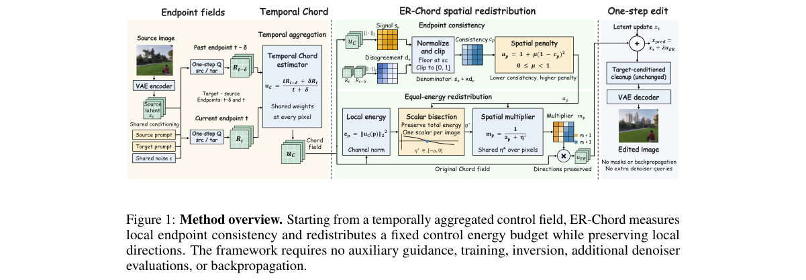

*Main result - Temporal vs. spatial control in one-step editing. (a) ChordEdit temporally aggregates endpoint fields with uniform weights across space, which fails to reflect local differences in predictio*

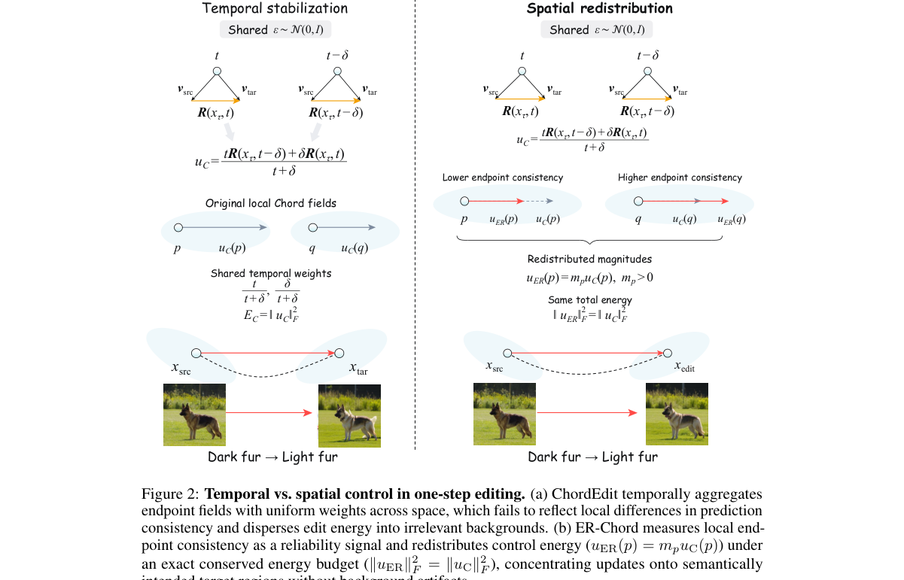

**Why this ranks #5**: 它指出一步编辑的两类失败中，「时序稳定」已被解决、**「空间一致」没人管**，并给出一个不需要额外去噪器调用的能量再分配解。

---

### 6. NeuralSRender: G-Buffer Guided Video Diffusion for Sim-to-Real Rendering

**arXiv**: [2610.29200](https://arxiv.org/abs/2610.29200) | **Score**: 8.3 (relevance 8.0 x 0.7 + quality 9.0 x 0.3) | **Tags**: AIGC-image, AIGC-video, AIGC-3D, AIGC-edit, sim-to-real, autonomous-driving | **Categories**: cs.CV | **Pages**: 8

**Authors**: Yipeng Lu, Youqi Liao, Zhenyu Wang, Yuning Peng, Zhen Dong

**Affiliation**: Wuhan University, China

**Abstract**

> The scarcity of high-quality annotated visual data remains a critical bottleneck for autonomous-driving perception. Simulators provide training data at scale, but the limited realism of synthetic videos compromises perception performance in real-world applications. To address this limitation, we propose NeuralSRender, a sim-to-real video translation framework that enhances the photorealism of synthetic videos while maintaining geometric consistency with the source scenes. Built on a pretrained video diffusion transformer (DiT), NeuralSRender uses a lightweight projector to inject geometric and material priors from G-buffers, and LoRA enables parameter-efficient adaptation. The model is trained in two stages: it first learns G-buffer conditioning from synthetic videos with accurate G-buffers, then adapts to real-world appearance using real videos with estimated G-buffers. During the second stage, an additional LoRA module is trained while the projector and first-stage LoRA remain frozen to reduce interference from estimation noise. NeuralSRender introduces only 1.45\% parameter overhead and can be trained on consumer-grade GPUs with 24 GB of memory. To support training and evaluation, we introduce GenReal, a large-scale driving video dataset comprising synthetic and real-world videos with corresponding G-buffers. Experiments demonstrate improved photorealism with competitive geometric consistency. Training perception models on our translated videos instead of raw simulator renders improves detection $\mathrm{AP}_{50}$ on nuImages from 35.1 to 40.6 and segmentation mIoU on Cityscapes from 32.4 to 40.8. Our code, data, and model weights are available at: https://github.com/WHU-USI3DV/NeuralSRender.

**Key findings**

- **Finding**: 自动驾驶感知受限于高质量标注视觉数据的稀缺；仿真器能提供规模训练数据，但真实感不足会拖累真实世界表现。
- **Finding**: NeuralSRender 是 sim-to-real 视频翻译框架，在提升合成视频照片真实感的同时保持与源场景的几何一致性。
- **Finding**: 基于预训练视频 DiT，用**轻量投影器注入 G-buffer 带来的几何与材质先验**，LoRA 做参数高效适配。
- **Finding**: 两阶段训练：先在有精确 G-buffer 的合成视频上学 G-buffer 条件，再在用估计 G-buffer 的真实视频上适配外观。
- **Finding**: 第二阶段额外训练一个 LoRA 模块，**冻结投影器与第一阶段 LoRA**，以降低估计噪声的干扰。
- **Finding**: 只增加 1.45% 参数开销，可在 24 GB 显存的消费级 GPU 上训练。
- **Finding**: 配套发布大规模驾驶视频数据集 GenReal（合成 + 真实，含对应 G-buffer）。
- **Finding**: 用翻译后的视频训练感知模型：nuImages 检测 AP50 从 35.1 → 40.6，Cityscapes 分割 mIoU 从 32.4 → 40.8。
- **Inference**: 「仿真到真实」通常被当成生成质量问题，但这篇把它拆成了**几何一致性**与**外观真实感**两个可分别控制的量——用 G-buffer 注入几何、只在第二阶段动外观。多模态感知的下游增益（+5.5 AP50 / +8.4 mIoU）说明这里的提升不是只在像素指标上好看。
- **Recommendation**: 推荐。做自动驾驶仿真数据增强、或研究 sim-to-real 视频翻译的人值得看。

**Key figures**

*Framework / architecture - Photorealistic sim-to-real synthesis with the proposed NeuralSRender. Our approach leverages video generation priors to synthesize photorealistic driving videos from G-buffers, reducing relian*

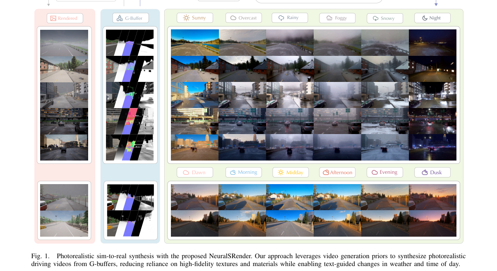

*Main result - Overview of NeuralSRender. In Stage I, the G-buffer projector and LoRA modules are trained on synthetic videos with accurate G-buffers. In Stage II, the model is adapted to real-world videos u*

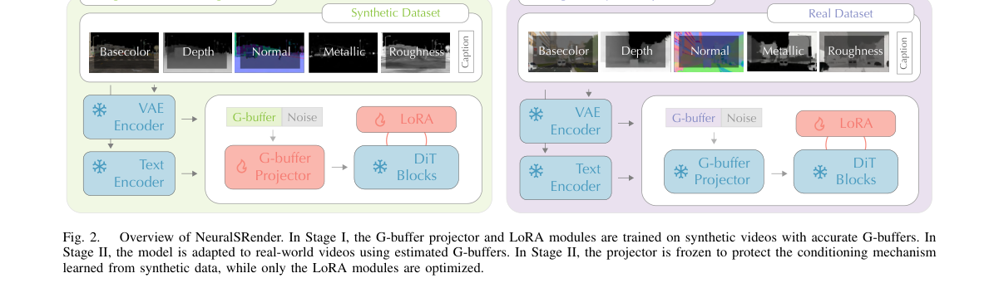

**Why this ranks #6**: 它把「仿真视频不真实」这件事的解法做得很工程化但结论很硬：只加 1.45% 参数，换来 nuImages 检测 AP50 从 35.1 到 40.6。

---

### 7. RealMe: Immersive Volumetric Video from Minimal Captures

**arXiv**: [2610.30023](https://arxiv.org/abs/2610.30023) | **Score**: 8.0 (relevance 8.0 x 0.7 + quality 8.0 x 0.3) | **Tags**: AIGC-image, AIGC-video, AIGC-3D, AIGC-edit, 4D, volumetric-video, diffusion | **Categories**: cs.CV | **Pages**: 19

**Authors**: Chenxu Zhou, Zhiyuan Yu, Yudong Jin, Yinji Shentu, Yu Zhang, Jiaming Sun, Xiaowei Zhou

**Affiliation**: State Key Laboratory of CAD&CG, Zhejiang University, China

**Abstract**

> This paper addresses the problem of creating immersive volumetric videos from sparse and low-resolution capture resources. Conventional dense multi-view reconstruction methods can produce high-quality volumetric videos, but their reliance on costly capture setups makes them impractical in real-world scenarios. Recent approaches use generative models to relax capture requirements, but still suffer from limited resolution and 4D inconsistency. To overcome these constraints, we propose RealMe, a unified framework built around a high-resolution video diffusion model that enhances limited captures into high-resolution (2K), 4D-consistent videos for volumetric video reconstruction. Specifically, RealMe constructs auxiliary data from capture videos and encodes them into latents along with layout-aware positional embeddings. The video diffusion model adapts factorized spatio-temporal attention to the multi-view capture layout, denoises these latents across viewpoints and time, and decodes them into enhanced videos to refine the 4D representation. This adaptation helps the model capture temporal dynamics and multi-view relationships, leading to more 4D-consistent generation. To reduce the data gap between generated videos and real captures, we apply a latent frequency loss that provides frequency-domain supervision in latent space. Extensive experiments on the public DNA-Rendering benchmark and our self-captured RealVV dataset demonstrate that RealMe is able to create immersive volumetric videos and outperforms state-of-the-art methods in visual fidelity and 4D consistency.

**Key findings**

- **Finding**: 从稀疏低分辨率采集创建沉浸式体积视频是核心问题。
- **Finding**: 密集多视图重建能做出高质量体积视频，但依赖昂贵的采集装置，不适合实际场景。
- **Finding**: 生成模型放宽了采集要求，但仍受限于**分辨率低**与**4D 不一致**两个问题。
- **Finding**: RealMe 以高分辨率视频扩散模型为核心，把有限采集增强为高分辨率（2K）、4D 一致的视频再用于体积视频重建。
- **Finding**: 从采集视频构造辅助数据，编码为隐变量并配合**布局感知的位置编码**。
- **Finding**: 视频扩散模型把因子化的时空注意力适配到多视图采集布局，在多视角与时间上同时去噪，再解码为增强视频以精化 4D 表示。
- **Finding**: 用**潜空间频率损失**做频域监督，缩小生成视频与真实采集之间的数据差距。
- **Finding**: 在公开 DNA-Rendering 基准与自采 RealVV 数据集上，视觉保真与 4D 一致性均优于 SOTA。
- **Inference**: 4D 内容的瓶颈通常不在生成器，而在「没有高质量输入」。RealMe 的定位很务实：把扩散模型当作采集质量的放大器，并靠潜空间频率损失解决生成域与真实域的频谱差异——这比在 RGB 空间做对抗/感知损失更对症。
- **Recommendation**: 推荐。做 4D / 体积视频、Gaussian Splatting 重建、或想降低采集硬件门槛的人应读。

**Key figures**

*Framework / architecture - RealMe creates immersive volumetric video from sparse and low-quality captures. When directly optimized from sparse observations, FTGS [Wang et al. 2025e] struggles to maintain consistent reco*

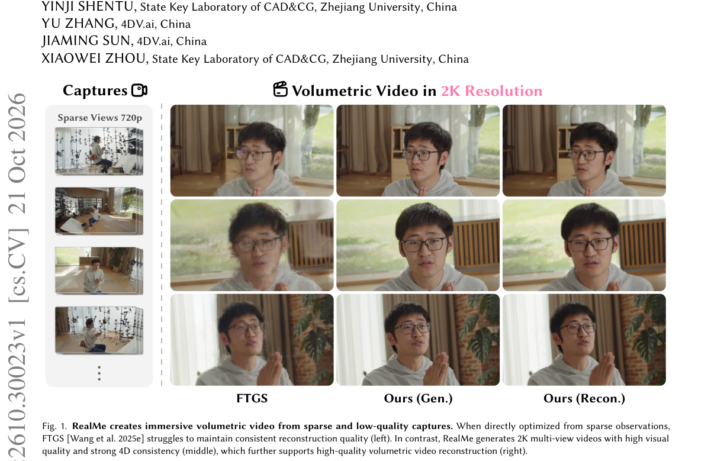

*Main result - Overview of our framework. Given sparse and low-quality captures, RealMe first initializes a coarse 4DGS [Wang et al. 2025e] representation and uses it to render novel-view videos; in parallel*

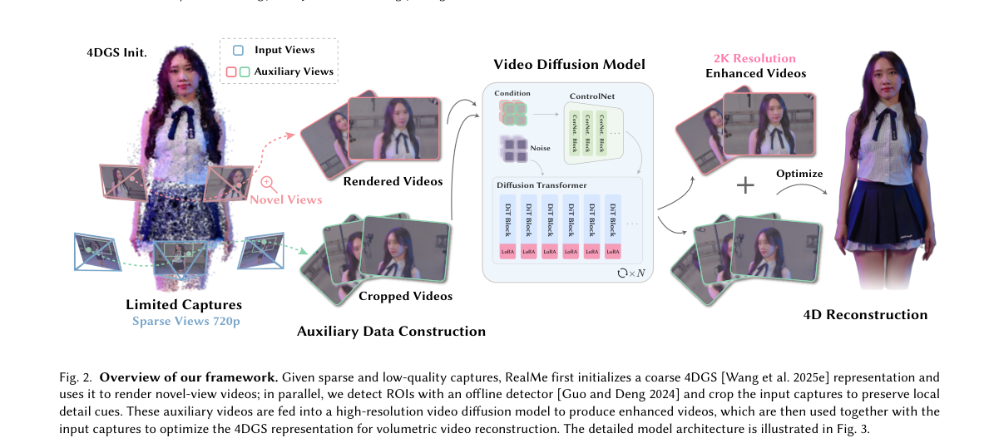

**Why this ranks #7**: 它处理的是 4D 视频生成里最实际的一环：采集设备贵，所以用高分辨率视频扩散模型把低质量采集「升级」成 2K、4D 一致的体积视频。

---

### 8. CausalAlign: Causal Alignment of Video Generation Models for Consistent Ego-Motion

**arXiv**: [2610.29915](https://arxiv.org/abs/2610.29915) | **Score**: 7.6 (relevance 7.0 x 0.7 + quality 9.0 x 0.3) | **Tags**: AIGC-image, AIGC-video, AIGC-3D, AIGC-edit, ego-motion, causal-analysis | **Categories**: cs.CV | **Pages**: 27

**Authors**: Kai Zhu, Yintianrun Zhang, Shuwei Jiang, Ruolin Zuo, Yixin Chen, Duomin Wang, Miao Liu, Yin Li et al.

**Affiliation**: Peking University, BIGAI, NVIDIA, Tsinghua University, University of Wisconsin-Madison

**Abstract**

> Diffusion-based video generation models (VGMs) can produce visually plausible videos, yet their camera ego-motion often drifts over long horizons. Camera ego-motion determines how the viewpoint changes between frames and is essential for maintaining consistent geometry and trajectories. To address this problem, we propose CausalAlign, a causal alignment framework with two components. First, we diagnose how precise ego motion is represented, used, and retained within VGMs using linear probes and causal interventions, revealing a rise-and-fall pattern during denoising. Second, we strengthen ego-motion state in VGM by aligning the representations at the identified layers to a 3D foundation model through delta-token space. This space encodes the changes between consecutive frames, allowing the alignment to focus on ego-motion dynamics rather than static scene content. With Wan2.2 fine-tuned on DL3DV and RealEstate10K, CausalAlign can largely improve motion accuracy, geometric consistency, and temporal smoothness, while preserving visual quality. For example, it improves geometric consistency by more than 20% relative to the base model. Moreover, with the fine-tuned VGM, CausalAlign improves the success rate of world action models (WAMs) by 10 points on mobile manipulation tasks of RoboCasa365 benchmark. Overall, CausalAlign improves ego-motion consistency in diffusion-based VGMs and yields noticeable gains in embodied models.

**Key findings**

- **Finding**: 扩散视频生成模型能产出视觉上合理的视频，但**相机自运动在长时间跨度上会漂移**。
- **Finding**: 相机自运动决定帧间视点如何变化，是维持几何一致性与轨迹的关键。
- **Finding**: 作者先用线性探针与因果干预诊断自运动在 VGM 中被**表示、使用、保留**的精度，揭示去噪过程中呈**先升后降**的模式。
- **Finding**: 然后通过 delta-token 空间，把识别出的层的表示对齐到 3D 基础模型。
- **Finding**: 该空间编码相邻帧之间的变化，使对齐聚焦于**自运动动态而非静态场景内容**。
- **Finding**: 在 Wan2.2 上用 DL3DV 与 RealEstate10K 微调，大幅提升运动精度、几何一致性与时间平滑度，同时保持视觉质量。
- **Finding**: 几何一致性相对基线提升 **20% 以上**；
- **Finding**: 用该微调 VLM，CausalAlign 把世界动作模型（WAM）在 RoboCasa365 移动操作任务上的成功率**提高 10 个点**。
- **Inference**: 「先升后降」这个诊断是这篇最值钱的部分：它说明自运动信息在去噪早期被建立、晚期被冲淡，所以对齐层不能随便挑。而把对齐换成 delta-token 空间（只管帧间变化）是让它同时保住几何与视觉质量的关键。
- **Recommendation**: 强烈推荐。做视频生成、又关心几何一致性或长时程漂移的人必读；也推荐做具身的人——世界动作模型的底座质量直接决定操作成功率。

**Key figures**

*Framework / architecture - Overview of CausalAlign. Left: Existing approaches rely on external 3D caches that may propagate errors, optimize output-level preferences without directly supervising ego-motion states, or*

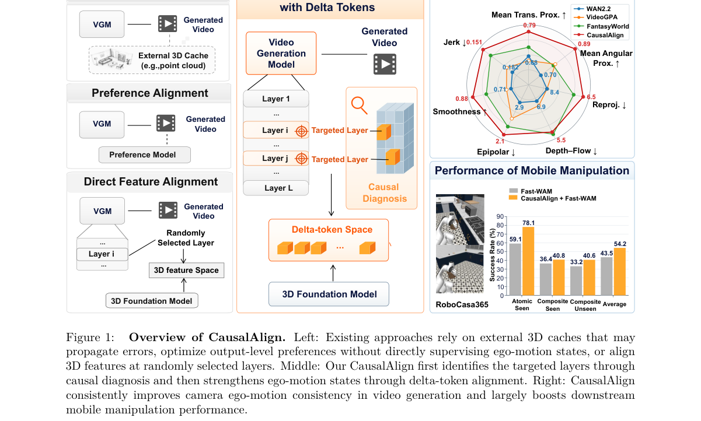

*Main result - Three stages of CausalAlign training. CausalAlign transfers ego-motion knowledge from a 3D teacher to the VGM through three-stage training. In Stage 1, consecutive features from a streaming*

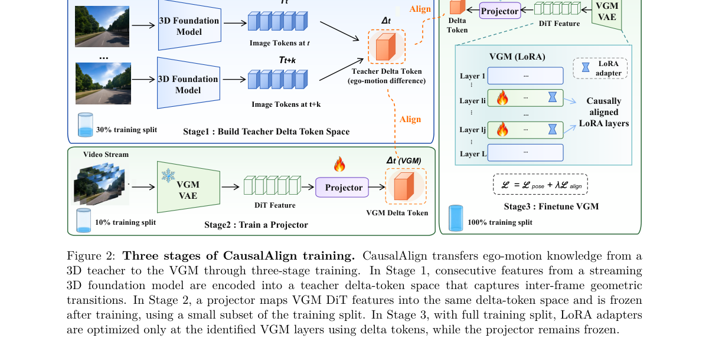

**Why this ranks #8**: 它用线性探针 + 因果干预诊断出「相机自运动在去噪过程中先升后降」，再据此选层做对齐——一个先诊断再治疗的完整范式。

---

### 9. CCG Diffusion: Combinatory Categorial Grammar-Driven Compositional and Syntactically Disambiguated Text-to-Image Generation

**arXiv**: [2610.29415](https://arxiv.org/abs/2610.29415) | **Score**: 7.3 (relevance 7.0 x 0.7 + quality 8.0 x 0.3) | **Tags**: AIGC-image, AIGC-video, AIGC-3D, AIGC-edit, compositional, training-free | **Categories**: cs.CL, cs.CV | **Pages**: 26

**Authors**: Ryosuke Yamaki, Daichi Mochihashi, Nobutaka Shimada, Seitaro Shinagawa, Tadahiro Taniguchi

**Affiliation**: Ritsumeikan University, Ibaraki, Osaka 567-8570, Japan / The Institute of Statistical Mathematics, Tachikawa, Tokyo 190-8562, Japan / Nara Institute of Science and Technology, Ikoma, Nara 630-0192, Japan / Kyoto University, Sakyo-ku, Kyoto 606-8501, Japan

**Abstract**

> Text-to-image generation models do not explicitly receive the syntactic structure of the prompt, i.e., which word modifies which and where each phrase attaches. Consequently, they often struggle to bind attributes to the correct objects, to depict spatial relations and counts correctly, and to render syntactically ambiguous prompts in the intended interpretation. Existing syntax-based control methods mainly address attribute binding and have limited ability to control spatial relations and counts or to specify the interpretation of syntactically ambiguous prompts. They rely on phrase-structure or dependency grammars and require additional rules or constraints on the tree structure to extract modification relations between words or to specify a syntactic interpretation. We propose CCG Diffusion, a training-free method that controls image generation using Combinatory Categorial Grammar (CCG). In CCG, the category of each word carries rich syntactic information: it specifies what the word combines with and what phrase it forms. Modification relations between words can therefore be read directly from a CCG parse. Moreover, prepositional phrase (PP) attachment ambiguity, a representative syntactic ambiguity, can be resolved simply by fixing the preposition's category. CCG Diffusion applies the same two CCG-based mechanisms, prompt rewriting and attention guidance, both to controlling attribute binding, spatial relations, and counts and to resolving PP ambiguity. On two architecturally different backbones, Stable Diffusion and Sana, CCG Diffusion achieves the highest scores among the compared methods in attribute binding and 2D spatial relations and significantly outperforms all of them in PP ambiguity resolution.

**Key findings**

- **Finding**: T2I 模型不显式接收 prompt 的句法结构，因此经常把属性绑错对象、画错空间关系和数量、或在句法歧义处给出错误解读。
- **Finding**: 既有句法控制方法主要处理属性绑定，对空间关系、数量以及句法歧义的**指定**能力有限。
- **Finding**: 它们依赖短语结构或依存文法，还需要额外规则或约束来抽取词间修饰关系、指定句法解读。
- **Finding**: CCG Diffusion 提出用**组合范畴语法**控制图像生成，训练无关。
- **Finding**: 在 CCG 中每个词的范畴本身就携带丰富句法信息——它指明该词与什么组合、形成什么短语；修饰关系可直接从 CCG 句法树读出。
- **Finding**: 介词短语（PP）附着歧义这一代表性句法歧义，**只需固定介词的范畴即可解决**。
- **Finding**: 同一套两机制（prompt 重写 + 注意力引导）同时用于属性绑定、空间关系与数量控制，以及 PP 歧义消解。
- **Finding**: 在 Stable Diffusion 与 Sana 两个架构不同的骨干上，属性绑定与 2D 空间关系得分最高，PP 歧义消解显著优于全部对比方法。
- **Inference**: 句法控制类工作常见的困境是：要精确指定解读就得堆规则，而规则会互相冲突。CCG 的好处是范畴本身就编码了组合关系——读修饰关系不需要额外规则，消歧也退化成「改一个范畴」。
- **Recommendation**: 推荐。做组合式 T2I、属性绑定、空间关系控制的读者可以看；也推荐关心「用解析器驱动生成」这条路线的人。

**Key figures**: 本篇未提取到可用图（PDF 内无符合图注正则的 Figure 1/2）。

**Why this ranks #9**: 它把「属性绑到哪个物体」这个老问题换了个解析器：用组合范畴语法（CCG）直接读出修饰关系，还顺手解决了介词短语歧义。

---

### 10. Velocity Ambiguity Profiles: Time-Resolved Bayes-Risk Diagnostics for Flow Matching

**arXiv**: [2610.30107](https://arxiv.org/abs/2610.30107) | **Score**: 6.9 (relevance 6.0 x 0.7 + quality 9.0 x 0.3) | **Tags**: AIGC-image, AIGC-video, AIGC-3D, AIGC-edit, flow-matching, theory, diagnostics | **Categories**: cs.LG | **Pages**: 57 | **[wild-card=yes]**

**Authors**: Yunpeng Mei, Xiaowen Zhu, Chenyu Wang, Chenbo Xin, Hongjie Cao, Jiamin Wang, Jie Chen, Gang Wang

**Affiliation**: Beijing Institute of Technology / ByteDance

**Abstract**

> Flow matching trains a continuum of velocity regression problems but usually reports a loss averaged over interpolation time, obscuring which regions are limited by intrinsic ambiguity and which remain data-limited. We introduce the Velocity Ambiguity Profile (VAP), $\mathcal{A}_v(t)$, the time-local Bayes-risk floor of velocity prediction, and decompose time-resolved loss as $L_N(t)=\mathcal{A}_v(t)+R(t;N)$, where only the excess term $R(t;N)$ is reducible by more data or a different estimator. For $N$ training samples and a $K$-component mixture in the structured example, we prove two statistical benchmarks. In an intrinsic local-regression benchmark, $\mathcal{A}_v(t)$ enters the time-dependent noise factor of the standard nonparametric rate. In separated isotropic Gaussian mixtures, the Bayes velocity becomes locally affine, and a label-oracle residual-regression benchmark has parametric excess-risk scale $K\mathcal{A}_v(t)/N$, matched within the same separated residual Gaussian-location subproblem. Controlled Gaussian-mixture experiments validate this diagnostic through a dense transition sweep, calibrated oracle-to-blind and empirical-proxy audits, and a local controlled time-sampler stress test in which a frozen reducible-error proxy reduces reducible loss while cross-cell sensitivity delimits aggressive sampling. On CIFAR-100 DINOv2 feature flow, guided time sampling reduces uniformly evaluated velocity loss by $6.78\%$ and global feature Fréchet distance (FD) by $23.6\%$, while class-conditional kernel inception distance (KID) shows no improvement. VAP turns an averaged flow-matching objective into a time-resolved diagnostic for locating ambiguity-limited and data-limited regions.

**Key findings**

- **Finding**: 流匹配训练的是一族连续的速度回归问题，但通常只报告**跨插值时间平均后**的损失，掩盖了哪些区间受制于内在歧义、哪些仍受制于数据不足。
- **Finding**: 作者提出速度歧义剖面（VAP），即速度预测的**时间局部贝叶斯风险下限**，并把时间分辨的损失分解为 L_N(t) = A_v(t) + R(t;N)，其中只有超出项 R(t;N) 可被更多数据或更好的估计器减少。
- **Finding**: 在内在局部回归基准中，A_v(t) 进入标准非参数速率的时间依赖噪声因子。
- **Finding**: 在分离的各向同性高斯混合中，贝叶斯速度局部仿射，标签预言机残差回归基准的参数化超出风险尺度为 K·A_v(t)/N。
- **Finding**: 受控高斯混合实验通过稠密过渡扫描、校准的预言机到盲评审计与局部受控时间采样器压力测试验证该诊断。
- **Finding**: 在 CIFAR-100 DINOv2 特征流上，**引导式时间采样使均匀评估的速度损失降低 6.78%**、全局特征 Fréchet 距离（FD）降低 **23.6%**，而类条件 KID 无改善。
- **Finding**: VAP 把被平均掉的流匹配目标变成定位「歧义受限」与「数据受限」区间的时间分辨诊断工具。
- **Inference**: 这是一篇方法论论文：它回答的是「我该往流匹配的时间轴哪个位置加算力」。结论对做图像/视频生成的人是直接可用的——因为流匹配的时间采样策略（比如把预算花在哪一段 t 上）正是当前 DiT/视频 DiT 训练里的实际调参点。
- **Recommendation**: 推荐（作为通读材料）。做流匹配训练、或者要在插值时间轴上做采样预算分配的人应读；也推荐关注「指标平均掩盖结构性差异」这一方法论问题的人。

**Key figures**

*Framework / architecture - Velocity ambiguity profiles localize where flow matching needs data. The flow match- ing path defines a continuum of velocity prediction problems. VAP separates the irreducible ambiguity flo*

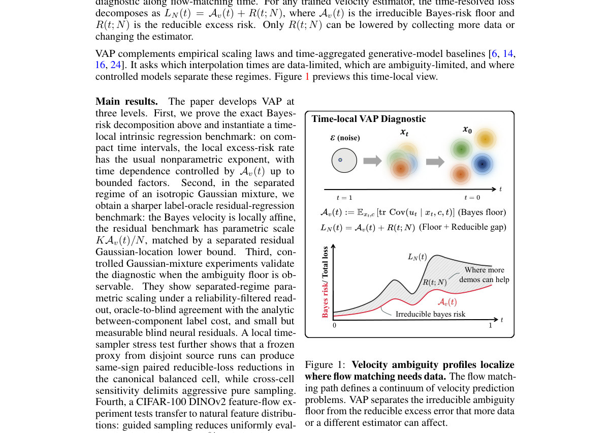

*Main result - Canonical d=4 dense controlled transition on a K=4, σ=0.5 Gaussian mixture. The 13-row front/plateau window shows the reliability-filtered signed log-log slope spooled = ∂log ¯R/∂log N and r*

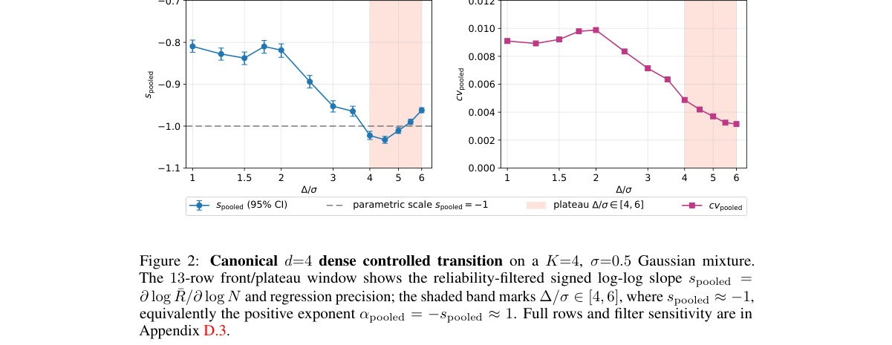

**Why this ranks #10**: [wild-card] 它是本批唯一把流匹配的损失拆成「本质歧义下限」与「可约减项」的诊断工作——虽然它不做图像生成，但流匹配正是当前图像/视频生成的主干。

---

## Footer

- Total papers scanned across all 7 tracks: 568（原始 789 条）
- aigc_visual track final top-10: 10
- Wild-cards in this track: 1
- Figure assets: 2026-10-22/res/

Generated by `mine-arxiv-daily-digest` skill. Sister file: `2026-10-22_aigc_visual_entry.md`.
