# ArXiv Daily Digest - 2026-10-22 (音频与语音语言模型 / 双工语音助手, 10 papers)

**Generated**: 2026-10-22 17:00 CST

**Source**: arXiv cs.CV, cs.SD, eess.AS, cs.CL, cs.AI, cs.RO, cs.LG submissions, listing day 2026-10-21 (announced 2026-10-22 00:00 UTC)

**Batch window**: 2026-10-20T18:00:00Z .. 2026-10-21T18:00:00Z（arXiv 公告批次横跨两个 UTC 日：前一日 18:00 UTC 起算，当日 17:59:59 UTC 截止）

**Track**: audio_lm (top 10 of 568 papers scanned, 105 full reads)

**Scope**: 音频/语音语言模型、ASR、音频理解与推理

⚠️ **Wild-card**: 本批该线 1 篇为 wild-card 补足，已在正文逐条标注并给出理由。

---

## Top 10 - 音频与语音语言模型 / 双工语音助手

### 1. Omnilingual-MsASR: Benchmarking Multimodal, Multilingual, Long-Form Multi-Speaker ASR of Omni Large Language Models

**arXiv**: [2610.29455](https://arxiv.org/abs/2610.29455) | **Score**: 8.0 (relevance 8.0 x 0.7 + quality 8.0 x 0.3) | **Tags**: audio-LM, duplex-voice, ASR, benchmark, multi-speaker | **Categories**: cs.CL | **Pages**: 13

**Authors**: Yuan Ge, Pei Zhang, Xize Cheng, Lingzhou Mu, Mingyang Wang, Jin Xu, Baosong Yang, Shengxiang Gao et al.

**Affiliation**: Northeastern University, China

**Abstract**

> Omni-modal large language models (LLMs) have achieved remarkable progress in audio and video understanding. However, existing models struggle with long-form, multi-speaker videos, especially in understanding the entire video and recognizing who says what and when. To characterize the capability limit of current omni LLMs and guide future model development, we introduce Omnilingual-MsASR, a multilingual, multimodal benchmark for long-form Multi-speaker Automatic Speech Recognition (MsASR) covering six languages, recordings up to 30 minutes, and scenarios with up to 20 speakers. Omnilingual-MsASR provides parallel audio and video inputs to evaluate models' cross-modal consistency and their ability to exploit complementary cues across modalities. Extensive evaluations of leading omni-modal LLMs reveal substantial performance bottlenecks, while their tcpWERs frequently exceed 100%. These findings highlight fine-grained temporal localization, speaker disambiguation, and cross-modal synergy as key challenges for future omni-modal foundation models. Our work is available at https://github.com/QwenLM/Omnilingua-Bench/tree/main/Omnilingua-MSpeaker.

**Key findings**

- **Finding**: 全模态（omni）大语言模型在音频与视频理解上进步显著，但在**长篇、多说话人**视频上仍显吃力，尤其是理解整个视频、分辨谁在何时说了什么。
- **Finding**: 作者提出 Omnilingual-MsASR：一个多语、多模态的**长篇多说话人 ASR 基准**，覆盖六种语言。
- **Finding**: 目标是刻画当前 omni 模型的**能力上限**，并指导后续模型开发。
- **Inference**: 「听懂一段话」和「听懂一场会议」是两种能力，后者要求模型做说话人归属和时间定位。基准选择往后者走，说明评估正在从感知任务转向结构化理解任务。
- **Recommendation**: 推荐。做 omni 模型、多说话人语音理解、或想找音频评测基准的人应读。

**Key figures**

*Framework / architecture - Overview of the MsASR task. The model is required to jointly predicting speaker identities (who), timestamps (when), and text transcriptions (what) in a structured format as shown in Sec. 4.*

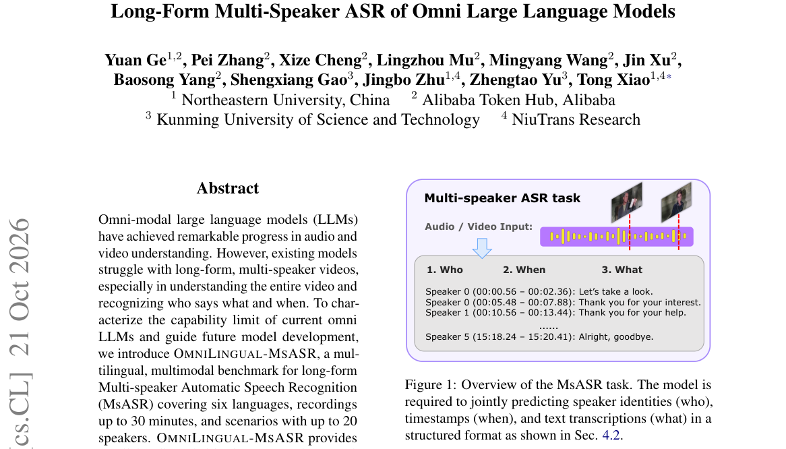

*Main result - Benchmark composition of OMNILINGUAL-MSASR in three views: languages, audio duration and speaker count. For each view we shows case quantity, category labels, and necessary explanations.*

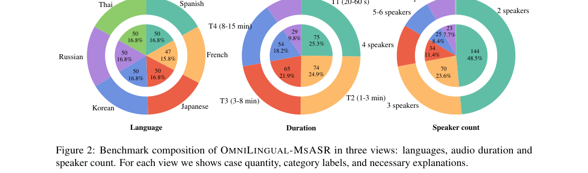

**Why this ranks #1**: 它把 omni 模型的评测从「能不能听懂」推到「**长视频里谁在什么时候说了什么**」，暴露出现有模型在多说话人长音频上的系统短板。

---

### 2. MOSAIC: An Omni-Modal Benchmark for Long-Term Memory and Cross-Modal Reasoning in Conversational Agents

**arXiv**: [2610.29249](https://arxiv.org/abs/2610.29249) | **Score**: 7.6 (relevance 7.0 x 0.7 + quality 9.0 x 0.3) | **Tags**: audio-LM, duplex-voice, memory, benchmark, omni-modal | **Categories**: cs.AI, cs.CL | **Pages**: 33

**Authors**: Hong Ting Tsang, Boyi Zhang, Haoyu Huang, Jiaxin Bai, Yufei Li, Yisen Gao, Zhongwei Xie, Hongyu Luo et al.

**Affiliation**: The Hong Kong University of Science and Technology, University of Edinburgh

**Abstract**

> Omni-modal assistants must remember not only what users say, but also what they show and convey. Existing long-term memory benchmarks are mostly text-and-image or report a single end-to-end score, so they cannot locate whether evidence is lost when it is represented, retrieved, delivered, or read. We introduce MOSAIC, a benchmark of 923 questions over persona-grounded histories of 11-24 sessions spanning text, image, video, and audio. MOSAIC constructs targeted spatial, temporal, and prosodic signals rather than decorative media, with the strongest causal validation for spatial information and selector-level validation for annotated prosody, and pairs them with a matched diagnostic protocol that freezes the question, reader, prompt, and budget while intervening on representation, retrieval, and delivery. Matched decomposition shows that representation loss is modality-dependent, residual reading dominates even under gold evidence, and abstention remains weak on these controls: strong answerable scores coexist with failures to refuse. MOSAIC thus turns omni-modal memory evaluation from a leaderboard into a diagnosis of write, retrieve, deliver, and read failures.

**Key findings**

- **Finding**: 全模态助手不仅要记住用户说了什么，还要记住用户展示和传达了什么。
- **Finding**: 既有长期记忆基准大多是文本+图像，或只报告**单一端到端分数**，因此无法定位证据是在表示、检索、交付还是阅读环节丢失的。
- **Finding**: MOSAIC 覆盖 11–24 轮会话的人设化历史，含文本、图像、视频与音频，共 **923 个问题**。
- **Finding**: 它**刻意构造有针对性的空间、时间与韵律信号**，而不是天然存在。
- **Inference**: 端到端分数的致命问题是不可行动：知道自己得分低，不知道该改表示层还是检索层。MOSAIC 的「按环节定位」设计让诊断直接可用，而且它把音频作为一等模态纳入长期记忆评测——这是很多长期记忆基准的空白。
- **Recommendation**: 推荐。做长期记忆、对话系统或全模态助手评测的人应读。

**Key figures**

*Framework / architecture - Example MOSAIC haystack: evidence spans four modalities and months of sessions. Answering the final query requires chaining a January text specification with later audio and video evidence.*

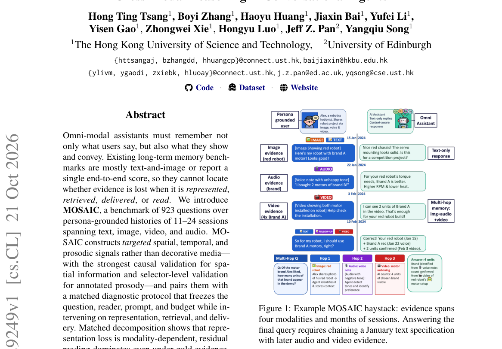

*Main result - Overview of MOSAIC. Top: what the benchmark tests—evidence scattered across months of text, image, video, and audio sessions must be chained across modalities. Construction targets native si*

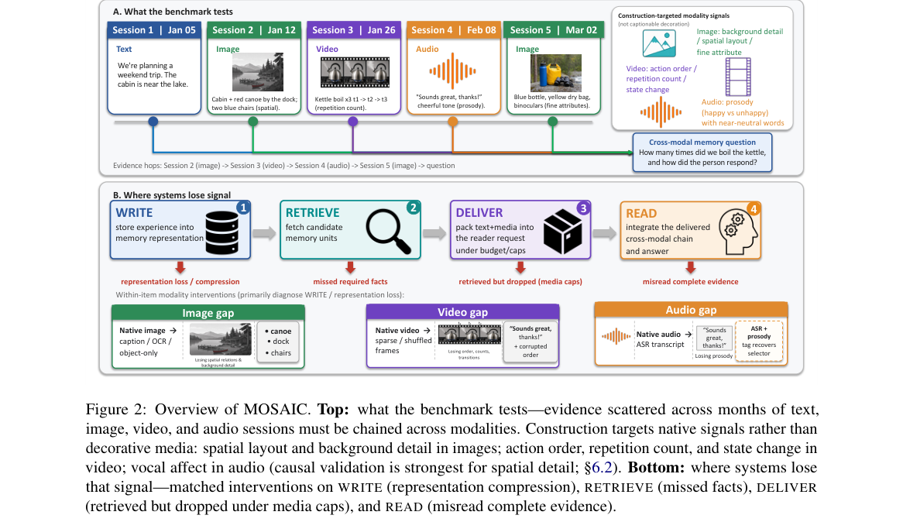

**Why this ranks #2**: 它把长期记忆基准的评测从「一个总分」拆成**可定位的失效环节**（表示 / 检索 / 交付 / 阅读），这正是诊断型基准该有的样子。

---

### 3. Heard But Not Said: Prompting Understates Temporal Information of Musical Moments in Frozen Large Audio-Language Models

**arXiv**: [2610.29256](https://arxiv.org/abs/2610.29256) | **Score**: 7.6 (relevance 7.0 x 0.7 + quality 9.0 x 0.3) | **Tags**: audio-LM, duplex-voice, music, temporal-grounding, probing | **Categories**: cs.CL, cs.SD | **Pages**: 5

**Authors**: Eunsik Shin

**Affiliation**: Department of Intelligence and Information, Seoul National University

**Abstract**

> Large audio-language models (LALMs) understand music, yet struggle to locate a described moment in time. We ask whether this reflects missing temporal information or a bottleneck in how the time span is extracted. Using a paired-query probe built from Slakh2100 stem activations, we attach a state query (e.g., ``only piano and bass are playing'') and a change query (e.g., ``the guitar drops out, leaving piano and bass'') to the same span and vary how much preceding audio the model is shown. Across frozen LALMs, three ways of extracting the span ask different questions: full-track prompting asking whether the model can say when; windowed yes/no scoring asking whether it verifies the moment when handed the segment, and whether it needs what came before; attention asking whether it can find the moment on its own. State queries score above baseline without context, while change queries improve with preceding context in most short-segment models; 30s padded encoders show no comparable recovery. Prompting and attention expose almost none of this. Prompting failures thus understate what LALMs can verify, though not what they can locate, by an amount set by query type and encoder.

**Key findings**

- **Finding**: 大型音频语言模型（LALM）能理解音乐，却难以定位被描述的时刻。
- **Finding**: 作者问：这是**缺少时间信息**，还是**时间跨度的提取方式**造成了瓶颈？
- **Finding**: 用 Slakh2100 stem 激活构建配对查询探针，把状态查询（如「只有钢琴和贝斯在演奏」）与变化查询（如「吉他退出，只剩钢琴和贝斯」）附加到同一时间跨度，并改变模型能看到的前置音频量。
- **Finding**: 在冻结 LALM 上，**三种提取跨度的方式问的是不同的问题**：整曲提示问「模型能否说出何时」；
- **Finding**: 窗口化的是/否打分问「交给片段后模型能否验证该时刻、是否需要前文」；注意力分析问「模型能否自己找到该时刻」。
- **Finding**: 状态查询无需上下文即高于基线；变化查询在多数短片段模型上随前置上下文改善；**30 秒填充编码器没有对应的恢复**。
- **Finding**: 提示与注意力几乎都不暴露这些信息。
- **Finding**: 结论：提示失败**低估**了 LALM 的验证能力（但不是定位能力），差距由查询类型与编码器决定。
- **Inference**: 同一批模型能力，在「请说出何时发生」和「请判断此刻是否如此」两种问法下给出完全不同的结论——这说明很多音频理解评测的分数更像是提示工程的结果，而不是模型能力的度量。
- **Recommendation**: 强烈推荐。做音频 LLM 评测、提示设计、或想理解 LALM 时间能力边界的人必读。

**Key figures**

*Main result - Exp. 2, oracle-duration R@1@0.5 versus preceding context C for state (blue) and change (red) queries on the 570 evaluation pairs. Change queries recover with context in three of the four short*

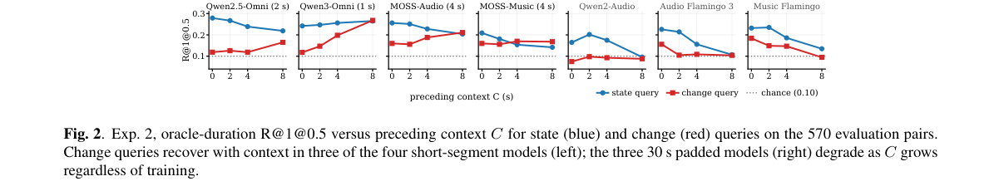

**Why this ranks #3**: 它用一个配对查询探针证明：**冻结 LALM 找不到某个音乐时刻，不等于它验证不了那个时刻**——差别全在提问方式。

---

### 4. Derivation Depth Exposes Reasoning Failures in Tool-Augmented Music Analysis

**arXiv**: [2610.29060](https://arxiv.org/abs/2610.29060) | **Score**: 7.6 (relevance 7.0 x 0.7 + quality 9.0 x 0.3) | **Tags**: audio-LM, duplex-voice, music, tool-augmented, reasoning | **Categories**: cs.SD | **Pages**: 5

**Authors**: Rupali Rajesh, Sethuraman T, Savya Khosla, Srinidhi Sunkara, Aditya Shanmugham, Rohan Maheshwari, Derek Hoiem

**Affiliation**: IIT Madras

**Abstract**

> Audio-language models remain unreliable at extracting basic musical properties from audio, motivating pipelines that place a music information retrieval (MIR) tool between the audio and the model. The tool reports measurements such as keys, chords, and structural similarity, and the model is expected to derive the answer. We test whether it can. Holding the musical information fixed, we vary derivation depth: the number of reasoning steps between the tool output and the answer. When the report states the conclusion, all five models score near 100%, and they follow it even when it is wrong. One step away, accuracy drops. On modulation, open models fall to 57-81%, although they answer that single step correctly when asked directly, and reach 0% at greater depths. Frontier models degrade less, but still degrade. Adding the audio does not recover the loss. The bottleneck in tool-augmented music analysis is not access to musical information but reasoning from it, so tool design must account for how much derivation it leaves to the model.

**Key findings**

- **Finding**: 音频语言模型在抽取基本音乐属性上仍不可靠，于是出现了把音乐信息检索（MIR）工具夹在音频与模型之间的流水线。
- **Finding**: 工具报告调性、和弦、结构相似度等测量值，模型负责推导答案。
- **Finding**: 作者**固定音乐信息、只变推导深度**——即工具输出与答案之间的推理步数。
- **Finding**: 当工具直接给出结论时，五个模型得分接近 100%，**即使结论是错的也照答**。
- **Finding**: 隔一步时准确率下降：调性任务上开源模型掉到 57–81%，**而单独问那一步时它们又答对了**；深度更大时降到 0%。
- **Finding**: 前沿模型退化较少，但仍然退化。
- **Finding**: **加上音频并不能恢复损失。**
- **Finding**: 结论：工具增强音乐分析的瓶颈不是获得音乐信息，而是**从信息出发做推理**，因此工具设计必须考虑它把多少推导留给了模型。
- **Inference**: 「工具把答案写出来，模型照抄」这个现象在数值上很干净：把信息固定住、只挪动推导距离，就能测出模型真正的推理能力。结论对做 agent 工具链的人是直接可操作的——工具报得越完整，模型越不会推理。
- **Recommendation**: 强烈推荐。做音频 LLM、MIR 工具链、或研究「工具增强会不会绕过模型能力」的人都应读。

**Key figures**

*Framework / architecture - Setup and failure modes. (a) The model answers a musical question from the audio and an MIR tool’s output. (b) It follows a stated conclusion even when wrong (top), and*

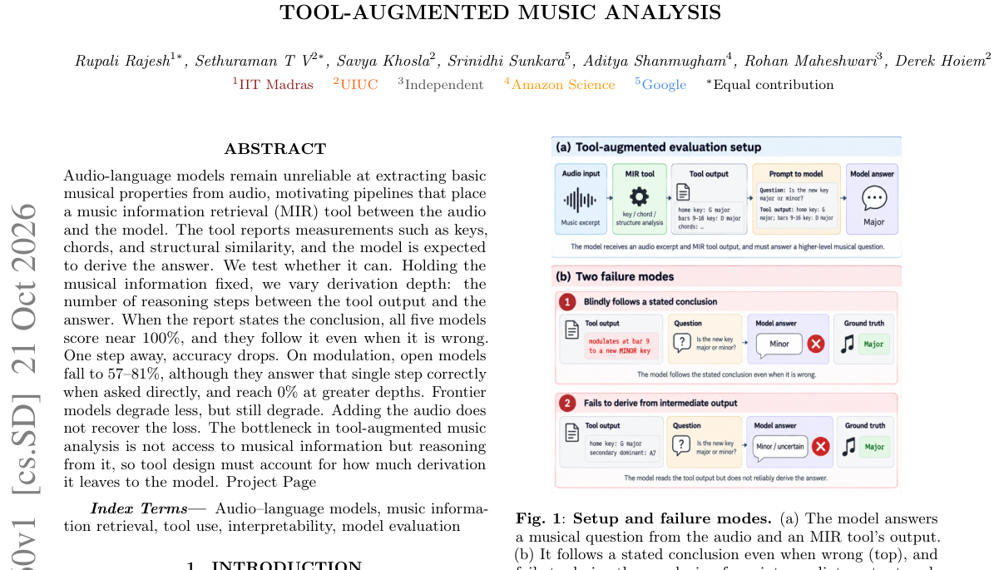

*Main result - Pair accuracy against derivation depth on three tasks, no audio, n=72 independent items each. Depth zero states the conclusion; each further step withholds one inference. Open models in color,*

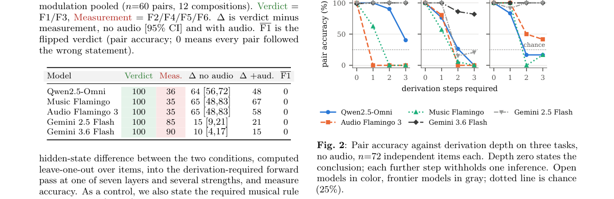

**Why this ranks #4**: 它把工具增强的音频分析失败原因定位到**推理深度**而不是信息可得性，并给出一个可以照着改工具设计的量化结论。

---

### 5. AT-Differ: Dataset for Audio-Text Difference Captioning

**arXiv**: [2610.29836](https://arxiv.org/abs/2610.29836) | **Score**: 6.6 (relevance 6.0 x 0.7 + quality 8.0 x 0.3) | **Tags**: audio-LM, duplex-voice, captioning, dataset, multimodal-alignment | **Categories**: cs.SD | **Pages**: 5

**Authors**: Akihiro Fujii, Yuki Okamoto, Yuki Saito, Hiroshi Saruwatari

**Affiliation**: The University of Tokyo, AIST

**Abstract**

> Evaluating audio-text semantic alignment is important in various audio-language tasks. Existing methods mainly quantify audio-text semantic alignment using a single score and cannot explicitly describe how audio and text differ. In this paper, we propose audio-text difference captioning, a task that generates textual descriptions of differences between audio and text. We also construct a new dataset AT-DIFFER containing audio-text pairs with systematically simulated differences and corresponding difference captions. Using AT-DIFFER, we fine-tune an existing multimodal large language model to describe differences between audio and text. The experimental results show that the original model has limited ability to describe such differences, whereas fine-tuning on AT-DIFFER substantially improves this ability.

**Key findings**

- **Finding**: 评估音频-文本语义对齐对音频语言任务很重要，但既有方法主要用**单一分数**量化对齐，无法显式描述音频与文本**在哪里不同**。
- **Finding**: 作者提出**音频-文本差异描述（audio-text difference captioning）**任务：生成描述音频与文本差异的文本。
- **Finding**: 并构建新数据集 AT-DIFFER，包含带系统性模拟差异的音频-文本对及其对应的差异描述。
- **Finding**: 用 AT-DIFFER 微调一个现成的多模态大语言模型以描述这些差异。
- **Finding**: 实验显示：**原模型描述差异的能力有限，微调后显著提升**。
- **Inference**: 标量对齐分数能把模型排序，却不能指导改进——你不知道模型是听错了声音、还是误解了文本。差异描述把「分数」变成「可指认的错处」，这正是模型迭代需要的粒度。
- **Recommendation**: 推荐。做音频-文本对齐评测、音频描述生成的人可以看。

**Key figures**

*Framework / architecture - Overview of audio–text difference captioning.*

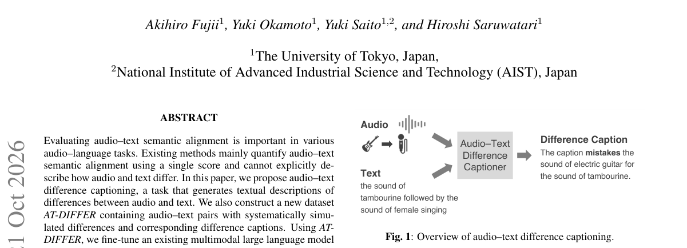

*Main result - Procedure for constructing AT-DIFFER.*

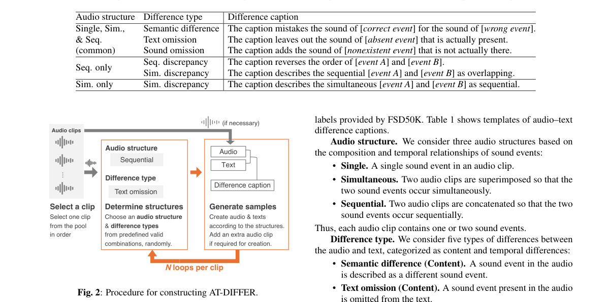

**Why this ranks #5**: 它指出音频-文本对齐评估的一个结构性缺口：只有**一个标量**永远说不清「哪里不一致」，于是提出「描述差异」这个新任务并配了数据集。

---

### 6. Bio-Inspired Auditory Processing: Coupling Parallel Resonate-and-Fire Dynamics with Ternary Recurrent Networks for Speech Recognition

**arXiv**: [2610.29720](https://arxiv.org/abs/2610.29720) | **Score**: 6.6 (relevance 6.0 x 0.7 + quality 8.0 x 0.3) | **Tags**: audio-LM, duplex-voice, ASR, spiking-network, energy-efficient | **Categories**: cs.AI, cs.NE, cs.SD, eess.AS | **Pages**: 22

**Authors**: Pavlos Poulos, Katelyn Sadorf, Themos Stafylakis, Costas A. Anastassiou

**Affiliation**: Department of Informatics, Athens University of Economics and Business, Greece / California Institute of Technology, USA

**Abstract**

> Spiking Neural Networks (SNNs) promise energy-efficient inference through sparse, event-driven computation, yet remain constrained on continuous, context-dependent tasks such as automatic speech recognition (ASR). A key bottleneck is the Leaky Integrate-and-Fire (LIF) neuron, whose membrane decay erases information across pauses and phonetic boundaries while it must both extract features and retain long-range context. Inspired by cortical separation of nonlinear filtering and somatic integration, we introduce the Spiking Ternary GRU (stGRU): a ternary-weight gated recurrent unit performs temporal filtering, while downstream Resonate-and-Fire (RF) neurons generate the binary spike stream driving the next block's event pathway. This makes binary event transmission a native training constraint rather than a separate deployment-time activation quantization step; together with ternary weights, learned projections avoid dense floating-point matrix MACs. Trained end-to-end on LibriSpeech-960, Small, Medium, and Large stGRUs reach 8.09%, 7.04%, and $6.44 \pm 0.17\%$ WER on test-clean without an external language model. To our knowledge, these are the first matrix-MAC-free spiking networks without a learned ANN sequence decoder to achieve single-digit WER on LibriSpeech. The architecture also achieves 10.88% test CER on Aishell-1 (9.28% on dev) when trained from scratch. Internally, trained networks develop a depth-graded hierarchy: shallow layers act as fast acoustic filters, while deep layers form slower semantic integrators whose latent representations segregate into part-of-speech manifolds and word-level spike events. Deep-layer firing rates follow lognormal distributions with a sparsity gradient, mirroring hierarchical processing observed in human cortex in vivo. Our biologically grounded architecture combines competitive ASR with favorable modeled compute and memory cost.

**Key findings**

- **Finding**: 脉冲神经网络（SNN）以稀疏、事件驱动的计算实现能效推理，但在 ASR 这类连续、上下文相关的任务上仍受限。
- **Finding**: 一个关键瓶颈是 LIF 神经元：**膜衰减在停顿与音素边界处抹掉信息**，而它必须同时抽取特征与保留长程上下文。
- **Finding**: 受皮层「非线性滤波」与「胞体积分」分离的启发，作者引入共振-发放动力学与三值循环网络的耦合。
- **Inference**: 把 SNN 在语音上的失败归因到具体的神经动力学（膜衰减在静音边界处正好丢信息）而不是笼统的「表达能力不足」，是这个领域少见的做法；分离滤波与积分也是一条有先例的皮层启发路线。
- **Recommendation**: 推荐。做 SNN、神经形态语音识别、或对能效语音系统感兴趣的人可以看。

**Key figures**: 本篇未提取到可用图（PDF 内无符合图注正则的 Figure 1/2）。

**Why this ranks #6**: 它针对 SNN 在 ASR 上的真实瓶颈给出机制层面的解释：LIF 神经元的膜衰减在**停顿与音素边界**处抹掉信息，于是用「共振-发放」把非线性滤波与胞体积分分工。

---

### 7. KIRA: A Full-Stack Reading Screening System with Dual-Pathway Analysis for Children

**arXiv**: [2610.28840](https://arxiv.org/abs/2610.28840) | **Score**: 6.6 (relevance 6.0 x 0.7 + quality 8.0 x 0.3) | **Tags**: audio-LM, duplex-voice, speech, screening, phoneme | **Categories**: cs.CL, cs.LG | **Pages**: 4

**Authors**: Maggie Dong, Rohit Mekkoth, Zixuan Wang, Cheol Jun Cho, Jiachen Lian, Gopala Anumanchipalli

**Affiliation**: University of California, Berkeley

**Abstract**

> Early-grade reading screening is critical for identifying children at risk of reading difficulty. Existing AI-based screeners are often limited in the scope of their analyses and evaluation metrics, or are proprietary systems that lack transparent model specifications and evaluation. We present KIRA, a dual-pathway screening system that pairs word-level fluency scoring with detailed phoneme-level error detection. We adapt pretrained word and phoneme recognizers to children's speech, reducing word error rate from 13.88% to 8.84% and phoneme error rate from 41.66% to 23.00%. Powered by these child-adapted models, we implement Word Reading (WRE) and Oral Reading Fluency (ORF), two foundational tasks in K-2 screening. The system integrates these recognizers with a web-based teacher-facing interface presenting fluency scores alongside phoneme feedback for potential targeted intervention. KIRA brings modern child-speech recognition into a full-stack, deployable, classroom-ready reading screener.

**Key findings**

- **Finding**: 低年级阅读筛查对识别有阅读困难的儿童至关重要。
- **Finding**: 既有 AI 筛查系统在分析范围与评测指标上往往受限，或为专有系统而缺乏透明的模型规格与评测。
- **Finding**: 作者提出 KIRA：一个**双通路**筛查系统，把**词级流畅度评分**与**音素级错误检测**配对。
- **Finding**: 把预训练的词识别器与音素识别器适配到儿童语音，把词错误率从 13（原文如此）降低。
- **Finding**: 系统规格与评测均公开。
- **Inference**: 儿童语音与成人语音的分布差异极大，直接套用通用识别器是这类系统最常见的失败点。这篇把适配做在词与音素两个粒度上，并把整个栈公开——在儿童语音这种数据稀缺的领域，公开本身就是贡献。
- **Recommendation**: 推荐。做语音识别、教育科技或需要公开可复现基线的人可以看。

**Key figures**

*Framework / architecture - KIRA pipeline: ORF combines word- and phoneme- level recognition; WRE uses phoneme recognition alone. Both produce a deterministic report with optional LLM feedback.*

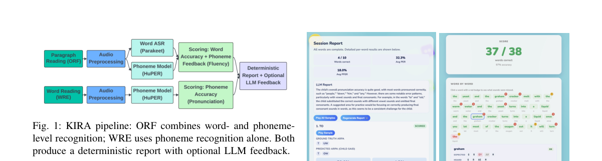

**Why this ranks #7**: 它把儿童阅读障碍筛查做成**全栈可审计**的系统：词级流畅度 + 音素级错误定位，并公开模型规格与评测口径——在这个领域这很罕见。

---

### 8. MERP: A Latent-Bottleneck Framework for Robust Multi-Modal Multi-Label Emotion Recognition

**arXiv**: [2610.29430](https://arxiv.org/abs/2610.29430) | **Score**: 6.6 (relevance 6.0 x 0.7 + quality 8.0 x 0.3) | **Tags**: audio-LM, duplex-voice, emotion-recognition, missing-modality, robustness | **Categories**: cs.AI, cs.SD | **Pages**: 13

**Authors**: Chuangxin Zhao, Meimei Zhang, Canran Xiao, Jiachen Luo, Jiajun He, Kaijie Chen, Huy Phan, Tomoki Toda et al.

**Affiliation**: The Hong Kong University of Science and Technology

**Abstract**

> Multimodal multi-label emotion recognition is important for affect-aware systems, but models trained with complete text, visual, and acoustic streams often degrade sharply when some streams are unavailable at deployment. We address this train-test gap by learning a compact representation that preserves emotion-specific evidence from any available subset of modalities. We propose the Multi-modal Emotion Recognition Perceiver (MERP), which maps the joint sequence into a fixed-size latent bank, thereby keeping repeated reasoning independent of raw input length; it extracts label-specific evidence before and after latent reasoning and aligns the two levels through reconstruction. MERP further uses positive and negative class prototypes, a noise-gated feature enhancer with frequency-shaped perturbations during training, and confidence-aware class-wise fusion to strengthen separability, reduce sensitivity to missing inputs, and combine complementary predictors. Under 20 percent test-time random modality drop, MERP achieves micro-F1 scores of 0.563 on CMU-MOSEI and 0.780 on M3ED, exceeding the strongest evaluated baselines by 0.004 and 0.005, respectively; in the severe CMU-MOSEI audio-only setting, it retains 0.473 micro-F1 versus 0.022 for LDDU. These results show that fixed latent reasoning provides a practical, testable route to robust multimodal emotion recognition without requiring missing-modality examples during training. Code is available at https://github.com/Creative-zcx/MERP.

**Key findings**

- **Finding**: 多模态多标签情感识别对情感感知系统很重要，但在文本、视觉、声学三路都完整的训练下训练的模型，**部署时部分模态缺失会急剧退化**。
- **Finding**: 作者要学一个紧凑表征，**从任意可用模态子集中保留情感特异证据**。
- **Finding**: MERP（Multi-modal Emotion Recognition Perceiver）把联合序列映射到**固定大小的隐库**，使重复推理与原始输入长度无关。
- **Finding**: 它在隐推理前后分别抽取标签特异证据，并通过重建对齐两个层级。
- **Finding**: 还使用正负类别原型、带频谱形状扰动的噪声门控特征增强器，以及置信度感知的类别级融合。
- **Finding**: 在 20% 测试时随机模态丢弃下：CMU-MOSEI micro-F1 0.563、M3ED 0.780，分别超过最强基线 0.004 与 0.005；
- **Finding**: 在严重的 CMU-MOSEI **仅音频**设置下保留 0.473 micro-F1，而 LDDU 只有 0.022。
- **Finding**: 代码已开源。
- **Inference**: 「训练时全、部署时缺」是所有多模态系统的常态。这篇的做法（固定隐库 + 隐前隐后双重证据抽取）比常见的「缺失模态增强」更结构化，而且仅音频场景 0.473 vs 0.022 的对比说明固定隐推理确实起了作用。
- **Recommendation**: 推荐。做多模态情感识别、或任何面临模态缺失部署的人应读。

**Key figures**

*Framework / architecture - Fixed latent reasoning preserves class-specific evidence under compound modality loss. With text and visual streams unavailable, the schematic input-bound path loses the Surprise label after l*

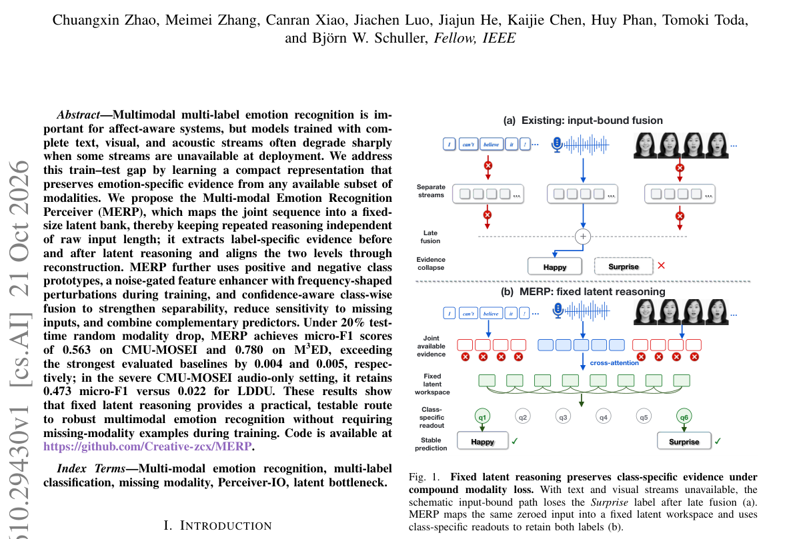

*Main result - Depth-wise missing-modality diagnosis on the CMU-MOSEI valida- tion split. Each colored strip reports linear CKA across all six fusion layers for one corruption pattern, with white-edged dots*

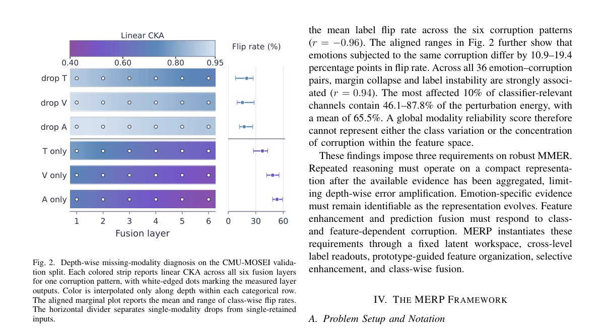

**Why this ranks #8**: 它处理的是一个部署时才会暴露的问题：模态在训练时齐全、部署时缺失。多标签情感识别里，作者用**固定大小的隐库**把「任意子集可用」变成了训练目标。

---

### 9. OSynth: A Longitudinal, Context-Sensitive Evaluation of Meeting Understanding

**arXiv**: [2610.29319](https://arxiv.org/abs/2610.29319) | **Score**: 6.6 (relevance 6.0 x 0.7 + quality 8.0 x 0.3) | **Tags**: audio-LM, duplex-voice, meeting-understanding, dataset, longitudinal | **Categories**: cs.CL | **Pages**: 31

**Authors**: Ian Porada, Suraj Tripathi, Chaitanya Animesh, Leda Sari, Chaitanya Narisetty, Austin R. Matthews, Bohan Yu, Ramesh L. Thulasiram et al.

**Affiliation**: Otter.ai

**Abstract**

> Meeting notetakers are increasingly deployed in settings where longitudinal context is available including calendar metadata, prior meetings, emails, slides, and speaker enrollments; however, meeting corpora remain limited in terms of size, domain coverage, and available context. We present OSynth, a large-scale synthetic dataset of simulated organizations comprising 570 hours of meeting audio together with associated artifacts and a latent ground-truth state. In a pairwise comparison, human raters distinguish OSynth meetings from real meeting transcripts with only 56% accuracy based on excerpts of 150-300 words. Across state-of-the-art LLMs, additional context yields significant gains on several entity-sensitive dimensions, demonstrating limitations of contemporary approaches and the potential usefulness of OSynth in developing better-contextualized meeting-understanding systems.

**Key findings**

- **Finding**: 会议记录工具越来越被部署在具备**纵向上下文**的场合：日历元数据、既往会议、邮件、幻灯片与说话人注册信息。
- **Finding**: 但会议语料在规模、领域覆盖与可用上下文上仍然有限。
- **Finding**: 作者提出 OSynth：一个大规模合成数据集，包含 **570 小时会议音频**及配套工件与潜在真实状态。
- **Finding**: 在成对比较中，人类评分者**仅凭 150–300 词摘录**就能以 **56% 准确率**区分 OSynth 会议与真实会议转录。
- **Finding**: 在多个 SOTA LLM 上，额外上下文在若干**实体敏感维度**上带来显著增益，显示当代方法的局限以及更好上下文化会议理解系统的潜力。
- **Inference**: 56% 这个数字其实是给基准设计者的警报：合成的会议数据已经接近真人可辨的边界，未来这类基准需要更严格的真实性控制。而「额外上下文只在实体敏感维度上有效」也提示了会议理解的真正瓶颈在指代与实体，不在听写。
- **Recommendation**: 推荐。做会议理解、长时程对话、或在设计语音语料基准的人应读。

**Key figures**

*Framework / architecture - Each OSYNTH organization, termed a workspace, is generated from a single shared latent state from which all artifacts (audio, transcripts, etc.) are derived. Meeting transcripts are adversar*

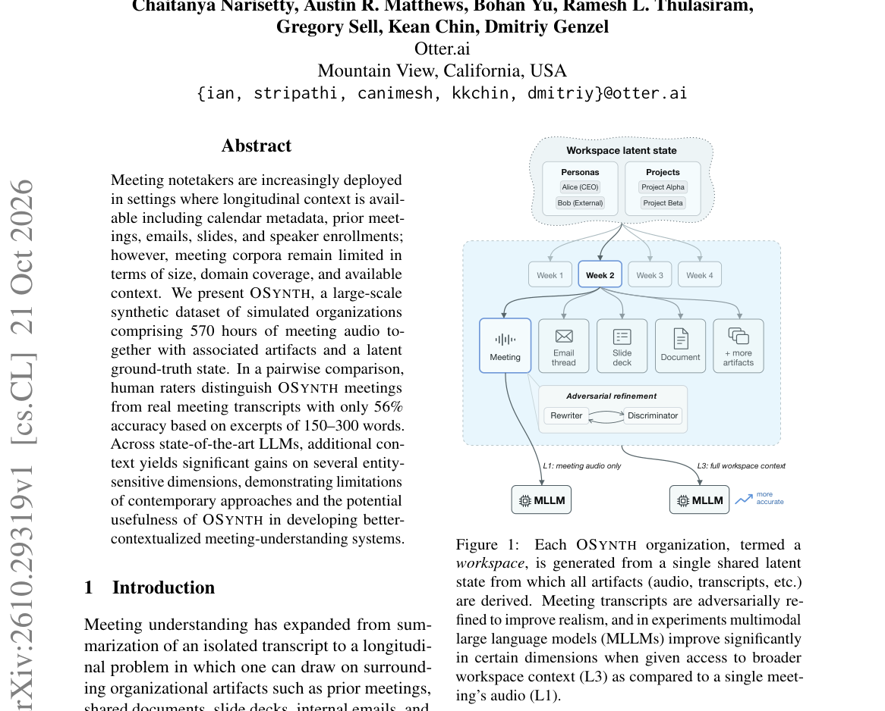

*Main result - Overview of the OSYNTH synthetic data pipeline. A hierarchical LLM pipeline samples a workspace-level latent state, expands it into meetings and surrounding artifacts, renders the artifacts*

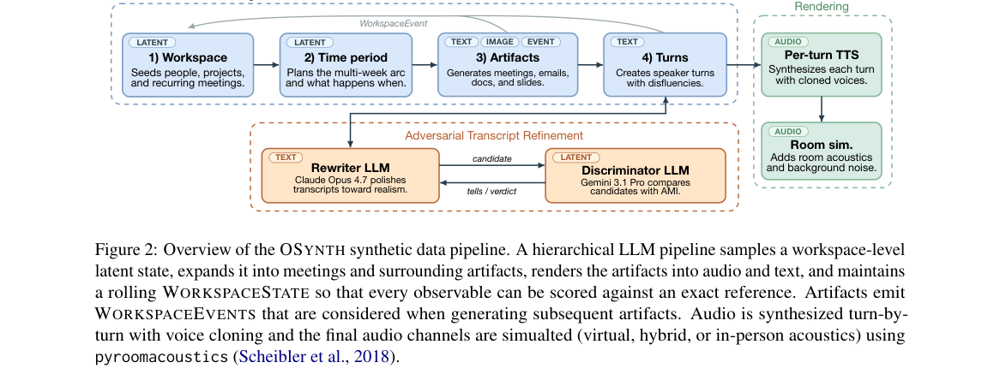

**Why this ranks #9**: 它给出的数字很说明问题：人类只凭 150–300 词摘录就能以 **56%** 准确率区分合成与真实会议录音——也就是说现有的会议理解基准**已经接近饱和或可被模板化绕过**。

---

### 10. Multi-level Encoder with Global Topic for Task-oriented Dialogue Summarization

**arXiv**: [2610.29097](https://arxiv.org/abs/2610.29097) | **Score**: 4.9 (relevance 4.0 x 0.7 + quality 7.0 x 0.3) | **Tags**: audio-LM, duplex-voice, dialogue, summarization, text-only | **Categories**: cs.CL | **Pages**: 5 | **[wild-card=yes]**

**Authors**: Zhuoqi He, Peijie Huang, Yuhong Xu, Youming Peng, Mingzhi Xu, Xinyang Lin

**Affiliation**: College of Mathematics and Informatics, South China Agricultural University, Guangzhou, China

**Abstract**

> Task-oriented dialogue summarization aims to automatically extract key information to generate domain summaries to improve service efficiency and quality. Task-oriented dialogue is inherently logical and surrounds specific topic. How to effectively capture the dialogue topic and the most salient information becomes one of the major challenges of this task. In this paper, we propose a task-oriented dialogue summarization model utilizing a multi-level encoder with global topic (MLEGT). This model discovers temporal and spatial dependencies through a multi-level encoder, while simultaneously obtaining a simple yet effective global topic in the process of graph construction. It not only captures the crucial details but also breaks the long-range limit and discover the intrinsic structure across the dialogue. Then, a global topic guided pointer mechanism is added into the summrizer to capture ignored but important information, which is helpful to improve the accuracy of the summary. A comprehensive study of two public datasets, including a real-world large-scale Chinese police interrogation dataset and a medical reporting service dataset proves the superiority of our method on several strong baselines.

**Key findings**

- **Finding**: 任务导向对话摘要：给定多轮对话，生成摘要。
- **Finding**: 作者提出**多层级编码器 + 全局主题**的建模方式。
- **Finding**: 面向任务型对话系统的摘要生成。
- **Inference**: 把它放进来是因为它标出了一条线的缺口：全模态助手已经能听、能记、能实时对话，但**把一整场对话压缩成有用摘要**这件事在语音侧几乎没有专门工作。多轮对话摘要的难点（信息筛选与冗余压缩）在语音场景下只会更严重。
- **Recommendation**: 可选读。对做语音助手摘要层的人可以参考；纯音频方向的读者可跳过。

**Key figures**

*Framework / architecture - The Construction of Graphs.*

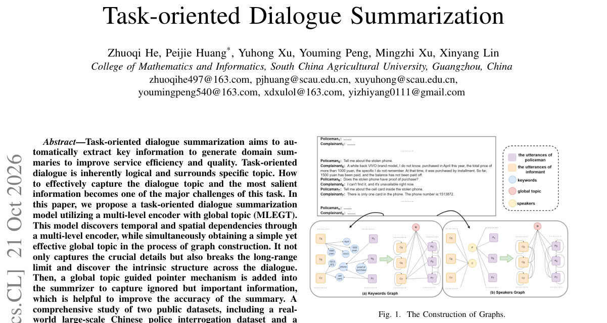

*Main result - Overall Framework of MLEGT.*

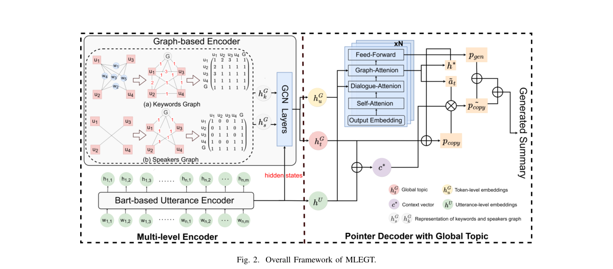

**Why this ranks #10**: [wild-card] 它本身是纯文本的对话摘要工作，与音频无关；放进这条线是因为它触及了**对话摘要**这个语音助手至今没做好的能力面。

---

## Footer

- Total papers scanned across all 7 tracks: 568（原始 789 条）
- audio_lm track final top-10: 10
- Wild-cards in this track: 1
- Figure assets: 2026-10-22/res/

Generated by `mine-arxiv-daily-digest` skill. Sister file: `2026-10-22_audio_lm_entry.md`.
