# ArXiv Daily Digest - 2026-10-22 (具身智能与世界模型, 10 papers)

**Generated**: 2026-10-22 17:00 CST

**Source**: arXiv cs.CV, cs.SD, eess.AS, cs.CL, cs.AI, cs.RO, cs.LG submissions, listing day 2026-10-21 (announced 2026-10-22 00:00 UTC)

**Batch window**: 2026-10-20T18:00:00Z .. 2026-10-21T18:00:00Z（arXiv 公告批次横跨两个 UTC 日：前一日 18:00 UTC 起算，当日 17:59:59 UTC 截止）

**Track**: embodied (top 10 of 568 papers scanned, 105 full reads)

**Scope**: 具身智能、机器人操作导航、世界模型与触觉

---

## Top 10 - 具身智能与世界模型

### 1. SP-HLM: Sparse-Pose-Driven Motion Generation and Whole-Body Control for Humanoid Loco-Manipulation

**arXiv**: [2610.30044](https://arxiv.org/abs/2610.30044) | **Score**: 8.7 (relevance 9.0 x 0.7 + quality 8.0 x 0.3) | **Tags**: embodied-ai, world-model, humanoid, loco-manipulation, motion-generation | **Categories**: cs.AI, cs.RO | **Pages**: 9

**Authors**: Zhaohui Yang, Quanbao Lin, Chengqi Shi, Zhenglang Weng, Jicheng Lin, Boyu Chen, Tengjie Zhu, Guanzhu Ren et al.

**Affiliation**: Shanghai Jiao Tong University, The University of Hong Kong

**Abstract**

> Humanoid loco-manipulation requires an effective interface between high-level task policies and whole-body control. Existing interfaces typically rely on a single action representation for both task intent and whole-body coordination. This may burden the high-level policy or leave one aspect underspecified. We present SP-HLM, a framework built on a sparse-pose-driven interface. The interface combines five task-critical body poses with a learned latent motion prior to represent spatial intent and whole-body coordination in complementary forms. SP-VLA, a vision-language-action model, first predicts task-relevant sparse poses and finger joint positions from multimodal observations and language instructions using asynchronous action-chunk inference. Given these sparse targets, SP-MGM, a motion generation model trained through two-stage distillation, reconstructs coordinated full-body motion in real time. A pretrained motion encoder maps this motion to a compact latent representation. SP-GMT, a general motion tracker, then integrates the explicit sparse targets with this implicit motion prior for whole-body control. Experiments in simulation and on a real humanoid robot demonstrate improved motion tracking, whole-body coordination, and loco-manipulation success over existing approaches. Additional results and videos are available on our \href{https://sp-hlm.github.io/}{\textcolor{blue}{project page}}.

**Key findings**

- **Finding**: 人形机器人的移动-操作（loco-manipulation）需要一个连接高层任务策略与全身控制的有效接口。
- **Finding**: 既有接口通常用**单一动作表征**同时承载任务意图与全身协调，结果是要么压垮高层策略，要么让某一侧欠定义。
- **Finding**: SP-HLM 构建在**稀疏姿态驱动的接口**上：接口结合**五个任务关键身体姿态**与一个**学习到的潜在运动先验**，用于表示空间意图与全身协调。
- **Finding**: 面向人形 loco-操作。
- **Inference**: 「一个动作空间干两件事」的代价是互相干扰。稀疏姿态接口的想法是把「我要到哪、拿什么」这类空间意图用少量离散姿态表达，而把「怎么动」交给运动先验——相当于在策略与控制器之间插入一个可学习的结构化瓶颈。
- **Recommendation**: 推荐。做人形机器人全身控制、VLA 接口设计的人应读。

**Key figures**

*Framework / architecture - SP-HLM: Sparse-pose-driven humanoid loco-manipulation. Top: The interface combines explicit five-point targets with an implicit motion prior for diverse simulated and real-world tasks. Bottom:*

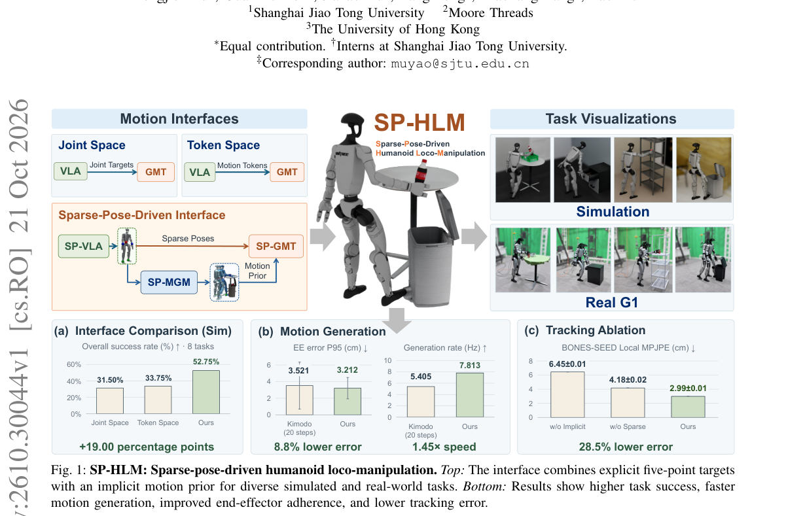

*Main result - Overview of the proposed SP-HLM framework based on the sparse-pose-driven interface. Top: the deployment pipeline integrating sparse-pose prediction, full-body motion generation, and explicit–*

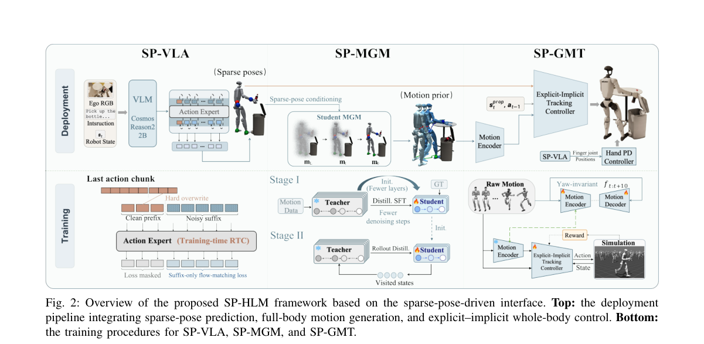

**Why this ranks #1**: 它质疑了「高层策略和全身控制必须共用一个动作表征」这个默认设定，提出用**五个任务关键姿态 + 学习到的运动先验**做接口，把两者的负担分开。

---

### 2. COWBOY: A Scalable Sim-to-Real Framework for Learning Contextual Whole-Body Manipulation

**arXiv**: [2610.28948](https://arxiv.org/abs/2610.28948) | **Score**: 9.0 (relevance 9.0 x 0.7 + quality 9.0 x 0.3) | **Tags**: embodied-ai, world-model, sim-to-real, mobile-manipulation, whole-body | **Categories**: cs.RO | **Pages**: 33

**Authors**: Jiahui Yang, Jason Jingzhou Liu, Ray Muxin Liu, Andrew E. Wang, Kenneth Shaw, Deepak Pathak, Ruslan Salakhutdinov

**Affiliation**: Carnegie Mellon University

**Abstract**

> Mobile manipulators must adapt not only to objects, but also to the spatial context in which they appear: where to position the base, how to manipulate, and where to look while navigating surrounding scene geometry. To address this, we present COWBOY, a scalable sim-to-real framework for learning such contextual whole-body manipulation. On whole-body dexterous grasping, COWBOY transfers zero-shot to hundreds of objects and diverse in-the-wild scenes, spanning cluttered tabletops, shelves, drawers, and other unstructured settings. Rather than learning scene adaptation directly with RL in simulation, a vectorized environment-aware whole-body controller (WBC) handles reaching in thousands of scenes by coordinating base-arm motion, collision avoidance, and active vision. Then, local RL experts are trained in local scenes for object interaction and can be reused across thousands of full-scene layouts. We distill these composed WBC-RL teachers into a single vision policy that controls the mobile base, arm, dexterous hand, and actuated camera from point-cloud observations. The resulting policy exhibits contextual whole-body behavior, automatically adapting base placement, camera viewpoint, arm trajectory, and grasp strategy to observed scene and object geometry. Videos are available at https://cowboy-manip.com

**Key findings**

- **Finding**: 移动操作者必须适应的**不只是物体，还有物体所处的空间语境**：底盘停在哪、怎么操作、看向哪。
- **Finding**: 作者提出 COWBOY，一个可扩展的 sim-to-real 框架，学习这种**上下文相关的全身操作**。
- **Finding**: 在全身灵巧抓取上，COWBOY **零样本迁移**到数百个物体与多种真实场景，涵盖杂乱的桌面、货架、抽屉等非结构化环境。
- **Inference**: 「sim-to-real 操作」的既有工作通常默认一个固定工位，而真实部署里工位本身就是变量。COWBOY 把「基座该站哪」当成策略的一部分来学，这个设定更接近真实场景，也更难。
- **Recommendation**: 强烈推荐。做移动操作、全身操作或 sim-to-real 迁移的人应读。

**Key figures**

*Framework / architecture - COWBOY enables learning whole-body manipulation in simulation across thousands of scenes and objects. We train a single vision-based policy that transfers zero-shot in diverse real-world sce*

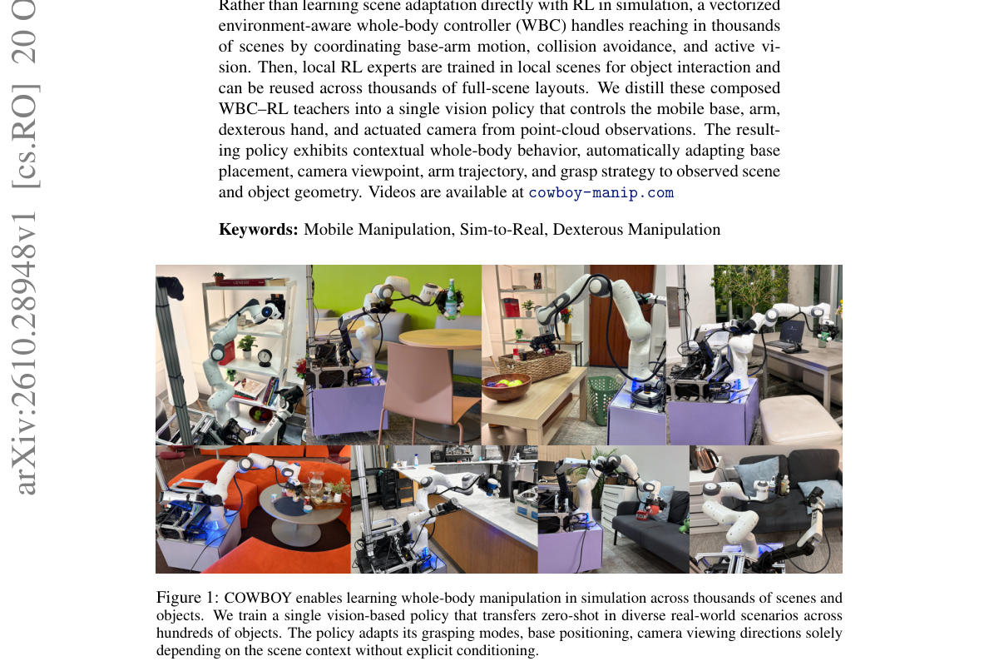

**Why this ranks #2**: 它处理的是移动操作里被长期忽略的**上下文**问题：机器人不仅要适应物体，还要适应物体所处的空间——基准在哪、怎么操作、看向哪。

---

### 3. Rethinking Video Autoencoders for Interactive World Models

**arXiv**: [2610.30129](https://arxiv.org/abs/2610.30129) | **Score**: 9.0 (relevance 9.0 x 0.7 + quality 9.0 x 0.3) | **Tags**: embodied-ai, world-model, video-autoencoder, compression, latency | **Categories**: cs.CV | **Pages**: 43

**Authors**: Adrien Ramanana Rahary, Yutong Bai, Nicolas Dufour, Patrick Pérez, David Picard

**Affiliation**: ENPC, Kyutai AI, UC Berkeley

**Abstract**

> Video world models predict future frames from past frames and actions. They serve as simulators in which agents train, plan or are evaluated, and that humans can control interactively. They generate in the latent space of a video autoencoder, whose compression sets their cost per frame and how long each action waits to take effect. Yet world models often reuse the autoencoders of text-to-video generators, built for offline generation with no agent waiting and, without their training data and code, not retrainable at another compression. We therefore ask how, where and how much a world model should compress. We build CADRE, an open family of causal diffusion representation autoencoders spanning multiple spatio-temporal compressions. Its members differ only in a small bottleneck on frozen features and share a diffusion decoder self-distilled to one or a few steps. We train the same world model on each autoencoder in two domains, manipulation and navigation, with two environments each. CADRE forms most of the latency-quality frontier, especially with a moving camera. Our study also leads to four findings. At strong compression, a diffusion decoder is sharper than perceptual regression. In robot manipulation, temporal compression is more effective in the autoencoder than in the world model. Manipulation and navigation call for opposite compressions: temporal compression costs little when the camera is still, and spatial compression when it moves. Surprisingly, with a still camera, coarser spatial tokens hurt motion far more than image quality. Code, models and a live demo are at https://kyutai.org/blog/2026-10-21-cadre

**Key findings**

- **Finding**: 视频世界模型从过去的帧与动作预测未来帧，是智能体训练、规划、评估乃至人类交互式操控的模拟器。
- **Finding**: 它们在视频自编码器的隐空间生成，而**自编码器的压缩程度决定了每帧成本与动作要等多久才生效**。
- **Finding**: 但世界模型常常直接复用文生视频生成器的自编码器——那些是为**离线生成**设计的（没有智能体在等），且在缺乏训练数据与代码时无法换压缩率重训。
- **Finding**: 作者因此问：世界模型应当在哪里、压缩多少、如何压缩。
- **Finding**: 他们构建 **CADRE**：一个开放的**因果扩散表征自编码器**家族，跨越多种时空压缩率。
- **Finding**: 各成员只差一个作用在冻结特征上的小瓶颈，并共享一个自蒸馏到一或数步的扩散解码器。
- **Finding**: 作者在两个领域（操作、导航）、各两个环境上用**同一个世界模型**训练每个自编码器。
- **Finding**: CADRE 构成延迟-质量前沿的大部分，**尤其在相机运动时**。
- **Finding**: 四条发现：强压缩下扩散解码器比感知回归更锐利；操作任务中**时间压缩放在自编码器里比放在世界模型里更有效**；
- **Finding**: 操作与导航需要**相反的压缩**——相机静止时时间压缩代价很小，相机运动时则需要空间压缩；
- **Finding**: 出人意料的是，**相机静止时更粗的空间 token 对运动的伤害远大于对图像质量的伤害**。
- **Finding**: 代码、模型与在线 demo 均已公开。
- **Inference**: 这是本批最值得细读的论文之一：它把「自编码器是给世界模型用的」这个隐含假设摆到台面上，并用一组对照实验给出了反直觉的答案——特别是「静止相机下粗空间 token 伤运动多于伤画质」这一条，说明视觉质量指标会系统性掩盖运动退化。
- **Recommendation**: 强烈推荐。做世界模型、交互式视频生成或实时仿真的人必读。

**Key figures**

*Framework / architecture - The right video autoencoder lets interactive world models react fast with high image and motion quality. On CADRE, world models run at 20 fps on one H100 and react in under 230 ms, below not*

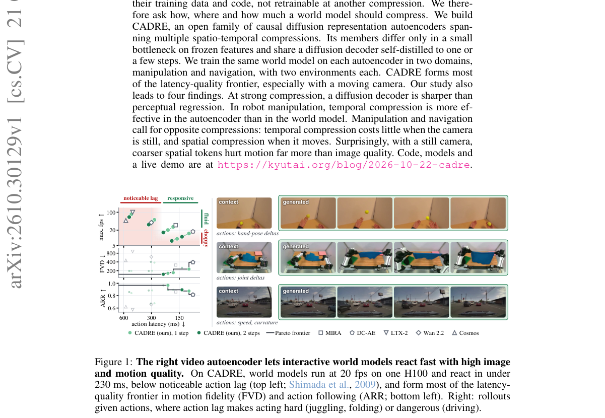

*Main result - Every frame registers an action, whose effect appears τ frames later. A latent frame is predicted only once all its τ actions are in, so a larger τ saves world model calls but delays actions*

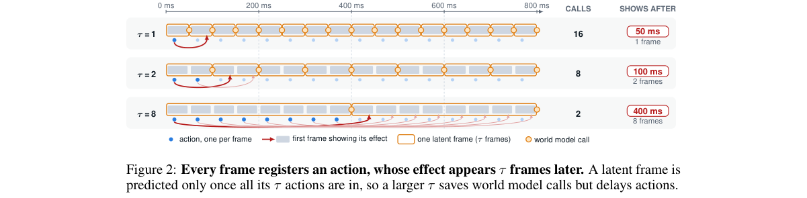

**Why this ranks #3**: 它问了一个被整个领域默认掉的问题：世界模型**到底该压缩到什么程度**？答案不是唯一值——而**相机动与不动需要相反的压缩**。

---

### 4. From VLM Planners to Robotic Agents: Self-Evolving Harnesses for History-Dependent Manipulation

**arXiv**: [2610.29560](https://arxiv.org/abs/2610.29560) | **Score**: 8.7 (relevance 9.0 x 0.7 + quality 8.0 x 0.3) | **Tags**: embodied-ai, world-model, VLA, memory, long-horizon | **Categories**: cs.RO | **Pages**: 17

**Authors**: Tingwen Du, Haoyu Guo, Hanxue Zhang, Xuanxu Wang, Junting Dong, Chao Gao, Mingfei Han, Tao Lu et al.

**Affiliation**: University of Science and Technology of China

**Abstract**

> Vision-language-action (VLA) models achieve strong performance across embodied manipulation tasks by unifying visual understanding, language conditioning, and action generation. However, long-horizon tasks can involve non-Markovian dependencies: successful decisions may require retaining task progress and past interaction outcomes, while partial observability and execution errors compound over time. Existing work has begun to address these challenges by augmenting foundation-model policies with memory and by introducing hierarchical architectures that separate high-level planning from low-level execution. We organize the high-level VLM as a robotic agent through an editable harness to maintain task context and improve planning through execution experience. We instantiate this approach as SERA (Self-Evolving Robotic Agent), with a fixed VLA executor providing low-level control. The harness maintains and updates task context using observations and execution feedback to guide subsequent planning. Self-evolution uses environment rollouts to propose and evaluate harness revisions, with the selected configuration fixed before held-out testing. On RoboMME, SERA achieves 51.38% overall success with autonomous selection, compared with 44.38% without self-evolution. Our exploration suggests that agentic planning is a promising direction for history-dependent robotic manipulation.

**Key findings**

- **Finding**: 视觉-语言-动作（VLA）模型通过统一视觉理解、语言条件与动作生成，在具身操作任务上表现强劲。
- **Finding**: 但**长时程任务可能涉及非马尔可夫依赖**：成功决策可能需要保留任务进度与过去的交互结果，而部分可观测性与执行误差会随时间累积。
- **Finding**: 既有工作开始用记忆增强基础模型策略来应对这些挑战。
- **Finding**: 作者提出**自进化的 harness**（self-evolving harnesses）把 VLM 规划器变成机器人智能体。
- **Finding**: 在历史相关的操作任务上评测。
- **Inference**: 非马尔可夫性是长时程任务的本质难题：同样的观测在不同历史下该做不同的事。这篇把 harness（而非模型本身）作为承载记忆与适应的地方，意味着可以在不动基座模型的前提下升级任务能力——对闭源/冻结 VLA 尤其实用。
- **Recommendation**: 强烈推荐。做 VLA、长时程操作或机器人 agent harness 的人应读。

**Key figures**

*Framework / architecture - From planner to agent for history-dependent manipulation. Top: Similar observations can require different decisions depending on task progress. (a) Memory-augmented policies equip VLA models*

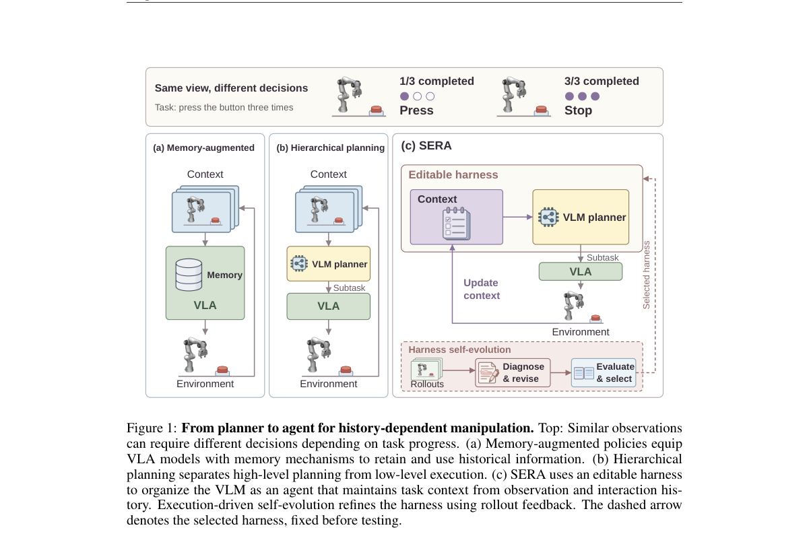

*Main result - Agentic execution and harness self-evolution. (a) The harness maintains task context and uses a VLM to plan commands for a VLA executor, incorporating execution feedback in sub- sequent roun*

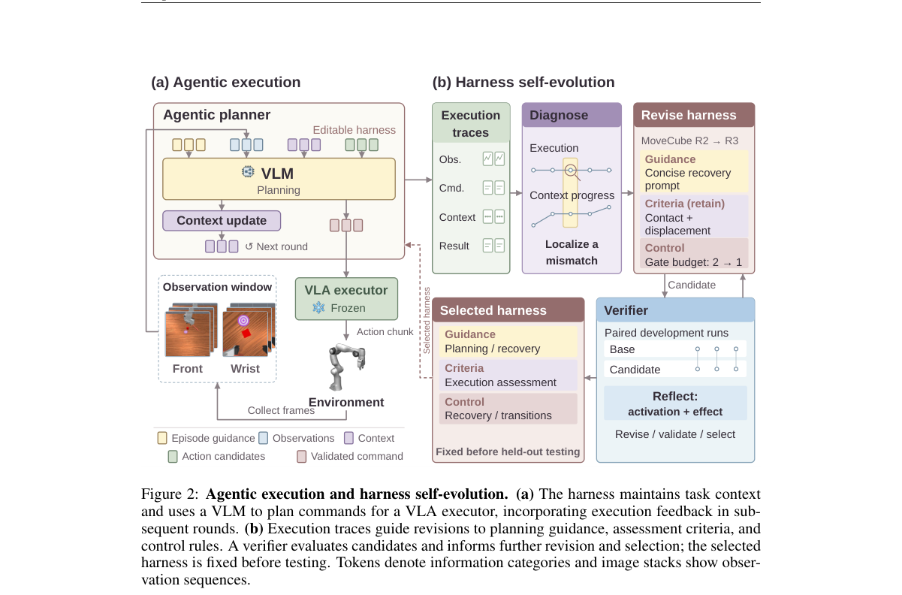

**Why this ranks #4**: 它把「VLA 缺记忆」这个问题重新表述为**非马尔可夫依赖 + 部分可观测 + 执行误差**三重叠加，并给出自进化 harness 作为解。

---

### 5. DepState-JEPA: Learning Depth-Grounded State Representation for Visual Perception and Manipulation

**arXiv**: [2610.29246](https://arxiv.org/abs/2610.29246) | **Score**: 8.3 (relevance 8.0 x 0.7 + quality 9.0 x 0.3) | **Tags**: embodied-ai, world-model, JEPA, representation-learning, depth | **Categories**: cs.CV, cs.RO | **Pages**: 45

**Authors**: Xiujian Liang, Liuyuan Na, Zehao Du, Jiacheng Xu, Weixi Song, Mingyang Sun, Xingjun Ma, Cewu Lu et al.

**Affiliation**: Fudan University / Shanghai Innovation Institute (SII) / Shanghai Jiao Tong University / Shandong University

**Abstract**

> Predictive representations for robot manipulation should connect scene geometry with the state changes induced by actions. Our intuition is that understanding what an action will change starts with understanding where things are: complementary RGB and depth observations ground a common scene representation from which to infer those changes. Guided by this intuition, we introduce \textbf{DepState-JEPA}, a dual-stream RGB--Depth joint-embedding predictive architecture that connects spatial understanding with action-conditioned prediction through a shared latent state, \textbf{DepState}. Built on V-JEPA~2.1, the framework uses depth both as a complementary observation stream and to ground both modalities in metric 3D space, aggregating shared information into DepState while retaining modality-private features for decoding. Ray-conditioned readouts predict local features without target depth; after an action-conditioned transition, the same decoders predict future RGB and depth features using the predicted state and fixed initial private features. Robot-state readouts provide recursive proprioceptive inputs; object-trajectory supervision and calibrated forward kinematics shape state learning through motion targets and joint--TCP consistency. Comparisons show stronger RGB-encoder transfer after RGB-D adaptation, feature completion, conditioned visual forecasting, and manipulation success. Within-model ablations identify contributions from depth content, metric coordinates, and future-state matching, with additional control gains from FK regularization.

**Key findings**

- **Finding**: 机器人操作的预测性表征应当把**场景几何**与**动作引起的状态变化**联系起来。
- **Finding**: 作者的直觉是：理解一个动作会改变什么，**始于理解东西在哪里**——互补的 RGB 与深度观测把一个共同的场景表征锚定下来，从中推断那些变化。
- **Finding**: DepState-JEPA 是一个**双流 RGB-深度联合嵌入的预测式架构**，把空间理解与动作后果连起来。
- **Finding**: 面向视觉感知与操作。
- **Inference**: JEPA 系的核心主张是「在抽象表征空间里预测」而非重建像素。这篇给双流 JEPA 加了深度这一路，是在「几何先验该以什么形式进入预测架构」上做的一次具体回答。
- **Recommendation**: 推荐。做预测式表征、JEPA 变体、或操作感知的人可以看。

**Key figures**

*Framework / architecture - From Where Things Are to What Actions Change. DepState-JEPA grounds comple- mentary RGB–depth observations in a shared latent state, DepState, while retaining modality-private features for d*

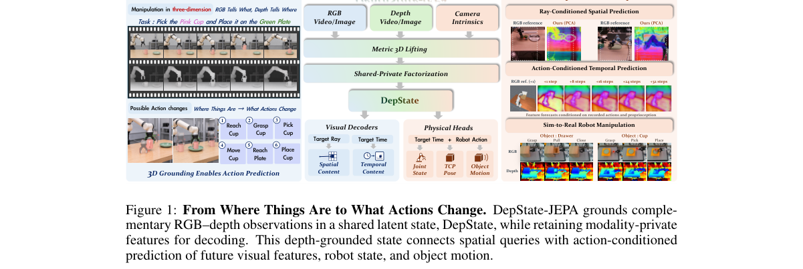

*Main result - Architectural Overview of DepState-JEPA. RGB–Depth features are grounded, factor- ized, and aggregated into DepState. Spatial queries read local content; action-conditioned transitions advan*

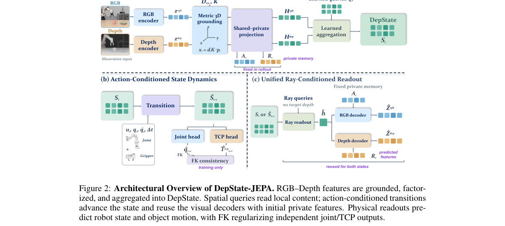

**Why this ranks #5**: 它的出发点很干净：**理解一个动作会改变什么，先得知道东西在哪里**——所以用 RGB + 深度双流把几何与状态变化接起来。

---

### 6. Real2Sem2Real: 3D Semantic Augmentations for Robot Learning from a Single Human RGB Demonstration

**arXiv**: [2610.28880](https://arxiv.org/abs/2610.28880) | **Score**: 8.3 (relevance 8.0 x 0.7 + quality 9.0 x 0.3) | **Tags**: embodied-ai, world-model, robot-learning, data-generation, gaussian-splatting | **Categories**: cs.CV, cs.RO | **Pages**: 9

**Authors**: Matthew Strong, Ankush K. Dhawan, Julien Poffet, Giuse Pham, Jinho So, Monroe Kennedy

**Affiliation**: Stanford University

**Abstract**

> Human video scales easily and does not need robot hardware, but existing methods require depth sensing, overlay the robot onto 2D video, or generate data only for the demonstrated objects. We present Real2Sem2Real (R2Sem2R), a real-to-semantic-to-real pipeline that turns one monocular RGB video of a human demonstration into thousands of robot demonstrations across the semantic object instances of a category. R2Sem2R tracks the SE(3) pose of each object with DINOv3-distilled Gaussian splats, outperforming existing methods and FoundationPose with estimated metric depth. R2Sem2R then aligns digital cousins, each generated from one or a few photographs, to the demonstrated objects with a semantic alignment. This alignment matches whole objects and the functional regions of target objects, such as a coffee machine's tray. R2Sem2R maps the human hand to a feasible robot grasp that extends to the cousins. Robot demonstrations are generated either in IsaacSim, for photorealistic rendering, or MuJoCo, for contact physics, and R2Sem2R can generate over 2,000 episodes in about two hours. On two real robots and four tasks, we train a vision-language-action policy on data from one human video per task, and policies trained on our data match or exceed policies trained on teleoperation across diverse object instances. The project page is available at https://real2sem2real.github.io/.

**Key findings**

- **Finding**: 人类视频容易扩展且不需要机器人硬件，但既有方法要求深度传感、把机器人叠加到 2D 视频上，或只对被演示的物体生成数据。
- **Finding**: Real2Sem2Real（R2Sem2R）是一条 **real-to-semantic-to-real** 流水线，把**一段人类单目 RGB 演示**变成数千条机器人演示，跨越该类别的语义物体实例。
- **Finding**: R2Sem2R 用 **DINOv3 蒸馏的高斯泼溅**跟踪每个物体的 SE(3) 位姿，性能优于既有方法。
- **Inference**: 机器人数据的瓶颈是「每个新物体都要重新采一遍」。R2Sem2R 的关键是先在语义层面把一个具体演示**推广到同类物体实例**，再回到真实域——这让「一次演示」有了乘数效应。
- **Recommendation**: 推荐。做机器人数据生成、模仿学习或 sim 数据瓶颈的人应读。

**Key figures**

*Framework / architecture - Real2Sem2Real at a glance. One human RGB video and a phone scan are the only inputs. DINOv3 part matches align demonstrated objects to digital cousins, including second objects such as coffee*

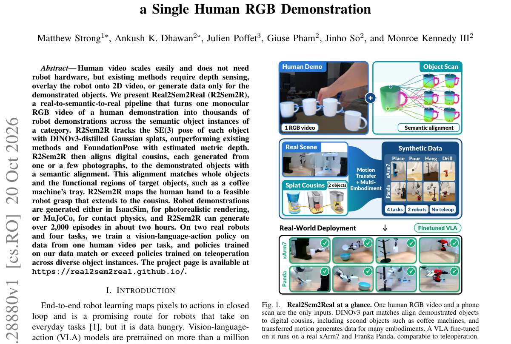

*Main result - Failure modes. Prior trackers lose objects, prior grasps collide with the ground, and prior meshes have poor textures. R2Sem2R tracks the mug, recovers collision-free grasps, and renders reali*

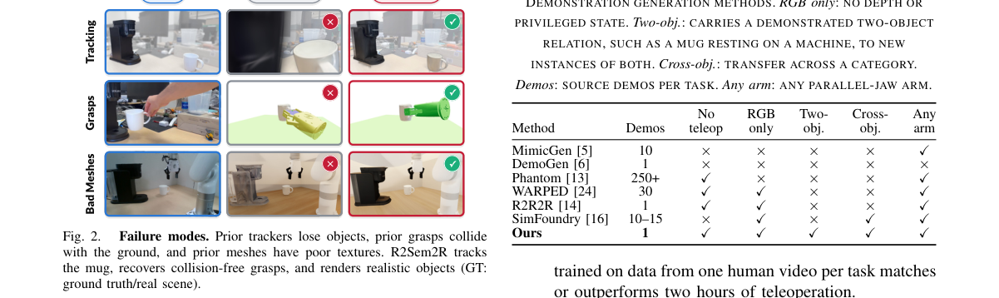

**Why this ranks #6**: 它用一条 real → semantic → real 的流水线，把**一段人类单目 RGB 演示**变成数千条机器人演示——绕开了机器人数据采集这个最贵的环节。

---

### 7. RangeNav: Task-Aligned LiDAR Range-Image Pretraining for Robot Navigation

**arXiv**: [2610.29845](https://arxiv.org/abs/2610.29845) | **Score**: 8.0 (relevance 8.0 x 0.7 + quality 8.0 x 0.3) | **Tags**: embodied-ai, world-model, navigation, lidar, RL-efficiency | **Categories**: cs.LG, cs.RO | **Pages**: 9

**Authors**: Samuel Foo Enze, Manthan Patel, Fan Yang, Linus Kramer, Pascal Roth, Marco Hutter, Cesar Cadena

**Affiliation**: ETH Zurich, Robotic Systems Lab

**Abstract**

> Autonomous mobile robots operating in dense crowds and cluttered sites require $360^\circ$ perception to react to surrounding hazards. While panoramic LiDAR offers full-surround coverage, learning representations within reinforcement learning (RL) is sample-inefficient under sparse rewards, and existing 3D pretrained point-cloud encoders are too memory-heavy for massively parallel RL simulation. We present RangeNav, a compact (183k parameters) LiDAR range-image encoder pretrained entirely on synthetic data. RangeNav uses anisotropic convolutions and circular padding to handle the extreme aspect ratio and azimuthal seam of range images. We pretrain the network using a navigation-aligned objective combining range reconstruction, semantic segmentation, and bird's-eye-view (BEV) prediction, then freeze it for policy learning. In simulation, adding semantic and BEV supervision increases success rates over a reconstruction-only baseline by an average of 32.03 and 23.73 percentage points (pp) in procedurally generated training and out-of-distribution realistic test environments, respectively. Zero-shot real-world deployments on a Unitree B2-W quadruped demonstrate robust navigation through dense crowds, low-light settings, and construction zones where limited-field-of-view depth policies struggle. Code and models will be open-sourced.

**Key findings**

- **Finding**: 密集人群与杂乱场所中的自主移动机器人需要 **360° 感知**来应对周边危险。
- **Finding**: 全景 LiDAR 提供全向覆盖，但在稀疏奖励下于其中学习表征**样本效率低**；既有 3D 预训练点云编码器对大规模并行 RL 仿真又太占内存。
- **Finding**: 作者提出 RangeNav：一个紧凑的（**183k 参数**）LiDAR 距离图编码器，**完全在合成数据上预训练**。
- **Finding**: 并用于 RL 导航。
- **Inference**: 把输入先降维到「距离图」这个结构化形式，让预训练既便宜又能直接对接 RL 仿真——这是很务实的组合：183k 参数意味着可以塞进并行仿真的预算里，而预训练全用合成数据又免去了真实采集。
- **Recommendation**: 推荐。做 LiDAR 感知、机器人导航或 RL 仿真效率的人应读。

**Key figures**

*Framework / architecture - System overview. (a) A mobile robot observes the environ- ment with LiDAR, odometry, and proprioception. (b) The LiDAR scan is projected into a panoramic range image. (c) Our pretrained encode*

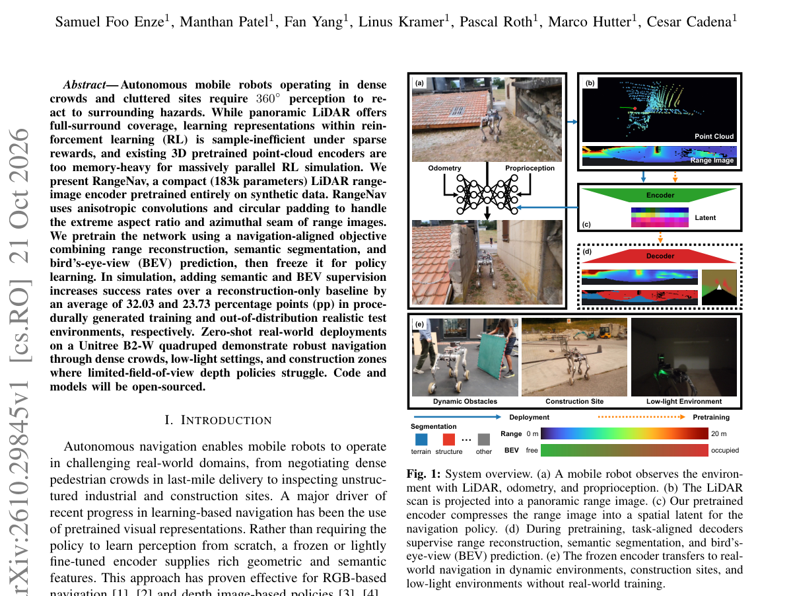

*Main result - Data processing for encoder pretraining. (a) Six dense depth views are fused in 3D and projected onto the target spherical LiDAR grid, then corrupted with noise and random masking to form the*

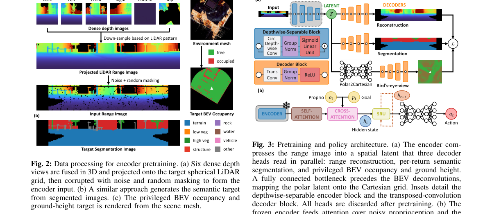

**Why this ranks #7**: 它把「全景 LiDAR 表示学习」和「稀疏奖励下的 RL 样本效率」这两个老问题接在一起，用一个 **183k 参数**的编码器解决。

---

### 8. DONIC: Generalist Dexterous Bimanual Tracking Control from Human Demonstrations

**arXiv**: [2610.29997](https://arxiv.org/abs/2610.29997) | **Score**: 8.0 (relevance 8.0 x 0.7 + quality 8.0 x 0.3) | **Tags**: embodied-ai, world-model, dexterous, bimanual, imitation-learning | **Categories**: cs.CV, cs.RO | **Pages**: 26

**Authors**: Mingze Sun, Ziang Cao, Yuan Fei, Qiankuan Tao, Zihan Wang, Tianqi Liu, Junhao Chen, Haiwen Diao et al.

**Affiliation**: Ropedia

**Abstract**

> Despite recent progress in dexterous reference tracking, existing models focus primarily on single-hand manipulation and a limited range of interactions, leaving the bimanual dexterous behaviors common in real life unaddressed. The scarcity of contact-rich bimanual manipulation data and the increased complexity of coordinating contacts make developing a generalist bimanual tracker particularly challenging. Therefore, we present 1) DONIC, the first generalist bimanual tracker jointly trained across operation categories and human-motion sources, together with 2) BiHOI, a multi-view dataset of 1,575 sequences spanning 229 objects and emphasizing sustained bimanual interaction, where reconstructed interactions are retargeted into robot references. DONIC combines proximal policy optimization with behavioral cloning in a feedback loop that recycles verified successful executions into training demonstrations. An object-centered per-hand reward maintains object-motion feedback while supervising each hand according to its reference contact role. Clip-Centered Advantages remove reference-dependent advantage offsets while preserving within-trajectory differences. Together, these designs enable one single policy to learn coordinated manipulation across heterogeneous references. Without finetuning, a single checkpoint achieves 86.79% success on unseen trajectories of training objects and 57.32% on held-out objects, surpassing the state-of-the-art bimanual tracking baselines by 77.36 and 45.73 percentage points.

**Key findings**

- **Finding**: 尽管灵巧参考跟踪已有进展，既有模型主要关注**单手操作**与有限的交互类型，**双手灵巧行为**这一现实常态未被处理。
- **Finding**: 接触密集的双手操作数据稀缺、接触协调复杂度高，使通用型双手跟踪器难以开发。
- **Finding**: 作者提出 DONIC：**首个跨操作类别联合训练的通用双手跟踪器**。
- **Inference**: 双手操作的难点不在于手的灵巧度，而在于两只手的接触必须协调——这使得数据更稀缺、目标更难定义。DONIC 把「通用 + 双手」放在一起做，绕开了单手范式的舒适区。
- **Recommendation**: 推荐。做灵巧操作、遥操作或模仿学习的人应读。

**Key figures**

*Framework / architecture - Overview of DONIC. BiHOI provides multi-view bimanual demonstrations that are reconstructed and retargeted to robot hands. DONIC learns a shared policy for diverse bimanual reference-tracki*

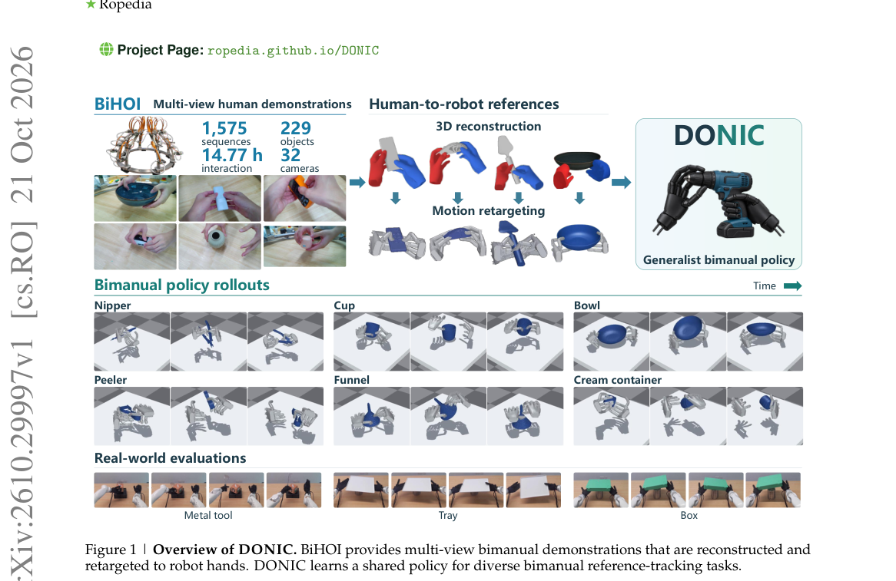

*Main result - Overview of DONIC. Top: BiHOI captures are reconstructed and retargeted, then com- bined with public-data references to form the training pool. Middle: A shared bimanual policy learns throu*

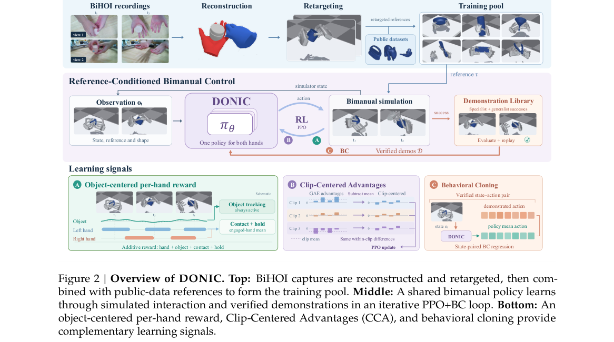

**Why this ranks #8**: 它填的是灵巧操作里最明显的一个洞：现有灵巧参考跟踪模型几乎都只做**单手**，而现实生活里最难的交互恰恰是双手。

---

### 9. T-WLA: Bridging Slow Vision and Fast Touch

**arXiv**: [2610.28814](https://arxiv.org/abs/2610.28814) | **Score**: 8.0 (relevance 8.0 x 0.7 + quality 8.0 x 0.3) | **Tags**: embodied-ai, world-model, tactile, world-language-action, latency | **Categories**: cs.RO | **Pages**: 27

**Authors**: Kaichen Zhou, Yuzhen Chen, Hannah Yao, Chonghe Jiang, Rao Fu, Xihang Yu, Wei Dai, Bashar Kabbarah et al.

**Affiliation**: Massachusetts Institute of Technology / Harvard University / University of California, Berkeley

**Abstract**

> In contact-rich manipulation, contact conditions can change before a visual policy updates its action plan. Recomputing the plan through the visual policy adds latency, while tactile feedback alone does not specify how the ongoing motion should be revised for the task. We introduce T-WLA, a world-language-action architecture that uses shared visual memory to guide both action generation and tactile correction. At each visual update, the visual branch integrates the current image, task instruction, and retrieved history into a visual memory that conditions base-action generation. The same memory is cached for a lightweight tactile editor, which combines it with the active action chunk and incoming touch to predict residual corrections to unexecuted actions without rerunning the visual branch. Future-image and future-pressure prediction provide training-only supervision, encouraging the visual memory and tactile features to capture interaction dynamics relevant to action generation and correction. We evaluate T-WLA on tactile-conditioned hand-motion prediction using EgoTouch and Tachin, and on four real-world dexterous manipulation tasks. T-WLA reduces finger-joint MPJPE by 30% relative to the strongest reported baseline and achieves an average success rate of approximately 50.0% across real-robot manipulation tasks. Videos and code are available at https://anonymous-submission-20.github.io/T-WLA.github.io/.

**Key findings**

- **Finding**: 在接触密集的操作中，**接触条件可能在视觉策略更新其动作计划之前就已改变**。
- **Finding**: 通过视觉策略重算计划会增加延迟，而**仅有触觉反馈又不足以说明正在进行的运动该如何为任务而修正**。
- **Finding**: T-WLA 是一种 **world-language-action 架构**，用**共享视觉记忆**同时引导动作生成与触觉修正。
- **Finding**: 每次视觉更新时，视觉分支融合当前图像、任务指令与检索到的历史，形成条件化基础动作生成的视觉记忆。
- **Finding**: 同一份记忆被缓存给一个**轻量触觉编辑器**，它把记忆与当前动作块和传入触觉结合，**在不重跑视觉分支的前提下**预测对尚未执行动作的残差修正。
- **Finding**: 未来图像与未来压力预测提供**仅训练时**的监督，鼓励视觉记忆与触觉特征捕捉与动作生成和修正相关的交互动态。
- **Finding**: 在 EgoTouch 与 Tachin 的触觉条件手部运动预测、以及四个真实灵巧操作任务上评测。
- **Finding**: T-WLA 相对最强已报道基线把手指关节 MPJPE **降低 30%**，真实机器人操作任务平均成功率约 **50.0%**。
- **Inference**: 「视觉慢、触觉快」这个时序差是本批触觉方向第三篇论文反复触及的主题。T-WLA 的解法是把视觉记忆缓存下来给触觉编辑器复用，从而在保持视觉决策质量的同时把修正延迟压下来——这比让触觉去「独立做决策」更合理。
- **Recommendation**: 强烈推荐。做触觉感知、灵巧操作或高频控制的人应读。

**Key figures**

*Framework / architecture - Tactile World–Language–Action (T-WLA). The visual branch uses current and past visual information to produce an action chunk and visual memory. Between visual updates, the tactile editor use*

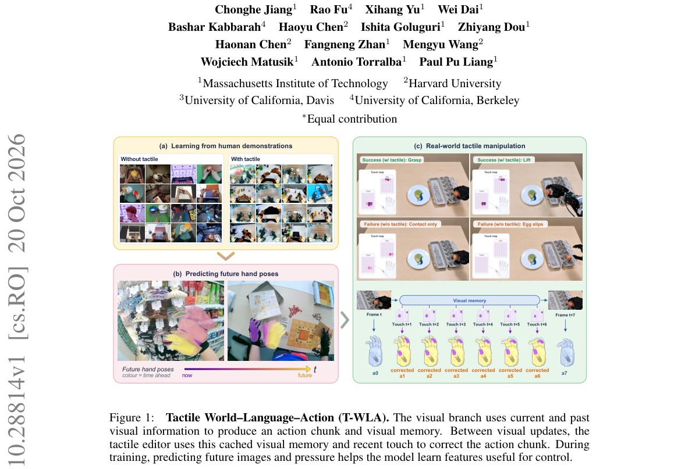

*Main result - Shared memory connects slow visual planning with fast tactile correction. Each visual update generates a base action chunk and visual memory. Between updates, the tactile editor reads this c*

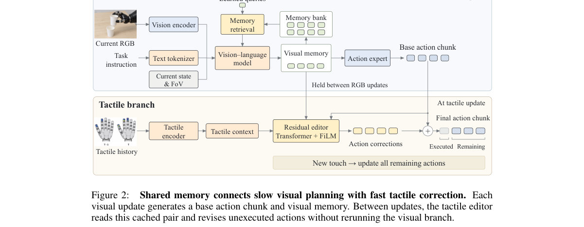

**Why this ranks #9**: 它指出了一个时序事实：接触条件**在视觉策略更新动作之前就已经变了**——所以触觉修正必须能在不重跑视觉分支的前提下完成。

---

### 10. CW-WAM: A Structured Contact-Wrench World Action Model for Force-Sensitive Manipulation

**arXiv**: [2610.30117](https://arxiv.org/abs/2610.30117) | **Score**: 8.0 (relevance 8.0 x 0.7 + quality 8.0 x 0.3) | **Tags**: embodied-ai, world-model, force-sensing, contact | **Categories**: cs.RO | **Pages**: 8

**Authors**: Houzhu Ding, Xinda Qi, Luqi Wang, Ming Yang

**Affiliation**: Ant Group

**Abstract**

> Force-sensitive manipulation requires contact and load information that is not provided explicitly by visual observations. We present CW-WAM, a world action model that jointly predicts video, motion, and contact wrench. Inspired by hybrid motion-force control, it contains a unified interaction module that treats both motion and contact wrench as modeling targets and predicts time-aligned motion-wrench chunks as control references. A pair-causal attention mechanism structures the motion-wrench dependencies, while a long fixed-length wrench memory retains past interaction information. The predicted wrench chunk acts as a force reference for a 20-Hz outer-loop admittance controller within a slow-fast control system that maintains force feedback and smooth motion between model queries. CW-WAM improves contact prediction and increases the insertion success rate from 25% to 70% for square pegs with 1-mm clearance per side and from 40% to 95% for power adapters, compared with WAM without wrench input. It also improves lifting-height accuracy across different loads. Our framework with an admittance controller reduces force-reference RMSE from 4.8 to 2.7 N for peg insertion and from 2.0 to 1.3 N for wiping, respectively, with smaller force fluctuations during successful execution. Project website: https://cw-wam-project.github.io/

**Key findings**

- **Finding**: 力敏感操作需要接触与负载信息，而视觉观测**不显式提供**这些。
- **Finding**: CW-WAM 是一个世界动作模型，**联合预测视频、运动与接触力矩（contact wrench）**。
- **Finding**: 受混合运动-力控制启发，它包含一个统一交互模块，把运动与接触力矩都当作建模目标，预测**时间对齐的运动-力矩块**作为控制参考。
- **Finding**: **成对因果注意力机制**组织运动与力矩的依赖关系；一条固定长度的力矩记忆保留过往交互信息。
- **Finding**: 预测的力矩块作为 **20 Hz 外环导纳控制器**的力参考，嵌在慢-快控制系统中，维持力反馈与模型查询之间的平滑运动。
- **Finding**: 相比不带力矩输入的 WAM：方销插入成功率 **25% → 70%**（每侧 1 mm 间隙），电源适配器 **40% → 95%**；不同负载下抬升高度精度也更准。
- **Finding**: 配合导纳控制器，力参考 RMSE 从 4.8 N 降到 2.7 N（销插入）、从 2.0 N 降到 1.3 N（擦拭），成功执行时力波动更小。
- **Inference**: 把接触力作为世界模型的一等输出，等于让模型自己「感觉到」接触——这比让下游控制器去猜接触状态可靠得多。1 mm 间隙方销 25%→70% 这个数字说明：视觉世界模型缺的不是分辨率，而是**接触这个模态**。
- **Recommendation**: 强烈推荐。做力控、精密装配或世界动作模型的人应读。

**Key figures**

*Framework / architecture - CW-WAM helps robots use contact forces to guide their movements. It learns from past motions and wrist force measurements to predict both how to move and the forces expected during contact. Th*

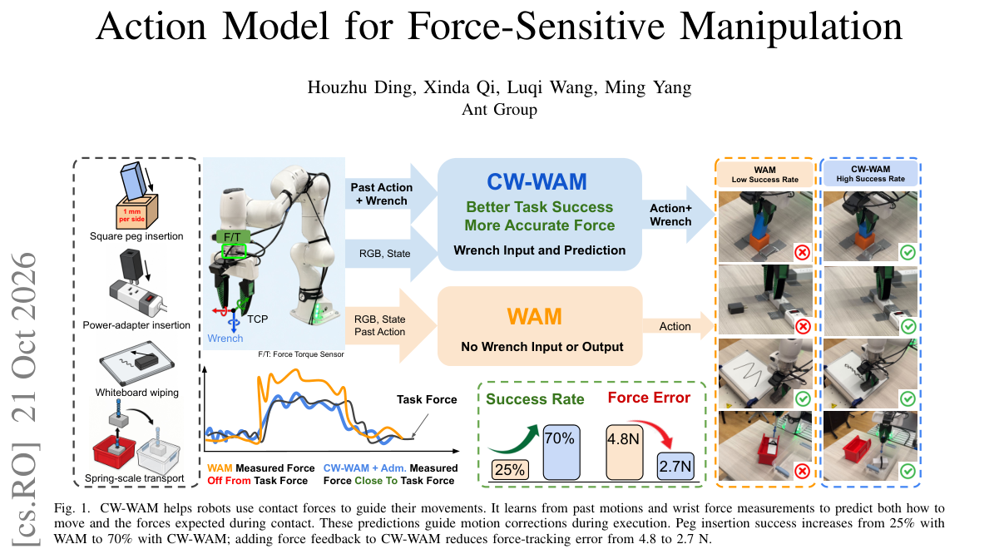

*Main result - CW-WAM jointly predicts video, motion, and wrench from visual observations, language, robot state, and interaction history. Paired motion–wrench tokens capture recent interactions, while long-*

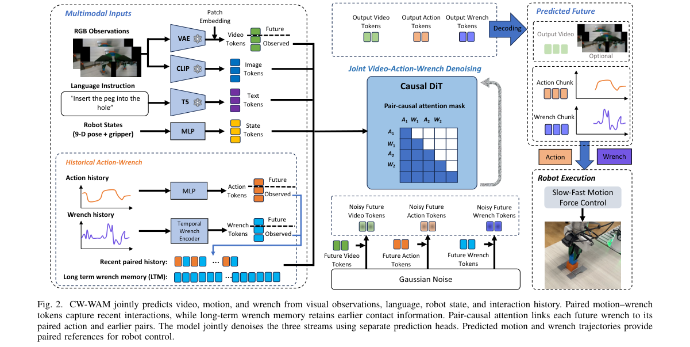

**Why this ranks #10**: 它补上了世界动作模型普遍缺的一块输出：**接触力**。结果是把 1mm 间隙方销的插入成功率从 25% 拉到 70%。

---

## Footer

- Total papers scanned across all 7 tracks: 568（原始 789 条）
- embodied track final top-10: 10
- Wild-cards in this track: 0
- Figure assets: 2026-10-22/res/

Generated by `mine-arxiv-daily-digest` skill. Sister file: `2026-10-22_embodied_entry.md`.
