# ArXiv Daily Digest - 2026-10-22 (强化学习 · 生成式内容模型, 10 papers)

**Generated**: 2026-10-22 17:00 CST

**Source**: arXiv cs.CV, cs.SD, eess.AS, cs.CL, cs.AI, cs.RO, cs.LG submissions, listing day 2026-10-21 (announced 2026-10-22 00:00 UTC)

**Batch window**: 2026-10-20T18:00:00Z .. 2026-10-21T18:00:00Z（arXiv 公告批次横跨两个 UTC 日：前一日 18:00 UTC 起算，当日 17:59:59 UTC 截止）

**Track**: rl_aigc (top 10 of 568 papers scanned, 105 full reads)

**Scope**: 扩散与流匹配上的 RL、偏好优化、生成式奖励模型

⚠️ **Wild-card**: 本批该线 3 篇为 wild-card 补足，已在正文逐条标注并给出理由。

---

## Top 10 - 强化学习 · 生成式内容模型

### 1. AdvFidelity: Unifying Preference Alignment and Few-Step Image Generation within Reinforcement Learning

**arXiv**: [2610.29380](https://arxiv.org/abs/2610.29380) | **Score**: 9.0 (relevance 9.0 x 0.7 + quality 9.0 x 0.3) | **Tags**: rl-aigc, reward-model-gen, few-step, adversarial-reward | **Categories**: cs.CV | **Pages**: 19

**Authors**: Sicong Kang, Fangao Zeng, Yuhan Li, Hao Zhou, Mengfei Xu, Wenxiang Shang, Wei Li, Bingbing Ni et al.

**Affiliation**: Taobao & Tmall group of Alibaba / Shanghai Jiao Tong University

**Abstract**

> Practical image generation requires both human preference alignment and few-step efficiency, yet combining reinforcement learning (RL) with distillation is often multi-stage and may erode RL gains We observe that few-step RL progressively improves structural coherence, even with specialized rewards, but leaves low-level artifacts that these rewards may fail to penalize. To address this gap, we propose AdvFidelity, which integrates artifact-sensitive fidelity supervision into RL through an online adversarial reward. This enables joint reward alignment and high-fidelity few-step generation within a single RL stage, without distribution matching distillation (DMD) or other explicit distillation objectives. We train a discriminator to rank high-quality references (positives) above content-matched reconstructions (negatives) produced by the current generator. Reconstructing moderately noised references largely preserves style and scene layout while exposing low-level degradations. This encourages the discriminator to assess artifacts rather than content differences. With negatives reconstructed online, alternating updates adapt fidelity supervision to the generator's evolving failure modes. References can come from existing target-domain data or full-step model samples. Built on LeapAlign, AdvFidelity backpropagates gradients from both rewards through the few-step sampling trajectories used at inference. Across two model backbones and three task settings, AdvFidelity matches full-step LeapAlign in alignment, task performance, and overall generation quality and remains highly competitive with other evaluated full-step RL methods, using only 4 or 8 steps without CFG.

**Key findings**

- **Finding**: 实际图像生成既需要人类偏好对齐，又需要少步效率，但把 RL 与蒸馏结合通常是**多阶段**的，且可能**侵蚀 RL 的收益**。
- **Finding**: 作者观察到：**少步 RL 逐步改善结构连贯性**，即便使用专门的奖励，但**留下低层伪影**——这些伪影可能是这些奖励**无法惩罚**的。
- **Finding**: AdvFidelity 通过**在线对抗奖励**把伪影敏感的保真监督整合进 RL。
- **Finding**: 在**少步 RL 本身**上工作，这正是社区所忽略的阶段。
- **Finding**: 动机在于**少步生成器所需的对齐信号与多步模型不同**。
- **Inference**: 少步生成器的失败模式不一样：结构大致对了，但细节有伪影，而人类偏好模型对伪影不敏感——所以偏好分数涨了，视觉质量没涨。这篇把「保真」和「偏好」拆成两个奖励源再合成，是针对少步阶段的正确解法。
- **Recommendation**: 强烈推荐。做少步图像生成、扩散 RL 或生成式奖励模型的人必读。

**Key figures**

*Framework / architecture - Motivation of AdvFidelity.*

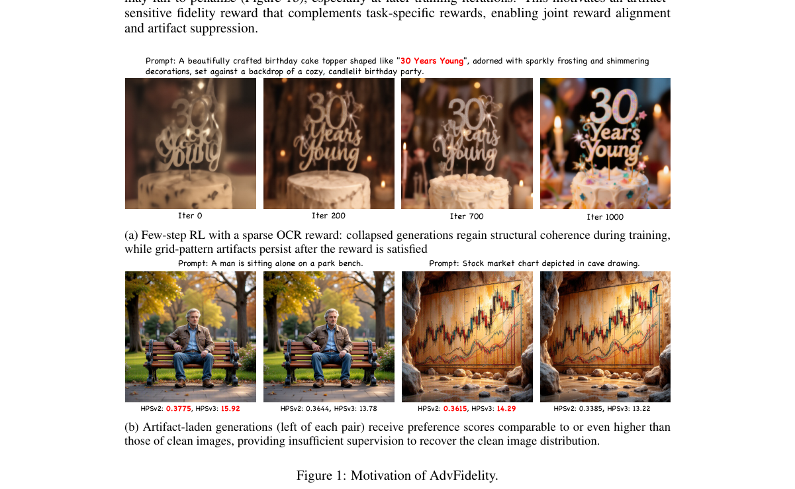

*Main result - Framework of AdvFidelity. (a) Joint RL update: the few-step generator Gθ (πθ) rolls out a trajectory from Gaussian noise x1 to the generated image x0, and is updated with both the task rewar*

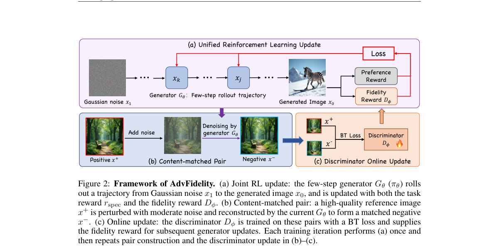

**Why this ranks #1**: 它诊断出「少步 RL」的一个具体盲区：结构变好了，**低层伪影还在**，因为奖励模型不惩罚它们——并用在线对抗奖励补上。

---

### 2. T-DIG: Text-Conditioned Diversity for Image Generation

**arXiv**: [2610.29003](https://arxiv.org/abs/2610.29003) | **Score**: 9.0 (relevance 9.0 x 0.7 + quality 9.0 x 0.3) | **Tags**: rl-aigc, reward-model-gen, text-to-image, diversity, open-weight | **Categories**: cs.CV | **Pages**: 35

**Authors**: Simran Khanuja, Rohit Gandikota, Gaurav Parmar, Graham Neubig

**Affiliation**: Carnegie Mellon University, Northeastern University

**Abstract**

> Text-to-image (T2I) platforms typically return several images per prompt so users can explore different visual interpretations and choose one that matches their intent. However, T2I models are usually optimized for single-image quality which comes at a cost of multi-image diversity, limiting this exploration. Diversity is also contextual: one user wants variations in background, while another wants them in artistic style, and the same user may later want variations in clothing. The generated images should differ along whatever axis the user cares about. In this paper, we introduce T-DIG, a text-conditioned diversity framework for image generation and editing. T-DIG is an iterative framework comprising multiple modules that lets users type prompts, inspect default generations, request variations using natural language, and continue refining outputs until they're satisfied. At its core, T-DIG uses an LLM policy that produces K axis-conditioned prompts or edit instructions for a frozen generator or editor. We train this policy with GRPO using a text-conditioned diversity reward and alignment penalties. Because the image generator remains frozen, T-DIG applies to open-weight, distilled, and proprietary models. We also release the first dataset for text-conditioned prompt diversity in image generation, with the training and validation splits built from human-written axes and a test set drawn from real user interactions with T-DIG. T-DIG far exceeds baselines in improving text-conditioned diversity, while preserving base-prompt alignment across a variety of metrics and human judgements. We show that user-directed diversity exploration can be added to a wide range of image generation models, open and closed, without the need to access their weights. Website: https://image-study.org/t-dig/

**Key findings**

- **Finding**: T2I 平台通常对每个 prompt 返回多张图，让用户探索不同视觉解读并挑一张。
- **Finding**: 但 T2I 模型通常针对**单图质量**优化，代价是**多图多样性**，限制了这种探索。
- **Finding**: 多样性还是**上下文相关**的：一个用户想要背景变化，另一个想要艺术风格变化，同一个用户之后还可能想要服装变化。
- **Finding**: 作者提出 **T-DIG**，一个文本条件的多样性框架，覆盖图像生成与编辑。
- **Finding**: 它是一个迭代框架：用户输入 prompt、检查默认生成、用自然语言请求变化、继续精修输出。
- **Finding**: 核心是一个 **LLM 策略**，为**冻结的**生成器或编辑器产生 K 个轴条件化的 prompt 或编辑指令。
- **Finding**: 该策略用 **GRPO** 训练，使用**文本条件的多样性奖励**与对齐惩罚。
- **Finding**: 由于图像生成器保持冻结，T-DIG 可应用于**开源权重、蒸馏模型与专有模型**。
- **Finding**: 作者还发布了**首个文本条件 prompt 多样性数据集**（训练/验证划分基于人写轴，测试集取自 T-DIG 的真实用户交互）。
- **Finding**: T-DIG 在提升文本条件多样性上远超基线，同时在多项指标与人工评判上保持基础 prompt 对齐。
- **Finding**: 项目页：https://image-study.org/t-dig/
- **Inference**: 「多样性是有维度的」这个观察和实现方式都很干净：把「往哪个方向变」交给一个可训练的 LLM 策略，生成器完全冻结——所以这套方法能立刻用在闭源 API 上，这在 RL-for-generation 里并不常见。
- **Recommendation**: 强烈推荐。做 T2I 多样性、偏好优化或希望把 RL 用到闭源生成模型上的人必读。

**Key figures**

*Framework / architecture - Text-conditioned Diversity: For one prompt, i.i.d. sampling and prior methods return one set regardless of what the user wants to vary; T-DIG produces a different set for each text-condition*

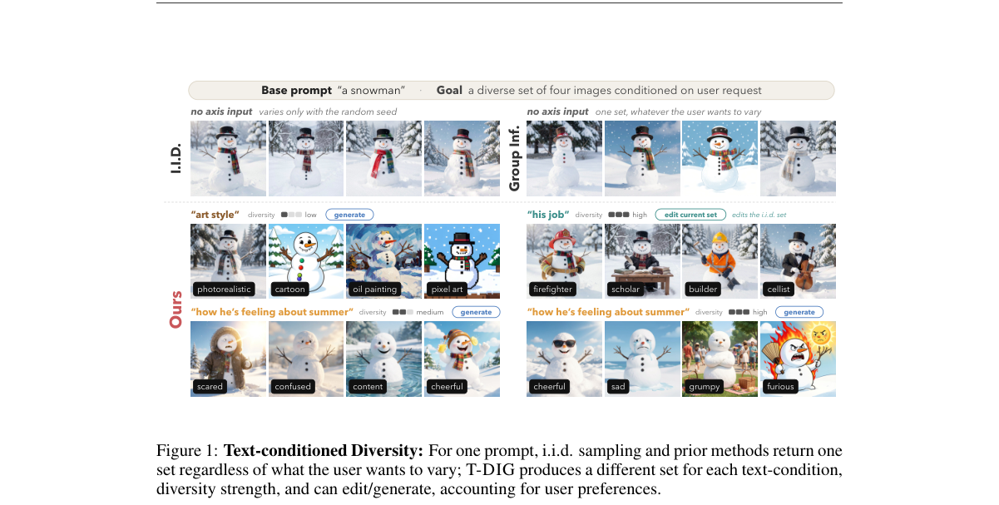

*Main result - T-DIG framework. After inspecting default samples, the user writes an axis or picks a suggested one, sets the diversity strength, and chooses to generate a new set or edit the current one. A*

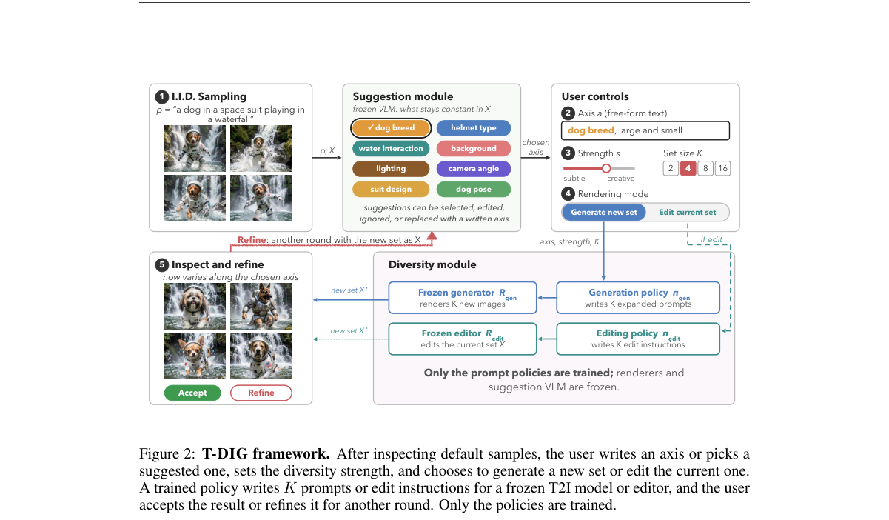

**Why this ranks #2**: 它把 T2I 平台的一个真实产品需求——「同一 prompt 出多张图，要能按用户指定的方向变化」——做成了带 GRPO 训练的策略，而且**不碰生成器权重**。

---

### 3. CineEvolve: An Agentic Self-Evolution Framework for Cinematic Multi-Shot Video Generation

**arXiv**: [2610.29590](https://arxiv.org/abs/2610.29590) | **Score**: 8.3 (relevance 8.0 x 0.7 + quality 9.0 x 0.3) | **Tags**: rl-aigc, reward-model-gen, video-generation, multi-shot, agentic-RL | **Categories**: cs.CV | **Pages**: 11

**Authors**: Jingzhe Zhang, Peixuan Zhang, Genying Li, Bing Ma, Shuchen Weng, Si Li, Boxin Shi

**Affiliation**: School of Artificial Intelligence, Beijing University of Posts and Telecommunications / State Key Laboratory of Multimedia Information Processing, School of Computer Science, Peking University / National Engineering Research Center of Visual Technology, School of Computer Science, Peking University / Beijing Academy of Artificial Intelligence

**Abstract**

> Cinematic multi-shot video generation requires both narrative planning and iterative refinement. Existing methods either lack narrative reasoning or rely on feed-forward workflows without policy updates. In this paper, we propose CineEvolve, an agentic self-evolution framework for cinematic multi-shot video generation that unifies a Director and a Critic within a single vision-language policy. Emulating real-world filmmaking that couples iterative direction with critical feedback, we train CineEvolve via alternating reinforcement learning, where the Director surfaces flaws to sharpen the Critic, and the updated Critic guides the Director's targeted revisions. To stabilize co-evolution, we introduce Evolutionary GRPO (E-GRPO), leveraging historical anchoring and revision safeguarding to mitigate advantage inflation. Additionally, we contribute CineTraj, a 40K cinematic trajectory dataset spanning creation, critique, and revision. Extensive experiments demonstrate that CineEvolve outperforms existing approaches. Our code will be available at https://github.com/JingZhe-8/CineEvolve.

**Key findings**

- **Finding**: 电影级多镜头视频生成既需要**叙事规划**也需要**迭代精修**。
- **Finding**: 既有方法要么缺乏叙事推理，要么依赖**没有策略更新**的前馈工作流。
- **Finding**: CineEvolve 是一个面向电影级多镜头视频生成的**智能体自进化框架**，在**单个视觉语言策略**内统一了 Director 与 Critic。
- **Finding**: 模仿真实电影制作中迭代指导与批判反馈的耦合，作者用**交替强化学习**训练 CineEvolve：Director 暴露缺陷以磨砺 Critic，更新后的 Critic 再指导 Director 的定向修改。
- **Finding**: 为稳定协同进化，作者引入 **Evolutionary GRPO（E-GRPO）**，利用**历史锚定**与**修改保护**来缓解**优势膨胀**。
- **Finding**: 另贡献 **CineTraj**，一个 4 万条的电影级轨迹数据集，覆盖创作、批判与修改。
- **Finding**: 大量实验显示 CineEvolve 优于既有方法。
- **Inference**: 把「生成—批评」做成双角色协同进化，而不是两个独立模型或一个带 critic 头的策略，好处是两者共享同一个策略基座、可以互相塑造。E-GRPO 里的优势膨胀是这类交替训练的典型病灶，用历史锚定来治是对症的。
- **Recommendation**: 强烈推荐。做视频生成、多镜头叙事或 RL 自进化的人应读。

**Key figures**

*Framework / architecture - Illustration of our proposed CineEvolve for multi-shot video generation. (a) Existing visual-based and agentic-based methods suffer from narrative reasoning deficiency and static workflow ri*

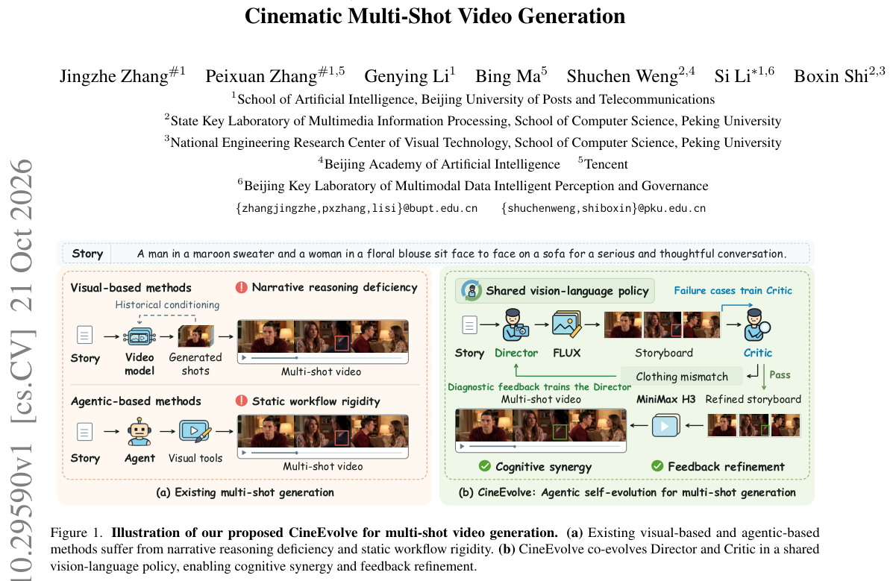

*Main result - Overview of the CineTraj construction pipeline. (a) Movie scenes are curated through deduplication, shot segmentation and grouping, and quality filtering. (b) The teacher Director con- verts*

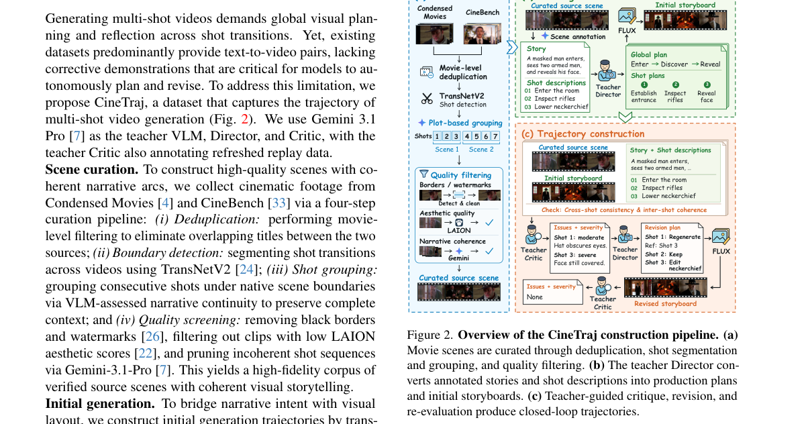

**Why this ranks #3**: 它把「导演—批评」的循环形式化为**两个角色的协同进化 RL**，并用 Evolutionary GRPO 解决优势膨胀这个稳定性问题。

---

### 4. DualHeads: Reward-tilted few-step diffusion made simple

**arXiv**: [2610.28858](https://arxiv.org/abs/2610.28858) | **Score**: 8.3 (relevance 8.0 x 0.7 + quality 9.0 x 0.3) | **Tags**: rl-aigc, reward-model-gen, few-step, training-free | **Categories**: cs.AI, cs.CV, cs.LG | **Pages**: 22

**Authors**: Yuanzhi Zhu, Eleftherios Tsonis, Simo Alami Chehboune, Xi Wang, Stéphane Lathuilière, Vicky Kalogeiton

**Affiliation**: LIX, ´Ecole Polytechnique, CNRS, IPP / Inria at Univ. Grenoble Alpes, CNRS, LJK

**Abstract**

> Distilled diffusion models generate high-quality images in a few sampling steps, but aligning them with task requirements and human preferences is difficult. Methods developed for multi-step diffusion models rely on differentiable rewards, or on score fields and stochastic trajectories that distilled generators may lack. We ask whether a few-step generator can be adapted using only external reward evaluations and reference samples, and show that two binary classifiers suffice. Our method, DualHeads, implements them as lightweight heads on a frozen diffusion backbone. The reward head learns which samples of the same prompt score higher, the reference head separates reference images from generated ones, and the generator maximizes a weighted sum of their logits. When the heads are optimal, this objective is KL-regularized maximization of the learned reward, and the ratio of head weights sets the regularization strength. Empirically, with both rule-based and model-based rewards, a few-step DualHeads generator reaches task rewards close to those of 40-step reinforcement learning methods while preserving image quality, at no extra inference cost. We hope that this simple and elegant dual-head formulation will help advance few-step reward-tilted generation.

**Key findings**

- **Finding**: 蒸馏扩散模型能以少采样步数生成高质量图像，但**与任务需求和人类偏好对齐很困难**。
- **Finding**: 为多步扩散模型开发的方法依赖**可微奖励**，或依赖蒸馏生成器可能不具备的**分数场与随机轨迹**。
- **Finding**: 作者问：一个少步生成器能否**仅用外部奖励评估与参考样本**来适配？并证明**两个二分类器就足够**。
- **Finding**: DualHeads 把它们实现为**冻结扩散骨干上的轻量头**：
- **Finding**: **奖励头**学习同一 prompt 的哪些样本得分更高，**参考头**区分参考图与生成图，生成器最大化两者 logits 的加权和。
- **Finding**: 当两头最优时，该目标是**学习到的奖励的 KL 正则化最大化**，而**两头权重之比设定正则化强度**。
- **Finding**: 实证上，用规则型与模型型两种奖励，少步 DualHeads 生成器达到接近 **40 步 RL 方法**的任务奖励，同时保持图像质量，**且推理无额外开销**。
- **Inference**: 这篇的价值在于证明「对齐信号」和「梯度可微性」可以解耦：只要能比较「哪个更好」和「哪个更像参考」，就能在没有可微奖励的少步模型上做偏好优化，而且推理端零成本。对蒸馏模型时代的 RLHF 路线是一份很实用的配方。
- **Recommendation**: 强烈推荐。做少步/蒸馏扩散、对齐或奖励模型的人必读。

**Key figures**

*Framework / architecture - Four-step samples from DualHeads. Z-Image-Turbo (Jiang et al., 2026) fine-tuned with DualHeads using the HPSv3 reward (Ma et al., 2025).*

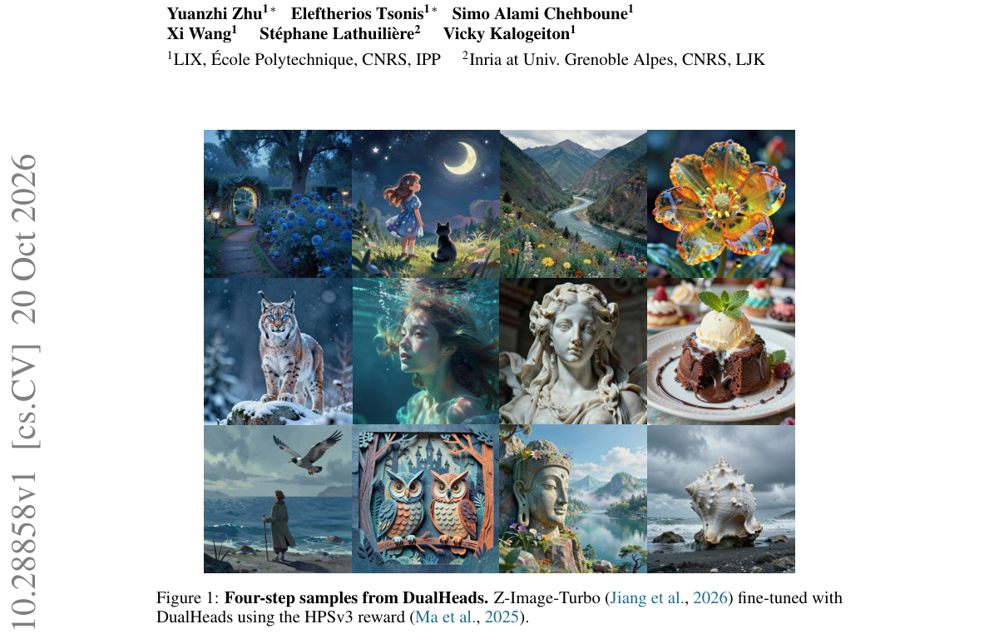

*Main result - Generator update of DualHeads. The generator fθ first rolls out N steps from noise without gradient; the endpoint x1 is re-noised to xti, from which fθ predicts ˆx1 in one differentiable ste*

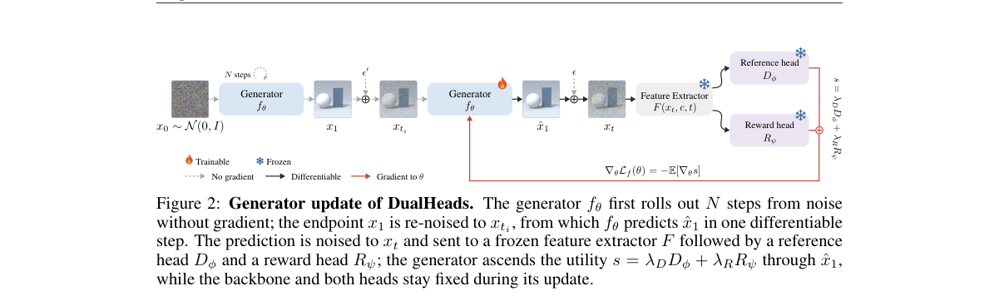

**Why this ranks #4**: 它问了一个很尖锐的问题：少步扩散生成器**没有可微奖励、也没有分数场**，那还能不能对齐？答案是：两个二分类头就够了。

---

### 5. When Do Gaussian Priors Fail? A Latent Geometry Investigation of RL Fine-Tuning

**arXiv**: [2610.28849](https://arxiv.org/abs/2610.28849) | **Score**: 8.3 (relevance 8.0 x 0.7 + quality 9.0 x 0.3) | **Tags**: rl-aigc, reward-model-gen, latent-diffusion, geometry, theory | **Categories**: cs.AI, cs.LG | **Pages**: 49

**Authors**: Wang Ru

**Affiliation**: Tsinghua University / Corresponding author:; ORCiD 0000-0002-2362-3214.

**Abstract**

> Latent diffusion models almost universally place a Gaussian prior on the VAE latent space. For base generation this default is unproblematic; under reinforcement-learning fine-tuning, however, it carries a structural limitation. The standard VAE's KL term does not merely ignore mode structure - it actively taxes separation and tightness. When data are multimodal, the ELBO optimum compresses distinct modes into an overlapping latent. RL fine-tuning amplifies this overlap: the score network is under-resolved on the saddle region between modes, dynamic-to-variational amplification rises sharply, and the collapse boundary beta_c is pushed far above its variational scale. On the real alanine-dipeptide Boltzmann distribution, a Gaussian-prior VAE collapses at beta_c = 0.224 while a mode-tracked Gaussian-mixture prior collapses at 0.00316, a 71x gap from the same pipeline. We trace this gap to a single geometric mediator, d_min/(2 sigma_0), and verify the causal chain through controlled interventions: moving geometry at fixed prior, and switching prior at matched geometry (full mediation; prior-label coefficient 0.995x, 95% CI [0.79, 1.25]). A three-source decomposition localises the amplification to the learned policy (zero ODE-solver contribution, bounded anchor mismatch); the coverage plateau is an unconditional benefit of mode-separating priors that no amount of RL capacity recovers. The remedy is conditional: a non-Gaussian prior is necessary precisely when the latent geometry would fall into overlap and the task is coverage-sensitive. A machine-checked theory skeleton supports the KL pricing structure - a divergent compactness tax under a Gaussian prior versus a finite assignment fee under a mixture - and the position-versus-plateau distinction delimits what is finite-resource from what requires changing the prior.

**Key findings**

- **Finding**: 潜扩散模型几乎普遍在 VAE 潜空间上放置**高斯先验**；对基础生成这没问题，但在**强化学习微调**下它带来结构性限制。
- **Finding**: 标准 VAE 的 KL 项不只是**忽略**模式结构——它**主动对分离度与紧致度征税**。
- **Finding**: 数据是多模态时，ELBO 最优解会把不同模式压进**重叠**的潜空间。
- **Finding**: **RL 微调会放大这种重叠**：分数网络在模式间的鞍区欠分辨，dynamic-to-variational 放大急剧上升，崩溃边界 beta_c 被推到远超其变分尺度。
- **Finding**: 在真实的 alanine-dipeptide Boltzmann 分布上，高斯先验 VAE 在 beta_c = 0.224 崩溃，而**模式跟踪的高斯混合先验在 0.00316 崩溃——同一流水线下 71 倍的差距**。
- **Finding**: 作者把这一差距追溯到单一几何中介量 d_min/(2 sigma_0)，并通过受控干预验证因果链：固定先验移动几何、以及匹配几何切换先验（**完全中介**，先验标签系数 0.995x，95% CI [0.79, 1.25]）。
- **Finding**: 三源分解把放大定位到**学到的策略**（ODE 求解器零贡献，锚点不匹配有界）；
- **Finding**: **覆盖率的平台期是模式分离先验的无条件收益，再多 RL 容量也换不回来**。
- **Finding**: 解法是有条件的：**当潜几何会落入重叠且任务对覆盖敏感时，非高斯先验是必需的**。
- **Inference**: 这是本批最「基础」但可能最重要的一篇：它说明 RL 微调的失败不一定是 RL 的问题，可能是**你的先验在收租**。71 倍的崩溃边界差与完全中介的因果识别，让「换个先验」成为一个可验证的工程决策而非玄学。
- **Recommendation**: 强烈推荐。做潜扩散 RL 微调、VAE 先验设计或做覆盖率/多样性评测的人必读。

**Key figures**

*Framework / architecture - Overview. (a) The data are multimodal: several separated modes in data space. (b) The VAE prior sets the latent separation-to-width ratio dmin/(2σ0): under a Gaussian prior the modes can ove*

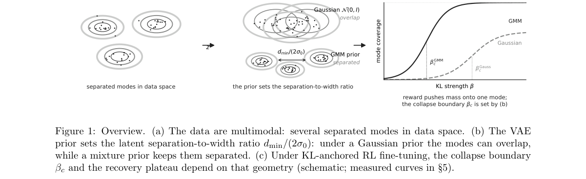

*Main result - Experiment Z: latent geometry during VAE training. Identical architecture and pack (K=10, d=8 →2, dsep=5) trained under N(0, I) and under a label-tracked GMM prior (VaDE-style, switched on a*

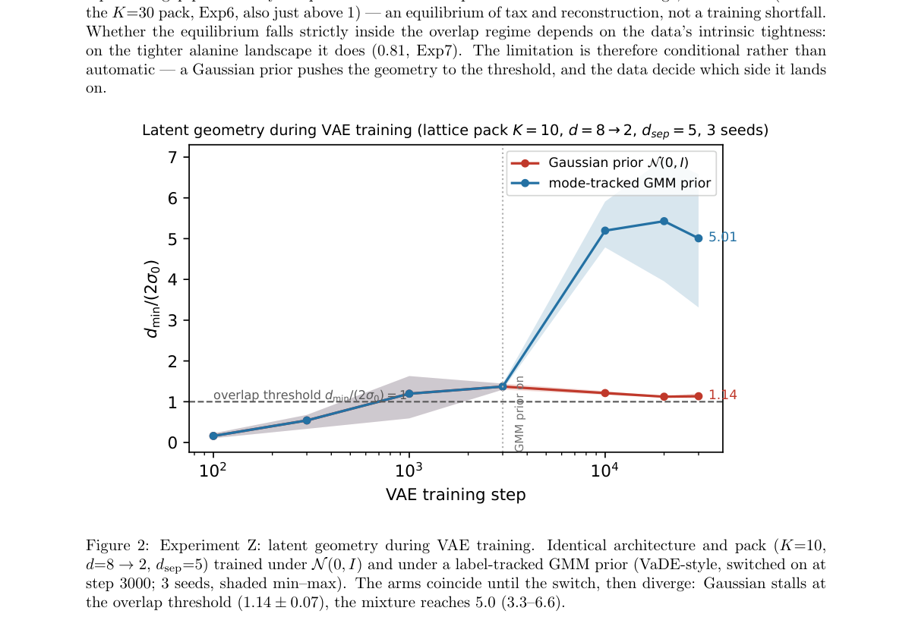

**Why this ranks #5**: 它用一个 71 倍的崩溃边界差值说明了一件被完全忽略的事：**VAE 的高斯先验不是无害的默认值，在 RL 微调下它会主动「征税」模式分离**。

---

### 6. Agentic Music Post-Production

**arXiv**: [2610.29093](https://arxiv.org/abs/2610.29093) | **Score**: 7.6 (relevance 7.0 x 0.7 + quality 9.0 x 0.3) | **Tags**: rl-aigc, reward-model-gen, music, preference-optimization | **Categories**: cs.AI, cs.SD | **Pages**: 22

**Authors**: Jaywon Koo, Junghyun Koo, Marco A. Martinez-Ramirez, Wei-Hsiang Liao, Seungheon Doh, Qiyu Wu, Vicente Ordonez, Yuki Mitsufuji

**Affiliation**: Rice University, Sony

**Abstract**

> We introduce MixAgent, an agentic pipeline for music post-production that follows the workflow of audio engineers to build interpretable and editable mixing plans guided by a reference song. A grouping agent first routes related input tracks, such as drum recordings, into subgroups. A planning agent then uses retrieved examples to choose and order audio effects, such as volume control and reverb, for tracks, subgroups, and the full mix. To refine the mix, a detector identifies what needs correction, and a critic proposes numerical parameter adjustments from tracks to the full mix. In our experiments, prompting recent multimodal models to listen and revise often worsens the mix, making reliable correction a central challenge. We therefore build MixCritic, a dataset of 45,657 repair critiques derived from parameters fitted to professional mixes, and train the critic with supervised fine-tuning followed by preference optimization on rendered audio outcomes. On MedleyDB, learned refinement reduces error by 19% relative to the initial mix, with preference optimization reducing it by 8.4% over supervised training alone. Retrieved examples further improve effects selection, and a human listening test shows that MixAgent gets higher quality ratings than mixes produced by Qwen3-Omni, Gemini 3.8 Flash and GPT-4o-audio.

**Key findings**

- **Finding**: 作者提出 MixAgent，一个遵循混音工程师工作流的**智能体化音乐后期制作**流水线，产出**可解释、可编辑**的混音方案，由一首参考歌曲引导。
- **Finding**: 一个**分组智能体**先把相关输入音轨（如鼓录音）路由到子组；
- **Finding**: 一个**规划智能体**用检索到的示例为音轨、子组与整体混音选择并排序音频效果（音量控制、混响等）；
- **Finding**: 为精修混音，一个**检测器**识别需要修正之处，一个**批评者**从音轨到整体混音提出**数值参数调整**。
- **Finding**: 实验中，让近期多模态模型**听并修改**通常会**让混音变差**，因此可靠修正是核心挑战。
- **Finding**: 作者因此构建 **MixCritic**：一个 **45,657 条**修复批评数据集，源自拟合到专业混音的参数，并用监督微调后**在渲染音频结果上做偏好优化**训练批评者。
- **Finding**: 在 MedleyDB 上，学习到的精修使误差相对初始混音降低 **19%**，其中**偏好优化比纯监督训练再降 8.4%**。
- **Finding**: 检索到的示例进一步改善效果选择；
- **Finding**: **人工听测显示 MixAgent 的质量评分高于 Qwen3-Omni、Gemini 3.8 Flash 与 GPT-4o-audio 生成的混音**。
- **Inference**: 「模型听着改会改坏」是个反直觉但很可信的观察：混音是参数空间的精确操作，靠自然语言反馈无法替代数值搜索。这篇的做法——把评判与参数建议分开、用渲染结果做偏好优化——恰好绕开了这个失效点。
- **Recommendation**: 强烈推荐。做音乐生成、音频编辑、或研究「生成式评审 + 偏好优化」这条路线的人应读。

**Key figures**

*Framework / architecture - Comparison of music post-production work- flows. (a) Neural mixing systems predict final mixes or audio effects settings without explicit critique–revision loops. (b) Prior LLM-based approac*

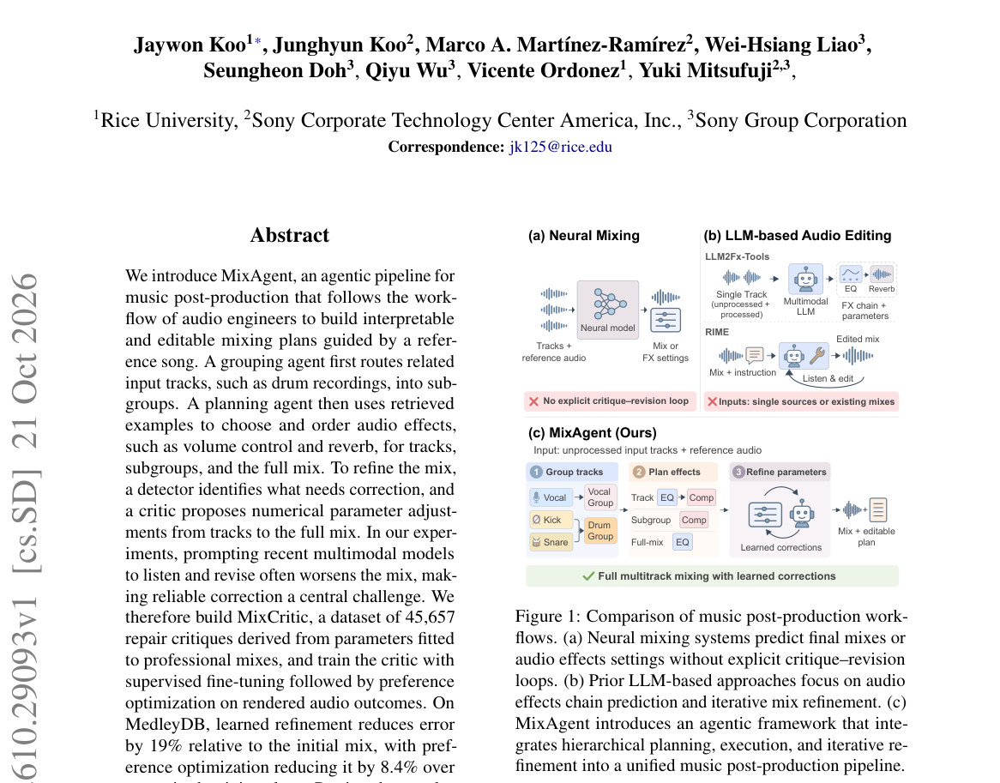

*Main result - Overview of MixAgent. (a) The grouping agent assigns tracks to subgroups. (b) Using retrieved examples, the planner selects audio effects chains sequentially at the track, subgroup, and full*

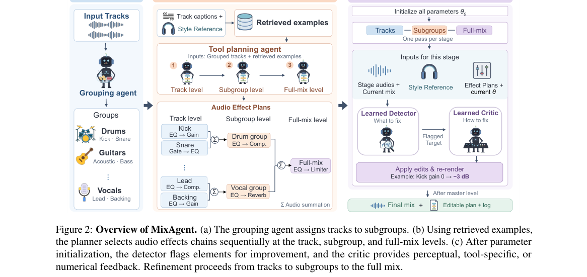

**Why this ranks #6**: 它给出了一个很实用的负面结果：**让多模态模型「听着改」通常会把混音改坏**——所以真正需要优化的是判据，而不是让模型自己品评。

---

### 7. HorizonComposer: Spatiotemporally Consistent Driving Video Editing with Enriched Traffic Semantics

**arXiv**: [2610.28829](https://arxiv.org/abs/2610.28829) | **Score**: 7.3 (relevance 7.0 x 0.7 + quality 8.0 x 0.3) | **Tags**: rl-aigc, reward-model-gen, video-editing, driving | **Categories**: cs.CV | **Pages**: 34

**Authors**: Mauricio Soroco, Yuqiu Liu, Zaid Tasneem, Francesco Pittaluga, Abhishek Aich, Wuyang Chen, Manmohan Chandraker, Ziyu Jiang

**Affiliation**: Simon Fraser University, NEC Labs America

**Abstract**

> Instruction-guided video generative models offer a scalable solution for stress-testing autonomous driving systems by simulating diverse environmental conditions. However, driving scenes operate within a dense Operational Design Domain (ODD) governed by strict traffic semantics. When applied to global driving-condition edits, general-purpose instruction-guided video editors frequently corrupt these semantics, leading to structural hallucinations and ``temporal shock.'' This work distills and protects traffic semantics during video editing at three levels. First, we construct a hybrid dataset by combining temporally aligned real-world videos with synthetic edits, balancing foundational scene structure with unambiguous appearance signals. Second, during training, we adapt advantage conditioning from offline reinforcement learning to align the model using dense rewards. We extract dense, pixel-level rewards from the hybrid data to serve as a localized signal and actively steer generation toward structurally reliable pixels. Finally, our model mitigates temporal shock by introducing thinking frames, a transition mechanism that seamlessly reconciles static image conditioning with dynamic video context. Extensive experiments demonstrate that our method prevents the corruption of multi-actor dynamics, establishing state-of-the-art spatiotemporal consistency, yielding consistent user preference (39% relative improvement in content preservation and 12% in temporal consistency), and achieving a significant 5% gain in downstream road line segmentation and 7% gain in downstream multi-object detection.

**Key findings**

- **Finding**: 指令引导的视频生成模型为压力测试自动驾驶系统提供了可扩展手段，可模拟多样环境条件。
- **Finding**: 驾驶场景受严格交通语义构成的 ODD 支配；施加全局驾驶条件编辑时，通用指令引导视频编辑器**经常破坏这些语义**，导致结构幻觉与**时间震荡（temporal shock）**。
- **Finding**: 作者在**三个层级**上蒸馏并保护交通语义。
- **Finding**: 第一，用时间对齐的真实视频与合成编辑构建**混合数据集**，平衡基础场景结构与无歧义外观信号。
- **Finding**: 第二，训练时把**来自离线强化学习的优势条件化（advantage conditioning）**改造为用**稠密奖励**对齐模型；作者从混合数据中抽取**稠密、像素级奖励**作为局部信号，主动把生成导向结构可靠的像素。
- **Finding**: 第三，引入 **thinking frames** 这一过渡机制，在静态图像条件与动态视频上下文之间做无缝调和，以缓解时间震荡。
- **Finding**: 实验表明该方法**防止了多主体动态的破坏**，取得时空一致性 SOTA，
- **Finding**: 用户偏好一致（内容保持相对提升 **39%**，时间一致性 **12%**），
- **Finding**: 并带来下游道路线分割 **5%** 与多目标检测 **7%** 的增益。
- **Inference**: 把「语义崩坏」当作奖励稀疏问题来处理——用像素级稠密奖励替代通用偏好——是这篇的实质贡献。而且它把下游检测/分割增益一并验证了，说明这不是纯视觉指标上的胜利。
- **Recommendation**: 推荐。做视频编辑、驾驶场景生成或「用稠密奖励解决结构崩坏」这条路线的人应读。

**Key figures**

*Framework / architecture - HorizonComposer maintains complex traffic semantics during global appearance editing (rows 1-3) using a careful design across data (Sec 3.2), model (Sec. 3.4), and training (Sec. 3.3). Be- y*

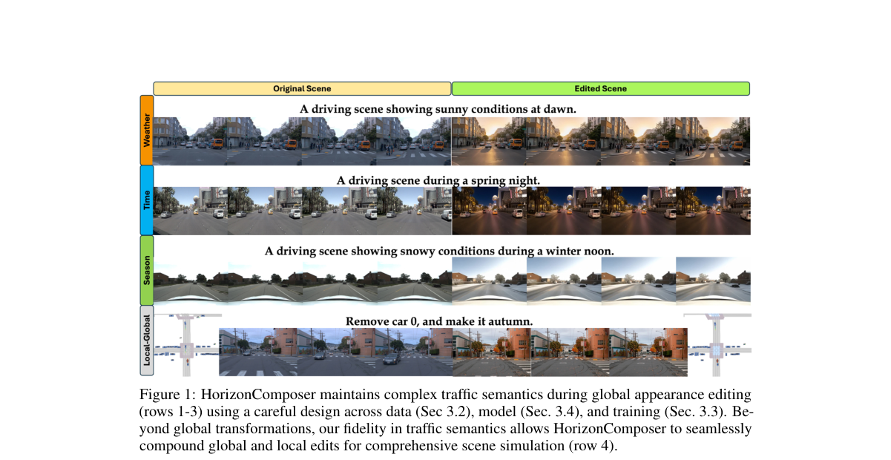

*Main result - Dataset Construction and Pseudo-Labeling Pipeline. (Top) Realistic Dataset Devel- opment : Real-world data (Sec. 3.2.1) are matched via pose alignment, temporally filtered, and processed to*

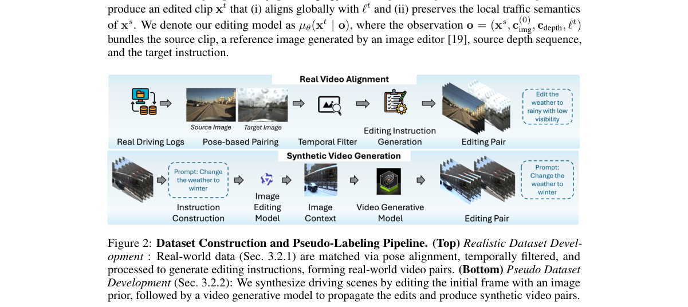

**Why this ranks #7**: 它把「视频编辑时保不住交通语义」当作**奖励设计问题**来解：从混合数据里抽像素级稠密奖励，替代通用的人类偏好信号。

---

### 8. How Do DiTs Denoise? An Aggregator-Predictor View of Attention and MLPs

**arXiv**: [2610.29854](https://arxiv.org/abs/2610.29854) | **Score**: 6.9 (relevance 6.0 x 0.7 + quality 9.0 x 0.3) | **Tags**: rl-aigc, reward-model-gen, DiT, interpretability, theory | **Categories**: cs.CV, stat.ML | **Pages**: 49 | **[wild-card=yes]**

**Authors**: Gyeonghun Kang, William Xingxu Chen, Xiang Cheng

**Affiliation**: Duke University

**Abstract**

> How do diffusion transformers (DiTs) represent image content and learn rules for reusing it to generalize? We develop an aggregator--predictor view of DiTs as input-adaptive local denoisers, in which context aggregation and patch prediction provide functional roles for interpreting attention and MLPs. We first establish that, for Gaussian Markov random field (GMRF) priors, the global Bayes denoiser can be approximated using only a subset of context patches, with error decaying exponentially in context radius. We further show that patchwise linear denoisers, often invoked to explain diffusion generalization, recover the empirical local denoiser with sufficiently informative aggregation. Within this view, AdaLN-modulated attention naturally parameterizes an input- and noise-dependent aggregator, while the MLP admits a learned key--value representation for tokenwise patch prediction. Our experiments support this view. DiTs trained on real images exhibit noise-dependent denoising contexts resembling those in the analytic GMRF setting, while attention mass exhibits a qualitatively corresponding broadening pattern. In a controlled CelebA64 study, shared-memory patch predictors used in place of DiT MLPs achieve competitive denoising and generative performance. Finally, cross-dataset component transplantation reveals compatibility patterns consistent with the proposed roles of QK in spatial weighting, VO in feature transport, and MLPs in patch prediction. Together, these results provide a component-level account of DiT denoising and motivate architecture-specific fine-tuning and controlled intervention.

**Key findings**

- **Finding**: 作者问：扩散 Transformer（DiT）**如何表示图像内容**、又如何**学习复用它的规则**来泛化？
- **Finding**: 他们发展出 DiT 的**聚合器—预测器视角**，把 DiT 视为输入自适应的局部去噪器，其中上下文聚合与 patch 预测为解释注意力与 MLP 提供功能角色。
- **Finding**: 首先证明：对高斯马尔可夫随机场（GMRF）先验，**全局贝叶斯去噪器可以用上下文 patch 的一个子集近似**，误差随上下文半径**指数衰减**。
- **Finding**: 接着证明常被用来解释扩散泛化的**逐 patch 线性去噪器**，在聚合足够信息时能恢复经验局部去噪器。
- **Finding**: 在该视角下，**AdaLN 调制的注意力**自然地参数化了一个输入与噪声相关的聚合器，而 **MLP 则容许一个学习到的 key-value 表示用于 token 级的 patch 预测**。
- **Finding**: 实验支持这一视角：真实图像训练的 DiT 表现出**依赖噪声的去噪上下文**，与解析 GMRF 设定相似，注意力质量呈现定性对应的**展宽模式**。
- **Finding**: 在受控的 CelebA64 研究中，用共享记忆的 patch 预测器替换 DiT 的 MLP 可达到有竞争力的去噪与生成性能。
- **Finding**: 跨数据集组件移植揭示了与所提角色一致的兼容性模式：**QK 负责空间加权、VO 负责特征传输、MLP 负责 patch 预测**。
- **Inference**: 这组解释的实用价值在于它给出了**可干预的归因**：知道注意力在聚合、MLP 在预测，就能设计针对性的微调与消融。跨数据集移植的验证方式也比单纯的探针更有说服力。
- **Recommendation**: 推荐（作为通读材料）。做 DiT 架构、模型可解释性或组件级分析的人应读。

**Key figures**

*Framework / architecture - In each row, a CelebA source checkpoint is fine-tuned on the AAHQ, FFHQ, AFHQ, or STL-10 dataset. The source and fine-tuned generated images are shown in columns (000) and (111). In the middl*

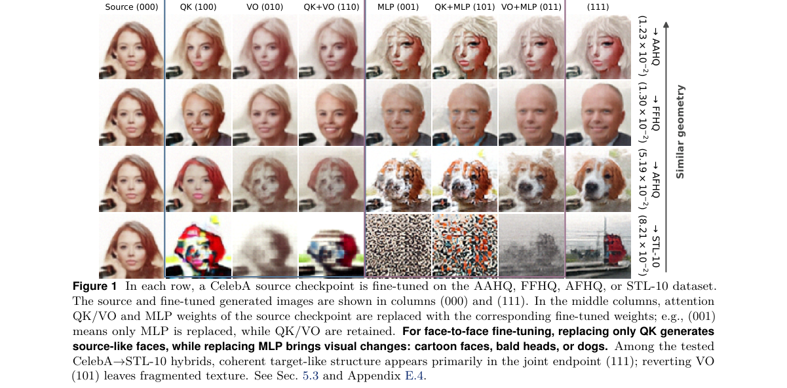

*Main result - Exact context set in a Gaussian MRF prior. The known graph and precision matrix allow exact analysis of context set in this synthetic setting. (a) Radius-3 contexts B3(m) for two selected pat*

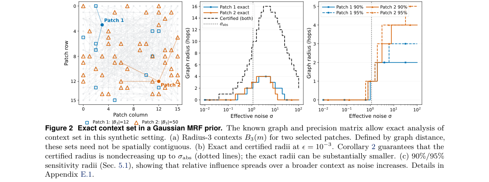

**Why this ranks #8**: [wild-card] 它给 DiT 提供了一套组件级的功能解释：注意力是**聚合器**，MLP 是**预测器**——并用受控的跨数据集组件移植验证了这个分工。

---

### 9. GRAFT: Restoring the Missing Sampling Interface in Continuous Diffusion Language Models

**arXiv**: [2610.29136](https://arxiv.org/abs/2610.29136) | **Score**: 6.6 (relevance 6.0 x 0.7 + quality 8.0 x 0.3) | **Tags**: rl-aigc, reward-model-gen, diffusion-LM, sampling, decoding | **Categories**: cs.AI, cs.CL | **Pages**: 43 | **[wild-card=yes]**

**Authors**: Haoning Yang, Lili Pan

**Affiliation**: University of Electronic Science and Technology of China

**Abstract**

> Continuous diffusion language models generate a whole sequence in parallel, never drawing a single word at any intermediate step; only the final step turns embeddings into text. Models such as ELF now report autoregressive-level quality at a fraction of the sampling steps of discrete-token diffusion models, and this design principle -- no step-wise discretization -- is what their own ablations credit for the gain. We show that this same principle carries a hidden cost: a collapse of the lexical long tail. Measured against held-out human text, ELF's output matches the human rate on common words almost exactly, yet its rarest words appear at only 0.30x the human rate, a gap that does not close from 105M to 652M parameters and that no sampler setting these models expose can reach. A same-size GPT-2, in contrast, spans zero to above the human rate by its decoding rule alone. We trace the difference to what continuous diffusion models lack: with no step that ever draws a discrete word, every step is instead driven by an average over the candidates still in play, and averaging a rare candidate together with the common word competing for its slot lands on the common word. An autoregressive model avoids this because its decoding rule samples one candidate rather than averaging over all of them. We propose GRAFT, a training-free method that grafts this missing choice back onto a frozen model: while the model is still undecided, GRAFT commits the rare words the average would otherwise discard, then regenerates the sequence from scratch with those commitments held in place. Across three ELF scales and on LangFlow, an independent continuous dLLM, GRAFT restores the rare-word share of generated text from 0.42-0.77x the human rate to 0.82-1.10x, a relative gain of 34-109%, and moves the entire word-frequency profile closer to human on every model tested, by 2.7x on ELF-B and 12x on LangFlow.

**Key findings**

- **Finding**: 连续扩散语言模型并行生成整个序列，**在任何中间步骤都不抽取单个词**；只有最后一步把嵌入转成文本。
- **Finding**: ELF 等模型已能用离散 token 扩散模型分数的采样步数达到自回归级质量，其消融把这一增益归功于「无步级离散化」这一设计原则。
- **Finding**: 作者指出**同一原则带有隐藏代价：词汇长尾坍缩**。
- **Finding**: 对照留出的人类文本，ELF 的输出在常用词上几乎精确匹配人类比率，但**最稀有的词只以人类比率的 0.30 倍出现**，
- **Finding**: 且这一差距**从 105M 到 652M 参数都不收敛**，也没有任何该模型暴露的采样设置能弥合。
- **Finding**: 同规模的 GPT-2 反而仅凭其解码规则就能从零跨到人类比率之上。
- **Finding**: 作者把差异追溯到连续扩散模型**缺少的东西**：没有哪一步会抽取一个离散词，于是每一步都由「仍在场上的候选的平均」驱动——
- **Finding**: 把一个稀有候选与争夺同一位置的常用词平均在一起，就落在常用词上。
- **Finding**: 自回归模型避免这一点，因为其解码规则**采样一个候选**而非对所有候选求平均。
- **Finding**: GRAFT 是一种**训练无关**的方法，把这个缺失的选择嫁接回冻结模型：模型尚未决定时，GRAFT **承诺**那些平均本会丢弃的稀有词，
- **Finding**: 再带着这些承诺从头重新生成序列。
- **Finding**: 在三个 ELF 规模与独立连续 dLLM LangFlow 上，GRAFT 把生成文本的稀有词占比从人类比率的 0.42–0.77 倍恢复到 **0.82–1.10 倍**，相对增益 **34–109%**，
- **Finding**: 并使整个词频分布更接近人类（ELF-B 上 2.7 倍，LangFlow 上 12 倍）。
- **Inference**: 「并行解码 = 平均 = 稀有词被吃掉」这个机制解释很干净，而且它预测了一个可验证的现象：GPT-2 的采样规则天然避开它。这篇虽属扩散语言模型（文本生成），但它揭示的「生成模型的选择机制 vs 平均机制」对任何并行生成的模型都成立。
- **Recommendation**: 推荐（作为通读材料）。做扩散语言模型、并行解码或采样策略的人应读。

**Key figures**

*Framework / architecture - Lexical-tail coverage depends on whether a model samples discrete words during gen- eration. (a) ELF-L matches human usage for common words but substantially underproduces rare ones, reachin*

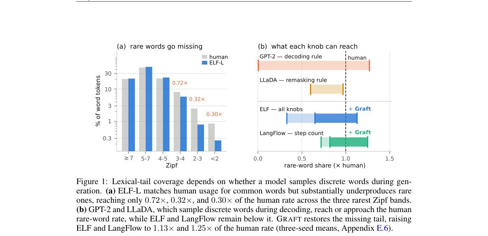

*Main result - Where rare words are lost. ELF uses a denoising head (MSE) at every timestep and a decoding head (CE) only at the final readout. Right: on clean held-out human embeddings, the decoding head*

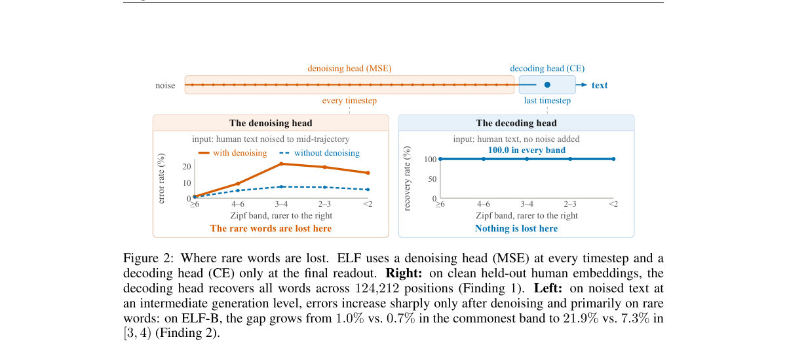

**Why this ranks #9**: [wild-card] 它给连续扩散语言模型指出一个结构性的代价：**整序列并行解码没有「选中某一个」这一步**，于是罕见词被平均掉了。

---

### 10. JUICE: Unified Multimodal Modeling in Pretrained Representation Spaces

**arXiv**: [2610.28801](https://arxiv.org/abs/2610.28801) | **Score**: 5.9 (relevance 5.0 x 0.7 + quality 8.0 x 0.3) | **Tags**: rl-aigc, reward-model-gen, unified-multimodal, diffusion-head, representation-space | **Categories**: cs.CV | **Pages**: 69 | **[wild-card=yes]**

**Authors**: Jiahan Li, Huangyuan Su, Shengbang Tong, Shusheng Yang, Ruihan Guo, Suozhi Huang, Hexu Zhao, Pratyusha Sharma et al.

**Affiliation**: New York University

**Abstract**

> Most unified multimodal models treat images and text asymmetrically: a pretrained language model generates text, an attached diffusion head generates images, and outputs that contain both are produced in a fixed order, so the first output cannot adapt to the second. We ask whether both modalities can instead be generated by one process that is trained on them jointly from scratch. Pretrained encoder spaces hold both modalities in one continuous form and carry knowledge learned at scale, and recent work finds them effective as generative targets for vision and language. We therefore model the joint distribution directly in these spaces. We introduce JUICE (Joint Unified multimodal modeling In Continuous Encoder spaces), a single flow matching Transformer over frozen image and text representations, in which each modality has its own noise level. Which modalities are clean and which are generated then decides the task: image generation, captioning, visual question answering, or joint generation. Controlled pretraining runs test each design choice. At equal guidance, generating text as continuous states leaves image generation intact (48.41 GenEval, against 47.86 for a model trained only for text-to-image generation), while captions lose some exact wording. Training on joint and conditional denoising together beats either alone, and semantic encoder spaces beat VAE latents and raw pixels as targets. At 2.1B parameters, with no language model initialization and at 224x224, JUICE reaches up to 0.88 on GenEval and 73.1 on VQAv2. By sampling both modalities from the joint distribution (coupled sampling), it can also draw a route on a map while writing out the matching moves. On mazes with several valid solutions, joint success rises from 54.6% with independent sampling to 93.7%, and no modality has to go first. On visual spatial planning, JUICE solves 99.8% of maps at its training sizes.

**Key findings**

- **Finding**: 多数统一多模态模型**不对称地**对待图像与文本：预训练语言模型生成文本，挂载的扩散头生成图像，
- **Finding**: 同时含两者的输出按**固定顺序**产生，因此**第一个输出无法对第二个做出适应**。
- **Finding**: 作者问：两种模态能否改为**由一个联合训练的过程**生成？
- **Finding**: 预训练编码器空间以连续形式同时承载两种模态，并携带规模化学到的知识，且近期工作发现它们可交换。
- **Finding**: JUICE 统一了预训练表示空间中的多模态建模。
- **Inference**: 「固定输出顺序」是统一模型里一个很少被单独拎出来说的结构约束：它意味着模型不能先看文字再决定画什么。这篇把联合生成搬到共享表示空间，代价是要从头训，但结构上更对称。
- **Recommendation**: 可选读。做统一多模态模型或表征空间生成的人可以看；纯扩散 RL 方向的读者可跳过。

**Key figures**

*Framework / architecture - JUICE overview. (a) Continuous image and text representations from frozen encoders share one MM-RiT backbone via bidirectional joint attention. Appendix A.3 explains the details of each bloc*

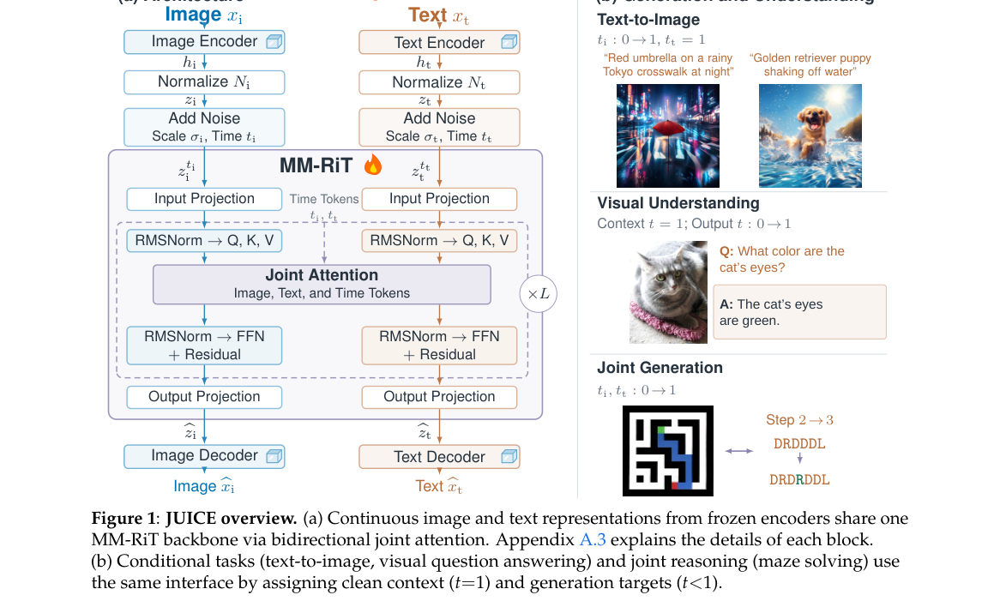

*Main result - Tasks are paths in the 2D time domain. Each modality has its own time, from noise (t=0) to clean (t=1). Conditional tasks run along the edges, where the condition is clean, and joint generat*

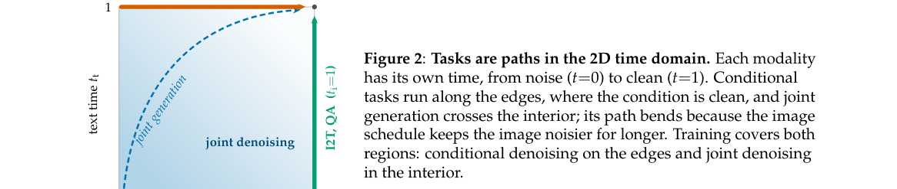

**Why this ranks #10**: [wild-card] 它追问「统一多模态模型」是否必须按固定顺序输出两种模态——并给出一个在**预训练表示空间**里从头联合训练的替代方案。

---

## Footer

- Total papers scanned across all 7 tracks: 568（原始 789 条）
- rl_aigc track final top-10: 10
- Wild-cards in this track: 3
- Figure assets: 2026-10-22/res/

Generated by `mine-arxiv-daily-digest` skill. Sister file: `2026-10-22_rl_aigc_entry.md`.
