# ArXiv Daily Digest - 2026-10-22 (强化学习 · 核心算法 / 理论 / MARL / sim-to-real, 10 papers)

**Generated**: 2026-10-22 17:00 CST

**Source**: arXiv cs.CV, cs.SD, eess.AS, cs.CL, cs.AI, cs.RO, cs.LG submissions, listing day 2026-10-21 (announced 2026-10-22 00:00 UTC)

**Batch window**: 2026-10-20T18:00:00Z .. 2026-10-21T18:00:00Z（arXiv 公告批次横跨两个 UTC 日：前一日 18:00 UTC 起算，当日 17:59:59 UTC 截止）

**Track**: rl_core (top 10 of 568 papers scanned, 105 full reads)

**Scope**: RL 算法与理论、多智能体 RL、bandit、sim-to-real

---

## Top 10 - 强化学习 · 核心算法 / 理论 / MARL / sim-to-real

### 1. AtomicRL: Atomic Reinforcement Learning for Long-Horizon Robotic Manipulation

**arXiv**: [2610.30097](https://arxiv.org/abs/2610.30097) | **Score**: 9.0 (relevance 9.0 x 0.7 + quality 9.0 x 0.3) | **Tags**: rl-algorithm, multi-agent-rl, sim-to-real, credit-assignment, VLA-RL | **Categories**: cs.AI, cs.CV, cs.RO | **Pages**: 16

**Authors**: Likui Zhang, Zhe Zhu, Zhihao Zhan, Yibo Bai, Hanlin Wang, Dongwei Li, Bin Wang, Tianle Zhang et al.

**Affiliation**: Sun Yat-sen University

**Abstract**

> Vision-language-action (VLA) models have shown promise in robotic manipulation, but imitation learning (IL) alone often struggles to master complex long-horizon skills. Reinforcement learning (RL) offers an effective avenue for further improving VLA policies. However, existing VLA-RL methods typically suffer from delayed and biased credit assignment due to trajectory-level sparse rewards, while imbalanced subtask mastery creates bottlenecks that limit overall performance. To address these challenges, we propose AtomicRL, an RL post-training framework that leverages atomic task structures for reliable credit assignment and adaptive exploration. AtomicRL introduces Semantic-Aware Policy Optimization (SAPO), which uses semantic-aware gating to constrain TD residuals from failed atomic subtasks from propagating across task boundaries, mitigating credit contamination while preserving intra-subtask credit assignment and value bootstrapping. In addition, Bottleneck-Adaptive Target Exploration (BATE) dynamically coordinates task sampling and local exploration incentives based on the mastery of individual atomic subtasks, directing learning toward the remaining bottlenecks. Finally, we develop a Real2Sim2Real pipeline that bridges online RL in simulation with real-world deployment, facilitating practical transfer to physical robots. On LIBERO-LONG, AtomicRL achieves absolute performance gains of 3.6% and 4.0% over PPO across two VLA architectures. On CALVIN ABC-D, it improves full-task performance by up to 9.5% over PPO. Combined with the Real2Sim2Real pipeline, AtomicRL further improves real-world task performance by an average of 21.3%. These results demonstrate that AtomicRL effectively improves the learning efficiency and manipulation performance of VLA policies on long-horizon tasks.

**Key findings**

- **Finding**: VLA 模型在机器人操作上已有潜力，但仅靠模仿学习往往难以掌握复杂长时程技能。
- **Finding**: RL 为进一步改进 VLA 策略提供了途径，然而既有 VLA-RL 方法因**轨迹级稀疏奖励**而 suffers **延迟且有偏的信用分配**；
- **Finding**: 同时**子任务掌握不均**会造成瓶颈，限制整体表现。
- **Finding**: AtomicRL 是一个 RL 后训练框架，利用**原子任务结构**实现可靠信用分配与自适应探索。
- **Finding**: **语义感知策略优化（SAPO）**用语义门控，约束来自失败原子子任务的 TD 残差**跨任务边界传播**，缓解信用污染，同时保留子任务内信用分配与价值自举。
- **Finding**: **瓶颈自适应目标探索（BATE）**根据各原子子任务的掌握情况动态协调任务采样与局部探索激励，把学习导向剩余瓶颈。
- **Finding**: 另建 **Real2Sim2Real 流水线**打通仿真在线 RL 与真实部署。
- **Finding**: LIBERO-LONG 上，两个 VLA 架构相对 PPO 取得 3.6% 与 4.0% 的绝对提升；CALVIN ABC-D 上全任务性能最高提升 9.5%。
- **Finding**: 配合 Real2Sim2Real 流水线，真实世界任务性能平均再提升 **21.3%**。
- **Inference**: 「信用污染」这个词点得很准：失败子任务的 TD 误差会顺着时间轴渗进别的子任务，而长时程任务的失败往往就发生在这种渗漏里。SAPO 用语义门控把传播限制在子任务边界内，是针对病理本身而不是绕开它。
- **Recommendation**: 强烈推荐。做 VLA 后训练、长时程操作或 RL 信用分配的人应读。

**Key figures**

*Framework / architecture - Overview of AtomicRL. Unlike previous RL methods that use standard GAE which may suffer from credit contamination, AtomicRL uses SAPO to promote more reliable credit assignment. Together wit*

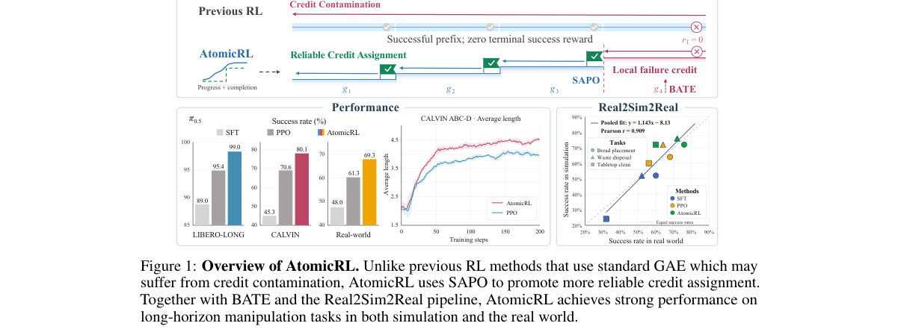

*Main result - Overall pipeline of AtomicRL. (a) Progress–Completion Critic: PCC identifies atomic task boundaries and estimates atomic task progress from interaction histories. (b) Semantic-Aware Policy O*

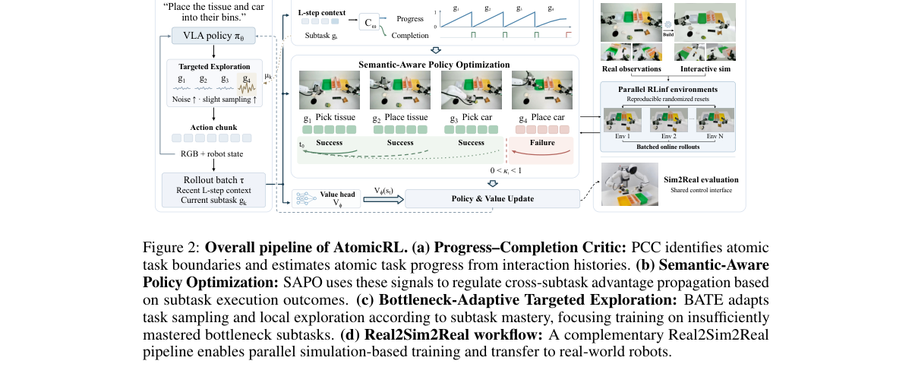

**Why this ranks #1**: 它把 VLA-RL 里最常见的两个病——**信用污染**和**子任务掌握不均**——分别给了机制性解法，并给出了一条完整的 Real2Sim2Real 落地链路。

---

### 2. RL-IF: Tracking Non-local Training Data Influence for Online Reinforcement Learning

**arXiv**: [2610.28883](https://arxiv.org/abs/2610.28883) | **Score**: 8.7 (relevance 9.0 x 0.7 + quality 8.0 x 0.3) | **Tags**: rl-algorithm, multi-agent-rl, sim-to-real, data-attribution, online-RL, data-centric | **Categories**: cs.AI, cs.LG | **Pages**: 39

**Authors**: Shixuan Liu, Cheng Tang, Yuzheng Hu, Fan Wu, Han Zhao, Jiaqi W. Ma

**Affiliation**: University of Illinois Urbana-Champaign

**Abstract**

> Online reinforcement learning (RL) has achieved significant success in decision-making tasks, but modern online RL remains highly sensitive to the quality of training experience. Understanding the contribution of individual training instances is therefore central to data-centric RL, with applications ranging from experience selection to policy interpretation. Existing data attribution methods for online RL primarily focus on local influence within a single training round, overlooking the non-local data influence across multiple training rounds. In this work, we formalize data attribution in online RL through a trajectory-level leave-one-out quantity, RL-LOO, which measures how one training sample influences a downstream target after subsequent online updates have taken place. We then derive RL-IF, a first-order estimator that propagates data influence through both optimization effects and policy-induced sampling effects, and provide theoretical guarantees on its approximation accuracy under smoothness assumptions. Our analysis further disentangles these two effects and shows both theoretically and empirically that the full RL-IF estimator can often be well approximated using the optimization effect alone. Building on this observation, we develop RINSE, a practical data filtering method for online RL. Experiments on standard control benchmarks and an RLHF-style toxicity-mitigation setting show that RINSE improves training efficiency and final performance over standard PPO and local attribution baselines. These results suggest that RL-IF provides a practical and principled framework for understanding and improving online RL.

**Key findings**

- **Finding**: 在线 RL 在决策任务上取得显著成功，但现代在线 RL **对训练经验的质量高度敏感**。
- **Finding**: 因此理解单个训练样本的贡献是数据中心 RL 的核心问题，应用于经验选择与策略解释。
- **Finding**: 既有在线 RL 的数据归因方法主要关注**单轮训练内的局部影响**，忽略了**跨轮次的非局部数据影响**。
- **Finding**: 作者提出 RL-IF，追踪在线 RL 中的非局部训练数据影响。
- **Inference**: 经验回放池选得好不好，直接决定在线 RL 的样本效率。既有归因方法只看「这一条样本在它被采到的那一轮里造成了多少损失」，但真正有用的问题是「这条样本在之后的训练里还影响了什么」——后者才是经验选择该优化的量。
- **Recommendation**: 推荐。做在线 RL、数据中心 RL 或经验回放设计的人应读。

**Key figures**

*Framework / architecture - Two-fold data influence in RL. A training occurrence z∗∈D(l)*

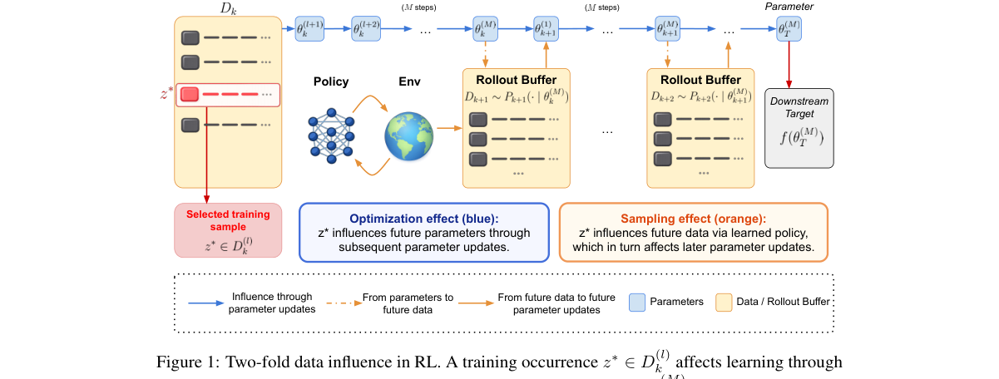

*Main result - Left: two LunarLander samples that appear harmful locally but are beneficial in the long run. Right: fraction of late-episode samples labeled harmful vs. attribution hori- zon H.*

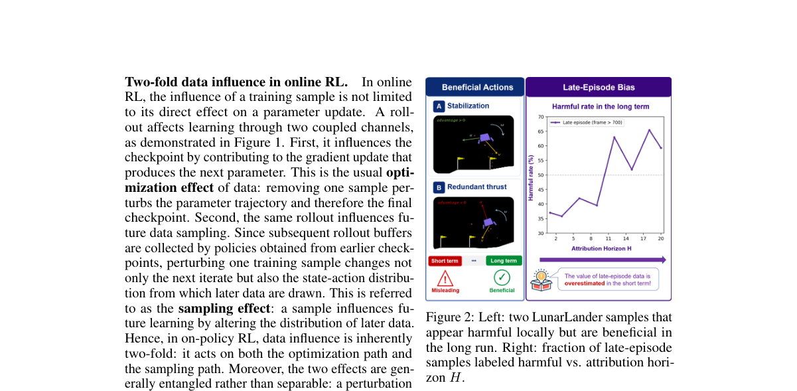

**Why this ranks #2**: 它指出在线 RL 的数据归因方法都只看**单轮内的局部影响**，而真正起作用的是跨轮次的**非局部影响**——这直接决定了经验选择策略。

---

### 3. Doob-Based Generative Policy Optimization

**arXiv**: [2610.28990](https://arxiv.org/abs/2610.28990) | **Score**: 8.3 (relevance 8.0 x 0.7 + quality 9.0 x 0.3) | **Tags**: rl-algorithm, multi-agent-rl, sim-to-real, generative-policy, diffusion-policy, likelihood-free | **Categories**: cs.LG | **Pages**: 38

**Authors**: Maojiang Su, Qijie Zhu, Yu Xiao, Shuyang Yu, Minshuo Chen, Zhaoran Wang, Han Liu

**Affiliation**: Northwestern University

**Abstract**

> Diffusion and flow models provide expressive policy classes for robotic and sequential decision-making systems. However, their action likelihoods are generally intractable, limiting the direct use of widely adopted policy optimization methods such as PPO and GRPO. We propose Doob Policy Optimization (DoobPO), a framework that leverages Doob's $h$-transform for likelihood-free reinforcement learning fine-tuning of generative policies. DoobPO separates policy improvement from generative policy learning. It first learns a lightweight ratio model that represents the desired policy update, and then distills the resulting ratio-tilted target policy into the generative policy via conditional drift matching. This formulation applies uniformly to both diffusion and flow policies and supports a broad family of policy improvement rules, including PPO and GRPO. We prove that the practical conditional drift matching objective is gradient-equivalent to the ideal Doob drift matching objective. We further show that the induced diffusion process solves an endpoint-constrained stochastic optimal control problem. This establishes that it achieves the minimum-energy modification required to realize the desired policy tilt. Across MuJoCo continuous-control benchmarks, DoobPO achieves strong performance against competitive diffusion- and flow-policy baselines, showing a principled and practical route to RL fine-tuning for generative policies.

**Key findings**

- **Finding**: 扩散与流模型为机器人与序列决策系统提供了表达力强的策略类。
- **Finding**: 但它们的**动作似然一般不可解**，限制了 PPO、GRPO 等主流策略优化方法的使用。
- **Finding**: 作者提出 Doob 策略优化（DoobPO），用 **Doob 的 h-变换**实现无似然的生成式策略 RL 微调。
- **Finding**: DoobPO **把策略改进与生成式策略学习分开**：先学一个轻量的**比率模型**表示期望的策略更新，
- **Finding**: 再通过**条件漂移匹配（conditional drift matching）**把比率倾斜后的目标策略蒸馏进生成式策略。
- **Finding**: 该形式统一适用于扩散与流策略，并支持包括 PPO 与 GRPO 在内的广泛策略改进规则。
- **Finding**: 作者证明实用的条件漂移匹配目标与理想 Doob 漂移匹配目标**梯度等价**。
- **Finding**: 并证明诱导出的扩散过程求解一个**端点约束的随机最优控制问题**，即它实现了实现期望策略倾斜所需的**最小能量修改**。
- **Finding**: 在 MuJoCo 连续控制基准上，DoobPO 相对扩散-与流-策略的强基线表现优异。
- **Inference**: 「不可解似然」是扩散策略做 RL 的真正拦路虎——不是算力问题，而是 PPO 的代理似然比在这里没有定义。DoobPO 的漂亮之处在于它不近似似然，而是用 h-变换把「想要什么分布」和「怎么生成」拆开，再用漂移匹配把前者搬到后者上。
- **Recommendation**: 强烈推荐。做扩散策略、流策略 RL 或生成式策略微调的人必读。

**Key figures**: 本篇未提取到可用图（PDF 内无符合图注正则的 Figure 1/2）。

**Why this ranks #3**: 它解决了扩散/流策略的一个硬约束：**动作似然不可解**，所以 PPO/GRPO 用不上；解法是用 Doob h-变换把策略改进与生成式学习解耦。

---

### 4. JaxMARL-BC: Multi-Agent Reinforcement Learning for Macroeconomic Modelling, in Seconds

**arXiv**: [2610.28907](https://arxiv.org/abs/2610.28907) | **Score**: 8.3 (relevance 8.0 x 0.7 + quality 9.0 x 0.3) | **Tags**: rl-algorithm, multi-agent-rl, sim-to-real, MARL, economics, simulation-efficiency | **Categories**: cs.AI, cs.LG, cs.MA, econ.GN | **Pages**: 9

**Authors**: Daniele Montagnani, Andrea Coletta, Antonietta Mira, Aldo Glielmo

**Affiliation**: Università di Pavia / Università dell’Insubria

**Abstract**

> Multi-agent reinforcement learning (MARL) offers a principled way of populating simulated economies with many heterogeneous decision makers. Its adoption, pioneered in finance, has nonetheless been slow in macroeconomics because of two main limitations: the lack of a shared frame of reference connecting MARL systems to dynamic stochastic general equilibrium (DSGE) models the profession already trusts, and the very long training times. The first limitation was recently addressed by the Multi-Agent Reinforcement Learning Business Cycle (MARL-BC), which places deep RL households in a real business cycle economy and reduces to classic DSGE models in specific limits. Here we address the second limitation. We present JaxMARL-BC, a JAX-accelerated simulator that trains MARL-BC economies in seconds (between 75x and 724x faster than the reference implementation), and scales to 200,000 independent learning households. We verify its correctness against the known DSGE limits, characterise its scaling through a simple cost law, and demonstrate its value by a proof-of-concept calibration of an extended model with heterogeneous returns on capital, in a two-hour experiment that would previously have taken over a month. We release JaxMARL-BC as open source.

**Key findings**

- **Finding**: MARL 为用许多异质决策者填充模拟经济提供了原则化方法，自金融业开创以来在宏观经济学中采用缓慢。
- **Finding**: 原因有二：缺少与经济学家信任的 **DSGE 模型**之间的共享参照系，以及**训练时间极长**。
- **Finding**: 第一个障碍已由 MARL-BC 解决——它把深度 RL 家庭放进真实商业周期经济，并在特定极限下退化为经典 DSGE。
- **Finding**: 本文解决第二个障碍：提出 **JaxMARL-BC**，一个 JAX 加速的模拟器，用**秒级**训练 MARL-BC 经济（比参考实现快 **75–724 倍**），并可扩展到 **20 万个独立学习家庭**。
- **Finding**: 作者对照已知 DSGE 极限验证其正确性，用简单的成本律刻画其扩展性，
- **Finding**: 并用一个带异质资本回报的扩展模型的校准概念验证展示价值——**两小时的实验**，此前需要**一个多月**。
- **Finding**: JaxMARL-BC 以开源形式发布。
- **Inference**: MARL 长期进不了经济学，不是因为方法不行，而是因为两个非常具体的原因：经济学界不认它的极限行为，以及它跑不动。这篇用 JAX 把第二个障碍变成工程问题，示范了「让一个方法进入另一个学科」需要先解决什么。
- **Recommendation**: 推荐。做 MARL、仿真加速或跨学科应用的人应读。

**Key figures**

*Main result - The LLM-augmented dashboard for JaxMARL-BC.*

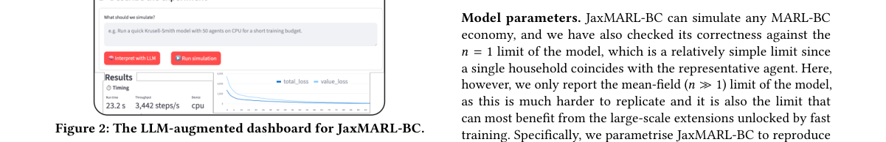

**Why this ranks #4**: 它把 MARL 引入宏观经济学的**两个真实障碍**各解决一个：DSGE 可解释性（MARL-BC 已解决）与训练时间（这篇解决，快 75–724 倍）。

---

### 5. SAFTER: Safety-Aware Filtering Through Explicit Recoverability for Robust Reinforcement Learning under Distribution Shift

**arXiv**: [2610.29149](https://arxiv.org/abs/2610.29149) | **Score**: 8.3 (relevance 8.0 x 0.7 + quality 9.0 x 0.3) | **Tags**: rl-algorithm, multi-agent-rl, sim-to-real, safety, recoverability, distribution-shift | **Categories**: cs.LG, eess.SY | **Pages**: 24

**Authors**: Benedictus C. G. Cinun, Bin Hu

**Affiliation**: University of Houston

**Abstract**

> Learning safe policies that generalize to unseen environments is difficult under bounded actuation, where an unsafe decision may become unrecoverable. Conventional control barrier function (CBF) filters enforce only instantaneous safety and ignore future recoverability. We propose SAFTER (Safety-Aware Filtering Through Explicit Recoverability), which embeds a differentiable, closed-form backup-CBF filter into Soft Actor-Critic training. SAFTER unifies current safety, finite-horizon backup safety, terminal recoverability, and input admissibility into a single differentiable certificate. Its CBF condition yields an exact minimum-intervention projection without iterative online optimization. In quadruped navigation, SAFTER reaches 90% training success with 30.6% fewer transitions than Vanilla SAC and 34.1-35.1% fewer than current-state CBF-filtered SAC baselines. Across unseen simulated environments, SAFTER improves success by up to 42.4 and 61.4 percentage points over the state-of-the-art methods CBF-RL and SEA-Nav, respectively, and achieves 73.3% and 76.7% success on two real-world navigation maps. Ablations identify accurate differentiation through the safety filter as a key contributor to robustness, in which replacing the projection Jacobian with the identity approximation reduces success rate in a High-Shift environment from 61.4% to 6.2%. These results show that recoverability-aware filtering serves as both a runtime safety mechanism and a learning mechanism for sample-efficient, robust policies.

**Key findings**

- **Finding**: 在有界驱动下学习能泛化到未见环境的安全策略很困难，因为**一个不安全的决策可能变得不可恢复**。
- **Finding**: 传统控制障碍函数（CBF）过滤器只强制**瞬时安全**，忽略未来的可恢复性。
- **Finding**: SAFTER 把一个**可微的闭式 backup-CBF 过滤器**嵌入 Soft Actor-Critic 训练。
- **Finding**: 它把当前安全、有限视野 backup 安全、终端可恢复性与输入可容许性**统一为单一可微证书**。
- **Finding**: 其 CBF 条件给出**精确的最小干预投影，无需迭代在线优化**。
- **Finding**: 四足导航中：达到 **90% 训练成功率**，比 Vanilla SAC 少 **30.6%** 的转移，比当前状态 CBF 过滤的 SAC 基线少 **34.1–35.1%**。
- **Finding**: 在未见过的仿真环境中，成功率比 SOTA 的 CBF-RL 与 SEA-Nav 分别最高提升 **42.4** 与 **61.4 个百分点**；
- **Finding**: 在两张真实世界导航地图上取得 **73.3%** 与 **76.7%** 成功率。
- **Finding**: 消融显示，**准确对安全过滤器求导**是鲁棒性的关键贡献之一：把投影 Jacobian 换成单位近似，会使 High-Shift 环境成功率从 61.4% 跌到 6.2%。
- **Inference**: 「不可恢复」这个概念把安全从「不撞」提升到了「还能回来」，这在分布偏移下是决定性的——因为偏移环境里第一步就可能走进死路。把 backup CBF 做成闭式最小干预投影，避免了在线优化的延迟与不稳定性。
- **Recommendation**: 强烈推荐。做安全 RL、控制屏障函数或分布偏移鲁棒性的人必读。

**Key figures**

*Framework / architecture - Overview of SAFTER. A task policy proposes a nominal command; a prescribed backup rollout evaluates finite-horizon recoverability; current, future, terminal, and input-admissibility con- dit*

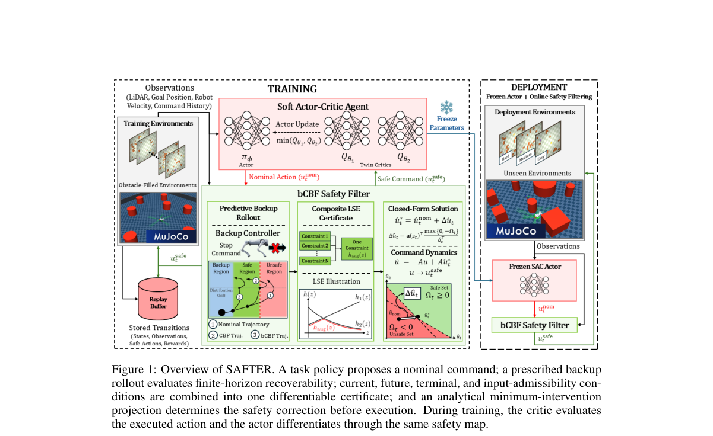

*Main result - Training success rates of Vanilla SAC, CBF–QP/CBF–CF, bCBF–LSE–QP, and SAFTER under the same training environments.*

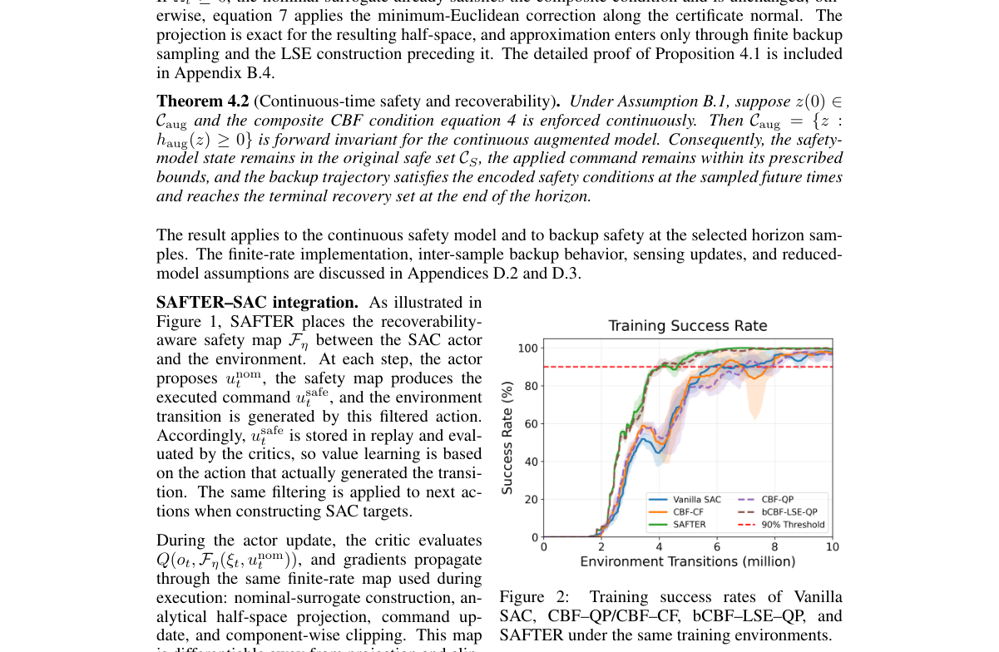

**Why this ranks #5**: 它指出 CBF 过滤器的结构性缺陷：只管**当下安全**，不管「这一脚下去还回不回得来」——而后者才是分布偏移下真正致命的。

---

### 6. Value-Rectified Distillation for Flow-based Offline Reinforcement Learning

**arXiv**: [2610.29075](https://arxiv.org/abs/2610.29075) | **Score**: 8.0 (relevance 8.0 x 0.7 + quality 8.0 x 0.3) | **Tags**: rl-algorithm, multi-agent-rl, sim-to-real, offline-RL, flow-matching, mode-averaging | **Categories**: cs.AI, cs.LG | **Pages**: 36

**Authors**: Ke Jiang, Wen Jiang, Yoshinobu Kawahara, Xiaoyang Tan

**Affiliation**: College of Computer Science and Technology, Nanjing University of Aeronautics and Astronautics / MIIT Key Laboratory of Pattern Analysis and Machine Intelligence / Graduate School of Information Science and Technology, The University of Osaka

**Abstract**

> We aim to address the problem of Out-of-Distribution (OOD) Mode Averaging, a critical problem that emerges when distilling Flow Matching (FM) based behavior policies in offline Reinforcement Learning (RL): When learning over multi-modal datasets, standard distillation inadvertently forces the policy to interpolate across different behavioral modes, causing the generated actions to collapse into invalid, OOD regions. To resolve this, we propose Value-Rectified Distillation (VRD), a novel framework that reformulates offline policy distillation as a value-guided generative trajectory alignment problem. By employing a dynamic coupling mechanism, VRD actively rectifies flow dynamics to explicitly decouple distinct behavioral modes, cleanly isolating high-value actions. Specifically, we instantiate VRD through two complementary algorithms: VRD-Q, which utilizes value-quantile behavior distillation to statistically filter out low-value behaviors, and VRD-R, which reorganizes the latent space to geometrically isolate high-value generative trajectories from the FM-based behavior policy. Extensive empirical evaluations demonstrate that VRD improves existing generative baselines across diverse continuous control and planning tasks on the D4RL, OGBench, and Minari benchmarks, especially over those multi-modal, non-expert datasets.

**Key findings**

- **Finding**: 离线 RL 中蒸馏流匹配（FM）行为策略会出现一个关键问题：**分布外模式平均（OOD Mode Averaging）**。
- **Finding**: 在多模态数据上学习时，标准蒸馏会**强行让策略在行为模式之间插值**，导致生成的动作塌进无效的 OOD 区域。
- **Finding**: 作者提出价值整流蒸馏（VRD），把离线策略蒸馏**重构为价值引导的生成式轨迹对齐问题**。
- **Finding**: 通过动态耦合机制，VRD 主动整流流的动力学以**解耦不同的行为模式**，干净地隔离出高价值动作。
- **Finding**: 两个互补算法：**VRD-Q** 用价值分位数行为蒸馏统计性地过滤掉低价值行为；
- **Finding**: **VRD-R** 重整隐空间，把高价值生成轨迹与 FM 行为策略在几何上隔离开。
- **Finding**: 在 D4RL、OGBench 与 Minari 基准的多样连续控制与规划任务上，尤其在多模态、非专家数据集上，VRD 优于既有生成式基线。
- **Inference**: 「多模态离线数据 + 生成式蒸馏」是个常见组合，而模式平均这个失败模式很隐蔽：模型没有崩溃，只是把两个模式之间的无效动作当成答案。VRD 的思路是引入价值信号来**在几何上把模式分开**，而不是在参数上硬掰。
- **Recommendation**: 推荐。做离线 RL、生成式策略或流匹配蒸馏的人应读。

**Key figures**

*Framework / architecture - Problem of Latent Fusion (left) and the OOD Mode Averaging problem caused by FQL- style behavior distillation (right).*

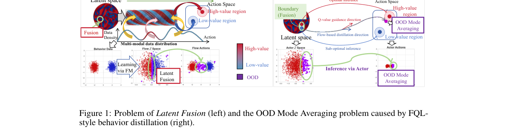

*Main result - Implementations for Value-Rectified Distillation (VRD): Statistical rectification via quantile behavior distillation (left), Geometric rectification via reshaping behavior distillation (righ*

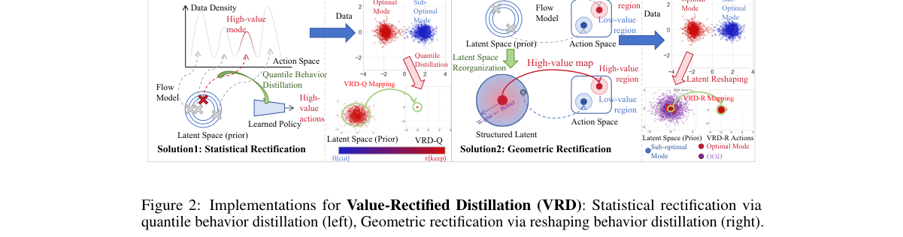

**Why this ranks #6**: 它诊断出流匹配蒸馏在离线 RL 上的一个具体病灶：**模式平均**把不同行为模式混在一起，生成的动作落到无效区域——并用价值信息把模式「拉开」。

---

### 7. A Model-Free Continuous-Time RL Algorithm from Discrete-Time Off-Policy Data with End-to-End Guarantees

**arXiv**: [2610.28915](https://arxiv.org/abs/2610.28915) | **Score**: 8.0 (relevance 8.0 x 0.7 + quality 8.0 x 0.3) | **Tags**: rl-algorithm, multi-agent-rl, sim-to-real, theory, continuous-time, off-policy | **Categories**: cs.LG, math.OC | **Pages**: 43

**Authors**: Chaorui Yao, Yuming Paul Zhang, Lin Yang, Yuhua Zhu

**Affiliation**: UCLA, Auburn University

**Abstract**

> In this paper, we study continuous-time reinforcement learning, where the state follows an unknown stochastic differential equation but only a fixed off-policy batch of discrete-time transitions is available. Standard discrete-time Q-learning becomes problematic as the sampling interval shrinks, because differences between action values vanish. Continuous-time alternatives, such as Deep Advantage Updating and martingale q-learning, preserve the action signal but jointly learn a value function and an action-dependent critic. Building on the PhiBE-Q formulation (arXiv:2606.21925), we develop a model-free PhiBE policy iteration (PhiBE-PI) framework that uses a single state-action critic while preserving the continuous-time action-ranking scale. At each iteration, the framework learns the critic directly from sampled increments and uses it to improve the policy. The same batch is reused throughout, without explicitly estimating the drift or diffusion. We further develop an implementation under linear function approximation and establish a local end-to-end suboptimality guarantee for the learned policy. Our analysis quantifies how errors from time discretization, function approximation, and finite-sample policy evaluation propagate through policy iteration. It accounts for the dependence of successive policies on the reused data, so the guarantee does not require a fresh batch at each iteration. Moreover, we identify a bias-variance trade-off: smaller sampling intervals improve the approximation to the continuous-time problem but can increase statistical error at a fixed sample size. Thus, finer time discretization does not necessarily lead to better policy performance.

**Key findings**

- **Finding**: 作者研究**连续时间 RL**：状态遵循未知随机微分方程，但只有一批固定的**离策略离散时间转移**可用。
- **Finding**: 标准离散时间 Q-learning 在采样间隔变小时会失效，因为**动作价值之差随之消失**。
- **Finding**: 连续时间的替代方案（深度优势更新、martingale q-learning）保住了动作信号，但要联合学习价值函数与动作相关 critic。
- **Finding**: 基于 PhiBE-Q 形式，作者发展出**无模型的 PhiBE 策略迭代（PhiBE-PI）**，只用**单个 state-action critic**同时保持连续时间的动作排序尺度。
- **Finding**: 每次迭代直接从采样增量学习 critic 并用它改进策略；**同一批数据被反复复用**，且不显式估计漂移与扩散。
- **Finding**: 作者在线性函数逼近下给出实现，并建立**局部端到端次优性保证**。
- **Finding**: 分析量化了时间离散化、函数逼近与有限样本策略评估的误差如何沿策略迭代传播，
- **Finding**: 并**正确处理了后续策略对复用数据的依赖**，因此保证不要求每次迭代换新数据。
- **Finding**: 作者还识别出一个**偏差-方差权衡**：更小的采样间隔改善对连续时间问题的逼近，但在样本量固定时可能增加统计误差——
- **Finding**: 因此**更细的时间离散化并不必然带来更好的策略性能**。
- **Inference**: 「离散化越细越好」在连续时间 RL 里是个很自然但错误的直觉。这篇把它形式化成偏差-方差权衡，并给出一个可以放心复用同一批数据的策略迭代框架——后者在实践中比理论界更让人放心。
- **Recommendation**: 推荐。做连续时间 RL、理论 RL 或离策略分析的人应读。

**Key figures**: 本篇未提取到可用图（PDF 内无符合图注正则的 Figure 1/2）。

**Why this ranks #7**: 它给出一个反直觉的结论：**更细的时间离散化并不一定带来更好的策略**——因为逼近误差下降的同时统计误差上升。

---

### 8. Characterizing Oblivious Common-Reward Multi-Player Bandits: Universal Stationarity, Coordination Traps, and Certified Global Rates

**arXiv**: [2610.29673](https://arxiv.org/abs/2610.29673) | **Score**: 7.3 (relevance 7.0 x 0.7 + quality 8.0 x 0.3) | **Tags**: rl-algorithm, multi-agent-rl, sim-to-real, theory, bandit, multi-agent | **Categories**: cs.LG | **Pages**: 20

**Authors**: Mingxiao Li, Wenhai Lai, Hongyu Wang

**Affiliation**: [unverified]（论文首页仅列作者姓名，未标注机构）

**Abstract**

> This paper presents a theoretical analysis of the oblivious common-reward multi-player multi-armed bandit (OC-MPMAB), a minimal multi-player bandit model in which multiple players select arms simultaneously and observe only a shared reward. Crucially, the players are fully oblivious: they do not observe the actions of other players and do not even know whether any other players exist. The contributions of this work are threefold. First, we prove that the independent gradient-bandit updates applied by the players jointly form an unbiased stochastic gradient estimator of a hidden product-policy objective. This property then yields a universal finite-time first-order stationarity guarantee for every instance. Second, we show that stationarity cannot, in general, be strengthened to global optimality. To illustrate this, we identify a product-policy trap obstruction that rules out the guarantee of global optimality. Third, we show that global optimality can be recovered under structural assumptions on the reward table. To make global optimality achievable, we introduce finite-table certificates that separately characterize product-gradient dominance and self-bounding stochastic noise. We then establish certificate-conditioned bounds on the product-policy gap and pseudo-regret. Consequently, the standard $O(1/t)$ product-policy gap and $O(\log T)$ pseudo-regret rates hold when the certificates are uniform.

**Key findings**

- **Finding**: 作者给出**无观测共同奖励多玩家多臂老虎机（OC-MPMAB）**的理论分析：多个玩家同时选臂，只观测到一个共享奖励。
- **Finding**: 关键在于玩家是**完全无观测的**：他们看不到彼此的动作，甚至不知道是否存在其他玩家。
- **Finding**: 贡献一：证明玩家各自施加的独立梯度更新**联合构成隐藏的乘积策略目标的无偏随机梯度估计**，从而对每个实例给出**普适的有限时间一阶站点性保证**。
- **Finding**: 贡献二：站点性一般**不能**提升为全局最优；作者识别出**乘积策略陷阱**这一障碍，排除全局最优的保证。
- **Finding**: 贡献三：在奖励表的结构性假设下全局最优可以恢复；为此引入**有限表证书**，分别刻画乘积梯度支配性与自界随机噪声。
- **Finding**: 在证书条件下给出乘积策略 gap 与伪遗憾的界；证书一致时，标准的 O(1/t) 乘积策略 gap 与 O(log T) 伪遗憾速率成立。
- **Inference**: 「彼此看不见的多玩家」听起来像无解，但这篇证明了独立更新其实在无偏地优化一个乘积策略目标——只是这个目标有陷阱，给定局面的最优策略会把某些玩家推到坏位置上。有限表证书把「什么时候能保证最优」变成一个可判定的条件。
- **Recommendation**: 推荐。做 bandit 理论、多智能体分析或关心「无观测协调」问题的人应读。

**Key figures**

*Framework / architecture - Sparse coordination (left), block trap (center), and AI routing (right); bands show 95% CIs.*

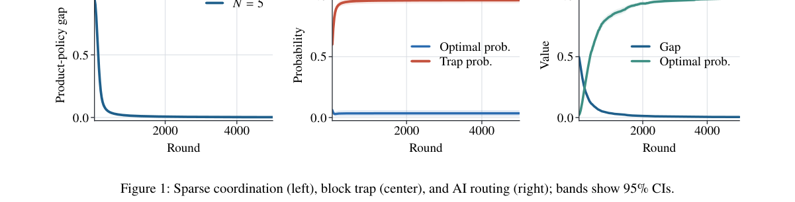

**Why this ranks #8**: 它把「多智能体都看不见彼此」这一极端设定分析得很彻底：独立梯度更新居然是**无偏**的，但**站点性无法提升为全局最优**——并给出可判定的证书。

---

### 9. Cascading Bandits with Noisy Observations: Algorithms and Regret Bounds

**arXiv**: [2610.29381](https://arxiv.org/abs/2610.29381) | **Score**: 7.3 (relevance 7.0 x 0.7 + quality 8.0 x 0.3) | **Tags**: rl-algorithm, multi-agent-rl, sim-to-real, theory, bandit, cascade | **Categories**: cs.LG, stat.ML | **Pages**: 47

**Authors**: Yashaswini Kaluguri, Nikhil Karamchandani

**Affiliation**: Department of Electrical Engineering, Indian Institute of Technology Bombay, Mumbai, India ().

**Abstract**

> We propose a novel stochastic cascading bandit setup where probing an ordered shortlist of $K$ out of $L$ arms incurs position-dependent costs, and the learner observes only noisy feedback regarding each arm's true output. We identify a sub-class of noise models for which the optimal shortlist can be found by sorting arms according to a per-arm score: such a score exists for both selection and ordering when the channel has no false positives, and for ordering alone (but not selection) when measurements are costless; however in general neither selection nor ordering is separable once noise and cost are both present. For the case where both selection and ordering scores exist, we provide a UCB-based algorithm with $O((L-K)\log T)$ instance-dependent regret over a time horizon $T$, which matches an algorithm-agnostic lower bound (up to constant factors). For the more challenging scenario where scores don't exist, we develop a new algorithmic template, DP-UCB, that embeds optimism directly inside an exact dynamic program, yielding $O\big(LK\log T\big)$ regret. Finally, we validate our theoretical results through extensive numerical evaluations and simulations over both synthetic and real-world datasets.

**Key findings**

- **Finding**: 作者提出新的随机级联老虎机设定：探测 L 个臂中的有序 K 个短名单，代价随位置而异，学习者只观测到关于每个臂真实输出的**有噪反馈**。
- **Finding**: 他们识别出一类噪声模型：此时最优短名单可通过按**每臂分数**排序找到——
- **Finding**: 当信道无假阳性时选择与排序都有这样的分数；当测量免费时**只有排序**有分数。
- **Finding**: 但一般情况下，**一旦噪声与成本同时存在，选择与排序都不可分离**。
- **Finding**: 对存在分数的情形，作者给出 UCB 算法，实例依赖遗憾为 O((L-K) log T)，与算法无关的下界匹配（差常数因子）。
- **Finding**: 对分数不存在的情形，发展出新的算法模板 **DP-UCB**，把乐观直接嵌入精确动态规划，遗憾 O(LK log T)。
- **Finding**: 最后在合成与真实数据集上做了大量数值评估与仿真验证。
- **Inference**: 「排序分数在无噪声时存在、有噪声时消失」这个结构性结论，比任何具体算法都更有价值：它告诉你级联推荐里的「按分数排序」这一整套做法在什么条件下会悄悄失效。
- **Recommendation**: 推荐。做级联推荐/广告、bandit 理论的人应读。

**Key figures**

*Framework / architecture - Cumulative regret vs. time. (a)–(c) Case 1 (Score): ϵ0 = 06, TOP-K-P(Y = 1)-UCB vs. DP-UCB. (d)–(e) Case 2 (no-score): Regret for K < L and K = L. (f) Shared-Channel: K = 3, L = 6, τ = 0.15.*

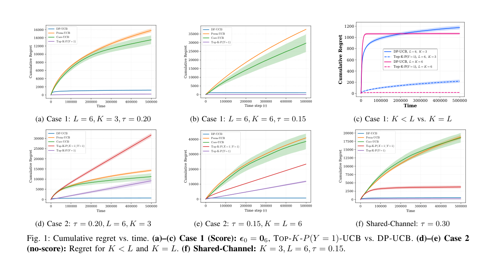

*Main result - Cumulative regret vs. time on MovieLens-1M. (a) Case 1 (Score regime): ϵ0 = 010. (b) Case 2 (No-score regime): τ = 0.15. (c) Case 2 (No-score regime): τ = 0.*

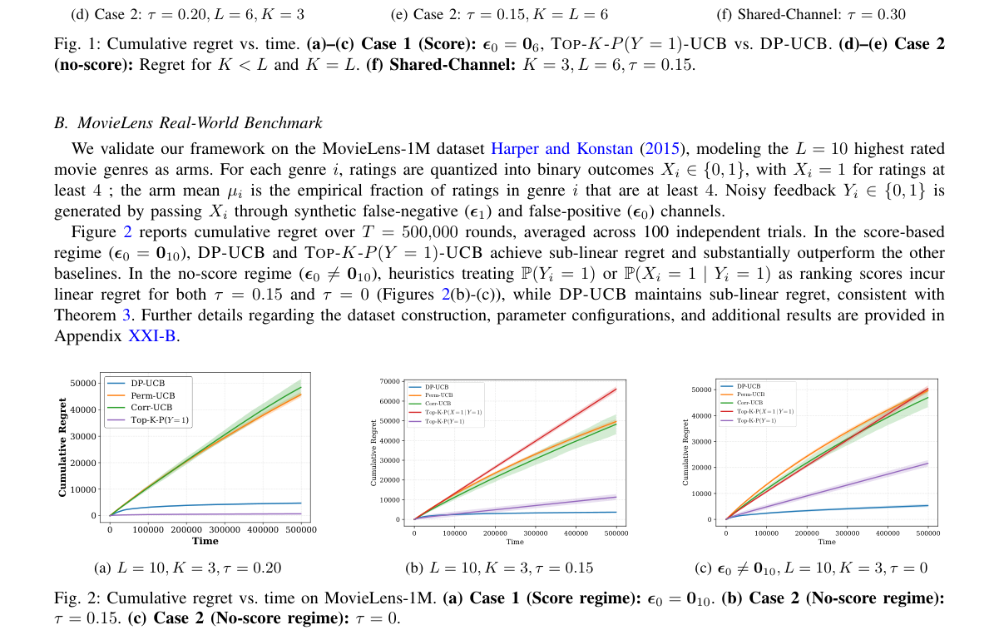

**Why this ranks #9**: 它的结论很反直觉：**噪声与成本同时存在时，选择与排序都不可分解**——这不是实现问题，是结构性的。

---

### 10. End-to-End Reinforcement Learning for Quadrupedal Jumping in Lunar Gravity

**arXiv**: [2610.29586](https://arxiv.org/abs/2610.29586) | **Score**: 6.6 (relevance 6.0 x 0.7 + quality 8.0 x 0.3) | **Tags**: rl-algorithm, multi-agent-rl, sim-to-real, legged-robot, space | **Categories**: cs.RO | **Pages**: 8

**Authors**: Levin Müller, Oliver Fischer, Marco Trentini, Yusuke Tanaka, Marco Hutter

**Affiliation**: ETH Zurich, Robotics Systems Lab

**Abstract**

> Legged robots can extend planetary exploration to rugged and discontinuous terrain that is inaccessible to conventional rovers. In lunar gravity, jumping further expands this mobility by enabling robots to cross obstacles and gaps that cannot be traversed by walking alone. We present a multistage reinforcement-learning approach that produces a single end-to-end control policy for commanded point-to-point jumping under lunar gravity. The resulting policy has a simple architecture and relies exclusively on mission-compatible onboard sensing, making its deployment on a real lunar mission plausible. In simulation, the learned policy performs accurate point-to-point jumps with landing errors smaller than the robot's body size. We analyze the torque and power demands of lunar jumping and characterize performance degradation under extreme outlier events, including control-update freezes of up to \SI{1}{s} during flight. Hardware transfer demonstrates that the policy can successfully execute a vertical jump under lunar-gravity offloading. Furthermore, the measured torque and power profiles are consistent with the simulation results and remain within the robot's hardware limits.

**Key findings**

- **Finding**: 腿式机器人能把行星探索扩展到传统轮式 rover 无法通过的崎岖不连续地形。
- **Finding**: 在月球重力下，**跳跃**进一步扩展了机动性——能跨越单靠行走无法通过的障碍与间隙。
- **Finding**: 作者提出多阶段 RL 方法，为月球重力下的指令式点到点跳跃产出**单一端到端控制策略**。
- **Finding**: 所得策略结构简单，**仅依赖任务兼容的车载传感**，因此部署到真实月球任务是可行的。
- **Finding**: 仿真中，学到的策略完成准确的点到点跳跃，**着陆误差小于机器人机身尺寸**。
- **Finding**: 作者分析月球跳跃的力矩与功率需求，并刻画在极端离群事件下的性能退化，包括**飞行中长达 1 秒的控制更新冻结**。
- **Finding**: 硬件迁移表明策略能成功执行月球重力卸载下的垂直跳跃；
- **Finding**: 实测力矩与功率曲线与仿真结果一致，且保持在机器人硬件限制内。
- **Inference**: 把「控制更新冻结 1 秒」这种在地面几乎不会发生的故障明确纳入分析，让这份工作比一般的 sim-to-real 更可信。而且它只用车载传感、单一端到端策略——这些约束说明作者是在按真实任务规格设计，而不是先做算法再补可行性。
- **Recommendation**: 推荐。做腿式机器人 RL、极端环境部署或空间机器人的人应读。

**Key figures**

*Framework / architecture - The Magnecko robot mid-flight under gravity offloading during hardware deployment of the jumping controller.*

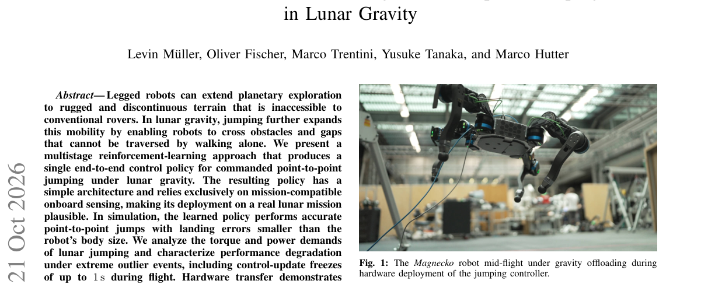

*Main result - Illustration of the five-stage control scheme used during training and its transition logic. The control policy does not observe the current stage.*

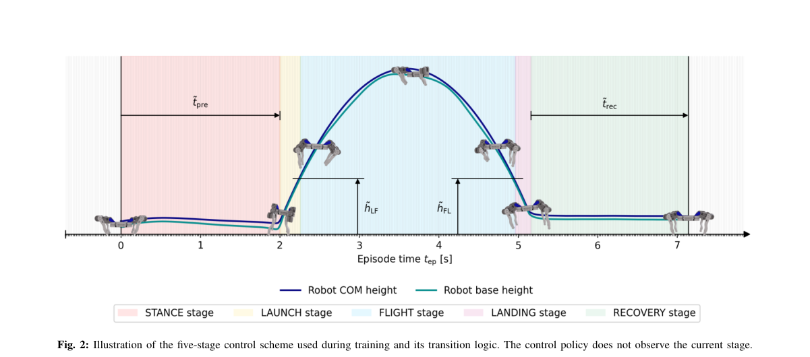

**Why this ranks #10**: 它做了一件工程上很硬的事：在**月球重力**下训练四足跳跃策略，并在真实硬件上用**重力卸载**验证——而且诚实地分析了极端故障下的性能退化。

---

## Footer

- Total papers scanned across all 7 tracks: 568（原始 789 条）
- rl_core track final top-10: 10
- Wild-cards in this track: 0
- Figure assets: 2026-10-22/res/

Generated by `mine-arxiv-daily-digest` skill. Sister file: `2026-10-22_rl_core_entry.md`.
