# ArXiv Daily Digest - 2026-10-22 (强化学习 · LLM 后训练与对齐, 10 papers)

**Generated**: 2026-10-22 17:00 CST

**Source**: arXiv cs.CV, cs.SD, eess.AS, cs.CL, cs.AI, cs.RO, cs.LG submissions, listing day 2026-10-21 (announced 2026-10-22 00:00 UTC)

**Batch window**: 2026-10-20T18:00:00Z .. 2026-10-21T18:00:00Z（arXiv 公告批次横跨两个 UTC 日：前一日 18:00 UTC 起算，当日 17:59:59 UTC 截止）

**Track**: rl_llm (top 10 of 568 papers scanned, 105 full reads)

**Scope**: RLHF / DPO / GRPO / RLVR 等 LLM 后训练

---

## Top 10 - 强化学习 · LLM 后训练与对齐

### 1. ReAPO: Retry-Aware Policy Optimization for Efficient Exploration in LLM Reasoning

**arXiv**: [2610.28770](https://arxiv.org/abs/2610.28770) | **Score**: 9.0 (relevance 9.0 x 0.7 + quality 9.0 x 0.3) | **Tags**: rlhf, rl-llm-posttrain, exploration, credit-assignment | **Categories**: cs.AI, cs.LG, stat.ML | **Pages**: 35

**Authors**: Nghi Dao, Calder Morton-Ferguson, Noah Golowich, Adam Block

**Affiliation**: Columbia University / Yale University

**Abstract**

> RLVR improves language-model reasoning, but commonly relies on independent stochastic rollouts for exploration, which can repeatedly sample similar failed strategies. Prior work has seen success with approaches that guide exploration by introducing dependence into the sampling process by including incorrect solutions in the context for subsequent attempts. Still, these methods introduce the additional question of how to assign credit to each attempt. We propose to view the credit assignment through the lens of Stochastic Shortest Paths, a framework in classical reinforcement learning that seeks to minimize the expected cumulative cost to reach a terminal state (in our case, a verified successful response). We show that, under suitable simplifying assumptions, this perspective naturally leads to a simple modification to GRPO, which we call Retry-Aware Policy Optimization (ReAPO). ReAPO allocates additional generation to failed trajectories, allowing successful retries to be reinforced without rewarding preceding failures, and assigns credit in a theoretically principled way to each attempt. Across Qwen3 and OLMo-2 models from 0.6B to 4B and eight mathematical and scientific reasoning benchmarks, ReAPO improves first-attempt performance over GRPO as well as natural recent baseline algorithms, while additional ablations demonstrate the utility of both serial sampling and ReAPO's credit assignment. On Qwen3-0.6B, ReAPO also outperforms GRPO with twice the group size or twice the training steps, reaching their peak accuracy with 39% and 31% fewer generated tokens, respectively. Taken together, our results suggest that ReAPO is a simple yet effective approach for improving LM reasoning performance through improved exploration and retry-aware credit assignment.

**Key findings**

- **Finding**: RLVR 改进语言模型推理，但通常依赖**独立的随机 rollout** 来探索，这会反复采样相似的失败策略。
- **Finding**: 已有工作通过在后续尝试的上下文中**包含错误解**来引入采样依赖以引导探索成功。
- **Finding**: 但这引入了新问题：**如何给每次尝试分配信用**。
- **Finding**: 作者从**随机最短路（SSP）**这一经典 RL 框架的角度看待信用分配——它寻求最小化到达终态的期望累积代价。
- **Finding**: 在适当简化假设下，这一视角自然导向 GRPO 的一个简单修改，即**重试感知策略优化（ReAPO）**。
- **Finding**: ReAPO 为失败轨迹**分配额外生成预算**，使成功的重试能被强化而**不奖励先前的失败**，并以理论上站得住的方式给每次尝试分配信用。
- **Finding**: 在 Qwen3 与 OLMo-2（0.6B–4B）以及八个数学与科学推理基准上，ReAPO 相对 GRPO 及近期自然基线都提升了**首答性能**。
- **Finding**: 消融显示串行采样与 ReAPO 的信用分配各自有用。
- **Finding**: 在 Qwen3-0.6B 上，ReAPO 超过了**两倍组大小**或**两倍训练步数**的 GRPO，分别以少 **39%** 与 **31%** 的生成 token 达到其峰值准确率。
- **Inference**: 「探索失败」在 RLVR 里通常被归为 rollout 太少，但这篇指出真正的问题是**独立采样会反复撞同一面墙**——增加预算只会重复浪费。SSP 视角带来的解法很直接：把生成预算当成本来分配，失败轨迹值得追加采样但不该被当作正例强化。
- **Recommendation**: 强烈推荐。做 RLVR / GRPO 探索或信用分配的人必读。

**Key figures**

*Framework / architecture - Overview of ReAPO. Each rollout begins with an independent response; failed responses receive a verifier-conditioned retry, while successful rollouts terminate. Advantages are computed for e*

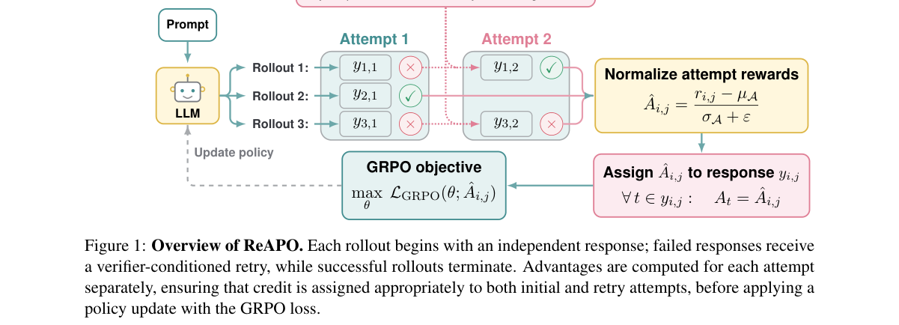

*Main result - Training efficiency on GSM8K-Platinum with Qwen3-0.6B-Base. The first three panels plot accuracy (mean@32) against optimization steps, cumulative generated response tokens, and wall-clock ti*

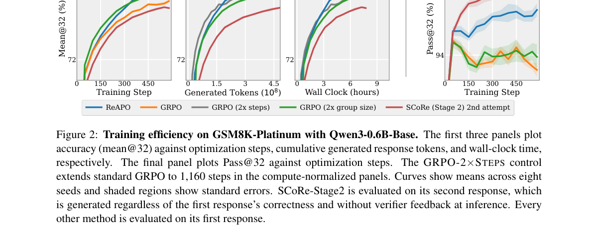

**Why this ranks #1**: 它把 RLVR 的探索浪费归因到一个具体机制：独立随机 rollout **反复采样相似的失败策略**，并用随机最短路的视角给出带理论依据的信用分配。

---

### 2. Flat-RLVR: Sharpness-Aware Reinforcement Learning with Verifiable Rewards for Reasoning Capacity in LLMs

**arXiv**: [2610.29281](https://arxiv.org/abs/2610.29281) | **Score**: 9.0 (relevance 9.0 x 0.7 + quality 9.0 x 0.3) | **Tags**: rlhf, rl-llm-posttrain, sharpness, diversity | **Categories**: cs.AI, cs.LG | **Pages**: 21

**Authors**: Yeonbum Kim, Hyun Kyu Lee, Sung Whan Yoon

**Affiliation**: Ulsan National Institute of Science and Technology

**Abstract**

> Reinforcement learning with verifiable rewards (RLVR), particularly through group-relative policy optimization (GRPO), has emerged as a central paradigm for the post-training of large language models (LLMs). While RLVR is highly effective at enhancing the reasoning capabilities of LLMs, it commonly induces \textit{distribution sharpening}, whereby the policy distribution becomes excessively peaked and rare-yet-correct trajectories are progressively suppressed, thus diminishing sample diversity. To this end, we promote flat-reward optima in RLVR to smooth the policy distribution. We theoretically link flat reward RLVR to reduced distribution sharpening, and empirically show improved sample diversity while maintaining single-attempt accuracy. Our method, called \texttt{Flat}-RLVR, searches for flat reward regions via sharpness-aware minimization during LLM post-training, combining this with GRPO variants to achieve better trade-offs between sampling efficiency and reasoning capacity.

**Key findings**

- **Finding**: RLVR（尤其是 GRPO）已成为大语言模型后训练的核心范式，在增强推理能力上非常有效。
- **Finding**: 但 RLVR 常常导致**分布锐化（distribution sharpening）**：策略分布变得过度尖锐，**罕见但正确的轨迹被逐步压制**，从而降低样本多样性。
- **Finding**: 作者在 RLVR 中**促进平坦奖励最优（flat-reward optima）**以平滑策略分布。
- **Finding**: 他们**理论上把平坦奖励 RLVR 与更低的分布锐化联系起来**，并实证展示样本多样性提升同时**保持单次尝试的准确率**。
- **Finding**: 方法 Flat-RLVR 在 LLM 后训练中通过**锐度感知最小化**搜索平坦奖励区域，并与 GRPO 变体结合，以取得采样效率与推理容量之间更好的权衡。
- **Inference**: 「GRPO 让模型变强」是共识，「GRPO 同时在杀掉少数派解」很少被正面讨论。这篇的洞察是：锐化不只伤多样性，它伤的是**恰好那些模型还不会的题**——所以多样性与准确率并非必然冲突，只要目标函数不那么尖。
- **Recommendation**: 强烈推荐。做 RLVR / GRPO 训练的人应读；也推荐关心「后训练如何在变强的同时不变得更窄」的人。

**Key figures**

*Framework / architecture - RLVR and Flat-RLVR on LLM reasoning capacity.*

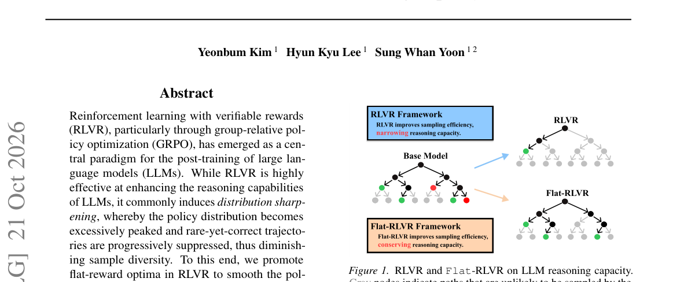

*Main result - Illustration of the loss landscape and reasoning capacity of RLVR and Flat-RLVR. Flat-RLVR converges to a flatter*

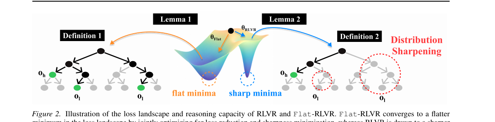

**Why this ranks #2**: 它指出 GRPO 有一个被普遍忽视的副作用：**分布锐化**会持续压制罕见但正确的轨迹——并用「平坦最优」在保持单次准确率的同时换回采样多样性。

---

### 3. Uni-Mem: Learning a Long-Horizon Agentic Memory Manager with Unified Online Policy Optimization

**arXiv**: [2610.29671](https://arxiv.org/abs/2610.29671) | **Score**: 8.7 (relevance 9.0 x 0.7 + quality 8.0 x 0.3) | **Tags**: rlhf, rl-llm-posttrain, agent-memory, credit-assignment | **Categories**: cs.CL | **Pages**: 21

**Authors**: Zhiqian Xia, Jielong Tang, Ling-An Zeng, Shixiong Kai, Rong Yao, Hao Kong, Xiao Dong, Wei Wang et al.

**Affiliation**: Southeast University / Sun Yat-sen University / Huawei Technologies, Noah’s Ark Lab / Shandong Normal University

**Abstract**

> Long-term agent memory is shifting from predefined workflows toward learnable policies for memory construction and retrieval. Existing learning-based methods either optimize construction alone or combine retrieval-side online reinforcement learning (RL) with offline construction supervision, limiting co-adaptation between the two stages. In this paper, we explore end-to-end online RL for a unified memory manager (Uni-Mem) that learns both capabilities under a shared policy. However, joint optimization with existing RL algorithms such as GRPO faces confounded group comparisons and sparse feedback over long memory-management trajectories. To this end, we propose Stage-Decoupled GRPO, which alternates construction and retrieval optimization while controlling variation from the other stage within each rollout group, yielding stage-specific learning signals. We further introduce Event-Wise Credit Assignment (ECA), which localizes feedback to responsible events and propagates event-level advantages to their constituent operations. Experiments on LoCoMo and LongMemEval show that Uni-Mem outperforms the strongest RL-based memory, demonstrating the effectiveness of jointly learning memory construction and retrieval via Stage-Decoupled GRPO and ECA.

**Key findings**

- **Finding**: 长期智能体记忆正从预定义工作流转向**可学习的构建与检索策略**。
- **Finding**: 既有学习型方法要么只优化构建，要么把检索侧的在线 RL 与离线的构建监督结合，**限制了两阶段的协同适应**。
- **Finding**: 作者探索对统一记忆管理器（Uni-Mem）做**端到端在线 RL**，在共享策略下同时学习两种能力。
- **Finding**: 但与 GRPO 等既有 RL 算法做联合优化会遇到**混淆的组比较**以及长记忆管理轨迹上的**稀疏反馈**。
- **Finding**: 为此提出**阶段解耦 GRPO**：交替进行构建与检索优化，同时在每个 rollout 组内控制来自另一阶段的变动，从而产生阶段特定的学习信号。
- **Finding**: 另引入**事件级信用分配（ECA）**，把反馈定位到负责任的事件，并把事件级优势传播到其构成的操作。
- **Finding**: 在 LoCoMo 与 LongMemEval 上，Uni-Mem 优于最强的基于 RL 的记忆方法。
- **Inference**: 把「记忆构建」和「记忆检索」当成一个联合 RL 问题是顺理成章的，但真正卡住的是 GRPO 的组比较在这里失效——组内样本的差异来自两个不同阶段，优势归因就乱了。阶段解耦是个很干净的解法。
- **Recommendation**: 强烈推荐。做智能体记忆、长期上下文或 RL 信用分配的人应读。

**Key figures**

*Framework / architecture - Comparison of training paradigms in dif- ferent methods. Construction-only RL keeps retrieval fixed, while asymmetric joint learning combines offline construction imitation with online retri*

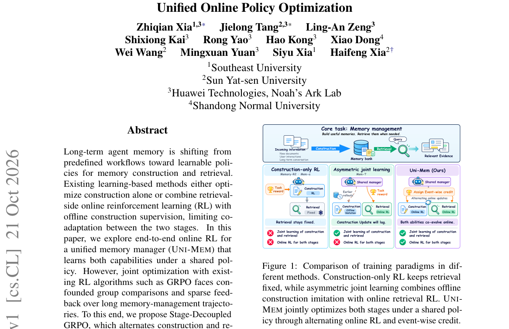

*Main result - Overview of UNI-MEM. (a) UNI-MEM unifies memory construction and retrieval through a shared tool-using agent, continually processing an ordered stream of events. (b) Event-Wise Credit Assign*

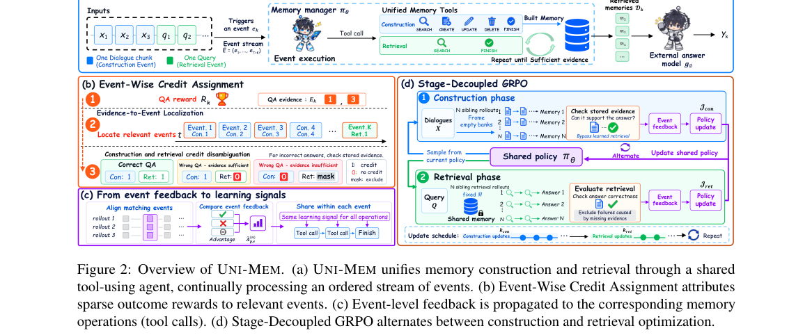

**Why this ranks #3**: 它指出现有记忆学习方法**要么只优化构造、要么只在线优化检索**，导致两阶段无法协同适应——并给出阶段解耦的 GRPO 来处理混淆的组比较。

---

### 4. ECHO: Emergent Common-Mode Hidden Offsets Drive Vocabulary Collapse in Preference Optimization

**arXiv**: [2610.29410](https://arxiv.org/abs/2610.29410) | **Score**: 9.0 (relevance 9.0 x 0.7 + quality 9.0 x 0.3) | **Tags**: rlhf, rl-llm-posttrain, representation-collapse, diagnostics | **Categories**: cs.CL | **Pages**: 28

**Authors**: Yun Li, Ehsan Javanmardi, Simon Thompson, Jiachen Gong, Qunli Zhang, Zifan Zeng, Shiming Liu, Peng Wang et al.

**Affiliation**: Graduate School of Information Science and Technology, The University of Tokyo, Tokyo, Japan / TIER IV, Inc., Tokyo, Japan / Huawei

**Abstract**

> Preference optimization can improve every ranking metric while building a hidden, shared representation shift that the relative loss barely sees, one that can eventually destroy generation. We trace this failure to the common-mode offset, a shared directional shift in the model's hidden states that appears across token positions, prompts, and both chosen and rejected responses. Because it moves chosen and rejected representations together, the relative ranking loss barely reacts to its accumulation. As this offset grows, it projects onto the output layer to form a vocabulary well, elevating a single token's probability until it dominates decoding and causes generation collapse. The isolated offset alone reconstructs the vocabulary well, injecting the learned offset into an untreated base model recreates the collapse where norm-matched random directions do not, and masking this common component from the loss prevents the well in our flagship setting. Under the per-token ranking loss we study, the same collapse appears in 14 of 17 base-model lineages and under full-parameter fine-tuning. Moreover, the offset is not merely an artifact of collapse, since it is already present in textbook DPO and SimPO runs that form no well. Textbook DPO keeps it weakly aligned with any single vocabulary direction even with three times our base budget. Trained from base models for that budget, however, full-parameter SimPO drives it into collapse on both Llama-2 and Llama-3.1, and the same kind of offset grows, without a well, from a public SFT checkpoint under the official SimPO recipe. Across 17 UltraFeedback runs, the better a run ranks held-out responses, the less often two public reward models prefer its samples to the base model's. These findings expose a blind spot in standard ranking metrics and introduce a representation-level signal that can warn of generation collapse before it occurs.

**Key findings**

- **Finding**: 偏好优化可以**改进每一个排序指标**，同时却在建立一个隐藏的、共享的表征位移，而相对损失几乎察觉不到它，最终可能摧毁生成能力。
- **Finding**: 作者把这个失效追溯到**共模偏移（common-mode offset）**：模型隐状态中一个共享的方向性位移，出现在 token 位置、prompt 以及被选与被拒响应各处。
- **Finding**: 因为它**同时移动 chosen 与 rejected 的表征**，相对排序损失对其累积几乎不反应。
- **Finding**: 随着偏移增长，它投影到输出层形成一个**词表井（vocabulary well）**，抬升单个 token 的概率直到它主导解码并导致生成坍缩。
- **Finding**: 证据链：孤立的偏移本身就能重建词表井；把学到的偏移注入未处理的基座模型会复现坍缩，而**范数匹配的随机方向不会**；
- **Finding**: 在损失中屏蔽这一共模成分可阻止旗舰设定下的井形成。
- **Finding**: 在所研究的每 token 排序损失下，同样的坍缩出现在 **17 个基座模型谱系中的 14 个**，全参数微调亦然。
- **Finding**: 偏移并非坍缩的副产品：它在**不形成井的教科书级 DPO 与 SimPO 运行中就已存在**。
- **Finding**: 在 **17 次 UltraFeedback 运行**中，运行在留出响应上排名越好，两个公开奖励模型偏好其样本**相对于基座模型**的次数就越少。
- **Finding**: 这些发现暴露了标准排序指标的一个盲区，并引入了一个**能在坍缩发生前发出警告**的表征级信号。
- **Inference**: 这是本批最尖锐的一篇。它证明「DPO 有效」和「DPO 有效」是两件事：排序指标可以在模型正在走向坍缩时照常上涨。共模偏移之所以危险，正因为相对损失对共同方向的移动天然免疫——这是 DPO 目标函数的结构性盲区，不是实现 bug。
- **Recommendation**: 强烈推荐（必读）。做偏好优化、奖励模型或对齐诊断的人不应错过；也推荐所有用排序指标判断训练健康度的人。

**Key figures**: 本篇未提取到可用图（PDF 内无符合图注正则的 Figure 1/2）。

**Why this ranks #4**: 它揭出偏好优化一个被完全忽视的失败模式：模型可以**所有排序指标都在涨**，同时隐状态里已经积累了一个会把生成毁掉的共同位移。

---

### 5. RubricOpt: Self-Revision of Semantic Rubrics for Preference Optimization

**arXiv**: [2610.29491](https://arxiv.org/abs/2610.29491) | **Score**: 8.0 (relevance 8.0 x 0.7 + quality 8.0 x 0.3) | **Tags**: rlhf, rl-llm-posttrain, rubric, self-revision | **Categories**: cs.AI | **Pages**: 27

**Authors**: Wei Chen, Yubing Wu, Shigui Li, Delu Zeng, Jingfeng Liu, Junmei Yang, Zhiheng Zhou, Bo Li et al.

**Affiliation**: South China University of Technology / LinkSprite / University of Waterloo

**Abstract**

> A model's failures can reveal gaps in the behavioral criteria guiding its training. We introduce RubricOpt, a framework that lets a policy revise these criteria within preference optimization. The policy diagnoses its own rubric-free outputs, retains requirements already covered by the rubric, and edits clauses that leave recurring failures unaddressed. A shared semantic representation connects task demands, preference-data contrasts, and rubric clauses, while a deterministic gate checks evidence references and fixed semantic anchors. The rubric then guides Direct Preference Optimization (DPO) during training, with preference pairs, labels, and the objective held fixed, and is removed at evaluation. Our analysis relates the local effect on rubric-free success to semantic alignment and a residual beyond the measured factors. Experiments on capability and open-ended generation benchmarks show that rubric conditioning can improve outcomes over ordinary DPO, with gains and regressions varying across models and datasets. A matched continuation isolates the contribution of revision from additional training and finds mixed incremental effects for the tested edit, whose feedback overlaps the evaluation set. RubricOpt thus brings the behavioral specification itself into the policy's feedback loop.

**Key findings**

- **Finding**: 模型的失败可以揭示训练所用**行为标准的缺口**。
- **Finding**: 作者提出 RubricOpt：一个框架，允许策略在**偏好优化过程中自行修订这些标准**。
- **Finding**: 策略诊断自己的无 rubric 输出，保留 rubric 已覆盖的要求，并**编辑那些未能应对反复出现的失败的条款**。
- **Finding**: 一个共享的语义表示把任务需求、偏好数据对比与 rubric 条款连接起来，同时有一个**确定性门控**检查证据引用与固定的语义锚点。
- **Finding**: 随后 rubric 指导训练中的**直接偏好优化（DPO）**——偏好对、标签与目标函数保持不变——并在评测时被移除。
- **Finding**: 作者的分析把无 rubric 成功率的局部效应与语义对齐以及超出所测因子的残差联系起来。
- **Finding**: 在能力与开放式生成基准上，rubric 条件化能优于普通 DPO，**但增益与回退随模型与数据集而异**。
- **Finding**: 一个匹配的续训实验把「修订」的贡献从额外训练中隔离出来，发现**在被测编辑上效果混杂**，因为其反馈与评测集存在重叠。
- **Inference**: 「标准写错了」比「标准没被执行」更难被发现。这篇把 rubric 变成可学习对象，但作者诚实地报告了局限：收益不稳定，且他们自己的消融显示部分增益可能来自评测集重叠——这种自我证伪在偏好优化论文里并不常见。
- **Recommendation**: 推荐。做偏好优化或自动 rubric/spec 生成的人应读。

**Key figures**

*Framework / architecture - The RubricOpt loop. (a) Task demand and preference-data supply share eight factor axes. (b) Matched Prefer/Avoid clauses condition both responses during DPO. (c) Rubric-free evaluation suppl*

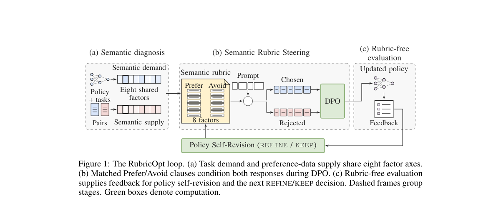

*Main result - Policy-driven rubric refinement (appendix C.2). Prompt stages 1–5 diagnose failures, at- tribute gaps, propose edits, and audit the candidate. The audit is advisory; step 6 decides acceptanc*

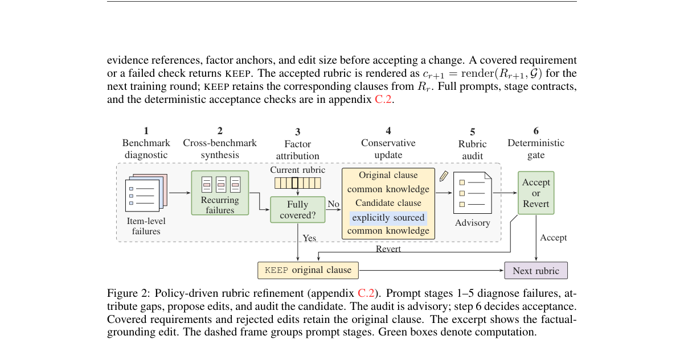

**Why this ranks #5**: 它把「评分标准」本身放进策略的反馈回路：让模型**修订自己的 rubric**，再用修订后的 rubric 指导 DPO——把「行为规范」从常量变成变量。

---

### 6. One Act, Many Masks: Effect-Marginal Policy Optimization for Long-Horizon Agents

**arXiv**: [2610.29427](https://arxiv.org/abs/2610.29427) | **Score**: 8.0 (relevance 8.0 x 0.7 + quality 8.0 x 0.3) | **Tags**: rlhf, rl-llm-posttrain, credit-assignment, multi-turn | **Categories**: cs.LG, stat.ML | **Pages**: 20

**Authors**: Shaojin Ma, Ruitao Wang, Pengyi Li, Jie Yang, Liangyu Chen, Gangyi Zhao, Hongyao Tang, Yan Zheng et al.

**Affiliation**: Tianjin University / Fudan University / Renmin University of China

**Abstract**

> Recent advances in multi-turn reinforcement learning (RL) have substantially improved the performance of LLM agents on complex, long-horizon interactive tasks. However, despite progress in fine-grained credit assignment, policy optimization still applies these learning signals through response-specific probability ratios. Different textual responses can induce the same executable effect, yet credit differences arising from subsequent outcomes remain tied to their individual textual realizations. We identify this mismatch as credit-update misalignment. Our analysis reveals that credit-text pairing directly shapes policy-update directions, even when the policy context and executable effect are held fixed. Motivated by this finding, we propose Effect-Marginal Policy Optimization (EMPO), which aligns policy optimization with execution-level equivalence through an effect-level surrogate that couples updates across alternative textual realizations. EMPO preserves the original credit signals, integrates with both trajectory-level and step-level credit estimators, and requires no additional critics or rollouts. Experiments on ALFWorld, WebShop, and Sokoban show that EMPO outperforms strong baselines in both task performance and learning efficiency.

**Key findings**

- **Finding**: 多轮 RL 显著提升了 LLM 智能体在复杂长时程交互任务上的表现。
- **Finding**: 尽管细粒度信用分配已有进展，策略优化仍通过**响应特定的概率比**施加这些学习信号。
- **Finding**: 不同的文本响应可以**诱导出同一个可执行效果**，但来自后续结果的信用差异仍系于各自的文本实现。
- **Finding**: 作者把这个错配命名为**信用-更新错配（credit-update misalignment）**，并分析揭示：即使策略上下文与可执行效果被固定，**信用与文本的配对方式仍直接塑造策略更新方向**。
- **Finding**: 据此提出**效果边缘策略优化（EMPO）**，通过一个**效果级代理目标**把策略优化与执行级等价性对齐，该目标跨不同文本实现耦合更新。
- **Finding**: EMPO 保留原始信用信号，可与轨迹级和步级信用估计器集成，且**不需要额外的 critic 或 rollout**。
- **Finding**: 在 ALFWorld、WebShop 与 Sokoban 上，EMPO 在任务性能与学习效率上都优于强基线。
- **Inference**: 这是多轮 RL 里一个很隐蔽的偏差来源：agent 的「措辞」是任意的，但信用分配却对它敏感，于是优化器实际上在奖励某种表达方式而不是一种效果。EMPO 把更新目标改到效果层，是个概念上很干净的修正。
- **Recommendation**: 强烈推荐。做多轮 RL、agent 训练或信用分配的人应读。

**Key figures**

*Framework / architecture - Execution-equivalent responses may receive different credit and undergo divergent response-wise policy updates despite inducing the same immediate effect. Such within-effect varia- tion can*

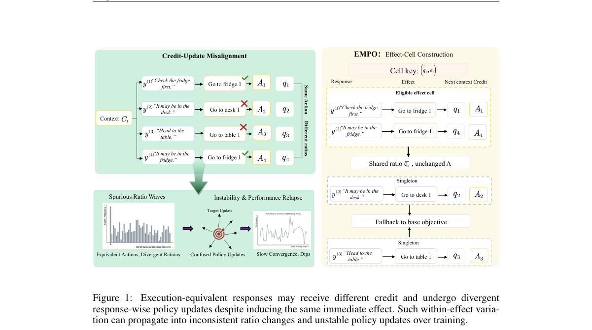

*Main result - Overview of Effect-Marginal Policy Optimization (EMPO). EMPO groups locally comparable responses with the same canonical execution effect and aggregates their response-level policy ratios in*

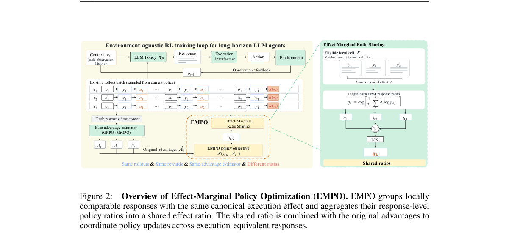

**Why this ranks #6**: 它指出了一个被普遍忽略的错配：**不同的文本响应可以产生同一个可执行效果**，但信用却仍绑在各自的文本实现上。

---

### 7. TeachBack: Learning to Teach via Bidirectional Preference Optimization for On-Policy Self-Distillation

**arXiv**: [2610.29167](https://arxiv.org/abs/2610.29167) | **Score**: 8.0 (relevance 8.0 x 0.7 + quality 8.0 x 0.3) | **Tags**: rlhf, rl-llm-posttrain, on-policy-distillation, teacher | **Categories**: cs.AI, cs.CL, cs.LG | **Pages**: 21

**Authors**: Linfei Ji, Jiayun Li, Haozhao Wang, Siyu Jiang, Zehao Wang, Longtao Xiao, Yu-Jie Yuan, Ruixuan Li

**Affiliation**: Huazhong University of Science and Technology / Tsinghua University / Harbin Institute of Technology / Huawei Technologies Ltd.

**Abstract**

> On-policy self-distillation (OPSD) enables a language model to learn from a Teacher instantiated from the same model but given access to privileged information, such as a reference solution. We find that access to sufficient privileged information allows the Teacher to generate highly accurate trajectories; however, accuracy alone does not guarantee that these trajectories are suitable for Student learning. Direct access to a complete solution may encourage shortened, reference-conditioned derivations that omit the exploration, verification, and self-correction required to solve problems without privileged information. We introduce TeachBack, a bidirectional preference-learning framework for on-policy self-distillation that learns not only from the Teacher but also how the Teacher should teach. TeachBack shapes the Teacher's generation behavior by controlling the length of the reference-reasoning suffix injected into the prompt and by varying the prompt style. While maintaining comparable Teacher accuracy, it encourages the Teacher to explore and re-solve problems, thereby reducing its reliance on the reference solution. At each rollout refresh, the shared policy generates both a privileged Teacher trajectory and a problem-only Student trajectory. A pairwise preference objective uses privileged Teacher trajectories to improve Student learning, while the reversed preference uses the Student's behavior to shape future Teacher supervision under the privileged condition. Experiments on mathematical and logical reasoning tasks show that TeachBack consistently improves Student performance over existing OPSD methods and related baselines.

**Key findings**

- **Finding**: on-policy 自蒸馏（OPSD）让语言模型从一个教师学习，教师由同一模型实例化但拥有**特权信息**（如参考答案）。
- **Finding**: 作者发现：足够的特权信息让教师产出**高准确率**轨迹，但**准确本身不保证这些轨迹适合学生学习**。
- **Finding**: 直接接触完整解法可能促成**缩短的、以参考为条件的推导**，从而省略了无特权信息时解决问题所需的探索、验证与自我纠正。
- **Finding**: 作者提出 **TeachBack**：一个**双向**偏好学习框架，用于 on-policy 自蒸馏，**既从教师学习，也学习教师应当如何教**。
- **Finding**: TeachBack 通过控制注入 prompt 的参考推理后缀长度、变化 prompt 风格来塑造教师生成行为。
- **Finding**: 在保持教师准确率相当的前提下，它促使教师**探索并重解问题**，减少对参考解的依赖。
- **Finding**: 每次 rollout 刷新时，共享策略同时生成**特权教师轨迹**与**仅问题的学生轨迹**。
- **Finding**: 成对偏好目标用特权教师轨迹改进学生学习，而**反向偏好**用学生行为塑造未来教师监督。
- **Finding**: 在数学与逻辑推理任务上，TeachBack 一致优于既有 OPSD 方法与相关基线。
- **Inference**: 「教会模型怎么想」和「给它正确答案」是两件事，而后者可能教出坏习惯（省略验证）。TeachBack 的双向设计很聪明：教师的行为本身成为可优化对象，用学生的表现反向塑造教师的教学方式。
- **Recommendation**: 强烈推荐。做自蒸馏、on-policy 蒸馏或教师-学生训练的人应读。

**Key figures**

*Framework / architecture - Motivation for TEACHBACK. In standard OPSD, access to privileged information can lead the Teacher to produce a short solution that omits exploration and verification. TEACHBACK uses partial*

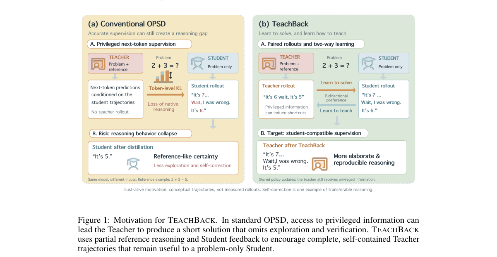

*Main result - Overview of TEACHBACK. (a) The Student receives the problem alone, while a reference- reasoning suffix is framed as optional working notes for the Teacher to re-solve the problem. (b) The sh*

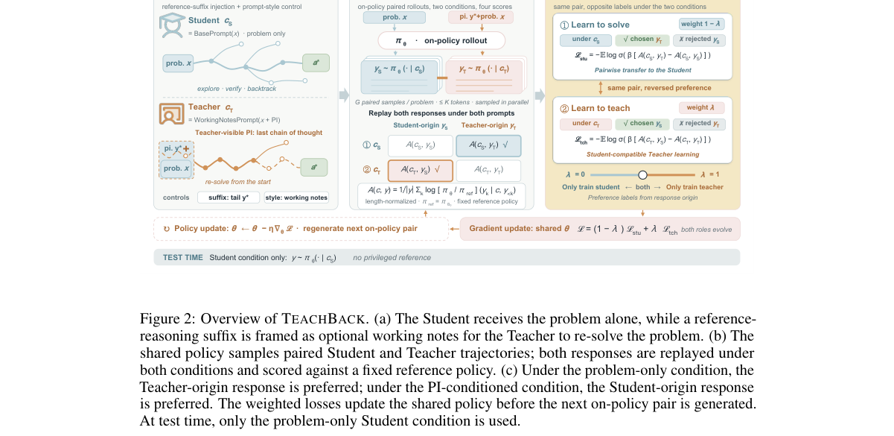

**Why this ranks #7**: 它指出 on-policy 自蒸馏里的一个反直觉事实：教师**准确**不等于教师**适合教**——完整答案反而会让学生学会「跳过探索」。

---

### 8. Stochastic Pruning of the DPO Computation Graph: 1.4x Faster Training and Lower Peak Memory

**arXiv**: [2610.29538](https://arxiv.org/abs/2610.29538) | **Score**: 7.3 (relevance 7.0 x 0.7 + quality 8.0 x 0.3) | **Tags**: rlhf, rl-llm-posttrain, systems, efficiency | **Categories**: cs.AI, cs.LG | **Pages**: 21

**Authors**: Yubing Wu, Wei Chen, Junmei Yang, Delu Zeng, Tiewen Pan

**Affiliation**: South China University of Technology, Shenzhen Technology University

**Abstract**

> Direct preference optimization (DPO) incurs training costs in output scoring, sequence execution, and backpropagation, so reducing supervision alone does not necessarily save computation. We introduce a unified framework for stochastic pruning of the DPO computation graph that independently samples response positions for scoring, response prefixes for execution, and preference branches for backpropagation. By making these selections before the corresponding operations, the framework omits computation at each stage of a training step. Our analysis characterizes the objective changes induced by position and sequence pruning and uses inverse-probability weighting to obtain a conditionally unbiased single-branch gradient estimator for the sampled objective. Controlled measurements show that position and sequence pruning primarily reduce peak memory, with most output-memory savings attributable to an implementation that retains full response supervision. Branch pruning yields a $1.426\times$ step-time speedup over a concatenated DPO baseline and reduces training time by about 30\% relative to stock DPO across two model families, with slightly lower mean accuracy and benchmark-dependent changes in open-ended scores. These findings relate the resource benefits of stochastic graph pruning to the computation omitted and the resulting changes in the training objective.

**Key findings**

- **Finding**: DPO 在输出打分、序列执行与反向传播上都有训练开销，因此**仅减少监督并不必然节省计算**。
- **Finding**: 作者引入对 **DPO 计算图的随机剪枝**统一框架，**独立采样**用于打分的响应位置、用于执行的响应前缀、以及用于反向传播的偏好分支。
- **Finding**: 在相应操作之前做出这些选择，框架就在训练的每个阶段省下了计算。
- **Finding**: 作者的分析刻画了位置剪枝与序列剪枝所诱导的目标变化，并用**逆概率加权**得到采样目标的条件无偏单分支梯度估计。
- **Finding**: 受控测量显示：位置与序列剪枝主要降低**峰值内存**（大部分输出内存节省来自一个保留完整响应监督的实现）；
- **Finding**: 分支剪枝相对拼接 DPO 基线带来 **1.426 倍**单步加速，相对原生 DPO 在两个模型族上减少约 **30%** 训练时间，
- **Finding**: 代价是平均准确率略降、开放式得分随基准而变。
- **Inference**: 这篇的价值在于把「省算力」这件事做成了可测量的取舍：不同维度的剪枝省的是不同资源（内存 vs 时间），且要付出准确率代价。对需要把 DPO 塞进有限预算的人是实用的工程参考。
- **Recommendation**: 推荐。做 DPO 训练系统或后训练效率工程的人应读。

**Key figures**

*Framework / architecture - Stochastic interventions on the DPO computation graph. The two response branches share policy parame- ters. Rewards average policy–reference log-ratios over scored response positions. Fixed-*

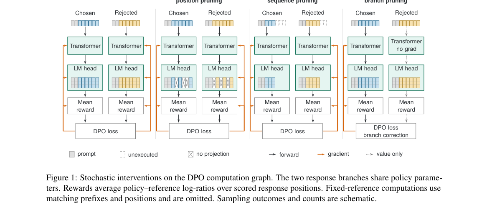

*Main result - Resource ratios at the default settings. Dashed lines mark each baseline. Panel (c) counts executed input tokens, including prompt and padding.*

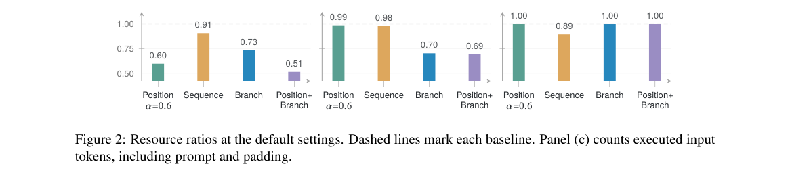

**Why this ranks #8**: 它纠正了一个常见误解：**减少监督量并不等于省计算**——DPO 的开销分布在打分、执行与反向传播三处，监督裁剪省不到关键的那块。

---

### 9. Generalized CycleGRPO for Fine-Grained Multimodal Understanding and Grounding

**arXiv**: [2610.29552](https://arxiv.org/abs/2610.29552) | **Score**: 8.3 (relevance 8.0 x 0.7 + quality 9.0 x 0.3) | **Tags**: rlhf, rl-llm-posttrain, multimodal, grounding | **Categories**: cs.CV | **Pages**: 31

**Authors**: Xin Zhang, Haochen Wang, Beibei Lin, Zhaoxiang Zhang, Robby T. Tan, Jason Li, Dacheng Tao

**Affiliation**: NUS, UCAS, NTU

**Abstract**

> Fine-grained multimodal intelligence requires models to both understand a designated region and localize it from language. Existing methods learn these directions with separate objectives and task-specific annotations. We present Generalized CycleGRPO, the first unified reinforcement learning framework coupling region understanding and localization across spatial, temporal, and spatio-temporal domains. Given a region, a multimodal large language model generates candidate descriptions and then localizes each description to reconstruct the input region. Reconstruction overlap provides a verifiable reward for captioning, while individual localization rewards improve the inverse mapping. A common region-space formulation extends this cycle from image masks and boxes to video intervals and timestamped spatial evidence, without reference captions or an external language-model judge during reinforcement learning. In videos, the cycle encourages descriptions that distinguish a target event from similar recurrences. We introduce DOVE (Distinctive Occurrence-level Video-caption Evaluation), a human-verified contrastive benchmark for this temporal distinctiveness. CycleGRPO improves SAMTok's overall gIoU from 57.5% to 68.2% on GroundingSuite and average gIoU from 71.2% to 78.7% on GRES. For temporal tasks, it achieves 51.9% tIoU on Charades and 33.3% Temporal Evidence Coverage on DOVE, compared with 45.6% and 14.8% for the Qwen3-VL initialization. These results establish region-text cycle consistency as a general self-evaluation principle for multimodal understanding and localization. Models, code, and DOVE are available at https://devinxzhang.github.io/Generalized-CycleGRPO-Page/.

**Key findings**

- **Finding**: 细粒度多模态智能要求模型既能**理解指定区域**、又能**从语言定位它**。
- **Finding**: 既有方法用**分离的目标**与任务专属标注来学习这两个方向。
- **Finding**: 作者提出 Generalized CycleGRPO：**首个统一**耦合区域理解与定位的强化学习框架，横跨空间、时间与时空三个域。
- **Finding**: 给定一个区域，多模态大语言模型生成候选描述，再把每个描述定位回去以**重建输入区域**。
- **Finding**: **重建重叠提供可验证奖励**用于描述任务，而单条定位奖励改进反向映射。
- **Finding**: 一个共同的区域空间形式把该循环从图像掩码与框扩展到视频区间与带时间戳的空间证据，**强化学习期间无需参考描述或外部语言模型裁判**。
- **Finding**: 在视频中，该循环促使描述**区分目标事件与相似复现**。
- **Finding**: 作者引入 **DOVE**（事件级视频-描述对比评测），一个经人工验证的对比式基准。
- **Finding**: CycleGRPO 把 SAMTok 在 GroundingSuite 上的整体 gIoU 从 **57.5% 提升到 68.2%**，GRES 上平均 gIoU 从 **71.2% 提升到 78.7%**；
- **Finding**: 时间任务上达到 Charades **51.9% tIoU** 与 DOVE **33.3%** 时间证据覆盖（Qwen3-VL 初始化为 45.6% 与 14.8%）。
- **Inference**: 「自己描述、自己定位、重建区域」构成一个自验证闭环——这是绕开外部裁判和人工标注的一条务实路径，而且它天然适用于视频（区分重复事件），这正是定位任务最难的地方。
- **Recommendation**: 强烈推荐。做多模态 RL、grounding 或自验证奖励设计的人应读。

**Key figures**

*Framework / architecture - From spatial CycleGRPO to Generalized CycleGRPO. (A) Region-captioning reinforcement learning relies on an extra critic to score generated descriptions. (B) Referring-localization reinforceme*

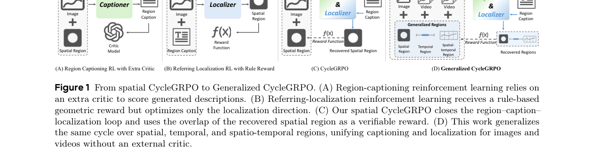

*Main result - Improvements over the corresponding base models on spatial (left), temporal (middle), and spatio-temporal (right) benchmarks. Within each benchmark, bar lengths show gains in percentage point*

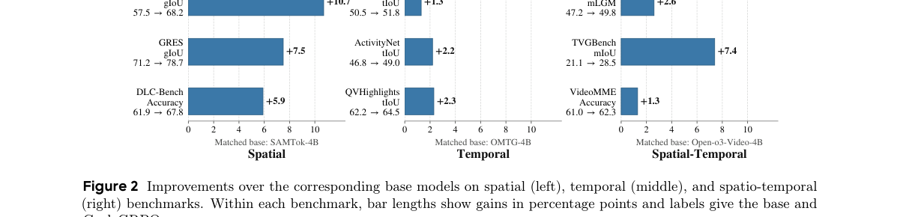

**Why this ranks #9**: 它用一个**自验证**的循环取代了外部标注与外部裁判：让模型描述一个区域、再把描述定位回该区域，重叠度就是奖励。

---

### 10. Differentially Private Sparse Reward Estimation with Preference Feedback

**arXiv**: [2610.30099](https://arxiv.org/abs/2610.30099) | **Score**: 8.3 (relevance 8.0 x 0.7 + quality 9.0 x 0.3) | **Tags**: rlhf, rl-llm-posttrain, differential-privacy, theory | **Categories**: cs.AI, cs.LG | **Pages**: 36

**Authors**: Meng Ding, Mingxi Lei, Jie Zhang, Jinyan Liu, Di Wang

**Affiliation**: University of Massachusetts Boston / University at Buffalo, SUNY / ETH Zürich / Beijing Institute of Technology

**Abstract**

> Reinforcement Learning with Human Feedback (RLHF) has become a central paradigm for aligning Large Language Models with human values. However, the reliance on sensitive preference data necessitates rigorous differential privacy (DP) guarantees to prevent user information leakage. Existing private alignment methods typically assume dense reward parameterizations, resulting in estimation error bounds that scale polynomially with the ambient {model size $d$}. Such dependence is prohibitive in modern {overparameterized models} where $d$ is vast. In this work, we study \emph{Private Sparse RLHF} problem to address this limitation, assuming that human preferences (reward model) are governed by a subset of $s^* \ll d$ relevant features. We provide the first comprehensive theoretical framework for differentially private sparse reward estimation from pairwise preference feedback under the Bradley-Terry-Luce model, and introduce efficient algorithms for both Sample-DP and Label-DP settings. Theoretically, under the squared $\ell_2$ parameter estimation error, we establish upper bounds of $\widetilde{O}(s^*/n + {s^*}^2/n^2\varepsilon^2)$ for $(\varepsilon,δ)$-Sample-DP and $\widetilde{O}(s^*/n + s^*/n\varepsilon^2)$ for $\varepsilon$-Label-DP based on randomized response, where $n$ is the training data size. For the lower bounds, we show that the Sample-DP rate is nearly optimal, and that the guarantee for our Label-DP method cannot be further improved within the randomized-response framework. We also provide a general lower bound for the problem with Label-DP. Empirically, our framework demonstrates superior efficacy over dense baselines across sentiment generation and safety alignment benchmarks, offering a significantly more favorable privacy-utility trade-off.

**Key findings**

- **Finding**: RLHF 已成为对齐大语言模型与人类价值的核心范式，但对敏感偏好数据的依赖要求严格的**差分隐私（DP）**保证。
- **Finding**: 既有私有对齐方法通常假设**稠密奖励参数化**，导致估计误差界随模型规模 d **多项式增长**。
- **Finding**: 在现代**过参数化**模型中这种依赖是不可接受的。
- **Finding**: 作者研究 **Private Sparse RLHF** 问题，假设人类偏好（奖励模型）由远小于 d 的 s* 个相关特征决定。
- **Finding**: 他们给出**首个全面的理论框架**，在 Bradley-Terry-Luce 模型下从成对偏好反馈做差分隐私稀疏奖励估计，并给出 Sample-DP 与 Label-DP 两种设定下的高效算法。
- **Finding**: 理论上，在平方 ℓ2 参数估计误差下建立了 Sample-DP 的 O~(s*/n + s*²/n²ε²) 与 Label-DP 的 O~(s*/n + s*/nε²) 上界；
- **Finding**: 下界方面，Sample-DP 速率**近乎最优**，且其 Label-DP 方法的保证在随机化响应框架内**无法再改进**。
- **Finding**: 实证上，框架在情感生成与安全对齐基准上均优于稠密基线，隐私-效用权衡明显更优。
- **Inference**: 「稀疏性救得了 DP」这个结论在理论上很漂亮：偏好判断其实只依赖少量特征，但稠密参数化让 DP 界随维度爆掉。把「奖励是稀疏的」写进假设，是把隐私与过参数化同时解决的少数路径之一。
- **Recommendation**: 推荐。做私有对齐、DP 训练或奖励建模理论的人应读。

**Key figures**

*Framework / architecture - IMDb Sentiment Generation with Llama-7B under different privacy budgets (ε).*

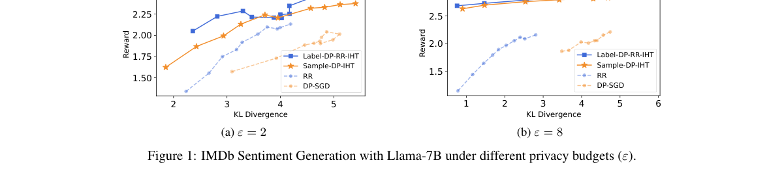

*Main result - Safety Alignment with Gemma-3-1B (ε = 8).*

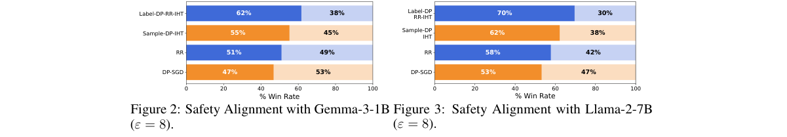

**Why this ranks #10**: 它指出私有对齐的一个**模型规模悖论**：误差界随模型维度多项式增长，在过参数化时代直接不可用——而稀疏假设能把它降下来。

---

## Footer

- Total papers scanned across all 7 tracks: 568（原始 789 条）
- rl_llm track final top-10: 10
- Wild-cards in this track: 0
- Figure assets: 2026-10-22/res/

Generated by `mine-arxiv-daily-digest` skill. Sister file: `2026-10-22_rl_llm_entry.md`.
