# ArXiv Daily Digest - 2026-10-23 (AIGC 音频生成与编辑, 10 papers)

**Generated**: 2026-10-23 17:00 CST

**Source**: arXiv cs.CV, cs.SD, eess.AS, cs.CL, cs.AI, cs.RO, cs.LG submissions, listing day 2026-10-22 (announced 2026-10-23 00:00 UTC)

**Batch window**: 2026-10-21T18:00:00Z .. 2026-10-22T18:00:00Z（arXiv 公告批次横跨两个 UTC 日：前一日 18:00 UTC 起算，当日 17:59:59 UTC 截止）

**Track**: aigc_audio (top 10 of 535 papers scanned, 107 full reads)

**Scope**: TTS、语音克隆、音乐 / 音频生成、语音增强与修复（仅生成侧）

⚠️ **Wild-card**: 本批该线 3 篇为 wild-card 补足，已在正文逐条标注并给出理由。

---

## Top 10 - AIGC 音频生成与编辑

### 1. HeyGen Voice: Scene-Aware Voice Cloning for Talking Videos

**arXiv**: [2610.30470](https://arxiv.org/abs/2610.30470) | **Score**: 9.7 (relevance 10.0 x 0.7 + quality 9.0 x 0.3) | **Tags**: AIGC-audio, voice-cloning, talking-video, multimodal-TTS | **Categories**: cs.SD | **Pages**: 30

**Authors**: Pavel Andreev, Andrei Gusev, Adithya Narayan, Yi Ren, Ivan Somov, Zijian Li, Sergey Demyanov, Viktor Goriachko, Alan Tan, Nik Nolte, Sam Prokopchuk, Andy Pan

**Affiliation**: HeyGen Research

**Abstract**

> Most voice-cloning systems are built for audio alone: they copy the reference recording's delivery and acoustics, so a voice cloned on a phone sounds like a phone recording whether the speaker is pictured in a studio, on a street, or in a cathedral. Speech for a talking video should sound like the pictured person speaking in the pictured place. We present HeyGen Voice, a scene-aware voice-cloning model that separates who is speaking from how and where: it keeps the speaker's voice from an everyday recording while the target image sets the delivery and acoustics. Prior image-conditioned TTS does half of this job: it either adds scene acoustics without keeping a specific speaker or infers a voice from a face. HeyGen Voice is a multimodal autoregressive transformer conditioned on the image, speaker and scene captions, and the voice recording, trained in five stages that move from multilingual TTS pretraining through simulated and real cross-scene adaptation to reinforcement and preference optimization. Two clone policies trade scene adaptation against fidelity to the original recording, and an audio anchor holds long scripts in one voice and one acoustic environment. Listeners prefer HeyGen Voice over leading commercial systems across a third-party arena, production votes, and talking-video studies: it ranks first (Elo 1201) on the public Artificial Analysis controlled-voice TTS leaderboard (October 2026); in a blind test, users cloning their own voice chose it over ElevenLabs v4 and Cartesia Sonic 3.6 in 62% and 54% of votes; and volunteers rated talking videos of their own digital twin about 10 to 30 points higher (out of 100) when voiced by HeyGen Voice than by leading commercial alternatives. Try HeyGen Voice and hear samples at https://heygen.com/heygen-voice.

**Key findings**

- **Finding**: 多数语音克隆系统只做音频：它们照抄参考录音的表达方式与声学环境，于是「手机上录的声音」克隆出来还是手机录音质感。
- **Finding**: HeyGen Voice 把**谁在说**与**在哪儿说、怎么说**分离：保留说话人的音色，由目标图像决定表达方式与声学环境。
- **Finding**: 模型是**多模态自回归 transformer**，条件包括图像、说话人字幕、场景字幕与原始录音。
- **Finding**: 训练分**五个阶段**：多语 TTS 预训练 → 模拟跨场景适配 → 真实跨场景适配 → **强化学习** → **偏好优化**。
- **Finding**: 两种克隆策略在「场景适配程度」与「对原始录音的保真度」之间做权衡；**音频锚点**让长脚本保持同一声线与同一声学环境。
- **Finding**: 在 Artificial Analysis 受控音色 TTS 榜单上排名第一（**Elo 1201**，2026 年 10 月）；盲测中用户克隆自己的声音时，62% 与 54% 的投票选择它而非 ElevenLabs v4 与 Cartesia Sonic 3.6。
- **Finding**: 志愿者对自己数字分身的说话视频评分，用 HeyGen Voice 配音比主流商业方案高约 **10–30 分**（满分 100）。
- **Inference**: 「图像决定场景声学、录音决定音色」这个解耦很干净——它把视频生成的「场景一致性」要求直接搬进了语音合成。
- **Inference**: 值得注意的是 RL 与偏好优化只是五阶段里的最后一步，主体仍是条件架构；按方法学优先的规则它归生成侧而非 RL 侧。
- **Recommendation**: 强烈推荐。做 TTS、语音克隆、talking video 的人必读；也值得听它的公开样本。

**Key figures**

*Framework - HeyGen Voice architecture. Multimodal inputs are encoded by frozen encoders and pooled into conditioning tokens; the clone policy determines whether the continuation state comes from an ancho*

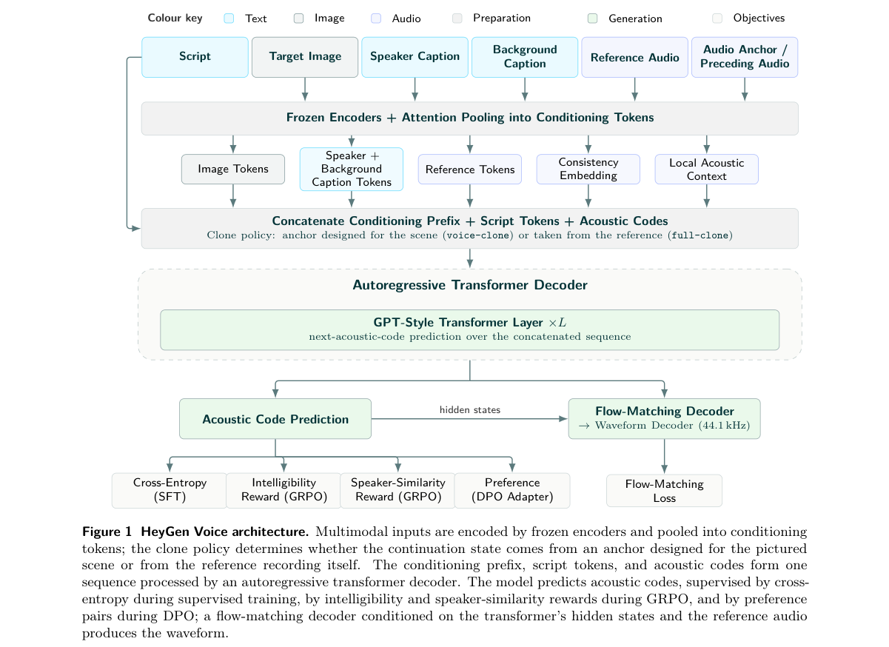

*Result - Example speaker and background captions for one recording, a speaker talking inside a moving car. Each caption is a short descriptive paragraph; the background caption names the sound sources*

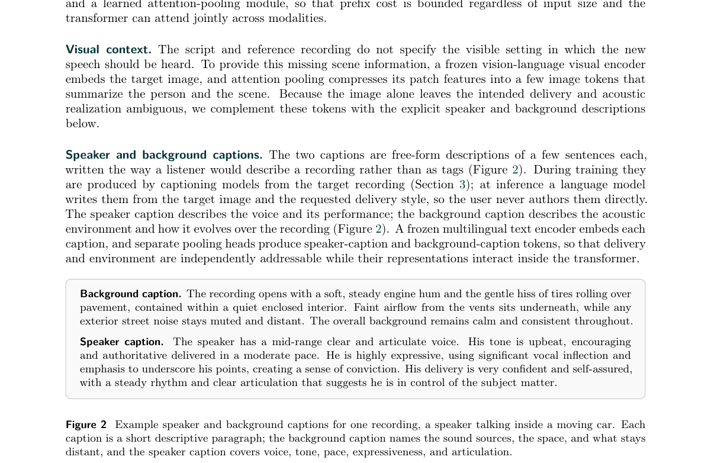

**Why this ranks #1**: 场景感知的语音克隆：把「谁在说」与「在哪儿说、怎么说」彻底分开，本批音频生成侧最完整的产品级技术报告。

---

### 2. EmoFI-TTS: Face-Conditioned Expressive Voice Synthesis with Intensity Modulation

**arXiv**: [2610.30477](https://arxiv.org/abs/2610.30477) | **Score**: 8.7 (relevance 9.0 x 0.7 + quality 8.0 x 0.3) | **Tags**: AIGC-audio, TTS, emotion-control, intensity-modulation | **Categories**: cs.SD | **Pages**: 5

**Authors**: Yejin Jeon, Luel Hagos Beyene, Marie Maltais, Hyounghun Kim, David Ifeoluwa Adelani

**Affiliation**: Mila-Québec AI Institute; McGill University

**Abstract**

> Controlling emotional intensity remains challenging in expressive text-to-speech synthesis, particularly when emotion must be inferred without explicit labels. We propose EmoFI-TTS, a face-conditioned framework that derives emotion category and intensity from a single facial image while extracting speaker characteristics from reference audio. Modality-specific representations are fused to condition a pretrained speech synthesizer, with cross-speaker training encouraging separation of affect and vocal identity. An intensity-conditioned refinement module enhances the generated mel-spectrogram, while interpolation of learned intensity embeddings enables continuous control without additional training. On speaker-disjoint MEAD evaluation, EmoFI-TTS achieves on average 64.4% and 75.2% objective and subjective emotion intensity accuracies, while retaining low word error rate and high naturalness.

**Key findings**

- **Finding**: 控制情绪强度在表达性 TTS 中依然困难，尤其当情绪必须**在没有显式标注**的情况下推断。
- **Finding**: EmoFI-TTS 是**人脸条件**框架：从单张人脸推断情绪类别与强度，同时从参考音频提取说话人特征。
- **Finding**: 模态专属表示融合后条件化一个预训练语音合成器；**跨说话人训练**促使情感与声纹身份分离。
- **Finding**: 强度条件化的精修模块增强生成的 mel 频谱；**插值学习到的强度嵌入**即可实现连续控制，无需额外训练。
- **Finding**: 说话人不相交的 MEAD 评测上，平均达到 **64.4% 客观**与 **75.2% 主观**情绪强度准确率，同时保持低 WER 与高自然度。
- **Inference**: 「强度嵌入可插值」是把离散情绪标签变成连续旋钮的干净做法，比逐个情绪训模型省得多。
- **Inference**: 跨说话人训练逼模型把情感与身份解耦，这是能同时做强度控制与保持音色的前提，值得抄。
- **Recommendation**: 推荐。做表达性 TTS、情绪控制、语音角色的人应读。

**Key figures**

*Framework - System overview. Text, face image, and reference audio each control content, emotion and its intensity, and speaker timbre, respectively. Solid lines carry signal, blue dashed lines carry cond*

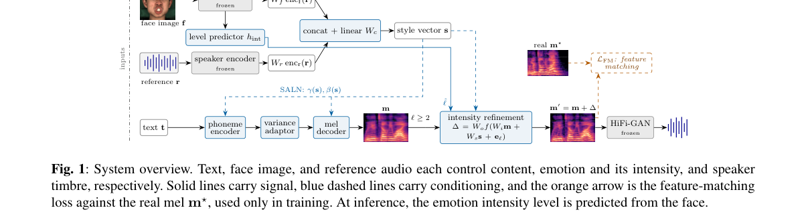

*Result - Emotion visualizations of generated audio.*

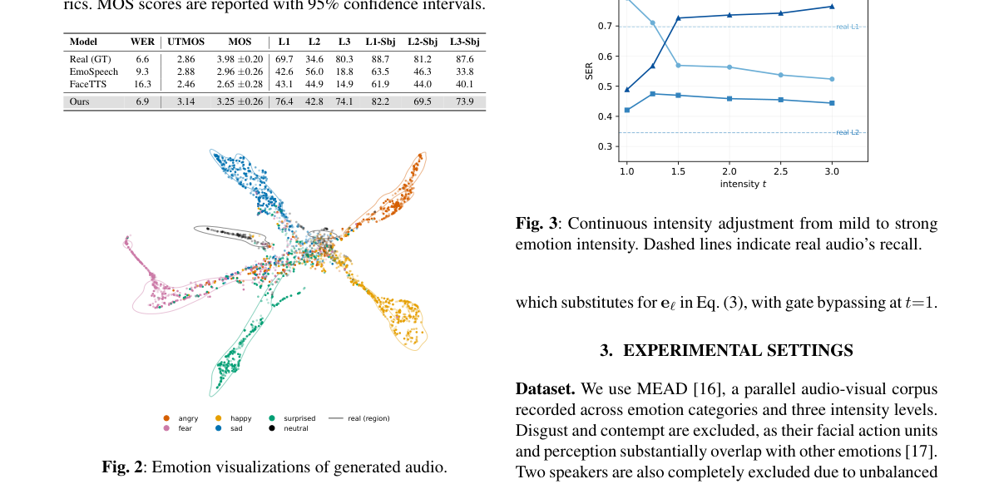

**Why this ranks #2**: 从单张人脸推断情绪**类别与强度**，并用插值实现免训练的连续强度控制。

---

### 3. Piano2Pop: Expanding Piano Demos into Pop Productions Without Aligned Supervision

**arXiv**: [2610.31510](https://arxiv.org/abs/2610.31510) | **Score**: 8.3 (relevance 8.0 x 0.7 + quality 9.0 x 0.3) | **Tags**: AIGC-audio, music-generation, flow-matching, pseudo-supervision | **Categories**: cs.LG, cs.SD | **Pages**: 5

**Authors**: Yun-Chen Cheng, Chih-Pin Tan, Tzu-Hung Huang, Yi-Hsuan Yang

**Affiliation**: National Taiwan University

**Abstract**

> We introduce Piano2Pop, a music-expansion task that transforms piano MIDI into instrumental pop productions. Enabled by recent advances in music generation and polyphonic music transcription, our pseudo-supervised approach conditions a pretrained flow-matching model on piano rolls without aligned piano-pop supervision. We train on synthetic piano-instrumental pairs derived from pop recordings, comparing pair-free transcription, including function-selective (FST) and register-density (RDA) augmentations, with a pair-supervised piano-cover generator as pseudo-demo sources. On 476 testing real-world piano-cover/pop pairs, the pair-supervised approach achieves the best Frechet Audio Distance, Accompaniment Prompt Adherence, and spectral shape on real-piano inputs, while FST mitigates piano-heavy outputs in pair-free training and remains a promising alternative. All fine-tuned systems significantly outperform the zero-shot baselines, which suggests a role for task-specific modeling.

**Key findings**

- **Finding**: 论文提出 **Piano2Pop** 这一音乐扩展任务：把钢琴 MIDI 变换为器乐流行制作。
- **Finding**: 依托音乐生成与**多声部音乐转录**的进展，方法用伪监督方式把预训练**流匹配模型**条件化在钢琴卷帘上，没有对齐的钢琴-流行配对数据。
- **Finding**: 训练数据是从流行录音派生的合成钢琴-器乐配对。
- **Finding**: 作者比较了配对自由转录与其他基线。
- **Inference**: 「借转录造伪标签」是绕过配对数据稀缺的一条实用路子——和 3D 那条线的「借渲染造配对监督」是同一个套路。
- **Inference**: 流匹配模型被放在音乐扩展这个位置上，说明音乐生成的基础设施已经稳定到可以被当作现成先验。
- **Recommendation**: 推荐。做音乐生成、编曲自动化、或者想看「无配对监督」玩法的人可以读。

**Key figures**

*Framework - Overview of Piano2Pop. Data preparation: real pop audio is optionally source-separated, transcribed to piano MIDI (pair-free or pair-supervised), and optionally augmented. Training: transcribe*

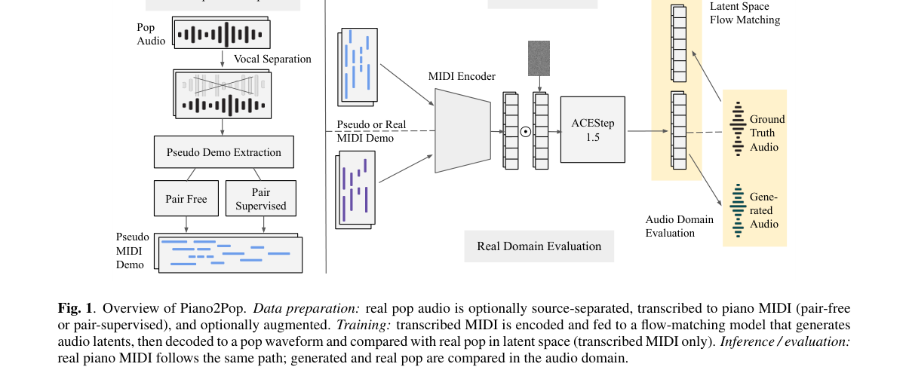

*Result - Difference from GT in mean instrument-energy share, with 95% confidence intervals, under OOD real-piano condition- ing. Vocals are omitted.*

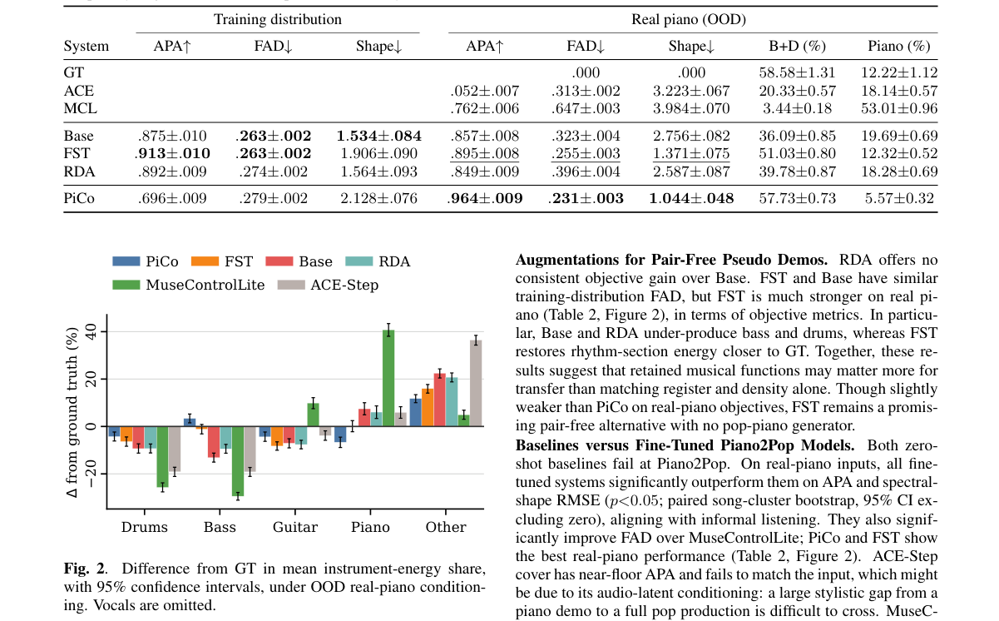

**Why this ranks #3**: 没有配对监督也能做音乐扩展：借多声部转录把钢琴 MIDI 变成流行编曲的「伪监督」训练信号。

---

### 4. CAVC: Convergence-Adaptive Audio-Visual Cache for Modality-Asymmetric Diffusion Generation

**arXiv**: [2610.30854](https://arxiv.org/abs/2610.30854) | **Score**: 8.3 (relevance 8.0 x 0.7 + quality 9.0 x 0.3) | **Tags**: AIGC-audio, audio-visual-generation, cache, training-free | **Categories**: cs.CV, cs.SD | **Pages**: 13

**Authors**: Lifan Jiang, Yibo Zhao, Senlin cheng, Bolei Xu, Xiaobo Li, Can Ye, Dehai Zhao, Deng Cai, Boxi Wu

**Affiliation**: State Key Lab of CAD&CG, Zhejiang University; Ant Group

**Abstract**

> Diffusion-based audio-visual generation methods typically perform joint denoising of audio and video latents throughout the entire sampling trajectory, repeatedly executing modality-specific denoising branches and cross-modal attention at every timestep. However, we observe that such uniform joint computation is not always necessary. The key is a modality-asymmetric recoverability: audio-side drift introduced by mid-stage caching can be substantially reduced by only a few terminal joint denoising steps, whereas video-side degradation caused by caching leads to persistent loss of motion and temporal details. This asymmetry suggests that inference acceleration should selectively cache recoverable audio-side computation while preserving full video refinement. Motivated by this observation, we propose \textbf{Convergence-Adaptive Audio-Visual Cache (CAVC)}, a training-free modality-asymmetric caching framework. CAVC adopts a sandwich-structured computation allocation: after detecting that audio denoiser outputs enter a cache-tolerant regime, it caches and reuses the audio denoiser output to bypass audio denoising and cross-modal attention in the middle stage, while the video branch continues independent spatio-temporal refinement; a few joint steps are then restored at the end to reduce accumulated cross-modal drift and improve synchronization. Experiments across multiple public benchmarks demonstrate that CAVC achieves 1.10--1.35x wall-clock acceleration, improves several visual dynamics and temporal statistics, and maintains competitive audio fidelity and audio-visual alignment.

**Key findings**

- **Finding**: 扩散式音视频生成通常全程联合去噪音频与视频潜变量，反复执行模态专属去噪分支与跨模态注意力。
- **Finding**: 核心观察是**模态不对称的可恢复性**：中段缓存带来的音频侧漂移，可以靠末端少数几步联合去噪**大幅缓解**；而视频侧因缓存造成的退化（运动与时序细节丢失）是**持久**的。
- **Finding**: CAVC 是**训练无关**的模态不对称缓存框架，采用「三明治」式计算分配。
- **Finding**: 检测到音频去噪器输出进入可缓存区后，中段缓存并复用音频去噪器输出，跳过音频去噪与跨模态注意力，视频分支继续独立时空精化；末端恢复少数联合步以降低累积跨模态漂移、改善同步。
- **Finding**: 在多个公开基准上取得 **1.10–1.35×** 墙钟加速，同时**改善**若干视觉动态与时序统计，并保持有竞争力的音频保真度与音视频对齐。
- **Inference**: 「加速后质量反而变好」通常意味着原实现有冗余计算——这里冗余在音频侧，而视频侧一步都不能省。
- **Inference**: 模态不对称这个概念可以直接搬到别的多模态扩散（如音-图、视-触）上，是篇有迁移价值的论文。
- **Recommendation**: 强烈推荐。做音视频生成、扩散加速、多模态联合去噪的人必读。

**Key figures**

*Framework - A: CAVC generates high-fidelity video frames synchronized with complex audio waveforms. B: On General-80, training-free CAVC achieves a favorable quality-efficiency trade-off across generati*

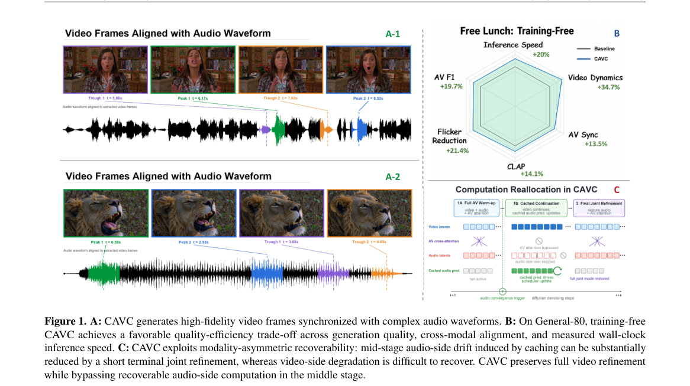

*Result - Overview of the CAVC framework. The denoising trajectory (t = T →0) is dynamically partitioned based on modality convergence. (1A) Full AV Warm-up: During early high-noise stages, audio/vide*

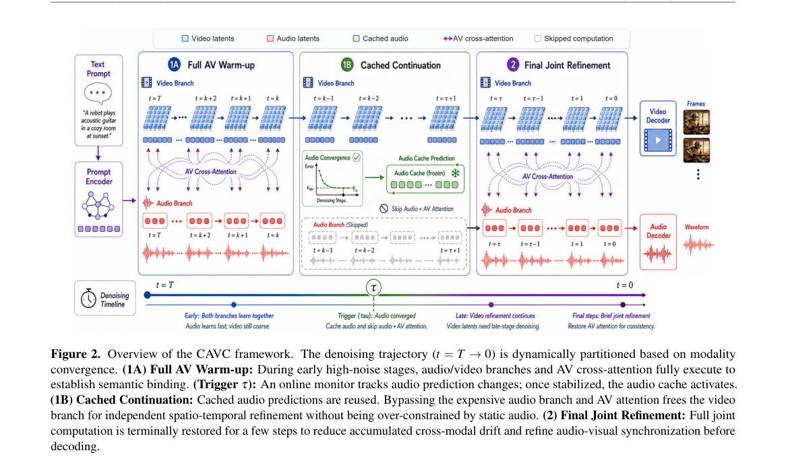

**Why this ranks #4**: 音视频联合扩散里的「模态不对称」：缓存音频侧、保全视频侧，只用几步联合去噪补回漂移。

---

### 5. When Do Self-Supervised Representations Help Speech Restoration?

**arXiv**: [2610.30869](https://arxiv.org/abs/2610.30869) | **Score**: 8.0 (relevance 8.0 x 0.7 + quality 8.0 x 0.3) | **Tags**: AIGC-audio, speech-restoration, SSL-representation, negative-result | **Categories**: cs.SD | **Pages**: 5

**Authors**: Yongjoon Lee, Younghoo Kwon, Jung-Woo Choi

**Affiliation**: KAIST

**Abstract**

> Self-supervised learning (SSL) representations are widely used in speech restoration (SR), and the prevailing trend is SSL feature cleansing: fine-tuning the SSL to recover clean features from degraded speech, then conditioning the restoration model on them. However, the representational capability of SSL when encoding degraded speech has been underexplored, and we ask whether cleansing always benefits SR training. Across SSL encoders and perceptual quality proxies, we discover perceptual correlation collapse---under severe degradation, cleansing degraded SSL features toward clean ones misaligns with the SR objective. We hypothesize the restoration backbone can supply the SSL with clues to resolve this collapse, since its intermediate layers already produce partially restored features. We therefore propose Early Restoration Injection (ERI), which routes intermediate features from the restoration backbone into the SSL through a lightweight conditioning network. ERI excels over the unconditioned baseline and, on the VoiceFixer benchmark, achieves competitive performance among multiple baselines.

**Key findings**

- **Finding**: 主流做法是 **SSL 特征清洗**：微调 SSL 从退化语音中恢复干净特征，再用它们条件化恢复模型。
- **Finding**: 但 SSL 在**编码退化语音**时的表征能力此前被忽视，论文追问「清洗是否总是有益」。
- **Finding**: 跨 SSL 编码器与感知质量代理指标，作者发现**感知相关性崩塌**：在严重退化下，把退化 SSL 特征向干净特征清洗会与语音恢复目标错配。
- **Finding**: 作者假设恢复骨干可以给 SSL 提供解决崩塌的线索——其中间层本已产生部分恢复的特征。
- **Finding**: 提出 **ERI（Early Restoration Injection）**：用轻量条件网络把恢复骨干的中间特征路由进 SSL。
- **Finding**: ERI 优于无条件基线，在 VoiceFixer 基准上与多个基线达到有竞争力的表现。
- **Inference**: 这篇的 negative result 比它的方法更有价值：它说明「SSL 特征在下游任务里有用」和「清洗一定有用」是两件事。
- **Inference**: 「让下游骨干反过来给表征学习器提供线索」是个跨结构的通用思路，不限于语音。
- **Recommendation**: 推荐。做语音增强 / 恢复，或任何使用预训练表征做条件的人应读。

**Key figures**

*Framework - t-SNE plots of speech degraded with additive noise at varying SNR level, visualized in WavLM feature space.*

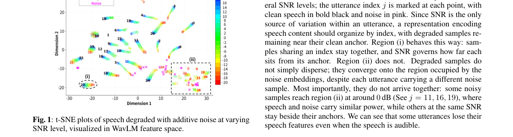

*Result - SSL-wise plot of perceptual correlation.*

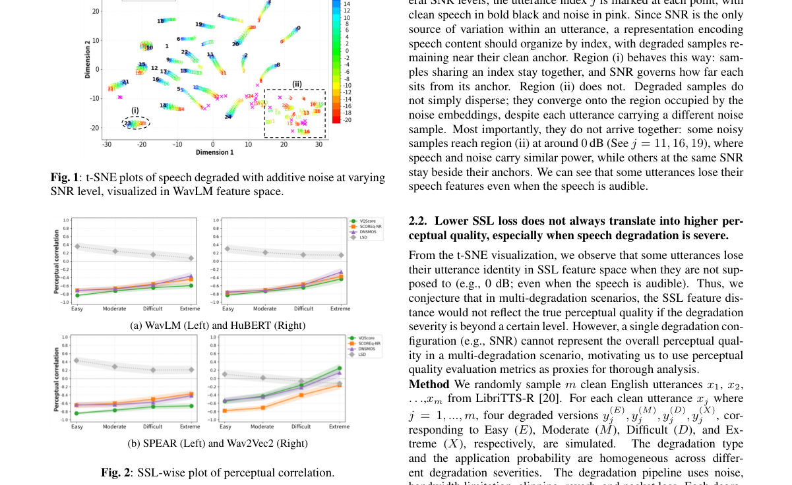

**Why this ranks #5**: 反直觉结论：严重退化下，把 SSL 特征「清洗」回干净反而与恢复目标错配——一篇有价值的 negative result。

---

### 6. HC-AINet: An Auditory-Inspired Network with Harmonic Compensation for Low-Complexity Speech Enhancement

**arXiv**: [2610.30818](https://arxiv.org/abs/2610.30818) | **Score**: 7.3 (relevance 7.0 x 0.7 + quality 8.0 x 0.3) | **Tags**: AIGC-audio, speech-enhancement, ERB-filterbank, edge-efficient | **Categories**: eess.AS | **Pages**: 12

**Authors**: Nan Li, Xiaoxiong Wu, Huawei Liu, Ziping Zhao

**Affiliation**: Tianjin Normal University

**Abstract**

> Speech enhancement on resource-constrained devices requires noise suppression with limited computation and minimal loss of spectral detail. Auditory-inspired subband processing reduces computation, but its smooth gains have limited ability to distinguish harmonic peaks from neighboring noise. We propose a harmonic-compensated auditory-inspired network (HC-AINet) for low-complexity speech enhancement. A triangular equivalent rectangular bandwidth (ERB) filterbank supplies compact features to a lightweight network comprising inverted-residual units, temporal Conformer layers, and parallel frequency-gated convolutions. The network predicts global and harmonic gains together with fusion weights. A harmonic-location map derived from the noisy spectrum confines the harmonic contribution to selected bins on the original frequency grid, while the global branch controls the broader spectral envelope. The compensated magnitude, noisy phase, and a magnitude-derived minimum-phase cue jointly condition a compact phase estimator for waveform reconstruction. On VoiceBank-DEMAND, the 64-band model achieves a PESQ of 3.20 and a STOI of 0.95 with approximately 0.27 million parameters.

**Key findings**

- **Finding**: 资源受限设备上的语音增强需要在算力有限、频谱细节损失尽量小的前提下抑制噪声。
- **Finding**: 听觉启发的子带处理能降算力，但**平滑增益**难以区分谐波峰与邻近噪声。
- **Finding**: HC-AINet 引入**谐波补偿**：三角 ERB 滤波器组提供紧凑特征，送入由倒残差单元、时序 Conformer 层与并行频率门控卷积组成的轻量网络。
- **Finding**: 网络同时预测**全局增益与谐波增益**以及融合权重。
- **Finding**: 由含噪频谱导出的**谐波位置图**把谐波贡献限制在原始频率栅格上的选定频带，全局分支负责更宽的频谱包络。
- **Finding**: 补偿后的幅度、含噪相位与幅度推导的最小相位线索共同条件化一个紧凑的相位估计器以重建波形。
- **Finding**: 在 VoiceBank-DEMAND 上，64 频带模型达到 **PESQ 3.20、STOI 0.95**，参数量约 **0.27M**。
- **Inference**: 「全局增益 + 谐波增益」的双分支，把「降噪」和「保留音高结构」拆成两件可分别建模的事，比单一掩码更合物理。
- **Inference**: 0.27M 参数 + PESQ 3.20 是相当漂亮的性价比，对端侧语音增强落地很有参考价值。
- **Recommendation**: 推荐。做端侧语音增强、低算力音频模型的人应读。

**Key figures**

*Framework - Comparison of (a) noisy speech, (b) clean speech, and (c) speech reconstructed with oracle 32-band ERB gains. The highlighted regions show residual differences in narrowband spectral structure*

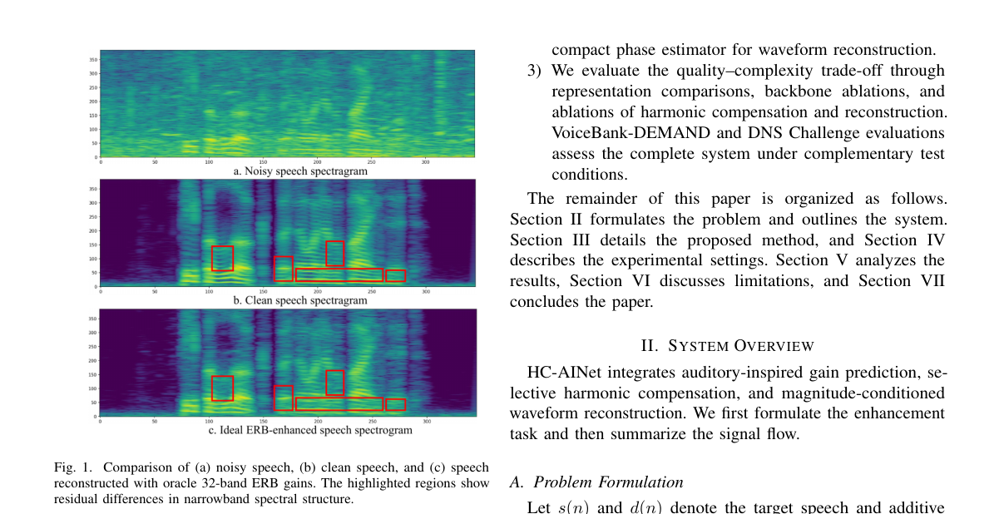

*Result - Overview of HC-AINet. The auditory-inspired gain network (AINet) predicts global and harmonic gains and their fusion weights from ERB features. A noisy-input harmonic-location map guides selec*

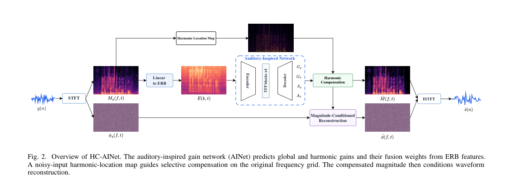

**Why this ranks #6**: 0.27M 参数做到 PESQ 3.20 / STOI 0.95：把听觉启发式子带处理补上谐波补偿。

---

### 7. Measuring the Verifier's Floor: How Much Apparent Rare-Word Text-to-Speech Error Is ASR Error?

**arXiv**: [2610.31470](https://arxiv.org/abs/2610.31470) | **Score**: 7.3 (relevance 7.0 x 0.7 + quality 8.0 x 0.3) | **Tags**: AIGC-audio, TTS-evaluation, ASR-round-trip, measurement-error | **Categories**: cs.CL, cs.SD | **Pages**: 5

**Authors**: Kirill Borodin, Vasilii Kudryavtsev, Nikita Vasiliev, Grach Mkrtchian

**Affiliation**: BitmanagerAI, Dubai; lab260, Yerevan

**Abstract**

> Text-to-speech (TTS) is usually evaluated by transcribing its output with an automatic speech recognition (ASR) system, so the word error rate also counts recognizer errors. We measure these errors on human recordings of the test sentences. On LibriSpeech and FLEURS, the evaluation recognizer misses 33-67% of very rare words even in human speech, and all three recognizers miss 22-42%. Checking every word with two more recognizer families lowers the apparent TTS error on words that at least one recognizer hears two- to three-fold (very rare LibriSpeech words: from 10-13% to 3-5%), yet very rare words remain the hardest. Ignoring words the recognizer misses in human speech is biased: the other recognizers find TTS errors far more often on these words (4-6% vs. 0.2-0.3%) and overturn about half of the errors this mask keeps. As half of the remaining adjudicated errors may be spelling variants, a listening test is needed.

**Key findings**

- **Finding**: TTS 通常用 ASR 转写自己的输出来评测，**词错误率因此混入了识别器的错误**。
- **Finding**: 作者在**人类录音**的测试句上测量这块地板：LibriSpeech 与 FLEURS 上，评测识别器即使在人类语音中也漏掉 **33–67%** 的极罕见词；三个识别器全部漏掉 **22–42%**。
- **Finding**: 再用两个别的识别器族逐词复查，可把「至少有一个识别器听到两到三倍」的词上的表面 TTS 错误从 **10–13% 降到 3–5%**，但极罕见词依然最难。
- **Finding**: 直接忽略「识别器在人类语音上也漏掉的词」是有偏的：其他识别器在这些词上发现 TTS 错误的频率高得多（**4–6% vs 0.2–0.3%**），并推翻了该掩码保留的约一半错误。
- **Finding**: 由于剩余已裁定错误中可能有一半是拼写变体，**仍需听辨测试**才能定性。
- **Inference**: 这是整条 TTS 评测链路上的方法学修正：很多「罕见词难」的结论其实有一半是识别器的能力边界。
- **Inference**: 作者诚实地指出「掩码有偏、听测必要」，这种把测量误差讲到底的写法比给个漂亮数字更值得学。
- **Recommendation**: 推荐。做 TTS 评测、榜单、或需要用 WER 下结论的人必读。

**Key figures**

*Framework - TTS word error per judged word (any-of-N) against the share of rare words (corpus measure) in the 500 LibriSpeech sentences, split into four bins at the quartiles (124, 124, 111 and 141 senten*

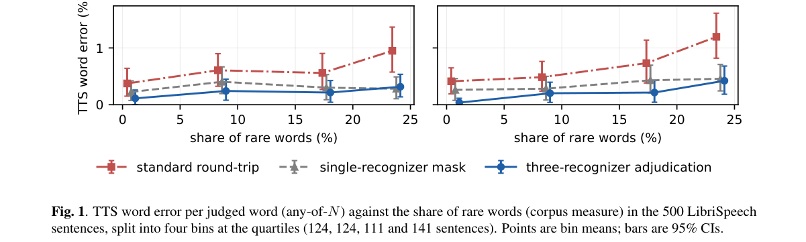

**Why this ranks #7**: 量化 TTS 评测的地板误差：罕见词上的「ASR 错误」有多少其实是识别器自己的错。

---

### 8. MQAScore: Fine-Grained Text-Music Alignment Evaluation via Large Audio Language Model

⚠️ **[wild-card=yes]** — 本批 cs.SD/eess.AS 生成侧真实命中仅 7 篇（低于 top-10 配额 3 篇）；该文是为 text-to-music 生成提出的细粒度对齐评测方法，落在音乐生成的质量评价环节，与生成侧直接相关但本身不训练生成模型。

**arXiv**: [2610.31083](https://arxiv.org/abs/2610.31083) | **Score**: 7.3 (relevance 7.0 x 0.7 + quality 8.0 x 0.3) | **Tags**: AIGC-audio, text-to-music, evaluation, audio-LLM, WILD | **Categories**: cs.AI, cs.SD, eess.AS | **Pages**: 5

**Authors**: Wei-Jaw Lee, Chun-Ping Wang, Xuanjun Chen, Yi-Hsuan Yang

**Affiliation**: National Taiwan University; Taiwan AILabs

**Abstract**

> Text-to-music alignment is commonly evaluated by the global similarity between text and audio embeddings, which collapses all described attributes into a single score and obscures which ones are missing. We instead introduce MQAScore, which verifies each atomic musical concept along five clip-level dimensions (genre, instrument, mood/theme, vocal, and usage) by the probability that a large audio language model (LALM) answers affirmatively to a binary question. To assess evaluator reliability, we construct verification labels from presence/absence annotations and LLM-guided concept substitutions, and propose the Sensitivity-Invariance Ratio, which measures how selectively an evaluator responds to meaning-changing substitutions. Experiments show that concept-level scoring improves both question-answering and similarity-based evaluators, and MQAScore can be a more reliable and interpretable fine-grained complement to global similarity for evaluating text-to-music alignment.

**Key findings**

- **Finding**: text-to-music 对齐通常用文本与音频 embedding 的**全局相似度**评测，把所有被描述的属性压成一个分数，看不出缺了哪一项。
- **Finding**: MQAScore 沿五个片段级维度（**流派、配器、情绪 / 主题、人声、用途**）逐个原子音乐概念做核验，方式是看大音频语言模型（LALM）对二元提问给出肯定回答的概率。
- **Finding**: 为评估评测器可靠性，作者用「存在 / 缺失」标注与 LLM 引导的概念替换构造核验标签。
- **Finding**: 提出 **Sensitivity-Invariance Ratio**，衡量评测器对改变语义的替换有多敏感。
- **Finding**: 实验显示概念级打分同时改善**问答式**与**相似度式**评测器；MQAScore 可以作为全局相似度之外更可靠、更可解释的细粒度补充。
- **Inference**: 把「LALM 对二元问题的肯定概率」当作细粒度打分器，是把 LLM 的语言先验直接当软标签用的典型做法——便宜、可扩展，但继承了 LLM 的偏差。
- **Inference**: Sensitivity-Invariance Ratio 这个指标本身可复用：它测的是评测器是否只对语义变化起反应。
- **Recommendation**: 推荐。做音乐生成评测、T2M 对齐、或任何用 LLM 打细粒度分的人可以读。

**Key figures**

*Framework - Global similarity (e.g. CLAP, MuQ-MuLan) yields a single score; MQAScore verifies each musical dimension separately.*

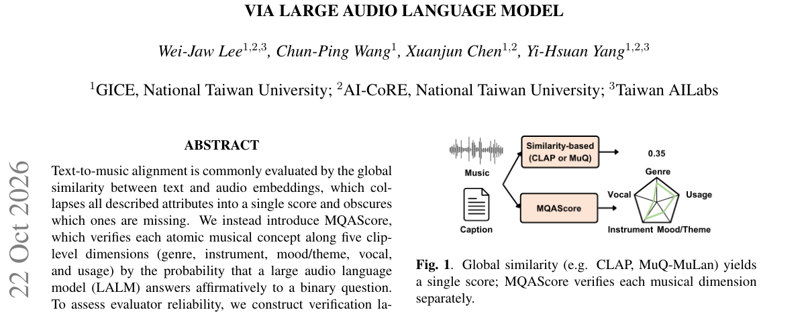

**Why this ranks #8**: 用大音频语言模型逐概念核验 text-to-music 对齐，而不是把一切压成一个相似度分数。  [wild-card]

---

### 9. MixJudge: Learning a Language-Queryable Critic for Vocal Mixing

⚠️ **[wild-card=yes]** — 生成侧真实命中不足；该文是人声混音的语言可查询评判器（audio critic），服务于音频制作与编辑链路，是生成侧最接近的质量/奖励模型邻居。

**arXiv**: [2610.30783](https://arxiv.org/abs/2610.30783) | **Score**: 6.6 (relevance 6.0 x 0.7 + quality 8.0 x 0.3) | **Tags**: AIGC-audio, audio-critic, vocal-mixing, language-queryable, WILD | **Categories**: cs.CL, cs.SD | **Pages**: 5

**Authors**: Kuan-Hsun Ho, Yuan-Chiao Cheng, Yen-Tung Yeh, Yi-Hsuan Yang

**Affiliation**: Georgia Institute of Technology; National Taiwan University

**Abstract**

> Mixing requires not only applying processing but also assessing the resulting mix. Audio-language models can provide conversa- tional mixing advice, but existing evaluations do not separately test whether they can judge specific mixing issues. Since professional supervision for such judgments is scarce, we construct a curriculum of 11 vocal-mix issues at multiple severity levels and use it to train MixJudge, a language-queryable audio critic. MixJudge shows its ability to retrieve mixing issues, distinguish opposite issues, and order the severity of an issue. Moreover, its judgments transfer to menu selection: given a set of processing candidates, MixJudge often favors versions acoustically closer to a held-out professional version, demonstrating how explicit mixing judgment can support comparison and downstream mixing decisions.

**Key findings**

- **Finding**: 混音不只是施加处理，还需要**评估**混完的结果。
- **Finding**: 音频语言模型能给出对话式混音建议，但现有评测没有单独检验它们能否判断具体的混音问题；且**专业监督稀缺**。
- **Finding**: 作者构造了 **11 类人声混音问题、多个严重度等级**的课程，用来训练 **MixJudge** 这个语言可查询的音频评判器。
- **Finding**: MixJudge 能检索混音问题、区分相反的问题、并对同一问题的严重度排序。
- **Finding**: 其判断可迁移到**菜单选择**：给定一组处理候选，MixJudge 往往偏向声学上更接近留出的专业版本的选项。
- **Inference**: 「专业监督稀缺 → 用构造的难度课程替代标注」是音频领域少见的思路，也让评判器有可分级的输出而非二元好坏。
- **Inference**: 用评判器直接驱动处理链选择，比让 LLM 给建议更可靠——这正是 reward model 的典型用法形态。
- **Recommendation**: 可选读。做音频质量评估、混音自动化、或研究音频 critic 的人可以看。

**Key figures**

*Framework - Same-content training batch construction.*

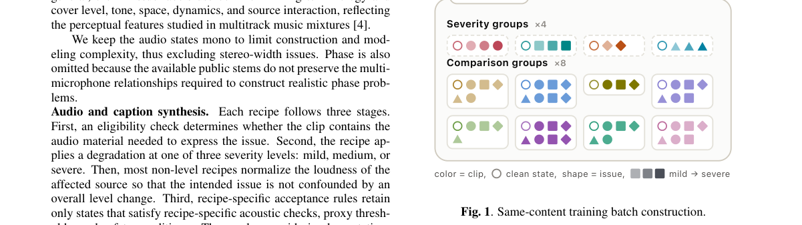

*Result - The critic’s exam. Green marks correct responses; red marks errors.*

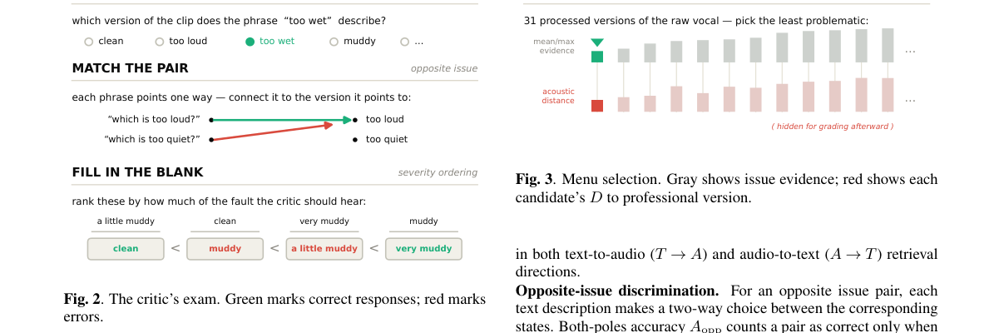

**Why this ranks #9**: 人声混音的语言可查询评判器：11 类问题、多级严重度，评判结果能直接用于选择处理方案。  [wild-card]

---

### 10. Lip-Focused Audio-Visual Consistency Detects Speech Content Manipulation beyond Coarse Synchronization

⚠️ **[wild-card=yes]** — 生成侧真实命中不足；该文检测语音内容被替换 / 口型再生成的操纵，直接针对 talking-head 与 retalking 生成模型的滥用面。

**arXiv**: [2610.30872](https://arxiv.org/abs/2610.30872) | **Score**: 6.6 (relevance 6.0 x 0.7 + quality 8.0 x 0.3) | **Tags**: AIGC-audio, audio-visual-forensics, deepfake, retalking, WILD | **Categories**: eess.AS | **Pages**: 15

**Authors**: Jian Zong, Chenghan Lin, Meng Liu, Zhao Xu, Junyu Wang, Siyuan Zhang, Peiyuan Jiang, Longbiao Wang, Jianwu Dang

**Affiliation**: Tianjin University; Shenzhen Institutes of Advanced Technology, Chinese Academy of Sciences

**Abstract**

> Speech-content manipulation changes what a visible person appears to say by replacing the speech track and, in stronger attacks, regenerating mouth motion to match the forged utterance. Such attacks are difficult to expose with texture artifacts or coarse lip-sync scores because modern retalking models explicitly optimize audio-visual synchrony. We test the narrower hypothesis that speech replacement still perturbs the local relationship between acoustic dynamics and mouth motion after speaker identity or coarse synchrony is controlled. To isolate this signal, we introduce SyncSpeech, an LRS3-derived benchmark containing real videos, audio-splicing cheapfakes and Wav2Lip retalking attacks under same-speaker and different-speaker replacement. We then introduce C-MIND, a lip-focused detector that aligns audio and mouth-motion representations at frame level and models their agreement and disagreement without transcripts, automatic speech recognition features or an unmanipulated reference. On SyncSpeech, pretrained SyncLip-C achieves 95.813% scenario-averaged accuracy and 0.9943 AUC, outperforming sentence-level fusion, full-face inputs and a reproduced SyncNet baseline under the reported protocol. When trained on the corresponding FakeAVCeleb training split, C-MIND correctly classifies 278 of 280 samples in the selected unseen-speaker test subset, whereas accuracy falls to 82.775% on unseen Video-Retalking attacks. These results identify lip-focused speech-articulation consistency as a useful but generator-sensitive forensic signal within the evaluated settings.

**Key findings**

- **Finding**: 语音内容操纵会替换音轨，更强的攻击还会**重新生成口型运动**以匹配伪造话语。
- **Finding**: 这类攻击难以靠纹理伪影或粗粒度唇同步分数暴露，因为现代 retalking 模型会显式优化音视频同步。
- **Finding**: 论文测试更窄的假设：在控制说话人身份与粗同步后，**语音替换仍会扰动声学动态与口型运动的局部关系**。
- **Finding**: 构造 **SyncSpeech** 基准（LRS3 派生）：真实视频、音频拼接 cheapfake 与 Wav2Lip retalking 攻击，覆盖同说话人与跨说话人替换。
- **Finding**: 提出 **C-MIND**：在帧级对齐音频与口型运动表示，建模二者的**一致与不一致**，且**不使用转写、ASR 特征或未操纵的参考**。
- **Finding**: 在 SyncSpeech 上，预训练 SyncLip-C 达到 **95.813%** 场景平均准确率与 **0.9943 AUC**，优于句级融合、全脸输入与复现的 SyncNet 基线。
- **Finding**: 在 FakeAVCeleb 训练划分上，C-MIND 在选定未见说话人测试子集上正确分类 **278/280**；但在未见 Video-Retalking 攻击上准确率降到 **82.775%**。
- **Inference**: 「对生成器敏感」这个自我限定很关键：检测器在换一种 retalking 模型就掉 13 个点，说明这类取证信号离普适还有距离。
- **Inference**: 不用转写与 ASR 特征、只用口型局部关系——这是在受限取证场景下的漂亮设计。
- **Recommendation**: 可选读。做音视频取证、deepfake 检测的人可以看；做语音生成的人值得了解对手的检测面。

**Key figures**

*Framework - Overview of C-MIND (SyncLip-C). Audio and visual encoders produce frame-level representations that are projected to a common dimension and temporally aligned. Their concatenation, element-wise*

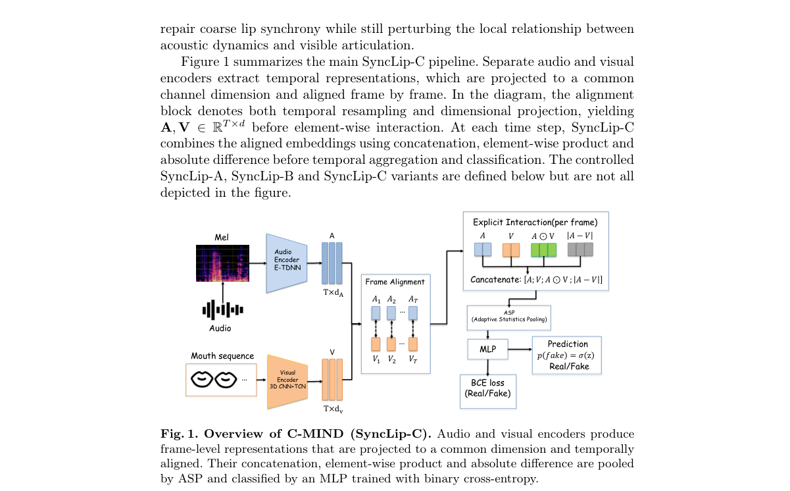

*Result - SyncSpeech manipulation matrix. Scenario 0 supplies the real source pair. Different-speaker and same-speaker replacement speech produce the identity- mismatched and identity-controlled branche*

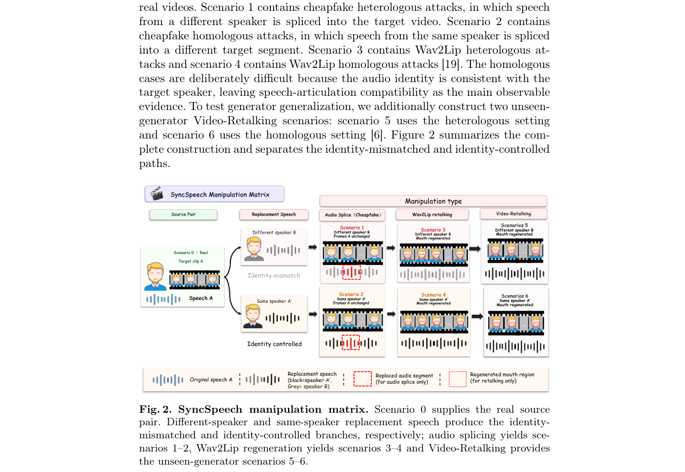

**Why this ranks #10**: 口型局部一致性这一取证信号：绕开粗粒度唇同步，专门抓语音被替换后的唇部微扰。  [wild-card]

---

## Footer

- Total papers scanned across all 7 tracks: 535（原始 705 条）
- aigc_audio track final top-10: 10
- Wild-cards in this track: 3
- Figure assets: 2026-10-23/res/

Generated by `mine-arxiv-daily-digest` skill. Sister file: `2026-10-23_aigc_audio_entry.md`.
