# ArXiv Daily Digest - 2026-10-23 (AIGC 图像 / 视频 / 3D 生成与编辑, 10 papers)

**Generated**: 2026-10-23 17:00 CST

**Source**: arXiv cs.CV, cs.SD, eess.AS, cs.CL, cs.AI, cs.RO, cs.LG submissions, listing day 2026-10-22 (announced 2026-10-23 00:00 UTC)

**Batch window**: 2026-10-21T18:00:00Z .. 2026-10-22T18:00:00Z（arXiv 公告批次横跨两个 UTC 日：前一日 18:00 UTC 起算，当日 17:59:59 UTC 截止）

**Track**: aigc_visual (top 10 of 535 papers scanned, 107 full reads)

**Scope**: 图像 / 视频 / 3D / 4D 生成、编辑与可控生成

---

## Top 10 - AIGC 图像 / 视频 / 3D 生成与编辑

### 1. Direct Forcing: A Single-Stage Training Recipe for Few-Step Autoregressive Text-to-Video Generation

**arXiv**: [2610.30861](https://arxiv.org/abs/2610.30861) | **Score**: 9.7 (relevance 10.0 x 0.7 + quality 9.0 x 0.3) | **Tags**: AIGC-video, autoregressive, few-step, single-stage-training | **Categories**: cs.AI, cs.CV | **Pages**: 17

**Authors**: Haojun Xu, Jie Huang, Xin Lu, Mingchen Zhong, Zihao Fan, Linjiang Huang, Si Liu

**Affiliation**: Beihang University

**Abstract**

> Few-step autoregressive video generation enables low-latency streaming, yet prevailing training pipelines separate causal adaptation from distribution matching. Recent representation-based text-to-video methods retain this separation by starting from ODE-initialized checkpoints, even when the target distribution is defined directly by reference videos. We introduce Direct Forcing, a single-stage framework that uses reference videos both as paired examples of how a history continues and as a target population for self-generated rollouts. Causal Continuation Alignment learns paired spatiotemporal correspondence under reference histories, while Rollout Distribution Matching uses maximum mean discrepancy to align the representation distributions of self-generated and reference videos. Together, these complementary signals allow a pretrained video model to learn causal continuation and the target video distribution in a single training stage. Dynamic Gradient Balancing adapts the relative gradient contributions of continuation alignment and distribution matching during training. Starting from bidirectional Wan2.1-1.3B, Direct Forcing learns a four-step autoregressive generator in 250 updates without a separate initialization stage or online diffusion-score supervision, achieving 84.63 VBench Total and 86.01 Quality. Ablation studies further demonstrate the benefits of dynamic gradient balancing and reveal distinct representation preferences: deeper features benefit continuation alignment, whereas intermediate features yield better performance for rollout distribution matching.

**Key findings**

- **Finding**: 当前少步自回归视频生成的训练流水线通常把**因果适配**与**分布匹配**分开做，代表性方法必须从 ODE 初始化的 checkpoint 起步。
- **Finding**: Direct Forcing 把参考视频同时当作两件事：**配对的「历史如何延续」样本**，以及**自生成 rollout 的目标分布总体**。
- **Finding**: 两个互补信号分别是 **Causal Continuation Alignment**（在参考历史下学配对时空对应）与 **Rollout Distribution Matching**（用 MMD 对齐自生成视频与参考视频的表示分布）。
- **Finding**: **Dynamic Gradient Balancing** 在训练中动态调节两个信号的梯度贡献。
- **Finding**: 从双向的 Wan2.1-1.3B 出发，**250 次更新**即得到四步自回归生成器，无独立初始化阶段、无在线 diffusion-score 监督；VBench Total **84.63**、Quality **86.01**。
- **Finding**: 消融显示更深层特征受益于延续对齐，中间层特征更适合 rollout 分布匹配。
- **Inference**: 「先 ODE 初始化再对齐」是 inherited 的两段式包袱：这篇证明单阶段也能拿到同等效果，说明那一步初始化其实主要是在补因果适配的欠账，而不是必需的结构。
- **Inference**: 更深层偏延续、中间层偏分布，这个分层特征视图值得注意——它暗示「哪一层承载哪种先验」在视频模型里有可复用的规律。
- **Recommendation**: 强烈推荐。做少步 / 流式视频生成、想简化训练配方的人必读。

**Key figures**

*Framework - Single-stage training for few-step AR generation. Direct Forcing jointly learns causal alignment and distribution matching, achieving 84.63 VBench Total in 250 updates. Baseline counts inclu*

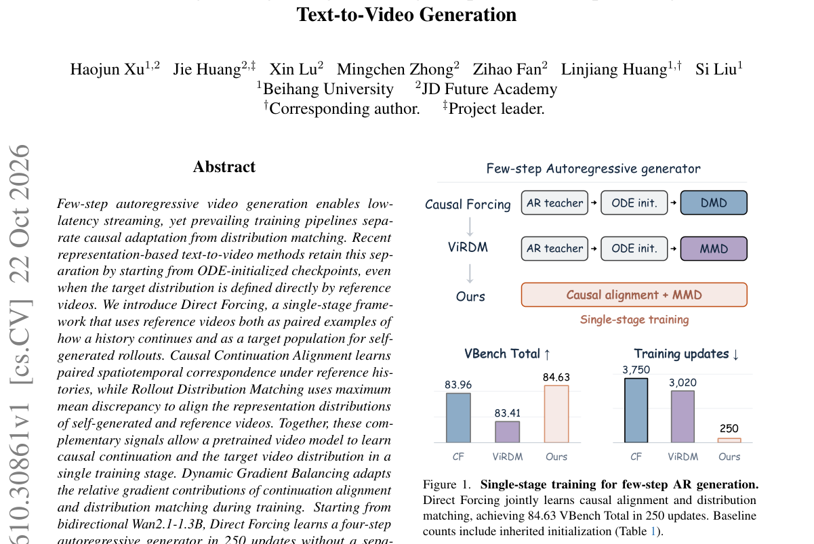

*Result - Temporal discontinuity under MMD-only training. Consecutive frames 8–10 show an abrupt change at the first chunk boundary.*

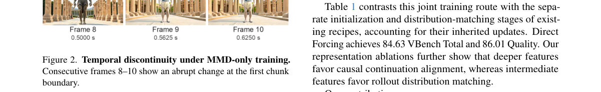

**Why this ranks #1**: 少步自回归视频生成的一体化训练配方：把「因果适配」和「分布匹配」从两段式流水线合并成单阶段，250 次更新就把 Wan2.1-1.3B 推到一个可流式的四步生成器。

---

### 2. Making MLLM Latents Matter: Factor-Aware Predictive Learning for Cinematic Video Generation

**arXiv**: [2610.30926](https://arxiv.org/abs/2610.30926) | **Score**: 9.0 (relevance 9.0 x 0.7 + quality 9.0 x 0.3) | **Tags**: AIGC-video, MLLM-prior, factor-control, temporal-inference | **Categories**: cs.CV | **Pages**: 13

**Authors**: Songlin Yang, Zhe Wang, Xiaotong Zhao, Xi Wang, Ran Zhang, Shuai Li, Taiyi Wu, Songlian Li, Eric Liu, Alan Zhao, Anyi Rao

**Affiliation**: MMLab@HKUST, The Hong Kong University of Science and Technology; Tencent Video; LIX, École Polytechnique

**Abstract**

> Cinematic video generation requires both temporal inference from limited inputs (i.e., sparse rather than frame-by-frame guidance) and factor-aware control of character, scene, action, and camera. Multimodal large language models (MLLMs) offer useful priors for both capabilities, but their representations are not automatically actionable for video generation: a Video Diffusion Transformer (DiT) may bypass them through native conditioning pathways, and using them does not ensure either factor-aware control or generation-compatible temporal prediction. We propose Factor-Aware Predictive Learning (FAPL), which establishes effective MLLM latent use as a shared prerequisite and then targets the two capabilities with complementary learning signals. First, latent-only generator grounding trains the DiT with a frozen MLLM and connector, strengthening the DiT's use of MLLM latents for generation. Second, for factor-aware control, paired videos specify a target-factor change and non-target preservation, and factor-span replacement trains the DiT to realize this relationship in its output. Third, for temporal inference, text-only and text-plus-complete-video observations share a video target, and the trained DiT is then frozen while the MLLM and connector are optimized through it. This final stage trains limited-input representations for generation while retaining complete-observation reconstruction as a complementary training mode. Extensive experiments demonstrate our consistently better performance on three cinematic video generation tasks (i.e., sparse-to-video, factor-aware editing, and multi-shot generation) over baselines and validate FAPL's contributions to MLLM feature use, temporal control, and factor coordination.

**Key findings**

- **Finding**: 电影级视频生成需要两件事：从有限输入做时间推理（稀疏引导而非逐帧），以及对角色、场景、动作、镜头做**因子级控制**。
- **Finding**: MLLM 提供了这两类先验，但其表示**并不会自动对视频生成生效**——DiT 可能通过原生条件通路绕开它们。
- **Finding**: **latent-only generator grounding** 冻结 MLLM 与 connector 训练 DiT，先强化 DiT 对 MLLM latent 的实际使用。
- **Finding**: **factor-span replacement** 用成对视频（指定目标因子变化 + 非目标保持）训练 DiT 实现这种关系。
- **Finding**: 时间推理阶段冻结 DiT、只优化 MLLM 与 connector，且以「完整观测重建」作为互补训练模式保留。
- **Finding**: 在稀疏生视频、因子级编辑、多镜头生成三个任务上均优于基线。
- **Inference**: 「用了 MLLM 就等于用上了 MLLM 的先验」是个常见幻觉：这篇把「潜变量是否真的被使用」单独立成一个可训练的前置步骤，方法论上比直接接条件更扎实。
- **Inference**: 冻结 DiT 反训 MLLM 的方向值得借鉴——多数工作只调生成器，很少回头去调先验提供方。
- **Recommendation**: 强烈推荐。做 MLLM 增强的视频生成、或想搞清楚「潜变量到底有没有被用」的人应读。

**Key figures**

*Framework - Cinematic video generation requires inference from limited inputs and factor-aware control. (i) The man turns toward the box, places his right hand on top, and steadies the bundle with his l*

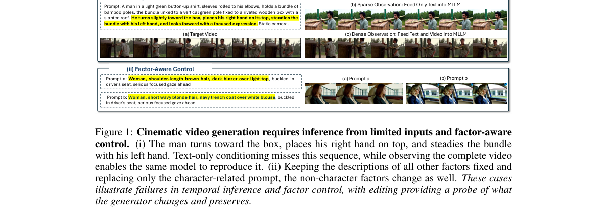

*Result - MLLM latents are easily bypassed in existing MLLM–DiT models. (i) Under MLLM- only conditioning, Omni-Video 2 (1.3B DiT) produces noise, while Omni-Video 2 (14B DiT) and UniVideo produce art*

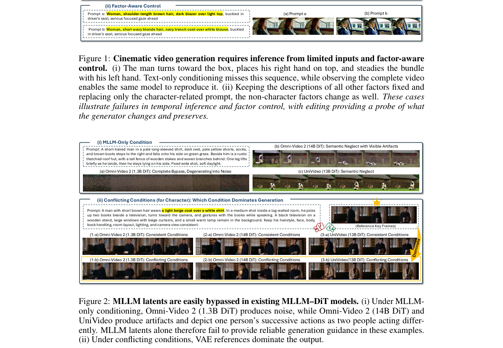

**Why this ranks #2**: 把 MLLM 先验真正「接上」到视频 DiT 上：先解决「用不用」，再解决「因子可控」与「稀疏时间推理」。

---

### 3. WorldForge V2: Eliciting Camera-Trajectory Alignment in Video Diffusion Models

**arXiv**: [2610.31640](https://arxiv.org/abs/2610.31640) | **Score**: 9.0 (relevance 9.0 x 0.7 + quality 9.0 x 0.3) | **Tags**: AIGC-video, camera-control, training-free-guidance, LoRA | **Categories**: cs.CV | **Pages**: 23

**Authors**: Chenxi Song, Yanming Yang, Tong Zhao, Ruibo Li, Joey Tianyi Zhou, Chi Zhang

**Affiliation**: Westlake University; Beihang University; Singapore Management University

**Abstract**

> Video diffusion models have learned rich 3D/4D priors, making them promising for scene generation and video re-rendering. However, their use in spatial tasks is limited by imprecise camera control, spatial and temporal inconsistencies, and entangled camera motion with scene dynamics. Existing approaches, such as task-specific fine-tuning and post-process warping, often introduce visual artifacts, generalize poorly, or incur high computational costs. We propose WorldForge V2 to achieve accurate camera control while preserving the generative capabilities of pretrained video models. We first develop a training-free guidance framework using warped references to iteratively refine generation along a target camera path. Optical-flow analysis identifies motion-related latent channels for selective guidance, helping separate motion control from appearance. A dual-path strategy further compares guided and unguided predictions to correct artifacts from imperfect references. Together, these components guide viewpoint changes while preserving scene appearance and object motion. To reduce refinement costs, v-cache approximates the correction using the preceding denoising prediction, avoiding an additional model evaluation. We further extend motion localization from latent channels to network blocks and introduce Trajectory LoRA, which concentrates adaptation on blocks most responsive to trajectory guidance. A two-stage training strategy teaches these adapters to denoise the states encountered during guided generation, using limited supervision effectively. This enables reliable camera control with very little training data, with a single training scene already supporting generalization to unseen scenes. Quantitative and qualitative evaluations across multiple datasets show that our method achieves state-of-the-art generation quality and trajectory accuracy in camera-controlled video generation.

**Key findings**

- **Finding**: 视频扩散模型学到了丰富的 3D/4D 先验，但用于空间任务时受限于**相机控制不精确**、时空不一致、相机运动与场景动态纠缠。
- **Finding**: 现有做法（任务专用微调、后处理 warp）会引入视觉伪影、泛化差或计算昂贵。
- **Finding**: WorldForge V2 用**训练无关的引导框架**，以 warped reference 沿目标相机路径迭代精化生成。
- **Finding**: 用**光流分析**识别与运动相关的潜通道做选择性引导，把运动控制与外观解耦。
- **Finding**: **dual-path 策略**比较引导与非引导的预测，纠正不完美 reference 带来的伪影；**v-cache** 用前一次去噪预测近似修正，避免额外一次模型前向。
- **Finding**: 进一步把运动定位从潜通道扩展到**网络块**，并提出 **Trajectory LoRA** 把适应集中在对轨迹引导最敏感的块上。
- **Finding**: 两阶段训练策略让 adapter 学会去噪引导生成过程中遇到的状态，**单个训练场景**即可泛化到未见场景。
- **Inference**: 「一个场景就能泛化」这个结果，和大家默认的「3D 一致性需要多场景数据」直觉相反，值得单独记住。
- **Inference**: 光流用来在潜空间里定位「运动在哪」，是把视觉先验注入扩散内部的一种可复用手法。
- **Recommendation**: 推荐。做相机可控视频生成、3D 一致性编辑的人应读。

**Key figures**

*Framework - Comparison with existing methods. With limited training data and iterations, our method achieves state-of-the-art visual quality and trajectory accuracy in camera-controlled video generation.*

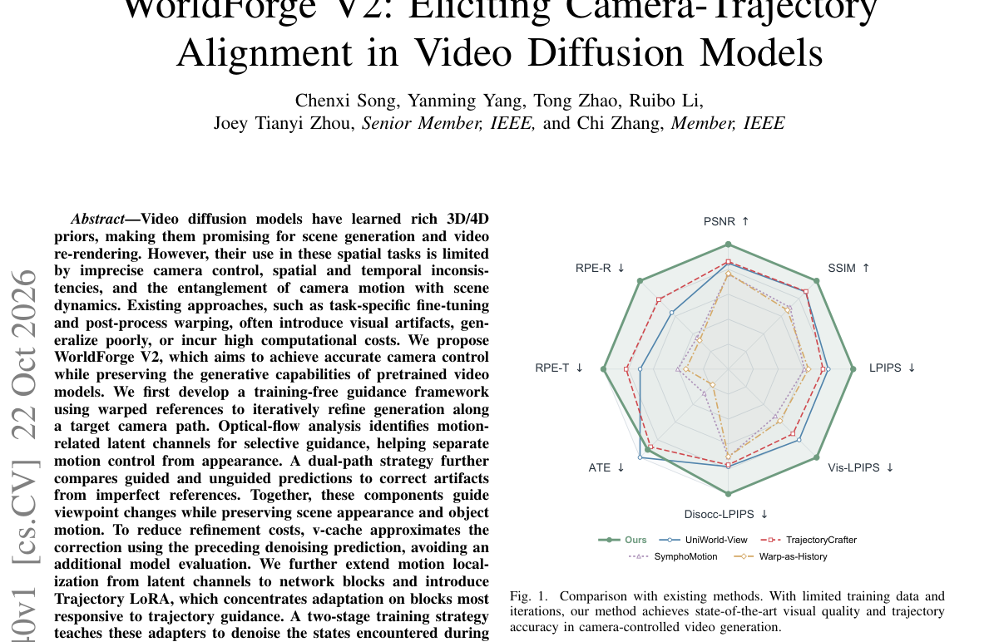

*Result - Overview of WorldForge V2. Given a single image or video frame and a target camera trajectory, the scene geometry is reconstructed and rendered into trajectory-aligned warped frames. WorldForg*

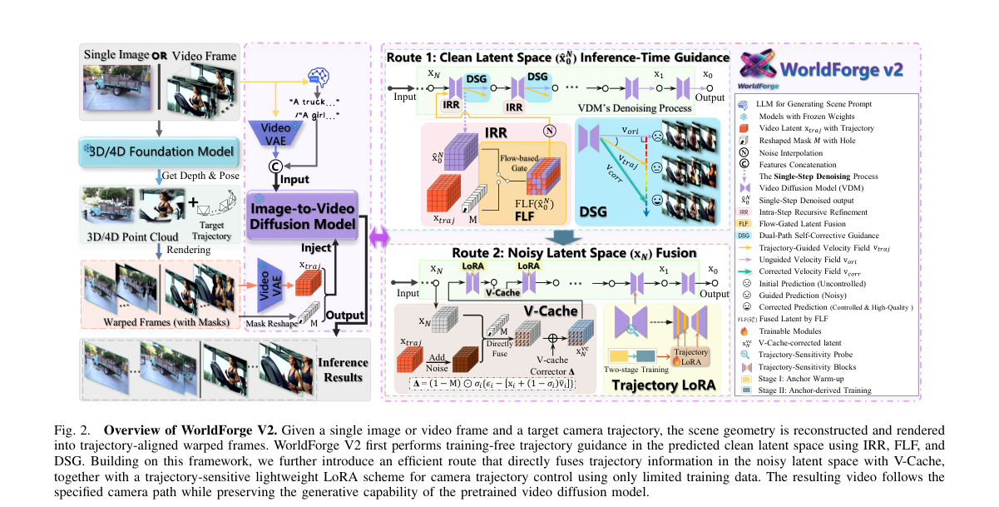

**Why this ranks #3**: 训练无关的相机轨迹引导 + 把适应集中到少数网络块上：在不重训主干的前提下拿到可用的镜头控制。

---

### 4. Latent Space Jam: Layout Guided Video Synthesis

**arXiv**: [2610.30390](https://arxiv.org/abs/2610.30390) | **Score**: 8.7 (relevance 9.0 x 0.7 + quality 8.0 x 0.3) | **Tags**: AIGC-video, layout-control, training-free, cross-attention | **Categories**: cs.CV | **Pages**: 11

**Authors**: Asaf Joseph, Moshe Mandel, Ohad Fried

**Affiliation**: CANVAS Lab, Reichman University

**Abstract**

> Adding control to video generation often requires training, which demands additional computational resources, data, or architectural changes. We propose a training-free approach that utilizes pretrained video diffusion models to control object layout and motion using coarse layouts. Our method operates in two passes: first, it steers spatiotemporal placement through prompt-guided cross-attention to produce a coarse visual guide; second, this guide conditions the same model to generate a high-quality, layoutconsistent video. The approach enables coordinated motion with strong temporal consistency, supporting diverse trajectories and object interactions without additional training. Extensive experiments show that our method consistently outperforms prior work in overlap and trajectory accuracy, as well as visual quality across static, dynamic, and multi-object scene settings.

**Key findings**

- **Finding**: 给视频生成加控制通常需要训练，带来额外算力、数据或结构改动。
- **Finding**: 本文提出**训练无关**方案，利用预训练视频扩散模型，用粗布局控制物体布局与运动。
- **Finding**: 方法分**两遍**：第一遍通过 prompt 引导的 cross-attention 进行时空排布，生成粗视频。
- **Finding**: 第二遍在粗视频基础上精化布局与运动。
- **Inference**: 「不加训练就加控制」这条路上，多数工作靠 guidance 调权重；这篇靠**两遍式分解**把控制问题转成可组合的生成轨迹，思路更工程化。
- **Inference**: 视频版 Layout-to-Image 的类比值得注意：布局控制正在从图像迁移到视频，而两遍式是成本最低的迁移路径。
- **Recommendation**: 推荐。做可控视频生成、想要免训练控制方案的人可以看。

**Key figures**

*Framework - We steer the output (right) of a pre-trained video diffusion model towards a given layout (left) without training.*

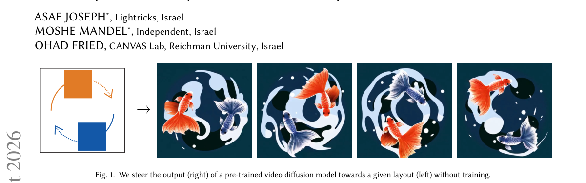

*Result - provides an overview of our pipeline. We present a two- stage training-free layout-guided video synthesis framework that enables explicit control in both time and space over videos generated*

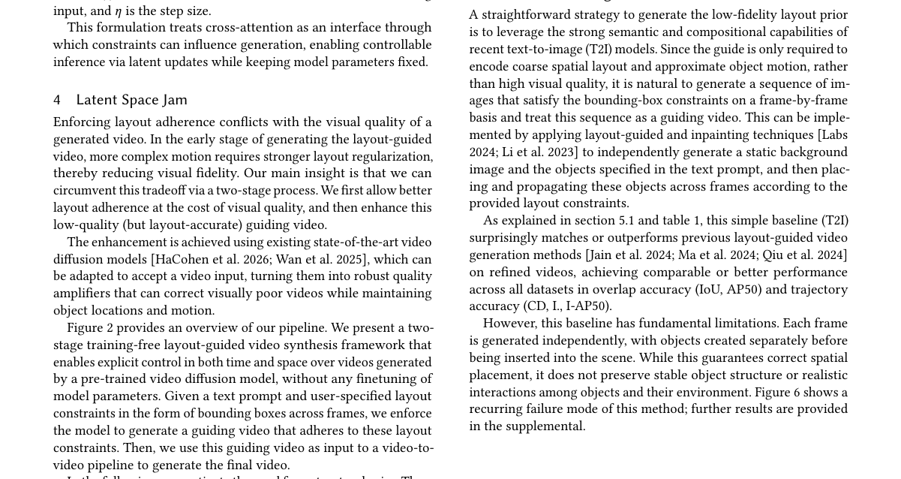

**Why this ranks #4**: 两遍式训练无关布局控制：把「粗布局 → 精确布局」拆成可组合的两步，在预训练视频扩散上直接做。

---

### 5. SciFusion: Physics-Guided Compositional Diffusion for Multimodal 3D Scientific Image Generation

**arXiv**: [2610.30313](https://arxiv.org/abs/2610.30313) | **Score**: 8.3 (relevance 8.0 x 0.7 + quality 9.0 x 0.3) | **Tags**: AIGC-3D, latent-diffusion, compositional-conditioning, physics-informed | **Categories**: cs.LG | **Pages**: 14

**Authors**: Luoxi Wang, Alessio Quercia, Hanno Scharr, Arya Bangun

**Affiliation**: Princeton University; Forschungszentrum Jülich

**Abstract**

> Existing 3D generative approaches are typically developed for individual imaging modalities, requiring substantial modality-specific data and limiting their ability to exploit shared structure across scientific imaging domains. We present SciFusion, a multimodal framework for unified 3D scientific image generation built on a latent diffusion backbone, with two key contributions. First, we introduce a compositional conditioning scheme that factorizes each modality into domain, object, and contrast representations. Sharing these factors across related modalities enables knowledge transfer across heterogeneous imaging domains and allows the factors to be recombined at inference time to synthesize unseen domain-object-contrast compositions in a zero-shot manner. Second, we incorporate domain-specific physics-informed objectives: Fourier spectral consistency for MRI, Radon projection consistency for CT, and multislice diffraction consistency for electron microscopy, to encourage generated samples to respect modality-dependent image formation processes. Extensive experiments across 15 medical and scientific imaging modalities demonstrate that SciFusion improves generation fidelity and cross-domain generalization over modality-specific and flattened multimodal conditioning strategies, while enabling zero-shot synthesis of unseen compositions without training on those target compositions. These results demonstrate that compositional, physics-guided conditioning provides a scalable framework for unified 3D scientific image generation, particularly for emerging modalities where large-scale training data are difficult to obtain.

**Key findings**

- **Finding**: 现有 3D 生成方法通常针对单一成像模态开发，需要大量模态专属数据，难以利用科学影像域间的共享结构。
- **Finding**: SciFusion 是基于**潜扩散骨干**的多模态统一 3D 科学影像生成框架。
- **Finding**: **组合条件**把每个模态分解为 domain / object / contrast 三类表示；跨相关模态共享这些因子，可在推理时重组，**零样本**合成未见过的域-物体-对比度组合。
- **Finding**: 引入模态专属的**物理信息目标**：MRI 用 Fourier 谱一致性、CT 用 Radon 投影一致性、电子显微镜用多切片衍射一致性。
- **Finding**: 在 **15 种**医学与科学成像模态上，生成保真度与跨域泛化优于模态专属与扁平多模态条件方案。
- **Inference**: 「因子分解 + 推理时重组」本质是把组合泛化变成零样本问题，这比单纯扩模态数据更省。
- **Inference**: 为每种成像模态配一条物理一致性约束，是把「领域知识」注入生成模型的轻量做法，比加对抗判别器更贴合成像物理。
- **Recommendation**: 推荐。科学影像 / 医学影像生成方向必读；也推荐任何做「模态组合泛化」的人。

**Key figures**

*Framework - Overview of SciFusion. (a) Two-stage training with shared latent representation learning, compositional conditioning, and domain-specific physics guidance. (b) Inference via recombination of*

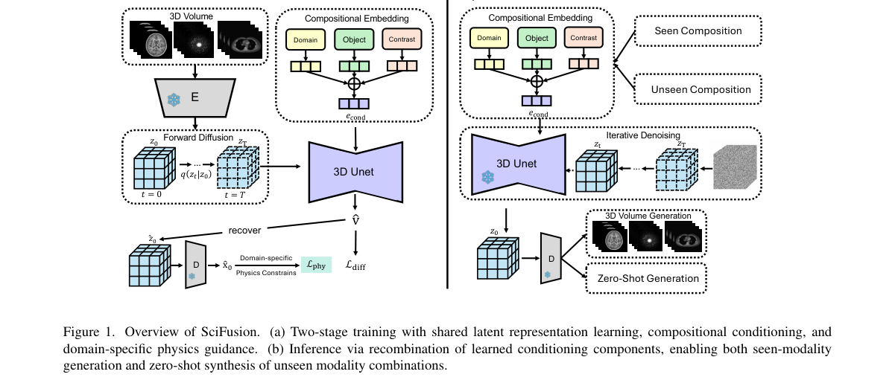

*Result - Selected generated 3D volumes across all selected modalities.*

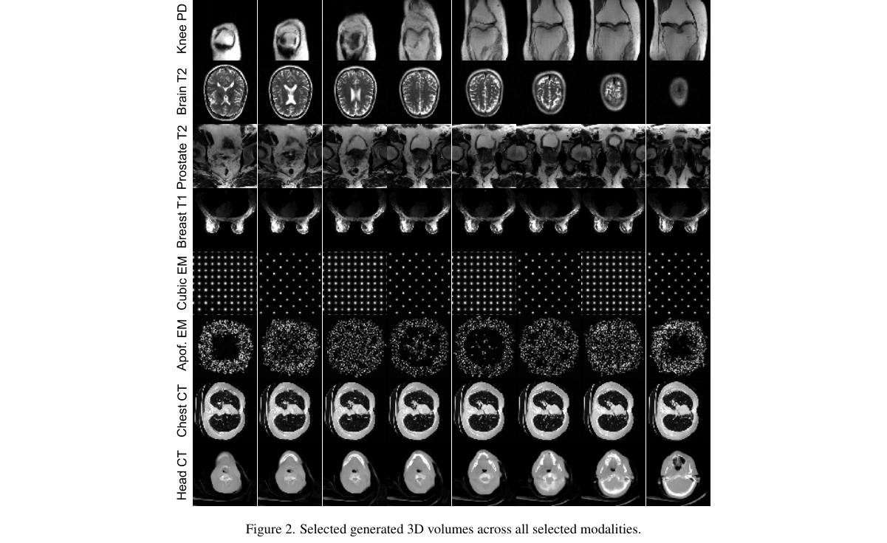

**Why this ranks #5**: 把「域 / 物体 / 对比度」拆成可组合因子，并给每个成像模态配一条物理约束：科学影像 3D 生成少见的统一化尝试。

---

### 6. Gate3DGen: A Pre-processing Model that Selectively Purifies Real-World Images for 3D Generation

**arXiv**: [2610.31649](https://arxiv.org/abs/2610.31649) | **Score**: 8.3 (relevance 8.0 x 0.7 + quality 9.0 x 0.3) | **Tags**: AIGC-3D, pre-processing, degradation-aware-router, one-step | **Categories**: cs.CV | **Pages**: 13

**Authors**: Xiaolin Li, Zihao Huang, Fanpeng Meng, Chen Yang, Guanjun Wu, Kai Zhang, Jiemin Fang, Qi Tian

**Affiliation**: Tsinghua University; Huawei Inc.; Huazhong University of Science and Technology

**Abstract**

> Single-image 3D generation has achieved high fidelity on curated benchmarks, yet degrades sharply on real-world images with uneven illumination, blur, and occlusions. Purifying such inputs requires deciding when to intervene and preserving the visual cues needed for 3D generation, while leaving clean inputs unchanged. We introduce Gate3DGen, a selective pre-processing model that gates image inputs to existing 3D generators without retraining them. A degradation-aware router bypasses inputs classified as clean and extracts features to guide purification of the remaining inputs. Conditioned on these features, a 3D-oriented one-step purifier purifies degraded inputs with spatial losses that encourage preservation of object identity, contours, and textural cues. To provide paired supervision, we construct a synthetic data engine that renders clean views of 3D assets and synthesises composite degradations. On the synthetic benchmark, the purifier improves image fidelity and downstream 3D geometry in only 2.3s on average, reducing TRELLIS.2 mesh distance by 61.5% relative to degraded inputs. VLM evaluation and human preferences on real photographs further support identity preservation and degradation correction. More demos and code are available at https://supra-3d.github.io/gate3dgen.

**Key findings**

- **Finding**: 单图 3D 生成在精选基准上保真度很高，但在真实照片（光照不均、模糊、遮挡）上**急剧退化**。
- **Finding**: 净化输入需要解决两件事：**何时该干预**，以及**保住 3D 生成真正需要的视觉线索**。
- **Finding**: Gate3DGen 是**选择性前置模型**，对现有 3D 生成器做门控，无需重训生成器。
- **Finding**: **degradation-aware router** 对判定为干净的输入直接旁路，并提取特征指导其余输入的净化。
- **Finding**: 3D 导向的**一步净化器**用空间损失鼓励保留物体身份、轮廓与纹理线索。
- **Finding**: 合成数据引擎渲染 3D 资产的干净视图并合成复合退化，提供配对监督。
- **Finding**: 净化器平均仅 **2.3 秒**，相对退化输入把 TRELLIS.2 的 mesh 距离降低 **61.5%**；VLM 评测与人类偏好在真实照片上进一步支持身份保持。
- **Inference**: 「路由 + 净化」的两段结构把「什么时候不该改」显式化了，这比端到端加一个去噪前端更可控也更容易解释。
- **Inference**: 2.3 秒换来 61.5% 的 mesh 距离下降，说明 3D 生成的前端鲁棒性还有很大未开采空间——这通常是整条 pipeline 里最便宜的一环。
- **Recommendation**: 强烈推荐。做单图 3D 生成、工程上需要处理真实脏数据的人必读。

**Key figures**

*Framework - Gate3DGen improves 3D generation by purifying real-world image input.*

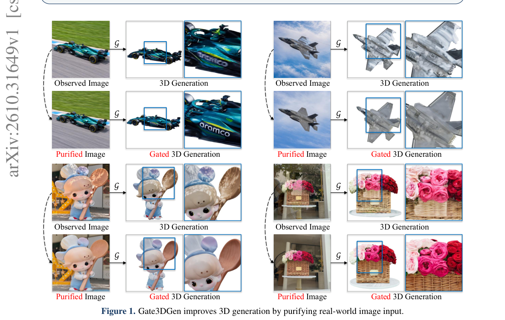

*Result - Overview of Gate3DGen. (A) Data Engine. We render 3D assets from multi-view, select informative anchor views, and apply composite degradations to construct aligned observation-reference pair*

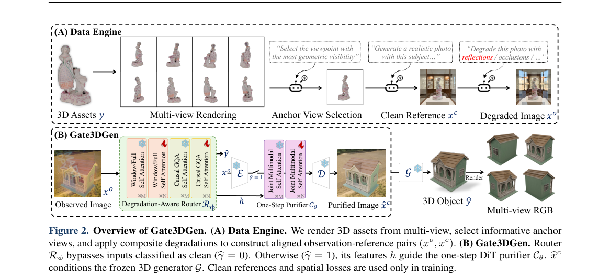

**Why this ranks #6**: 3D 生成的前置净化器：先判断「该不该动手」，再动手；不改 3D 生成器本身。

---

### 7. GLOW-FM: Efficient Generative Low-Light Image Enhancement with One-Step Latent Flow Matching

**arXiv**: [2610.31222](https://arxiv.org/abs/2610.31222) | **Score**: 8.3 (relevance 8.0 x 0.7 + quality 9.0 x 0.3) | **Tags**: AIGC-image, flow-matching, one-step, low-light-enhancement | **Categories**: cs.CV | **Pages**: 24

**Authors**: Ariel Lapid, Yuval Haitman, Reuven Peretz, Arnon Netzer, Idit Diamant

**Affiliation**: Arm AI Research (AAIR), Arm Ltd

**Abstract**

> Low-light image enhancement (LLIE) aims to recover well-exposed and perceptually faithful images from severely degraded observations. Recent diffusion-based generative methods achieve strong perceptual quality by leveraging powerful image priors, but their iterative sampling incurs substantial computational cost, limiting practical deployment. Despite recent efficiency gains in generative LLIE, high-quality enhancement with a single function evaluation and low overall computation remains challenging, particularly under diverse real-world low-light conditions. We introduce GLOW-FM, a one-step latent flow-matching framework for efficient generative LLIE. GLOW-FM performs conditional transport in the latent space of a frozen Tiny-VAE and leverages Terminal Velocity Matching (TVM) to enable enhancement with a single function evaluation. Matched comparisons with alternative one-step objectives support TVM as an effective design choice, and, to the best of our knowledge, this is its first adaptation to image restoration and specifically to LLIE. Extensive experiments on challenging real-world benchmarks demonstrate that GLOW-FM achieves competitive image quality and state-of-the-art cross-dataset generalization while requiring only a single function evaluation and 34 GFLOPs for the small variant. These findings highlight the potential of GLOW-FM to bring generative LLIE closer to practical deployment through single-step inference and compact latent modeling. Code will be made publicly available upon publication.

**Key findings**

- **Finding**: 低光增强（LLIE）目标是从严重退化的观测中恢复曝光良好、感知忠实的图像。
- **Finding**: 扩散式生成方法感知质量强，但迭代采样代价高昂，限制实际部署。
- **Finding**: GLOW-FM 是**一步潜空间流匹配**框架，在冻结 Tiny-VAE 的潜空间做条件传输。
- **Finding**: 用 **Terminal Velocity Matching (TVM)** 实现单次函数求值的增强；论文称这是 TVM 首次被改编到图像恢复、尤其是 LLIE。
- **Finding**: 与其他一步目标的匹配对照支持 TVM 作为有效设计选择。
- **Finding**: 在真实低光基准上达到有竞争力的图像质量与**最优的跨数据集泛化**，小变体只需**一次函数求值、34 GFLOPs**。
- **Inference**: TVM 的迁移本身是这篇最值得注意的信号——流匹配里「终速度」这个目标在恢复任务上意外地合适，可能意味着它更适配「一步到位」的映射类问题。
- **Inference**: 34 GFLOPs + 一次求值，把生成式增强从「研究演示」推到了「可上手机」的量级。
- **Recommendation**: 强烈推荐。做低光增强 / 图像恢复、关心生成模型落地成本的人必读。

**Key figures**

*Framework - GLOW-FM Performance. Comparison with efficient gener- ative LLIE baselines on LSD-DLL. Metrics are min–max normalized across the compared methods, with lower-is-better metrics reversed so th*

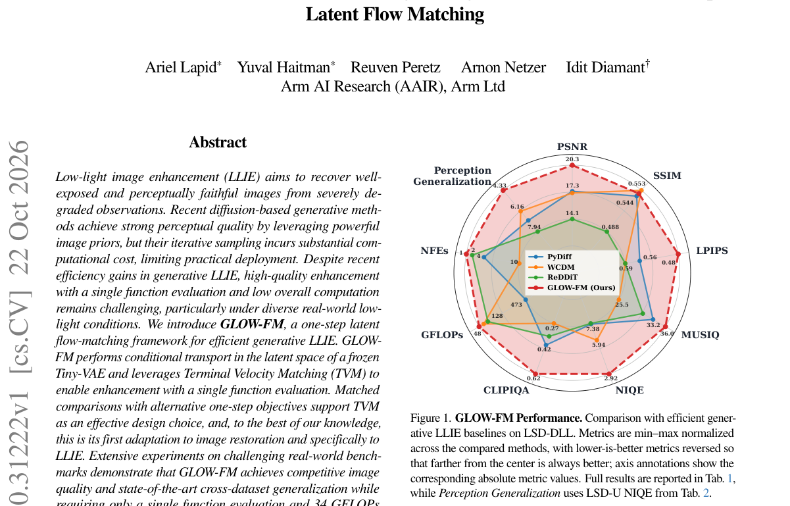

*Result - Overview of GLOW-FM Training. Paired low-light and normally exposed images are encoded into a frozen autoencoder latent space. During training, the model learns both the instantaneous flow-m*

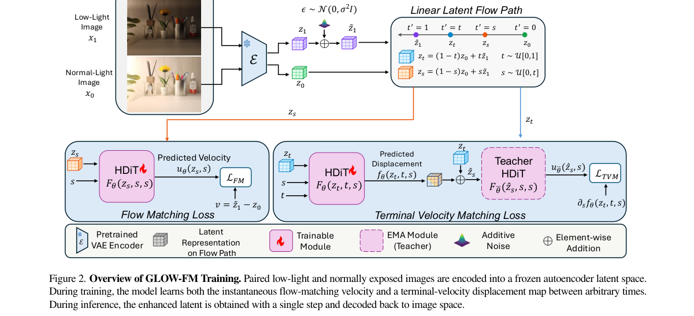

**Why this ranks #7**: 把生成式低光增强压到**一次函数求值**：TVM 首次被用于图像恢复，小模型 34 GFLOPs 即可跑。

---

### 8. R4DGS: Referring Segmentation in 4D Gaussian Splatting

**arXiv**: [2610.30326](https://arxiv.org/abs/2610.30326) | **Score**: 8.0 (relevance 8.0 x 0.7 + quality 8.0 x 0.3) | **Tags**: AIGC-4D, referring-segmentation, language-grounding, training-free | **Categories**: cs.CV | **Pages**: 10

**Authors**: Bangpu Chen, Yaxuan Li, Shirui Peng, Xiangtian Si, Liuxin Chu, Xitong Cao, Hongbo Jin, Jiayu Ding

**Affiliation**: China University of Geosciences; Xinjiang University; University of Nottingham Ningbo

**Abstract**

> Dynamic representations based on 4D Gaussian Splatting (4DGS) have shown strong capabilities in reconstruction and rendering, yet current methods remain limited in supporting complex natural-language referring in dynamic scenes. Existing 4D Gaussian methods are primarily designed for rendering-oriented dynamic modeling, while current semantic extensions often rely on scene-specific semantic optimization or are evaluated on relatively simple query settings. In this paper, we study Referring 4D Gaussian Splatting (R4DGS), a task for grounding temporally varying, multi-target or reasoning-intensive, and zero-target or distractor expressions in dynamic 4D scenes. To support this task, we introduce R4D-Bench-QA, a benchmark with structured query annotations. We further present ReferGaussian, a unified framework built upon 4DGS that converts low-level dynamic Gaussians into persistent, language-addressable entities for training-free referring inference. ReferGaussian organizes mask-supported Gaussian entities in an EntityBank, uses Multimodal Large Language Models (MLLMs) to decompose complex queries into trackable object phrases and structured referring constraints, and performs constraint-aware grounding without scene-specific semantic optimization. Experiments on R4D-Bench-QA and the 4D LangSplat protocol demonstrate improved temporal target selection and competitive spatiotemporal grounding without scene-specific semantic training. Project resources are available at https://chenbangpu.github.io/R4DGS/.

**Key findings**

- **Finding**: 4D 高斯泼溅在重建与渲染上表现强，但难以支持动态场景中复杂的自然语言指代。
- **Finding**: 现有 4D 方法主要面向渲染式动态建模，语义扩展多依赖场景专属语义优化，查询设置也偏简单。
- **Finding**: 论文定义 **Referring 4D Gaussian Splatting (R4DGS)** 任务：定位时变、多目标或需推理、以及零目标 / 干扰项的表达。
- **Finding**: 提出 **R4D-Bench-QA** 基准，含结构化查询标注。
- **Finding**: **ReferGaussian** 把低层动态高斯转成持久、可语言寻址的实体：mask 支持的高斯实体组织成 **EntityBank**。
- **Finding**: MLLM 把复杂查询分解为可跟踪的物体短语与结构化指代约束，在**无需场景专属语义训练**的前提下做约束感知定位。
- **Finding**: 在 R4D-Bench-QA 与 4D LangSplat 协议上，时间目标选择与时空定位均改善。
- **Inference**: 把「语义」放在推理期而非训练期（EntityBank + MLLM 分解），是 4D 动态场景里少见的省算力路线。
- **Inference**: 零目标 / 干扰项表达被写进任务定义，说明作者把「指代失败」当成一等公民——这是评测设计上的加分项。
- **Recommendation**: 推荐。做 4D / 动态场景语言交互、Video-as-world-model 方向的人应读。

**Key figures**

*Framework - Example visualizations of ReferGaussian for dynamic and multi-target referring in 4D scenes.*

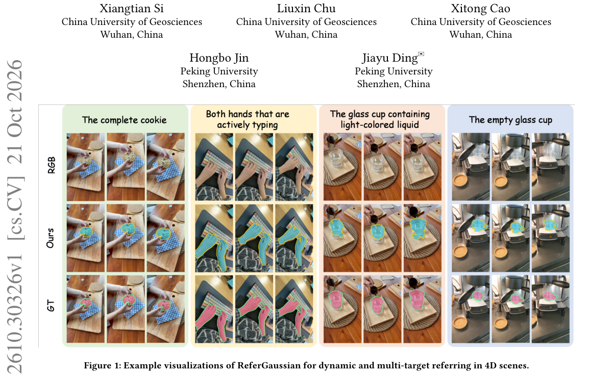

*Result - Task comparison between Gaussian semantic queries and R4DGS. R4DGS resolves temporal, relational, exclusion, and cardinality constraints into zero-, one-, or multi-target mask sequences.*

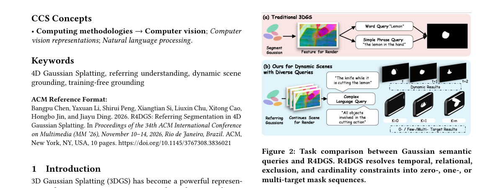

**Why this ranks #8**: 给 4D 高斯泼溅加上语言指代能力：把低层动态高斯变成可被语言寻址的持久实体。

---

### 9. One Evaluation Is Enough: Inversion-Free Image Editing with Trajectory Correction

**arXiv**: [2610.30827](https://arxiv.org/abs/2610.30827) | **Score**: 8.0 (relevance 8.0 x 0.7 + quality 8.0 x 0.3) | **Tags**: AIGC-image, image-editing, inversion-free, training-free, one-step | **Categories**: cs.AI, cs.CV | **Pages**: 17

**Authors**: Lifan Jiang, Taiyang Chen, Senlin cheng, Bolei Xu, Xiaobo Li, Can Ye, Dehai Zhao, Deng Cai, Boxi Wu

**Affiliation**: State Key Lab of CAD&CG, Zhejiang University; Chongqing University of Posts and Telecommunications

**Abstract**

> Real-image editing commonly relies on inversion and iterative sampling, while efficient one-step editors often stabilize a large update by estimating and averaging editing fields at multiple noise levels. We ask a stricter question: is a single temporal field evaluation sufficient for reliable inversion-free editing? Our answer rests on a previously underused duality in a variance-preserving (VP) one-step model: one source-target query at a shared noisy state simultaneously determines a local angular semantic tangent and a clean endpoint displacement. We integrate the tangent over the analytically known remaining VP angle to obtain a nominal one-step transport, and use the endpoint displacement to correct its long-horizon extrapolation through a constrained projection. This transport-first, correction-second construction yields Endpoint-Calibrated Transport (ECT), a closed-form, training-free editor requiring only one noise level, two text conditions packed into one denoiser batch, and one latent update. ECT requires no image inversion, trajectory integration, second temporal observation, or iterative optimization, and can be directly applied to pretrained epsilon-prediction VP one-step generators. Across the reported benchmark settings, ECT delivers stable gains in editing quality within an extremely short editing time.

**Key findings**

- **Finding**: 真实图像编辑通常依赖反演与迭代采样；高效的一步编辑器则往往靠**多噪声水平**估计并平均编辑场来稳定大步更新。
- **Finding**: 本文追问更严格的问题：在**保方差（VP）一步模型**下，单次时间场求值是否足以做可靠的无反演编辑。
- **Finding**: 关键是一个此前被低估的对偶性：共享噪声状态下的一次源-目标查询**同时**决定局部角度语义切向与干净的端点位移。
- **Finding**: 把切向沿解析已知的剩余 VP 角度积分得到名义一步传输，再用端点位移通过**约束投影**修正其长程外推误差。
- **Finding**: 这种「先传输、后修正」的结构得到 **ECT**（Endpoint-Calibrated Transport）：闭式、训练无关，只需一个噪声水平、两个打包进同一去噪 batch 的文本条件、一次潜变量更新。
- **Finding**: 无需图像反演、轨迹积分、第二次时间观测或迭代优化，可直接套用预训练的 epsilon-prediction VP 一步生成器。
- **Inference**: 「单次查询同时编码切向与端点」这个对偶性是全文最漂亮的地方——它把「一步编辑」从工程近似变成了有解析依据的构造。
- **Inference**: 运输-投影的结构与「先粗校准后精修」的一般工程直觉吻合，值得在别的潜空间任务上试。
- **Recommendation**: 强烈推荐。做高效图像编辑、关心推理成本的人必读。

**Key figures**

*Framework - Edits with ECT (ours), ChordEdit, and FlowEdit, covering object addition and removal, attribute and background changes, stylization, and object replacement.*

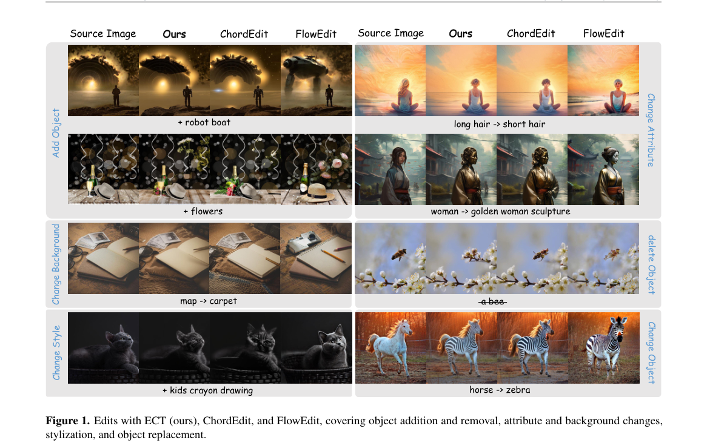

*Result - Editing pipelines, illustrated by a horse-to-zebra edit. (a) FlowEdit accumulates source–target field differences along a multi-step path. (b) ChordEdit combines residuals at t and t −δ into*

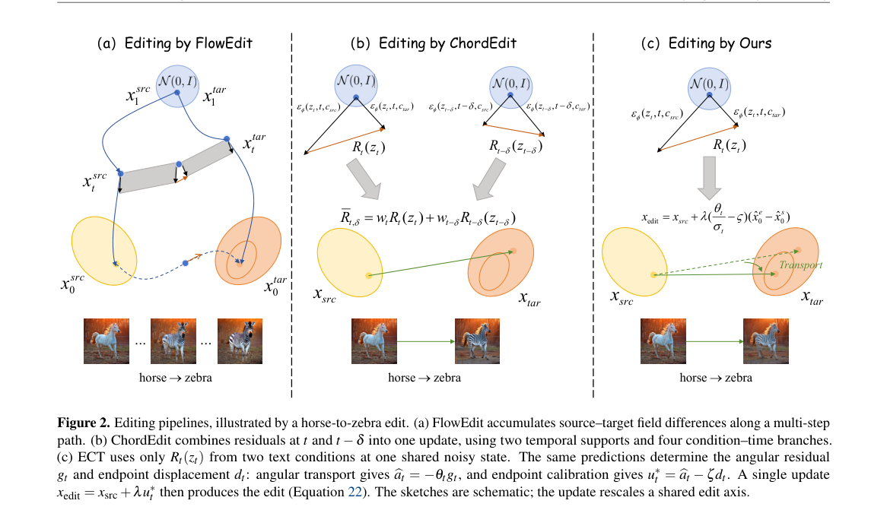

**Why this ranks #9**: 无反演图像编辑：只用一次噪声水平、一次去噪 batch、一次潜变量更新。

---

### 10. A Unified Framework for Image-to-3D Part Generation via Variable Granularity

**arXiv**: [2610.31671](https://arxiv.org/abs/2610.31671) | **Score**: 8.0 (relevance 8.0 x 0.7 + quality 8.0 x 0.3) | **Tags**: AIGC-3D, part-generation, variable-granularity, gated-modulation | **Categories**: cs.CV | **Pages**: 22

**Authors**: Qiwen Gu, Xin Zhou, Xiwu Chen, Zhongyang Zhu, Zhuo Zhang, Junqiao Zhao

**Affiliation**: Tongji University; Chongqing Afari Intelligent Drive Co., Ltd; Huazhong University of Science and Technology

**Abstract**

> Controllable 3D part generation is pivotal for digital asset creation, yet existing methods lack the flexibility to accommodate diverse user workflows requiring varying levels of control. In this paper, we introduce FlexPart, a unified image-to-3D part generation framework that supports variable-granularity geometric conditions within a single model. By seamlessly integrating heterogeneous inputs, ranging from sparse points to dense bounding boxes and masks, via gated adaptive modulation, FlexPart unlocks a powerful cross-modal synergy. We also propose an asymmetric geometric guidance mechanism that leverages strong spatial priors to align representations across granularities, improving geometric consistency and facilitating inter-task synergy. Under mask conditioning on PartVerseXL, FlexPart reduces Part CD by 16.6% relative to TripoSG + SAM3D and by 10.5% relative to OmniPart, while maintaining competitive whole-mesh quality. The code can be found at https://github.com/Gucci233/FlexPart

**Key findings**

- **Finding**: 可控 3D 部件生成对数字资产创作很关键，但现有方法缺乏适配不同控制粒度工作流的灵活性。
- **Finding**: FlexPart 是统一的 image-to-3D 部件生成框架，在**单个模型内**支持可变粒度的几何条件。
- **Finding**: 通过**门控自适应调制**无缝整合从稀疏点到密集边界框与掩码的异构输入，释放跨模态协同。
- **Finding**: 提出**非对称几何引导**机制，用强空间先验对齐不同粒度的表示，提升几何一致性并促进任务间协同。
- **Finding**: 掩码条件下在 PartVerseXL 上，相对 TripoSG + SAM3D 把 Part CD 降低 **16.6%**，相对 OmniPart 降低 **10.5%**，同时保持有竞争力的整体网格质量。
- **Inference**: 「一个模型多粒度」把用户工作流里的切换成本降到零；非对称引导让稀疏条件的强先验去带动密集条件，实现任务间互惠。
- **Inference**: 16.6% / 10.5% 的 Part CD 降幅说明部件级生成的瓶颈正在从「几何精度」转向「控制粒度」。
- **Recommendation**: 推荐。做 3D 资产 / 部件生成、需要精细可控性的人应读。

**Key figures**

*Result - Overview of the FlexPart framework. FlexPart supports point, box, and mask prompts, with points as the minimal input. The noisy latent, part ID, and timestep are jointly conditioned on encod*

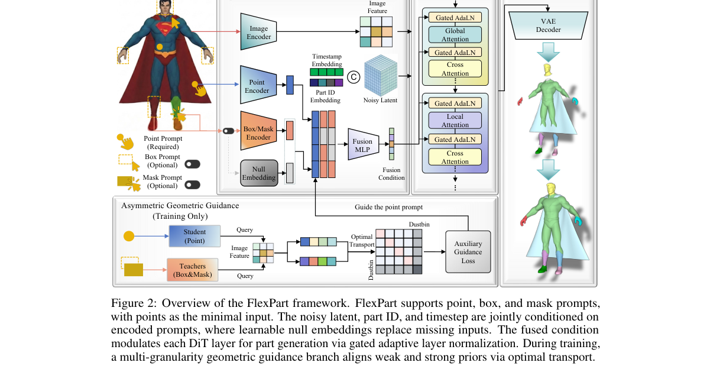

**Why this ranks #10**: 一个模型吃下从稀疏点到密集掩码的所有几何条件，做可变粒度的图像到 3D 部件生成。

---

## Footer

- Total papers scanned across all 7 tracks: 535（原始 705 条）
- aigc_visual track final top-10: 10
- Wild-cards in this track: 0
- Figure assets: 2026-10-23/res/

Generated by `mine-arxiv-daily-digest` skill. Sister file: `2026-10-23_aigc_visual_entry.md`.
