# ArXiv Daily Digest - 2026-10-23 (音频与语音语言模型、双工语音助手, 10 papers)

**Generated**: 2026-10-23 17:00 CST

**Source**: arXiv cs.CV, cs.SD, eess.AS, cs.CL, cs.AI, cs.RO, cs.LG submissions, listing day 2026-10-22 (announced 2026-10-23 00:00 UTC)

**Batch window**: 2026-10-21T18:00:00Z .. 2026-10-22T18:00:00Z（arXiv 公告批次横跨两个 UTC 日：前一日 18:00 UTC 起算，当日 17:59:59 UTC 截止）

**Track**: audio_lm (top 10 of 535 papers scanned, 107 full reads)

**Scope**: 音频 / 语音语言模型、语音理解、ASR、流式与对话式语音

---

## Top 10 - 音频与语音语言模型、双工语音助手

### 1. Spark-Audio 1.0 Technical Report

**arXiv**: [2610.31292](https://arxiv.org/abs/2610.31292) | **Score**: 9.7 (relevance 10.0 x 0.7 + quality 9.0 x 0.3) | **Tags**: audio-LM, speech-foundation-model, MoE, on-policy-distillation | **Categories**: eess.AS | **Pages**: 18

**Authors**: Chenyue Zhang, Cong Liu, Dingshu Tian, Dong Sun, Genshun Wan, Guanming Meng, Guolong Zhong, Hang Chen, Hankun Yang, Haoming Wang, Haoyang Wang, Hengquan Mei

**Affiliation**: iFlytek Spark Audio Team

**Abstract**

> This paper introduces Spark-Audio 1.0, a speech foundation model trained on domestically produced computing infrastructure. The model accepts text and speech inputs and generates text outputs. It supports multilingual (99 languages) and multi-dialect (202 dialects) speech recognition, speech translation, audio perception and understanding, and both text- and speech-based dialogue, marking a shift from merely ``hearing clearly'' to genuinely ``understanding'' speech. Architecturally, Spark-Audio 1.0 couples a 0.65B-parameter dense audio encoder with a 30B-A3B Mixture-of-Experts (MoE) large language model (LLM). The audio encoder is pretrained with representation-enhanced BEST-RQ and then refined through multi-task supervised training. The audio--LLM is trained through staged pretraining, followed by post-training that combines supervised fine-tuning with on-policy distillation. In total, the model is trained on 13 million hours of audio data together with large-scale text data. We evaluate Spark-Audio 1.0 on mainstream audio and text benchmarks, as well as on in-house test sets drawn from real-world application scenarios. Despite using substantially less audio training data than Qwen3.5-Omni-Flash, Spark-Audio 1.0 achieves comparable performance on most audio and text tasks, outperforms it in multilingual speech recognition, spoken dialogue, and real-world application scenarios, and approaches the performance of larger closed-source models. Nevertheless, there remains room for improvement in instruction following and complex audio reasoning. Finally, the successful training of Spark-Audio 1.0 on domestic hardware, including Huawei Ascend 910B and Hygon BW1000 chips, demonstrates the feasibility of a domestic technical pathway for building speech foundation models.

**Key findings**

- **Finding**: Spark-Audio 1.0 是**语音基座模型**，接受文本与语音输入、生成文本输出，在国产算力上训练。
- **Finding**: 支持 **99 种语言**与 **202 种方言**的语音识别、语音翻译、音频感知与理解，以及文本与语音两种对话。
- **Finding**: 结构上是 **0.65B 稠密音频编码器 + 30B-A3B MoE 大语言模型**。
- **Finding**: 音频编码器用**表征增强的 BEST-RQ** 预训练，再用多任务监督训练精化；音频-LLM 分阶段预训练，后训练结合 SFT 与 **on-policy 蒸馏**。
- **Finding**: 总共使用 **1300 万小时**音频数据与大规模文本数据训练。
- **Finding**: 音频训练数据显著少于 Qwen3.5-Omni-Flash，但在多数音频与文本任务上相当，在多语种识别、口语对话与真实应用场景上更优，并接近更大的闭源模型。
- **Finding**: 在华为昇腾 910B 与海光 BW1000 等**国产芯片**上完成训练，验证了国产技术路线的可行性。
- **Finding**: 作者也指出指令遵循与复杂音频推理仍有改进空间。
- **Inference**: 「on-policy 蒸馏」替代部分 SFT 是这份报告里最值得注意的训练配方选择——把 LLM 后训练的经验搬回音频-LLM 联合训练。
- **Inference**: 同数据量下打赢 Qwen3.5-Omni-Flash，说明音频数据质量与配方比单纯堆时长更关键。
- **Recommendation**: 强烈推荐。做语音基座模型、端到端语音对话、MoE 音频 LLM 的人必读。

**Key figures**

*Framework - Overview of the audio encoder architecture and training curriculum. (a) Unified streaming and non-streaming audio encoder based on the Whisper large-v3 architecture. (b) Representation-enhan*

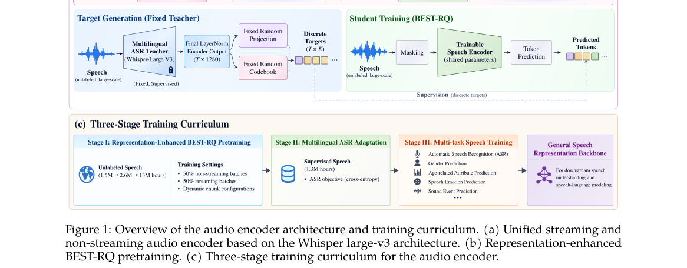

**Why this ranks #1**: 0.65B 音频编码器 + 30B-A3B MoE，1300 万小时音频数据；本批最完整的语音基座模型技术报告。

---

### 2. SyRA-CS: Synthetic-to-Real Adaptation for Code-Switched ASR with Meta-Learning

**arXiv**: [2610.31415](https://arxiv.org/abs/2610.31415) | **Score**: 8.7 (relevance 9.0 x 0.7 + quality 8.0 x 0.3) | **Tags**: audio-LM, code-switched-ASR, meta-learning, synthetic-to-real | **Categories**: cs.CL | **Pages**: 10

**Authors**: Fadel Thior, Ahmer Tabassum, Haania Siddiqui, Hanan Aldarmaki, Thamar Solorio

**Affiliation**: Mohamed bin Zayed University of Artificial Intelligence

**Abstract**

> Code-switched (CS) automatic speech recognition (ASR) remains difficult because real CS speech is scarce and synthetic speech does not fully match it. We investigate whether synthetic CS speech is more useful for learning an adaptation-friendly initialization than for ordinary continual fine-tuning. We propose SyRA-CS, a pair-specific synthetic-to-real adaptation framework based on Reptile meta-learning. For each language pair and pretrained model, we meta-train on the corresponding synthetic CS-FLEURS subset and then adapt using one hour of labeled real target speech. We evaluate four architectural settings: Encoder-CTC, FastConformer-RNN-T, Attention Encoder-Decoder (AED) and Speech-LLM. Experiments cover on Arabic-, French-, German-, and Hindi-English, against synthetic-only transfer, real-only fine-tuning, and continual fine-tuning. SyRA-CS improves over continual fine-tuning on WER in all 16 model-pair comparisons and on CER in 15 of 16, with relative macro WER reductions of 17.7% for XLS-R and 5.3-5.8% for the other three models. The gains hold across the tested models but vary in size across architectures, language pairs and metrics.

**Key findings**

- **Finding**: 代码切换 ASR 难在真实语料稀缺、合成语音又不完全匹配。
- **Finding**: 作者追问：合成 CS 语音是否更适合用来学一个**适配友好的初始化**，而不是普通持续微调。
- **Finding**: SyRA-CS 是基于 **Reptile 元学习**的「语言对专属」合成-真实适配框架：先在对应合成 CS-FLEURS 子集上元训练，再用**一小时**标注真实目标语音适配。
- **Finding**: 覆盖四种架构：Encoder-CTC、FastConformer-RNN-T、Attention Encoder-Decoder、Speech-LLM。
- **Finding**: 语料覆盖阿拉伯语、法语、德语、印地语-英语的代码切换，对比合成-only 迁移、真实-only 微调与持续微调。
- **Finding**: 在全部 **16 个模型-语言对**的 WER 对比中均优于持续微调，CER 上 16 个里 15 个更优；XLS-R 的宏平均 WER 相对降低 **17.7%**，其余三个模型为 **5.3–5.8%**。
- **Finding**: 收益跨模型成立，但幅度随架构、语言对与指标而变。
- **Inference**: 「合成数据的正确用法是元学习的任务分布，而不是额外的监督信号」——这个视角转换比方法本身更值得记住。
- **Inference**: 只用一小时真实标注就换来 17.7% 的 WER 下降，对低资源语言的工程落地价值很高。
- **Recommendation**: 强烈推荐。做代码切换 / 低资源 ASR、合成数据利用的人必读。

**Key figures**

*Framework - Overview of the Pair-Specific Synthetic-to-Real Reptile Adaptation Framework for Code-Switched ASR.*

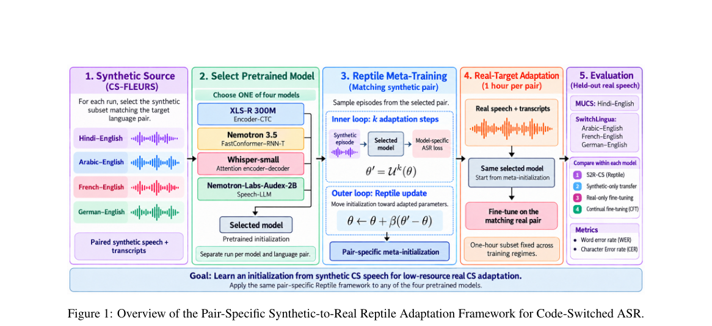

*Result - Relative WER and CER reductions of SyRA-CS against CFT, computed as 100(eCFT −eSyRA)/eCFT. Positive values indicate improvement; negative values indicate higher error.*

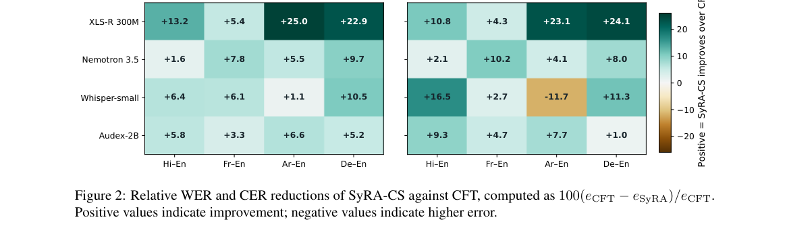

**Why this ranks #2**: 合成语料的价值不是「直接训练」，而是「学一个更易适配的初始化」：Reptile 元学习的合成-真实适配。

---

### 3. Synthetic-to-Real Code-Switched ASR: A Spontaneous Nepali-English Podcast Benchmark

**arXiv**: [2610.30860](https://arxiv.org/abs/2610.30860) | **Score**: 8.0 (relevance 8.0 x 0.7 + quality 8.0 x 0.3) | **Tags**: audio-LM, code-switched-ASR, benchmark, GRPO, synthetic-to-real | **Categories**: cs.CL, cs.SD | **Pages**: 9

**Authors**: Firoj Paudel

**Affiliation**: Wiseyak Inc.

**Abstract**

> Nepali-English code-switched conversational speech presents severe challenges for automatic speech recognition (ASR), chiefly through script confusion (inappropriate mixing of Devanagari and Latin orthography) and elevated error rates at language switch points. Supervised fine-tuning (SFT) can adapt multilingual foundation models, but human code-switched audio is expensive to collect and annotate. We curate a new benchmark of 13,044 spontaneous podcast utterances (15.45 h total; 10,214 test, 2,830 dev), audited and verified to eliminate machine translation leakages and acoustic loops. We investigate a two-stage synthetic-to-real adaptation framework: Stage 1 applies SFT on 0.95 h of speech synthesized via a multi-speaker, dual-engine TTS pipeline; Stage 2 explores Group Relative Policy Optimization (GRPO) with transcription and script rewards. We find that synthetic SFT provides the primary cross-domain transfer to spontaneous human speech, reducing Mixed Error Rate (MER) from 23.40% to 21.52% (-1.88 pp) and switch-point error rate (SPER) from 35.89% to 28.77% (-7.12 pp). Subsequent GRPO yields small, statistically significant adjustments on 173 test utterances (1.69%), driving English script confusion (SCR_en) from 6.45% to 6.36% (p <= 0.001) and SPER to 28.70% (p = 0.022 clustered). Crucially, ablation reveals that in this SFT-converged encoder-decoder setting, an auxiliary script reward term yields performance identical to MER-only optimization because rollout candidate groups exhibit near-zero script variance on synthetic data. On monolingual benchmarks, SFT improves Nepali MER by 2.71 pp (stabilizing at 18.42% after GRPO, a 2.38 pp gain over baseline) while preserving English lexical WER (3.38% vs. 3.33%). Verified transcripts, timestamps, episode metadata, and reconstruction scripts are publicly released.

**Key findings**

- **Finding**: 尼泊尔语-英语代码切换对话语音的 ASR 难点主要是**脚本混淆**（天城文与拉丁文不当混用）与切换点错误率升高。
- **Finding**: 作者整理了 **13,044 条**自发播客语句（合计 **15.45 小时**；10,214 测试 / 2,830 开发），并审计验证以排除机器翻译泄漏与声学循环。
- **Finding**: 两阶段合成-真实适配：阶段一在 **0.95 小时**由多说话人双引擎 TTS 合成的语音上做 SFT；阶段二用 **GRPO** 配转写奖励与脚本奖励。
- **Finding**: 合成 SFT 提供主要的跨域迁移，把混合错误率（MER）从 **23.40% 降到 21.52%**（-1.88 pp），切换点错误率（SPER）从 **35.89% 降到 28.77%**（-7.12 pp）。
- **Finding**: 随后的 GRPO 只带来小幅但统计显著的调整（测试集的 1.69%），把英语脚本混淆从 6.45% 降到 6.36%（p ≤ 0.001），SPER 到 28.70%（p = 0.022 聚类）。
- **Finding**: 关键消融：在这种 SFT 已收敛的 encoder-decoder 设定下，**辅助脚本奖励项与只用 MER 的优化表现相同**——因为合成数据上的 rollout 候选组几乎没有脚本方差。
- **Finding**: 单语基准上 SFT 让尼泊尔语 MER 改善 2.71 pp（GRPO 后稳定在 18.42%，较基线高 2.38 pp），同时保持英语词法 WER（3.38% vs 3.33%）。
- **Finding**: 已验证转写、时间戳、剧集元数据与重建脚本公开发布。
- **Inference**: 「rollout 组里没有方差 ⇒ 那条奖励项等于不存在」是 RL 里非常实用的一条诊断，能省掉大量无效的 reward 设计。
- **Inference**: 把合成 SFT 与后续 RL 的贡献拆开量化（-1.88 pp vs 几乎为零）本身就是本批最扎实的方法学示范。
- **Recommendation**: 强烈推荐。做代码切换 ASR、合成数据 + RL 组合、或奖励项设计的人必读。

**Key figures**

*Framework - Primary benchmark results on the 10,214-utterance Frozen Real Test Split. (a) Macro transcription error rates (MER, WER, CER). (b) Code-switch and script fidelity metrics (SPER, English scri*

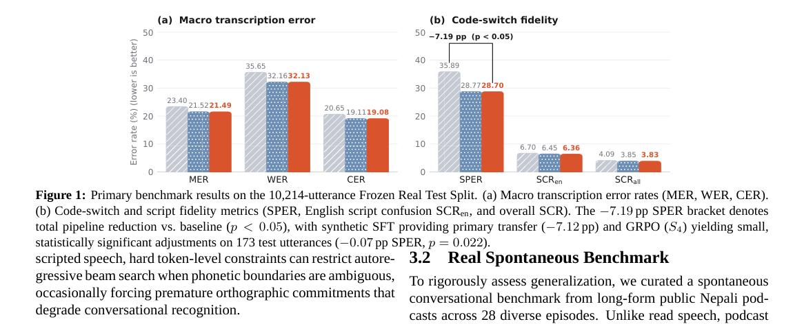

*Result - Paired bootstrap 95% confidence intervals (B = 1,000 resamples) comparing S4 against unadapted baseline S0 (left) and synthetic SFT S1 (right) on the Frozen Real Test Split. Both utterance-l*

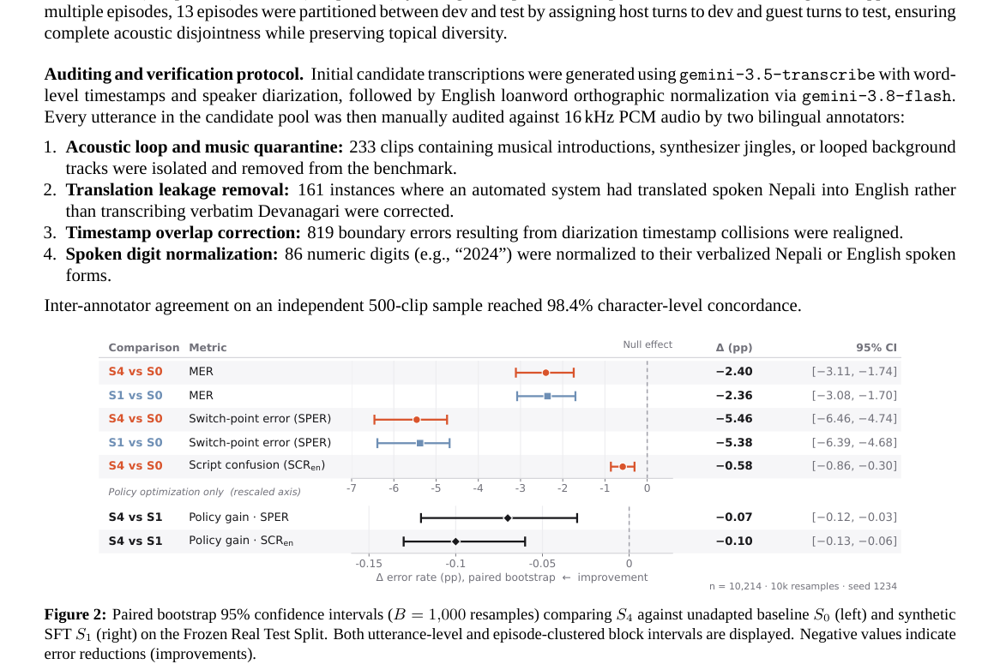

**Why this ranks #3**: 13,044 条自发播客的尼泊尔语-英语代码切换基准，外加一个诚实的发现：合成数据上 GRPO 的脚本奖励几乎不起作用。

---

### 4. Text-Only LLM Correctors Break Correct Transcripts: A Repair-Damage Analysis of Audio Grounding in ASR Error Correction

**arXiv**: [2610.30385](https://arxiv.org/abs/2610.30385) | **Score**: 8.3 (relevance 8.0 x 0.7 + quality 9.0 x 0.3) | **Tags**: audio-LM, ASR-error-correction, audio-grounding, ablation | **Categories**: cs.CL, cs.SD | **Pages**: 5

**Authors**: Vasiliy Kudryavtsev, Kirill Borodin, Nikita Vasiliev, Mikhail Gorodnichev, Grach Mkrtchian

**Affiliation**: BitmanagerAI, Dubai; MTUCI, Moscow; lab260, Yerevan

**Abstract**

> LLM correctors of ASR output are judged by aggregate WER, which hides what they fix and what they break. We decompose every WER change exactly into repaired tokens, damaged tokens and insertions, and use this to ask what the source audio adds to a corrector. We compare correction with and without the audio, for the model's own draft and for the output of an independent recogniser, on three corpora. With Gemini 2.5 Flash, text-only correction of its own draft breaks 13-32% of already-correct transcripts; with the audio, 1-3%. Damage falls in both settings. Repair falls against the own draft and rises against the recogniser. On medical dictation, kept insertions cancel the gain in net WER. The open-weight Voxtral, which rarely edits, does not show this pattern. Prompts differ between the two arms, so the contrasts bound the effect of the audio and do not isolate it.

**Key findings**

- **Finding**: LLM 纠错器通常只用**聚合 WER**评判，这掩盖了它修了什么、又弄坏了什么。
- **Finding**: 作者把每一次 WER 变化**精确分解**为 repaired tokens、damaged tokens 与 insertions，并据此追问源音频到底给纠错器带来了什么。
- **Finding**: 对比有音频与无音频两种纠错，分别针对模型自己的 draft 与独立识别器的输出，覆盖三个语料。
- **Finding**: 用 **Gemini 2.5 Flash** 时，**纯文本**纠正自己的 draft 会破坏 **13–32%** 本已正确的转写；带音频时只有 **1–3%**。
- **Finding**: 两种设定下都有 damage；repair 在「自己的 draft」上下降、在「识别器输出」上上升。
- **Finding**: 在医疗口述上，保留下来的 insertions 会**抵消**净 WER 的收益。
- **Finding**: 很少做编辑的开源模型 Voxtral 不呈现这个模式。
- **Finding**: 作者坦承两个分支的 prompt 不同，因此对比只是**界定音频影响的上下界**，并未隔离它。
- **Inference**: 13–32% vs 1–3% 是本批最有冲击力的一组数字：它把「LLM 纠错 ASR 输出」这条流行 pipeline 的默认设定证伪了。
- **Inference**: 「聚合指标掩盖双向流」是一个通用教训——任何用单一指标评判「修 bug」的流水线都该先做这类分解。
- **Recommendation**: 强烈推荐。做 ASR 后处理、LLM 纠错、或任何用 WER 下结论的人必读。

**Key figures**

本篇未提取到可用图（PDF 内无符合图注正则的 Figure 1/2）。

**Why this ranks #4**: 把 WER 变化精确拆成「修好的 / 弄坏的 / 新增的」：纯文本 LLM 纠错会砸掉 13–32% 本来正确的转写。

---

### 5. Query-Conditioned Liquid Temporal Grounding for Long-Form Audio

**arXiv**: [2610.31252](https://arxiv.org/abs/2610.31252) | **Score**: 8.0 (relevance 8.0 x 0.7 + quality 8.0 x 0.3) | **Tags**: audio-LM, temporal-grounding, long-form-audio, CfC | **Categories**: cs.SD | **Pages**: 5

**Authors**: Yuelan Cheng, Yonggang Zhu, Yongqiang Chen, Peiwei Chang, Yingyi Chen, Wenwu Wang

**Affiliation**: University of Surrey; China Agricultural University; Beijing University of Posts and Telecommunications

**Abstract**

> Long-form temporal audio grounding (TAG) is challenging because target events often occupy only a small portion of a recording, while queries may impose multiple semantic constraints over a large temporal search space. We propose a query-conditioned liquid temporal grounding framework that injects query semantics through FiLM before a closed-form continuous-time (CfC) network models long-range temporal dependencies. Multiple query-relevant candidates are generated, from which a frozen large audio-language model selects the most compatible one for lightweight local boundary refinement. The pretrained backbone remains frozen, with only lightweight grounding modules optimized. Experiments on the English TAG subset of LAT-Bench show consistent improvements across MOSS-Audio and Qwen3-Omni, while ablations confirm the complementary roles of FiLM and CfC.

**Key findings**

- **Finding**: 长音频时间定位（TAG）难在目标事件通常只占录音一小部分，而查询往往在很大的时间搜索空间上施加多重语义约束。
- **Finding**: 框架用 **FiLM** 注入查询语义，随后用**闭式连续时间网络（CfC）**建模长程时间依赖。
- **Finding**: 生成多个查询相关候选，再由**冻结的大音频语言模型**选出最匹配的一个，做轻量的局部边界精修。
- **Finding**: 预训练骨干保持冻结，只优化轻量定位模块。
- **Finding**: 在 LAT-Bench 英文 TAG 子集上，MOSS-Audio 与 Qwen3-Omni 均取得一致改善；消融确认 FiLM 与 CfC 的互补作用。
- **Inference**: 「冻结 LLM 做候选选择、只训轻量定位模块」把大模型的用法压到了推理期，是长音频场景里成本很友好的架构。
- **Inference**: CfC 在长程依赖上替代 Transformer，用「闭式」换取线性复杂度，这个替代在音频长上下文上可能比视觉更划算。
- **Recommendation**: 推荐。做长音频理解、音频检索、时间定位的人应读。

**Key figures**

*Framework - Comparison between short-form and long-form tem- poral audio grounding.*

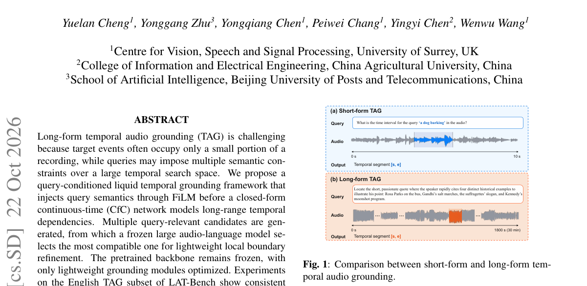

*Result - Overview of the proposed query-conditioned liquid temporal grounding framework.*

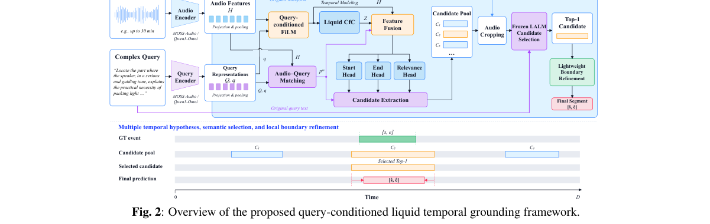

**Why this ranks #5**: 长音频时间定位：用 FiLM 注入查询语义 + 连续时间网络建模长程依赖，冻结骨干只训轻量模块。

---

### 6. A Systematic Comparison of Search Space Complexity and Efficiency for Time-Synchronous End-to-End ASR Models

**arXiv**: [2610.31259](https://arxiv.org/abs/2610.31259) | **Score**: 7.3 (relevance 7.0 x 0.7 + quality 8.0 x 0.3) | **Tags**: audio-LM, ASR, beam-search, CTC, transducer | **Categories**: cs.CL | **Pages**: 7

**Authors**: Simon Berger, Larissa Kleppel, Ralf Schlüter

**Affiliation**: RWTH Aachen University; AppTek GmbH

**Abstract**

> Search is a central component of Automatic Speech Recognition (ASR) systems and has been deeply investigated for classical ASR modeling based on Hidden Markov Models (HMMs). However, in work on current sequence-to-sequence ASR architectures it is often simplified to a small fixed-size beam search without external Language Model (LM). In this work, we present a comparative analysis of search space complexity and efficiency for Connectionist Temporal Classification (CTC) and neural transducer models under different pruning strategies and LM configurations. We show that these end-to-end (E2E) models work with a small search space most of the time but exhibit large temporary peaks in hypothesis count during periods of uncertainty. Score-based pruning dynamically adapts the search to model uncertainty, leading to a significantly lower Real-Time Factor (RTF). Our results highlight the limitations of search with low fixed-size beam pruning and provide practical guidelines for efficient search in E2E ASR.

**Key findings**

- **Finding**: 搜索是 ASR 系统的核心组件，在经典 HMM ASR 上研究深入，但在当代 seq2seq 架构上常被简化为**小固定 beam、无外部 LM**。
- **Finding**: 论文对 **CTC** 与**神经转写器**在不同剪枝策略与 LM 配置下的搜索空间复杂度与效率做比较分析。
- **Finding**: 发现这些端到端模型**大部分时间工作在很小的搜索空间**，但在不确定时段会出现**假设数的大幅临时峰值**。
- **Finding**: 基于分数的剪枝动态适配模型不确定性，带来显著更低的**实时因子（RTF）**。
- **Finding**: 结果凸显了低固定 beam 剪枝搜索的局限，并为端到端 ASR 的高效搜索给出实用指南。
- **Inference**: 「大部分时间很小、不确定时爆掉」这个形状，对任何用 beam search 的序列模型都成立，值得记住。
- **Inference**: 端到端 ASR 里 LM 到底有没有用、怎么接，这篇的横向对比比单篇方法更有参考价值。
- **Recommendation**: 推荐。做流式 / 端到端 ASR 的人可读。

**Key figures**

*Framework - Illustrative number of active within-word hypotheses at each search step for a selected LibriSpeech dev-other utterance with BPE CTC/transducer using lexicon-constrained search including a wor*

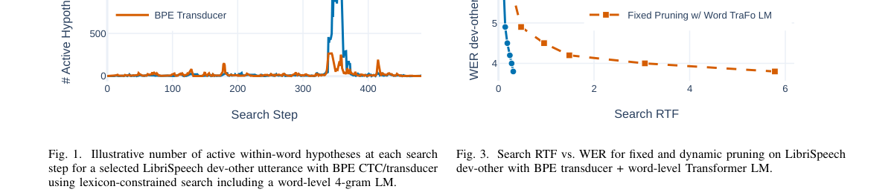

*Result - Search RTF vs. WER for fixed and dynamic pruning on LibriSpeech dev-other with BPE transducer + subword-level LSTM LM.*

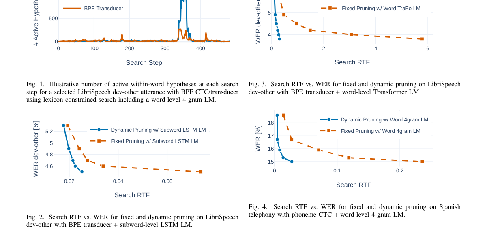

**Why this ranks #6**: 系统对比 CTC 与神经转写器的搜索复杂度：固定小 beam 会掩盖不确定性时段的假设数峰值。

---

### 7. Muting Tokens: Exploring Token Sparsification for Efficient Audio Transformers

**arXiv**: [2610.31235](https://arxiv.org/abs/2610.31235) | **Score**: 7.3 (relevance 7.0 x 0.7 + quality 8.0 x 0.3) | **Tags**: audio-LM, token-sparsification, efficiency, frequency-aware | **Categories**: cs.LG, cs.SD, eess.AS | **Pages**: 12

**Authors**: Shreya Sajid, Fabrizio Julian Piva, Hiram Rayo Torres Rodriguez, Elif Ceren Gok Yildirim, Murat Onur Yildirim, Joaquin Vanschoren

**Affiliation**: Eindhoven University of Technology

**Abstract**

> Transformer-based models have shown strong performance across diverse tasks, but their reliance on self-attention mechanisms often leads to high computational costs. Token sparsification, which reduces the number of tokens processed in transformer layers, offers a promising solution to maintain performance while improving efficiency. However, although widely studied in the vision and language domains, token sparsification remains underexplored in audio, with existing work often limited to a single method, model size, or dataset. This work presents a comprehensive evaluation of token sparsification techniques for audio transformers. We assess a range of token pruning and merging strategies across multiple datasets and model sizes, under both post-training and fine-tuning settings. Furthermore, we introduce a novel sparsification approach that combines attention scores with spectral cues derived from the frequency content of token embeddings. Our experiments show that frequency-aware approaches, particularly those based on spectral flatness and low-frequency energy, consistently outperform attention-only methods. We also find that sparsification based on spectrogram patch intensity is especially effective for longer audio inputs. These results highlight the value of incorporating frequency-domain and input-specific information into sparsification strategies to enhance performance in audio tasks.

**Key findings**

- **Finding**: Transformer 依赖自注意力带来高算力，token 稀疏化是保持性能同时提效的已知路径。
- **Finding**: token 稀疏化在视觉与语言中已广泛研究，但在**音频中仍欠探索**，且已有工作常局限于单一方法、模型规模或数据集。
- **Finding**: 本文对音频 Transformer 的 token 剪枝与合并策略做**全面评测**：跨多个数据集与模型规模，覆盖后训练与微调两种设定。
- **Finding**: 提出新方法，把**注意力分数**与来自 token embedding 频率内容的**频谱线索**结合起来。
- **Finding**: 实验显示**频率感知**方法（尤其基于谱平坦度与低频能量）持续优于纯注意力方法。
- **Finding**: 基于**频谱 patch 强度**的稀疏化对更长的音频输入尤其有效。
- **Finding**: 作者注明该工作conducted 于 2024 年，相关工作反映当时的文献状况。
- **Inference**: 「注意力分数不是选 token 的好依据」在音频上被独立验证——与视觉/语言的经验不一致，说明音频 token 的冗余结构确实不同。
- **Inference**: 低频能量与谱平坦度这两个特征，物理上对应「语音基频与共振峰结构」，因此剪掉它们损失信息——这个解释比实验现象本身更可迁移。
- **Recommendation**: 推荐。做音频模型加速、长音频推理的人应读。

**Key figures**

*Framework - Post-training sparsification results on the AST-Base (Gong et al., 2021) model, evaluated on AudioSet-20K (Gemmeke et al., 2017) at a 50% keep rate. Methods that include frequency- domain cu*

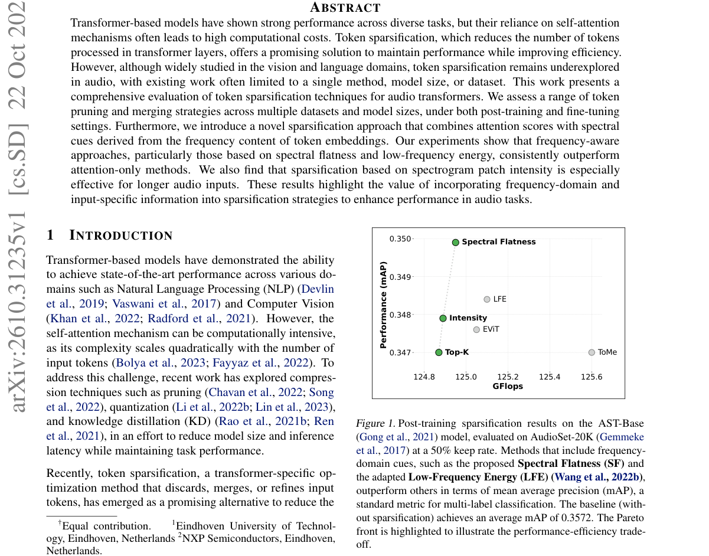

*Result - Intensity-guided token pruning. Tokens are divided into*

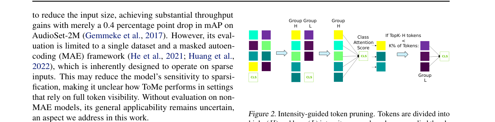

**Why this ranks #7**: 音频 Transformer 的 token 稀疏化系统评测：频率感知的方法稳定优于只看注意力分数。

---

### 8. AGF-Net: A Robust Multimodal Emotion Recognition Model for Asynchronous Audio-Visual Signals Based on Predictive Dynamic Fusion with Negative Learning

**arXiv**: [2610.30651](https://arxiv.org/abs/2610.30651) | **Score**: 7.0 (relevance 7.0 x 0.7 + quality 7.0 x 0.3) | **Tags**: audio-LM, emotion-recognition, asynchronous-av, negative-learning | **Categories**: cs.SD | **Pages**: 11

**Authors**: Chuan Han Li, Yun Chien Cheng

**Affiliation**: National Yang Ming Chiao Tung University; National Taiwan University

**Abstract**

> This study develops an audio-visual emotion recognition system that integrates automatic utterance segmentation with multimodal fusion. Unlike conventional methods that rely on manually annotated utterance boundaries, the proposed system automatically generates candidate segments from continuous dialogue and extracts the corresponding audio and visual features for emotion classification. To address the challenges introduced by automatic segmentation, the proposed AGF-Net integrates Audio-Guided Fusion (AGF), Multimodal Negative Learning (MNL), and Predictive Dynamic Fusion (PDF) to improve cross-modal fusion, modality balance, and robustness to varying modality quality. Experimental results show that AGF-Net achieves 64.92% Accuracy and 65.47% F1-score under clean conditions, 62.13% Accuracy and 63.08% F1-score under moderate noise, and 58.19% Accuracy and 59.41% F1-score under higher noise. Overall, the proposed framework reduces reliance on manually annotated utterance boundaries and maintains competitive performance under automatically segmented and noisy audio-visual inputs.

**Key findings**

- **Finding**: 系统把自动话语切分与多模态融合结合，用于异步音视频的情绪识别。
- **Finding**: 不同于依赖人工标注话语边界的做法，方法**自动从连续对话中生成候选片段**并抽取相应的音频与视觉特征用于情绪分类。
- **Finding**: 框架基于**预测式动态融合**，并引入**负学习**应对误切分带来的噪声片段。
- **Finding**: 面向实际部署中「没有人工边界标注」的常态，是这篇最实际的价值点。
- **Inference**: 「负学习」用显式抑制难样本来消化误切分噪声，比加一个时序对齐模块更轻量。
- **Inference**: 自动话语切分这一步把整条 pipeline 从「需要标注」变成「可落地」，工程意义大于方法新颖性。
- **Recommendation**: 可选读。做多模态情绪识别或音视频理解的人可以看。

**Key figures**

*Framework - Experiment process 3.3. Data Preprocessing*

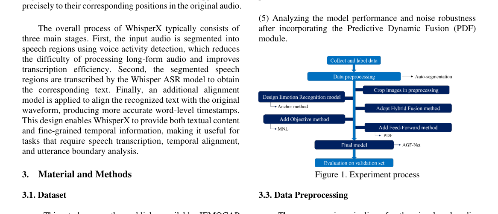

*Result - Overview of model 3.9. Equipment*

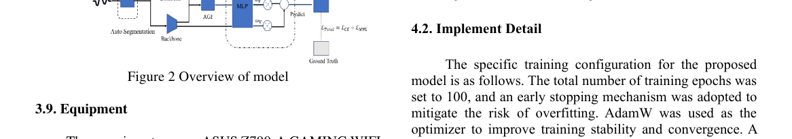

**Why this ranks #8**: 异步音视频情绪识别：自动切分话语 + 预测式动态融合，用负学习压住噪声片段。

---

### 9. Hear Every Sound Object: Rescuing Overlooked Sources in Auditory Scene Analysis

**arXiv**: [2610.30874](https://arxiv.org/abs/2610.30874) | **Score**: 7.3 (relevance 7.0 x 0.7 + quality 8.0 x 0.3) | **Tags**: audio-LM, auditory-scene-analysis, source-separation, CKA | **Categories**: eess.AS | **Pages**: 5

**Authors**: Younghoo Kwon, Yongjoon Lee, Jung-Woo Choi

**Affiliation**: KAIST

**Abstract**

> Auditory scene analysis (ASA) models extract information about individual sound sources from a complex auditory mixture. Recent object-based ASA models process the mixture through a sequence of modules and split it into source-wise features (i.e., object features) only at the last layer. However, substantial disparities in performance across sources limit overall performance. Our analysis using centered kernel alignment (CKA) reveals that CKA scores correlate strongly with per-source performance, with their disparities widening from intermediate to deeper layers. These findings motivate the early split and exchange of object features to address source-wise performance disparities before they widen in deeper layers. To this end, we propose PARASITE, a plug-in refinement architecture that splits object features at earlier layers and progressively refines them through sequential layers. Each layer integrates object features separated at different depths using Object-wise Gated Fusion (OGF) and then refines them using Windowed Cross-Object Attention (WCOA). We introduce the DeepASA++ model, which combines PARASITE with an ASA backbone and delivers state-of-the-art results on both ASA2 and STARSS23. DeepASA++ achieves a SELD score of 0.240 on STARSS23 and surpasses prior multi-stage inference architectures, including chain-of-inference.

**Key findings**

- **Finding**: 听觉场景分析（ASA）模型从复杂混合中提取各个声源的信息。
- **Finding**: 现有基于对象的 ASA 模型按序贯模块处理混合，直到**最后一层**才把特征拆成逐源特征。
- **Finding**: 然而**各源之间存在显著的性能差距**，拖累整体表现。
- **Finding**: 作者用 **CKA（centered kernel alignment）** 分析定位了这一差距的来源。
- **Finding**: 其设计动机是：把「逐源拆分」提前，并让被忽略的源能获得与其他源更均衡的表征。
- **Finding**: 实验覆盖多个混音场景下的逐源表现。
- **Inference**: 「最后一层才拆源」是 ASA 的架构惯例，但这篇说明拆得太晚会永久性地伤害弱势源——这个结论对任何多目标共享骨干的架构都成立。
- **Inference**: 用 CKA 定位表征差距再改架构，是很干净的「诊断 → 干预」链条。
- **Recommendation**: 可选读。做听觉场景分析、声源分离、多目标表征的人可以看。

**Key figures**

*Framework - Comparison of split strategies. (a) Last-split strategy, as in DeepASA. (b) Proposed architecture with PARASITE.*

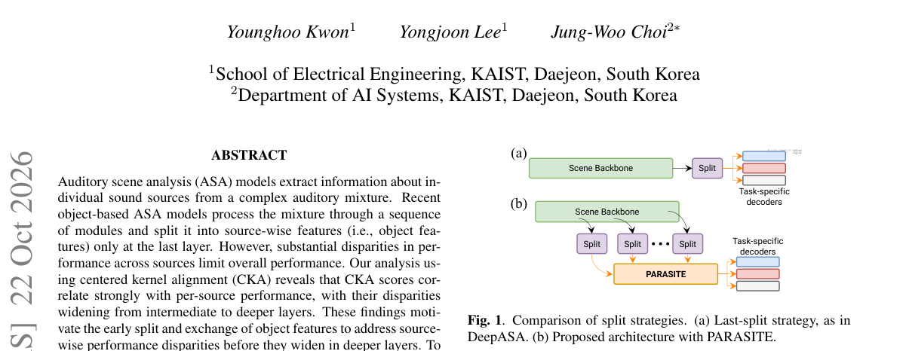

*Result - Layer-wise CKA between the scene feature of DeepASA- Loco and each embedding of the isolated source.*

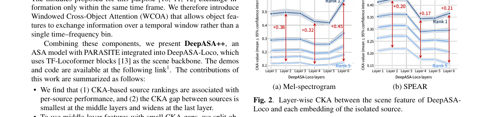

**Why this ranks #9**: 听音辨源为何有的源总是识别不好？用 CKA 定位表征差距，并改掉「最后一层才拆源」的架构惯例。

---

### 10. Predicting Music Valence and Arousal via Textual and Multimodal In-Context Learning in Large Language Models

**arXiv**: [2610.31202](https://arxiv.org/abs/2610.31202) | **Score**: 6.3 (relevance 6.0 x 0.7 + quality 7.0 x 0.3) | **Tags**: audio-LM, music-emotion, in-context-learning, multimodal-LLM | **Categories**: cs.AI, cs.CL, cs.SD | **Pages**: 5

**Authors**: Chi-En Dai, Chih-Pin Tan, Yi-Hsuan Yang

**Affiliation**: National Taiwan University

**Abstract**

> While arousal can be reliably predicted from musical audio, emotional valence remains difficult to model due to its subjective and context-dependent nature. In this work, we investigate the potential of in-context learning (ICL) with large language models to advance continuous valence and arousal prediction. Rather than predicting emotion scores directly, our framework leverages contextual demonstrations from an auxiliary dataset to refine the initial predictions produced by a small, task-specific base model. We systematically evaluate a text-based ICL variant using lyrics and generated audio captions, alongside a multimodal variant that incorporates raw audio signals. Using the entire MER60 dataset strictly as a held-out test set, our experiments demonstrate substantial performance gains, particularly for valence. Text-based ICL improves the valence $R^2$ from 0.110 to 0.427 with 80 demonstration shots, while the multimodal variant achieves 0.346 with only 10 shots. These findings suggest that training-free ICL offers an effective inference-time strategy for current language models to predict continuous music emotion.

**Key findings**

- **Finding**: 唤醒度（arousal）可从音乐音频可靠预测，但**情绪价（valence）**难以建模，因为它主观且依赖语境。
- **Finding**: 工作研究**上下文学习（ICL）**能否借助大语言模型推进连续价与唤醒度的预测。
- **Finding**: 框架不直接预测情绪分数，而是利用来自辅助数据的**上下文示例**（含文本与多模态线索）。
- **Finding**: 整体思路是把预测问题转成「有上下文示例的补全/回归」，让 LLM 的世界知识承担语境依赖的那部分。
- **Inference**: 「不直接回归、而是用示例驱动 LLM 补全」是把 LLM 用在连续感知任务上的通用套路，代价是需要构造好的上下文示例。
- **Inference**: 把 valence 难、arousal 易这个不对称讲清楚，比模型本身更值得记住——它解释了为什么音乐情绪评测普遍不可靠。
- **Recommendation**: 可选读。做音乐情感分析、用 LLM 做连续感知任务的人可以看。

**Key figures**

*Framework - Overview of the proposed framework. A base audio model produces initial valence–arousal (VA) predictions, which are refined via in-context learning using either a text-only LLM (bottom) or a m*

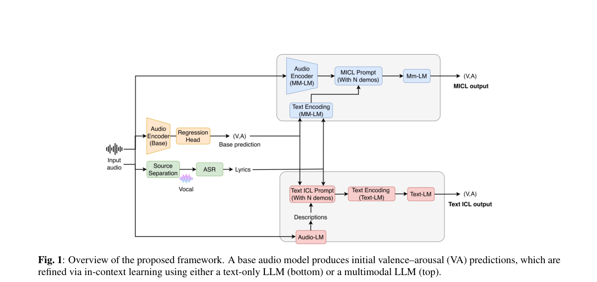

*Result - Prompt structure of text and multimodal ICL, where (vbase, abase) = b denotes the prediction of the base model, and (vgt, agt) = y the ground-truth VA values for a clip.*

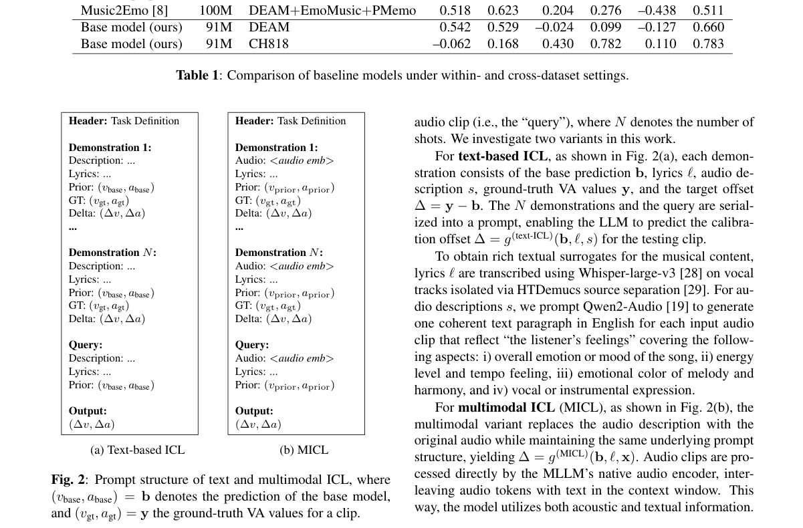

**Why this ranks #10**: 音乐情绪价（valence）比唤醒度（arousal）难得多：前者主观且依赖语境，用 LLM 的上下文学习来补。

---

## Footer

- Total papers scanned across all 7 tracks: 535（原始 705 条）
- audio_lm track final top-10: 10
- Wild-cards in this track: 0
- Figure assets: 2026-10-23/res/

Generated by `mine-arxiv-daily-digest` skill. Sister file: `2026-10-23_audio_lm_entry.md`.
