# ArXiv Daily Digest - 2026-10-23 (具身智能与世界模型, 10 papers)

**Generated**: 2026-10-23 17:00 CST

**Source**: arXiv cs.CV, cs.SD, eess.AS, cs.CL, cs.AI, cs.RO, cs.LG submissions, listing day 2026-10-22 (announced 2026-10-23 00:00 UTC)

**Batch window**: 2026-10-21T18:00:00Z .. 2026-10-22T18:00:00Z（arXiv 公告批次横跨两个 UTC 日：前一日 18:00 UTC 起算，当日 17:59:59 UTC 截止）

**Track**: embodied (top 10 of 535 papers scanned, 107 full reads)

**Scope**: 具身智能、机器人操作与导航、VLA、世界模型、触觉与仿真

---

## Top 10 - 具身智能与世界模型

### 1. DeXplicit: Making Physical State Explicit in Dexterous Manipulation World Models

**arXiv**: [2610.30781](https://arxiv.org/abs/2610.30781) | **Score**: 9.7 (relevance 10.0 x 0.7 + quality 9.0 x 0.3) | **Tags**: embodied, world-model, dexterous, explicit-3D, video-generation | **Categories**: cs.CV | **Pages**: 23

**Authors**: Adam Lee, Mutian Xu, Yukang Cao, Shulin Tian, Ziwei Liu

**Affiliation**: S-Lab, Nanyang Technological University; University of California, Berkeley

**Abstract**

> Before acting on an object, a robot needs to anticipate how its hand motion will change the physical world and what the resulting scene will look like. Existing approaches typically entangle action-conditioned dynamics, camera motion, and visual synthesis within a video generation model, or represent dynamics as point trajectories without explicit object structure. We introduce DeXplicit, a dexterous manipulation world model that instead predicts how the world evolves explicitly in metric 3D before rendering its visual consequences. Given an initial scene and a future hand trajectory, a lightweight 3D dynamics network predicts object-centric motion and deformation, providing structured and geometrically grounded future world states. These predictions then serve as a strong scaffold for video generation: appearance is transported through the predicted 3D motion and projected into future views, allowing the renderer to focus on completing uncertain and newly visible content rather than implicitly learning world dynamics from pixels. This explicit-3D-first decomposition also enables efficient causal generation, requiring only two denoising steps per block while conditioning on generated history. Across HOT3D, OakInk2, and PhysTwin, DeXplicit reduces moved-point error by 27-40% relative to PointWorld and improves object fidelity IoU+ by 47% on HOT3D under a shared renderer. Our design with two-step causal generation achieves a 57x speedup from our 14B bi-directional configuration in video synthesis.

**Key findings**

- **Finding**: 机器人动手前需要预判手部运动会如何改变物理世界、以及结果场景长什么样。
- **Finding**: 现有做法要么在视频生成模型里把**动作条件动力学、相机运动、视觉合成纠缠在一起**，要么用点轨迹表示动力学却**缺少显式物体结构**。
- **Finding**: DeXplicit 先**在度量 3D 中显式预测世界如何演化**，再渲染其视觉结果。
- **Finding**: 给定初始场景与未来手部轨迹，一个轻量 3D 动力学网络预测**以物体为中心的运动与形变**，给出结构化、几何锚定的未来世界状态。
- **Finding**: 这些预测作为视频生成的强脚手架：外观经预测的 3D 运动**搬运**并投影到未来视角，渲染器只需补全不确定与新暴露的内容。
- **Finding**: 显式 3D 优先的分解带来高效因果生成：每个 block 只需**两步去噪**，并条件化于已生成历史。
- **Finding**: 在 HOT3D、OakInk2、PhysTwin 上，移动点误差相对 PointWorld 降低 **27–40%**；共享渲染器下 HOT3D 的物体保真 IoU+ 提升 **47%**。
- **Finding**: 两步因果生成相对 14B 双向配置实现 **57× 加速**。
- **Inference**: 「把动力学从像素里搬到几何里」是本篇的核心命题：渲染器不必再隐式学习世界动力学，只需补全新暴露内容——这同时解释了精度提升与 57× 加速的来源。
- **Inference**: 显式 3D 状态还有个额外好处：它天然可被下游规划器消费，不必再从视频里反推几何。
- **Recommendation**: 强烈推荐。做世界模型、灵巧操作、视频生成的人必读。

**Key figures**

*Framework - Explicit physical state for dexterous interaction. Structured interaction dynamics connect metric prediction to video synthesis, preserving transport, articulation, and deformation. The late*

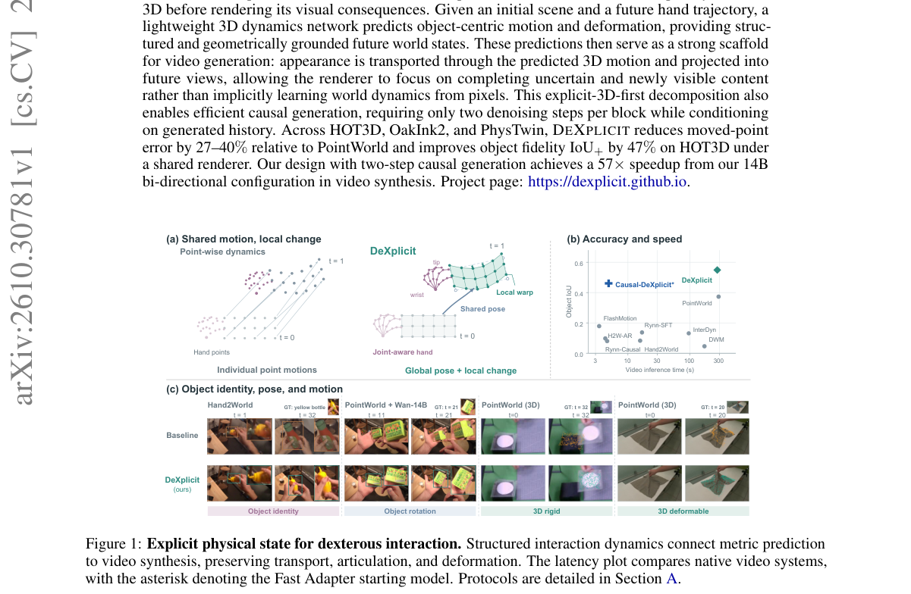

*Result - Overview of DeXplicit. Joint-aware action encoding drives object-centric metric dynamics with shared object transport and local deformation. Metric-aligned refinement corrects object pose, a*

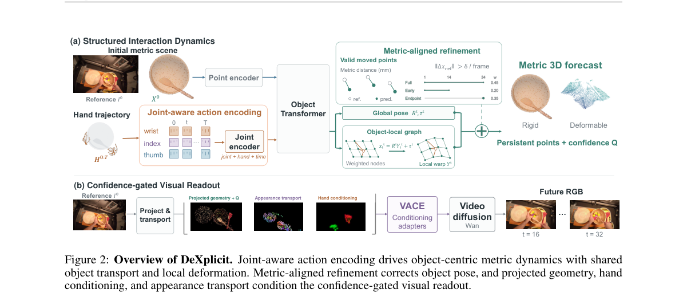

**Why this ranks #1**: 先在 3D 里显式算清物理，再让渲染器去画：把「世界模型」从像素预测改写成几何状态预测。

---

### 2. In-Context Learning World Models for Robot Dual-Arm Manipulation of Soft Garment with Partial Observations

**arXiv**: [2610.30988](https://arxiv.org/abs/2610.30988) | **Score**: 9.0 (relevance 9.0 x 0.7 + quality 9.0 x 0.3) | **Tags**: embodied, world-model, soft-object, in-context-learning, bimanual | **Categories**: cs.RO | **Pages**: 12

**Authors**: Hengyi Sim, Quentin Rouxel, Dennis Hong, Darwin Caldwell, Fei Chen

**Affiliation**: Institute of Advanced Engineering, The Chinese University of Hong Kong

**Abstract**

> Robust manipulation of soft objects, such as garments, is a critical skill for service and household robots to adopt, but remains challenging due to its high-dimensional state space, and material-dependent deformations. Humans address this challenge by using mental world models that "imagine" the shape and material properties from partial observations, which enables them to predict how actions affect future states. As such, embedding such world models in robots allows for better generalization in manipulating a wide variety of garments in the real world. However, learned world models typically require large amounts of real world data that is strenuous to collect, and a mechanism to infer latent properties that govern dynamics. We present a Soft-Object World Model that performs generative full-state estimation and action-conditioned dynamics prediction using a transformer backbone trained on large-scale simulated soft object interactions, with measures to mitigate the sim-to-real gap. By learning to infer latent shape and material cues through in-context learning over a variable-length partial point-cloud history, the model generalizes across robot embodiments, material parameters, garment types and shapes, and manipulation coordination modes without weight updates. The world model is then integrated with a Goal-Conditioned action planner for motion synthesis. We validate the approach in simulation and real world for bimanual garment folding, reporting improvements in reconstruction fidelity, prediction accuracy, and task success.

**Key findings**

- **Finding**: 软物体（衣物等）操作对服务与家用机器人很关键，但因**高维状态空间**与**材质相关形变**而困难。
- **Finding**: 人类靠「心智世界模型」从部分观测中想象形状与材质属性，从而预测动作如何影响未来状态。
- **Finding**: 学到的世界模型通常需要**大量真实世界数据**（采集代价高），且缺少推断支配动力学的潜属性的机制。
- **Finding**: Soft-Object World Model 用 **transformer 骨干**在大规模仿真软物体交互上训练，同时做生成式全状态估计与动作条件动力学预测，并采取措施缓解 sim-to-real gap。
- **Finding**: 关键机制是**在变长部分点云历史上的上下文学习**，据此推断潜形状与材质线索。
- **Finding**: 模型因此**无需权重更新**即可跨机器人本体、材质参数、衣物类型与形状、以及操作协同模式泛化。
- **Finding**: 世界模型再接入一个**目标条件动作规划器**做运动合成；在仿真与真实世界验证双臂衣物折叠，重建保真度、预测精度与任务成功率均提升。
- **Inference**: 「上下文学习推断潜属性」是这篇最漂亮的一步：它把材质与形状从需要标注的参数，变成了从交互历史里读出来的隐变量。
- **Inference**: 零权重更新跨本体泛化，意味着这类世界模型可以作为通用模块挂到不同机器人上——这是落地价值最高的性质。
- **Recommendation**: 强烈推荐。做软物体操作、世界模型、sim-to-real 的人必读。

**Key figures**

*Framework - This work leverages a large scale simulation dataset of soft-object point-cloud interactions to perform generative full-state estimation and action- conditioned dynamics prediction, with In-Co*

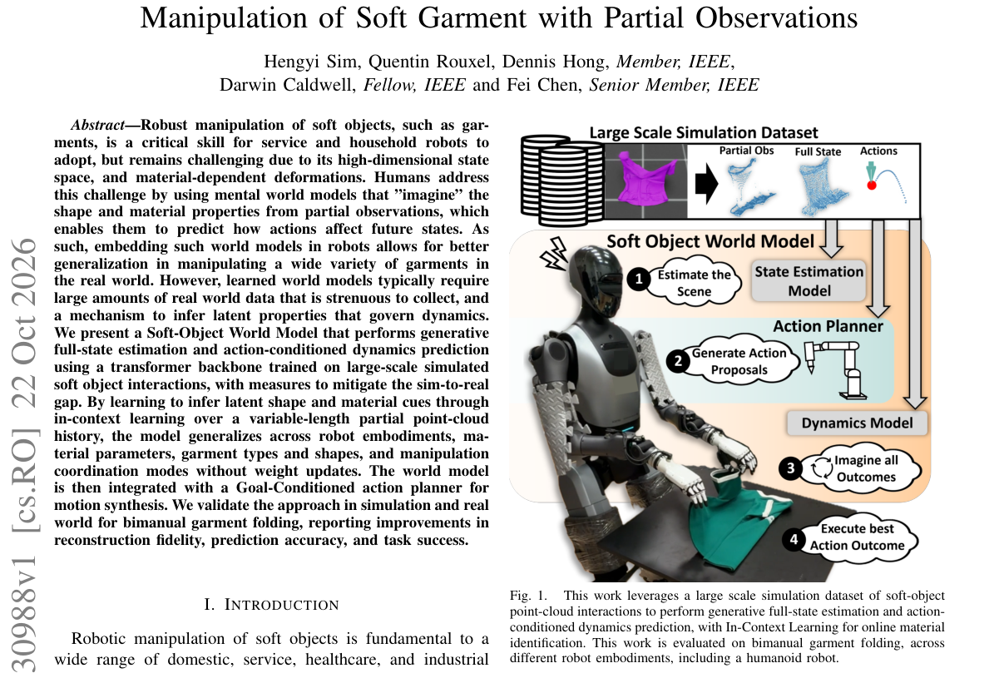

*Result - Overview of the proposed pipeline, comprising three stages. i) Synthetic soft object manipulation demonstrations are collected in simulation using Isaac Lab, capturing partial point cloud obse*

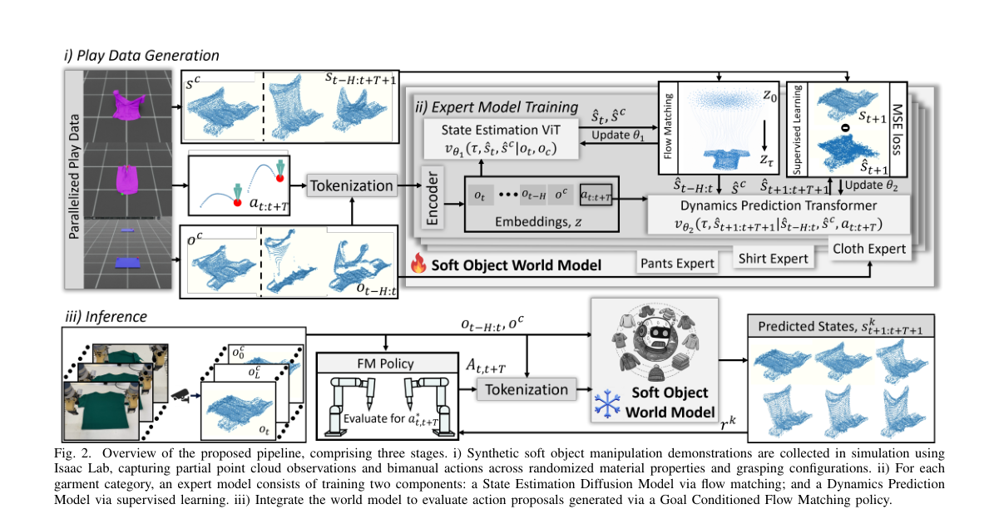

**Why this ranks #2**: 软物体世界模型：用上下文学习从部分点云历史推断形状与材质，零权重更新跨本体泛化。

---

### 3. Tactile-Based Robotic Manipulation: From Mechanics-Driven to Data-Driven Perspectives

**arXiv**: [2610.30438](https://arxiv.org/abs/2610.30438) | **Score**: 9.0 (relevance 9.0 x 0.7 + quality 9.0 x 0.3) | **Tags**: embodied, tactile, survey, imitation-learning, VLA | **Categories**: cs.RO | **Pages**: 30

**Authors**: Jingyi Xiang, Yixuan Wang, Wenzhen Yuan

**Affiliation**: Siebel School of Computing and Data Science, University of Illinois

**Abstract**

> Tactile sensing provides robots with direct access to physical interactions at the contact interface, making it a critical modality for robust and dexterous manipulation. Over the past several decades, tactile-based manipulation research has evolved from mechanics-driven approaches, which explicitly interpret tactile signals through contact mechanics and task-specific reasoning, to data-driven approaches that learn tactile representations and manipulation policies directly from data. This paper reviews the development of tactile-based manipulation from these two complementary perspectives. We first introduce the fundamentals of tactile sensing, and then review, from a mechanics-driven perspective, how those signals form manipulation-relevant state representations and subsequently influence the robot action. We then examine the recent advances in data-driven tactile manipulation, covering imitation learning, reinforcement learning, vision-language-action models, and predictive models. Finally, we discuss open challenges and future opportunities toward scalable, generalizable, and robust tactile-enabled robotic systems.

**Key findings**

- **Finding**: 触觉感知让机器人能直接接触交互界面，是鲁棒灵巧操作的关键模态。
- **Finding**: 过去数十年的研究从**力学驱动**路线（显式地用接触力学与任务特定推理解释触觉信号）演进到**数据驱动**路线（直接从数据学触觉表征与操作策略）。
- **Finding**: 综述先介绍触觉传感的基础，再从力学驱动视角回顾这些信号如何构成操作相关的状态表征并影响机器人动作。
- **Finding**: 随后检视数据驱动触觉操作的最新进展，覆盖**模仿学习、强化学习、视觉-语言-动作模型与预测式模型**。
- **Finding**: 最后讨论面向可扩展、可泛化、鲁棒的触觉机器人系统的开放挑战与未来机会。
- **Inference**: 把「力学驱动 vs 数据驱动」作为主轴整理触觉研究，本身就是一个有用的判据：它能直接回答「我该做表征学习还是做物理建模」。
- **Inference**: 它把触觉与当前最热的 VLA / RL 路线并置，等于给触觉研究指了三个具体的接入点。
- **Recommendation**: 强烈推荐。触觉方向必读；也推荐所有做机器人操作、想知道触觉该往哪接的人。

**Key figures**

本篇未提取到可用图（PDF 内无符合图注正则的 Figure 1/2）。

**Why this ranks #3**: 触觉操作三十年综述：从「用接触力学解释信号」到「让数据自己学」，Annual Reviews 级别的手册。

---

### 4. Memory before Goal: Role of Pre-History Memory for Humanoid Loco-Manipulation

**arXiv**: [2610.31166](https://arxiv.org/abs/2610.31166) | **Score**: 8.7 (relevance 9.0 x 0.7 + quality 8.0 x 0.3) | **Tags**: embodied, humanoid, VLA, memory, non-Markovian | **Categories**: cs.CV, cs.LG, cs.RO | **Pages**: 8

**Authors**: Chenyuan Chen, Ran Ding, Lechen Zhang, Zewen He, Yoshihiko Nakamura

**Affiliation**: Mohamed bin Zayed University of Artificial Intelligence

**Abstract**

> Humanoid loco-manipulation in dynamic scenes is non-Markovian: cues vanish as objects change or are hidden, or leave the view as the robot turns and walks, yet whole-body vision-language-action (VLA) policies see only the present. We present WholeBodyMem, an object-guided perceptual memory that keeps the pre-history of object events seen before the robot acts on its goal. SAM3 tracks the task objects, and their events causally select key frames within an adaptive budget, which the action expert reads by cross-attention together with object tokens encoding appearance, geometry and time. We also contribute HuMeGo, a humanoid memory benchmark with six simulated and six real-world Unitree G1 tasks. Keeping the right frames rather than more frames, WholeBodyMem surpasses memoryless and uniform-memory baselines, raising its base policy's success from 29.1% to 72.6% in simulation and from 36.7% to 88.3% on the real robot, while also improving the standard SIMPLE tasks (70.2% to 86.9%).

**Key findings**

- **Finding**: 动态场景中的人形 loco-manipulation 是**非马尔可夫**的：线索会随物体变化或被遮挡而消失，也会因机器人转身行走而离开视野，而全身 VLA 策略只看当下。
- **Finding**: 提出 **WholeBodyMem**：物体引导的感知记忆，保留机器人在对目标动手**之前**看到过的物体事件历史。
- **Finding**: **SAM3** 跟踪任务物体，其事件因果性地在自适应预算内**选择关键帧**；动作专家通过交叉注意力读取这些帧，以及编码外观、几何与时间的物体 token。
- **Finding**: 配套发布 **HuMeGo** 人形记忆基准：6 个仿真 + 6 个真实 Unitree G1 任务。
- **Finding**: 「保留对的帧而不是更多帧」这一点很关键——WholeBodyMem 超越无记忆与均匀记忆基线，仿真成功率从 **29.1% 提到 72.6%**，真机从 **36.7% 提到 88.3%**。
- **Finding**: 同时标准 SIMPLE 任务也从 70.2% 提升到 86.9%。
- **Inference**: 29.1% → 72.6% 这个幅度说明：在非马尔可夫任务里，「记忆」不是锦上添花，而是能力缺口本身。
- **Inference**: 「由物体事件因果性地选择帧」比按时间窗口均匀采样聪明得多——记忆预算应该花在有因果意义的时刻。
- **Recommendation**: 强烈推荐。做人形机器人、VLA、具身记忆的人必读。

**Key figures**

*Framework - Memory in a real whole-body task. Top: the cola stops first on the middle seat (1.1 s), then a sprite and the cola stop on the other two; the robot turns away to fetch the cola and, when it re*

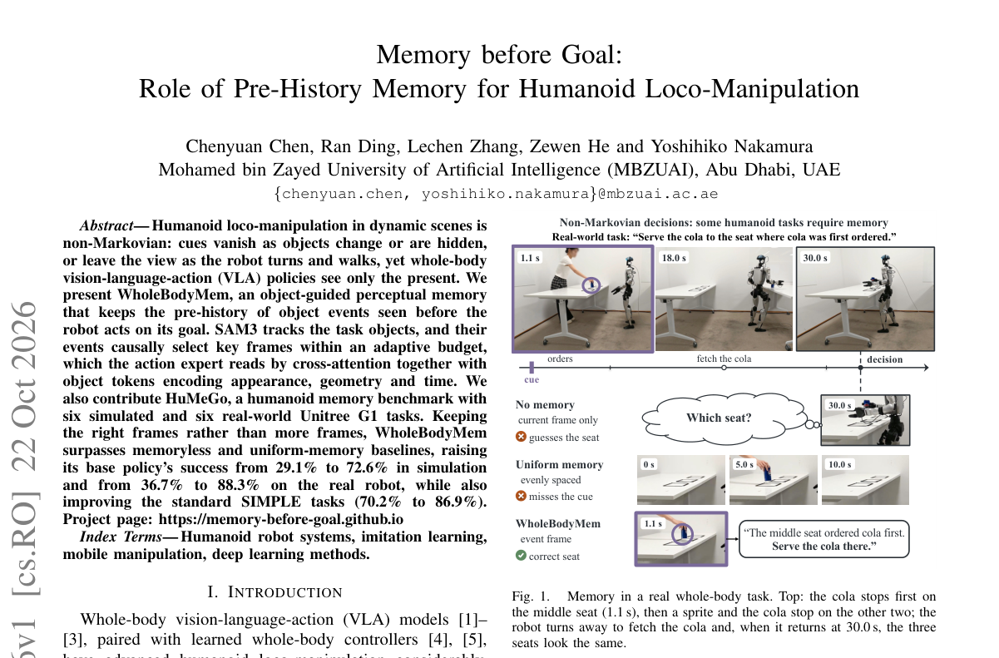

*Result - Memory-dependent tasks in simulation, grouped by memory type. Each block shows one task and its memory suite (as in RoboMME [12]; Sec. III-A): the instruction, nine subtasks and the robot’s he*

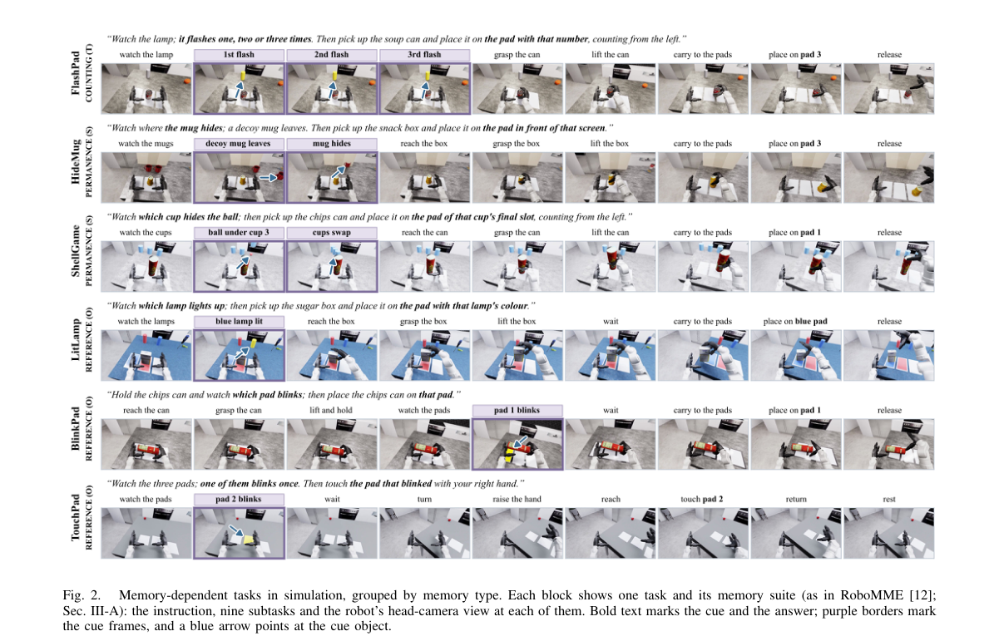

**Why this ranks #4**: 「先记后做」：人形机器人不只看当下，还看目标之前发生过什么——成功率 29.1% → 72.6%。

---

### 5. DiffDreamer: Coupling World Models with Differentiable Simulation for Agile Quadrotor Control

**arXiv**: [2610.31617](https://arxiv.org/abs/2610.31617) | **Score**: 8.7 (relevance 9.0 x 0.7 + quality 8.0 x 0.3) | **Tags**: embodied, world-model, differentiable-simulation, quadrotor, model-based-RL | **Categories**: cs.RO | **Pages**: 8

**Authors**: Fanxing Li, Yuxiang Huang, Shengyang Wang, Fangyu Sun, Shuyu Wu, Tianbao Zhang, Dexin Zuo, Yan Yufei, Danping Zou, Wenxian Yu

**Affiliation**: [unverified]

**Abstract**

> Tasks such as quadrotor dynamic-gate racing require agents to anticipate external motion while maintaining precise high-frequency control. World-model-based reinforcement learning provides a natural solution by learning latent dynamics for future imagination, yet it often entangles environmental evolution and the robot's own dynamics in a single learned rollout, where model bias can affect policy optimization efficiency. We propose DiffDreamer, a differentiable reinforcement learning framework that tightly couples a learned world model with differentiable simulation for actor optimization. In one optimization step, the learned world model propagates latent states that capture external dynamics and history-dependent features, while the differentiable simulator propagates the robot's explicit physical state. We further decompose the actor objective into a critic-driven pathway for non-differentiable task rewards and a simulator-driven pathway for differentiable motion rewards. Experiments on aggressive tracking and dynamic-gate racing show that DiffDreamer improves training convergence over the model-free, model-based, and differentiable-RL baselines, and final performance over these baselines and classical planning and control methods. Additional experiments assess reward decomposition and the odometry-conditioned relative-state representation through ablations. We also provide proof-of-concept real-world flight experiments for validation.

**Key findings**

- **Finding**: 四旋翼动态门竞速等任务要求智能体预判外部运动，同时维持精确的高频控制。
- **Finding**: 基于世界模型的 RL 是自然解法，但常见做法在**单次学得的 rollout 里把环境演化与机器人自身动力学纠缠在一起**，模型偏差因此影响策略优化效率。
- **Finding**: DiffDreamer 是**可微强化学习**框架，把学到的世界模型与可微仿真紧密耦合以优化 actor。
- **Finding**: 在一次优化步里：学到的世界模型传播**隐状态**（捕捉外部动态与历史相关特征），可微仿真器传播机器人的**显式物理状态**。
- **Finding**: actor 目标被分解为两条通路：**critic 驱动**通路处理不可微的任务奖励，**仿真器驱动**通路处理可微的运动奖励。
- **Finding**: 在激进跟踪与动态门竞速上，DiffDreamer 的训练收敛优于 model-free、model-based 与可微 RL 基线，最终性能也优于这些基线以及经典规划与控制方法。
- **Finding**: 额外实验评估了**奖励分解**与**里程计条件的相对状态表示**的消融。
- **Finding**: 论文还提供了真实飞行的概念验证实验。
- **Finding**: 该论文为 IEEE Robotics and Automation Letters 格式，PDF 内**未给出作者机构行**，因此机构标为 [unverified]。
- **Inference**: 「隐状态管外部、显式状态管自身」是这篇的核心解耦——它把世界模型最容易被污染的那部分（机器人自身动力学）交给了物理引擎而非学习模型。
- **Inference**: 把不可微任务奖励与可微运动奖励分成两条通路，是让可微仿真真正发挥作用的必要工程步骤，否则梯度会被离散奖励掐断。
- **Recommendation**: 强烈推荐。做世界模型 RL、可微仿真、四旋翼与高速控制的人必读。

**Key figures**

*Framework - A schematic overview of DiffDreamer for dynamic-gate racing. The quadrotor must predict the future motion of dynamic gates while executing precise flight control. DiffDreamer trains the actor*

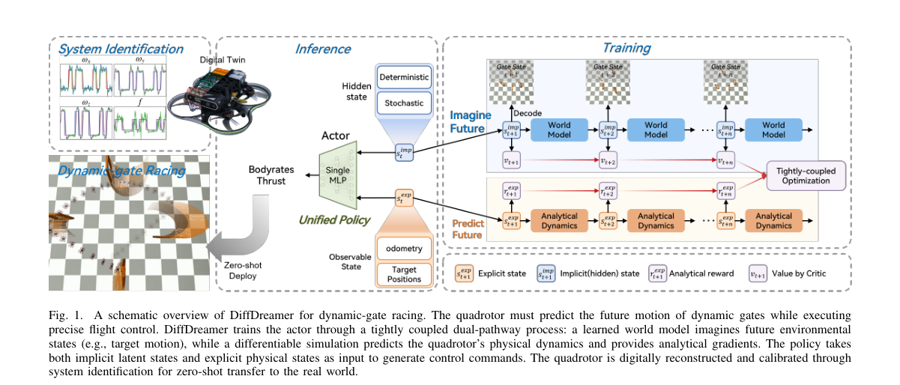

*Result - Coupling external-motion prediction with internal control. Left: Catching a ball requires imagining its trajectory and planning body motion. Right: DiffDreamer combines latent world-model feat*

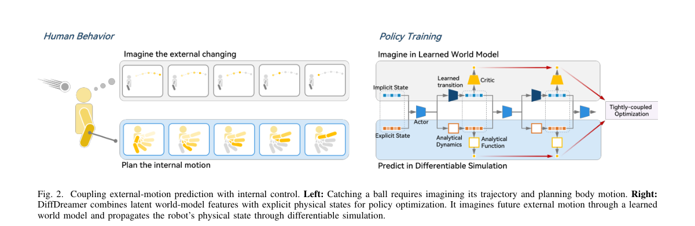

**Why this ranks #5**: 世界模型与可微仿真各管一半：隐状态管外部动态，物理状态管机器人自身，再把 actor 目标拆成 critic 通路与仿真通路。

---

### 6. Motion Retargeting with Spatiotemporal Preferences for Humanoid Loco-Manipulation

**arXiv**: [2610.30540](https://arxiv.org/abs/2610.30540) | **Score**: 8.3 (relevance 8.0 x 0.7 + quality 9.0 x 0.3) | **Tags**: embodied, humanoid, motion-retargeting, mechanics-aware, RL | **Categories**: cs.RO | **Pages**: 14

**Authors**: Xiongbo Shi, Shihang Du, Zongyou Yu, Ao Zhou, Xudong Zhang, Ziyu Lin, Haodong Zhang, Junqiao Zhao, Guang Chen

**Affiliation**: Physical Intelligence Lab, Tongji University; Shanghai Innovation Institute

**Abstract**

> Human motion retargeting bridges the embodiment gap between humans and humanoid robots by converting human demonstrations into reference trajectories for whole-body control and loco-manipulation. For object-interaction tasks, successful execution depends on accurately preserving body--object relations at critical stages. However, uniform per-frame iteration budgets do not account for these localized accuracy requirements, limiting the computational efficiency of retargeting. To address this limitation, we present Spatiotemporal Retargeting (STR), which uses keyframes and key body parts to allocate optimization effort. Specifically, a vision-language model selects relevant motion signals and body parts, and keyframes are identified from changes in the selected signals. Based on these selections, STR assigns additional solver iterations to keyframes and higher interaction weights to the selected parts. To further improve contact fidelity, we introduce Mechanics-Aware Contact Anchoring (MCA) to refine object-surface contact positions using an approximate object-wrench model while retaining the selected surface directions. Building on the resulting references, we develop Spatiotemporal Reinforcement Learning (STRL), which combines adaptive key-stage sampling with a contact reward based on target proximity and object contact forces for downstream control. Simulation experiments on a Unitree G1 and real-world experiments on a Unitree R1 demonstrate that STR improves geometric contact coverage and continuity at lower computational cost, while the resulting references improve downstream task completion across diverse object-interaction motions.

**Key findings**

- **Finding**: 人体动作重定向在人与人形机器人之间架起具身鸿沟的桥梁，把人类示范转成全身控制与 loco-manipulation 的参考轨迹。
- **Finding**: 对物体交互任务，成功执行取决于在**关键阶段**准确保留身体-物体关系；而**均匀的逐帧迭代预算**没有反映这种局部精度需求，限制了重定向的计算效率。
- **Finding**: **STR（Spatiotemporal Retargeting）**用关键帧与关键身体部位分配优化算力：视觉语言模型挑选相关运动信号与身体部位，关键帧由所选信号的变化确定。
- **Finding**: STR 据此给关键帧分配更多求解器迭代、给所选部位更高交互权重。
- **Finding**: **MCA（Mechanics-Aware Contact Anchoring）**用近似的物体扳手模型精修物体表面接触位置，同时保留所选表面方向。
- **Finding**: 在此参考轨迹之上开发 **STRL**：结合自适应关键阶段采样与基于目标接近度、物体接触力的接触奖励，做下游控制。
- **Finding**: 在 Unitree G1 仿真与 Unitree R1 真机上，STR 以更低计算成本改善了几何接触覆盖与连续性，参考轨迹也提升了多样物体交互动作的任务完成率。
- **Inference**: 「算力按重要性分配」这个思路在生成模型（分层特征）里已经很常见，但迁移到物理重定向上仍少见。
- **Inference**: 用扳手模型做接触锚定，是把物理约束以软形式注入优化，而不是硬约束投影，工程上更稳。
- **Recommendation**: 推荐。做人体动作重定向、人形机器人、接触丰富操作的人应读。

**Key figures**

*Framework - Keyframes and key body parts for human-to-humanoid retargeting. The human demonstration (top) and robot reference (bottom) illustrate an object-interaction motion. Highlighted poses mark keyfr*

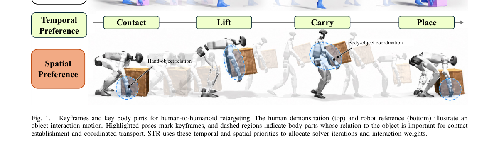

*Result - Overview of STR and STRL. (a) A vision-language model selects motion signals and key body parts, and trajectory analysis identifies keyframes. (b) STR allocates additional SQP iterations to ke*

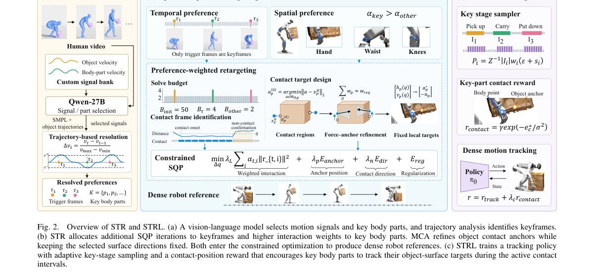

**Why this ranks #6**: 把优化算力花在「关键帧 × 关键部位」上：STR + 力学感知接触锚定，把人体动作迁移给机器人。

---

### 7. LocoManiLab: A Unified Testbed for Data, Policies, Controllers, and Deployment in Humanoid Loco-Manipulation

**arXiv**: [2610.30876](https://arxiv.org/abs/2610.30876) | **Score**: 8.3 (relevance 8.0 x 0.7 + quality 9.0 x 0.3) | **Tags**: embodied, humanoid, benchmark, teleoperation, deployment | **Categories**: cs.RO | **Pages**: 27

**Authors**: Dewei Wang, Jinrui Han, Jiyuan Shi, Chenyun Zhang, Xianbo Lu, Jiabao Wu, Jiqin Feng, Jipeng Kong, Ping Luo, Chenjia Bai, Xuelong Li

**Affiliation**: The University of Hong Kong; Zhejiang University; Shanghai Jiao Tong University; ShanghaiTech University

**Abstract**

> Humanoid robots must coordinate locomotion and manipulation in everyday environments, yet progress is difficult to assess across differing policies, controllers, and task settings. LocoManiLab provides an integrated testbed spanning data collection and generation, policy training, evaluation, and physical deployment. Its task suite covers 234 atomic and compositional tasks across five household scene categories, supported by 51.5 hours of simulated teleoperation. The evaluation covers twelve policies with a shared controller across task and scene splits and perturbation levels, two policies across five controllers, and studies of demonstration scale and data-source mixtures. Success rates fall on unseen tasks and scenes and generally decline as visual perturbations increase, with differences in generalization and robustness across policies. For data generation, a humanoid motion generation model is fine-tuned for loco-manipulation to study the alignment of its outputs with task execution requirements and its integration into the data generation pipeline. Three simulated loco-manipulation tasks closely match real-world setups, enabling evaluation of three policies in both domains. Similar policy rankings support the reliability of simulation-based evaluation.

**Key findings**

- **Finding**: 人形机器人必须在日常环境中协调移动与操作，但在不同策略、控制器与任务设定下**进展难以评估**。
- **Finding**: LocoManiLab 提供覆盖数据采集与生成、策略训练、评测与**物理部署**的一体化试验台。
- **Finding**: 任务集覆盖五类家居场景下的 **234 个原子与组合任务**，配有 **51.5 小时**仿真遥操作数据。
- **Finding**: 评测覆盖：共享控制器下的 **12 个策略**（按任务 / 场景划分与扰动等级）、5 个控制器下的 2 个策略，以及演示规模与数据源混合的研究。
- **Finding**: 成功率在未见任务与场景上下降，并随视觉扰动增大而普遍下降；不同策略在泛化与鲁棒性上差异明显。
- **Finding**: 数据生成方面，将人形运动生成模型微调用于 loco-manipulation，研究其输出与任务执行需求的对齐。
- **Finding**: 三个仿真 loco-manipulation 任务与真实 setups 紧密对应，可同时评测三个策略；**相近的策略排序支持了基于仿真的评测可靠性**。
- **Inference**: 「仿真里的策略排序与真实一致」这个验证是这篇最有价值的部分——它是整个人形评测体系可信度的基础。
- **Inference**: 51.5 小时遥操作数据 + 234 任务规模，比大多数只做几个任务的基准更像一个真正的试验台。
- **Recommendation**: 强烈推荐。做人形机器人、VLA 评测、需要标准基准的人必读。

**Key figures**

*Framework - Overview of LocoManiLab. Scene categories span kitchens, living rooms, bedrooms, bathrooms, and offices, with affordances including articulated appliances, drawers, object placement, and desk*

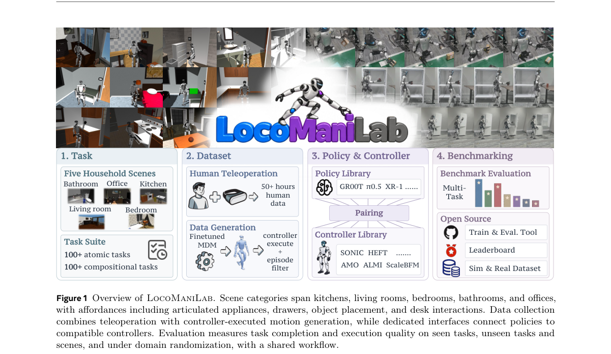

*Result - Teleoperation data statistics. Panels (a)–(c) describe the SONIC corpus by scene category, task-chain duration, and body motion. Duration is shown by median, interquartile range, and 5th–95th*

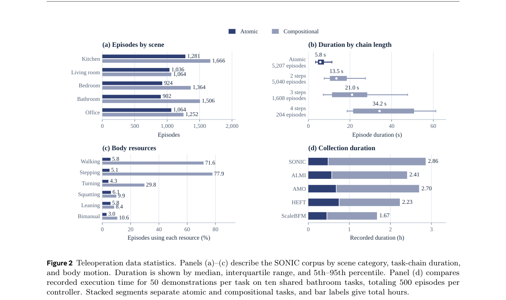

**Why this ranks #7**: 人形 loco-manipulation 的统一试验台：234 个任务 + 51.5 小时遥操作数据 + 真机部署闭环。

---

### 8. PiHand: Latent Hand-Object Interaction Priors for Physics-Based Policy Learning

**arXiv**: [2610.31299](https://arxiv.org/abs/2610.31299) | **Score**: 8.0 (relevance 8.0 x 0.7 + quality 8.0 x 0.3) | **Tags**: embodied, dexterous, VAE-prior, residual-exploration, physics-based | **Categories**: cs.CV | **Pages**: 25

**Authors**: Niklas Berndt, Xianghui Xie, Enes Duran, Yixiao Wang, Gerard Pons-Moll

**Affiliation**: Max Planck Institute for Informatics; University of California, Berkeley

**Abstract**

> Synthesizing physically grounded dexterous hand-object interactions is important for VR/AR, gaming, and robotics, yet remains challenging because subtle contact dynamics, diverse object geometries, and target trajectories must be jointly respected while maintaining natural grasps. Existing methods either track mocap trajectories with limited transfer to novel objects, or rely on hand-only generative priors that fail to capture coupled hand-object motion, sacrificing contact fidelity and sample efficiency. To tackle these challenges, we introduce PiHand, a Physically grounded Interaction-aware Hand motion synthesis framework. PiHand first trains expert policies that track mocap demonstrations in simulation, distills them into a unified hand-object interaction prior using a goal-conditioned VAE, and finally solve diverse dexterous manipulation tasks through bounded residual exploration in its latent space. With only a single reward and no complex curriculum training, this yields general tabletop manipulation policies that generalize to unseen objects and trajectories on GRAB and DexYCB. The same prior transfers to object catching and bimanual handover, two tasks that are rarely seen in its training data. Across all tasks, PiHand consistently outperforms baselines in all metrics. We will release the processed data and model checkpoints.

**Key findings**

- **Finding**: 合成物理接地的灵巧手-物交互对 VR/AR、游戏与机器人很重要，但需同时满足细微接触动力学、多样物体几何与目标轨迹，并保持自然抓握。
- **Finding**: 现有方法或跟踪 mocap 轨迹但**迁移到新物体能力有限**，或只用**手部生成先验**而无法刻画耦合的手-物运动，牺牲接触保真度与样本效率。
- **Finding**: PiHand 先在仿真中训练**跟踪 mocap 示教**的专家策略，再把它们**蒸馏成统一的手-物交互先验**（目标条件 VAE）。
- **Finding**: 最后在先验潜空间里用**有界残差探索**求解多样的灵巧操作任务。
- **Finding**: 只用**单一奖励**、无复杂课程训练，得到可泛化到未见物体与未见轨迹的桌面操作策略（GRAB、DexYCB）。
- **Finding**: 同一先验还能迁移到**物体接取**与**双手交接**这两个训练数据里极少出现的任务。
- **Finding**: 在全部任务上，各项指标一致优于基线。
- **Inference**: 「专家策略 → 先验 → 残差探索」的三段式，把昂贵的示范数据一次性压进一个可复用的潜先验，后续任务几乎零成本。
- **Inference**: 双手交接是验证先验抽象层次是否够高的好试金石——训练里没有却在测试里能用，说明先验抓的是交互本质而非具体任务。
- **Recommendation**: 强烈推荐。做灵巧操作、手-物交互、先验蒸馏的人必读。

**Key figures**

*Framework - We propose PiHand, a method to generate physically plausible hand-object interaction motions by learning physically grounded interaction priors from mocap references. Our single interaction*

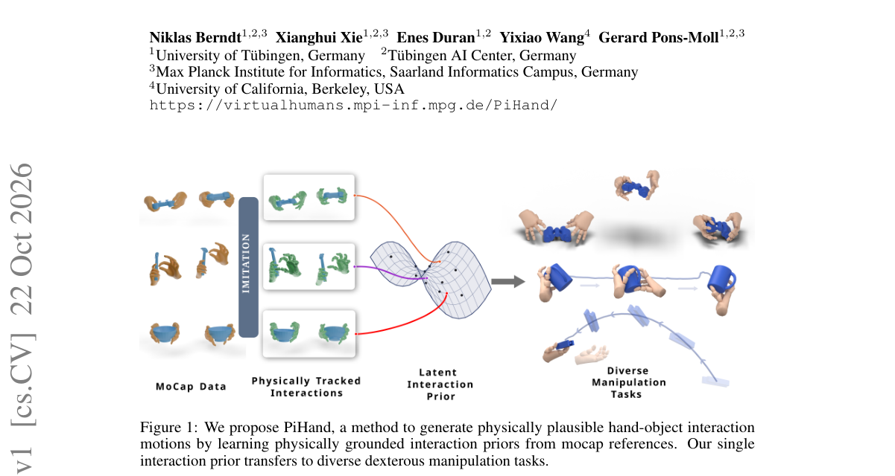

*Result - Method Overview. In Stage I we train expert policies that can track mocap hand-object interactions in a physically simulated environment. In Stage II we then distill the expert knowledge int*

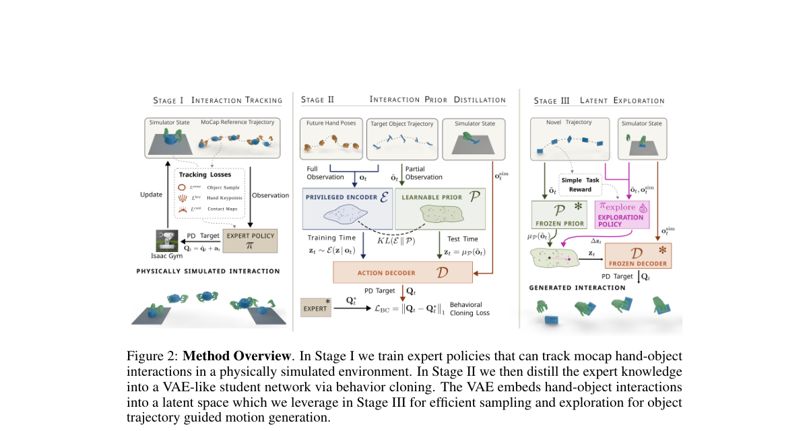

**Why this ranks #8**: 把手-物交互先蒸馏成一个「先验」，再用有界残差探索解任务：单一奖励、无需课程训练。

---

### 9. FastHarness: Experience-Driven Review Scheduling for Vision-Language-Action Policies

**arXiv**: [2610.31427](https://arxiv.org/abs/2610.31427) | **Score**: 8.0 (relevance 8.0 x 0.7 + quality 8.0 x 0.3) | **Tags**: embodied, VLA, agentic-robotics, adaptive-supervision, efficiency | **Categories**: cs.RO | **Pages**: 13

**Authors**: Tao Lin, Yuxin Du, Haoxiao Wang, Zile Zhong, Bo Zhao

**Affiliation**: Shanghai Jiao Tong University; Zhejiang University

**Abstract**

> Agentic robot systems combine language-model reasoning with robot policies to monitor execution and recover from failures. However, reviewing every action chunk incurs substantial overhead, even in familiar situations. We introduce FastHarness, an experience-driven execution harness that adaptively schedules GPT-6 Astra supervision of a π0.5 policy. A fast path uses stage memory and reviewed outcomes to reduce review frequency as experience accumulates, while a complementary recovery path focuses supervision on correcting errors. Once recovery is verified, routine execution resumes, with failure experience retained to guide future interventions. The policy remains frozen and generates fresh actions from current observations. Across four simulated manipulation tasks, reviewer token use decreases by an average of 57.2% per task from the first evaluated episode to the mean of the final five episodes. Mean episode time decreases from 85.5 to 52.0 minutes over the same interval. On the same tasks, mean success increases from 80% for GPT-as-Policy (π0.5 + GPT-6 Astra) to 97.19% with FastHarness. These results highlight adaptive supervision as a practical route to more efficient agentic robotics without additional model training.

**Key findings**

- **Finding**: 智能体机器人系统结合语言模型推理与机器人策略来监控执行、恢复失败；但**逐个动作块审查**代价高昂，哪怕在熟悉场景。
- **Finding**: FastHarness 是经验驱动的执行 harness，自适应调度对 **π0.5** 策略的 **GPT-6 Astra** 监督。
- **Finding**: **快路径**用阶段记忆与已审查结果，随着经验积累降低审查频率；**恢复路径**则把监督集中用于纠错。
- **Finding**: 一旦恢复被验证，常规执行恢复，失败经验被保留以指导未来干预。
- **Finding**: 策略保持**冻结**，始终从当前观测生成新动作。
- **Finding**: 在四个仿真操作任务上，审查者 token 用量从首个评测 episode 到最后五个 episode 均值**平均下降 57.2%**；平均 episode 时长从 **85.5 分钟降到 52.0 分钟**。
- **Finding**: 同任务上平均成功率从 GPT-as-Policy（π0.5 + GPT-6 Astra）的 **80% 提升到 97.19%**。
- **Inference**: 「既省 token 又涨成功率」通常矛盾，这里的关键是**审查频率自适应**——熟练区域少看，出错区域集中看。
- **Inference**: 策略冻结、完全靠外部调度优化，是很反直觉但很实用的架构选择：把智能放在流程而非模型里。
- **Recommendation**: 强烈推荐。做智能体机器人、LLM 监督机器人、或关心推理成本的人必读。

**Key figures**

*Framework - From VLA execution to experience-driven supervision. VLA-only execution generates actions from current observations. GPT-as-Policy adds GPT-6 Astra review at every action chunk. Using the sa*

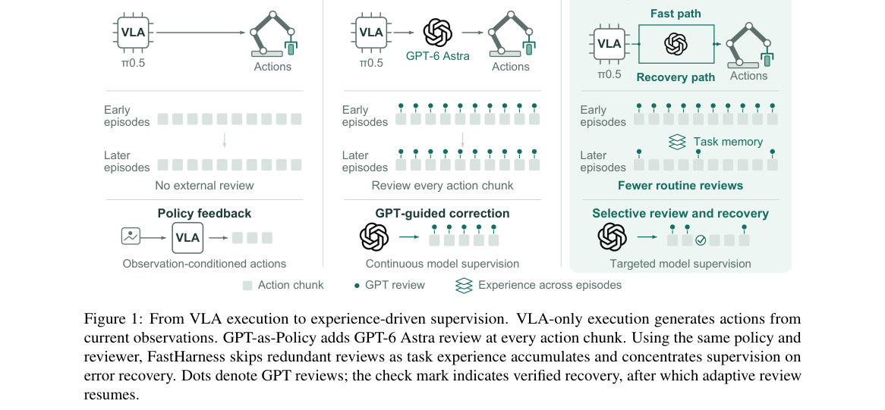

*Result - FastHarness adds two paths around the original GPT-as-Policy execution backbone (gray, middle). The experience-driven fast path (top) routes fresh VLA proposals through a memory-guided sched*

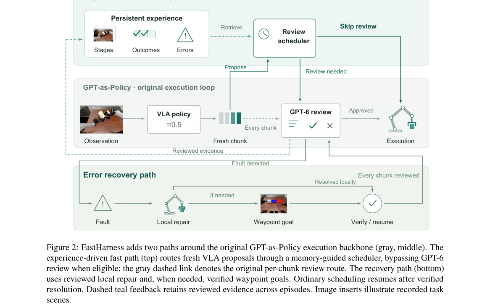

**Why this ranks #9**: 别每一步都叫大模型来盯：按经验自适应降低审查频率，审查 token 降 57.2%、成功率升到 97.19%。

---

### 10. SmolVLA-MoE: Sparse Mixture-of-Experts for Efficient Multi-Task Robotic Manipulation

**arXiv**: [2610.30732](https://arxiv.org/abs/2610.30732) | **Score**: 7.7 (relevance 8.0 x 0.7 + quality 7.0 x 0.3) | **Tags**: embodied, VLA, mixture-of-experts, edge-efficient, LIBERO | **Categories**: cs.CV | **Pages**: 16

**Authors**: Shiyang Zhang, Miao Yang, Zhengda Li, Yang Shao, Ruifang Zhai, Hui Peng, Peng Song

**Affiliation**: Huazhong Agricultural University

**Abstract**

> Vision-Language-Action (VLA) models have shown promising results in multi-task robotic manipulation by leveraging visual and language understanding for action generation. However, existing lightweight VLA models employ a single dense action expert to handle all tasks, which limits their multi-task capability under constrained computational budgets. To address this issue, we propose SmolVLA-MoE, a novel framework that introduces sparse Mixture-of-Experts (MoE) into the FFN layers of the action expert in VLA models. SmolVLA-MoE replaces dense FFN layers with multiple parallel expert FFNs and a token-level router, enabling each token to adaptively select the most suitable expert for action generation. We further introduce a shared expert with a tunable weight parameter to balance the inheritance of pre-trained capabilities and task-specific expert specialization. Through sparse activation, SmolVLA-MoE activates only a single expert FFN during inference, with a total activated parameter count of approximately 500M including the frozen VLM backbone, while benefiting from approximately 800M total stored parameters. We evaluate our method on four task suites of the LIBERO benchmark. SmolVLA-MoE achieves an average success rate of 84.25%, outperforming SmolVLA (82.75%) and OpenVLA-7B (76.5%), while maintaining comparable inference efficiency. Our code is publicly available at https://github.com/dudu435/smolvla-moe.

**Key findings**

- **Finding**: VLA 模型在多任务机器人操作中表现出色，但现有**轻量** VLA 用单一稠密动作专家处理所有任务，在受限算力下限制了多任务能力。
- **Finding**: SmolVLA-MoE 把**稀疏 MoE 引入动作专家的 FFN 层**。
- **Finding**: 用多个并行专家 FFN 替换稠密 FFN，并配一个 **token 级路由器**，让每个 token 自适应选择最合适的专家生成动作。
- **Finding**: 引入**共享专家**并配可调权重参数，用来平衡预训练能力的继承与任务专属专家的特化。
- **Finding**: 稀疏激活下推理时只激活单个专家 FFN，含冻结 VLM 骨干在内**激活参数约 500M**，而**总存储参数约 800M**。
- **Finding**: 在 LIBERO 的四个任务套件上平均成功率 **84.25%**，超过 SmolVLA（82.75%）与 OpenVLA-7B（76.5%），同时保持相当的推理效率。
- **Inference**: 「共享专家 + 任务专家」的双层结构是应对灾难性遗忘的常见做法，它让预训练能力的继承变成可调参数而非二选一。
- **Inference**: 500M 激活 / 800M 存储的比例，说明 MoE 的收益主要在推理成本而非参数量——这与「MoE 省显存不省算力」的常识一致。
- **Recommendation**: 推荐。做轻量 VLA、边缘部署、多任务操作的人应读。

**Key figures**

*Framework - Overview of the SmolVLA-MoE architecture. The frozen VLM backbone processes visual observations and language instructions to produce contextual representations. The action expert replaces dens*

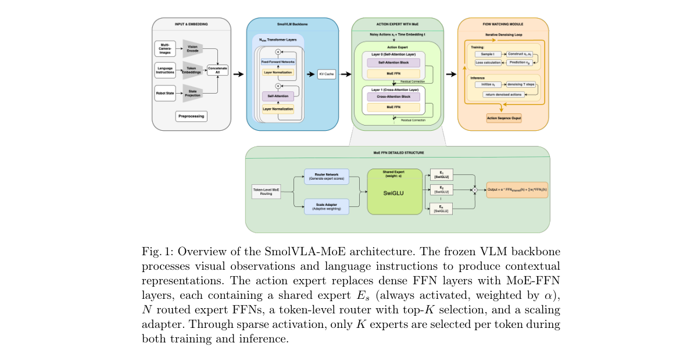

*Result - Detailed structure of the MoE-FFN layer. The input token is processed by both the shared expert and the top-K routed experts selected by the router. The scaling adapter provides additional per*

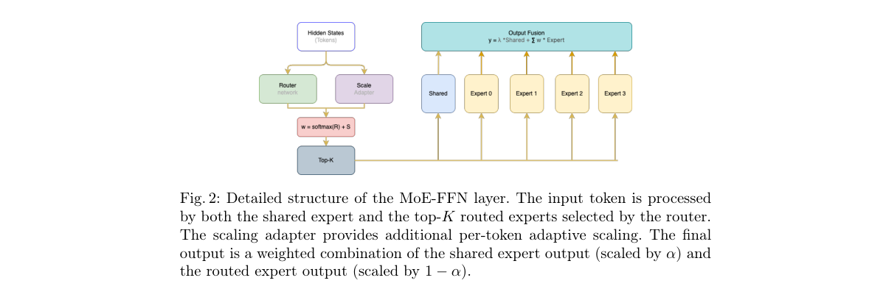

**Why this ranks #10**: 把稀疏 MoE 塞进 VLA 的动作专家 FFN：激活参数约 500M、存储 800M，LIBERO 平均 84.25%。

---

## Footer

- Total papers scanned across all 7 tracks: 535（原始 705 条）
- embodied track final top-10: 10
- Wild-cards in this track: 0
- Figure assets: 2026-10-23/res/

Generated by `mine-arxiv-daily-digest` skill. Sister file: `2026-10-23_embodied_entry.md`.
