# ArXiv Daily Digest - 2026-10-23 (生成式内容模型的 RL, 10 papers)

**Generated**: 2026-10-23 17:00 CST

**Source**: arXiv cs.CV, cs.SD, eess.AS, cs.CL, cs.AI, cs.RO, cs.LG submissions, listing day 2026-10-22 (announced 2026-10-23 00:00 UTC)

**Batch window**: 2026-10-21T18:00:00Z .. 2026-10-22T18:00:00Z（arXiv 公告批次横跨两个 UTC 日：前一日 18:00 UTC 起算，当日 17:59:59 UTC 截止）

**Track**: rl_aigc (top 10 of 535 papers scanned, 107 full reads)

**Scope**: 扩散 / 流匹配模型的 RL 与偏好优化、生成式奖励模型、best-of-N 与测试时搜索

⚠️ **Wild-card**: 本批该线 3 篇为 wild-card 补足，已在正文逐条标注并给出理由。

---

## Top 10 - 生成式内容模型的 RL

### 1. Scaling Laws for Generative Reward Models

**arXiv**: [2610.30765](https://arxiv.org/abs/2610.30765) | **Score**: 9.0 (relevance 9.0 x 0.7 + quality 9.0 x 0.3) | **Tags**: rl-aigc, reward-model, GRPO, online-DPO, scaling-law | **Categories**: cs.AI | **Pages**: 28

**Authors**: Angel Raychev, Nathan Lile, Rafael Rafailov

**Affiliation**: Stanford University

**Abstract**

> We study generative reward models (GenRMs) as online preference providers for policy optimization in creative writing. Across Qwen3 reward-model sizes from 0.6B to 14B, Thinking judges trained with GRPO have higher static Gold-label accuracy than Answer-Only judges trained with SFT. This ranking often reverses when the judges train policies through online DPO: Answer-Only rewarders yield higher peak and top-five-average policy Elo in seven of eight matched settings under a fixed, learned 32B Gold evaluator. Intermediate Thinking-judge checkpoints can also outperform later, more statically accurate checkpoints as rewarders. Sweeps over rewarder size, policy size, training duration and DPO regularization show substantial benefits from reward-model capacity, including judges larger than the policy. We analyze trajectories with evaluator-specific Elo arenas, conditional match-resampling intervals and descriptive scaling fits. These results demonstrate an evaluator-rewarder gap in the studied pipelines: fixed-distribution judging accuracy does not determine downstream optimization quality. The comparison changes judge-training objective as well as response format, and the main ranking is conditional on its learned reference rather than a universal human-quality result. A limited follow-up using a different learned judge is inconclusive overall.

**Key findings**

- **Finding**: 论文研究**生成式奖励模型（GenRM）**作为创意写作中策略优化的在线偏好提供者。
- **Finding**: 在 Qwen3 奖励模型从 0.6B 到 14B 的规模上，用 **GRPO** 训练的 **Thinking 裁判**比用 SFT 训练的 **Answer-Only 裁判**静态 Gold 标签准确率更高。
- **Finding**: 但这个排序在裁判通过**在线 DPO 训练策略时经常反转**：在固定的学习型 32B Gold 评测器下，Answer-Only 奖励器在 **8 组匹配设定中的 7 组**给出更高的峰值与前五平均策略 Elo。
- **Finding**: **中间的 Thinking 裁判 checkpoint** 作为奖励器时也能胜过更晚、静态准确率更高的 checkpoint。
- **Finding**: 对奖励器规模、策略规模、训练时长与 DPO 正则化做的扫描显示，奖励模型容量有显著收益，**包括裁判比策略更大**的情形。
- **Finding**: 作者用评测器专属 Elo 竞技场、条件匹配重采样区间与描述性缩放拟合来分析轨迹。
- **Finding**: 核心结论：存在**评测者-奖励者鸿沟**——固定分布上的判断准确率**并不决定**下游优化质量。
- **Finding**: 作者同时限定：该比较同时改变了裁判的训练目标与响应格式，主要排序依赖于其学习到的参照，而非普适的人类质量结论；换一个学习到的裁判的有限后续验证整体上是不确定的。
- **Inference**: 「GRPO 训的裁判更准，但在线 DPO 里更差」是本批最反直觉的一个结果——它说明静态评测指标在在线偏好优化场景里可能方向都是反的。
- **Inference**: 「裁判比策略更大更好」把奖励模型从「辅助模块」抬升成了需要独立扩展的核心资产，这个结论对做 RLHF 基础设施的人最有价值。
- **Recommendation**: 强烈推荐。做奖励模型、GRPO / DPO 训练、评测器设计的人必读。

**Key figures**

*Framework - Static evaluator accuracy on the Gold Preference dataset. Thinking GenRMs exceed Answer-Only models across the studied sizes, while both trained variants substantially exceed off-the-shelf b*

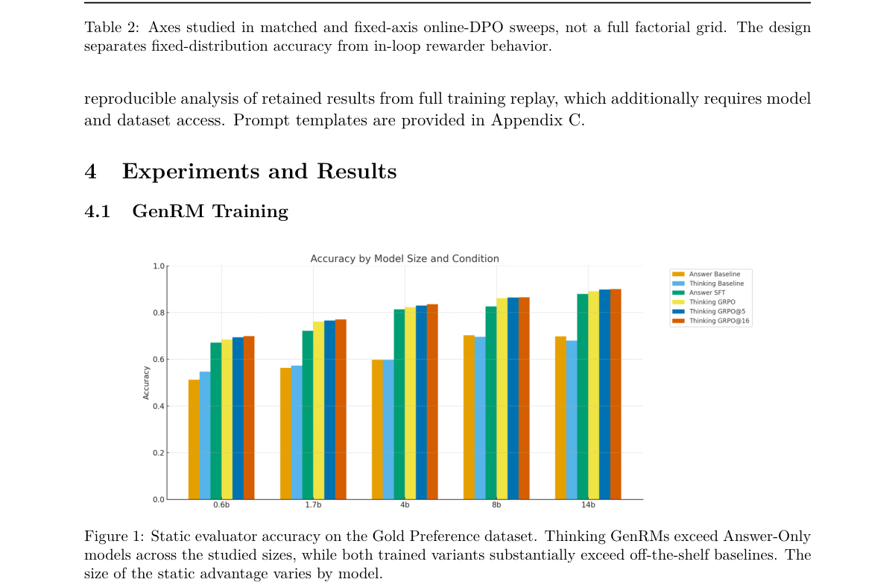

*Result - Trained versus off-the-shelf 4B rewarders training a 4B policy. Points are recorded snapshots connected in policy-training order; squares/circles mark first/last observations, not maxima. Go*

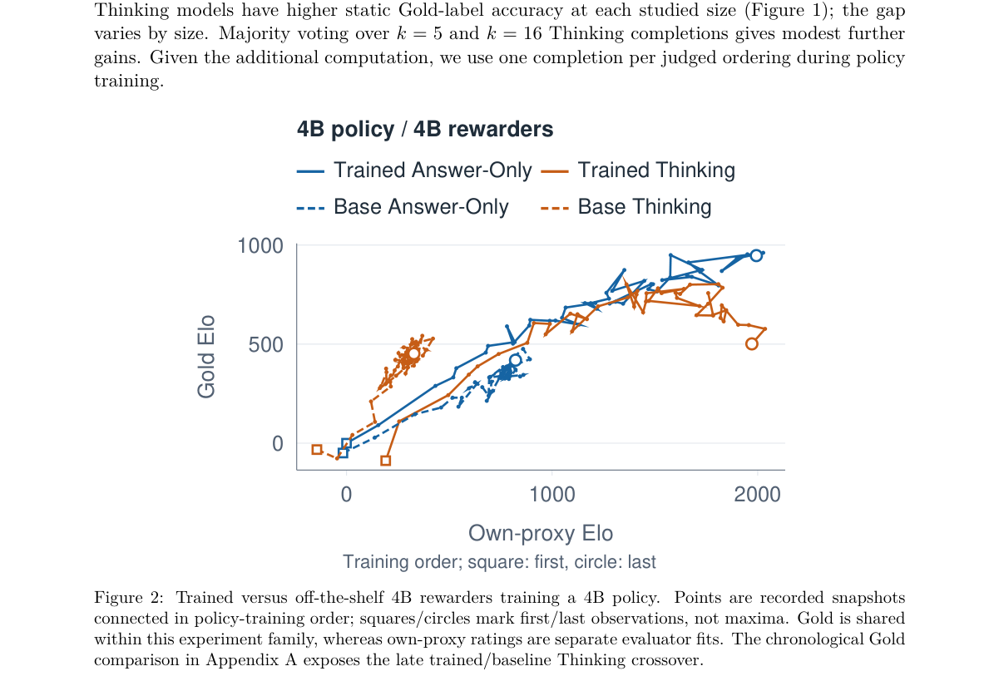

**Why this ranks #1**: 奖励模型越准≠下游越好：本批最锋利的一个「评测者-奖励者鸿沟」证据。

---

### 2. UniVOE: A Removal-Driven Framework for Interaction-Aware Universal Video Object Editing

**arXiv**: [2610.31641](https://arxiv.org/abs/2610.31641) | **Score**: 8.7 (relevance 9.0 x 0.7 + quality 8.0 x 0.3) | **Tags**: rl-aigc, video-editing, reward-model, preference-alignment, object-injection | **Categories**: cs.CV | **Pages**: 14

**Authors**: Shuzhou Yang, Lanqing Guo, Lingen Li, Weiqi Li, Zhao Zhong, Liefeng Bo, Jian Zhang

**Affiliation**: Peking University; Tencent Hunyuan; The Chinese University of Hong Kong

**Abstract**

> Video object removal and injection are reciprocal editing operations between object-present and object-absent video states, yet they differ substantially in training difficulty. Removal can be effectively bootstrapped from video inpainting and further adapted to erase object-related interaction effects. Injection, however, requires large-scale paired supervision to model object appearance, dynamics, and scene-dependent effects, while perfectly aligned real-world pairs are difficult to collect and synthetic data lacks sufficient realism and diversity. To address this challenge, we present UniVOE, a removal-driven framework for training both video object removal and injection models. We first train an effect-aware remover by transferring video inpainting priors and finetuning on object-present/object-absent pairs. The trained remover converts real object-present videos into object-absent counterparts, creating large-scale paired supervision for injection. An injection model is trained on these pairs in the reverse direction to recover objects together with their dynamics and interaction effects. Moreover, since pixel-level reconstruction alone cannot adequately capture perceptual realism, we introduce a reward-based post-training method that aligns injection results with human preferences using a proprietary reward model. Experiments against strong open-source and commercial systems demonstrate that UniVOE achieves state-of-the-art performance on both object removal and injection, particularly in challenging interaction-effect cases.

**Key findings**

- **Finding**: 视频物体移除与注入是**互为相反**的编辑操作，但训练难度差别很大。
- **Finding**: 移除可从视频 inpainting 有效自举，再适配以擦除与物体相关的交互效应；**注入**则需要大规模配对监督来建模物体外观、动态与场景相关效应，而完美对齐的真实世界配对难以收集，合成数据又缺乏真实感与多样性。
- **Finding**: UniVOE 是**移除驱动**的框架来同时训练移除与注入模型。
- **Finding**: 先训练**效应感知的移除器**：迁移视频 inpainting 先验，在「有物体 / 无物体」配对上微调。
- **Finding**: 训练好的移除器把真实的有物体视频转成无物体对应物，从而为注入制造**大规模配对监督**；注入模型在这些配对上反向训练，恢复物体及其动态与交互效应。
- **Finding**: 关键补充：由于像素级重建不足以刻画感知真实感，作者引入**基于奖励的后训练方法**，用**专有奖励模型**把注入结果与人类偏好对齐。
- **Finding**: 对比强开源与商业系统，UniVOE 在移除与注入上都达到 SOTA，在交互效应这种困难情形下尤为明显。
- **Inference**: 「用易得的移除任务造出难得的注入配对」是本篇最聪明的工程点——它把数据瓶颈转成了任务对称性。
- **Inference**: 用专有奖励模型做后训练也说明：在视频生成上，感知真实感的最后一段差距目前仍靠偏好对齐而非结构改进来补。
- **Recommendation**: 强烈推荐。做视频编辑、生成模型后训练、奖励模型落地的人必读。

**Key figures**

*Framework - We propose UniVOE, a video object editing pipeline that enables object-centered removal and injection, together with predictions of changes in object-related effects. Such as footprint, shad*

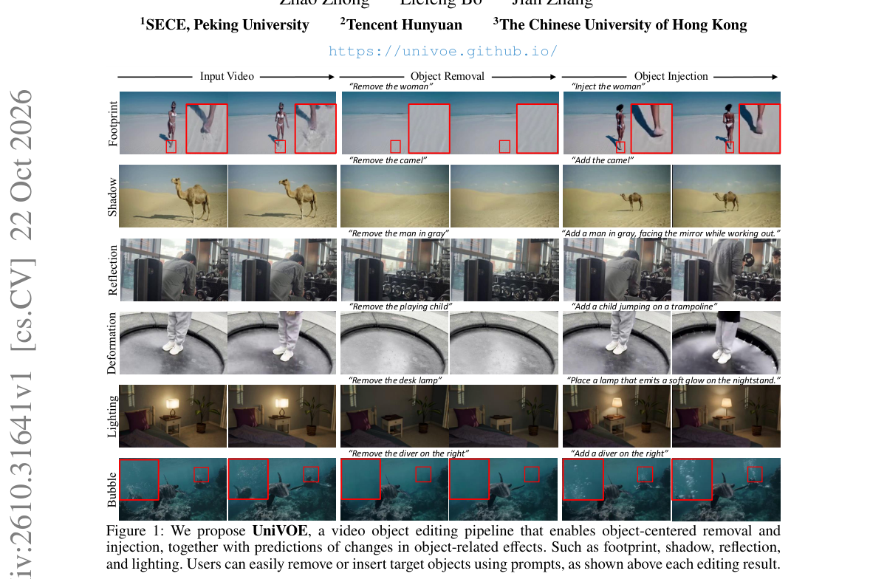

*Result - UniVOE uses removal to scale paired video data up, drives the training of injection.*

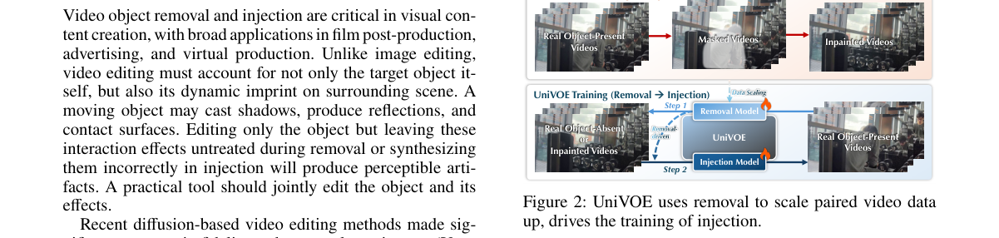

**Why this ranks #2**: 视频物体注入的关键缺口：像素重建不足以刻画感知真实感，于是用奖励模型做后训练。

---

### 3. Where Do Long Captions Fail? Position-Aware Diagnosis and Reinforcement Learning for Detailed Image Captioning

**arXiv**: [2610.31111](https://arxiv.org/abs/2610.31111) | **Score**: 8.3 (relevance 8.0 x 0.7 + quality 9.0 x 0.3) | **Tags**: rl-aigc, GRPO, VLM-captioning, position-aware, rubric | **Categories**: cs.CV | **Pages**: 38

**Authors**: Yuanze Hu, Zhichao Yang, Junwei Jing, Xin Yang, Wenxuan Liu, Tinghai Zhang, Jia Fu, Hongzhi Zhang, Xiangyu Wu, Ruiming Tang, Tingting Gao, Han Li

**Affiliation**: Beihang University; Kuaishou Technology; Fudan University; Zhejiang University

**Abstract**

> Detailed image captioning is usually framed as an amount problem: a model should mention more visual facts while avoiding hallucination. However, autoregressive VLMs generate captions as ordered sequences, and later generations may be produced under weaker or noisier visual grounding. We therefore argue that long-form captioning should be studied not only by what facts are mentioned, but also by where they appear. We introduce a position-aware rubric representation that decomposes dense human references into atomic visual claims, verifies generated captions against those claims, and induces a quartile-wise composition of supported, hallucinated, and generic content. This lens reveals two qualitatively different failures in long captions: models tend to produce unsupported specificity in the middle, while the final portion often escapes into vague, non-evidential language rather than simply accumulating more hallucination. A same-reference human control does not exhibit these patterns; additional human audits examine the visual validity of the induced labels. Motivated by this diagnosis, we propose PAGER (Position-Aware Grounded Evidence Reinforcement), a GRPO training objective with separate signals for supported fine-grained middle evidence, evidence-bearing tail continuation, claim coverage, and content-aware length control. The result is a closed loop: the same ordered claim representation identifies where long captions fail and supplies the position-specific reward needed to repair those failures. Experiments on detailed-caption benchmarks show that PAGER improves position-wise grounding and pairwise caption preference while preserving competitive global caption quality.

**Key findings**

- **Finding**: 详细图像描述通常被当作**数量问题**：模型应提到更多视觉事实同时避免幻觉。
- **Finding**: 但自回归 VLM 按序生成字幕，后段生成可能建立在**更弱或更有噪声的视觉锚定**上。
- **Finding**: 作者主张长字幕研究不应只看「提到了什么」，还要看「**出现在哪里**」。
- **Finding**: 提出**位置感知 rubric 表示**：把密集人工参考分解为原子视觉断言，核验生成字幕与之对应，并归纳出按四分位组织的「被支持 / 幻觉 / 泛化」内容构成。
- **Finding**: 该视角揭示两类**定性不同**的失败：模型倾向在**中段产生无支持的具体性**，而**尾段**常滑向含糊、无证据的语言，而非简单地累积更多幻觉。
- **Finding**: **同参考的人类对照不呈现这些模式**；额外的人工审计检查了诱导标签的视觉有效性。
- **Finding**: 据此提出 **PAGER**（Position-Aware Grounded Evidence Reinforcement）：一个 GRPO 训练目标，对「中段被支持的细粒度证据」「带证据的尾部续写」「断言覆盖度」「内容感知的长度控制」分别给信号。
- **Finding**: 形成闭环：同一个有序断言表示既定位长字幕在哪里失败，又提供修复这些失败所需的位置特定奖励。
- **Finding**: 在详细字幕基准上，PAGER 改善了位置级锚定与成对字幕偏好，同时保持有竞争力的整体字幕质量。
- **Inference**: 「中段假具体、尾段假含糊」这个细分失败模式很具体——它意味着通用的「幻觉惩罚」在长文本上粒度太粗。
- **Inference**: 用同一套断言表示既做诊断又做奖励（闭环），比先诊断再另建一套奖励要省，也更容易泛化。
- **Recommendation**: 强烈推荐。做 VLM RL、图像描述、长文本生成奖励设计的人必读。

**Key figures**

*Framework - Position-dependent failures in detailed captioning. Top: hallucination rate Hq and generic rate Gq across caption quartiles. Six colored lines are evaluated captioners; the dashed human line*

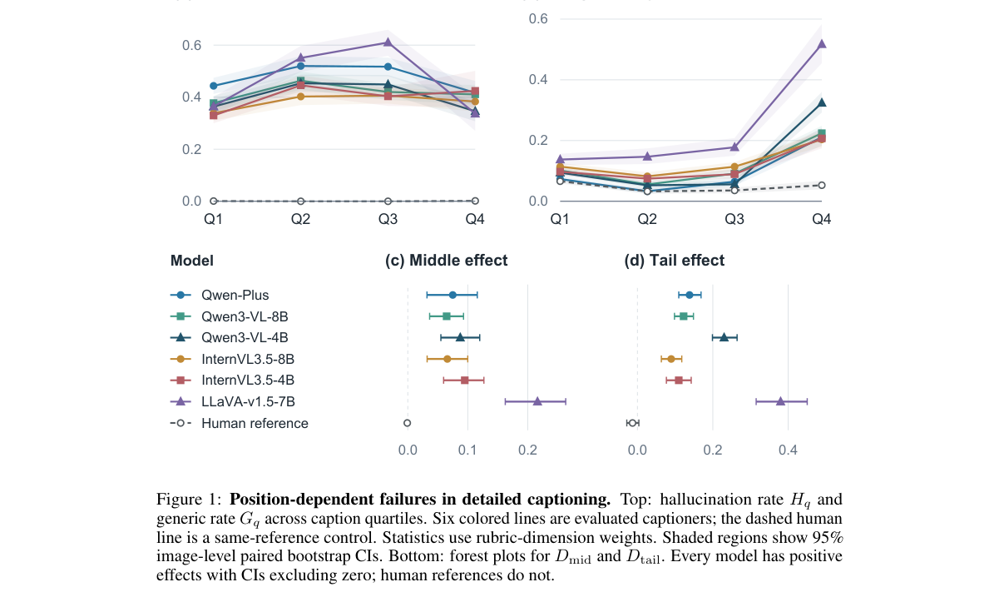

*Result - PAGER training pipeline. Reference-derived rubrics and generated captions provide claim judgments and sentence positions. Four reward terms guide GRPO; the tail term uses a separate sentence*

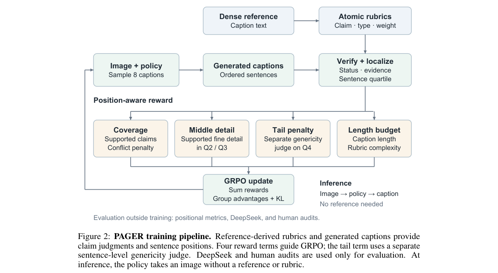

**Why this ranks #3**: 长字幕的问题不是「说少了」而是「在哪里说错了」：PAGER 用位置感知奖励分别修中段与尾段。

---

### 4. HimmBO: High-Dimensional Interactive Model-Merging Bayesian Optimization for Image Generation

**arXiv**: [2610.30875](https://arxiv.org/abs/2610.30875) | **Score**: 8.3 (relevance 8.0 x 0.7 + quality 9.0 x 0.3) | **Tags**: rl-aigc, bayesian-optimization, adapter-merging, preference-driven, T2I | **Categories**: cs.CV | **Pages**: 21

**Authors**: Jinyuan Mao, Zhihao Shen, Chenxi Liu

**Affiliation**: Zhejiang University

**Abstract**

> Fine-tuning has become a common way to customize text-to-image models, leading to community collections of over 100K lightweight adapters. Adapters sharing a base model can be merged with continuous coefficients. This turns a large collection into a high-dimensional continuous design space, which recent work explores interactively using preferential Bayesian optimization (PBO). However, existing approaches are limited to a few dozen preselected adapters and require expensive image generation in every interaction round. We introduce HimmBO, a two-stage method that scales preference-driven adapter merging to much larger collections while reducing image-generation cost. Its screening stage recovers the active adapter set through level-set estimation over pre-generated images, requiring no image generation. The refinement stage then optimizes merge coefficients in the recovered low-dimensional subspace. Both stages use a style-aware kernel, allowing preference information to transfer between visually similar adapters. In simulated-user image-matching experiments, HimmBO achieves higher final similarity than all comparisons while reaching a given similarity with under one tenth of the image generations required by prior work. Its performance remains stable as the collection grows to 1080 adapters, while competing methods degrade substantially.

**Key findings**

- **Finding**: 微调已成为定制 text-to-image 模型的常用方式，催生了社区中**超过 10 万个**轻量适配器。
- **Finding**: 共享基座的适配器可用连续系数合并，这就把庞大的集合变成一个**高维连续设计空间**，近期工作用**偏好贝叶斯优化（PBO）**交互式地探索它。
- **Finding**: 但现有方法局限于**几十个预选适配器**，且每一轮交互都要付出昂贵的图像生成。
- **Finding**: HimmBO 是两阶段方法，把偏好驱动的适配器合并扩展到更大的集合，同时降低图像生成成本。
- **Finding**: **筛选阶段**通过在**预生成图像**上做水平集估计，恢复活跃适配器集合，**完全不需要图像生成**。
- **Finding**: **精修阶段**在恢复出的低维子空间中优化合并系数。
- **Finding**: 两个阶段都用**风格感知核**，使偏好信息能在视觉上相似的适配器之间迁移。
- **Finding**: 在模拟用户图像匹配实验中，HimmBO 的最终相似度高于所有对比方法，且达到给定相似度所需的图像生成**不到此前方法的十分之一**。
- **Finding**: 集合扩大到 **1080 个适配器**时性能保持稳定，而对比方法显著退化。
- **Inference**: 「用预生成图像做水平集估计来筛活跃集合」是关键一招：它把筛选阶段从「昂贵交互」变成「离线计算」，这才是能扩到 10 万量级的原因。
- **Inference**: 风格感知核让偏好信息在相似适配器间迁移——这实际上是在用「风格相似性」做一种隐式的偏好聚类。
- **Recommendation**: 推荐。做模型合并、偏好优化、贝叶斯优化的人应读。

**Key figures**

*Framework - HimmBO lets a user explore merges of a whole adapter library (N=1080 here) through preference feedback. Screening narrows the library to a small set of promising adapters using only precompu*

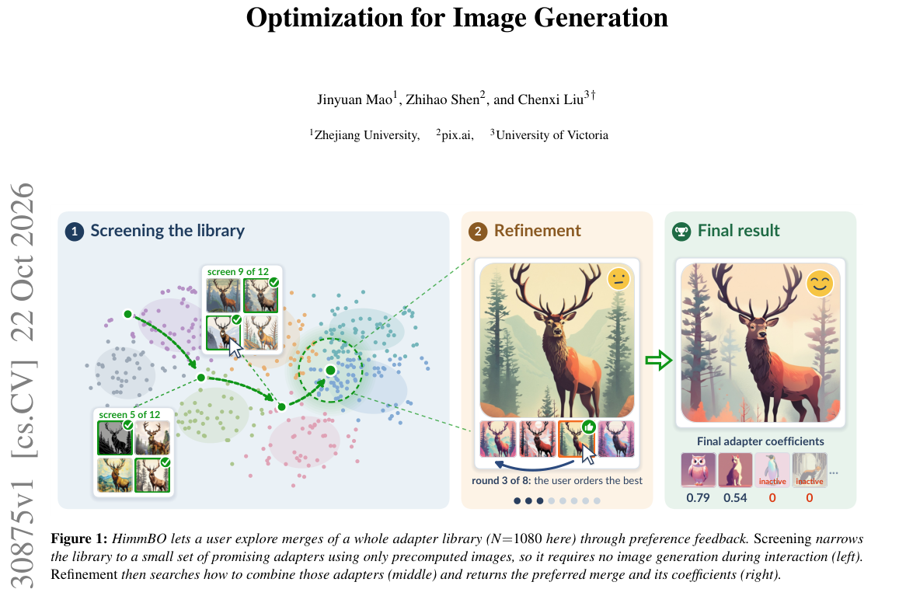

*Result - Both the selected adapters and coefficients determine the appearance of the merged image. Each row shows two adapters used separately (left, middle) and a merge of the two (right).*

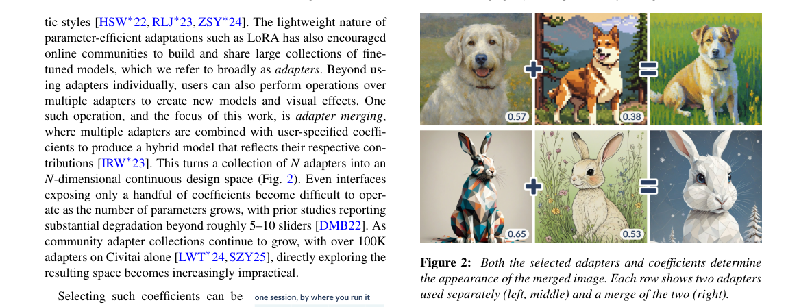

**Why this ranks #4**: 10 万个 T2I 适配器怎么合并？用两阶段偏好贝叶斯优化把「选哪些」与「怎么合」拆开。

---

### 5. Building Presentation Intelligence for High-Quality Slide Generation

**arXiv**: [2610.30888](https://arxiv.org/abs/2610.30888) | **Score**: 8.3 (relevance 8.0 x 0.7 + quality 9.0 x 0.3) | **Tags**: rl-aigc, GRPO, verifiable-reward, aesthetic-metrics, slide-generation | **Categories**: cs.LG | **Pages**: 28

**Authors**: Yuhang Xie, Cheng Li, Chenliang Li, Mingyu Xu, Mingwei Sun, Suhang Zheng, Ming Yan, Xiaoxiao Xu, Lin Qu

**Affiliation**: Peking University; Alibaba Group

**Abstract**

> PowerPoint presentations (PPTs) are a dominant medium for communication across diverse domains, yet high-quality PPT generation still depends heavily on labor-intensive human effort. Recent advances in large language models (LLMs) for agentic tasks have created both new opportunities and challenges (Chen et al., 2026) for automatic PPT generation. In this work, we present a unified training framework for automatic PPT generation toward presentation intelligence, integrating cross-validated data synthesis, guided teacher enhancement, and verifiable reward optimization. We first construct a cross-validated pipeline for data synthesis, with explicit control over both difficulty and validity. We then develop a teacher-enhancement framework grounded in rules and prior knowledge to substantially strengthen the instructional capacity of teacher models. Building on this, we further improve supervised fine-tuning (SFT) through a mixed-teacher strategy and a lightweight outcome-driven trajectory filtering method. Finally, based on the resulting SFT models, we introduce a suite of verifiable aesthetic metrics together with a GRPO-based reinforcement learning framework to optimize slide-level visual attributes beyond text-only supervision. Experiments show that our enhanced SFT pipeline improves Qwen-3.6-27B and Qwen-3.6-35B-A3B by 7.45 and 9.35 points on PresentBench, respectively, surpassing GLM-5.2 while maintaining strong generalization. Reinforcement learning further improves performance across five aesthetic dimensions, compensating for the limitations of SFT in visual refinement. Overall, the results demonstrate the effectiveness of our framework for high-quality PPT generation.

**Key findings**

- **Finding**: PPT 是各领域的主导沟通媒介，但高质量 PPT 生成仍重度依赖人工。
- **Finding**: 论文提出面向「演示智能」的统一训练框架，融合**交叉验证的数据合成**、**引导的教师增强**与**可验证奖励优化**。
- **Finding**: 第一步是带难度与有效性显式控制的交叉验证数据合成流水线。
- **Finding**: 第二步是建立在规则与先验知识之上的**教师增强框架**，显著强化教师模型的教学能力。
- **Finding**: 第三步通过**混合教师策略**与轻量的**结果驱动轨迹过滤**改进 SFT。
- **Finding**: 最后基于 SFT 模型，引入一套**可验证的美学指标**与 **GRPO 强化学习框架**，以超越纯文本监督优化幻灯片级的视觉属性。
- **Finding**: 增强后的 SFT 流水线把 Qwen-3.6-27B 与 Qwen-3.6-35B-A3B 在 PresentBench 上分别提升 **7.45** 与 **9.35** 分，超过 GLM-5.2，并保持强泛化。
- **Finding**: **强化学习在五个美学维度上进一步提升表现，弥补了 SFT 在视觉精修上的局限**。
- **Inference**: 「可验证美学指标」是这篇最值钱的部分：它把主观的「好看」转成可自动计算的量，从而让 RL 有了非文本奖励可优化。
- **Inference**: SFT 与 RL 分工清晰（内容 vs 视觉精修）的分工设计很干净——这正是 GRPO 相对纯 SFT 的典型增益来源。
- **Recommendation**: 推荐。做生成式内容的 RL 与可验证奖励设计、或做文档 / 幻灯片生成的人应读。

**Key figures**

*Framework - Overview of the proposed presentation generation pipeline.*

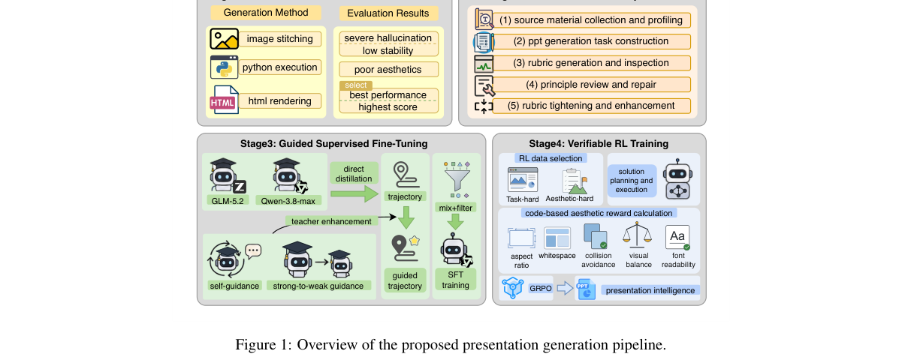

*Result - Case studies of slides generated before and after SFT. From left to right: Cases 1–3.*

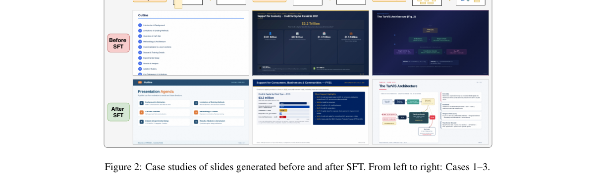

**Why this ranks #5**: 「好看」终于能被验证了：一套可验证的版面美学指标 + GRPO，把 PPT 生成的视觉质量拉出 SFT 的天花板。

---

### 6. To Route or to Adapt? Multi-Expert Diffusion Planners in Unseen Regions

**arXiv**: [2610.31095](https://arxiv.org/abs/2610.31095) | **Score**: 8.3 (relevance 8.0 x 0.7 + quality 9.0 x 0.3) | **Tags**: rl-aigc, diffusion-RL, test-time-routing, reward-based-finetuning, autonomous-driving | **Categories**: cs.RO | **Pages**: 36

**Authors**: Yun Li, Ehsan Javanmardi, Simon Thompson, Jiachen Gong, Qunli Zhang, Zifan Zeng, Shiming Liu, Peng Wang, Yidu Zhang, Manabu Tsukada

**Affiliation**: The University of Tokyo; TIER IV; Huawei

**Abstract**

> Diffusion trajectory planners with domain-specific experts face a practical question in unseen regions: can they rely on selecting among existing experts, or must the planner itself adapt? We study this question using a planner with a shared adapter and per-domain expert adapters. Across three real-world held-out maps, none of eight test-time routing schemes improves the fleet-mean lateral offset over the static default, which uses the same expert for every scene. Even an oracle that selects the best expert for each scene reduces the mean offset by only 0.9 m. In contrast, reward-based fine-tuning on just 20 target-region scenes yields substantially larger gains. On matched evaluation slices, joint replay achieves a fleet-mean offset of 6.9 m, compared with 12.4 m for the static default. Comparisons under the same target-region training budget show that target-region training drives the improvement, while replaying training scenes limits forgetting on the original ODDs. On nuPlan, fine-tuning across training cities also improves open-loop offsets, although closed-loop performance deteriorates. Further diagnostics reveal that two test-time adaptation baselines achieve low offsets by producing degenerate trajectories. These results show the limited headroom for selecting among existing experts and the greater open-loop gains available from adapting the planner.

**Key findings**

- **Finding**: 带领域专属专家的扩散轨迹规划器在未见区域面临一个实际选择：**是依赖在已有专家中挑选，还是让规划器自己适配**。
- **Finding**: 在三个真实留出地图上，**八种测试时路由方案没有一种**能改善相对静态默认方案的车队平均横向偏移。
- **Finding**: 即使有一个**逐场景挑选最优专家的 oracle**，也只把平均偏移减少 **0.9 m**。
- **Finding**: 相比之下，仅在 **20 个目标区域场景**上做**基于奖励的微调**，带来的增益大得多。
- **Finding**: 在匹配的评测切片上，**联合回放**达到车队平均偏移 **6.9 m**，而静态默认为 **12.4 m**。
- **Finding**: 在相同目标区域训练预算下对比表明：**目标区域训练是增益来源**，而回放训练场景只是限制了原始 ODD 上的遗忘。
- **Finding**: 在 nuPlan 上，跨训练城市微调也改善开环偏移，但**闭环性能反而恶化**。
- **Finding**: 进一步诊断显示，两个测试时自适应基线之所以取得低偏移，是因为产生了**退化轨迹**。
- **Inference**: 「路由 vs 适配」的对比做得很干净：oracle 都只赢 0.9 m，而 20 个场景的奖励微调把偏移砍掉近一半。
- **Inference**: 「低偏移可能来自退化轨迹」这个诊断提醒我们：单一指标下降在生成/规划系统里必须配行为合理性检查。
- **Recommendation**: 强烈推荐。做扩散策略 RL、测试时适配、规划器微调的人必读。

**Key figures**

*Framework - Method overview aligned with the Autoware E2E Generator–Selector reference archi- tecture [3]. The Generator (the adapter stack) emits K=4 candidate trajectories, and the Selector chooses on*

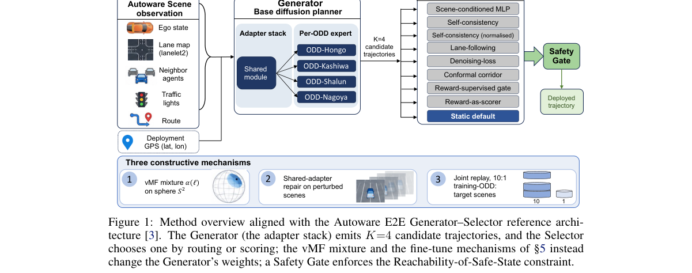

*Result - Three constructive mechanisms. (A) vMF mixture: experts weighted by distance to the deployment location (§5.1). (B) Shared-adapter repair: only the shared module is fine-tuned, on perturbed*

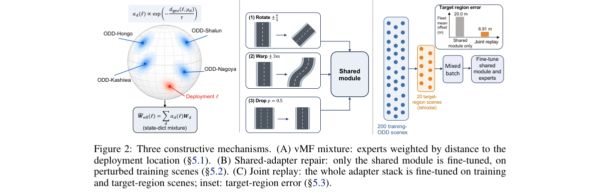

**Why this ranks #6**: 在未见区域该挑专家还是该自己适配？答案是后者——奖励微调 20 个场景就远超任何测试时路由。

---

### 7. Beyond Best-of-$k$: Prior-Consistent DAPS for Ambiguous Nonlinear Inverse Problems

**arXiv**: [2610.31592](https://arxiv.org/abs/2610.31592) | **Score**: 8.0 (relevance 8.0 x 0.7 + quality 8.0 x 0.3) | **Tags**: rl-aigc, diffusion, best-of-k, candidate-selection, inverse-problems | **Categories**: cs.CV, cs.LG | **Pages**: 25

**Authors**: Merve Kocabas, Benjamin A. Burns, Andreas Geiger, Kent Gauen, Sara Fridovich-Keil

**Affiliation**: Max Planck Institute for Intelligent Systems; Georgia Institute of Technology; ELLIS Institute

**Abstract**

> Diffusion models have become strong priors for solving inverse problems. However, nonlinear inverse problems such as phase retrieval remain challenging when multiple measurement-consistent solutions are distinguishable only by the prior; we call such measurements ambiguous. Existing diffusion-based samplers rely on local approximations during reconstruction. For an ambiguous measurement, these approximations can allow measurement guidance to favor a measurement-consistent mode that is close to a prior-supported mode but is itself not supported by the prior. Evaluation often masks this type of failure by reporting the best-of-$k$ runs, where the best is selected by comparison to the ground truth. We introduce Prior-Consistent DAPS (PC-DAPS), a variant of Decoupled Annealing Posterior Sampling (DAPS) designed to address this failure case by maintaining multiple candidate solutions within a single sampling run. As annealing noise decreases, PC-DAPS prunes and replaces weaker candidates according to their prior consistency, without any ground-truth access. PC-DAPS reduces the incidence of prior-inconsistent samples and improves sample quality on nonlinear inverse problems while preserving sample quality and diversity on linear inverse problems.

**Key findings**

- **Finding**: 扩散模型已成为求解逆问题的强先验，但**非线性**逆问题（如相位恢复）仍难——当多个测量一致的解只能靠先验区分时，这类测量被称为**歧义**。
- **Finding**: 现有扩散采样器依赖重建中的局部近似；对歧义测量，这会让测量引导偏向一个「靠近先验支持模态、但本身不被先验支持」的测量一致模态。
- **Finding**: 论文指出：**评测往往掩盖这类失败**——报告的是 best-of-k 的运行结果，而「最好」是拿真值比较选出来的。
- **Finding**: **PC-DAPS** 是 DAPS（解耦退火后验采样）的变体，在**单次采样运行内维护多个候选解**。
- **Finding**: 随退火噪声降低，PC-DAPS 按**先验一致性**剪枝并替换较弱的候选，**全程不需要真值访问**。
- **Finding**: PC-DAPS 降低了先验不一致样本的出现率并改善非线性逆问题上的样本质量，同时在**线性**逆问题上保持样本质量与多样性。
- **Inference**: 「best-of-k 需要真值才能选」这一点是全文的靶心：它说明以 best-of-k 报告的所有生成结果，其数字都包含一层事后挑选的乐观偏差。
- **Inference**: 「单次采样内维护多候选并按先验剪枝」本质是把 best-of-N 从离线评测搬进在线推理，代价是计算量上升。
- **Recommendation**: 强烈推荐。做扩散采样、生成评测方法学、或者报告过 best-of-k 数字的人必读。

**Key figures**

*Framework - Measurement consistency is not sufficient for reconstruction. A single Fourier mag- nitude measurement is shared by rotations, translations, and color-channel inversions of an image. Existin*

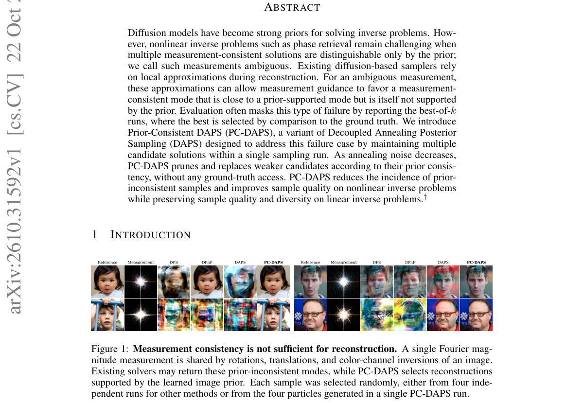

**Why this ranks #7**: 「报告 best-of-k」本身就是一种掩盖失败：PC-DAPS 在单次采样内维护多个候选并按先验一致性剪枝。

---

### 8. ParaLin++: Accelerating Parallel Diffusion Integrator via Intrinsic Partially Linear Structure

⚠️ **[wild-card=yes]** — 本批「RL for 生成模型」真实命中仅 7 篇（低于配额 3 篇）；该文是扩散 / 流匹配的训练无关采样加速器，并在 GenEval / DPG-Bench 等生成质量基准上重审了「少步即无损」的通行结论，属于同一生成模型方法族。

**arXiv**: [2610.30704](https://arxiv.org/abs/2610.30704) | **Score**: 7.3 (relevance 7.0 x 0.7 + quality 8.0 x 0.3) | **Tags**: rl-aigc, WILD, diffusion-sampler, flow-matching, benchmark-audit | **Categories**: cs.CV | **Pages**: 16

**Authors**: Jianrong Lu, Zhiyu Zhu, Hui Liu, Junhui Hou

**Affiliation**: City University of Hong Kong (Dongguan); Saint Francis University

**Abstract**

> Training-free few-step samplers are often described as nearly quality-lossless under conventional FID/CLIP-style evaluation. It remains unclear whether that conclusion transfers to more realistic and complex generation-quality benchmarks. We first systematize the quality metrics used to evaluate training-free sampling acceleration for diffusion and flow-matching models. We find that representative training-free step-shortening methods often remain nearly lossless under FID/CLIP-class metrics, yet can suffer substantial quality degradation when evaluated with semantic-composition, dense-instruction, and long-text-rendering benchmarks such as GenEval, DPG-Bench, and LongTextBench. Parallel sampling is a notable exception: by retaining the full-step discretization and removing only the solver's temporal dependency, it can preserve near-lossless quality while accelerating sampling. Building on this observation, we propose \textit{ParaLin++}, a step-parity parallel sampler that preserves the full-step discretization while accelerating the solver iterations. Experiments across Stable Diffusion-v2, LSUN Church, FLUX.1-dev, and Ming-Flash-Omni 2.0 show that ParaLin++ preserves the full-step Euler quality profile at $2.6\times$--$4.8\times$, $1.68\times$ on FLUX, and $1.21\times$ on Ming. Project page: https://paralinplus.github.io/.

**Key findings**

- **Finding**: 训练无关的少步采样器常被描述为**近乎无损**，但这一结论在 FID / CLIP 式的评测下是否成立并不清楚。
- **Finding**: 作者首先**系统梳理**了训练无关采样加速所用的质量指标。
- **Finding**: 发现代表性的训练无关减步方法在 FID / CLIP 类指标下**几乎无损**，但在**语义组合、密集指令、长文本渲染**等基准（如 **GenEval、DPG-Bench、LongTextBench**）上会有**实质性的质量退化**。
- **Finding**: **并行采样**是一个显著例外：保留完整步数离散化、只去掉求解器的时间依赖性，可以保住近乎无损的质量同时加速。
- **Finding**: 基于此提出 **ParaLin++**：保持步数奇偶的并行采样器，保留完整步数离散化同时加速求解器迭代。
- **Finding**: 在 Stable Diffusion-v2、LSUN Church、FLUX.1-dev 与 Ming-Flash-Omni 2.0 上，ParaLin++ 保持完整步数 Euler 的质量剖面，加速比 **2.6×–4.8×**（FLUX 上 1.68×，Ming 上 1.21×）。
- **Inference**: 这篇的价值主要不在加速器本身，而在那张「指标审计表」——它说明生成加速的评测口径本身是有偏的。
- **Inference**: 「保留完整步数离散化、只解耦时间依赖」是并行采样能保住质量的原因，这个思路对任何迭代求解器都成立。
- **Recommendation**: 推荐。做扩散加速、或用 FID / CLIP 评估加速方法的人必读。

**Key figures**

*Framework - Illustration of ParaLin++. During iteration k, ParaLin++ performs simultaneous denoising updates across multiple steps. From left to right: existing full nonlinear parallel methods, our partia*

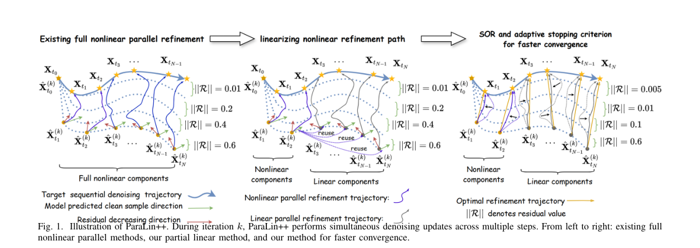

**Why this ranks #8**: 「少步即无损」这句话只在 FID / CLIP 下成立：在 GenEval、DPG-Bench、LongTextBench 上会掉得很惨。  [wild-card]

---

### 9. SplatLab: Autonomous Scientific Discovery for 3DGS Research

⚠️ **[wild-card=yes]** — 同上；该文用 GPU 实测 PSNR 驱动的 Elo 锦标赛给生成候选打分并做选择，是「以评分函数筛生成结果」的 best-of-N / 奖励模型同族机制。

**arXiv**: [2610.30468](https://arxiv.org/abs/2610.30468) | **Score**: 7.3 (relevance 7.0 x 0.7 + quality 8.0 x 0.3) | **Tags**: rl-aigc, WILD, autonomous-research, elo-tournament, 3DGS | **Categories**: cs.AI, cs.CV | **Pages**: 14

**Authors**: Seemandhar Jain, Manmohan Chandraker

**Affiliation**: University of California San Diego

**Abstract**

> Reproducing a published 3DGS paper takes weeks of expert engineering before any extension can be proposed. Prior autonomous-research systems read papers, draft hypotheses, and write code, but are limited by short fixed templates, low executability, and weak traceability, and none has been demonstrated end-to-end in a live computer-vision subfield with intense activity. SplatLab is an autonomous research system for 3D Gaussian Splatting that addresses these limitations. Given a research prompt, a target-paper URL, or no input at all, it reproduces a published baseline, proposes an extension, trains and ablates across Mip-NeRF 360 and LLFF, writes the manuscript, and binds every reported number to a logged training run. Five design choices distinguish it: (i) candidates mutate plugins from a verified-reproduction backbone matched to published baselines; (ii) a cascade-weighted Elo tournament across eight islands scores candidates on measured GPU PSNR with verbal-gradient feedback; (iii) a standing falsifier subtracts Elo on failure, integrating stress-test survival into selection; (iv) every reported number is bound to a logged training run, and the run cannot terminate while any claim is unbacked; (v) a seven-category 3DGS taxonomy wraps EVOLVE-BLOCK markers in domain-aligned scaffolds transferable across 3DGS repositories. On PSNR-targeted runs, SplatLab's manuscripts beat their reproduced targets by +0.18 to +3.78 dB, including +3.78 dB on astrophotographic nebula rendering, for which no prior 3DGS method exists. The research cycle compresses from months of graduate-student time to days of mostly autonomous compute. Code, all manuscripts, experiment ledgers, and the cross-run paper store are available on the project page.

**Key findings**

- **Finding**: 复现一篇已发表的 3DGS 论文需要数周专家工程，之后才谈得上扩展。
- **Finding**: 既有的自主研究系统会读论文、起草假设、写代码，但受限于**固定模板短、可执行性弱、追溯性差**，没有一个在活跃的 CV 子领域端到端跑通。
- **Finding**: SplatLab 是面向 3D 高斯泼溅的自主研究系统：给定研究提示、目标论文 URL 或什么都不给，它会复现已发表基线、提出扩展、在 Mip-NeRF 360 与 LLFF 上训练与消融、写出论文，并把**每个报告的数字绑定到一条已记录的训练运行**。
- **Finding**: 五个关键设计：候选从**已验证复现的骨干**上以插件形式变异；**跨八个岛的级联加权 Elo 锦标赛**用**实测 GPU PSNR** 加口头梯度反馈给候选打分。
- **Finding**: 一个**常设的反证者**在失败时扣除 Elo，把压力测试的存活能力整合进选择；每个报告数字都绑定到训练运行，且**任何主张无据时运行不能终止**。
- **Finding**: 一个七类的 3DGS 分类体系把 EVOLVE-BLOCK 标记包装成可跨 3DGS 仓库迁移的领域对齐脚手架。
- **Finding**: 在以 PSNR 为目标的运行中，SplatLab 的手稿比其复现目标高 **+0.18 到 +3.78 dB**，其中天体摄影星云渲染上 **+3.78 dB**——该方向此前无 3DGS 方法。
- **Finding**: 研究周期从数月研究生时间压缩到数天以自主计算为主的时间。
- **Inference**: 「常设反证者扣 Elo」是把压力测试存活率直接写进选择函数的评分机制——这比单纯的准确率锦标赛更接近真实的科研选择。
- **Inference**: 「任何主张无据时运行不能终止」是硬约束式的可追溯性设计，比事后追溯更可靠。
- **Recommendation**: 推荐。做自主科研、agentic 科研流水线、或研究「如何用实测指标给生成候选打分」的人可以读。

**Key figures**

*Framework - Overview of SplatLab: research pipeline (top) and sixteen generated manuscripts (bottom).*

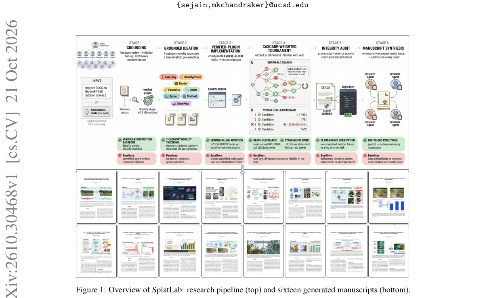

*Result - Detailed pipeline of SplatLab. Expanding the overview in Figure 1, a research intent (or no input) passes through six stages (grounding, Elo-pre-ranked ideation, EVOLVE-BLOCK implementation,*

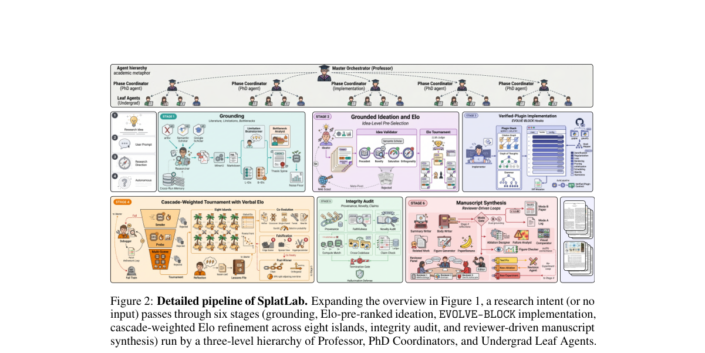

**Why this ranks #9**: 用实测 PSNR 驱动的 Elo 锦标赛给 3DGS 候选打分：生成式科研自动化里最扎实的一次打分机制尝试。  [wild-card]

---

### 10. SetCommit: Coordinated Token Commitments for Few-Step Diffusion Language Model Decoding

⚠️ **[wild-card=yes]** — 同上；该文为扩散语言模型提出训练无关的 token 承诺集合选择，本质是并行解码下的候选选择 / 风险权衡机制。

**arXiv**: [2610.31120](https://arxiv.org/abs/2610.31120) | **Score**: 7.3 (relevance 7.0 x 0.7 + quality 8.0 x 0.3) | **Tags**: rl-aigc, WILD, diffusion-LM, decoding, token-commitment | **Categories**: cs.AI | **Pages**: 27

**Authors**: Yuannuo Feng, Yubing Ye, Wenshuai Yao, Yizhe Chen, Ngai Wong, Wenyong Zhou, Wang Kang

**Affiliation**: Beihang University; The University of Hong Kong; Peking University

**Abstract**

> Diffusion language models generate multiple token positions in parallel, but few-step decoding makes parallel commitment difficult: tokens that appear reliable individually may be jointly inconsistent, while premature commitments can prevent later context-dependent refinement. In this paper, we introduce SetCommit, a training-free method for coordinated parallel token commitment. Instead of selecting tokens independently by confidence, SetCommit selects a commitment set that balances token reliability against local joint commitment risk, preserving conditioning opportunities for subsequent denoising steps. It further performs budget-neutral local exchanges, replacing vulnerable earlier commitments when newly revealed context supports more reliable alternatives. SetCommit requires no retraining or architectural modification and is compatible with existing diffusion decoding strategies. Experiments with LLaDA-8B and Dream-7B on GSM8K, MATH-500, MBPP, and HumanEval show accuracy/pass@1 gains of up to 7.4 percentage points over native decoding at 32 model evaluations. At common quality targets, geometric-mean incremental speedups range from $1.44$ to $1.74\times$. Code is available at https://github.com/Kissmetothemoon/SetCommit.

**Key findings**

- **Finding**: 扩散语言模型并行生成多个 token 位置，但**少步解码让并行承诺变难**：单独看可靠的 token 组合起来可能互相矛盾，过早承诺还会阻断后续依赖上下文的精化。
- **Finding**: SetCommit 是训练无关的**协调式并行 token 承诺**方法。
- **Finding**: 它不按置信度独立选 token，而是选一个**承诺集合**，在 token 可靠性与**局部联合承诺风险**之间取得平衡，为后续去噪步保留条件化机会。
- **Finding**: 它还做**预算中性的局部交换**：当新揭示的上下文支持更可靠的替代时，替换掉脆弱的早期承诺。
- **Finding**: 无需重训或改结构，兼容现有扩散解码策略。
- **Finding**: 在 LLaDA-8B 与 Dream-7B 上（GSM8K、MATH-500、MBPP、HumanEval），32 次模型评估下准确率 / pass@1 相对原生解码最高提升 **7.4 个百分点**；在同等质量目标下，几何平均增量加速 **1.44×–1.74×**。
- **Inference**: 「局部联合风险」这个量是这篇的核心：独立置信度只看单点，联合风险才反映并行承诺的真实代价。
- **Inference**: 「预算中性交换」让方法可以持续改进而不改变并行度，这个约束设计得干净，很适合移植到其它并行解码场景。
- **Recommendation**: 推荐。做扩散语言模型解码、少步推理、或并行采样的人应读。

**Key figures**

*Framework - SETCOMMIT complements system- and schedule-side diffusion decoding accelera- tors. Left: it coordinates parallel token commitments, orthogonally to reducing forward-pass com- putation or den*

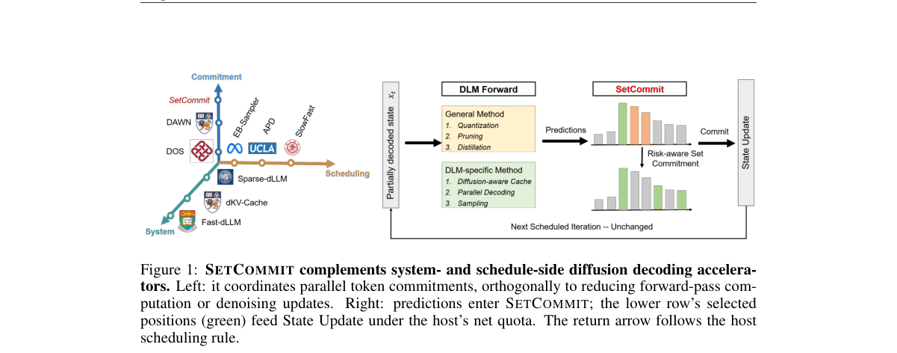

*Result - Local clustering and context sensitivity on GSM8K. Left: counts of 16 top-k com- mitments per 10-position bin in one state. Center: cumulative excess adjacent pairs per prompt in the Discove*

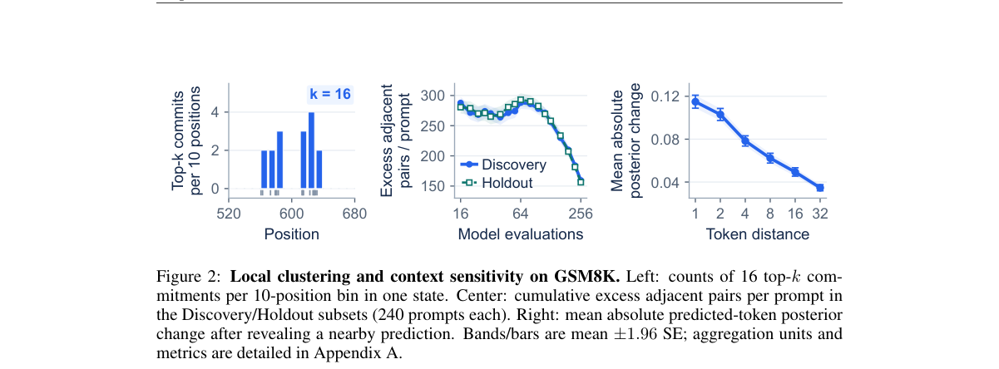

**Why this ranks #10**: 并行解码里「每个 token 各自可信」不等于「一起可信」：SetCommit 按联合风险挑承诺集合。  [wild-card]

---

## Footer

- Total papers scanned across all 7 tracks: 535（原始 705 条）
- rl_aigc track final top-10: 10
- Wild-cards in this track: 3
- Figure assets: 2026-10-23/res/

Generated by `mine-arxiv-daily-digest` skill. Sister file: `2026-10-23_rl_aigc_entry.md`.
