# ArXiv Daily Digest - 2026-10-23 (RL 算法与理论、多智能体 RL、Sim-to-Real, 10 papers)

**Generated**: 2026-10-23 17:00 CST

**Source**: arXiv cs.CV, cs.SD, eess.AS, cs.CL, cs.AI, cs.RO, cs.LG submissions, listing day 2026-10-22 (announced 2026-10-23 00:00 UTC)

**Batch window**: 2026-10-21T18:00:00Z .. 2026-10-22T18:00:00Z（arXiv 公告批次横跨两个 UTC 日：前一日 18:00 UTC 起算，当日 17:59:59 UTC 截止）

**Track**: rl_core (top 10 of 535 papers scanned, 107 full reads)

**Scope**: RL 算法与理论、探索、信用分配、MARL、sim-to-real 迁移

---

## Top 10 - RL 算法与理论、多智能体 RL、Sim-to-Real

### 1. Same Luck, Different Choice: Twin-World Credit Assignment for Agentic Reinforcement Learning

**arXiv**: [2610.31544](https://arxiv.org/abs/2610.31544) | **Score**: 9.7 (relevance 10.0 x 0.7 + quality 9.0 x 0.3) | **Tags**: rl-core, credit-assignment, agentic-RL, counterfactual, GRPO | **Categories**: cs.LG | **Pages**: 32

**Authors**: Zeropy Surio, Tobias Engel, Mei-Lin Chou, Anika Raman, Samuel Okafor

**Affiliation**: University of Sheffield; Carnegie Mellon University; University of Michigan

**Abstract**

> Agentic reinforcement learning rewards a complete episode, yet the policy needs credit for every decision inside it. Counterfactual branching estimates this credit by re-running the episode after an alternative decision, but the branch draws its sampling noise independently of the factual episode, so the outcome difference mixes the effect of the decision with the luck of everything that follows. We observe that in agentic search the retriever, the corpus, and the grader are deterministic, so an episode is a deterministic function of the policy's decisions and its sampling noise. Twin worlds are therefore realizable: the same noise, a different decision. We introduce TWICE (TWIn-world Credit Estimation), which keys the Gumbel noise of every token by turn and line, rolls out counterfactual twins that inherit the factual episode's downstream noise, and turns their paired outcome differences into turn-level advantages for policy-gradient updates on actor-sampled trajectories; only the actor is deployed. Twin credit is unbiased for any coupling quality, its variance is that of an independent counterfactual scaled by $1-ρ$, where $ρ$ is the twins' outcome correlation, and under coupling the number of rollouts needed to resolve an advantage of size $Δ$ falls from $Θ(Δ^{-2})$ to $Θ(Δ^{-1})$. A square-root rule spends the twin budget where outcomes are predicted to disagree per unit cost. On seven question-answering benchmarks, TWICE improves the average exact match of GRPO by 5.3 and 4.5 points on Qwen2.5-3B and 7B, outperforms tree-search and counterfactual-branching baselines, and uses 68% fewer auxiliary tokens than VinePPO.

**Key findings**

- **Finding**: 智能体 RL 按完整 episode 给奖励，但策略需要其中**每个决策**的信用。
- **Finding**: 反事实分支通过在替代决策后重跑 episode 来估计信用，但分支**独立抽取采样噪声**，于是结果差异混入了「决策效应」与「后续运气」。
- **Finding**: 关键观察：在智能体搜索中，检索器、语料与评分器都是确定性的，于是 episode 是策略决策与采样噪声的**确定性函数**。
- **Finding**: 因此「**孪生世界**」是可实现的：同样的噪声，不同的决策。
- **Finding**: **TWICE** 按 turn 与 line 为每个 token 的 Gumbel 噪声做键控，滚出继承事实 episode 下游噪声的反事实孪生体，把成对结果差异转成 turn 级优势用于策略梯度更新；只有 actor 被部署。
- **Finding**: 孪生信用对任意耦合质量都无偏，其方差是独立反事实的方差按 1-ρ 缩放（ρ 为孪生体结果相关性）。
- **Finding**: 在耦合下，解析出大小为 Δ 的优势所需 rollout 数从 **Θ(Δ⁻²) 降到 Θ(Δ⁻¹)**；平方根规则把孪生预算花在「每单位成本预计结果分歧最大」的地方。
- **Finding**: 在七个问答基准上，TWICE 把 GRPO 的平均精确匹配在 Qwen2.5-3B 与 7B 上分别提升 **5.3 与 4.5 个点**，优于树搜索与反事实分支基线，比 VinePPO 少用 **68%** 辅助 token。
- **Inference**: 把「运气」从「决策效应」里剥离是本篇的核心贡献，而它成立的前提（检索器 / 语料 / 评分器确定性）非常具体——迁移到非确定性环境需要重新审视。
- **Inference**: Θ(Δ⁻²) → Θ(Δ⁻¹) 与 68% token 节省是很实在的工程收益，说明 agentic RL 的信用分配还有大量结构性冗余。
- **Recommendation**: 强烈推荐。做 agentic RL、信用分配、GRPO 改进的人必读。

**Key figures**

*Framework - Why twins (exact curves). (a) Variance of credit for a decision with Q=0.55, V =0.45: subtracting a Monte Carlo baseline from the realized return is floored by the return’s own variance; ind*

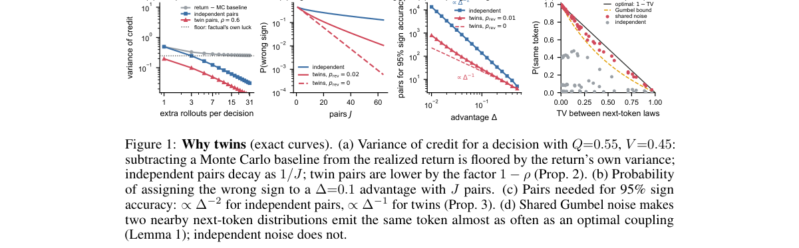

*Result - TWICE in one training step. Top: every factual token draws Gumbel noise keyed by (episode, turn, line, position). Bottom: the twin of turn 2 swaps in an alternative drawn with fresh noise an*

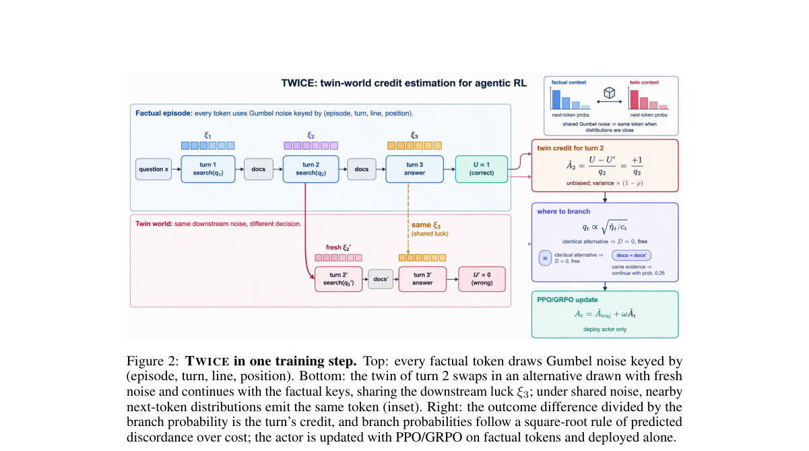

**Why this ranks #1**: 同噪声、不同决策：把反事实分支的运气与决策影响拆开，rollout 需求从 Θ(Δ⁻²) 降到 Θ(Δ⁻¹)。

---

### 2. METTA: Memory-Enhanced Test-Time Adaptation for Meta-Reinforcement Learning

**arXiv**: [2610.31656](https://arxiv.org/abs/2610.31656) | **Score**: 9.0 (relevance 9.0 x 0.7 + quality 9.0 x 0.3) | **Tags**: rl-core, meta-RL, memory, test-time-adaptation, linear-complexity | **Categories**: cs.AI, cs.LG | **Pages**: 27

**Authors**: Ali Najar, Hosein Hasani, Amir Kooshan Fattah, Yasamin Rajabi, Mahdieh Soleymani Baghshah

**Affiliation**: Sharif University of Technology

**Abstract**

> Meta-reinforcement learning aims to train agents that adapt quickly to unseen tasks from limited interaction, but this requires representing task evidence over long interaction histories. Classical recurrent agents compress experience into hidden states, while transformer-based agents retrieve from past trajectories at quadratic memory and computation cost. In this work, we propose Memory-Enhanced Test-Time Adaptation (METTA) for meta-reinforcement learning. It decomposes the fast adaptation phase into two temporal scales: a causal neural memory performs fine-grained within-episode adaptation with linear sequence complexity, while compact episode-level summaries support long-range cross-episode task inference without attending over the full interaction history. Moreover, equipping agents with neural memory provides sufficient expressive capacity and test-time training capability, enabling effective adaptation to unseen held-out tasks and task families at meta-test time. On unseen held-out Meta-World ML10/45 test environments, METTA achieves a success rate over $50\%$ while maintaining a low training budget and short wall-clock time. On long-context sparse-reward PointMaze tasks, it outperforms transformer-based baselines by exhibiting more structured exploration behavior. These results show that METTA provides an efficient path toward more adaptive and scalable long-context meta-RL.

**Key findings**

- **Finding**: 元 RL 要训练能从有限交互中快速适应未见任务的智能体，这要求在**长交互历史**上表征任务证据。
- **Finding**: 经典循环智能体把经验压进隐状态；基于 transformer 的智能体则从过往轨迹检索，但代价是**二次的显存与算力**。
- **Finding**: METTA 把快速适应阶段分解为**两个时间尺度**：因果神经记忆以**线性序列复杂度**做细粒度的回合内适应，紧凑的回合级摘要支持长程跨回合的任务推断而无需关注完整交互历史。
- **Finding**: 作者指出，配备神经记忆本身提供了足够的表达容量与测试时训练能力，使智能体能在 meta-test 时有效适应未见的留出任务与任务族。
- **Finding**: 在未见的留出 Meta-World ML10/45 测试环境上，METTA 成功率超过 **50%**，同时保持低训练预算与短墙钟时间。
- **Finding**: 在长上下文稀疏奖励的 PointMaze 任务上，它凭**更有结构的探索行为**超过基于 transformer 的基线。
- **Inference**: 「双时间尺度」是这里最漂亮的设计：回合内要细、跨回合要粗，两种需求被显式拆开后，复杂度自然降到线性。
- **Inference**: 更有结构的探索行为这一附带结果，说明记忆机制本身在改善探索，而不只是改善记忆。
- **Recommendation**: 强烈推荐。做元 RL、长上下文 RL、需要记忆结构的智能体的人必读。

**Key figures**

*Framework - Exploration behavior on a sparse-reward PointMaze task (Fu et al., 2020) across adapta- tion episodes. Trajectories are shown for Episodes 1, 2, 5, and 10 of the same task. As interaction pr*

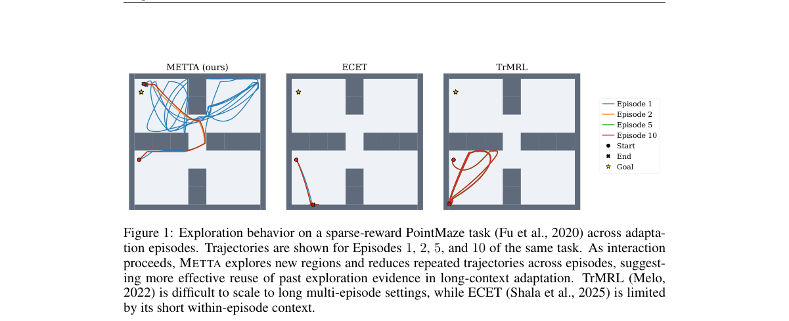

*Result - Overview of METTA. The current episode is processed by a within-episode neural memory to produce h(L)*

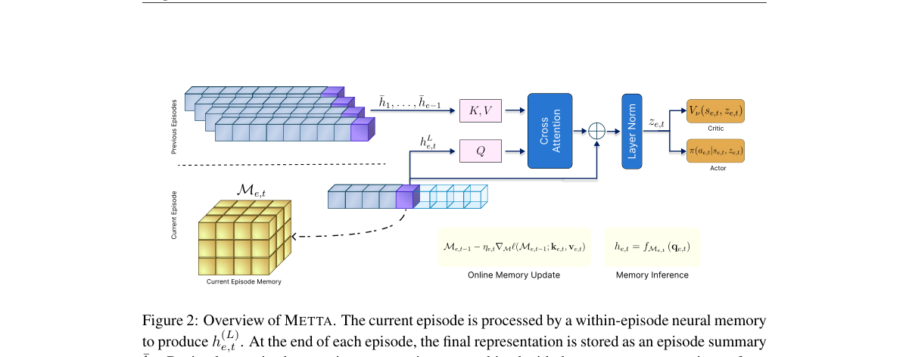

**Why this ranks #2**: 把快适应拆成两个时间尺度：因果神经记忆做回合内适应，回合级摘要做跨回合推断。

---

### 3. SpecMAGIC: Specification-Guided Multi-Task Generalization in Multi-Agent Reinforcement Learning

**arXiv**: [2610.30443](https://arxiv.org/abs/2610.30443) | **Score**: 9.0 (relevance 9.0 x 0.7 + quality 9.0 x 0.3) | **Tags**: rl-core, MARL, temporal-logic, hierarchical, zero-shot | **Categories**: cs.AI | **Pages**: 20

**Authors**: Zijian Guo, İlker Işık, H. M. Sabbir Ahmad, Wenchao Li

**Affiliation**: Boston University

**Abstract**

> Multi-task generalization is an important yet underexplored problem in multi-agent reinforcement learning (MARL). Many real-world applications require multi-agent systems to generalize across complex, temporally extended tasks with diverse inter-agent coordination requirements. We introduce a specification language that combines temporal-logic task specifications with operators for expressing such requirements. We propose SpecMAGIC, a hierarchical framework that leverages the automaton structure of task specifications for subtask decomposition. A centralized high-level planner identifies and allocates compatible subtask sequences across agents, while decentralized low-level policies execute individual subtasks. This enables zero-shot generalization to new tasks by composing reusable subtask policies according to new specifications, without retraining. We establish soundness and probabilistic completeness of the high-level planner. Experiments on multi-agent navigation tasks show that SpecMAGIC substantially outperforms existing approaches on unseen task specifications and maintains strong performance as the number of agents increases.

**Key findings**

- **Finding**: 多任务泛化在 MARL 中重要却研究不足——真实应用需要多智能体系统泛化到**时序跨度长、协调要求各异**的新任务。
- **Finding**: 论文引入一种**规格语言**，把时序逻辑任务规格与表达此类要求的算子结合起来。
- **Finding**: SpecMAGIC 是分层框架，利用任务规格的**自动机结构**做子任务分解。
- **Finding**: **集中式高层规划器**识别并把兼容的子任务序列分配给各智能体，**去中心化低层策略**执行单个子任务。
- **Finding**: 这使得通过按新规格组合**可复用的子任务策略**来实现对新任务的**零样本泛化，无需重训**。
- **Finding**: 作者证明了高层规划器的可靠性（soundness）与概率完备性。
- **Finding**: 在多智能体导航任务上，SpecMAGIC 在未见任务规格上显著优于现有方法，并随智能体数量增加保持强性能。
- **Inference**: 「把任务写成规格、用自动机结构换掉学习」在 MARL 里是很干净的路子——泛化问题被转成了组合问题。
- **Inference**: 配套的可靠性与概率完备性证明，让「零样本泛化」这句话有了形式化支撑而不只是实验现象。
- **Recommendation**: 强烈推荐。做 MARL、多任务泛化、形式化任务指定的人必读。

**Key figures**

*Framework - Overview of the proposed hierarchical framework. Specifications are decomposed into reach-avoid subtasks, from which a centralized sampling-based planner constructs a feasible subtask sequen*

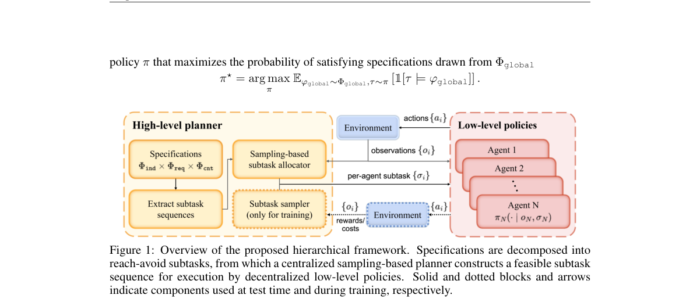

*Result - Example trajec- tories of 2 agents in the Zone environment: φ1 : ¬b U m, φ2 : ¬y U b, φdep : m1 Req b2, φcnt : Sync[{1, 2}, g, 2].*

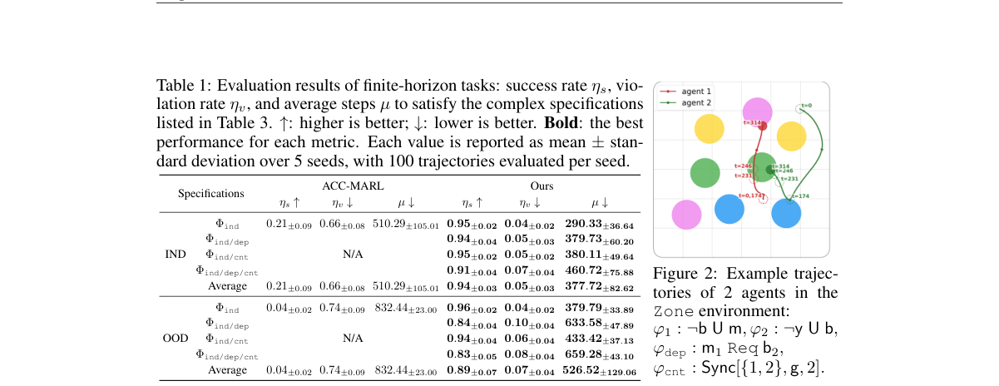

**Why this ranks #3**: 用时序逻辑规格直接指挥多智能体协作：换规格就换任务，无需重训。

---

### 4. TerraTransfer++: Demonstration-Free End-to-End Planner

**arXiv**: [2610.30319](https://arxiv.org/abs/2610.30319) | **Score**: 8.7 (relevance 9.0 x 0.7 + quality 8.0 x 0.3) | **Tags**: rl-core, sim-to-real, self-play, flow-matching, autonomous-driving | **Categories**: cs.AI, cs.CV, cs.LG, cs.RO | **Pages**: 30

**Authors**: Zikang Xiong, Weixin Li, Zhouchonghao Wu, Akshay Rangesh, Saarth Bonde, Grantland Hall, Chen Tang, Yihan Hu, Wei Zhan

**Affiliation**: University of California, Berkeley

**Abstract**

> End-to-end autonomous driving has achieved state-of-the-art performance on benchmarks and real-world deployments. Its standard training recipe, however, is expensive across all existing paradigms: imitation learning requires fleet-scale driving logs whose behavior distribution only thinly covers the safety-critical tail; closed-loop reinforcement learning in a photorealistic simulator, while offering diverse behaviors, is bottlenecked by sample-efficiency, per-step cost of rendering, and a forward pass through a large vision backbone. Self-play in vectorized simulators changes the economics: at millions of rollout steps per second, one can obtain a state distribution with natural diversity in collisions, near-misses, and recoveries that no driving log contains, and a highly reactive policy emerges from a basic driving-quality reward. Our approach exploits this asymmetry. We pretrain a single policy by self-play, distill its rollouts into a flow-matching trajectory teacher that also plans, and train lightweight adapters on a frozen pretrained vision backbone to reproduce the latent space of either teacher through the action KL divergence, a batch-relational low-rank structural loss, and, for the planner, a trajectory-matching loss. Every target traces back to the self-play policy, so alignment never supervises against a logged trajectory: a paired dataset of (image, scene-state) frames suffices, with no need for the curated expert demonstrations that imitation pretraining is built on. From this one self-play teacher we obtain two end-to-end students: a closed-loop policy that outperforms every published imitation-based end-to-end method on the photorealistic 3D Gaussian splatting closed-loop benchmark HUGSim, and a planner that reaches 59.4 EPDMS on NAVSIM navhard, above every published method including DriveZero-Scale (57.1), and 95.5 PDMS on navtest, without human demonstrations.

**Key findings**

- **Finding**: 端到端自动驾驶在基准与真实部署上已达 SOTA，但标准训练配方都很贵：模仿学习需要车队规模日志，而其行为分布只薄薄覆盖安全关键长尾。
- **Finding**: 照片级仿真器里的闭环 RL 虽能提供多样行为，却受**样本效率、每步渲染成本与大视觉骨干前向**所限。
- **Finding**: **向量化仿真器里的自博弈改变了经济性**：每秒数百万 rollout 步，可以获得碰撞、擦碰与恢复上自然多样的状态分布——这是任何驾驶日志都不包含的。
- **Finding**: 方法利用这一不对称：先以自博弈**预训练单一策略**，再把其 rollout **蒸馏成流匹配轨迹教师**（该教师同时也会规划），最后在冻结的预训练视觉骨干上训练轻量适配器。
- **Finding**: 适配器用动作 KL 散度、批关系低秩结构损失、以及（对规划器而言的）轨迹匹配损失来复现教师潜空间。
- **Finding**: 关键设计：**每个目标都可追溯到自博弈策略**，对齐过程从不以日志轨迹为监督——只需 (图像, 场景状态) 的成对数据，无需模仿预训练赖以建立的精选专家示范。
- **Finding**: 由这一个自博弈教师得到两个端到端学生：闭环策略在照片级 3D 高斯泼溅闭环基准 **HUGSim** 上超过所有已发表的模仿式端到端方法；规划器在 NAVSIM navhard 上达到 **59.4 EPDMS**，高于包括 DriveZero-Scale（57.1）在内的所有已发表方法，navtest 上 **95.5 PDMS**，全程无人类示范。
- **Inference**: 「自博弈作为数据引擎，再蒸馏成教师」绕开了模仿学习最贵的一环——专家示范的获取——这是自动驾驶训练范式的实质性转变。
- **Inference**: 「每个目标都可追溯到自博弈策略」这条约束保证了整条蒸馏链不引入示范偏差，是方法能成立的根。
- **Recommendation**: 强烈推荐。做端到端自动驾驶、sim-to-real、蒸馏与自博弈的人必读。

**Key figures**

本篇未提取到可用图（PDF 内无符合图注正则的 Figure 1/2）。

**Why this ranks #4**: 用自博弈一个老师，蒸出策略与规划器两个学生：全程不需要人工示范数据。

---

### 5. MPBRS: Multi-Potential-Based Reward Shaping for Unified Reward Configuration in Humanoid Locomotion

**arXiv**: [2610.30334](https://arxiv.org/abs/2610.30334) | **Score**: 8.3 (relevance 8.0 x 0.7 + quality 9.0 x 0.3) | **Tags**: rl-core, reward-shaping, humanoid, PBRS, transferability | **Categories**: cs.AI, cs.RO | **Pages**: 8

**Authors**: Van Chung Nguyen, Hung Manh La

**Affiliation**: University of Nevada, Reno

**Abstract**

> Designing and tuning reward functions remains one of the main challenges in building effective reinforcement learning (RL) pipelines for humanoid locomotion. While shaping rewards can accelerate learning, naively formulated terms often conflict with the desired behavior, overfit to a specific robot, or become unstable under small weight changes. Potential-Based Reward Shaping (PBRS) offers an alternative solution: shaping the reward via differences of a potential function to guide exploration without changing the optimal policy. In this paper, we study Multi-PBRS for humanoid locomotion and propose a unified reward configuration. We then evaluate the same reward structure and weights across nine humanoid robots, requiring only robot-specific metadata (joint/link mappings and default poses) rather than per-robot reward redesign. Our experiments show that, compared to standard shaping, MPBRS provides more consistent scaling behavior and reduced tuning sensitivity across robots, making it easier to tune without altering the optimal policy.

**Key findings**

- **Finding**: 设计并调奖励函数仍是构建人形运动 RL 流程的主要挑战之一。
- **Finding**: 奖励塑造能加速学习，但朴素构造的项常常与期望行为冲突、过拟合到特定机器人，或在小幅权重变化下不稳定。
- **Finding**: **势函数奖励塑造（PBRS）**提供了另一种解法：用势函数之差来塑造奖励，在**不改变最优策略**的前提下引导探索。
- **Finding**: 本文研究人形运动中的 **Multi-PBRS** 并提出统一的奖励配置。
- **Finding**: 关键评测设计：同一套奖励结构与权重在**九台人形机器人**上评估，只需机器人专属元数据（关节 / 连杆映射与默认姿态），而无需逐机器人重新设计奖励。
- **Finding**: 结果显示，相比标准塑造，MPBRS 提供了**更一致的缩放行为**与**更低的调参敏感度**，在不改变最优策略的前提下更容易调参。
- **Inference**: 「不改变最优策略」是 PBRS 的理论保证，而这篇的贡献在于把「保证」变成了「跨九台机器人的可迁移性」——这才是工程上真正稀缺的。
- **Inference**: 只靠元数据而非重设计奖励来做跨本体迁移，这个思路对任何多机器人 RL 配方都适用。
- **Recommendation**: 强烈推荐。做人形 RL、奖励设计、跨本体迁移的人必读。

**Key figures**

*Result - A snapshot of nine humanoid robots used in this paper in IsaacLab. From right to left: Fourier N1, Tienkung2, Unitree G1, Unitree H1, Booster T1, Fourier GR3V2, Kuavo S45, Hightorque HI, and B*

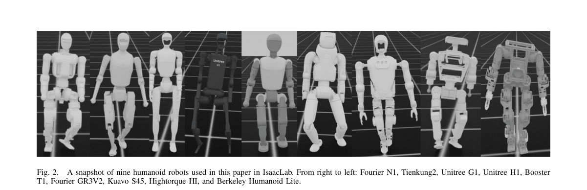

**Why this ranks #5**: 一套奖励配置跑九台人形机器人：多势函数 PBRS 让奖励塑造不再一机一调。

---

### 6. Ground-Truth-First Benchmarking of Reinforcement Learning via Converse Optimality: From Smooth, Fully Observed Systems to Non-Smooth or Partially Observed Tasks

**arXiv**: [2610.30954](https://arxiv.org/abs/2610.30954) | **Score**: 8.3 (relevance 8.0 x 0.7 + quality 9.0 x 0.3) | **Tags**: rl-core, RL-theory, benchmark, oracle, converse-optimality | **Categories**: cs.LG | **Pages**: 63

**Authors**: Grégoire Ouerdane, Sinan Ibrahim, Stefan Streif, Pavel Osinenko

**Affiliation**: Sirius University of Science and Technology; Technische Universität Chemnitz

**Abstract**

> Benchmarking in reinforcement learning is usually relative: algorithms are ranked by returns on environments with unknown optima. Distance to optimality remains unobservable, while conclusions may depend on reward design, stochasticity, hyperparameters, environment selection, and simulator details. We develop a ground-truth-first framework based on converse optimality, constructing each task with a certified optimal value function and policy withheld from learners and used only for evaluation. The framework unifies two modes: sensitivity benchmarking samples certified environments from continuous-time generators to assess robustness to task variation, while oracle-referenced comparison uses native discrete-time generators to evaluate policies via optimality gap, regret, and policy error. Continuous-time models support physically interpretable sensitivity studies but introduce dependence on the simulator step ($Δt$) and numerical scheme. Native discrete-time models align the environment, oracle, and learner on the same transition law, eliminating external integration choices as a confounder. We reproduce quantitative results covering optimizer sensitivity and oracle-referenced comparisons on serial planar arms, dynamically extended nonholonomic vehicles, and quadrotor-inspired tasks. The methodology extends beyond smooth affine Gaussian systems: virtual-input pullback handles non-affine raw-action interfaces and finite-covariance non-Gaussian disturbances. A non-smooth converse optimality formulation enables certified benchmarks with kinked value functions and switching surfaces. For partially observed evaluation, an information-state formulation reduces benchmarking to converse optimality on a sufficient statistic and provides an information-penalty reference. Code, fixtures, and diagnostics are available on the public project page.

**Key findings**

- **Finding**: RL 基准测试通常是**相对**的：算法按最优值未知的环境上的回报排名。
- **Finding**: 到最优性的距离始终不可观测，而结论可能依赖奖励设计、随机性、超参、环境选择与仿真器细节。
- **Finding**: 作者发展了一套**ground-truth-first** 框架，基于**逆向最优性（converse optimality）**：每个任务都构造一个带**认证最优值函数与最优策略**的环境，只对学习者隐藏、仅用于评测。
- **Finding**: 框架统一两种模式：**敏感性基准**从连续时间生成器采样认证环境以评估对任务变化的鲁棒性；**oracle 参考比较**用原生离散时间生成器，以最优差距、遗憾与策略误差评测策略。
- **Finding**: 连续时间模型支持物理可解释的敏感性研究，但引入对仿真步长 Δt 与数值格式的依赖；原生离散时间模型让环境、oracle 与学习者对齐到同一转移律，消除外部积分选择这一混淆因素。
- **Finding**: 方法超出光滑仿射高斯系统：虚拟输入回拉处理非仿射原始动作接口与有限协方差非高斯扰动；**非光滑逆向最优性**形式支持带折点值函数与切换面的认证基准；部分可观测评测用信息状态形式把基准归约到充分统计量上的逆向最优性，并给出信息惩罚参考。
- **Finding**: 在串联平面机械臂、动态扩展的非完整车辆与四旋翼启发式任务上复现了定量结果。
- **Inference**: 把「最优策略」变成可认证的构造，而不是指望环境恰好有闭式解，这是 RL 评测方法学上多年没人认真做的基础工作。
- **Inference**: 63 页的篇幅与覆盖范围说明这是方法论工作的体量：它给后续所有 RL 基准设定了一条更高标准。
- **Recommendation**: 强烈推荐。做 RL 评测、benchmark 设计、RL 理论的人必读。

**Key figures**

*Framework - Ground-truth-first benchmark-generation pipeline. A converse construction samples certified dynamics and costs, validates the optimality certificate, exports an environment fixture, trains l*

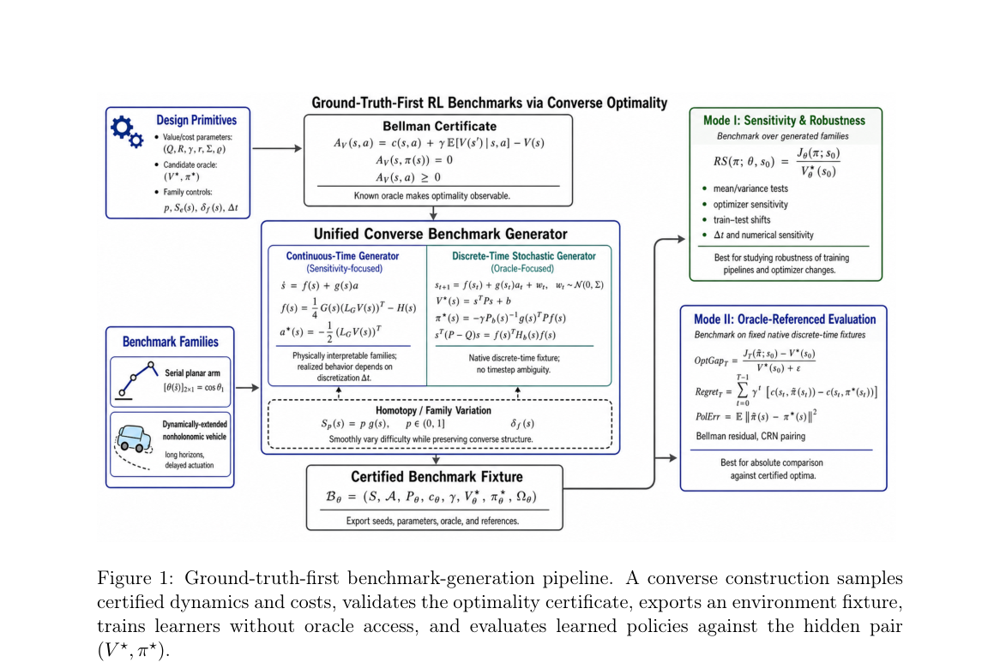

*Result - Reproduced from Yaremenko et al. [19]. Sensitivity (top) and robustness (bottom) test structures. The symbol ◦indicates that the policy is substituted into the test problem, closing the loop*

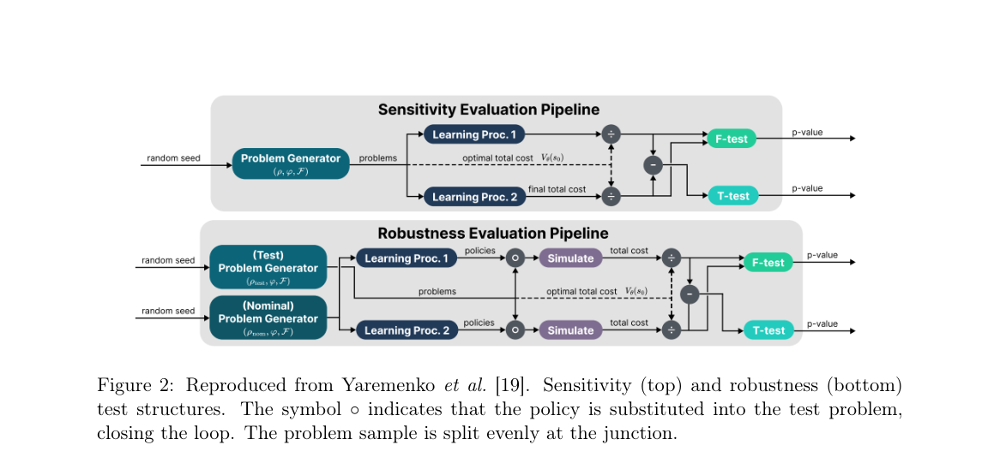

**Why this ranks #6**: 「先有标准答案再出题」：RL 评测终于有了认证过的最优值函数与最优策略。

---

### 7. DRILL: Training World Models to Improve Policies, Not Predict Pixels

**arXiv**: [2610.30814](https://arxiv.org/abs/2610.30814) | **Score**: 8.3 (relevance 8.0 x 0.7 + quality 9.0 x 0.3) | **Tags**: rl-core, world-model, VLA, bilevel, GRPO | **Categories**: cs.CV | **Pages**: 38

**Authors**: Zhaolu Kang, Tailong Luo, Lei Wei, Guangyuan Dong, Sihan Liu, Yingjie He, Siheng Wang, Shuaibo Li, Rongchao Zhang, Zhen Tian, Richeng Xuan, Zhichao Hu

**Affiliation**: Tencent Hunyuan; Peking University

**Abstract**

> World models are increasingly used to reduce environment interaction when post-training vision-language-action (VLA) policies with reinforcement learning. Yet they are typically trained to predict pixels one step ahead, even though their role here is not merely to render visually faithful videos but to produce learning signals from imagined rollouts that improve the policy. We show that this mismatch is substantial: lower pixel MSE can produce worse policy gradients, and a world model trained for policy utility can yield better downstream policies despite 17% higher pixel MSE on the next frame. We propose the Downstream-Return Imagination Learning Loop (DRILL), a bilevel framework that updates the world model to maximize the policy's return after an inner GRPO update on imagined rollouts. DRILL has two instantiations. DRILL-VWI is a closed-form surrogate, requiring no additional simulator rollouts, that reweights prediction errors by policy visitation, the group-relative GRPO advantage, and model confidence. DRILL-IMG is a full meta-gradient method that differentiates through the inner update using truncated Hessian-vector products. We show that DRILL-VWI recovers the local one-step component of the DRILL-IMG meta-gradient under score-compatibility and small-residual assumptions. Across five manipulation simulators and two VLA backbones, DRILL-IMG raises mean success rate by 13.1 points over WMPO and 7.9 points over RLVR-World, and complements RLVR pretraining rather than competing with it. More broadly, we believe video world models for VLA reinforcement learning can be productively trained by the policy gradients they produce, not only by pixel-level prediction.

**Key findings**

- **Finding**: 世界模型被广泛用于减少环境交互，好处是用 RL 后训练 VLA 策略。
- **Finding**: 但它们通常被训练成**预测下一帧像素**，而它们在这里的角色不是渲染逼真的视频，而是**从想象 rollout 中产生能改进策略的学习信号**。
- **Finding**: 作者证明这一错配相当严重：**更低的像素 MSE 可能产生更差的策略梯度**；为策略效用训练的世界模型即使下一帧像素 MSE 高 **17%**，也能给出更好的下游策略。
- **Finding**: 提出 **DRILL**（Downstream-Return Imagination Learning Loop）：一个双层框架，在想象 rollout 上做一次内层 GRPO 更新后，**最大化策略回报**来更新世界模型。
- **Finding**: 两个实例化：**DRILL-VWI** 是无需额外仿真 rollout 的闭式代理，用策略访问频率、组相对 GRPO 优势与模型置信度对预测误差重加权。
- **Finding**: **DRILL-IMG** 是完整的元梯度方法，用截断 Hessian-向量积穿过内层更新求导。
- **Finding**: 在分数兼容与小残差假设下，DRILL-VWI 能恢复 DRILL-IMG 元梯度的局部单步分量。
- **Finding**: 在五个操作仿真器与两个 VLA 骨干上，DRILL-IMG 把平均成功率相对 WMPO 提升 **13.1 个点**、相对 RLVR-World 提升 **7.9 个点**，并与 RLVR 预训练**互补而非竞争**。
- **Inference**: 「训练目标该匹配下游用途」这个论点本身不新，但这篇给出了硬证据（像素 MSE 与策略质量甚至负相关），足以改变世界模型的训练配方。
- **Inference**: 闭式代理能恢复元梯度的局部单步分量，意味着大部分情况下不必付元梯度的代价——工程上非常友好。
- **Recommendation**: 强烈推荐。做世界模型 + RL、VLA 后训练的人必读。

**Key figures**

*Framework - Overview of DRILL. The policy first learns inside the current world model through imagined GRPO. The resulting policy-improvement signal is then fed back to the world model: DRILL-VWI uses t*

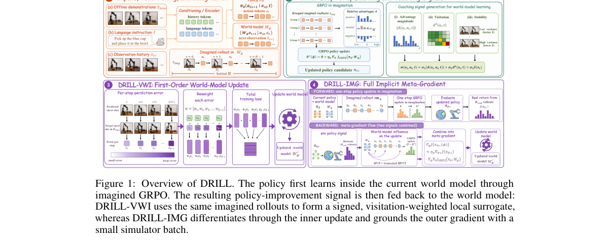

*Result - MSE–success decoupling on LIBERO-Long (π0-3B). Faint markers are seeds; bold markers are mean±std.*

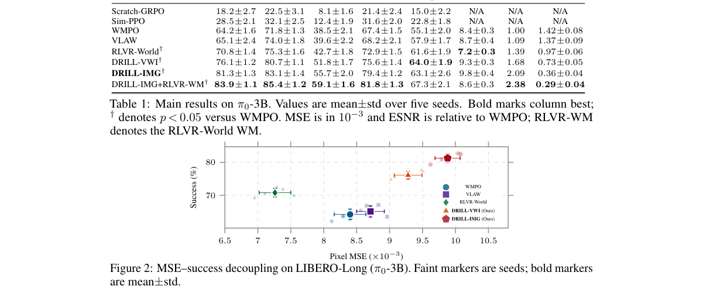

**Why this ranks #7**: 世界模型该为谁而训？答案是为策略梯度而训——像素 MSE 更低反而梯度更差。

---

### 8. SABLE: Scalable Affine Bayesian Latent-space Exploration

**arXiv**: [2610.31495](https://arxiv.org/abs/2610.31495) | **Score**: 8.0 (relevance 8.0 x 0.7 + quality 8.0 x 0.3) | **Tags**: rl-core, exploration, bayesian-optimization, latent-space, high-dimensional | **Categories**: cs.AI, cs.LG | **Pages**: 47

**Authors**: Erik Bodin, Lisa Maria Kreusser, Donney Fan, Henry Moss, Geoff Pleiss, Nicolas Durrande

**Affiliation**: Lancaster University; Vector Institute

**Abstract**

> Complex objects such as engineering designs and proteins are often difficult to optimise because their design spaces exhibit high-dimensional structure and objective evaluations are expensive. Generative models provide continuous latent representations, but their latent spaces can have thousands to tens of thousands of dimensions, creating a regime where the latent dimension $D$ greatly exceeds the evaluation budget. We introduce SABLE, a Bayesian optimisation method for high-dimensional latent spaces with an isotropic distribution and limited budget. SABLE uses a Bayesian affine surrogate for prediction and acquisition, treating higher-order structure as surrogate discrepancy. After $N$ observations, the slope update has dimension at most $N-1$, yielding a decomposition of each query into an in-span component optimised by expected improvement (EI) in at most $N$ dimensions and an off-span component governed by a scalar norm. We show that the off-span norm implicitly selected by affine EI can lead to underexploration, and SABLE instead prescribes it using a finite-horizon schedule, without restricting search to a learned subspace. A recompression scheme reduces information to $\mathcal O(M)$ pseudo-observations, bounding refitting cost by $\mathcal O(M^2D+M^3)$ while keeping parameter inference, prediction, and acquisition decisions to tens of milliseconds. Across synthetic benchmarks and latent-space optimisation tasks, SABLE achieves high sample efficiency and reduces decision time by several orders of magnitude at large budgets.

**Key findings**

- **Finding**: 工程设计与蛋白质这类复杂对象难以优化，因为设计空间有高维结构且目标评估昂贵。
- **Finding**: 生成模型提供连续潜表示，但潜空间可达数千至数万维，造成潜维度 D **远超评估预算**的困境。
- **Finding**: SABLE 是面向高维潜空间、预算有限的**贝叶斯优化**方法。
- **Finding**: 核心机制：用**贝叶斯仿射代理**做预测与采集，把高阶结构当作代理的 discrepancy（残差）处理。
- **Finding**: N 次观测后，斜率更新的维度至多为 N-1，从而把每次查询分解为：在至多 N 维中用期望改进（EI）优化的**张成内**分量，以及由标量范数支配的**张成外**分量。
- **Finding**: 作者证明张成外范数若由仿射 EI 隐式选择会导致**探索不足**，SABLE 改用有限视野调度来规定该范数，且不把搜索限制在学到的子空间内。
- **Finding**: 重压缩方案把信息降到 **O(M)** 伪观测，把重拟合成本限制在 **O(M²D + M³)**，同时把参数推断、预测与采集决策压到数十毫秒。
- **Finding**: 在合成基准与潜空间优化任务上，SABLE 达到高样本效率，并在大预算下把决策时间降低数个数量级。
- **Inference**: 「高阶结构 → discrepancy」这个建模选择是全篇的支点：它承认了低维代理在超维潜空间里的先天不足，并把它变成可解释的残差项。
- **Inference**: 「不把搜索限制在学到的子空间内」是很多人会忽略的要点——仿射 EI 的隐式范数选择会导致探索不足，这个坑值得单独记住。
- **Recommendation**: 推荐。做潜空间优化、贝叶斯优化、生成模型设计优化的人应读。

**Key figures**

*Framework - Overview of SABLE. (a) Each query is decomposed into an in-span component and an orthogonal off-span component. EI chooses the in-span direction, while the exploration schedule prescribes th*

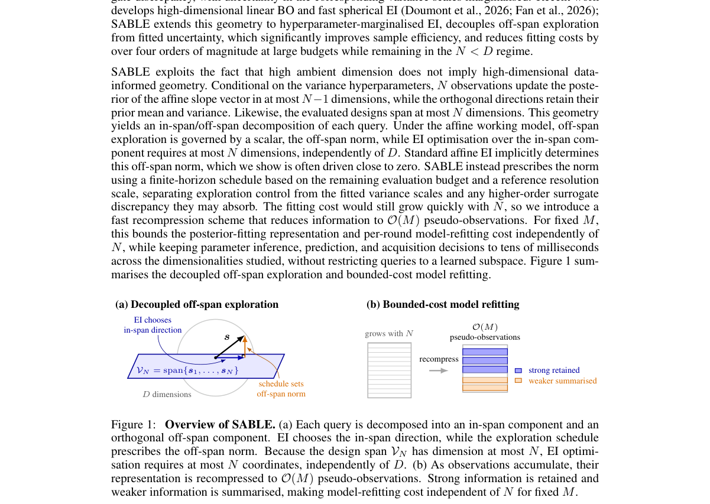

*Result - Effect of state compression. Left: best observed value for compression budgets M ∈ {10, 100, 300, 500} at D = 10,000, compared with the uncapped representation (dashed) and the mean global m*

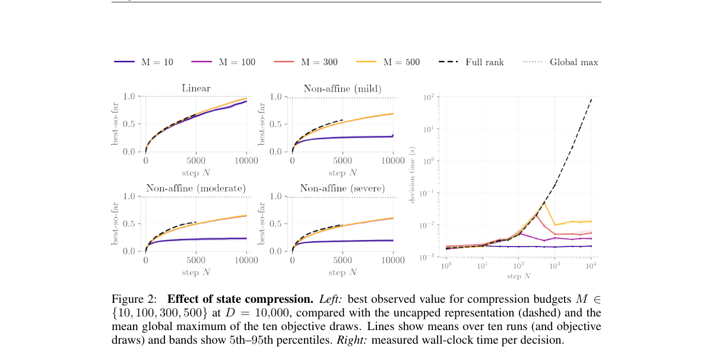

**Why this ranks #8**: 潜空间维度远超预算时怎么办：把高阶结构当作代理模型的「残差」而非硬塞进参数化。

---

### 9. Primal-Dual Representation Learning for Low-Rank Constrained MDPs

**arXiv**: [2610.30756](https://arxiv.org/abs/2610.30756) | **Score**: 8.0 (relevance 8.0 x 0.7 + quality 8.0 x 0.3) | **Tags**: rl-core, RL-theory, constrained-MDP, representation-learning, regret-bounds | **Categories**: cs.LG | **Pages**: 44

**Authors**: Chenhao Zhou, Chao Zhang, Wensong Bai, Hanbin Zhao, Hui Qian

**Affiliation**: Zhejiang University

**Abstract**

> Representation learning has substantially improved the efficiency of unconstrained continuous-state Markov Decision Processes (MDPs), but its extension to Constrained MDPs (CMDPs) is difficult because the transition representation must be learned while constraint violation is controlled. In this paper, we study representation learning for low-rank CMDPs with continuous state spaces, and propose REP-PD-TEG for the soft cumulative-violation setting. In the feature learning period, the algorithm interacts with the environment using a decaying-$ε$-greedy mixture execution policy, and uses the collected samples to learn transition features by maximum likelihood. Based on the learned features, it constructs uncertainty bonuses and plans with an optimistic Lagrangian objective to obtain the return policy. We prove regret and soft-violation guarantees for the return policies, and quantify the influence of the decaying-$ε$-greedy exploration. In particular, REP-PD-TEG achieves the optimal $\widetilde O(\sqrt K)$ return policy bound, and gives a $\widetilde O(K^{3/4})$ overall sample bound when exploratory actions are charged. For the stricter hard cumulative violation, where feasibility must be verified episode by episode, we propose REP-PD-H-TEG. It plans under a bonus-corrected lower-confidence utility certificate with the learned representation, and performs a stabilized dual search to obtain the return policy, yielding regret and hard-violation bounds. Together, these results give the first theoretically guaranteed representation-learning method for low-rank continuous-state CMDPs with both soft cumulative guarantees and certified hard-violation control.

**Key findings**

- **Finding**: 表征学习显著提升了**无约束**连续状态 MDP 的效率，但扩展到**约束 MDP（CMDP）**很困难——转移表征要边学边控制约束违反。
- **Finding**: 本文研究低秩 CMDP 的表征学习，提出面向**软累积违反**设定的 **REP-PD-TEG**。
- **Finding**: 特征学习阶段用**衰减的 ε-贪心混合执行策略**与环境交互，用收集到的样本通过最大似然学习转移特征。
- **Finding**: 基于学到的特征构造不确定性奖励，并用**乐观的拉格朗日目标**规划以得到回报策略。
- **Finding**: 作者证明了回报策略的遗憾与软违反保证，并量化了衰减 ε-贪心探索的影响。
- **Finding**: REP-PD-TEG 达到最优的 **Õ(√K)** 回报策略界，并在计入探索动作代价时给出 **Õ(K^{3/4})** 的整体样本界。
- **Finding**: 对更严格的**硬累积违反**（需逐 episode 验证可行性），提出 **REP-PD-H-TEG**：用带奖励修正的下置信效用证书规划，并做稳定的对偶搜索，给出遗憾与硬违反界。
- **Finding**: 论文称这是**首个**对低秩连续状态 CMDP 同时具备软累积保证与认证硬违反控制的理论保证表征学习方法。
- **Inference**: 把「学表征」与「控约束」耦合起来做理论分析此前基本是空白；这篇的 Õ(√K) 与 Õ(K^{3/4}) 两个界把可能性边界划得很清楚。
- **Inference**: 硬约束版本用「带奖励修正的下置信效用证书」而不是惩罚项，这是处理可行性保证更稳的工程路径。
- **Recommendation**: 推荐。做安全 RL、约束 MDP、表征学习理论的人应读。

**Key figures**

本篇未提取到可用图（PDF 内无符合图注正则的 Figure 1/2）。

**Why this ranks #9**: 首个对低秩连续状态约束 MDP 有理论保证的表征学习方法，软约束与硬可行性都能给界。

---

### 10. PATH: Preference-Aware Traversability Estimation for Robotic Teleoperation in Off-Road Navigation

**arXiv**: [2610.30605](https://arxiv.org/abs/2610.30605) | **Score**: 7.3 (relevance 7.0 x 0.7 + quality 8.0 x 0.3) | **Tags**: rl-core, inverse-RL, teleoperation, off-road, human-preference | **Categories**: cs.RO | **Pages**: 12

**Authors**: Xianghao Meng, Wenshuo Wang, Cheng Shao, Lewei Feng, Qingxiao Liu, Canyu Wang, Junqiang Xi

**Affiliation**: The Hong Kong Polytechnic University; China North Vehicle Research Institute

**Abstract**

> Traversability estimation is critical for ground vehicle teleoperation, yet existing methods often neglect the human operator's preferences for speed and risk tolerance. To address this gap, we propose PATH-Net, a Preference-Aware Traversability estimation Hierarchical Network that adaptively generates preference-conditioned traversability cost maps and speed profiles for off-road teleoperation. Our framework integrates visual and geometric bird's-eye-view features with short-term historical vehicle states through a multi-head shared-backbone architecture. Our PATH-Net infers traversability cost maps while optimizing speed recommendations by using maximum entropy inverse reinforcement learning and sparse speed supervision. Our method incorporates operator preference via an asymmetric feature aggregation mechanism, splitting inference into a cost branch that prioritizes high-risk traversability regions and a speed branch that outputs preference-adjusted recommended speeds. Experiments with 15 operators across 225 teleoperated trajectories show alignment with user-specific navigation strategies, achieving modified Hausdorff distance of 0.17 m (aggressive) and 0.15 m (conservative). In the questionnaire assessment, participants reported lower NASA-TLX workload scores with PATH-Net recommendations than without recommendations, decreasing from 34.7 to 22.2. These results support preference-conditioned trajectory and speed recommendation for off-road teleoperation.

**Key findings**

- **Finding**: 可通行性估计对地面车辆遥操作至关重要，但现有方法常忽略人类操作者对**速度与风险容忍度**的偏好。
- **Finding**: PATH-Net 是偏好感知的可通行性估计分层网络，**自适应生成偏好条件的可通行性代价图与速度剖面**。
- **Finding**: 框架把视觉与几何鸟瞰图特征与短期历史车辆状态整合进多头共享骨干架构。
- **Finding**: 在推断可通行性代价图的同时，用**最大熵逆强化学习**与稀疏速度监督来优化速度推荐。
- **Finding**: 偏好通过**非对称特征聚合**引入：推理拆成优先处理高风险可通行区域的**代价分支**，与输出偏好调整后建议速度的**速度分支**。
- **Finding**: 在 **15 名操作者、225 条遥操作轨迹**上，方法与用户各自的导航策略对齐，修改 Hausdorff 距离为 **0.17 m**（激进）与 **0.15 m**（保守）。
- **Finding**: 问卷评估中，参与者报告有 PATH-Net 推荐时 **NASA-TLX 工作负荷从 34.7 降到 22.2**。
- **Inference**: 用逆强化学习从遥操作轨迹里学出人类偏好，是把人机共驾的隐性目标显式化的干净做法。
- **Inference**: NASA-TLX 从 34.7 降到 22.2 说明「建议速度」直接减轻了操作者的认知负荷——这比轨迹精度更能说明产品价值。
- **Recommendation**: 推荐。做越野机器人、遥操作、人机共驾与偏好对齐的人应读。

**Key figures**

*Framework - Our PATH-Net integrates environmental factors, kinematics, and expert preferences to provide off-road traversability recommendations.*

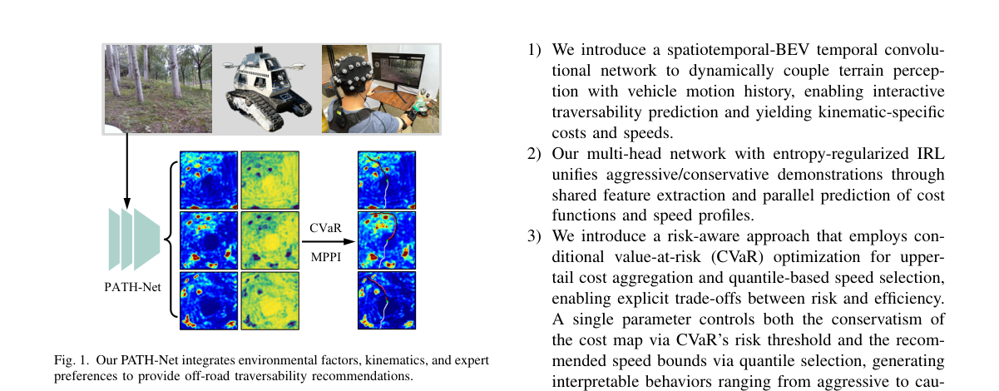

*Result - Overview of PATH-Net. Visual-geometric BEV features and recent vehicle states history are fused to predict candidate cost and speed maps, which are then converted into preference-conditioned c*

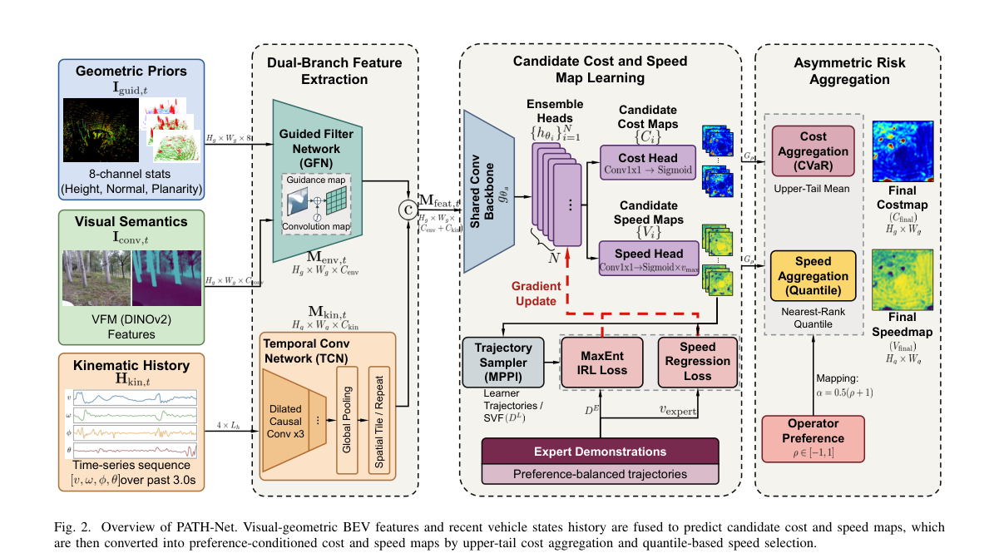

**Why this ranks #10**: 越野遥操作也要照顾人的偏好：用最大熵逆强化学习从人类轨迹里学出「可通行性 + 建议速度」。

---

## Footer

- Total papers scanned across all 7 tracks: 535（原始 705 条）
- rl_core track final top-10: 10
- Wild-cards in this track: 0
- Figure assets: 2026-10-23/res/

Generated by `mine-arxiv-daily-digest` skill. Sister file: `2026-10-23_rl_core_entry.md`.
